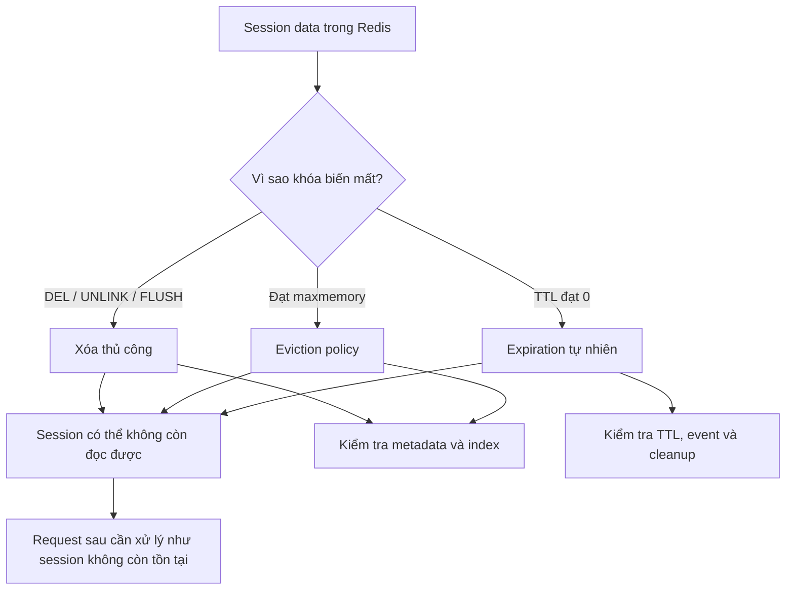

# Khóa bị xóa thủ công, khóa bị eviction và phiên hết hạn tự nhiên

Khi Spring Session lưu phiên trong Redis, dữ liệu session có thể biến mất vì nhiều nguyên nhân. Một quản trị viên có thể chủ động xóa khóa bằng `DEL`; Redis có thể tự loại bỏ khóa khi thiếu bộ nhớ theo chính sách eviction; hoặc khóa có thể hết hạn tự nhiên khi TTL đạt đến thời điểm kết thúc. Cả ba trường hợp đều có thể khiến request tiếp theo không còn đọc được session, nhưng ý nghĩa vận hành và tác động tới index, sự kiện cũng như khả năng khôi phục rất khác nhau.

Ứng dụng Spring Session dùng Redis làm kho chia sẻ để nhiều instance có thể đọc cùng trạng thái `HttpSession`. Repository quản lý dữ liệu, thời hạn và các cấu trúc phụ của session. Vì vậy, việc xóa một khóa Redis trực tiếp không tương đương với việc kết thúc session qua API Spring Session. Tương tự, eviction do thiếu bộ nhớ không phải là một lần hết hạn đúng theo chính sách nghiệp vụ.

Bài học này phân biệt ba nguyên nhân mất khóa, giải thích cách nhận biết, những ảnh hưởng tới session và principal index, cách cấu hình thông báo Redis, cùng các biện pháp vận hành để giảm mất phiên ngoài dự kiến.

## 1. Ba cách một khóa session có thể biến mất

| Nguyên nhân | Ai hoặc thành phần nào khởi tạo? | Điều kiện | Ý nghĩa |
|---|---|---|---|
| Xóa thủ công | Quản trị viên, script, ứng dụng hoặc lệnh Redis | Có thao tác như `DEL`, `UNLINK`, `FLUSHDB` hoặc `FLUSHALL` | Một tác nhân chủ động xóa dữ liệu |
| Eviction | Redis | Redis chạm giới hạn `maxmemory` và chính sách eviction cho phép chọn khóa | Redis hy sinh dữ liệu để giải phóng bộ nhớ |
| Hết hạn tự nhiên | Redis theo TTL do repository đặt | Thời hạn lưu trữ của khóa đã đến | Dữ liệu được dọn theo thời hạn đã thiết lập |



Một điểm quan trọng: Redis chỉ biết khóa và chính sách lưu trữ; Redis không hiểu session đó đại diện cho người dùng nào, đăng nhập lúc nào hay giao dịch nào đang diễn ra. Ngữ nghĩa session được định nghĩa ở Spring Session và ứng dụng. Vì thế, không thể chỉ nhìn thấy một khóa đã biến mất rồi kết luận người dùng đã logout đúng quy trình.

## 2. Spring Session lưu dữ liệu gì trong Redis?

Với Spring Session Redis, session thường được lưu dưới dạng hash cùng các khóa hoặc cấu trúc phụ phục vụ thời hạn, tra cứu và index. Tên khóa mặc định thường có prefix liên quan đến `spring:session`, nhưng prefix và cấu trúc cụ thể có thể thay đổi theo cấu hình và phiên bản.

Ví dụ minh họa các nhóm khóa:

| Nhóm dữ liệu | Vai trò |
|---|---|
| Hash session chính | Chứa ID, thời gian truy cập, timeout và các thuộc tính session |
| Khóa expiration hoặc cấu trúc theo thời điểm hết hạn | Hỗ trợ phát hiện session đến hạn và xử lý vòng đời |
| Principal index | Hỗ trợ tìm session theo tên principal khi dùng indexed repository |
| Các tập hợp/index phụ | Hỗ trợ liệt kê hoặc dọn dữ liệu theo cách implementation quản lý |

Không nên phụ thuộc vào tên khóa nội bộ như một API ổn định. Trước khi chẩn đoán, xác định đúng phiên bản Spring Session, repository đang dùng và prefix cấu hình. Không xây script production giả định rằng mọi phiên bản đều dùng cùng số lượng hoặc cùng tên khóa.

Một session có thể liên quan tới nhiều khóa. Xóa riêng hash session chính có thể khiến request không đọc được thuộc tính nữa nhưng để lại index hoặc metadata phụ cho đến khi cleanup chạy. Xóa nhầm khóa index có thể khiến truy vấn theo principal không tìm thấy session dù hash session vẫn còn. Vì vậy, thao tác trực tiếp với khóa Redis cần được giới hạn cho chẩn đoán có kiểm soát; việc kết thúc phiên nên đi qua `SessionRepository` hoặc `HttpSession.invalidate()`.

## 3. Xóa thủ công: DEL, UNLINK và flush database

Xóa thủ công xảy ra khi một tác nhân gửi lệnh xóa tới Redis. Những lệnh thường gặp:

- `DEL key`: xóa một hoặc nhiều khóa đồng bộ; chi phí xử lý phụ thuộc kích thước dữ liệu và loại cấu trúc.
- `UNLINK key`: gỡ khóa khỏi keyspace và giải phóng bộ nhớ nền bất đồng bộ, hữu ích với khóa lớn để giảm thời gian chặn Redis.
- `FLUSHDB`: xóa toàn bộ khóa trong database Redis hiện tại.
- `FLUSHALL`: xóa toàn bộ khóa trên mọi database của Redis instance, tùy chế độ triển khai.

`FLUSHDB` và `FLUSHALL` có phạm vi ảnh hưởng rất lớn. Không dùng chúng để “dọn session cũ” trong một Redis dùng chung với cache hoặc dữ liệu nghiệp vụ. Nếu cần xóa phiên của một người dùng, hãy truy vấn theo principal qua indexed repository rồi xóa từng session bằng API phù hợp.

### 3.1. Kết thúc session bằng API ứng dụng

Nếu đang xử lý request hiện tại, có thể invalidate session qua Servlet API:

```java
HttpSession session = request.getSession(false);
if (session != null) {
    session.invalidate();
}
```

Hoặc với service quản lý session, dùng `SessionRepository` đã được inject:

```java
sessionRepository.deleteById(sessionId);
```

Các API trên cho repository biết session nào cần kết thúc để implementation xử lý việc xóa dữ liệu và metadata liên quan. Trong ứng dụng có Spring Security, nên dùng logout flow đã cấu hình để xóa `SecurityContext`, invalidate session và xóa cookie thông qua resolver.

Không nên tự ghép tên khóa rồi gọi `DEL` trong controller. Cách đó bỏ qua abstraction của Spring Session, có thể để lại principal index hoặc expiration metadata và khiến các sự kiện vòng đời không được phát theo cách ứng dụng mong đợi.

### 3.2. Khi quản trị viên phải xóa trực tiếp

Đôi khi cần xóa thủ công để xử lý một session hỏng hoặc dữ liệu thử nghiệm. Quy trình an toàn nên gồm:

1. Xác định đúng Redis deployment, database, prefix và session ID; tránh dùng `KEYS *` trên Redis production.
2. Xác minh session thuộc môi trường và tài khoản cần xử lý; không đưa session ID vào ticket hoặc log công khai.
3. Ưu tiên gọi endpoint quản trị nội bộ đã được phân quyền hoặc công cụ sử dụng `SessionRepository`.
4. Nếu buộc phải dùng Redis command, ghi nhận phạm vi và tác động của các khóa liên quan, thực hiện trong cửa sổ được kiểm soát.
5. Sau thao tác, kiểm tra session không còn được đọc, principal index không còn kết quả sai và không có dữ liệu phụ tích tụ bất thường.
6. Ghi audit log về người thực hiện, lý do, thời điểm và phạm vi; không ghi lộ session ID hoặc cookie xác thực.

Redis có thể phát keyspace notification cho lệnh xóa nếu cấu hình loại sự kiện tương ứng được bật. Tuy nhiên, một sự kiện `del` ở Redis không tự động bảo đảm Spring Session đã xử lý đầy đủ vòng đời session. Không dựa vào việc có notification để thay thế API xóa session.

## 4. Eviction: Redis loại bỏ khóa vì thiếu bộ nhớ

Eviction xảy ra khi Redis được cấu hình giới hạn bộ nhớ (`maxmemory`) và lượng dữ liệu sử dụng vượt giới hạn đó. Redis chọn khóa theo `maxmemory-policy` để giải phóng bộ nhớ. Đây là cơ chế quản lý tài nguyên, không phải timeout của session.

Một số chính sách phổ biến:

| Chính sách | Hành vi |
|---|---|
| `noeviction` | Không tự loại bỏ khóa; các lệnh ghi làm tăng bộ nhớ có thể bị từ chối khi đạt giới hạn |
| `allkeys-lru` | Có thể loại bỏ khóa bất kỳ theo ước lượng least recently used |
| `allkeys-lfu` | Có thể loại bỏ khóa bất kỳ theo ước lượng least frequently used |
| `allkeys-random` | Chọn khóa bất kỳ để loại bỏ |
| `volatile-lru` | Chỉ chọn trong các khóa có TTL, theo LRU |
| `volatile-lfu` | Chỉ chọn trong các khóa có TTL, theo LFU |
| `volatile-random` | Chọn ngẫu nhiên trong các khóa có TTL |
| `volatile-ttl` | Ưu tiên khóa có TTL còn lại ngắn hơn |

Session Redis thường có thời hạn nên các khóa session có thể thuộc nhóm đủ điều kiện bị loại bỏ bởi các chính sách `volatile-*`. Với `allkeys-*`, khóa session và dữ liệu không có TTL đều có thể bị chọn. Vì thế, bật TTL không bảo đảm Redis sẽ giữ session đến hết thời hạn logic nếu eviction policy cho phép loại bỏ khóa sớm.

### 4.1. Vì sao eviction nguy hiểm với session store?

Nếu hash session chính bị eviction, request tiếp theo có thể không đọc được phiên dù người dùng vừa hoạt động. Họ có thể bị yêu cầu đăng nhập lại hoặc ứng dụng tạo session mới. Nếu khóa phụ hoặc index bị eviction riêng, tình trạng có thể phức tạp hơn: session chính vẫn còn nhưng truy vấn theo principal không đầy đủ; hoặc index còn mà session đã mất, dẫn tới kết quả cũ cần được làm sạch.

Eviction cũng có thể tác động tới các session đang được dùng bởi nhiều instance. Một instance không thể khôi phục dữ liệu chỉ từ cookie vì cookie thường chỉ mang session ID. Nếu repository không còn dữ liệu, trạng thái session đã mất.

### 4.2. noeviction cũng có rủi ro

`noeviction` tránh việc Redis âm thầm chọn khóa session để loại bỏ, nhưng khi đạt `maxmemory`, các lệnh ghi có thể thất bại với lỗi OOM. Spring Session có thể không lưu được thay đổi session hoặc không tạo được session mới. Request khi đó có thể thất bại và ứng dụng phải xử lý lỗi datastore.

Do đó, `noeviction` không có nghĩa là hệ thống miễn nhiễm với lỗi. Cần dự trù dung lượng, giám sát mức dùng bộ nhớ, đặt cảnh báo trước giới hạn và quyết định rõ cách ứng dụng xử lý khi Redis từ chối ghi.

## 5. Hết hạn tự nhiên: TTL đạt đến hạn

Expiration là cơ chế Redis tự loại bỏ một khóa khi TTL của nó hết. Spring Session đặt thời hạn lưu trữ dựa trên timeout session và repository cập nhật thời hạn khi session được gia hạn theo chính sách của nó.

Redis dùng cả cơ chế kiểm tra expiration chủ động và thụ động:

- **Thụ động:** khi một client truy cập khóa, Redis kiểm tra khóa đã hết hạn chưa; nếu hết hạn, khóa không được trả về như dữ liệu còn sống.
- **Chủ động:** Redis định kỳ kiểm tra một tập khóa có expiration để dọn các khóa đã quá hạn mà không cần client truy cập chúng.

Vì vậy, thời điểm TTL đạt 0 và thời điểm bộ nhớ vật lý được giải phóng có thể không trùng tuyệt đối. Redis đảm bảo khóa hết hạn không được phục vụ như một khóa còn hiệu lực, nhưng việc dọn vật lý và phát thông báo expiration có thể xảy ra trễ so với mốc thời gian chính xác.

### 5.1. TTL và PTTL khi chẩn đoán

Redis cung cấp `TTL key` để xem thời gian còn lại theo giây và `PTTL key` để xem theo mili giây. Kết quả thường cần hiểu như sau:

| Kết quả | Ý nghĩa |
|---|---|
| Số dương | Số giây hoặc mili giây còn lại trước khi hết hạn |
| `-1` | Khóa tồn tại nhưng không có expiration được gắn |
| `-2` | Khóa không tồn tại (đã xóa, đã hết hạn hoặc chưa từng có) |

Đừng kết luận một session không có TTL chỉ vì kiểm tra một khóa phụ không đúng loại. Spring Session có thể dùng nhiều khóa cho một phiên; TTL và thời điểm dọn của khóa chính, khóa expiration và index có thể khác nhau theo implementation. Hãy kiểm tra đúng khóa và đối chiếu cấu hình repository.

### 5.2. Hết hạn logic và xóa vật lý

Thời hạn logic của session được xác định bởi `maxInactiveInterval` và thời điểm truy cập gần nhất. Repository cần từ chối một session đã hết hạn theo logic ngay cả khi một số dữ liệu phụ còn tồn tại trong Redis.

Một số phiên bản/implementation Spring Session Redis dùng khóa expiration phụ và có thể giữ dữ liệu session chính thêm một khoảng thời gian để hỗ trợ xử lý sự kiện hết hạn. Do đó, không nên giả định khóa hash chính phải biến mất đúng giây `maxInactiveInterval` đạt 0. Hãy dựa vào semantics repository, không dựa vào một khóa riêng lẻ để xác định session còn hợp lệ hay không.

Nếu request mang session ID đã hết hạn, ứng dụng nên xử lý như session không còn tồn tại: yêu cầu xác thực lại hoặc tạo phiên mới theo luồng endpoint. Không khôi phục một phiên hết hạn chỉ vì tìm thấy một hash cũ còn sót lại.

## 6. Redis keyspace notifications và sự kiện Spring Session

Redis có thể phát keyspace notifications khi khóa hết hạn, bị eviction hoặc bị xóa. Đây là thông báo Pub/Sub, không phải hàng đợi bền vững. Subscriber đang ngừng hoạt động có thể bỏ lỡ thông báo trong thời gian đó.

Các nhóm cờ `notify-keyspace-events` thường gặp:

| Cờ | Ý nghĩa |
|---|---|
| `K` | Phát thông báo theo kênh keyspace `__keyspace@...__` |
| `E` | Phát thông báo theo kênh keyevent `__keyevent@...__` |
| `g` | Nhóm lệnh tổng quát, bao gồm một số thao tác như `DEL` |
| `x` | Sự kiện expiration |
| `e` | Sự kiện eviction |

Ví dụ, `Ex` bật keyevent notifications cho khóa hết hạn; `Egx` bật keyevent cho nhóm lệnh tổng quát và expiration. Cấu hình chính xác cần dựa trên phiên bản Spring Session, loại repository và các sự kiện mà ứng dụng cần quan sát. Nếu muốn nhận cả eviction, cần xem xét cờ `e`; đừng mặc định rằng cấu hình chỉ dành cho expiration đã bao gồm eviction.

Spring Session Redis có thể sử dụng Redis message listener để nhận thông báo expiration và phát các sự kiện session tương ứng, chẳng hạn `SessionExpiredEvent`. Khi session được xóa qua repository, implementation có thể phát sự kiện xóa tương ứng như `SessionDeletedEvent`. Cách xử lý cụ thể phụ thuộc repository và phiên bản.

Không nên giả định thao tác `DEL` thủ công sẽ tạo ra cùng một chuỗi sự kiện như `SessionRepository.deleteById`. Tương tự, notification eviction của Redis không tự động đồng nghĩa Spring Session sẽ phát `SessionExpiredEvent`. Eviction là mất dữ liệu ngoài chính sách hết hạn; ứng dụng cần theo dõi riêng.

### 6.1. Cấu hình notification trên Redis

Một số cấu hình Spring Session có thể yêu cầu Redis cho phép `CONFIG SET` để thiết lập keyspace notifications. Trong môi trường Redis tự quản, tài khoản cấu hình cần quyền phù hợp. Với dịch vụ Redis managed không cho phép `CONFIG`, ứng dụng có thể cần dùng `ConfigureRedisAction.NO_OP` và yêu cầu quản trị viên cấu hình notification ở phía dịch vụ.

Ví dụ cấu hình no-op khi nhà cung cấp quản lý notification bên ngoài:

```java
import org.springframework.context.annotation.Bean;
import org.springframework.context.annotation.Configuration;
import org.springframework.session.data.redis.config.ConfigureRedisAction;

@Configuration
public class RedisNotificationConfiguration {

    @Bean
    public ConfigureRedisAction configureRedisAction() {
        return ConfigureRedisAction.NO_OP;
    }
}
```

Đoạn cấu hình này không tự bật notification. Nó chỉ ngăn Spring Session cố thay đổi cấu hình Redis; quản trị viên phải bảo đảm `notify-keyspace-events` được đặt đúng ở dịch vụ Redis. Nếu notification bị tắt, session vẫn có thể hết hạn theo TTL và không được truy cập nữa, nhưng listener/event-driven cleanup có thể không nhận được thông báo cần thiết.

### 6.2. Event listener chỉ nên làm công việc phụ

Ứng dụng có thể lắng nghe sự kiện session để ghi metrics, audit, dọn dữ liệu phụ hoặc cập nhật trạng thái hiển thị. Không dùng listener expiration làm điểm duy nhất để thu hồi quyền quan trọng hoặc hoàn tất giao dịch nghiệp vụ. Pub/Sub không phải cơ chế giao nhận bền vững; sự kiện có thể đến trễ, bị mất khi subscriber ngừng hoạt động hoặc không được phát nếu cấu hình notification sai.

Nếu một nghiệp vụ cần bảo đảm xử lý đúng một lần hoặc ít nhất một lần, hãy lưu sự kiện nghiệp vụ trong outbox/queue bền vững hoặc dùng transaction và cơ chế retry phù hợp. Session expiration chỉ là một tín hiệu vòng đời kỹ thuật.

## 7. So sánh tác động tới principal index

Với `@EnableRedisIndexedHttpSession`, repository duy trì index để tìm session theo principal. Khi một session mất, index cần được cập nhật hoặc dọn để tránh trả về kết quả không còn hợp lệ.

| Nguyên nhân | Hash session | Principal index / metadata | Sự kiện |
|---|---|---|---|
| Xóa qua repository | Repository xóa theo cơ chế của nó | Có thể được cập nhật cùng thao tác xóa | Có thể phát sự kiện xóa theo implementation |
| Xóa hash thủ công | Hash có thể mất ngay | Có thể còn index hoặc khóa phụ | Notification `del` không bảo đảm được chuyển thành sự kiện Spring Session tương đương |
| Eviction hash | Hash bị Redis loại bỏ | Index có thể còn cho tới cleanup hoặc lần kiểm tra sau | Có thể có Redis eviction notification nếu bật, nhưng không đồng nghĩa session expiration event |
| Hết hạn tự nhiên | Khóa có TTL bị loại bỏ theo thời gian | Repository xử lý index/metadata theo expiration flow và notification | Có thể phát `SessionExpiredEvent` nếu listener và Redis notifications hoạt động đúng |

Nếu truy vấn principal trả về session ID nhưng đọc session theo ID không còn kết quả, có thể có dữ liệu index cũ hoặc trạng thái đang chuyển tiếp. Không hiển thị session như đang hoạt động chỉ dựa trên index. Khi cần liệt kê phiên cho người dùng, đọc lại session và xử lý trường hợp session đã mất; theo dõi tỷ lệ index entry không còn session để phát hiện cleanup bất thường.

## 8. Nhận biết nguyên nhân mất khóa

Không có một phép kiểm tra duy nhất luôn xác định được nguyên nhân. Khi Redis trả về `nil` hoặc `TTL` trả `-2`, khóa đã không còn tồn tại nhưng trạng thái hiện tại không nói được nó bị xóa thủ công, eviction hay expiration.

Kết hợp nhiều nguồn dữ liệu:

| Nguồn kiểm tra | Dấu hiệu hữu ích | Giới hạn |
|---|---|---|
| `TTL` / `PTTL` | Cho biết khóa còn tồn tại và còn bao nhiêu thời gian | Không cho biết nguyên nhân của khóa đã mất |
| `INFO stats` | Các bộ đếm như `expired_keys`, `evicted_keys` | Thường là số liệu tổng hợp, không ánh xạ chắc chắn tới session ID cụ thể |
| `INFO memory` | `used_memory`, `maxmemory` và trạng thái bộ nhớ | Giúp xác định áp lực bộ nhớ, không chứng minh một khóa cụ thể bị eviction |
| Keyspace notifications | Có thể quan sát `expired`, `evicted`, `del` nếu cờ phù hợp bật | Pub/Sub có thể bỏ lỡ sự kiện; cần subscriber đang hoạt động |
| Redis audit/command log của hạ tầng | Có thể tìm thao tác `DEL`, `UNLINK`, flush và actor | Tùy dịch vụ có lưu log hay không; không phải Redis nào cũng cung cấp audit đầy đủ |
| Spring Session events và application logs | Cho biết repository có xử lý xóa/hết hạn hay không | Chỉ phản ánh sự kiện listener nhận được và ứng dụng ghi lại |

Các bộ đếm `expired_keys` và `evicted_keys` là số liệu tích lũy từ Redis, có thể reset khi server khởi động lại hoặc thay đổi theo môi trường. Theo dõi delta theo thời gian thay vì chỉ đọc giá trị tuyệt đối. Nếu `evicted_keys` tăng trong khi session biến mất sớm, đó là tín hiệu cần điều tra áp lực bộ nhớ và policy.

Để liệt kê khóa khi chẩn đoán, ưu tiên `SCAN` theo prefix đã biết và giới hạn tốc độ. Tránh `KEYS` trên database lớn vì có thể chặn Redis trong lúc duyệt toàn bộ keyspace. Không chạy lệnh xóa hàng loạt trong quá trình chẩn đoán.

## 9. Cấu hình maxmemory và chọn eviction policy

Chọn policy dựa trên vai trò Redis. Nếu Redis chỉ chứa cache có thể dựng lại, eviction có thể là một phần của thiết kế. Nếu Redis là kho session xác thực, mất session ngoài timeout là sự cố trải nghiệm và bảo mật cần được xem xét nghiêm túc.

Các hướng vận hành thường gặp:

- Dành Redis deployment riêng cho session hoặc tách rõ tài nguyên/session keyspace khỏi cache dễ eviction.
- Ước lượng số session đồng thời, kích thước thuộc tính trung bình, overhead của hash/index và thời gian sống để dự trù bộ nhớ.
- Đặt `maxmemory` với khoảng dự phòng cho replication, persistence, fragmentation và tải tăng đột biến theo kiến trúc triển khai.
- Chọn `noeviction` nếu ưu tiên không tự xóa session, nhưng phải có cảnh báo sớm và xử lý OOM write failure.
- Nếu dùng `volatile-*` hoặc `allkeys-*`, chấp nhận rằng session có thể bị eviction trước timeout và thiết kế trải nghiệm xác thực lại phù hợp.
- Không dùng `volatile-ttl` với giả định nó chỉ xóa session đã hết hạn; policy có thể chọn khóa còn TTL ngắn nhất dù khóa đó vẫn hợp lệ.

Không có policy nào thay thế việc sizing và giám sát. Redis có thể dùng thêm bộ nhớ ngoài dữ liệu key do allocator fragmentation, replication buffers, client buffers và persistence. Cần theo dõi các chỉ số vận hành của dịch vụ, không chỉ tổng kích thước dữ liệu session.

## 10. Xử lý lỗi trong ứng dụng khi session không còn

Khi repository không tìm thấy session, Spring Session thường xử lý như session không tồn tại. Ứng dụng không nên tự tạo một trạng thái xác thực giả để che lỗi mất session.

Hành vi phù hợp phụ thuộc endpoint:

- Endpoint yêu cầu đăng nhập: trả `401` hoặc chuyển hướng đăng nhập theo cơ chế Spring Security.
- Endpoint cho phép khách: tạo session mới nếu cần và tiếp tục ở trạng thái anonymous.
- Quy trình nhiều bước: thông báo phiên làm việc hết hạn và cho phép khôi phục bản nháp từ kho nghiệp vụ nếu có.
- Thao tác thanh toán/đơn hàng: xác minh trạng thái giao dịch ở nguồn dữ liệu chính; không dựa vào dữ liệu session đã mất.
- API quan trọng: phân biệt session không tồn tại với Redis không truy cập được. Không biến mọi lỗi repository thành `401` nếu nguyên nhân thực sự là hạ tầng unavailable.

Nếu Redis đang mất kết nối, repository có thể phát lỗi thay vì trả về session rỗng. Ứng dụng cần phân loại lỗi, ghi metrics và trả phản hồi phù hợp như lỗi dịch vụ tạm thời. Không retry vô hạn hoặc tự tạo session mới khi chưa biết thao tác trước đã được ghi thành công hay chưa.

## 11. Kiểm thử ba tình huống mất khóa

Kiểm thử cần tái tạo từng nguyên nhân riêng biệt để xác nhận ứng dụng và repository phản ứng đúng:

| Trường hợp | Cách mô phỏng trong môi trường test | Điều cần xác minh |
|---|---|---|
| Xóa qua API repository | Tạo session rồi gọi `deleteById` hoặc `invalidate()` | Session không còn được đọc; index và event theo repository được xử lý |
| Xóa thủ công | Tạo session, xác định khóa test đúng rồi dùng `DEL`/`UNLINK` | Request sau không đọc được session; kiểm tra metadata/index còn sót và không giả định event chuẩn |
| Expiration tự nhiên | Tạo session với timeout ngắn, chờ hoặc điều khiển thời gian test | Session hết hạn theo logic; TTL và notification hoạt động theo cấu hình |
| Eviction | Redis test riêng với `maxmemory` thấp và policy được chọn | Có thể quan sát `evicted_keys`, session bị mất sớm và ứng dụng xử lý an toàn |
| `noeviction` OOM | Dùng Redis test có giới hạn bộ nhớ và tạo tải ghi | Ghi session lỗi được phát hiện, không bị coi là logout bình thường |
| Thiếu keyspace notifications | Tắt notification trong test | Session vẫn không còn hợp lệ sau TTL nhưng event listener không được giả định sẽ nhận thông báo |
| Subscriber ngừng hoạt động | Dừng listener trong lúc khóa hết hạn | Ứng dụng không phụ thuộc Pub/Sub như hàng đợi bền vững |
| Index stale | Tạo indexed session rồi xóa hash thủ công trong Redis test | Luồng truy vấn không hiển thị phiên như đang hoạt động và có cơ chế phát hiện cleanup |
| Nhiều instance | Tạo session ở A, đọc ở B, sau đó thử expiration/eviction | Cả hai instance phản ứng nhất quán với repository chung |

Không thực hiện thử nghiệm eviction hoặc flush trên Redis production. Dùng container hoặc Redis test riêng, dữ liệu giả và giới hạn tài nguyên rõ ràng. Kiểm tra cả log, metrics, response HTTP và trạng thái repository; chỉ xác nhận key biến mất là chưa đủ.

## 12. Lỗi thường gặp và cách khắc phục

| Triệu chứng | Nguyên nhân có thể | Hướng xử lý |
|---|---|---|
| Người dùng bị logout trước idle timeout | Session key bị eviction hoặc bị xóa thủ công | Kiểm tra `evicted_keys`, audit log và thao tác quản trị; xem lại policy và phân tách Redis |
| Session hash mất nhưng principal index vẫn còn | Xóa/eviction không đi qua luồng cleanup repository | Kiểm tra index stale, expiration notifications và dùng API repository để xóa session |
| Session hết hạn nhưng listener không chạy | `notify-keyspace-events` thiếu cờ hoặc subscriber không hoạt động | Kiểm tra `Ex`, listener container, quyền CONFIG và cấu hình managed Redis |
| Redis còn khóa sau khi timeout logic đã đến | Khóa phụ/grace period hoặc cleanup vật lý trễ | Kiểm tra semantics repository; xác minh session không được trả về như còn hợp lệ |
| `evicted_keys` tăng nhanh | `maxmemory` quá thấp hoặc Redis dùng chung với tải lớn | Tăng dung lượng, tách workload, xem lại policy và kích thước session |
| Ghi session thất bại với OOM | `noeviction` và Redis đạt giới hạn bộ nhớ | Giải phóng/tăng bộ nhớ, cảnh báo sớm và xử lý lỗi repository |
| `FLUSHDB` làm toàn bộ người dùng bị logout | Xóa cả database đang chứa session | Cô lập database/deployment, phục hồi theo quy trình và tránh flush diện rộng |
| Event `expired` không đến đúng thời điểm TTL | Redis expiration là bất đồng bộ, notification không phải timer chính xác | Không dùng event như deadline; kiểm tra timeout logic khi đọc |
| Không xác định được khóa mất do đâu | Chỉ kiểm tra trạng thái key sau khi đã biến mất | Kết hợp metrics, notifications, audit log và log ứng dụng từ trước thời điểm xảy ra |

## 13. Quy trình chẩn đoán khi session biến mất

Khi người dùng báo bị đăng xuất bất thường, có thể điều tra theo trình tự:

1. Xác nhận request đã gửi đúng cookie/session ID và đi tới Redis deployment nào.
2. Kiểm tra repository, prefix, database index và phiên bản Spring Session của instance xử lý request.
3. Xác định session còn tồn tại không; nếu còn, kiểm tra TTL của đúng khóa và các khóa phụ theo implementation.
4. Kiểm tra timeout logic, last-accessed time và `maxInactiveInterval` để biết phiên đã hết hạn hợp lệ hay chưa.
5. So sánh delta `expired_keys` và `evicted_keys`; kiểm tra `maxmemory`, `maxmemory-policy` và memory pressure.
6. Kiểm tra audit/command logs hoặc keyspace notifications để tìm `del`, `expired` hoặc `evicted` nếu hạ tầng lưu được.
7. Kiểm tra Spring Session events, listener health, Redis connectivity và các lỗi OOM/ACL/TLS.
8. Với indexed repository, xác minh principal index có còn tham chiếu session không tồn tại hay không.
9. Xử lý request theo trạng thái xác thực thực tế; không tự khôi phục quyền chỉ vì cookie cũ còn ở trình duyệt.
10. Ghi nhận nguyên nhân gốc và thay đổi sizing, policy, quyền thao tác hoặc monitoring để tránh tái diễn.

## 14. Nguyên tắc vận hành an toàn

- Xem Redis session store là dữ liệu xác thực quan trọng, không phải cache có thể xóa tùy ý.
- Không chạy `FLUSHDB`/`FLUSHALL` trên Redis đang chứa session production nếu không có kế hoạch tác động được phê duyệt.
- Dùng `SessionRepository` hoặc `HttpSession.invalidate()` để kết thúc phiên theo đúng vòng đời.
- Giám sát `expired_keys`, `evicted_keys`, `used_memory`, `maxmemory`, lỗi OOM và độ trễ repository.
- Bảo đảm keyspace notifications được cấu hình đúng nếu ứng dụng phụ thuộc sự kiện hết hạn; nhớ rằng Pub/Sub không bền vững.
- Chọn eviction policy theo vai trò Redis và hiểu rằng `volatile-*` vẫn có thể loại bỏ session còn hiệu lực.
- Không dùng sự kiện expiration làm cơ chế duy nhất cho nghiệp vụ quan trọng.
- Kiểm thử eviction, manual delete, expiration và OOM trên Redis riêng trước khi triển khai.

Xóa thủ công, eviction và expiration tự nhiên đều có thể làm session không còn đọc được, nhưng chỉ expiration mới phản ánh thời hạn TTL do repository thiết lập. Xóa thủ công là hành động bên ngoài vòng đời session; eviction là hệ quả của áp lực bộ nhớ và policy; expiration là cơ chế hết hạn bình thường của Redis. Khi ứng dụng dùng đúng API repository, theo dõi keyspace events và metrics, đồng thời sizing Redis phù hợp, việc quản lý session giữa nhiều instance sẽ dễ chẩn đoán và ít bị mất phiên ngoài dự kiến hơn.
