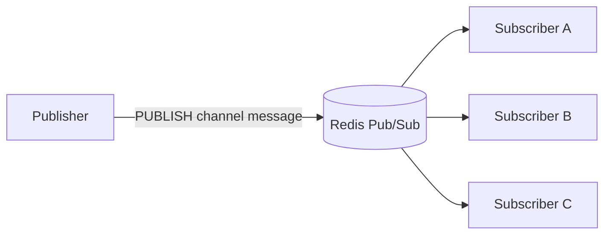
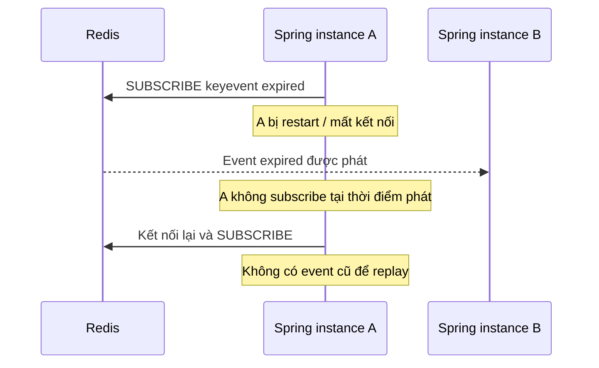

# Giới hạn giao nhận của Redis Pub/Sub và thông báo keyspace

Spring Session Redis có thể sử dụng Redis keyspace notifications để nhận biết session key hết hạn hoặc bị xóa, từ đó phát các sự kiện vòng đời như `SessionExpiredEvent` và `SessionDeletedEvent`. Cơ chế này dựa trên Redis Pub/Sub: Redis phát thông báo vào channel, còn ứng dụng đăng ký nhận thông báo đó. Đây là tín hiệu hữu ích cho cleanup, cập nhật chỉ mục và tác vụ phụ trợ, nhưng có giới hạn giao nhận quan trọng.

Redis Pub/Sub có ngữ nghĩa **at-most-once**: một message được gửi đến subscriber đang nhận tại thời điểm phát, nhưng Redis không lưu message để phát lại khi subscriber ngắt kết nối. Keyspace notifications cũng không phải nhật ký sự kiện bền vững và thời điểm phát thông báo hết hạn không nhất thiết trùng chính xác với thời điểm TTL về 0. Vì vậy, ứng dụng cần hiểu rõ những gì thông báo bảo đảm, những gì có thể bị bỏ lỡ và cách thiết kế xử lý bù.

## 1. Redis Pub/Sub hoạt động ra sao?

Pub/Sub là mô hình phát và đăng ký nhận message. Publisher gửi message đến một channel; các subscriber đang đăng ký channel đó nhận message. Publisher không cần biết danh tính từng subscriber và Redis không yêu cầu subscriber xác nhận đã xử lý message.



Ví dụ, một publisher gửi thông báo:

```text
PUBLISH orders:changed order-1042
```

Các client đang subscribe `orders:changed` sẽ nhận message `order-1042`. Client không subscribe tại thời điểm đó không có bản tin chờ để đọc sau.

Pub/Sub phù hợp với thông báo nhanh, cập nhật cache, tín hiệu đồng bộ tạm thời hoặc thông tin có thể tái tạo từ nguồn dữ liệu chuẩn. Nó không phù hợp làm hàng đợi công việc cần bảo đảm xử lý, nhật ký kiểm toán hay luồng sự kiện cần replay.

## 2. At-most-once: thông báo có thể bị mất

Redis Pub/Sub cung cấp giao nhận at-most-once. Điều này có nghĩa message được gửi tối đa một lần đến subscriber; Redis không đảm bảo message sẽ được nhận hoặc xử lý thành công.

Các tình huống có thể làm ứng dụng bỏ lỡ message:

- Subscriber chưa kết nối hoặc chưa subscribe khi publisher phát message.
- Kết nối mạng bị đứt tại thời điểm message được phát.
- Subscriber đang khởi động lại, triển khai phiên bản mới hoặc bị crash.
- Subscriber nhận message nhưng tiến trình dừng trước khi xử lý xong.
- Một consumer bị nghẽn hoặc lỗi trong callback; Redis không tự gửi lại message cho callback đó.

Pub/Sub không có acknowledgement, consumer offset, lưu trữ message hay cơ chế retry tích hợp. Nếu subscriber nhận message nhưng xử lý thất bại, Redis không biết để phát lại. Nếu cần thử lại, ứng dụng phải tự xây dựng nguồn dữ liệu và cơ chế retry riêng.

| Đặc tính | Redis Pub/Sub |
|---|---|
| Lưu message để đọc sau | Không |
| Phát lại khi subscriber kết nối lại | Không |
| Acknowledgement từ consumer | Không |
| Giao nhận | At-most-once |
| Consumer group và offset | Không có trong Pub/Sub cơ bản |
| Phù hợp | Tín hiệu tức thời, có thể tái tạo hoặc bỏ lỡ có kiểm soát |
| Không phù hợp | Công việc quan trọng cần lưu bền vững và xử lý ít nhất một lần |

Nếu nghiệp vụ yêu cầu không mất sự kiện, hãy dùng cơ chế có lưu trữ và xác nhận như Redis Streams với consumer groups, một message broker phù hợp hoặc transactional outbox kết hợp hàng đợi. Chỉ thêm retry trong subscriber không khắc phục được việc message chưa bao giờ được nhận.

## 3. Keyspace notifications là Pub/Sub

Keyspace notifications là cơ chế Redis phát thông báo khi một key thay đổi theo các loại sự kiện được bật. Các sự kiện có thể liên quan đến thao tác `DEL`, `EXPIRE`, hết TTL, eviction hoặc thay đổi cấu trúc dữ liệu.

Thông báo được phát qua các channel Pub/Sub đặc biệt. Có hai cách đặt tên channel:

| Loại channel | Mẫu | Nội dung message |
|---|---|---|
| Keyspace | `__keyspace@<db>__:<key>` | Tên sự kiện, ví dụ `expired` |
| Keyevent | `__keyevent@<db>__:<event>` | Tên key phát sinh sự kiện |

Ví dụ, khi key `spring:session:sessions:abc` hết hạn trong database 0:

```text
Channel: __keyspace@0__:spring:session:sessions:abc
Message: expired

Channel: __keyevent@0__:expired
Message: spring:session:sessions:abc
```

Ứng dụng có thể subscribe một channel cụ thể hoặc pattern channel. Spring Session Redis sử dụng keyspace notification để phát hiện các thay đổi vòng đời mà repository cần xử lý. Vì notification được truyền bằng Pub/Sub, giới hạn at-most-once của Pub/Sub cũng áp dụng cho các sự kiện keyspace.

## 4. Keyspace notifications thường bị tắt mặc định

Redis không phát keyspace notification nếu cấu hình `notify-keyspace-events` không bật loại sự kiện cần thiết. Cấu hình này là một chuỗi cờ, kết hợp nhóm channel và loại sự kiện.

Các cờ quan trọng:

| Cờ | Ý nghĩa |
|---|---|
| `K` | Phát theo keyspace channel `__keyspace@...__` |
| `E` | Phát theo keyevent channel `__keyevent@...__` |
| `x` | Sự kiện key hết hạn (`expired`) |
| `e` | Sự kiện key bị eviction |
| `g` | Nhóm sự kiện generic, gồm các thao tác như `DEL` |
| `A` | Alias cho nhóm sự kiện thông dụng, không bao gồm mọi loại sự kiện mới hoặc hiếm |

Nếu chỉ cần keyevent cho expiration, cấu hình Redis có thể dùng `Ex`. Nếu cần cả generic event như `del`, có thể cần thêm `g`, ví dụ `Egx`. Yêu cầu thực tế của Spring Session phụ thuộc phiên bản và loại repository; hãy kiểm tra cấu hình/tài liệu tương ứng để bật đủ cờ cần thiết, tránh bật tất cả sự kiện trên Redis tải lớn nếu không có lý do.

Có thể kiểm tra cấu hình hiện tại bằng Redis CLI:

```text
127.0.0.1:6379> CONFIG GET notify-keyspace-events
1) "notify-keyspace-events"
2) ""
```

Giá trị rỗng cho biết chưa bật notification. Trong môi trường phát triển, có thể thử bật keyevent expiration:

```text
127.0.0.1:6379> CONFIG SET notify-keyspace-events Ex
OK
```

Hoặc đặt trong file cấu hình Redis:

```text
notify-keyspace-events Ex
```

Nếu Spring Session cần thêm sự kiện generic, cấu hình tương ứng có thể là `Egx`. Hãy xác định các cờ cần dùng theo phiên bản thư viện, thay vì sao chép một cấu hình rộng vào mọi môi trường.

## 5. Vì sao sự kiện expired không xảy ra đúng thời điểm TTL về 0?

Một điểm dễ hiểu nhầm là TTL đạt 0 không có nghĩa Redis lập tức phát sự kiện `expired` đúng tại thời điểm đó. Redis dùng cơ chế expiration kết hợp:

- **Lazy expiration:** Redis kiểm tra và loại bỏ key hết hạn khi có thao tác truy cập đến key đó.
- **Active expiration:** Redis định kỳ lấy mẫu các key có TTL để tìm và loại bỏ key đã hết hạn trong nền.

Do đó, sự kiện `expired` được phát khi Redis thực sự loại bỏ key, không nhất thiết ngay tại thời điểm đồng hồ cho biết TTL đã về 0. Nếu key không được truy cập và chưa được active expiration xử lý, sự kiện có thể xuất hiện trễ.

Lệnh `TTL`/`PTTL` giúp kiểm tra thời hạn còn lại:

```text
127.0.0.1:6379> SET demo:session value EX 5
OK
127.0.0.1:6379> TTL demo:session
(integer) 5
```

Giá trị trả về có ý nghĩa:

- Số không âm: số giây còn lại.
- `-1`: key tồn tại nhưng không có expiration.
- `-2`: key không tồn tại, thường vì đã hết hạn hoặc đã bị xóa.

Không dùng thời điểm nhận event làm timestamp chính xác để kết luận người dùng vừa hết phiên. Nếu cần thời gian hết hạn theo nghiệp vụ, hãy lưu thời điểm/TTL dự kiến riêng và vẫn xác minh trạng thái hiện tại ở nơi có thẩm quyền.

## 6. Expired khác với evicted và deleted

Redis có thể loại bỏ key vì nhiều lý do. Những sự kiện này không đồng nghĩa:

| Tình huống | Ý nghĩa | Notification class |
|---|---|---|
| `expired` | Key bị loại bỏ do TTL hết hạn | `x` |
| `evicted` | Key bị loại bỏ bởi chính sách maxmemory/eviction | `e` |
| `del` | Key bị xóa bằng thao tác xóa như `DEL` | Nhóm generic `g` |

Nếu ứng dụng chỉ subscribe `expired`, nó không tự nhận biết key bị eviction hoặc bị xóa thủ công. Đối với session, eviction có thể khiến dữ liệu biến mất trước timeout dự kiến. Đây là lý do Redis dùng cho session cần memory policy và dung lượng được thiết kế cẩn thận; không nên dựa vào expiration notification để phát hiện mọi nguyên nhân session mất.

Trong vận hành, cần theo dõi riêng số lượng expired và evicted key. Tỷ lệ eviction bất thường có thể cho thấy Redis thiếu bộ nhớ hoặc `maxmemory-policy` không phù hợp với dữ liệu session.

## 7. Spring Session Redis sử dụng notification như thế nào?

Spring Session Redis có thể lắng nghe Redis keyspace notifications để xử lý vòng đời session. Khi repository nhận được thông báo phù hợp, nó có thể xác định session liên quan và phát sự kiện Spring như:

- `SessionExpiredEvent`: session hết hạn.
- `SessionDeletedEvent`: session bị xóa.
- `SessionCreatedEvent`: session mới được tạo; sự kiện này không nhất thiết bắt nguồn từ keyspace expiration notification.

Ứng dụng có thể đăng ký listener Spring để thực hiện công việc phụ trợ:

```java
import org.springframework.context.event.EventListener;
import org.springframework.stereotype.Component;
import org.springframework.session.events.SessionExpiredEvent;
import org.springframework.session.events.SessionDeletedEvent;

@Component
class SessionLifecycleListener {

    @EventListener
    void onExpired(SessionExpiredEvent event) {
        // Ghi nhận metric hoặc cập nhật trạng thái phụ trợ có thể tái tạo.
        // Không ghi session ID hoặc attribute nhạy cảm vào log công khai.
    }

    @EventListener
    void onDeleted(SessionDeletedEvent event) {
        // Xử lý dọn dữ liệu phụ trợ theo cách idempotent.
    }
}
```

Listener nên thực hiện công việc ngắn, an toàn khi chạy lặp và có thể phục hồi. Nếu phải gọi hệ thống ngoài, cân nhắc đưa công việc vào hàng đợi bền vững thay vì thực hiện một thao tác dài ngay trong callback nhận Pub/Sub.

Sự kiện Spring Session là tín hiệu vòng đời ở tầng ứng dụng, không phải bằng chứng rằng mọi subscriber đã nhận event hoặc mọi công việc hậu xử lý đã hoàn tất. Nếu ứng dụng bỏ lỡ notification trong lúc offline, listener không thể xử lý một event mà nó chưa nhận được.

## 8. Cấu hình notification trong môi trường Spring Session

Spring Session có cơ chế cấu hình Redis notification thông qua `ConfigureRedisAction`. Trong môi trường Redis cho phép ứng dụng chạy lệnh cấu hình, cơ chế mặc định có thể điều chỉnh `notify-keyspace-events` để bật các sự kiện cần thiết.

Một số Redis managed service giới hạn hoặc từ chối lệnh `CONFIG SET`. Khi đó, ứng dụng có thể được cấu hình không tự thay đổi Redis bằng `ConfigureRedisAction.NO_OP`; quản trị viên Redis phải bật các cờ notification cần thiết ở phía dịch vụ:

```java
import org.springframework.context.annotation.Bean;
import org.springframework.context.annotation.Configuration;
import org.springframework.session.data.redis.config.ConfigureRedisAction;

@Configuration
class RedisNotificationConfiguration {

    @Bean
    ConfigureRedisAction configureRedisAction() {
        return ConfigureRedisAction.NO_OP;
    }
}
```

`NO_OP` có nghĩa Spring Session không tự gửi lệnh cấu hình notification đến Redis. Nó không bật notification thay cho quản trị viên. Nếu Redis vẫn giữ `notify-keyspace-events` rỗng hoặc thiếu cờ cần thiết, ứng dụng có thể không nhận được các sự kiện expiration/deletion mong đợi.

Trước khi dùng `NO_OP`, xác nhận nhà cung cấp Redis đã bật các notification phù hợp và ứng dụng có quyền subscribe channel. Không dùng `NO_OP` như một cách che lỗi cấu hình. Khi thay đổi phiên bản Spring Session, kiểm tra lại các loại event cần thiết vì yêu cầu có thể khác.

## 9. Subscriber ngắt kết nối và khởi động lại

Giả sử ứng dụng A đang lắng nghe channel `__keyevent@0__:expired`. Redis phát event trong lúc ứng dụng A restart. Khi A kết nối lại, Redis không gửi lại những event đã phát trong thời gian gián đoạn.



Trong ứng dụng chạy nhiều instance, mỗi instance hoặc một nhóm listener có thể nhận cùng event nếu đang subscribe. Không có cơ chế consumer group tự động chia message cho một worker duy nhất như Redis Streams. Nếu tất cả instance cùng nhận một event, cần tránh thực hiện tác vụ phụ trợ không idempotent nhiều lần.

Ngược lại, nếu chỉ có một instance chịu trách nhiệm nhận event và instance đó bị dừng, sự kiện trong thời gian dừng có thể bị bỏ lỡ. Cần quyết định liệu công việc có thể bỏ lỡ được hay phải có cơ chế kiểm tra bù sau khi khởi động lại.

## 10. Redis Cluster và Redis được quản lý

Trong Redis Cluster, key được phân bố trên nhiều node. Keyspace notification phát sinh tại node đang quản lý key; không nên giả định một kết nối Pub/Sub đến một node bất kỳ sẽ quan sát mọi keyspace event của toàn cluster. Cần xác minh cách Spring Data Redis và Spring Session phiên bản đang dùng đăng ký listener trong topology Cluster, cũng như khả năng subscribe đến các node chứa key.

Redis Pub/Sub thông thường trong cluster có hành vi phân phối channel khác với keyspace notification cục bộ của từng node. Vì vậy, không suy luận rằng khả năng publish/subscribe toàn cluster đồng nghĩa mọi keyspace event tự động được chuyển đến mọi listener. Hãy kiểm thử trên đúng loại Redis Cluster/managed service sẽ triển khai.

Với Redis managed service:

- Nhà cung cấp có thể giới hạn `CONFIG GET` hoặc `CONFIG SET`.
- Cấu hình notification có thể được đặt qua parameter group hoặc giao diện quản trị.
- Một số dịch vụ có nhiều shard/primary và mỗi shard có cấu hình notification riêng.
- Quyền Pub/Sub, pattern subscription và giới hạn connection có thể khác Redis tự quản lý.
- Failover có thể làm subscriber phải kết nối lại và trong khoảng gián đoạn có thể mất event.

Hãy phối hợp với người vận hành dịch vụ để bật notification đúng node/shard, xác minh sau failover và giám sát kết nối subscriber. Không đưa mật khẩu hoặc thông tin kết nối Redis vào log chẩn đoán.

## 11. Tại sao không dùng keyspace notification làm nguồn sự thật nghiệp vụ?

Thông báo keyspace chỉ cho biết một thao tác/key lifecycle đã xảy ra. Nó không mang transaction log đầy đủ, không bảo đảm mọi subscriber nhận được, và không lưu lại để kiểm tra sau này. Ví dụ, nếu ứng dụng dùng event `expired` để gửi email xác nhận rằng một hợp đồng đã kết thúc, một lần disconnect có thể khiến email không bao giờ được gửi.

Đối với nghiệp vụ quan trọng:

- Lưu trạng thái nghiệp vụ và thời điểm hết hạn trong cơ sở dữ liệu chuẩn.
- Dùng scheduler hoặc worker định kỳ tìm các bản ghi đến hạn để đối soát.
- Dùng transactional outbox hoặc message broker bền vững cho sự kiện cần giao nhận.
- Thiết kế handler idempotent để xử lý an toàn khi retry hoặc nhận trùng từ nguồn khác.
- Kiểm tra trạng thái hiện tại trước khi thực hiện hành động; đừng chỉ tin payload event.

Keyspace notification vẫn hữu ích để dọn cache, cập nhật index phụ hoặc phát tín hiệu nhanh. Tuy nhiên, dữ liệu nghiệp vụ cần tồn tại và sự kiện cần được xử lý phải có cơ chế bền vững riêng.

## 12. Chiến lược đối soát khi có thể mất event

Nếu ứng dụng dựa vào expiration event để duy trì cấu trúc phụ, nên có một con đường sửa sai. Ví dụ, khi listener xử lý sự kiện hết hạn để dọn metadata thiết bị, một job định kỳ có thể tìm metadata tham chiếu đến session không còn tồn tại và dọn các mục cũ.

Một chiến lược đối soát có thể gồm:

1. Xác định nguồn dữ liệu chuẩn cho session và metadata phụ trợ.
2. Khi nhận event, xử lý nhanh và idempotent; ghi metric thành công/thất bại.
3. Khi listener reconnect, không giả định đã nhận đủ event trong thời gian offline.
4. Chạy job định kỳ để tìm và sửa mục phụ trợ mồ côi hoặc lỗi thời.
5. Giới hạn số lượng bản ghi xử lý mỗi đợt và theo dõi thời gian hoàn tất.
6. Nếu dữ liệu cần audit, ghi sự kiện nghiệp vụ vào kho bền vững trước khi phát Pub/Sub.

Đối soát không làm Pub/Sub trở thành reliable queue; nó là cơ chế bù dựa trên nguồn dữ liệu chuẩn. Với dữ liệu lớn, cần phân trang hoặc quét theo khoảng thời gian để tránh tạo tải đột biến.

## 13. Kiểm thử keyspace notification

Có thể kiểm tra Redis độc lập bằng hai cửa sổ terminal. Cửa sổ thứ nhất subscribe keyevent expiration:

```text
127.0.0.1:6379> SUBSCRIBE __keyevent@0__:expired
Reading messages... (press Ctrl-C to quit)
```

Cửa sổ thứ hai tạo key có TTL ngắn:

```text
127.0.0.1:6379> SET demo:expire value EX 2
OK
```

Khi Redis thực sự loại bỏ key, subscriber có thể nhận message chứa `demo:expire`. Kết quả kiểm thử cần tính đến việc event có thể phát trễ hơn thời điểm TTL về 0. Nếu không nhận được, kiểm tra `notify-keyspace-events`, database index trong channel, kết nối subscriber và quyền Pub/Sub.

Với Spring Session, kiểm thử tích hợp nên bao gồm:

1. Bật notification cần thiết trong Redis test.
2. Tạo session qua `HttpSession` và xác nhận session được lưu trong Redis.
3. Đặt timeout ngắn trong cấu hình test.
4. Chờ session hết hạn hoặc dùng cơ chế test phù hợp, rồi xác nhận repository không còn coi session là hợp lệ.
5. Xác nhận listener Spring nhận `SessionExpiredEvent` nếu ứng dụng yêu cầu sự kiện đó.
6. Ngắt subscriber hoặc khởi động lại ứng dụng trong lúc phát event để xác nhận không có replay tự động.
7. Kiểm thử event `del` và `evicted` riêng nếu logic ứng dụng cần phân biệt các trường hợp này.
8. Chạy trên Redis Cluster/managed service staging nếu production sử dụng topology đó.

Không dùng `sleep` với một khoảng rất ngắn rồi khẳng định event phải xuất hiện đúng mili giây. Kiểm thử expiration nên có timeout chờ hợp lý, đồng bộ theo điều kiện và tách bạch TTL hết hạn với thời điểm Redis phát notification.

## 14. Giám sát và xử lý sự cố

Các chỉ số nên theo dõi gồm:

- Trạng thái kết nối và số lượng subscriber đang hoạt động.
- Số event expired, deleted và evicted được listener nhận.
- Lỗi callback, thời gian xử lý và số tác vụ phụ trợ thất bại.
- Số session/index phụ trợ còn tồn tại sau thời gian cleanup dự kiến.
- Redis memory, eviction count, keyspace hit/miss và độ trễ.
- Số lần reconnect/failover và khoảng thời gian listener không hoạt động.

| Hiện tượng | Nguyên nhân có thể | Cách kiểm tra |
|---|---|---|
| Không nhận được `expired` | Notification tắt hoặc thiếu cờ `x`/`E` | Kiểm tra `notify-keyspace-events` và channel subscription |
| Nhận event trễ | Redis chưa thực sự xóa key tại thời điểm TTL về 0 | Phân biệt TTL với thời điểm expiration thực tế |
| Bỏ lỡ event khi deploy | Subscriber offline; Pub/Sub không replay | Thực hiện đối soát từ nguồn dữ liệu chuẩn |
| Có event ở node này nhưng thiếu ở node khác | Redis Cluster phân bố keyspace event theo node | Kiểm tra listener trên từng node/shard và hỗ trợ của thư viện |
| Session biến mất nhưng không có expired event | Key bị eviction hoặc xóa trực tiếp | Bật/kiểm tra `e` hoặc `g` nếu cần phân biệt |
| Listener xử lý trùng | Nhiều instance cùng subscribe và cùng chạy side effect | Thiết kế idempotency hoặc phân phối công việc qua hàng đợi bền vững |
| Managed Redis không cho `CONFIG SET` | Nhà cung cấp giới hạn lệnh cấu hình | Dùng `ConfigureRedisAction.NO_OP` và cấu hình notification tại dịch vụ |

Không log nguyên session ID, cookie hoặc attribute nhạy cảm. Dùng correlation ID, loại event, loại key đã được che và thời gian xử lý để chẩn đoán.

## 15. Nguyên tắc lựa chọn

- Coi Redis Pub/Sub là kênh thông báo tức thời với giao nhận at-most-once.
- Bật đúng nhóm keyspace notification cần thiết; mặc định Redis thường không phát các sự kiện này.
- Hiểu rằng expiration event được phát khi key thực sự bị xóa, có thể trễ so với TTL về 0.
- Phân biệt `expired`, `evicted` và `del`; bật đúng loại event mà logic cần.
- Với Spring Session, kiểm tra cấu hình notification theo phiên bản và quyền cấu hình của Redis; `ConfigureRedisAction.NO_OP` yêu cầu hạ tầng tự bật notification.
- Không giả định subscriber sẽ nhận event trong thời gian offline hoặc nhận lại event sau reconnect.
- Trên Redis Cluster, xác minh listener nhận notification từ mọi node quản lý key.
- Dùng listener cho cleanup/tác vụ phụ trợ có thể tái tạo; dùng Streams, outbox hoặc broker bền vững cho công việc không được phép mất.
- Có job đối soát, metric và xử lý idempotent để sửa trạng thái khi event bị bỏ lỡ hoặc xử lý trùng.

Trong Spring Session Redis, keyspace notifications giúp repository phản ứng nhanh với vòng đời key session và phát các sự kiện ứng dụng. Nhưng vì chúng chạy trên Redis Pub/Sub, thông báo không có lưu trữ, acknowledgement hay replay, và expiration event có thể đến trễ. Thiết kế an toàn là dùng notification như tín hiệu hỗ trợ, còn tính đúng đắn lâu dài phải dựa vào repository, nguồn dữ liệu chuẩn và cơ chế đối soát phù hợp.
