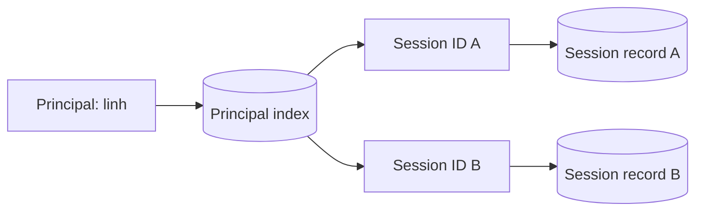

# Kiểm tra dữ liệu chỉ mục còn sót và chiến lược đối soát

Spring Session có thể lưu trạng thái phiên trong Redis và duy trì các chỉ mục để tìm phiên theo principal, chẳng hạn tên người dùng đã đăng nhập. Các chỉ mục này giúp ứng dụng tra cứu phiên nhanh mà không phải duyệt toàn bộ dữ liệu. Tuy nhiên, Redis expiration và Pub/Sub keyspace notifications hoạt động bất đồng bộ. Nếu thông báo hết hạn bị tắt, subscriber mất kết nối, ACL từ chối lệnh hoặc quá trình dọn dẹp bị gián đoạn, chỉ mục có thể còn tham chiếu đến một session đã hết hạn hoặc đã bị xóa.

Đối soát chỉ mục là quá trình tìm và sửa các tham chiếu không còn phản ánh trạng thái session hiện tại. Với Spring Session, dữ liệu session trong repository là nguồn kiểm tra chính; chỉ mục là cấu trúc hỗ trợ tra cứu. Vì vậy, cần phân biệt tham chiếu chỉ mục cũ với session còn hiệu lực, sửa đúng thành viên bị lỗi và giới hạn tải của công việc bảo trì khi hệ thống đang phục vụ người dùng.

## 1. Chỉ mục Redis có vai trò gì?

`RedisIndexedSessionRepository` lưu session trong Redis và hỗ trợ `FindByIndexNameSessionRepository`. Ứng dụng có thể tìm các session theo một chỉ mục, phổ biến nhất là principal name. Ví dụ, khi cần xem các phiên đăng nhập của một tài khoản, ứng dụng truy vấn chỉ mục principal thay vì quét toàn bộ session.

Về mặt khái niệm, dữ liệu có hai phần:

- **Session record:** chứa ID, thời gian truy cập, thời hạn không hoạt động và các thuộc tính phiên.
- **Index entry:** ánh xạ một giá trị chỉ mục, như principal name, đến một hoặc nhiều session ID.



Một principal có thể có nhiều phiên vì người dùng đăng nhập từ nhiều trình duyệt hoặc thiết bị. Chỉ mục giúp tìm các ID liên quan; repository vẫn phải xác minh từng ID có session hợp lệ hay không.

Tên khóa và cách biểu diễn index trong Redis là chi tiết triển khai của Spring Session. Chúng có thể thay đổi theo namespace, cấu hình và phiên bản thư viện. Không nên viết công cụ bảo trì dựa trên tên khóa suy đoán hoặc mặc định rằng mọi ứng dụng đều dùng namespace `spring:session`.

## 2. Các dạng dữ liệu chỉ mục không còn đồng bộ

### 2.1. Chỉ mục còn ID của session đã hết hạn

Đây là trường hợp thường được gọi là *stale index entry* hoặc tham chiếu mồ côi. Set chỉ mục vẫn chứa session ID, nhưng `findById(id)` không còn tìm thấy session hợp lệ.

Ví dụ:

| Principal index | Session repository | Kết quả |
|---|---|---|
| `linh` chứa `A`, `B` | `A` còn, `B` đã hết hạn | `B` là tham chiếu cũ |

Nguyên nhân có thể là notification hết hạn bị bỏ lỡ, listener ngừng hoạt động, cấu hình keyspace notifications không đúng hoặc cleanup phụ trợ chưa hoàn tất.

### 2.2. Session còn hiệu lực nhưng thiếu index entry

Session record vẫn tồn tại và có principal hợp lệ, nhưng chỉ mục không chứa session ID đó. Khi ứng dụng tìm session theo principal, phiên có thể không xuất hiện dù người dùng vẫn đang đăng nhập.

Nguyên nhân có thể gồm lỗi khi ghi index, cập nhật session bị gián đoạn, ứng dụng thay đổi cách xác định principal hoặc một thao tác Redis thủ công xóa nhầm thành viên.

### 2.3. Session đổi principal nhưng index cũ còn tồn tại

Nếu thuộc tính được dùng làm principal index thay đổi trong vòng đời session, chỉ mục cũ cần được loại bỏ và chỉ mục mới cần được cập nhật. Nếu quá trình cập nhật không hoàn tất, một ID có thể còn xuất hiện dưới principal cũ hoặc thiếu ở principal mới.

Ứng dụng cần dùng cùng một cách xác định principal ở mọi instance và ở mọi phiên bản. Không tự xây dựng logic index bằng cách đọc một thuộc tính tùy ý nếu repository đang dùng `IndexResolver` khác.

### 2.4. Chỉ mục phụ trợ tồn tại lâu hơn session

Khóa session chính có thể hết hạn đúng TTL nhưng một key phụ trợ hoặc thành viên trong set chỉ mục còn tồn tại. Điều này không nhất thiết có nghĩa session vẫn hợp lệ. Một số cấu trúc phụ trợ có vòng đời và cách cleanup riêng; cần xác định rõ đối tượng đang quan sát là session record, expiration key hay index entry.

### 2.5. Chỉ mục có số lượng tăng bất thường

Nếu các tham chiếu cũ không được loại bỏ, index set có thể lớn dần dù số session hoạt động không tăng tương ứng. Hệ quả là truy vấn theo principal tốn thêm bộ nhớ và thời gian, các thao tác duyệt set lâu hơn và công việc cleanup tạo tải Redis lớn hơn.

## 3. Vì sao expiration event có thể không dọn được chỉ mục?

Redis TTL quyết định thời điểm khóa đủ điều kiện hết hạn. Keyspace notification là thông báo Pub/Sub được phát khi Redis thực sự xử lý việc hết hạn và xóa khóa. Hai thời điểm này không nhất thiết trùng nhau.

Spring Session Redis sử dụng notification để nhận biết các thay đổi vòng đời cần xử lý. Tuy nhiên, Pub/Sub không phải hàng đợi bền vững: nếu subscriber mất kết nối đúng lúc sự kiện được phát, sự kiện đó không được lưu để subscriber đọc lại sau khi kết nối lại.

Một số nguyên nhân phổ biến:

- `notify-keyspace-events` chưa bật các cờ cần thiết cho event mà repository lắng nghe.
- Managed Redis chặn lệnh `CONFIG`; ứng dụng đã dùng `ConfigureRedisAction.NO_OP` nhưng nhà vận hành chưa bật notification ở phía dịch vụ.
- ACL cho phép đọc/ghi key nhưng không cho phép subscribe channel expiration.
- Redis failover, reconnect hoặc thay đổi endpoint làm subscriber gián đoạn.
- Một tiến trình bảo trì hoặc script ngoài ứng dụng xóa key/session/index trực tiếp.
- Các instance dùng namespace, database hoặc cấu hình repository khác nhau.
- Logic xác định principal không đồng nhất giữa các phiên bản ứng dụng.

Notification bị bỏ lỡ có thể khiến việc phát sự kiện và dọn dữ liệu phụ trợ không diễn ra. Dù vậy, session đã hết hạn vẫn phải bị xem là không hợp lệ khi repository tra cứu; không được dùng index entry làm bằng chứng rằng người dùng còn đăng nhập.

## 4. Xác minh một index entry có thực sự cũ hay không

Không xóa một ID chỉ vì một truy vấn index trả về kết quả bất thường. Đối soát cần xác minh ít nhất ba thông tin:

1. Session ID có còn tồn tại trong repository không?
2. Nếu session còn tồn tại, nó còn trong thời hạn hợp lệ không?
3. Principal hoặc giá trị index hiện tại của session có khớp với index đang chứa ID đó không?

Với API repository, có thể kiểm tra một session theo ID:

```java
Session session = sessionRepository.findById(sessionId);
if (session == null) {
    // Repository không tìm thấy session hợp lệ tại thời điểm kiểm tra.
}
```

Và truy vấn các session theo principal bằng API chuẩn:

```java
Map<String, ? extends Session> sessions =
    indexedSessionRepository.findByIndexNameAndIndexValue(
        FindByIndexNameSessionRepository.PRINCIPAL_NAME_INDEX_NAME,
        principalName
    );
```

Ví dụ giả định ứng dụng đã inject một `FindByIndexNameSessionRepository` tương thích với repository Redis đang dùng. `findById` là phép kiểm tra trạng thái session theo repository; `findByIndexNameAndIndexValue` là phép truy vấn theo chỉ mục. API public này không nhất thiết phơi bày mọi thành viên thô trong Redis index set, vì repository có thể đã lọc hoặc bỏ qua các tham chiếu không còn hợp lệ.

Nếu cần điều tra thành viên thô của một index set, công cụ bảo trì phải đọc đúng schema Redis của phiên bản Spring Session đang chạy. Không coi kết quả từ `findByIndexNameAndIndexValue` là danh sách đầy đủ các ID thô còn nằm trong Redis.

## 5. Chiến lược đối soát theo nhiều lớp

Một thiết kế bền vững thường kết hợp xử lý theo sự kiện, kiểm tra khi truy vấn và công việc đối soát định kỳ.

| Chiến lược | Cách hoạt động | Phù hợp khi |
|---|---|---|
| Event-driven cleanup | Spring Session xử lý keyspace notifications khi nhận được | Hoạt động thường ngày, độ trễ thấp |
| Lazy cleanup | Khi truy vấn index, kiểm tra session và bỏ qua hoặc dọn tham chiếu không còn hợp lệ theo cơ chế repository | Có thể xử lý dữ liệu cũ khi được truy cập |
| Periodic reconciliation | Job định kỳ kiểm tra theo lô và sửa tham chiếu cũ | Phòng ngừa notification bị bỏ lỡ |
| Full audit/rebuild | Quét có kiểm soát dữ liệu session và index để so sánh hoặc dựng lại index | Sự cố lớn, migration hoặc nghi ngờ sai lệch diện rộng |

Event-driven cleanup giúp phản ứng nhanh nhưng phụ thuộc notification. Lazy cleanup giảm tác động của dữ liệu cũ khi được truy vấn nhưng không bảo đảm các index ít được dùng sẽ được dọn. Periodic reconciliation là lớp sửa chữa bổ sung; full audit nên chạy có kế hoạch vì có thể tạo tải lớn.

## 6. Thiết kế job đối soát định kỳ

### 6.1. Xác định phạm vi và giới hạn mỗi lượt

Không nên quét toàn bộ Redis trong một request hoặc một lần chạy không giới hạn. Job nên có cấu hình:

- Namespace và loại index được phép kiểm tra.
- Số index key hoặc số thành viên tối đa trong một batch.
- Thời gian chạy tối đa và giới hạn tốc độ đọc.
- Số lần retry, backoff và cách tiếp tục từ checkpoint.
- Cửa sổ chạy thấp tải hoặc lịch chạy theo mức tăng trưởng dữ liệu.
- Cơ chế lock/lease hoặc phân vùng công việc để nhiều instance không cùng quét toàn bộ.

Với tập dữ liệu lớn, chia công việc thành nhiều batch nhỏ. Ghi checkpoint sau mỗi batch để khi job dừng giữa chừng có thể tiếp tục mà không phải bắt đầu lại toàn bộ.

### 6.2. Duyệt Redis an toàn

Nếu cần kiểm tra key thô, dùng `SCAN` thay cho `KEYS` trên production. `KEYS` có thể chặn Redis trong lúc duyệt một tập khóa lớn. `SCAN` trả kết quả theo từng trang và có thể trả trùng khóa; công cụ phải chấp nhận việc lặp và xử lý idempotent.

Nếu một index là Redis Set lớn, dùng `SSCAN` để đọc thành viên theo từng batch thay vì lấy toàn bộ set bằng `SMEMBERS`. Luôn đặt giới hạn số thành viên xử lý trong một lượt và theo dõi độ trễ Redis.

Ví dụ lệnh điều tra trong môi trường kiểm soát:

```text
SCAN 0 MATCH <namespace>:index:* COUNT 500
SSCAN <index-key> 0 COUNT 200
```

Các chuỗi `<namespace>:index:*` và `<index-key>` là chỗ giữ chỗ. Phải xác định tên key thực tế từ cấu hình và tài liệu/schema của đúng phiên bản; không sao chép nguyên văn thành lệnh production nếu chưa xác minh.

### 6.3. Phân loại từng thành viên

Với mỗi session ID được đọc từ index:

1. Tra cứu session bằng repository hoặc cách kiểm tra tương đương được xác minh cho implementation.
2. Nếu không tìm thấy session hợp lệ, đánh dấu thành viên là ứng viên stale.
3. Nếu session còn hợp lệ, xác định principal/index value hiện tại bằng cùng quy tắc mà ứng dụng dùng để lập chỉ mục.
4. Nếu principal khớp, giữ thành viên.
5. Nếu principal khác, ghi nhận sai lệch và lập kế hoạch sửa index cũ/mới theo cơ chế tương thích phiên bản.
6. Ghi metric và kết quả theo batch, tránh log session ID hoặc principal nhạy cảm ở dạng rõ.

Không dùng thao tác đọc index để kết luận session hợp lệ. Chỉ repository mới có thể xác minh trạng thái và thời hạn của session.

### 6.4. Sửa tham chiếu stale một cách an toàn

Nếu đã xác nhận ID không còn session hợp lệ, chỉ loại bỏ đúng thành viên đó khỏi đúng index set. Không xóa toàn bộ index của principal vì principal có thể còn các session khác đang hoạt động.

Có một race condition cần lưu ý: session có thể được tạo hoặc cập nhật trong lúc job đang kiểm tra. Trước khi xóa thành viên, nên kiểm tra lại session gần thời điểm sửa. Với công cụ bảo trì thao tác trực tiếp trên Redis, có thể dùng Lua script hoặc transaction để phối hợp kiểm tra và xóa theo schema đã xác minh. Nếu không thể bảo đảm thao tác nguyên tử, dùng chế độ dry-run trước, giới hạn batch nhỏ và chạy lại phép kiểm tra ngay trước khi sửa.

Không xóa session record chỉ vì index entry cũ. Session record có thể đã hợp lệ trở lại trong quá trình cập nhật hoặc index đang được tái lập. Mục tiêu của thao tác này là sửa quan hệ index, không thu hồi một session hợp lệ.

### 6.5. Khôi phục index bị thiếu

Nếu session còn hợp lệ nhưng thiếu index entry, job cần xác định principal hiện tại bằng đúng `IndexResolver` hoặc quy tắc indexing mà repository đang sử dụng. Sau đó có thể tái lập quan hệ index qua API được hỗ trợ hoặc một adapter bảo trì được kiểm thử với schema của phiên bản cụ thể.

Không tự suy ra principal từ username trong request hoặc một thuộc tính tùy ý. Spring Security có thể lưu thông tin principal trong `SecurityContext`, và `PrincipalNameIndexResolver` có quy tắc riêng để xác định giá trị. Dùng sai nguồn sẽ tạo index không tương thích với truy vấn của ứng dụng.

Với sai lệch diện rộng, cân nhắc dựng index mới ở namespace tạm, so sánh kết quả rồi chuyển đổi có kiểm soát. Việc thay index trực tiếp khi traffic vẫn ghi session có thể làm mất cập nhật; cần phối hợp với write traffic, dùng cơ chế đồng bộ thay đổi hoặc thực hiện trong maintenance window.

## 7. Pseudocode cho một lượt reconciliation

Ví dụ sau mô tả thuật toán, không phải API trực tiếp của `RedisIndexedSessionRepository`. Các thao tác đọc index thô và sửa thành viên cần được triển khai trong adapter riêng, phù hợp schema phiên bản đang dùng.

```java
for (IndexBatch batch : indexScanner.nextBatches()) {
    for (IndexEntry entry : batch.entries()) {
        Session session = sessionRepository.findById(entry.sessionId());

        if (session == null) {
            // Đọc lại ngay trước khi sửa để giảm race với session mới.
            Session rechecked = sessionRepository.findById(entry.sessionId());
            if (rechecked == null) {
                indexMaintenance.removeMember(
                    entry.indexKey(), entry.sessionId()
                );
                metrics.increment("session.index.stale.removed");
            }
            continue;
        }

        String actualPrincipal = principalResolver.resolve(session);
        if (!entry.principal().equals(actualPrincipal)) {
            indexMaintenance.repairMembership(entry, actualPrincipal);
            metrics.increment("session.index.mismatch.repaired");
        }
    }
}
```

`indexScanner`, `indexMaintenance` và `principalResolver` là abstraction do ứng dụng hoặc công cụ vận hành xây dựng. Không có nghĩa các class đó được Spring Session cung cấp sẵn. Trong triển khai thực, việc sửa membership cần kiểm tra lại session và tuân thủ schema, serializer, namespace cùng quy tắc index của phiên bản đang dùng.

## 8. Xử lý race condition và nhiều instance

Đối soát chạy trong hệ thống nhiều instance phải tính đến việc session thay đổi đồng thời:

- Người dùng có thể đăng nhập trong lúc job đang quét principal index.
- Request có thể gia hạn session hoặc thay đổi thuộc tính principal.
- Một instance có thể xử lý logout trong khi job đang kiểm tra session.
- Nhiều worker có thể cùng nhìn thấy một stale entry và cố xóa cùng lúc.

Các nguyên tắc giảm rủi ro:

1. **Idempotent:** chạy lại cùng một batch không làm hỏng dữ liệu đã đúng.
2. **Xóa đúng thành viên:** chỉ loại session ID đã xác minh stale, không xóa cả principal index.
3. **Recheck:** đọc lại trạng thái ngay trước thao tác sửa.
4. **Phân quyền rõ:** chỉ một worker/leader hoặc các worker được chia partition mới xử lý một vùng index tại một thời điểm.
5. **Giới hạn tải:** dùng batch, backoff và circuit breaker khi Redis tăng độ trễ hoặc báo lỗi.
6. **Không khóa lâu:** tránh giữ distributed lock trong suốt một lượt quét lớn; dùng lease ngắn và checkpoint.

Nếu dùng distributed lock, lock chỉ điều phối công việc bảo trì. Nó không thay thế kiểm tra session và không làm các thao tác Redis trở thành giao dịch nguyên tử. Thiết kế vẫn phải an toàn khi worker bị dừng đột ngột hoặc lease hết hạn.

## 9. Quan sát và đo lường chất lượng index

Đối soát chỉ hữu ích khi có số liệu để phát hiện xu hướng. Có thể theo dõi:

| Metric | Ý nghĩa |
|---|---|
| Số index entry được kiểm tra | Khối lượng công việc trong một cửa sổ |
| Số stale entry phát hiện | Mức độ sai lệch quan sát được |
| Số entry được xóa hoặc sửa | Kết quả reconciliation |
| Số session hợp lệ thiếu index | Dấu hiệu lỗi ghi hoặc sai resolver |
| Thời gian xử lý mỗi batch | Tác động vận hành và xu hướng tăng trưởng |
| Redis command latency | Tác động của job lên kho lưu trữ |
| Pub/Sub reconnect và listener error | Nguy cơ bỏ lỡ expiration event |
| ACL/NOPERM error | Quyền lệnh, key pattern hoặc channel pattern chưa đủ |

Có thể tính tỷ lệ stale trên số entry đã kiểm tra để so sánh theo thời gian. Không nên chỉ nhìn tổng số index entry vì một principal có thể hợp lệ khi có nhiều thiết bị đăng nhập. Đặt ngưỡng cảnh báo dựa trên baseline và tốc độ thay đổi bình thường của hệ thống.

Log nên ghi batch ID, namespace, số lượng kiểm tra, số lượng stale và thời gian chạy. Tránh ghi session ID, access token, username hoặc principal name đầy đủ nếu không cần thiết; có thể dùng mã băm hoặc ID tương quan đã được kiểm soát.

## 10. Dry-run, audit và quy trình sửa chữa

Job reconciliation nên có ít nhất hai chế độ:

- **Dry-run:** chỉ đọc và báo cáo các thành viên có khả năng stale hoặc sai principal; không ghi Redis.
- **Apply:** thực hiện sửa sau khi ngưỡng sai lệch, namespace, số batch và quyền thao tác đã được xác nhận.

Một quy trình vận hành có thể gồm:

1. Xác nhận notification và subscriber hoạt động; nếu đang lỗi, khắc phục nguyên nhân gốc trước.
2. Chọn namespace và một tập index nhỏ để chạy dry-run.
3. Đối chiếu số session tìm thấy với số thành viên index, lấy mẫu các trường hợp không khớp.
4. Xác nhận logic principal và schema của phiên bản Spring Session.
5. Chạy apply với batch nhỏ, giới hạn tốc độ và theo dõi Redis latency.
6. Chạy lại dry-run để xác nhận stale count giảm và không phát sinh lỗi mới.
7. Lưu audit về số lượng và kết quả; không lưu session ID hoặc dữ liệu nhạy cảm dạng rõ.

Không thực hiện `FLUSHDB`, `FLUSHALL`, xóa toàn bộ key pattern hoặc xóa index set hàng loạt để xử lý stale entry. Các thao tác đó có thể làm mất phiên hợp lệ của người dùng và ảnh hưởng các ứng dụng dùng chung Redis.

## 11. Kiểm thử chiến lược đối soát

Kiểm thử cần bao gồm cả sai lệch dữ liệu và thay đổi đồng thời:

| Kịch bản | Cách tạo | Kết quả mong đợi |
|---|---|---|
| ID mồ côi trong index | Tạo index entry thử nghiệm không có session record | Dry-run phát hiện; apply xóa đúng member |
| Session hết hạn | Tạo session với TTL ngắn và chờ Redis hết hạn | Session không được xem là hợp lệ; index được cleanup theo cơ chế |
| Session hợp lệ | Tạo phiên có principal và TTL còn hiệu lực | Job giữ nguyên index member |
| Thiếu index | Tạo session hợp lệ nhưng thiếu membership trong môi trường test | Job phát hiện và sửa theo resolver đúng |
| Principal thay đổi | Cập nhật principal/index value trong test | Index cũ được loại, index mới được thiết lập |
| Notification bị tắt | Tắt event trong Redis test | Job phát hiện stale entry dù event không đến |
| Subscriber reconnect | Ngắt và khôi phục kết nối Pub/Sub | Listener kết nối lại; periodic job xử lý phần bị bỏ lỡ |
| Request đồng thời | Cập nhật hoặc logout khi job đang quét | Job không xóa session hợp lệ hoặc index mới |
| Job chạy lặp | Chạy lại cùng batch | Kết quả idempotent, không có tác động phụ |
| Nhiều worker | Cho hai worker nhận cùng partition trong test | Lock/partition ngăn xử lý xung đột hoặc thao tác vẫn an toàn |

Nên dùng Redis thật trong integration test, ví dụ môi trường container dành cho test, vì mock repository không tái hiện TTL, Pub/Sub, set membership và reconnect.

## 12. Lỗi thường gặp

| Biểu hiện | Nguyên nhân có thể | Hướng xử lý |
|---|---|---|
| Index có nhiều ID không tìm thấy | Notification bị tắt/bỏ lỡ hoặc cleanup gián đoạn | Kiểm tra keyspace notifications và chạy reconciliation theo batch |
| Người dùng có session nhưng không xuất hiện khi tìm theo principal | Thiếu index hoặc resolver principal không đồng nhất | Kiểm tra `IndexResolver`, cập nhật session và cơ chế rebuild |
| Job xóa cả phiên đang hoạt động | Dùng index entry làm nguồn sự thật hoặc không recheck | Chỉ xóa member đã xác minh stale; không xóa session record |
| Redis latency tăng khi chạy job | Quét toàn bộ key/set hoặc batch quá lớn | Dùng `SCAN`/`SSCAN`, giảm batch và giới hạn tốc độ |
| Index lại sai sau khi repair | Job và request ghi session chạy đồng thời không có quy tắc đồng bộ | Thiết kế thao tác idempotent, recheck và điều phối worker |
| Chỉ một số principal bị lỗi | Principal encoding hoặc index key mapping khác dự kiến | Kiểm tra resolver, serializer và namespace |
| Reconciliation không phát hiện member thô | Chỉ dùng API truy vấn đã lọc stale entry | Dùng adapter đọc index raw theo schema phiên bản đã xác minh |
| Nhiều instance cùng chạy job | Không có lock hoặc phân vùng công việc | Dùng leader/lease hoặc partition rõ ràng |

## 13. Nguyên tắc triển khai

- Coi session record hợp lệ trong repository là nguồn kiểm tra chính; index chỉ là cấu trúc tra cứu.
- Phân biệt stale member, thiếu member, sai principal và key phụ trợ còn tồn tại.
- Dùng keyspace notification để cleanup thường ngày nhưng có periodic reconciliation làm lớp phòng ngừa.
- Dùng `findById` và API index public để xác minh session; chỉ đọc/sửa key thô qua adapter gắn với schema phiên bản cụ thể.
- Dùng `SCAN` và `SSCAN`, batch nhỏ, checkpoint và rate limit cho tập dữ liệu lớn.
- Recheck ngay trước khi xóa, chỉ loại đúng session ID khỏi đúng index, không xóa session đang hoạt động.
- Dùng cùng `IndexResolver` và principal mapping với ứng dụng.
- Điều phối job giữa nhiều instance; bảo đảm idempotent và an toàn khi worker dừng giữa chừng.
- Có dry-run, metric, audit và kiểm thử với Redis thật trước khi apply production.
- Không dùng Pub/Sub event làm nguồn duy nhất cho kiểm toán hoặc nghiệp vụ cần bảo đảm bền vững.

Chỉ mục Redis giúp Spring Session tìm phiên theo principal nhanh, nhưng không phải nguồn xác thực cuối cùng. Đối soát đúng cách cần kiểm tra trạng thái session trong repository, hiểu cách notification và index hoạt động ở phiên bản đang triển khai, rồi sửa từng tham chiếu theo batch có kiểm soát. Kết hợp event-driven cleanup với kiểm tra định kỳ, quan sát và quy trình dry-run/apply giúp dữ liệu index duy trì nhất quán mà không làm gián đoạn các phiên còn hiệu lực.
