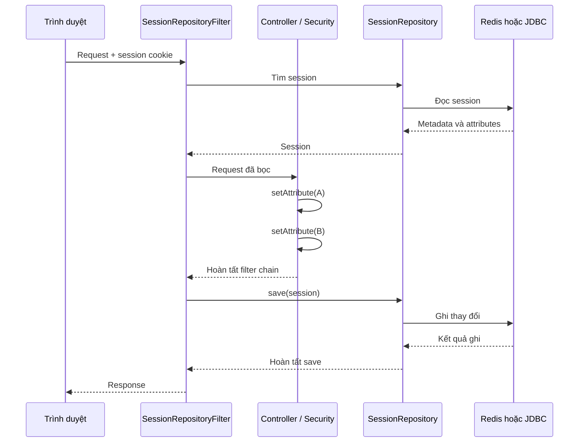
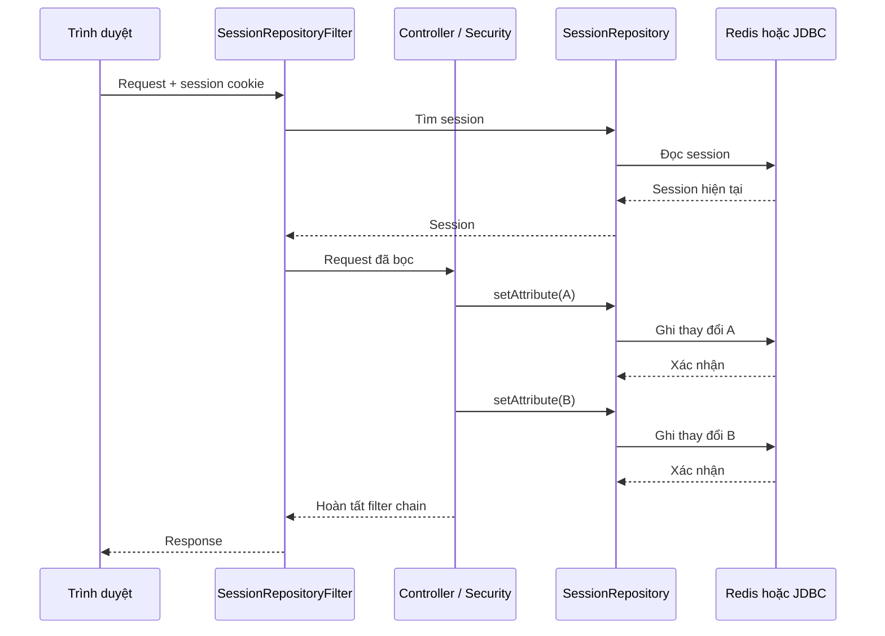

# FlushMode.ON_SAVE và FlushMode.IMMEDIATE trên repository hỗ trợ

Spring Session cho phép ứng dụng tiếp tục dùng API `HttpSession` trong khi dữ liệu phiên được lưu ở repository như Redis hoặc JDBC. Mỗi request có thể tạo session mới, cập nhật metadata hoặc thay đổi nhiều thuộc tính. `FlushMode` quyết định **khi nào các thay đổi của session được ghi xuống kho lưu trữ**.

Hai chế độ thường gặp là `FlushMode.ON_SAVE` và `FlushMode.IMMEDIATE`. `ON_SAVE` gom các thay đổi trong quá trình xử lý request và ghi khi repository nhận lệnh `save`. `IMMEDIATE` cố gắng ghi thay đổi xuống kho lưu trữ ngay khi thay đổi xảy ra. Việc chọn chế độ ảnh hưởng độ trễ, số lần ghi, khả năng quan sát thay đổi từ request khác và thời điểm lỗi lưu trữ xuất hiện.

## 1. FlushMode điều khiển điều gì?

`FlushMode` là chính sách ghi session của Spring Session, được định nghĩa trong API Spring Session. Repository hỗ trợ chế độ này sẽ dùng nó để quyết định thời điểm đẩy thay đổi session xuống kho dữ liệu.

| Chế độ | Hành vi chính | Thời điểm ghi thường gặp trong ứng dụng Servlet |
|---|---|---|
| `ON_SAVE` | Chỉ ghi thay đổi khi gọi `SessionRepository.save(session)` | `SessionRepositoryFilter` lưu session khi request kết thúc hoặc response cần commit |
| `IMMEDIATE` | Ghi thay đổi xuống repository ngay khi có thể sau khi thay đổi xảy ra | Khi tạo session hoặc cập nhật thuộc tính/metadata theo API session |

`ON_SAVE` thường là lựa chọn mặc định của các cấu hình Spring Session Data Redis. Nó cho phép ứng dụng thay đổi nhiều thuộc tính trên đối tượng session trong một request rồi lưu ở giai đoạn cuối. `IMMEDIATE` hữu ích khi thay đổi cần được các request khác nhìn thấy sớm hơn, nhưng có thể tạo thêm thao tác ghi và độ trễ mạng.

Không phải mọi `SessionRepository` đều có cùng khả năng hoặc cùng cách triển khai flush. Hãy xác nhận repository implementation và phiên bản Spring Session đang dùng có hỗ trợ cấu hình `FlushMode` hay không. Không suy luận rằng đổi enum trong cấu hình sẽ làm mọi backend tự động có hành vi giống nhau.

## 2. Đường đi của một request với ON_SAVE

Trong ứng dụng Servlet, `SessionRepositoryFilter` bọc request và response để các lời gọi `HttpSession` làm việc với session của Spring Session. Với `ON_SAVE`, thay đổi thường được giữ trong đối tượng session đang gắn với request, sau đó filter gọi repository lưu session khi vòng đời request đi tới giai đoạn save.



Giả sử một request cập nhật `cartId`, `locale` và `lastViewedProduct`. Với `ON_SAVE`, mã ứng dụng có thể gọi nhiều lần `setAttribute`; các thay đổi được giữ trong session hiện tại và được lưu khi repository nhận lệnh save ở cuối request. Điều này tránh phải ghi từng thay đổi trung gian xuống Redis hoặc JDBC.

Một request khác đọc cùng session trước khi request đầu tiên lưu có thể vẫn thấy trạng thái cũ. Đây là hệ quả quan trọng của thời điểm ghi. Nếu hai request cùng cập nhật một session, thứ tự tải và lưu có thể dẫn đến cạnh tranh hoặc ghi đè; `ON_SAVE` không tự cung cấp transaction hoặc khóa cho session.

## 3. Đường đi của một request với IMMEDIATE

Với `IMMEDIATE`, repository ghi thay đổi càng sớm càng tốt sau khi API session nhận thay đổi. Trong ví dụ cập nhật ba thuộc tính, ứng dụng có thể tạo ra nhiều thao tác ghi trong cùng một request thay vì đợi đến cuối request.



Các thao tác thực tế có thể được repository tối ưu hoặc thực hiện theo lô tùy implementation; sơ đồ chỉ thể hiện nguyên tắc ghi sớm. Khi một thay đổi đã được ghi thành công, request khác dùng cùng repository có thể quan sát thay đổi đó trước khi request hiện tại hoàn tất. Điều này hữu ích với một số luồng cần chia sẻ trạng thái sớm, nhưng không có nghĩa toàn bộ request được commit nguyên tử.

Nếu request cập nhật nhiều thuộc tính liên quan với nhau, request khác có thể quan sát trạng thái trung gian giữa các lần ghi. Ví dụ, `checkoutStatus` đã chuyển sang `PAYING` trong khi `paymentReference` chưa được ghi. Vì vậy, không nên dùng `IMMEDIATE` để giả định nhiều thuộc tính được cập nhật như một transaction duy nhất.

## 4. Cấu hình FlushMode với Spring Session Data Redis

Với cấu hình Java tường minh cho Servlet, có thể chọn `flushMode` trong annotation bật Redis HTTP session:

```java
import org.springframework.context.annotation.Configuration;
import org.springframework.session.FlushMode;
import org.springframework.session.data.redis.config.annotation.web.http.EnableRedisHttpSession;

@Configuration
@EnableRedisHttpSession(
        maxInactiveIntervalInSeconds = 1800,
        flushMode = FlushMode.ON_SAVE)
class RedisSessionConfiguration {
    // RedisConnectionFactory được cung cấp trong application context.
}
```

Để dùng chế độ ghi sớm, đổi giá trị thành `FlushMode.IMMEDIATE`:

```java
@Configuration
@EnableRedisHttpSession(
        maxInactiveIntervalInSeconds = 1800,
        flushMode = FlushMode.IMMEDIATE)
class ImmediateRedisSessionConfiguration {
    // Cấu hình Redis connection được cung cấp riêng.
}
```

Hai đoạn trên là hai cấu hình thay thế nhau. Trong một application context, chỉ nên có một cấu hình repository/filter phù hợp; không đăng ký hai cấu hình cùng tạo `SessionRepositoryFilter`.

Với Spring Boot, phiên bản hỗ trợ property binding cho Redis session có thể cấu hình trong `application.yml`:

```yaml
spring:
  session:
    redis:
      flush-mode: on-save
```

Hoặc:

```yaml
spring:
  session:
    redis:
      flush-mode: immediate
```

Tên property và cách auto-configuration phụ thuộc phiên bản Spring Boot/Spring Session. Hãy kiểm tra cấu hình được hỗ trợ trong phiên bản dự án và xác nhận bean repository thực tế đã nhận đúng chế độ. Không kết hợp cấu hình auto-configuration với annotation tường minh nếu việc đó tạo ra repository hoặc filter trùng lặp.

## 5. Khi nào nên chọn ON_SAVE?

`ON_SAVE` phù hợp với phần lớn request web thông thường vì một request thường là đơn vị xử lý tự nhiên: đọc session, cập nhật trạng thái và lưu khi hoàn tất. Một số lợi ích:

- **Giảm số lần ghi trung gian:** nhiều thay đổi trong cùng request có thể được lưu ở giai đoạn save thay vì ghi ngay sau từng thao tác.
- **Giảm round trip:** ít thao tác ghi riêng lẻ hơn có thể giảm độ trễ mạng và tải Redis/JDBC.
- **Giữ luồng xử lý đơn giản:** controller thao tác trên session hiện tại; repository lưu thay đổi theo vòng đời filter.
- **Phù hợp với cập nhật không cần quan sát tức thời:** request khác chỉ cần thấy trạng thái sau khi request hiện tại hoàn tất lưu.

Ví dụ một request cập nhật ngôn ngữ giao diện, tab gần đây và thông tin giỏ hàng. Nếu không có request đồng thời cần đọc trạng thái trung gian, `ON_SAVE` thường đáp ứng tốt.

Tuy nhiên, `ON_SAVE` không có nghĩa chắc chắn chỉ có một lệnh Redis hoặc một câu SQL cho cả request. Repository có thể cần nhiều thao tác để lưu metadata, attributes hoặc expiration. Ý nghĩa của chế độ là thời điểm gọi lưu, còn số lệnh backend phụ thuộc implementation.

## 6. Khi nào nên chọn IMMEDIATE?

`IMMEDIATE` có thể phù hợp khi thay đổi session cần được request khác nhìn thấy sớm, trước khi request hiện tại hoàn tất. Ví dụ:

- Một luồng điều phối có request phụ đọc session ngay sau khi thuộc tính được cập nhật.
- Một bước xác thực cập nhật metadata phiên và cần lưu sớm để một thành phần khác quan sát.
- Ứng dụng cần giảm khoảng thời gian thay đổi chỉ nằm trong bộ nhớ của request hiện tại.

Đổi lại, `IMMEDIATE` có thể:

- Tăng số thao tác ghi và round trip tới Redis/JDBC.
- Tăng latency của các lời gọi cập nhật session trong request.
- Làm lỗi kết nối repository xuất hiện ngay tại thao tác thay đổi, ảnh hưởng trực tiếp tới luồng ứng dụng.
- Cho phép request khác nhìn thấy trạng thái từng phần khi một request đang cập nhật nhiều thuộc tính.

Không nên chọn `IMMEDIATE` chỉ vì tên gọi nghe có vẻ an toàn hơn. Nó chỉ thay đổi thời điểm ghi; nó không bảo đảm transaction, thứ tự cập nhật giữa nhiều request hoặc tính nhất quán của dữ liệu nghiệp vụ.

## 7. So sánh chi tiết

| Tiêu chí | `ON_SAVE` | `IMMEDIATE` |
|---|---|---|
| Thời điểm ghi | Khi gọi `save` | Ngay khi thay đổi được xử lý, theo khả năng repository |
| Thay đổi trong request | Thường được giữ đến giai đoạn save | Được đẩy xuống store sớm hơn |
| Khả năng request khác thấy thay đổi | Sau khi request lưu session | Có thể thấy sau từng lần ghi thành công |
| Số lần ghi | Thường ít ghi trung gian hơn | Có thể nhiều thao tác ghi hơn |
| Latency | Có thể dồn chi phí ghi về cuối request | Chi phí ghi có thể xuất hiện ở từng thao tác cập nhật |
| Thời điểm lỗi ghi | Thường ở giai đoạn save cuối request | Có thể xảy ra ngay trong thao tác cập nhật |
| Tính nguyên tử nhiều thuộc tính | Không được bảo đảm | Không được bảo đảm |
| Use case thường gặp | Request web thông thường | Cần công bố thay đổi session sớm |

## 8. Phân biệt FlushMode với SaveMode

`FlushMode` và `SaveMode` liên quan nhau nhưng điều khiển hai vấn đề khác nhau:

- `FlushMode` quyết định **khi nào** thay đổi được ghi xuống repository.
- `SaveMode` quyết định **thuộc tính nào** được xem là cần lưu khi repository lưu session.

Ví dụ, `SaveMode.ON_SET_ATTRIBUTE` tập trung vào các thuộc tính được gán qua `setAttribute`. `SaveMode.ON_GET_ATTRIBUTE` có thể đánh dấu thuộc tính được đọc để lưu lại thay đổi trên object mutable theo cơ chế hỗ trợ. `SaveMode.ALWAYS` yêu cầu lưu rộng hơn. Tên và hành vi chi tiết cần đối chiếu API của phiên bản Spring Session đang dùng.

Nếu ứng dụng lấy một object mutable từ session rồi sửa trực tiếp mà không gọi `setAttribute` lại, việc thay đổi có được nhận ra hay không phụ thuộc `SaveMode` và repository. Chuyển sang `FlushMode.IMMEDIATE` không tự động làm Spring Session phát hiện mọi thay đổi sâu bên trong object Java. Để hành vi dễ dự đoán, ưu tiên object bất biến hoặc gán lại attribute sau khi cập nhật.

Ví dụ:

```java
Cart cart = (Cart) session.getAttribute("cart");
cart.addItem(item);

// Gán lại để repository nhận biết rõ thay đổi attribute.
session.setAttribute("cart", cart);
```

## 9. Ảnh hưởng tới request đồng thời

Flush sớm không đồng nghĩa với khóa session. Hai request có thể cùng nạp một session, sau đó thay đổi các thuộc tính gần như đồng thời. Ví dụ:

1. Request A đọc `cartCount = 1`.
2. Request B cũng đọc `cartCount = 1`.
3. A tăng lên 2 và lưu.
4. B tăng từ snapshot cũ lên 2 và lưu.

Kết quả cuối có thể là 2 thay vì 3. Với `ON_SAVE`, việc ghi có thể xảy ra ở cuối từng request; với `IMMEDIATE`, thay đổi có thể được ghi sớm hơn. Cả hai đều không tự biến chuỗi đọc-sửa-ghi thành thao tác nguyên tử.

Nếu dữ liệu cần cập nhật đồng thời, hãy dùng cơ chế phù hợp với loại dữ liệu: atomic command/transaction của Redis, optimistic locking, database transaction, distributed lock có thiết kế cẩn thận hoặc lưu dữ liệu nghiệp vụ trong kho chuyên dụng. Không dùng session làm database có bảo đảm transaction cho giỏ hàng, số dư hoặc trạng thái thanh toán.

Đối với các thuộc tính session độc lập, thiết kế tên thuộc tính và thao tác cập nhật để giảm ghi đè lẫn nhau. Với các trường có quan hệ phụ thuộc, cân nhắc lưu chúng thành một value bất biến duy nhất và cập nhật theo một thao tác có kiểm soát, nhưng vẫn cần cơ chế concurrency thích hợp nếu nhiều request có thể ghi đồng thời.

## 10. Thời điểm lỗi và xử lý khi repository không khả dụng

Với `ON_SAVE`, lỗi ghi thường xuất hiện khi filter/repository thực hiện save ở giai đoạn cuối request hoặc khi response được commit. Controller có thể đã hoàn tất phần lớn logic trước khi lỗi được phát hiện. Hãy bảo đảm ứng dụng có exception handling và logging phù hợp cho lỗi lưu session; không ghi session ID hoặc attributes vào log.

Với `IMMEDIATE`, lỗi có thể xuất hiện ngay khi code tạo session hoặc gọi `setAttribute`/thay đổi metadata. Điều này làm lỗi gần với thao tác gây ra nó hơn, nhưng cũng có nghĩa một request có thể thất bại giữa chừng sau khi một số thay đổi trước đó đã được ghi.

Trong cả hai chế độ:

- Không giả định repository ghi thành công chỉ vì code đã gọi API session.
- Không tự retry vô hạn khi Redis/JDBC lỗi; cấu hình timeout và retry phù hợp để tránh kéo dài request.
- Xác định response phù hợp nếu không thể lưu trạng thái cần thiết cho request hiện tại.
- Không fallback sang session in-memory cục bộ một cách âm thầm khi ứng dụng đang yêu cầu session dùng chung; điều đó có thể làm trạng thái phân tán không nhất quán.
- Dùng metrics cho repository latency, write failures, connection errors và request failures.
- Kiểm thử trường hợp lỗi xảy ra ở giữa nhiều lần cập nhật với `IMMEDIATE` và ở bước save cuối với `ON_SAVE`.

## 11. Tác động tới response và session ID

Trong Servlet, `SessionRepositoryFilter` phối hợp việc lưu session với vòng đời response. Với `ON_SAVE`, filter phải lưu session trước hoặc trong giai đoạn response commit theo cơ chế wrapper. Nếu lưu thất bại, response có thể bị ảnh hưởng tùy thời điểm commit và container. Vì vậy, cần kiểm thử trường hợp response lớn, streaming hoặc code chủ động flush response sớm.

Với `IMMEDIATE`, các thay đổi đã được ghi trước khi response hoàn tất, nhưng việc tạo session và phát hành cookie session ID vẫn chịu sự điều phối của filter và `HttpSessionIdResolver`. Không nhầm việc dữ liệu đã được ghi sớm với việc trình duyệt đã nhận cookie. Nếu response bị mất sau khi server đã ghi session, Redis có thể còn một session mà client chưa nhận được ID; TTL sẽ giúp dữ liệu đó hết hạn nếu không được sử dụng.

## 12. Kiểm thử và so sánh hai chế độ

Nên kiểm thử bằng repository thực tế, đặc biệt nếu dùng Redis trong production. Mock session có thể xác nhận logic controller nhưng không chứng minh thời điểm ghi của repository.

Các kịch bản nên có:

1. **ON_SAVE cơ bản:** tạo session, thay đổi nhiều attributes và xác nhận request kế tiếp đọc được giá trị sau khi request trước hoàn tất.
2. **IMMEDIATE cơ bản:** cập nhật attribute và kiểm tra repository có thể quan sát thay đổi trước khi request hiện tại kết thúc trong một test có điều khiển.
3. **Request đồng thời:** gửi hai request cùng session và thay đổi cùng/khác attributes; xác nhận ứng dụng xử lý cạnh tranh theo thiết kế.
4. **Repository latency:** đo số lần ghi, latency mỗi request và tổng thời gian response ở cả hai chế độ.
5. **Repository unavailable:** làm Redis/JDBC mất kết nối trong test và xác nhận exception được xử lý ở đúng giai đoạn dự kiến.
6. **Response commit:** kiểm thử request tạo session và commit response sớm để xác nhận cookie và session được xử lý đúng.
7. **Mutable attribute:** sửa object sau khi lấy từ session và kiểm tra tác động của SaveMode; không quy kết hành vi đó cho FlushMode.
8. **Nhiều instance:** ghi session qua instance A và đọc qua instance B, xác nhận cấu hình flush/save giống nhau giữa các node.

Khi benchmark, dùng cùng payload, số lượng request, Redis/JDBC topology và tải đồng thời. So sánh p50/p95/p99 latency, throughput, số thao tác ghi, lỗi timeout và mức sử dụng CPU/network. Không kết luận `IMMEDIATE` tốt hơn chỉ vì một request đơn lẻ đọc được dữ liệu sớm; cần đánh giá tải toàn hệ thống.

## 13. Hướng dẫn chọn chế độ

| Nhu cầu | Lựa chọn khởi đầu | Lý do |
|---|---|---|
| Request đọc/ghi session thông thường | `ON_SAVE` | Hạn chế ghi trung gian và phù hợp vòng đời request |
| Nhiều thay đổi trong một request, không cần chia sẻ trạng thái giữa chừng | `ON_SAVE` | Có thể giảm round trip |
| Request khác cần thấy một thay đổi session trước khi request hiện tại kết thúc | Cân nhắc `IMMEDIATE` | Ghi sớm hơn sau mỗi thay đổi được hỗ trợ |
| Dữ liệu có cập nhật đồng thời hoặc cần transaction | Không giải quyết chỉ bằng FlushMode | Cần cơ chế concurrency/transaction phù hợp |
| Backend có latency ghi cao | Thường thử `ON_SAVE` trước | Giảm số lần ghi trung gian trong một request |
| Cần phát hiện lỗi ghi gần thao tác thay đổi | Cân nhắc `IMMEDIATE` | Lỗi có thể xuất hiện sớm hơn trong request |

Hãy bắt đầu từ `ON_SAVE` nếu không có yêu cầu cụ thể về khả năng quan sát thay đổi trước khi request kết thúc. Chỉ chuyển sang `IMMEDIATE` sau khi xác định rõ request nào cần hành vi đó và đã đo ảnh hưởng tới latency, throughput cùng concurrency.

## 14. Nguyên tắc cần nhớ

- `FlushMode.ON_SAVE` ghi session khi repository nhận lệnh `save`, thường ở giai đoạn cuối request trong ứng dụng Servlet.
- `FlushMode.IMMEDIATE` ghi thay đổi sớm nhất có thể sau khi thao tác session xảy ra.
- `IMMEDIATE` có thể tăng số lần ghi và cho request khác thấy trạng thái trung gian; `ON_SAVE` có thể trì hoãn khả năng quan sát đến khi save.
- Cả hai chế độ đều không cung cấp transaction hoặc khóa cho nhiều request cùng cập nhật session.
- `FlushMode` điều khiển thời điểm ghi; `SaveMode` điều khiển thuộc tính nào được lưu. Hai chính sách không thay thế nhau.
- Thời điểm lỗi repository có thể khác: thường ở giai đoạn save với `ON_SAVE`, có thể ngay thao tác cập nhật với `IMMEDIATE`.
- Cookie session ID và response commit vẫn do filter/resolver quản lý; ghi dữ liệu sớm không có nghĩa client đã nhận cookie.
- Xác nhận repository hỗ trợ chế độ, cấu hình nhất quán giữa các instance và kiểm thử bằng Redis/JDBC thực tế.
