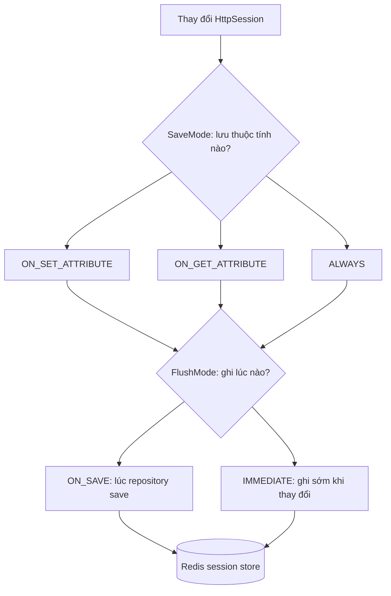

# Theo dõi thay đổi metadata và thuộc tính phiên

Spring Session lưu trạng thái `HttpSession` trong repository dùng chung như Redis hoặc JDBC. Trong một request, framework cần theo dõi hai nhóm dữ liệu: **metadata của phiên** và **các thuộc tính do ứng dụng đặt trong phiên**. Metadata mô tả vòng đời và thời hạn của phiên; thuộc tính chứa trạng thái nghiệp vụ tạm thời như mã giỏ hàng, lựa chọn giao diện hoặc dữ liệu quy trình.

Theo dõi thay đổi đúng cách giúp repository chỉ ghi những dữ liệu cần thiết, hạn chế ghi đè thuộc tính do request đồng thời cập nhật và kiểm soát thời điểm dữ liệu được đẩy xuống kho lưu trữ. Spring Session cung cấp `SaveMode` để quyết định thuộc tính nào được lưu và `FlushMode` để quyết định khi nào thay đổi được ghi vào repository. Hai chính sách này có mục đích khác nhau và không thay thế việc thiết kế cập nhật nghiệp vụ an toàn.

## 1. Phân biệt metadata và thuộc tính phiên

Metadata là thông tin quản lý do Spring Session và repository sử dụng. Các trường thường gặp gồm:

| Metadata | Ý nghĩa | Cách quản lý |
|---|---|---|
| Session ID | Định danh duy nhất dùng để tìm phiên | Spring Session tạo và quản lý; ứng dụng không tự đặt ID |
| Creation time | Thời điểm phiên được tạo | Framework quản lý trong vòng đời phiên |
| Last accessed time | Thời điểm phiên được truy cập gần nhất | Filter/repository cập nhật theo request sử dụng phiên |
| Max inactive interval | Khoảng không hoạt động tối đa trước khi phiên hết hạn | Có thể cấu hình mặc định hoặc thay đổi theo phiên bằng API |
| Expiration/TTL | Thời điểm hoặc thời gian còn lại trước khi phiên hết hiệu lực trong kho | Repository ánh xạ timeout của phiên sang cơ chế hết hạn của Redis/JDBC |

Thuộc tính phiên là dữ liệu do ứng dụng lưu bằng các API như `setAttribute`, `getAttribute`, `removeAttribute` và `getAttributeNames`. Ví dụ:

```java
HttpSession session = request.getSession(true);
session.setAttribute("cartId", "cart-123");
session.setAttribute("locale", "vi-VN");

String cartId = (String) session.getAttribute("cartId");
```

`cartId` và `locale` là thuộc tính nghiệp vụ; chúng không phải metadata. Ứng dụng không nên lưu bản sao của session ID, thời điểm truy cập hoặc TTL vào các thuộc tính tùy chỉnh để tự quản lý vòng đời, vì các giá trị đó có thể lệch khỏi trạng thái thật của repository.

## 2. Metadata được cập nhật trong vòng đời request

Khi request mang session ID hợp lệ đến, `SessionRepositoryFilter` khôi phục session từ repository và cung cấp một `HttpSession` tương thích với Servlet API. Spring Session quản lý thời điểm truy cập và lưu các thay đổi metadata theo vòng đời request.

Ứng dụng có thể đọc metadata qua API Servlet:

```java
@GetMapping("/session/metadata")
public Map<String, Object> metadata(HttpServletRequest request) {
    HttpSession session = request.getSession(false);
    if (session == null) {
        throw new ResponseStatusException(HttpStatus.UNAUTHORIZED);
    }

    return Map.of(
            "createdAt", Instant.ofEpochMilli(session.getCreationTime()),
            "lastAccessedAt", Instant.ofEpochMilli(session.getLastAccessedTime()),
            "maxInactiveSeconds", session.getMaxInactiveInterval()
    );
}
```

`getCreationTime()` và `getLastAccessedTime()` trả về thời gian theo mili giây kể từ epoch; ví dụ chuyển sang `Instant` để biểu diễn rõ ràng. `getMaxInactiveInterval()` trả về số giây không hoạt động tối đa. Các giá trị này hữu ích cho chẩn đoán hoặc giao diện quản lý phiên, nhưng không nên được dùng thay cho kiểm tra xác thực và quyền truy cập.

Ứng dụng có thể thay đổi thời gian không hoạt động của một phiên:

```java
HttpSession session = request.getSession(true);
session.setMaxInactiveInterval(900); // 15 phút
```

Đây là thay đổi metadata của phiên. Repository cần lưu giá trị timeout mới và áp dụng thời hạn tương ứng. Không cần tạo một thuộc tính `timeoutSeconds` riêng để thay thế `setMaxInactiveInterval`.

Không tự cập nhật `lastAccessedTime` trong controller. Thời điểm truy cập thuộc về cơ chế quản lý session; cập nhật thủ công có thể khiến timeout không còn phản ánh đúng hoạt động thực tế. Nếu cần ghi nhận hoạt động nghiệp vụ riêng, lưu một timestamp có tên và mục đích riêng, ví dụ `lastCheckoutActionAt`, và không nhầm nó với metadata truy cập session.

## 3. Thuộc tính phiên được theo dõi như thế nào?

Spring Session cần biết thuộc tính nào đã được thêm, thay đổi hoặc xóa để ghi vào kho dữ liệu. `SaveMode` điều khiển phạm vi thuộc tính được lưu trong lần lưu session.

Ba chế độ phổ biến:

| SaveMode | Thuộc tính được lưu | Hành vi chính |
|---|---|---|
| `ON_SET_ATTRIBUTE` | Thuộc tính được đặt bằng `setAttribute` trong request | Chỉ ghi những thuộc tính đã được set; phù hợp khi ứng dụng chủ động thay thế giá trị sau khi sửa |
| `ON_GET_ATTRIBUTE` | Thuộc tính đã được đọc hoặc đặt trong request | Hữu ích khi ứng dụng đọc một object mutable rồi sửa object đó mà không gọi lại `setAttribute` |
| `ALWAYS` | Tất cả thuộc tính của phiên | Đơn giản về mặt hành vi nhưng có thể ghi nhiều dữ liệu hơn và làm tăng nguy cơ ghi đè thay đổi từ request khác |

Ví dụ, ứng dụng lưu một object giỏ hàng:

```java
Cart cart = (Cart) session.getAttribute("cart");
cart.add(productId);
session.setAttribute("cart", cart);
```

Với `ON_SET_ATTRIBUTE`, lời gọi cuối `setAttribute` đánh dấu thuộc tính `cart` cần được lưu. Đây là cách rõ ràng và dễ đọc nhất khi cập nhật thuộc tính mutable: lấy giá trị, thay đổi rồi đặt lại vào session.

Nếu chỉ sửa object mà không gọi `setAttribute`:

```java
Cart cart = (Cart) session.getAttribute("cart");
cart.add(productId);
// Không gọi session.setAttribute("cart", cart)
```

`ON_SET_ATTRIBUTE` có thể không lưu thay đổi bên trong object vì thuộc tính không được đánh dấu là đã set. `ON_GET_ATTRIBUTE` có thể lưu thuộc tính đã được đọc trong request, còn `ALWAYS` lưu toàn bộ thuộc tính. Tuy nhiên, dựa vào việc lưu mọi thuộc tính có thể khiến object cũ ghi đè giá trị mới được request khác cập nhật. Nên ưu tiên cập nhật tường minh và hiểu rõ save mode của repository.

## 4. Cấu hình SaveMode với Redis

Với cấu hình Java, có thể đặt `saveMode` trên `@EnableRedisHttpSession`:

```java
import org.springframework.context.annotation.Configuration;
import org.springframework.session.SaveMode;
import org.springframework.session.data.redis.config.annotation.web.http.EnableRedisHttpSession;

@Configuration
@EnableRedisHttpSession(saveMode = SaveMode.ON_SET_ATTRIBUTE)
public class RedisSessionConfiguration {
}
```

Trong ví dụ, chỉ thuộc tính được đặt trong request mới được xem là cần lưu. Nếu ứng dụng có nhiều object mutable được đọc rồi sửa trực tiếp, hãy thay đổi code để gọi `setAttribute` sau khi cập nhật hoặc cân nhắc `ON_GET_ATTRIBUTE` sau khi đánh giá tác động.

Có thể dùng `SaveMode.ALWAYS` khi cần lưu mọi thuộc tính ở mỗi lần lưu session, nhưng cần đo lượng dữ liệu ghi và xem xét các request đồng thời. Chế độ này không tự tạo khóa phân tán, không hợp nhất object và không bảo đảm cập nhật nguyên tử.

Tên API và cách cấu hình có thể khác theo phiên bản Spring Session/Boot. Hãy dùng dependency management tương thích và kiểm tra Javadoc hoặc tài liệu của phiên bản đang chạy. Nếu cấu hình qua Spring Boot properties, kiểm tra metadata cấu hình đúng phiên bản thay vì đoán tên property.

## 5. FlushMode quyết định thời điểm ghi

`SaveMode` quyết định **thuộc tính nào** được ghi; `FlushMode` quyết định **khi nào** thay đổi được ghi xuống kho session.

Spring Session cung cấp hai lựa chọn thường gặp:

| FlushMode | Thời điểm ghi | Tác động |
|---|---|---|
| `ON_SAVE` | Khi repository được yêu cầu lưu session, thường ở điểm lưu do filter quản lý khi request hoàn tất | Gom thay đổi trong request và giảm số lần ghi trung gian; đây thường là lựa chọn mặc định |
| `IMMEDIATE` | Ghi xuống kho sớm nhất có thể khi session được tạo hoặc thay đổi | Có thể giúp thay đổi xuất hiện sớm hơn trong repository nhưng làm tăng số lần ghi và độ trễ |

Ví dụ cấu hình:

```java
import org.springframework.session.FlushMode;

@Configuration
@EnableRedisHttpSession(
        flushMode = FlushMode.ON_SAVE,
        saveMode = SaveMode.ON_SET_ATTRIBUTE
)
public class RedisSessionConfiguration {
}
```

Với `ON_SAVE`, code nghiệp vụ có thể cập nhật nhiều thuộc tính trong một request rồi để filter lưu session theo vòng đời chuẩn. Với `IMMEDIATE`, thay đổi được ghi sớm hơn; điều này không có nghĩa mọi thao tác nghiệp vụ và session cùng nằm trong một transaction.

Không nên chọn `IMMEDIATE` chỉ để xử lý race condition. Ghi sớm không bảo đảm hai request đồng thời không ghi đè nhau. Nó còn có thể khiến một phần trạng thái session được lưu trong khi request sau đó thất bại. Hãy chọn flush mode dựa trên yêu cầu về thời điểm nhìn thấy dữ liệu, số lần round-trip Redis và hành vi khi request lỗi.

## 6. Kết hợp SaveMode và FlushMode

Hai chính sách hoạt động trên hai trục độc lập:



Ví dụ các kết hợp:

| SaveMode | FlushMode | Hành vi mong đợi |
|---|---|---|
| `ON_SET_ATTRIBUTE` | `ON_SAVE` | Lưu thuộc tính được set tại điểm save của request |
| `ON_SET_ATTRIBUTE` | `IMMEDIATE` | Ghi thuộc tính được set sớm hơn khi thay đổi được thực hiện |
| `ON_GET_ATTRIBUTE` | `ON_SAVE` | Lưu các thuộc tính đã đọc/đặt tại điểm save |
| `ALWAYS` | `ON_SAVE` | Lưu tất cả thuộc tính tại điểm save |

Không thể dùng một chính sách để thay thế chính sách còn lại. Chẳng hạn, `IMMEDIATE` không làm cho `ON_SET_ATTRIBUTE` tự phát hiện mọi thay đổi bên trong object mutable nếu ứng dụng không gọi `setAttribute` và chế độ không đánh dấu thuộc tính đó qua thao tác đọc.

## 7. Metadata và SaveMode không phải cùng một thứ

`SaveMode` tập trung vào thuộc tính phiên của ứng dụng. Metadata như ID, creation time, last accessed time và max inactive interval được quản lý bởi đối tượng `Session` và repository. Không nên suy luận rằng `ON_SET_ATTRIBUTE` làm cho mọi thay đổi metadata bị bỏ qua, hoặc `ALWAYS` là cách duy nhất để lưu timeout.

Ví dụ:

```java
session.setMaxInactiveInterval(600);
session.setAttribute("workflowStep", "payment");
```

Ở đây có hai loại thay đổi:

- `setMaxInactiveInterval(600)` thay đổi metadata timeout của phiên.
- `setAttribute("workflowStep", "payment")` thay đổi thuộc tính nghiệp vụ.

Repository phải duy trì metadata để session có vòng đời đúng và xử lý thuộc tính theo save mode. Nếu TTL Redis không thay đổi như dự kiến, hãy kiểm tra timeout hiệu lực, flush mode, thời điểm repository save và implementation/version thay vì đổi `SaveMode` một cách ngẫu nhiên.

Không nên lưu `lastAccessedTime` như một session attribute rồi kỳ vọng giá trị đó điều khiển TTL. Metadata thật được Spring Session dùng để quyết định phiên còn hiệu lực; thuộc tính do ứng dụng đặt chỉ là dữ liệu bổ sung.

## 8. Cập nhật object mutable và nguy cơ dữ liệu cũ

Session attribute thường là object Java. Khi object được lấy ra bằng `getAttribute`, ứng dụng có thể thay đổi object tại chỗ. Tuy nhiên, repository không nhất thiết theo dõi mọi phép gán field bên trong object. Việc lưu phụ thuộc `SaveMode`, cách session wrapper theo dõi truy cập/thay đổi và thời điểm flush.

Một cách cập nhật tường minh:

```java
Cart current = (Cart) session.getAttribute("cart");
Cart updated = current.copy();
updated.add(productId);
session.setAttribute("cart", updated);
```

Ví dụ dùng một bản sao để tạo giá trị mới rồi đặt lại vào session. Điều này làm rõ thời điểm thuộc tính được đánh dấu thay đổi, đặc biệt với `ON_SET_ATTRIBUTE`. Nếu class không có `copy()`, có thể dùng constructor hoặc builder phù hợp.

Một cách khác là dùng object bất biến (immutable) để mọi cập nhật tạo ra giá trị mới. Tránh lưu entity ORM đang được quản lý, object có tham chiếu vòng hoặc cấu trúc lớn trong session. Dữ liệu phiên cần nhỏ, ổn định và dễ serialize giữa các instance.

Với `ON_GET_ATTRIBUTE`, thuộc tính được đọc có thể được lưu lại sau khi ứng dụng sửa object mutable. Nhưng nếu request khác cũng đọc phiên cũ và ghi một object khác, một lần lưu sau có thể ghi đè trạng thái của lần lưu trước. Save mode không thực hiện merge theo từng field trong object.

## 9. Request đồng thời và lost update

Hai request có thể cùng đọc một phiên trước khi request nào lưu thay đổi:

1. Request A đọc `cart` có số lượng 1.
2. Request B cũng đọc `cart` có số lượng 1.
3. A thêm sản phẩm X và lưu `cart` có số lượng 2.
4. B thêm sản phẩm Y trên object cũ rồi lưu `cart` có số lượng 2.
5. Một cập nhật có thể bị ghi đè; kết quả cuối không thể hiện cả hai thao tác.

`SaveMode.ON_SET_ATTRIBUTE` giúp tránh ghi lại các thuộc tính không được request thay đổi, do đó có thể giảm việc ghi đè không cần thiết giữa các thuộc tính độc lập. Nhưng nếu cả hai request cùng cập nhật `cart`, nó không giải quyết xung đột. `ON_GET_ATTRIBUTE` hoặc `ALWAYS` có thể làm phạm vi thuộc tính được ghi rộng hơn, tăng nguy cơ một request lưu dữ liệu cũ.

Với dữ liệu cần nhất quán như số lượng hàng, số dư, hạn mức hoặc trạng thái đơn hàng, hãy lưu trong kho nghiệp vụ có transaction và quy tắc cập nhật nguyên tử. Session chỉ nên giữ mã tham chiếu hoặc trạng thái giao diện. Nếu buộc phải cập nhật session attribute đồng thời, cân nhắc optimistic locking/version riêng, thao tác nguyên tử ở Redis hoặc cơ chế điều phối phù hợp. Không giả định Spring Session tự khóa session trên toàn cụm.

## 10. Lưu thay đổi khi request kết thúc và xử lý lỗi

Với `FlushMode.ON_SAVE`, Spring Session thường lưu thay đổi ở điểm lưu do filter quản lý. Nếu repository lỗi khi ghi, request có thể thất bại trong giai đoạn response được hoàn tất hoặc khi filter thực hiện save. Ứng dụng cần quan sát exception và không báo thành công giả cho thao tác mà trạng thái session là điều kiện cần.

Với `FlushMode.IMMEDIATE`, lỗi ghi có thể xuất hiện gần thao tác cập nhật session hơn. Tuy nhiên, các lần ghi trước đó có thể đã thành công trong khi một thao tác sau thất bại. Đây là lý do không nên dùng session làm transaction log cho nghiệp vụ.

Hãy phân biệt ba kết quả:

- Nghiệp vụ trong database chính đã commit.
- Session attribute đã được repository ghi.
- Response đã được gửi thành công đến client.

Ba việc này không tự động nằm trong cùng một transaction. Nếu tạo đơn hàng thành công nhưng Redis lưu session lỗi, không nên tạo lại đơn hàng khi client retry. Dùng idempotency key hoặc endpoint truy vấn trạng thái đơn hàng để tránh lặp giao dịch. Nếu session chỉ giữ thông báo tạm, có thể tạo lại thông báo từ dữ liệu nghiệp vụ sau request tiếp theo.

## 11. Kiểm tra metadata và thay đổi thuộc tính

Khi cần chẩn đoán, nên kiểm tra thông qua Spring Session API trước khi đọc cấu trúc Redis nội bộ:

```java
Session session = sessionRepository.findById(sessionId);
if (session != null) {
    log.info("Session found; inactive interval: {} seconds",
            session.getMaxInactiveInterval().getSeconds());
}
```

Ví dụ dùng `SessionRepository` ở tầng dịch vụ hoặc test. Không log session ID hoặc thuộc tính nhạy cảm. Metadata có thể được quan sát qua `Session` API; thuộc tính nghiệp vụ chỉ đọc khi có mục đích và quyền truy cập phù hợp.

Nếu phải kiểm tra Redis trực tiếp, cần hiểu namespace, key format, serializer và cấu trúc dữ liệu của đúng implementation/version. Không dùng `KEYS *` trên production; dùng `SCAN` giới hạn theo namespace và tránh sửa/xóa key nội bộ bằng tay. Redis có thể chứa key phiên, key expiration, index hoặc key phụ phục vụ event; nhìn thấy một key không đồng nghĩa toàn bộ session còn hiệu lực.

## 12. Kiểm thử SaveMode và FlushMode

Kiểm thử cần xác minh cả thuộc tính được lưu và thời điểm nó xuất hiện trong repository:

| Kịch bản | Cách thực hiện | Điều cần xác nhận |
|---|---|---|
| Metadata cơ bản | Tạo session và đọc creation time, last accessed time, timeout | Metadata phản ánh vòng đời phiên |
| Thay đổi timeout | Gọi `setMaxInactiveInterval` rồi lưu | Repository áp dụng timeout mới |
| `ON_SET_ATTRIBUTE` | Đặt thuộc tính bằng `setAttribute` | Thuộc tính được lưu sau save |
| Mutable object với `ON_SET_ATTRIBUTE` | Đọc object, sửa tại chỗ nhưng không set lại | Thay đổi không được giả định sẽ tự lưu |
| Mutable object với `ON_GET_ATTRIBUTE` | Đọc object rồi sửa trong request | Thuộc tính được xem xét lưu theo save mode |
| `ALWAYS` | Chỉ thay đổi một thuộc tính trong phiên có nhiều thuộc tính | Các thuộc tính phiên được ghi theo chính sách ALWAYS |
| `ON_SAVE` | Cập nhật thuộc tính nhưng chưa kết thúc request | Repository ghi tại điểm save, không giả định ghi ngay |
| `IMMEDIATE` | Cập nhật thuộc tính và quan sát repository trước khi request kết thúc | Thay đổi được đẩy sớm theo implementation |
| Hai request cập nhật cùng thuộc tính | Đồng thời đọc và ghi một object session | Xác định và kiểm soát lost update |
| Repository lỗi | Làm Redis/JDBC không sẵn sàng khi save | Lỗi ghi được phát hiện và không báo thành công giả |

Với integration test, dùng Redis test hoặc database test phù hợp. Tạo session qua repository hoặc HTTP request đi qua `SessionRepositoryFilter`, sau đó đọc lại bằng repository để xác minh. Test chỉ dùng `MockHttpSession` trong bộ nhớ không chứng minh SaveMode/FlushMode của Spring Session Redis.

Ví dụ kiểm tra thuộc tính sau khi lưu:

```java
Session session = sessionRepository.createSession();
session.setAttribute("theme", "dark");
sessionRepository.save(session);

Session reloaded = sessionRepository.findById(session.getId());
assertThat(reloaded.getAttribute("theme")).isEqualTo("dark");
```

Ví dụ này kiểm tra hợp đồng repository cơ bản. Để kiểm tra các chính sách save/flush thực tế, nên chạy qua filter và cấu hình tương ứng vì việc đánh dấu attribute access/set được thực hiện trong lớp session wrapper của Spring Session.

## 13. Lỗi thường gặp

| Triệu chứng | Nguyên nhân có thể | Hướng xử lý |
|---|---|---|
| Sửa object trong session nhưng request sau thấy dữ liệu cũ | `ON_SET_ATTRIBUTE` và không gọi lại `setAttribute` | Đặt lại thuộc tính sau khi sửa hoặc cân nhắc `ON_GET_ATTRIBUTE` |
| Nhiều thuộc tính không liên quan bị ghi lại | `SaveMode.ALWAYS` | Đánh giá `ON_SET_ATTRIBUTE` để giới hạn phạm vi ghi |
| Request sau ghi đè dữ liệu request trước | Hai request cùng đọc snapshot cũ rồi ghi cùng attribute | Dùng cập nhật nghiệp vụ nguyên tử/versioning; không dựa vào save mode để merge |
| Thay đổi chưa thấy trong Redis ngay lập tức | `FlushMode.ON_SAVE` chỉ ghi tại điểm save | Kiểm tra sau khi request hoàn tất hoặc dùng IMMEDIATE nếu có yêu cầu rõ |
| Redis có nhiều lần ghi và độ trễ tăng | `FlushMode.IMMEDIATE` hoặc `SaveMode.ALWAYS` làm tăng I/O | Đo workload và chọn chính sách phù hợp |
| TTL không phản ánh timeout mới | Metadata chưa được lưu, cấu hình timeout bị ghi đè hoặc đang xem nhầm key | Kiểm tra `maxInactiveInterval`, repository save và key đúng |
| Một instance đọc được object, instance khác lỗi deserialize | Class/serializer không tương thích giữa các node | Giữ cấu trúc dữ liệu ổn định và triển khai tương thích |
| Nghiệp vụ thành công nhưng session không lưu | Redis/JDBC lỗi tại điểm flush | Xử lý hai trạng thái riêng và dùng idempotency cho nghiệp vụ |

## 14. Nguyên tắc thiết kế và vận hành

- Để Spring Session quản lý metadata; ứng dụng chỉ đọc hoặc thay đổi timeout qua API phù hợp.
- Phân biệt metadata vòng đời với thuộc tính nghiệp vụ do ứng dụng lưu.
- Dùng `SaveMode.ON_SET_ATTRIBUTE` khi code chủ động đặt lại thuộc tính sau khi cập nhật.
- Chỉ chọn `ON_GET_ATTRIBUTE` nếu cần lưu object đã đọc rồi sửa tại chỗ và đã đánh giá tác động ghi đè.
- Dùng `ALWAYS` khi thật sự cần lưu mọi thuộc tính; đo chi phí và kiểm thử request đồng thời.
- Chọn `FlushMode.ON_SAVE` cho luồng ghi theo điểm save thông thường; dùng `IMMEDIATE` khi cần ghi sớm và chấp nhận thêm I/O.
- Không xem SaveMode hoặc FlushMode là cơ chế khóa, transaction hay merge dữ liệu đồng thời.
- Giữ session nhỏ; lưu dữ liệu nghiệp vụ quan trọng trong kho có transaction riêng.
- Kiểm thử metadata, mutable attributes, TTL, flush timing, concurrency và lỗi repository trên kho dữ liệu thật.
- Không ghi session ID hoặc thuộc tính nhạy cảm vào log và không thao tác trực tiếp key nội bộ khi chưa hiểu implementation.

Spring Session theo dõi metadata để duy trì vòng đời phiên và theo dõi thuộc tính để lưu trạng thái ứng dụng. `SaveMode` giới hạn thuộc tính được ghi; `FlushMode` quyết định thời điểm ghi. Chọn đúng hai chính sách giúp giảm I/O và tránh ghi dữ liệu cũ không cần thiết, nhưng tính nhất quán của các cập nhật nghiệp vụ đồng thời vẫn phải được bảo đảm ở tầng lưu trữ nghiệp vụ hoặc cơ chế đồng bộ riêng.
