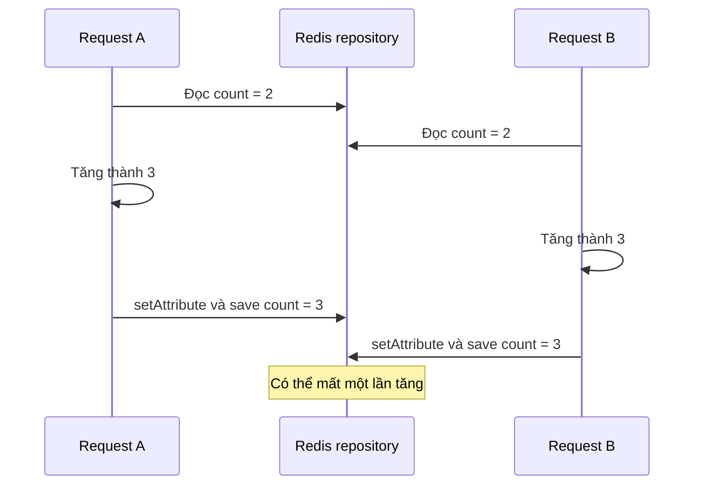

# Khi cần gán lại thuộc tính để thay đổi được ghi nhận

Khi dùng Spring Session với Redis, session attributes được lưu ở kho dữ liệu và có thể được tải lại trong request tiếp theo hoặc từ một instance Spring khác. Một tình huống dễ gây lỗi là ứng dụng lấy một object mutable từ session, sửa trực tiếp object đó rồi kết thúc request mà không gọi lại `setAttribute`. Dữ liệu trong bộ nhớ của request đã thay đổi, nhưng chính sách ghi của Spring Session có thể không nhận ra attribute cần được lưu.

Với chế độ ghi `SaveMode.ON_SET_ATTRIBUTE`, Spring Session chỉ lưu các attributes đã được đặt qua thao tác set. Vì vậy, sau khi sửa một `List`, `Map` hoặc object mutable lấy từ session, ứng dụng cần gán lại attribute bằng `setAttribute` để đánh dấu thay đổi. Bài học này giải thích lý do, cách viết mã an toàn và mối liên hệ giữa `SaveMode`, `FlushMode`, serialization và cập nhật đồng thời.

## 1. Vì sao sửa object trong session có thể không được lưu?

Session thường lưu các giá trị theo cặp tên–giá trị. Ví dụ, ứng dụng đặt danh sách sản phẩm trong giỏ hàng:

```java
HttpSession session = request.getSession();
session.setAttribute("cartItems", new ArrayList<String>());
```

Trong request sau, ứng dụng đọc danh sách và thêm sản phẩm:

```java
@PostMapping("/cart/add")
public String addItem(HttpServletRequest request) {
    HttpSession session = request.getSession();

    List<String> items = (List<String>) session.getAttribute("cartItems");
    items.add("BOOK-001");

    return "redirect:/cart";
}
```

Lệnh `items.add(...)` thay đổi object `List` mà biến `items` đang tham chiếu. Nó không gọi `HttpSession.setAttribute`. Với `SaveMode.ON_SET_ATTRIBUTE`, Spring Session theo dõi thao tác đặt attribute ở cấp session; framework không quan sát mọi phương thức nội bộ như `List.add`, `Map.put` hoặc setter của một object tùy chỉnh.

Vì vậy, request có thể kết thúc với danh sách đã thay đổi trong bộ nhớ nhưng thay đổi đó không được đánh dấu để ghi vào repository. Request tiếp theo, hoặc một instance khác, có thể tải lại giá trị cũ từ Redis.

Đây không phải lỗi của Redis. Redis chỉ lưu dữ liệu mà repository gửi đến. Vấn đề nằm ở việc ứng dụng đã sửa trạng thái bên trong object nhưng không thông báo cho cơ chế dirty tracking rằng attribute session cần được lưu.

## 2. Gán lại attribute sau khi sửa

Với `SaveMode.ON_SET_ATTRIBUTE`, cách đơn giản là gọi lại `setAttribute` sau khi thay đổi object:

```java
@PostMapping("/cart/add")
public String addItem(HttpServletRequest request) {
    HttpSession session = request.getSession();

    @SuppressWarnings("unchecked")
    List<String> items = (List<String>) session.getAttribute("cartItems");

    if (items == null) {
        items = new ArrayList<>();
    }

    items.add("BOOK-001");
    session.setAttribute("cartItems", items);

    return "redirect:/cart";
}
```

Dòng `session.setAttribute("cartItems", items)` là bước quan trọng. Nó thông báo cho wrapper `HttpSession` do Spring Session cung cấp rằng attribute `cartItems` đã được đặt và cần được xem xét khi lưu session.

Không nhất thiết phải tạo một object mới nếu kiểu dữ liệu hiện tại có thể được sử dụng an toàn. Tuy nhiên, tạo bản sao rồi gán lại thường làm luồng cập nhật rõ ràng hơn, nhất là khi cần tránh sửa object đang được thành phần khác giữ tham chiếu:

```java
@SuppressWarnings("unchecked")
List<String> current = (List<String>) session.getAttribute("cartItems");

List<String> updated = current == null
        ? new ArrayList<>()
        : new ArrayList<>(current);

updated.add("BOOK-001");
session.setAttribute("cartItems", updated);
```

Cách tạo bản sao giúp thay đổi diễn ra trên một collection mới và sau đó thay thế giá trị session bằng một lần `setAttribute`. Nó cũng làm giảm rủi ro nhiều đoạn code cùng giữ tham chiếu đến một collection rồi sửa ngoài ý muốn.

## 3. Ví dụ với Map và object tùy chỉnh

Quy tắc tương tự áp dụng cho `Map`. `put()` chỉ sửa object Map; nó không gọi API session:

```java
@SuppressWarnings("unchecked")
Map<String, Integer> preferences =
        (Map<String, Integer>) session.getAttribute("preferences");

if (preferences == null) {
    preferences = new HashMap<>();
}

preferences.put("pageSize", 50);
session.setAttribute("preferences", preferences);
```

Với object tùy chỉnh, việc gọi setter trên object cũng không đồng nghĩa với `HttpSession.setAttribute`:

```java
UserPreferences preferences =
        (UserPreferences) session.getAttribute("preferences");

if (preferences == null) {
    preferences = new UserPreferences();
}

preferences.setTheme("dark");
preferences.setLocale("vi-VN");

// Đánh dấu attribute đã thay đổi để SaveMode.ON_SET_ATTRIBUTE ghi nhận.
session.setAttribute("preferences", preferences);
```

Ví dụ giả định `UserPreferences` là kiểu dữ liệu mà serializer của ứng dụng có thể lưu và khôi phục. Khi dùng Redis, cần kiểm tra cấu hình serialization và khả năng tương thích giữa các phiên bản ứng dụng.

Nếu object chứa nhiều tầng object mutable, Spring Session cũng không tự theo dõi mọi thay đổi sâu bên trong graph. Sau khi sửa một trường lồng nhau, vẫn cần gọi `setAttribute` cho attribute gốc đang lưu object đó.

## 4. SaveMode điều khiển attribute nào được lưu

Spring Session cung cấp `SaveMode` để quyết định phạm vi attributes được ghi khi session được lưu. Các chế độ phổ biến:

| Chế độ | Hành vi | Khi nào hữu ích? |
|---|---|---|
| `ON_SET_ATTRIBUTE` | Chỉ lưu attributes đã được đặt qua thao tác set | Khi ứng dụng chủ động gọi `setAttribute` cho mọi thay đổi; giảm ghi không cần thiết |
| `ON_GET_ATTRIBUTE` | Lưu các attributes đã được lấy qua `getAttribute` | Khi ứng dụng thường đọc rồi sửa object mutable và muốn lần đọc đánh dấu attribute cần lưu |
| `ALWAYS` | Lưu tất cả attributes của session khi lưu session | Khi ưu tiên đơn giản hóa dirty tracking và chấp nhận chi phí ghi lớn hơn |

`ON_SET_ATTRIBUTE` thường là lựa chọn tiết kiệm ghi vì chỉ attributes được đặt mới được lưu. Đổi lại, ứng dụng phải tuân thủ quy tắc: sau khi sửa object mutable, gọi lại `setAttribute` cho tên attribute đó.

`ON_GET_ATTRIBUTE` có thể giúp trường hợp đọc rồi sửa object mà không gán lại, vì thao tác đọc attribute đánh dấu nó cần được lưu. Tuy nhiên, attribute chỉ cần đọc cũng có thể được ghi lại ở cuối request, làm tăng serialization và lưu trữ. Chế độ này không biến object mutable thành thread-safe và không giải quyết xung đột giữa hai request đồng thời.

`ALWAYS` ghi tất cả attributes khi session được lưu. Cách này có thể đơn giản hóa việc theo dõi thay đổi, nhưng tăng dữ liệu được tuần tự hóa và ghi vào Redis, kể cả attributes không đổi. Với session lớn hoặc request có tần suất cao, chi phí có thể đáng kể.

## 5. Cấu hình SaveMode cho Redis

Khi tự cấu hình Spring Session Redis bằng annotation, có thể chọn `SaveMode` tường minh:

```java
import org.springframework.context.annotation.Configuration;
import org.springframework.session.SaveMode;
import org.springframework.session.data.redis.config.annotation.web.http.EnableRedisHttpSession;

@Configuration
@EnableRedisHttpSession(saveMode = SaveMode.ON_SET_ATTRIBUTE)
class RedisSessionConfiguration {
}
```

Ví dụ trên dành cho ứng dụng Servlet và giả định `RedisConnectionFactory` đã được cấu hình. Nếu dùng Spring Boot auto-configuration, hãy cấu hình thuộc tính `save-mode` trong namespace Spring Session Redis phù hợp với phiên bản Boot thay vì bật thêm annotation thủ công. Tiền tố properties có thể khác giữa các thế hệ Boot; kiểm tra metadata cấu hình và tài liệu của đúng phiên bản.

Ví dụ YAML ở các phiên bản Boot sử dụng namespace `spring.session.redis`:

```yaml
spring:
  session:
    redis:
      save-mode: on-set-attribute
```

Ở dòng Spring Boot có namespace Redis Session mới hơn, thuộc tính này có thể nằm dưới `spring.session.data.redis.save-mode`. Không sao chép nguyên tiền tố giữa các major version mà chưa đối chiếu phiên bản dự án.

## 6. SaveMode khác FlushMode

Hai cấu hình thường bị nhầm là `SaveMode` và `FlushMode`, nhưng chúng trả lời hai câu hỏi khác nhau:

- `SaveMode`: **những attributes nào** được ghi khi session được lưu?
- `FlushMode`: **khi nào** các thay đổi được đẩy xuống repository?

Với Redis, `FlushMode.ON_SAVE` thường gom thay đổi và ghi khi Spring Session gọi thao tác lưu session, chẳng hạn khi hoàn tất request. `FlushMode.IMMEDIATE` đẩy thay đổi xuống kho sớm hơn, ngay khi có thao tác cập nhật phù hợp. Chế độ immediate có thể làm tăng số lần truy cập Redis.

Có thể cấu hình đồng thời hai chính sách:

```java
@Configuration
@EnableRedisHttpSession(
        saveMode = SaveMode.ON_SET_ATTRIBUTE,
        flushMode = FlushMode.ON_SAVE)
class RedisSessionConfiguration {
}
```

Với cấu hình này, ứng dụng cần đánh dấu attributes bằng thao tác set; thay đổi được ghi khi session được flush/save theo vòng đời request. Gọi `setAttribute` không có nghĩa dữ liệu đã lập tức được ghi xuống Redis nếu flush mode đang gom thay đổi đến thời điểm save.

Ngược lại, chọn `FlushMode.IMMEDIATE` không tự làm cho thay đổi sâu bên trong một object mutable được phát hiện. Nếu không có thao tác mà Spring Session theo dõi, không có gì để flush. Vì vậy, thay đổi object và chính sách thời điểm ghi phải được xử lý riêng.

## 7. Xóa attribute và thay thế giá trị

Khi muốn bỏ một attribute, dùng `removeAttribute`:

```java
session.removeAttribute("cartItems");
```

Trong Servlet API, gọi `setAttribute(name, null)` cũng có ngữ nghĩa loại bỏ attribute. Dù vậy, `removeAttribute` diễn đạt mục đích rõ ràng hơn. Không dùng việc gán `null` như cách đánh dấu một object mutable đã thay đổi.

Khi thay toàn bộ giá trị, gọi `setAttribute` với giá trị mới:

```java
session.setAttribute("cartItems", new ArrayList<>(updatedItems));
```

Khi sửa một object tại chỗ, gọi `setAttribute` với object đã sửa:

```java
preferences.setTheme("dark");
session.setAttribute("preferences", preferences);
```

Trong cả hai trường hợp, tên attribute phải đúng với tên đã lưu. Nếu đặt nhầm tên, ứng dụng có thể tạo một attribute mới trong khi giá trị cũ vẫn tồn tại.

## 8. Serialization vẫn là điều kiện bắt buộc

Gọi lại `setAttribute` chỉ giúp Spring Session nhận biết attribute cần lưu. Nó không bảo đảm mọi object đều có thể được Redis repository tuần tự hóa.

Khi lưu session trong Redis, cần bảo đảm:

- Kiểu object tương thích với serializer được cấu hình.
- Các object lồng nhau cũng có thể được tuần tự hóa.
- Cấu trúc dữ liệu tương thích giữa các instance đang chạy cùng lúc.
- Thay đổi class trong lần triển khai mới không khiến instance khác không giải mã được session cũ.
- Không lưu object lớn hoặc object graph không cần thiết trong session.

Nếu serializer lỗi, thao tác save có thể thất bại dù `setAttribute` đã được gọi. Cần quan sát exception và lỗi repository, đồng thời kiểm thử việc đọc lại attribute từ một request mới hoặc một instance khác.

## 9. Reassignment không giải quyết cập nhật đồng thời

Gán lại attribute giúp dirty tracking nhận biết thay đổi, nhưng không làm chuỗi đọc–sửa–ghi trở thành thao tác nguyên tử.

Ví dụ hai request cùng cập nhật số lượng trong giỏ hàng:

1. Request A đọc `count = 2`.
2. Request B cũng đọc `count = 2`.
3. A tăng thành 3 và gọi `setAttribute`.
4. B tăng thành 3 và gọi `setAttribute`.
5. Nếu B ghi sau A, giá trị cuối có thể là 3 thay vì 4.



Nếu dữ liệu cần cập nhật chính xác dưới tải đồng thời, hãy cân nhắc:

- Đưa dữ liệu nghiệp vụ có cập nhật cạnh tranh cao vào database với transaction phù hợp.
- Dùng thao tác nguyên tử ở Redis khi dữ liệu và quy tắc nghiệp vụ cho phép.
- Dùng khóa hoặc cơ chế kiểm soát phiên bản có thiết kế rõ ràng.
- Tránh coi session attributes là nơi lưu trữ giao dịch cho các phép cập nhật quan trọng.

Không nên giải quyết lost update bằng cách đổi từ `ON_SET_ATTRIBUTE` sang `ALWAYS`. Ghi toàn bộ attributes vẫn có thể ghi đè một bản cập nhật mới hơn bằng dữ liệu cũ.

## 10. Các mẫu code nên dùng

### Mẫu 1: Sửa tại chỗ rồi gán lại

```java
@SuppressWarnings("unchecked")
List<String> items = (List<String>) session.getAttribute("items");
if (items == null) {
    items = new ArrayList<>();
}
items.add(itemId);
session.setAttribute("items", items);
```

Mẫu này ngắn và phù hợp khi chỉ một đoạn code sở hữu việc cập nhật object trong request.

### Mẫu 2: Tạo bản sao rồi thay thế

```java
@SuppressWarnings("unchecked")
List<String> current = (List<String>) session.getAttribute("items");

List<String> next = current == null
        ? new ArrayList<>()
        : new ArrayList<>(current);

next.add(itemId);
session.setAttribute("items", next);
```

Mẫu này làm rõ giá trị trước và sau cập nhật, giảm việc sửa object đang được chia sẻ bởi nhiều tham chiếu trong cùng tiến trình.

### Mẫu 3: Dùng object bất biến

Với dữ liệu nhỏ, có thể tạo một giá trị mới thay vì sửa object hiện có:

```java
UserPreferences current =
        (UserPreferences) session.getAttribute("preferences");

UserPreferences next = current == null
        ? new UserPreferences("light", "vi-VN")
        : new UserPreferences("dark", current.getLocale());

session.setAttribute("preferences", next);
```

Ví dụ giả định `UserPreferences` được thiết kế bất biến hoặc không bị thay đổi sau khi tạo. Mẫu bất biến giúp dễ suy luận về thay đổi, nhưng vẫn cần gọi `setAttribute` để Spring Session nhận biết giá trị mới.

## 11. Kiểm thử để phát hiện attribute không được ghi

Một unit test chỉ xác nhận `List.add` đã thay đổi list trong bộ nhớ không đủ để chứng minh session đã được lưu. Cần kiểm thử qua repository hoặc request kế tiếp.

Quy trình kiểm thử tích hợp:

1. Tạo session và lưu attribute mutable ban đầu, ví dụ `items = [A]`.
2. Tải session bằng request tiếp theo.
3. Thêm `B` vào list.
4. Chạy test theo hai nhánh: một nhánh không gọi lại `setAttribute`, một nhánh gọi `setAttribute("items", items)`.
5. Hoàn tất lưu session theo flush mode đang cấu hình.
6. Tải lại session từ repository hoặc gửi request mới với cùng session ID.
7. Xác nhận nhánh có gán lại giữ được `[A, B]` với `ON_SET_ATTRIBUTE`; nhánh không gán lại có thể chỉ còn `[A]`.
8. Lặp lại với `Map` và object tùy chỉnh để kiểm tra cả object graph.

Nếu thử `ON_GET_ATTRIBUTE` hoặc `ALWAYS`, hãy viết test riêng cho chính sách tương ứng. Không suy ra hành vi của một chế độ từ test của chế độ khác.

Nên kiểm thử thêm:

- Flush mode `ON_SAVE` và `IMMEDIATE` để hiểu thời điểm dữ liệu xuất hiện trong Redis.
- Lỗi serialization khi attribute có kiểu không được hỗ trợ.
- Hai request đồng thời sửa cùng attribute.
- Request được xử lý ở instance khác để xác nhận dữ liệu đã thực sự được chia sẻ.
- TTL session để chắc chắn việc lưu thay đổi không vô tình làm sai thời hạn phiên.

## 12. Cách chẩn đoán khi thay đổi bị mất

Khi người dùng báo rằng thay đổi trong giỏ hàng hoặc preferences biến mất sau request tiếp theo, hãy kiểm tra theo trình tự:

1. Xác định session ID có giống nhau giữa hai request hay request đã tạo session mới.
2. Kiểm tra attribute có được đọc từ session và có đúng kiểu dữ liệu không.
3. Kiểm tra `SaveMode` đang dùng. Nếu là `ON_SET_ATTRIBUTE`, tìm mọi đường cập nhật object mutable và xác nhận chúng gọi `setAttribute` sau khi sửa.
4. Kiểm tra `FlushMode` để biết thay đổi được ghi ngay hay khi request hoàn tất.
5. Kiểm tra lỗi serialization, lỗi kết nối Redis và exception trong lúc save.
6. Đọc lại từ repository hoặc request mới; không chỉ kiểm tra object trong cùng request.
7. Nếu có nhiều request đồng thời, kiểm tra lost update và thứ tự ghi.
8. Nếu có nhiều instance, so sánh namespace, serializer và phiên bản ứng dụng.

Một số triệu chứng thường gặp:

| Triệu chứng | Nguyên nhân có thể | Hướng xử lý |
|---|---|---|
| List đã thêm phần tử trong controller nhưng request sau vẫn thấy list cũ | Chỉ gọi `List.add`, không gọi `setAttribute` trong `ON_SET_ATTRIBUTE` | Gán lại attribute sau khi sửa |
| `Map.put` không được lưu | Thay đổi nội bộ Map không được theo dõi | Gọi `session.setAttribute("map", map)` sau cập nhật |
| Đã gọi `setAttribute` nhưng Redis chưa đổi ngay | `FlushMode.ON_SAVE` đang gom thay đổi | Kiểm tra sau khi request hoàn tất hoặc dùng flush mode phù hợp |
| Đã gán lại nhưng save thất bại | Serialization hoặc kết nối Redis lỗi | Kiểm tra exception, serializer và kết nối |
| Một cập nhật biến mất khi hai request chạy đồng thời | Lost update do đọc–sửa–ghi | Dùng cơ chế đồng bộ hoặc kho dữ liệu nghiệp vụ phù hợp |
| Instance A thấy dữ liệu mới, instance B thấy dữ liệu cũ | Khác namespace, lỗi flush hoặc cấu hình serializer không tương thích | So sánh cấu hình và đọc lại từ repository dùng chung |

## 13. Chọn chính sách ghi phù hợp

Với session nhỏ và ứng dụng kiểm soát rõ nơi cập nhật, `ON_SET_ATTRIBUTE` là lựa chọn hiệu quả: mỗi thay đổi cần được biểu diễn bằng thao tác đặt attribute. Đây cũng là cách làm rõ ràng nhất khi object mutable được sửa trong controller hoặc service.

Chọn `ON_GET_ATTRIBUTE` nếu quy tắc ứng dụng phù hợp với việc lưu mọi attribute đã được đọc, và đã đánh giá chi phí ghi phát sinh. Chọn `ALWAYS` khi muốn lưu tất cả attributes mỗi lần session được lưu và chấp nhận chi phí serialization/Redis lớn hơn. Dù chọn chế độ nào, hãy kiểm thử trên đúng repository và phiên bản đang chạy.

Đối với object mutable, quy tắc thực hành an toàn là: đọc attribute, tạo thay đổi, rồi gọi `setAttribute` với giá trị đã cập nhật. Có thể dùng bản sao hoặc object bất biến để làm luồng cập nhật dễ kiểm soát hơn. Sau đó, để `FlushMode` quyết định thời điểm ghi theo cấu hình. Khi nhiều request có thể cập nhật cùng một giá trị, thiết kế thêm cơ chế nhất quán phù hợp; thao tác gán lại chỉ đánh dấu thay đổi, không tạo ra transaction hay khóa đồng thời.
