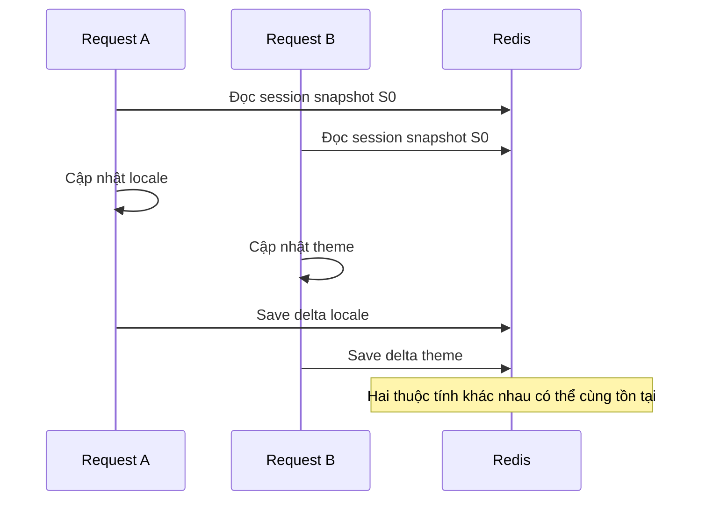

# Đánh đổi giữa số lần ghi, độ trễ và mức độ nhất quán quan sát được

Spring Session cho phép điều chỉnh cách session được ghi vào repository. Với Redis, hai chính sách quan trọng là `FlushMode` và `SaveMode`. `FlushMode` quyết định thời điểm thay đổi được đẩy xuống Redis; `SaveMode` quyết định những thuộc tính nào được đưa vào lần lưu. Hai lựa chọn này ảnh hưởng đến số lệnh Redis, độ trễ của request, thời điểm request khác nhìn thấy thay đổi và khả năng ghi đè dữ liệu khi nhiều request cùng dùng một session.

Không có một cấu hình tối ưu cho mọi ứng dụng. Một website có session nhỏ và nhiều request đọc có thể ưu tiên giảm số lần ghi. Một luồng cần cập nhật session sớm có thể chọn flush ngay hơn. Ứng dụng có nhiều request đồng thời phải hiểu rằng việc lưu session không tự tạo transaction hoặc phép cập nhật nguyên tử. Bài học này giúp chọn chính sách theo workload, nhận diện stale write/lost update và xác định dữ liệu nào không nên đặt trong session.

## 1. Vì sao chính sách ghi quan trọng?

Với Spring Session, request thường tải session từ repository, thao tác với các thuộc tính trong quá trình xử lý rồi lưu thay đổi. Khi nhiều request cùng dùng một cookie session, chúng có thể chạy đồng thời trên cùng một instance hoặc trên các instance khác nhau.

Ví dụ người dùng mở hai tab:

- Request A đọc session và cập nhật ngôn ngữ giao diện.
- Request B gần như đồng thời đọc session và cập nhật chủ đề hiển thị.
- Cả hai request lưu session vào Redis ở thời điểm khác nhau.

Nếu mỗi request ghi toàn bộ bản session cũ, request lưu sau có thể ghi đè thay đổi mà request kia vừa lưu. Nếu repository chỉ ghi những thuộc tính thực sự thay đổi, nguy cơ ghi đè một thuộc tính không liên quan sẽ giảm. Tuy nhiên, hai request cùng cập nhật một thuộc tính vẫn có thể gây lost update.

Các mục tiêu thường phải cân bằng:

| Mục tiêu | Điều cần cân nhắc |
| --- | --- |
| Giảm số lần ghi Redis | Gom thay đổi và chỉ ghi các thuộc tính cần thiết |
| Giảm độ trễ ghi | Đẩy thay đổi xuống kho sớm hơn, chấp nhận nhiều thao tác I/O hơn |
| Giảm ghi đè dữ liệu không liên quan | Chỉ lưu các thuộc tính được thay đổi thay vì toàn bộ snapshot |
| Xử lý request đồng thời | Không giả định session save có transaction hoặc read-modify-write nguyên tử |
| Giảm kích thước session | Lưu ít thuộc tính, dùng ID tham chiếu thay vì object nghiệp vụ lớn |

## 2. Phân biệt `FlushMode` và `SaveMode`

Hai chính sách giải quyết hai câu hỏi khác nhau:

- **`FlushMode`:** khi nào các thay đổi session được ghi xuống repository?
- **`SaveMode`:** thuộc tính nào được xem là cần ghi trong lần save?

Với Redis, các giá trị phổ biến là:

| Chính sách | Giá trị | Ý nghĩa |
| --- | --- | --- |
| `FlushMode` | `ON_SAVE` | Gom thay đổi và ghi khi repository thực hiện save, thường ở cuối request |
| `FlushMode` | `IMMEDIATE` | Đẩy thay đổi xuống repository sớm nhất có thể thay vì chờ lần save cuối request |
| `SaveMode` | `ON_SET_ATTRIBUTE` | Chỉ ghi các thuộc tính được đặt qua `setAttribute` hoặc API tương ứng; đây là lựa chọn mặc định phổ biến |
| `SaveMode` | `ON_GET_ATTRIBUTE` | Ghi cả những thuộc tính được đọc, ngoài các thuộc tính được đặt |
| `SaveMode` | `ALWAYS` | Ghi tất cả thuộc tính session trong lần save |

`FlushMode` tác động đến thời điểm ghi; `SaveMode` tác động đến phạm vi dữ liệu ghi. Chọn một giá trị ở mỗi nhóm. Không nên xem `IMMEDIATE` là chế độ nhất quán mạnh hoặc `ALWAYS` là bảo đảm cập nhật đồng thời không mất dữ liệu.

## 3. `FlushMode.ON_SAVE`: gom thay đổi đến cuối request

`ON_SAVE` là lựa chọn phù hợp cho nhiều ứng dụng web thông thường. Trong suốt request, Spring Session theo dõi thay đổi của session. Khi request hoàn tất và repository được yêu cầu save, những thay đổi cần ghi được gửi xuống Redis.

Ví dụ cấu hình Spring Boot:

```yaml
spring:
  session:
    timeout: 30m
    redis:
      flush-mode: on-save
      save-mode: on-set-attribute
```

Ưu điểm của `ON_SAVE`:

- Có thể gom nhiều thay đổi session trong một request.
- Giảm số lần round trip tới Redis so với ghi ngay sau mỗi thay đổi.
- Giảm overhead khi controller hoặc filter đặt nhiều thuộc tính trong cùng một request.
- Phù hợp khi thay đổi session chỉ cần được lưu khi response sắp hoàn tất.

Đánh đổi:

- Request khác có thể chưa nhìn thấy thay đổi cho đến khi request hiện tại lưu xong.
- Nếu request bị lỗi hoặc tiến trình dừng trước bước save, các thay đổi chưa flush có thể không được lưu.
- Request kéo dài có thể giữ thay đổi trong bộ nhớ lâu hơn trước khi Redis nhận được chúng.
- Nếu request khác cùng đọc và ghi session, thứ tự save cuối request có thể ảnh hưởng trạng thái cuối cùng.

Ví dụ, request A đặt `locale = "vi"` lúc bắt đầu rồi xử lý công việc mất vài giây. Request B đến trong khoảng đó có thể vẫn đọc giá trị cũ từ Redis. Với `ON_SAVE`, điều này là hệ quả của việc thay đổi chưa được ghi. Nếu nghiệp vụ yêu cầu request B phải thấy ngay cập nhật của A, cần xem xét lại cách lưu trạng thái hoặc dùng một cơ chế dữ liệu có semantics phù hợp.

## 4. `FlushMode.IMMEDIATE`: ghi thay đổi sớm hơn

`IMMEDIATE` yêu cầu Spring Session đẩy thay đổi xuống repository sớm nhất có thể. Khi thuộc tính session được đặt hoặc xóa, thay đổi có thể được gửi xuống Redis ngay trong quá trình request thay vì chờ lần save cuối.

Ví dụ:

```yaml
spring:
  session:
    redis:
      flush-mode: immediate
      save-mode: on-set-attribute
```

Ưu điểm:

- Thu hẹp khoảng thời gian thay đổi chỉ tồn tại trong bộ nhớ request.
- Request khác có cơ hội nhìn thấy thay đổi sớm hơn sau khi lệnh Redis hoàn tất.
- Có thể phù hợp khi ứng dụng cần lưu session ngay sau các thao tác thay đổi thuộc tính.

Đánh đổi:

- Có thể tạo nhiều lần ghi Redis hơn, đặc biệt khi một request thay đổi nhiều thuộc tính theo nhiều bước.
- Tăng network round trip và tải cho Redis.
- Có thể làm tăng độ trễ của chính thao tác đặt thuộc tính nếu request phải chờ ghi.
- Không tạo transaction bao trùm nhiều lần cập nhật; request khác có thể nhìn thấy trạng thái trung gian.
- Không ngăn hai request cùng ghi đè một thuộc tính hoặc cùng thực hiện read-modify-write.

Ví dụ, một request cập nhật `step = 1`, sau đó `step = 2`, rồi `step = 3`. Với ghi ngay, các trạng thái trung gian có thể lần lượt xuất hiện trong Redis. Nếu request khác đọc session giữa các lần ghi, nó có thể quan sát `step = 1` hoặc `step = 2` trước khi trạng thái cuối được lưu.

`IMMEDIATE` giảm độ trễ lưu thay đổi nhưng không đồng nghĩa với việc mọi thay đổi trong request được công bố như một giao dịch nguyên tử. Nếu cần cập nhật nhiều trường cùng nhau, hãy cân nhắc lưu một object bất biến rồi đặt lại một lần, hoặc đưa trạng thái đó vào một kho hỗ trợ transaction/atomic update phù hợp.

## 5. `SaveMode.ON_SET_ATTRIBUTE`: chỉ lưu thuộc tính được thay đổi

`ON_SET_ATTRIBUTE` là lựa chọn mặc định phổ biến của Spring Session. Repository theo dõi thuộc tính được đặt qua `setAttribute` và ghi những thuộc tính đó khi save. Thuộc tính không thay đổi không cần được ghi lại chỉ vì request đã đọc session.

Ví dụ:

```java
HttpSession session = request.getSession();
session.setAttribute("theme", "dark");
session.setAttribute("locale", "vi");
```

Với `ON_SET_ATTRIBUTE`, hai thuộc tính được đặt sẽ nằm trong tập thay đổi cần ghi. Nếu request chỉ đọc `profileSummary` mà không thay đổi, repository không cần ghi lại thuộc tính đó.

Ưu điểm:

- Giảm số thuộc tính và lượng dữ liệu được ghi.
- Giảm khả năng một request ghi đè thuộc tính mà nó chỉ đọc từ snapshot cũ.
- Phù hợp với session có nhiều thuộc tính nhưng mỗi request chỉ thay đổi một phần nhỏ.

Giới hạn quan trọng là thay đổi object mutable tại chỗ có thể không được nhận diện là một lần `setAttribute` mới.

Ví dụ dễ gây lỗi:

```java
Cart cart = (Cart) session.getAttribute("cart");
cart.add(productId);
// Không gọi setAttribute("cart", cart) lần nữa.
```

Ứng dụng đã thay đổi object `Cart` nhưng không gọi lại `setAttribute`. Với `ON_SET_ATTRIBUTE`, repository có thể không đánh dấu thuộc tính `cart` là thay đổi để ghi xuống Redis.

Cách rõ ràng hơn:

```java
Cart cart = (Cart) session.getAttribute("cart");
Cart updatedCart = cart.withItem(productId);
session.setAttribute("cart", updatedCart);
```

Hoặc nếu `Cart` là mutable:

```java
Cart cart = (Cart) session.getAttribute("cart");
cart.add(productId);
session.setAttribute("cart", cart);
```

Ưu tiên object bất biến hoặc copy-update để dễ nhận diện thay đổi và giảm chia sẻ tham chiếu không rõ ràng.

## 6. `SaveMode.ON_GET_ATTRIBUTE`: lưu cả thuộc tính được đọc

`ON_GET_ATTRIBUTE` mở rộng phạm vi save: ngoài thuộc tính được đặt, các thuộc tính được đọc qua `getAttribute` cũng được đánh dấu để lưu. Chế độ này có thể hữu ích khi ứng dụng truy cập object mutable và thay đổi object đó sau khi đọc, nhưng cần hiểu tác động đến request đồng thời.

Ví dụ:

```java
Cart cart = (Cart) session.getAttribute("cart");
cart.add(productId);
```

Khi thuộc tính `cart` đã được đọc, nó được đưa vào tập thuộc tính cần lưu theo chính sách này. Tuy nhiên, việc lưu lại object đã đọc không tự giải quyết xung đột nếu một request khác cũng đọc và cập nhật `cart`.

Giả sử hai request A và B cùng đọc `cart` ở phiên bản V1:

1. A thêm sản phẩm X vào bản cart V1.
2. B thêm sản phẩm Y vào bản cart V1.
3. A lưu cart V1+X.
4. B lưu cart V1+Y sau đó.

Trạng thái cuối có thể chỉ còn Y mà mất X, vì B ghi một snapshot được tạo từ dữ liệu cũ. `ON_GET_ATTRIBUTE` giúp thay đổi mutable object được đưa vào save; nó không hợp nhất hai phiên bản object.

Nếu chọn `ON_GET_ATTRIBUTE`, hãy kiểm thử các request song song và hạn chế lưu object mutable lớn. Trong nhiều trường hợp, gọi `setAttribute` rõ ràng sau khi tạo bản cập nhật mới vẫn dễ hiểu hơn.

## 7. `SaveMode.ALWAYS`: lưu tất cả thuộc tính

`ALWAYS` đưa tất cả thuộc tính session vào lần save, kể cả thuộc tính request không đọc hoặc không thay đổi.

Ưu điểm:

- Cách hiểu đơn giản khi ứng dụng có nhiều kiểu cập nhật thuộc tính và muốn lưu snapshot session mỗi lần save.
- Có thể phù hợp với ứng dụng nhỏ, session ít thuộc tính và yêu cầu lưu toàn bộ trạng thái.

Đánh đổi:

- Tăng lượng dữ liệu serialize và ghi Redis.
- Có thể ghi lại các thuộc tính không liên quan đến request.
- Tăng nguy cơ ghi đè thay đổi mới của request khác bằng snapshot cũ.
- Tăng tải mạng và CPU khi session chứa object lớn.

Ví dụ, request A chỉ thay đổi `locale`, nhưng snapshot của A còn chứa `theme = light`. Trong khi đó, request B đã cập nhật `theme = dark`. Nếu A lưu toàn bộ session sau B, snapshot cũ của A có thể đưa `theme` trở lại `light`. Đây là một dạng lost update do ghi snapshot rộng.

Không chọn `ALWAYS` chỉ vì muốn chắc chắn mọi thay đổi được lưu. Nó làm phạm vi ghi lớn hơn, không cung cấp optimistic locking hoặc transaction để bảo vệ cập nhật đồng thời.

## 8. So sánh các chế độ ghi

| Chế độ | Phạm vi/Thời điểm | Ưu điểm chính | Rủi ro hoặc chi phí |
| --- | --- | --- | --- |
| `ON_SAVE` | Ghi khi repository save | Gom thay đổi, giảm round trip | Thay đổi chưa được thấy cho đến khi save; có thể mất nếu request dừng trước save |
| `IMMEDIATE` | Ghi sớm sau thay đổi | Thu hẹp khoảng chờ trước khi Redis nhận thay đổi | Nhiều lệnh hơn, có thể lộ trạng thái trung gian; không chống lost update |
| `ON_SET_ATTRIBUTE` | Ghi thuộc tính được đặt | Ít dữ liệu ghi, giảm ghi đè thuộc tính không liên quan | Thay đổi mutable object tại chỗ có thể không được nhận diện |
| `ON_GET_ATTRIBUTE` | Ghi thuộc tính được đọc và đặt | Có thể lưu thay đổi object đã đọc | Có thể ghi lại snapshot cũ của thuộc tính được đọc |
| `ALWAYS` | Ghi mọi thuộc tính | Đơn giản về phạm vi dữ liệu | Write amplification và nguy cơ ghi đè snapshot lớn |

Một điểm xuất phát thường hợp lý cho ứng dụng web là `ON_SAVE` kết hợp `ON_SET_ATTRIBUTE`. Sau đó đo tải, độ trễ và hành vi concurrency trước khi thay đổi. Đây là điểm xuất phát, không phải quy tắc bắt buộc cho mọi ứng dụng.

## 9. Chính sách ghi và tính nhất quán khi nhiều request chạy đồng thời

Session dùng chung Redis có thể được đọc và ghi từ nhiều instance. Mỗi request có thể làm việc trên một bản session đã tải trước đó. Repository có thể ghi delta của request, nhưng không tự đảm bảo một chuỗi đọc-sửa-ghi là nguyên tử.

### 9.1. Hai request cập nhật cùng một thuộc tính

Giả sử `counter = 0`:

```text
Request A: đọc 0
Request B: đọc 0
Request A: tính 1 và setAttribute(counter, 1)
Request B: tính 1 và setAttribute(counter, 1)
Request A: save
Request B: save
Kết quả: counter = 1
```

Ứng dụng mong đợi giá trị 2 nhưng chỉ nhận 1. Đây là lost update. `IMMEDIATE` có thể làm từng thay đổi được ghi sớm hơn, nhưng không biến `counter++` thành thao tác nguyên tử. `ALWAYS` cũng không giải quyết; hai request vẫn có thể ghi giá trị dựa trên cùng snapshot cũ.

### 9.2. Hai request cập nhật hai thuộc tính khác nhau

Giả sử A chỉ thay `locale`, B chỉ thay `theme`. Với `ON_SET_ATTRIBUTE`, mỗi request ghi thuộc tính nó đã đặt, nên thường giảm nguy cơ A ghi đè `theme` hoặc B ghi đè `locale`. Với `ALWAYS`, mỗi request có thể ghi cả snapshot và ghi đè thay đổi của request kia.

Điều này không phải một bảo đảm giao dịch tuyệt đối. Các request còn có thể cùng thay đổi một thuộc tính, thay đổi cấu trúc object lồng nhau hoặc xóa thuộc tính trong khi request khác đặt lại. Cần thiết kế session attributes nhỏ và tránh dùng session làm nơi lưu dữ liệu nghiệp vụ có yêu cầu consistency cao.

### 9.3. Sơ đồ thứ tự ghi



Nếu cả A và B cùng ghi một thuộc tính, lệnh save đến sau thường quyết định giá trị cuối theo thứ tự Redis xử lý. Không có version check tự động trong chính sách flush/save để phát hiện mọi stale write.

## 10. Khi nào session không còn là nơi phù hợp để lưu dữ liệu?

Session phù hợp với trạng thái giao diện hoặc luồng tương tác ngắn hạn, chẳng hạn:

- Bước hiện tại của wizard.
- Ngôn ngữ hoặc lựa chọn hiển thị tạm thời.
- Một ít metadata của luồng checkout.
- Trạng thái tạm cần thiết để hoàn thành một request sequence.

Không nên lưu các dữ liệu cần cập nhật nguyên tử hoặc có giá trị nghiệp vụ quan trọng như:

- Số dư tài khoản hoặc hạn mức tín dụng.
- Số lượng tồn kho.
- Bộ đếm cần chính xác khi có nhiều request.
- Trạng thái đơn hàng và thanh toán.
- Dữ liệu chia sẻ giữa nhiều người dùng.

Đưa các dữ liệu đó vào database hoặc kho dữ liệu có cơ chế transaction, optimistic locking, atomic increment hoặc compare-and-set phù hợp. Session chỉ nên giữ ID tham chiếu hoặc trạng thái hiển thị nhỏ. Ví dụ, lưu `cartId` trong session và lưu nội dung giỏ hàng ở database nếu nhiều request/thiết bị có thể cùng sửa giỏ hàng.

## 11. Cấu hình và chọn chính sách theo workload

Ví dụ cấu hình cơ bản:

```yaml
spring:
  session:
    timeout: 30m
    redis:
      namespace: storefront:session
      flush-mode: on-save
      save-mode: on-set-attribute
```

Khi cân nhắc đổi chính sách, hãy dùng đặc điểm workload:

| Đặc điểm ứng dụng | Điểm bắt đầu cần cân nhắc | Lý do |
| --- | --- | --- |
| Nhiều request đọc session, ít request thay đổi | `ON_SAVE` + `ON_SET_ATTRIBUTE` | Chỉ ghi khi cần và chỉ ghi thuộc tính thay đổi |
| Request đặt nhiều thuộc tính trong một lần xử lý | `ON_SAVE` | Có thể gom các thay đổi trước khi ghi |
| Cần thay đổi session được lưu sớm hơn trong request | Đánh giá `IMMEDIATE` | Giảm thời gian thay đổi chỉ nằm trong bộ nhớ request |
| Ứng dụng sửa object mutable sau khi đọc mà chưa gọi lại `setAttribute` | Sửa thiết kế để gọi `setAttribute`; cân nhắc `ON_GET_ATTRIBUTE` sau khi kiểm thử | Bảo đảm thuộc tính được đưa vào save |
| Session có nhiều thuộc tính lớn | Tránh `ALWAYS`; giảm payload | Hạn chế serialize và ghi dữ liệu không liên quan |
| Có cập nhật đồng thời cùng một thuộc tính | Dùng cơ chế atomic/transaction ngoài session | Flush/save mode không ngăn lost update |

Property name và giá trị hợp lệ cần đối chiếu với phiên bản Spring Boot/Spring Session đang dùng. Nếu cấu hình repository bằng Java hoặc annotation thay vì auto-configuration, chọn cùng một chính sách ở cấu hình đó và tránh khai báo xung đột nhiều nơi.

## 12. Đo lường trước khi tối ưu

Không nên chọn `IMMEDIATE` hoặc `ALWAYS` chỉ dựa trên cảm giác. Thu thập số liệu trong môi trường gần production:

- Số lệnh ghi Redis trên mỗi request và trên mỗi session.
- Độ trễ Redis command và p95/p99 của request.
- Kích thước trung bình của session và số thuộc tính được serialize.
- Tỷ lệ request chỉ đọc session so với request thay đổi session.
- Tỷ lệ lỗi Redis, timeout và request kết thúc bất thường.
- Số trường hợp session attribute bị ghi đè hoặc mất cập nhật theo nghiệp vụ.

So sánh cùng một tập workload giữa các cấu hình. Thay một biến tại một thời điểm, giữ dữ liệu và số lượng instance tương đương, rồi đo lại. Nếu số lần ghi giảm nhưng lỗi stale update tăng, cấu hình chưa đáp ứng yêu cầu. Nếu độ trễ giảm nhưng Redis CPU và command rate tăng mạnh, cần đánh giá năng lực hạ tầng.

Không ghi session ID hoặc nội dung session vào metric label. Dùng tên endpoint, loại thao tác và correlation ID có giới hạn phù hợp để phân tích.

## 13. Kiểm thử các chính sách ghi

Nên có cả kiểm thử đơn vị và kiểm thử tích hợp với Redis:

1. **Kiểm tra `ON_SET_ATTRIBUTE`:** đặt thuộc tính, lưu session và xác nhận thuộc tính mới được đọc lại; chỉ đọc một thuộc tính khác và xác nhận ứng dụng không dựa vào việc ghi lại snapshot không thay đổi.
2. **Kiểm tra mutable object:** đọc object, sửa tại chỗ và không gọi `setAttribute`; xác nhận hành vi theo SaveMode. Sau đó gọi `setAttribute` rõ ràng và kiểm tra thay đổi được lưu.
3. **Kiểm tra `ON_GET_ATTRIBUTE`:** đọc thuộc tính, thay đổi object và xác nhận thuộc tính được đưa vào save; kiểm tra thêm trường hợp request khác đã thay đổi cùng thuộc tính.
4. **Kiểm tra `ALWAYS`:** thay đổi một thuộc tính rồi xác nhận các thuộc tính còn lại cũng được lưu; mô phỏng request song song để quan sát nguy cơ ghi đè snapshot cũ.
5. **Kiểm tra `ON_SAVE`:** trong một request test, thay đổi session nhưng chưa kết thúc request; từ request khác kiểm tra thay đổi chưa được giả định là đã lưu. Sau khi request đầu hoàn tất, xác nhận trạng thái được lưu.
6. **Kiểm tra `IMMEDIATE`:** thay đổi session và quan sát Redis trước khi request kết thúc, đồng thời đo số lệnh ghi.
7. **Kiểm tra lost update:** chạy hai request cùng đọc và cập nhật một counter; xác nhận session save không cung cấp phép tăng nguyên tử.
8. **Kiểm tra đa instance:** gửi request tới hai instance cùng Redis để bảo đảm kết quả không phụ thuộc vào bộ nhớ cục bộ của một JVM.

Với test cần điều khiển thứ tự request, dùng latch/barrier hoặc test hook thay vì `Thread.sleep` ngẫu nhiên. Dùng Redis riêng qua Testcontainers để xác minh flush, serialization và lệnh ghi thực tế. `MapSessionRepository` hữu ích cho logic đơn giản nhưng không đại diện cho write behavior của Redis repository.

## 14. Những lỗi thường gặp

- **Nhầm `FlushMode` với `SaveMode`:** một cái quyết định thời điểm flush, cái kia quyết định thuộc tính nào được lưu.
- **Cho rằng `IMMEDIATE` là strong consistency:** ghi sớm hơn không tạo transaction hay optimistic locking.
- **Dùng `ALWAYS` để tránh mất dữ liệu:** ghi snapshot rộng hơn có thể làm tăng stale overwrite.
- **Sửa object mutable mà không gọi `setAttribute`:** với `ON_SET_ATTRIBUTE`, thay đổi có thể không được theo dõi.
- **Dùng `ON_GET_ATTRIBUTE` mà không kiểm tra request đồng thời:** thuộc tính đọc từ snapshot cũ có thể được ghi lại và ghi đè thay đổi mới.
- **Lưu counter hoặc dữ liệu tài chính trong session:** read-modify-write không nguyên tử; dùng kho dữ liệu phù hợp.
- **Tối ưu chỉ theo số lần ghi:** cần đo cả độ trễ, kích thước payload, CPU Redis và lỗi concurrency.
- **Cho rằng mỗi request là tuần tự vì cùng session ID:** browser có thể gửi nhiều request song song và load balancer có thể phân phối chúng sang nhiều instance.

## 15. Checklist triển khai

Trước khi phát hành, xác nhận:

- [ ] Đã phân biệt `FlushMode` và `SaveMode`.
- [ ] Đã chọn `ON_SAVE` hoặc `IMMEDIATE` dựa trên yêu cầu độ trễ và số lần ghi.
- [ ] Đã chọn `ON_SET_ATTRIBUTE`, `ON_GET_ATTRIBUTE` hoặc `ALWAYS` dựa trên cách ứng dụng thay đổi thuộc tính.
- [ ] Không dựa vào việc sửa mutable object mà không đánh dấu thuộc tính cần lưu.
- [ ] Đã kiểm thử request song song đọc và ghi cùng một thuộc tính.
- [ ] Dữ liệu cần transaction/atomic update được lưu ngoài session.
- [ ] Đã đo Redis command rate, độ trễ, payload và tỷ lệ lỗi trên workload đại diện.
- [ ] Các instance dùng cùng cấu hình flush/save và cùng repository.
- [ ] Không log session ID hoặc toàn bộ session attributes khi đo lường.

## 16. Tự kiểm tra kiến thức

Bạn đã hiểu nội dung nếu có thể giải thích:

- `FlushMode` trả lời câu hỏi nào và `SaveMode` trả lời câu hỏi nào?
- Vì sao `ON_SAVE` thường giảm số lần ghi nhưng có thể làm request khác thấy thay đổi muộn hơn?
- `IMMEDIATE` cải thiện điều gì và không giải quyết được vấn đề gì?
- `ON_SET_ATTRIBUTE`, `ON_GET_ATTRIBUTE` và `ALWAYS` khác nhau thế nào?
- Vì sao thay đổi object mutable tại chỗ có thể không được ghi với `ON_SET_ATTRIBUTE`?
- Vì sao `ON_GET_ATTRIBUTE` hoặc `ALWAYS` có thể làm tăng nguy cơ ghi đè snapshot cũ?
- Vì sao hai request cùng tăng counter có thể làm mất một lần cập nhật dù dùng Redis?
- Khi nào cần chuyển dữ liệu khỏi session sang database hoặc cơ chế atomic update?

Chính sách ghi là một lựa chọn cân bằng giữa chi phí I/O và thời điểm thay đổi trở nên quan sát được. `ON_SAVE` cùng `ON_SET_ATTRIBUTE` thường là điểm khởi đầu tiết kiệm cho ứng dụng web; các lựa chọn khác cần được kiểm thử theo cách session được đọc, thay đổi và chia sẻ giữa request. Khi dữ liệu cần tính đúng đắn giao dịch, hãy dùng cơ chế transaction hoặc atomic update ở tầng lưu trữ nghiệp vụ thay vì kỳ vọng flush/save mode giải quyết concurrency.
