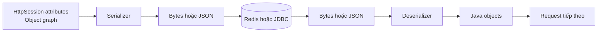

# Chuyển thuộc tính phiên thành dữ liệu lưu trữ và khôi phục lại đối tượng

Ứng dụng Servlet thường làm việc với `HttpSession` như một vùng chứa các thuộc tính Java. Ví dụ, controller có thể lưu `userId`, giỏ hàng hoặc lựa chọn ngôn ngữ bằng `session.setAttribute("cart", cart)`. Khi dùng Spring Session với Redis hoặc JDBC, các thuộc tính đó cần được chuyển thành dạng dữ liệu mà kho lưu trữ có thể ghi, rồi khôi phục thành đối tượng Java khi một request sau đọc phiên.

Quá trình chuyển đổi này gọi là *serialization* (tuần tự hóa); chiều ngược lại gọi là *deserialization* (giải tuần tự hóa). Serializer là một phần của hợp đồng lưu trữ session: mọi instance của ứng dụng cần hiểu cùng định dạng và có thể khôi phục được các kiểu dữ liệu đã được ghi bởi những instance khác hoặc phiên bản triển khai trước đó.

## 1. Tại sao thuộc tính session cần được tuần tự hóa?

Trong một ứng dụng chỉ chạy trên một JVM, thuộc tính session có thể nằm trong bộ nhớ dưới dạng object. Khi session được lưu ở Redis hoặc database, kho lưu trữ không giữ trực tiếp object Java đang tồn tại trong heap. Ứng dụng cần chuyển object graph thành bytes hoặc một biểu diễn văn bản, lưu biểu diễn đó, rồi khôi phục object khi cần.

Ví dụ, một session có thể chứa:

```java
session.setAttribute("userId", 42L);
session.setAttribute("locale", "vi-VN");
session.setAttribute("cart", cartSessionData);
```

Các giá trị trên có kiểu Java khác nhau. Serializer cần xử lý từng giá trị theo một quy tắc xác định. Khi request sau đến một instance khác, instance đó đọc dữ liệu từ repository và deserialize các thuộc tính thành object tương ứng.



Tuần tự hóa giúp session tồn tại độc lập với bộ nhớ của một instance. Nó cũng tạo ra một ranh giới tương thích: object được ghi bởi một tiến trình phải được tiến trình khác đọc được.

## 2. Quy trình lưu và khôi phục thuộc tính

Ở mức khái niệm, Spring Session quản lý vòng đời `Session` và repository chịu trách nhiệm lưu dữ liệu. Serializer xử lý biểu diễn của thuộc tính:

1. Ứng dụng gọi `setAttribute(name, value)` trên `HttpSession`.
2. Spring Session theo dõi thay đổi theo `SaveMode` và cơ chế lưu của repository.
3. Repository chuyển thuộc tính sang dạng lưu trữ bằng serializer hoặc conversion service.
4. Redis hoặc JDBC ghi dữ liệu cùng metadata phiên như ID, thời gian truy cập và thời hạn không hoạt động.
5. Request tiếp theo gửi session ID; repository tìm session và đọc dữ liệu thuộc tính.
6. Deserializer khôi phục các giá trị thành object để ứng dụng tiếp tục sử dụng.

Việc lưu có thể diễn ra khi request kết thúc hoặc theo chính sách flush của repository. Không nên giả định mọi thay đổi sâu bên trong một object mutable đều tự động được phát hiện. Với các cấu hình chỉ ghi nhận thao tác `setAttribute`, thay đổi object tại chỗ mà không gọi lại `setAttribute` có thể không được lưu như mong đợi.

## 3. Java serialization

### 3.1. Nguyên tắc hoạt động

Java serialization chuyển một object graph thành chuỗi byte theo cơ chế `ObjectOutputStream`. Để một lớp có thể được serialize theo cơ chế chuẩn, lớp đó cần triển khai `java.io.Serializable`; các object không transient được tham chiếu bên trong cũng cần serialize được.

Ví dụ DTO dùng trong session:

```java
import java.io.Serializable;
import java.util.List;

public final class CartSessionData implements Serializable {

    private static final long serialVersionUID = 1L;

    private final String cartId;
    private final List<String> productIds;

    public CartSessionData(String cartId, List<String> productIds) {
        this.cartId = cartId;
        this.productIds = List.copyOf(productIds);
    }

    public String getCartId() {
        return cartId;
    }

    public List<String> getProductIds() {
        return productIds;
    }
}
```

Lớp này triển khai `Serializable`, khai báo `serialVersionUID` rõ ràng và giữ danh sách sản phẩm ở dạng bất biến. Khi lưu:

```java
CartSessionData cart = new CartSessionData(
    "CART-908",
    List.of("P-100", "P-205")
);
session.setAttribute("cart", cart);
```

Khi đọc lại:

```java
CartSessionData cart =
    (CartSessionData) session.getAttribute("cart");
```

Kiểu dữ liệu được khôi phục phải tương thích với code đang chạy. Nếu một trường trong object graph tham chiếu đến lớp không serialize được, thao tác ghi có thể thất bại với lỗi serialization.

### 3.2. `serialVersionUID` và tương thích lớp

Java serialization dùng `serialVersionUID` để kiểm tra tương thích giữa phiên bản lớp lúc ghi và lúc đọc. Nếu không khai báo rõ, JVM có thể tính giá trị mặc định dựa trên cấu trúc lớp. Những thay đổi tưởng như nhỏ trong lớp có thể làm giá trị tự tính thay đổi.

Nên khai báo `serialVersionUID` rõ ràng cho các lớp session được serialize. Tuy nhiên, giữ cùng UID không tự động bảo đảm mọi thay đổi cấu trúc đều an toàn. Cần hiểu quy tắc tương thích của Java serialization và kiểm thử dữ liệu cũ với lớp mới.

Các rủi ro khi thay đổi lớp gồm:

- Đổi tên package hoặc lớp khiến dữ liệu cũ không tìm thấy kiểu tương ứng.
- Xóa hoặc đổi kiểu trường có thể làm dữ liệu cũ không khôi phục được hoặc mang giá trị mặc định ngoài dự kiến.
- Thêm trường mới có thể tương thích về mặt cấu trúc nhưng logic ứng dụng vẫn cần xử lý giá trị `null` hoặc mặc định.
- Thay đổi kiểu của trường, hierarchy hoặc constructor/serialization hooks có thể làm quá trình deserialize thất bại.
- Một classloader khác nhau giữa các instance có thể không tìm thấy lớp cần khôi phục.

Với rolling deployment, instance phiên bản mới có thể đọc session do phiên bản cũ ghi và ngược lại. Phải kiểm tra cả hai chiều trong giai đoạn triển khai nếu hai phiên bản cùng phục vụ traffic.

### 3.3. Những object không nên đưa vào session

Không nên lưu tùy tiện mọi object mà controller có thể truy cập. Các giá trị sau thường không phù hợp:

- `HttpServletRequest`, `HttpServletResponse`, `ServletContext` hoặc object gắn với request/thread hiện tại.
- JDBC connection, file handle, stream, socket, thread, executor hoặc tài nguyên đang mở.
- Hibernate entity/proxy lớn có lazy relationship, session ORM hoặc tham chiếu vòng phức tạp.
- Service, repository, Spring bean hoặc object chứa dependency container.
- Object mutable lớn hoặc dữ liệu nghiệp vụ có thể thay đổi đồng thời ở nhiều request.

Thay vào đó, lưu DTO nhỏ, mã định danh và các giá trị cần thiết để khôi phục ngữ cảnh. Dữ liệu nghiệp vụ chính nên nằm trong database/service nghiệp vụ; session chỉ giữ tham chiếu hoặc trạng thái tạm thời.

## 4. Serializer trong Spring Session Redis

### 4.1. Cơ chế mặc định

Spring Session Redis lưu metadata và các thuộc tính session trong Redis. Các thuộc tính object cần được chuyển thành dữ liệu byte. Cấu hình mặc định của Spring Session Redis thường dùng Java serialization thông qua `JdkSerializationRedisSerializer` cho dữ liệu thuộc tính.

Điều này có nghĩa các object lưu trong session phải đáp ứng yêu cầu của serializer mặc định. Nếu lưu một object không triển khai `Serializable`, thao tác lưu có thể phát sinh lỗi. Khi dùng nhiều instance, tất cả phải dùng serializer tương thích để đọc dữ liệu mà instance khác đã ghi.

### 4.2. Tùy chỉnh Redis serializer

Có thể cung cấp bean tên `springSessionDefaultRedisSerializer` với kiểu `RedisSerializer<Object>` để tùy chỉnh cách Spring Session Redis tuần tự hóa thuộc tính. Ví dụ dùng JSON:

```java
import org.springframework.context.annotation.Bean;
import org.springframework.context.annotation.Configuration;
import org.springframework.data.redis.serializer.GenericJackson2JsonRedisSerializer;
import org.springframework.data.redis.serializer.RedisSerializer;

@Configuration
public class SessionSerializationConfiguration {

    @Bean
    public RedisSerializer<Object> springSessionDefaultRedisSerializer() {
        return new GenericJackson2JsonRedisSerializer();
    }
}
```

Tên bean là một phần quan trọng của cơ chế cấu hình Spring Session Redis. Hãy kiểm tra tài liệu phiên bản Spring Session/Spring Data Redis đang dùng, vì API của Jackson serializer có thể thay đổi theo phiên bản thư viện.

JSON giúp dữ liệu dễ quan sát và hỗ trợ nhiều ngôn ngữ hơn Java serialization, nhưng serializer phải giữ được thông tin kiểu cần thiết để khôi phục đúng object. Một JSON object không có type metadata hoặc schema rõ ràng có thể chỉ deserialize được thành `Map`, thay vì lớp DTO ban đầu.

### 4.3. Kiểu dữ liệu và type metadata

Khi session chứa nhiều kiểu object, JSON serializer cần biết cách ánh xạ dữ liệu về kiểu Java. `GenericJackson2JsonRedisSerializer` thường lưu thông tin kiểu để khôi phục object polymorphic. Nếu tự cấu hình `ObjectMapper`, cần quyết định rõ:

- Kiểu nào được phép deserialize.
- Có cần type metadata hay không.
- Các module cho `java.time`, collection và kiểu miền được đăng ký thế nào.
- Cách xử lý kiểu cũ khi lớp được đổi package hoặc thay đổi schema.
- Có giới hạn/allowlist kiểu để tránh deserialize lớp ngoài dự kiến hay không.

Không bật polymorphic default typing một cách rộng rãi cho dữ liệu đến từ nguồn không tin cậy. JSON chứa type metadata có thể khiến deserializer cố khởi tạo kiểu mà ứng dụng không mong muốn nếu cấu hình quá mở. Chỉ deserialize dữ liệu từ kho được bảo vệ, giới hạn các kiểu hợp lệ và dùng cấu hình an toàn theo hướng dẫn của Jackson/Spring Data Redis.

## 5. Serializer trong Spring Session JDBC

Spring Session JDBC lưu metadata session trong các bảng session và lưu thuộc tính trong bảng thuộc tính với cột byte/binary tương ứng. Cơ chế mặc định sử dụng Java serialization thông qua các converter của Spring để chuyển object thành byte array và ngược lại.

Nếu dùng JDBC repository với serializer mặc định, các thuộc tính cần serialize được bằng Java serialization. Khi một request đến instance khác, repository đọc byte array từ database và converter khôi phục object. Các instance phải có class tương thích và cùng hiểu định dạng dữ liệu đã lưu.

Spring Session JDBC cho phép tùy chỉnh `ConversionService` được repository dùng để chuyển đổi thuộc tính. Với các phiên bản hỗ trợ thuộc tính `conversionServiceRef` trên `@EnableJdbcHttpSession`, có thể chỉ định bean conversion service riêng:

```java
@Configuration
@EnableJdbcHttpSession(
    conversionServiceRef = "springSessionConversionService"
)
public class JdbcSessionConfiguration {
}
```

Bean được tham chiếu cần đăng ký converter phù hợp cho hai chiều giữa object session và byte array. Ví dụ nền tảng dùng converter Java serialization:

```java
@Bean
public ConversionService springSessionConversionService() {
    DefaultConversionService conversionService =
        new DefaultConversionService();
    conversionService.addConverter(new SerializingConverter());
    conversionService.addConverter(new DeserializingConverter());
    return conversionService;
}
```

Các class converter thuộc Spring Core. Đoạn mã minh họa cách tạo conversion service với converter Java serialization; nếu thay bằng JSON hoặc định dạng riêng, cần đăng ký converter object-to-bytes và bytes-to-object phù hợp với kiểu dữ liệu, đồng thời xác nhận annotation/API đúng phiên bản dự án.

Không nhầm `ConversionService` của JDBC với bean `springSessionDefaultRedisSerializer` của Redis. Đây là hai điểm mở rộng khác nhau. Cấu hình serializer cho Redis không tự động thay đổi cách JDBC lưu thuộc tính.

## 6. Chọn Java serialization hay JSON?

| Tiêu chí | Java serialization | JSON serialization |
|---|---|---|
| Tính tiện dụng với object Java | Tốt khi toàn bộ object graph triển khai `Serializable` | Cần cấu hình mapping và kiểu phù hợp |
| Khả năng đọc dữ liệu | Dạng byte, khó kiểm tra trực tiếp | Có thể quan sát bằng công cụ văn bản nếu không mã hóa |
| Phụ thuộc ngôn ngữ | Gắn chặt với Java và class name | Dễ trao đổi hơn giữa các ngôn ngữ |
| Tương thích phiên bản | Nhạy với thay đổi class và `serialVersionUID` | Phụ thuộc schema, tên trường và type metadata |
| Dung lượng | Có thể lớn do metadata Java serialization | Thường dễ tối ưu cấu trúc, nhưng kích thước phụ thuộc dữ liệu |
| Bảo mật | Deserialize dữ liệu không tin cậy có rủi ro | Polymorphic type metadata cũng cần giới hạn kiểu |
| Khả năng migration | Khó nếu đổi class/package hoặc format | Có thể version schema và chuyển đổi có chủ đích |

Không có lựa chọn tốt nhất cho mọi hệ thống. Java serialization đơn giản khi ứng dụng thuần Java và DTO ổn định. JSON phù hợp khi cần khả năng quan sát, tương tác đa ngôn ngữ hoặc schema có kiểm soát. Cả hai đều yêu cầu quản lý tương thích giữa các phiên bản ứng dụng.

## 7. Thiết kế DTO phù hợp cho session

DTO trong session nên nhỏ, ổn định và chỉ chứa dữ liệu cần thiết cho request tiếp theo. Ví dụ:

```java
public final class UserSessionContext implements Serializable {

    private static final long serialVersionUID = 1L;

    private final String userId;
    private final String locale;
    private final long authenticatedAtEpochSecond;

    public UserSessionContext(
            String userId,
            String locale,
            long authenticatedAtEpochSecond) {
        this.userId = userId;
        this.locale = locale;
        this.authenticatedAtEpochSecond = authenticatedAtEpochSecond;
    }

    public String getUserId() { return userId; }
    public String getLocale() { return locale; }
    public long getAuthenticatedAtEpochSecond() {
        return authenticatedAtEpochSecond;
    }
}
```

Lưu DTO:

```java
session.setAttribute("userContext", userSessionContext);
```

Tránh đưa toàn bộ entity `User` hoặc `Order` vào session. Entity có thể mang theo proxy ORM, quan hệ lazy, trường nội bộ và nhiều dữ liệu không cần thiết. Lưu `userId` hoặc `orderId`, sau đó truy vấn dữ liệu nghiệp vụ qua service khi cần. Cách này giảm kích thước session và tránh dùng một snapshot cũ làm nguồn dữ liệu chuẩn.

Với collection, ưu tiên cấu trúc đơn giản và kiểm soát kích thước. Không lưu danh sách hàng nghìn sản phẩm hoặc object graph lồng nhau nếu chỉ cần một mã giỏ hàng để truy vấn lại.

## 8. Cập nhật thuộc tính và SaveMode

Spring Session có chính sách lưu thay đổi thuộc tính. Tùy repository và `SaveMode`, thay đổi có thể được ghi khi gọi `setAttribute`, khi session được commit hoặc theo cách lưu của implementation.

Ví dụ nên tạo object mới và đặt lại thuộc tính:

```java
CartSessionData current =
    (CartSessionData) session.getAttribute("cart");

List<String> nextProducts = new ArrayList<>(current.getProductIds());
nextProducts.add("P-310");

CartSessionData updated = new CartSessionData(
    current.getCartId(),
    nextProducts
);
session.setAttribute("cart", updated);
```

Thay đổi object mới rồi gọi `setAttribute` làm cho ý định cập nhật rõ ràng và tương thích tốt hơn với các chế độ chỉ ghi nhận thao tác set. Nếu sửa trực tiếp collection mutable bên trong session mà không gọi lại `setAttribute`, repository có thể không nhận ra thay đổi tùy `SaveMode`.

Các chế độ như `ON_SET_ATTRIBUTE`, `ON_GET_ATTRIBUTE` hoặc `ALWAYS` có ý nghĩa khác nhau về thời điểm lưu và có thể ảnh hưởng hiệu năng. Hãy đọc tài liệu của phiên bản Spring Session đang dùng và chọn chế độ phù hợp với kiểu truy cập session của ứng dụng.

## 9. Thay đổi serializer và migration dữ liệu đang tồn tại

Đổi từ Java serialization sang JSON không chỉ là thay một bean cấu hình. Redis/JDBC có thể đang chứa session do phiên bản cũ ghi. Nếu phiên bản mới đọc bằng serializer khác, dữ liệu cũ có thể không deserialize được và người dùng bị mất phiên hoặc request phát sinh lỗi.

Một chiến lược migration cần xem xét:

1. **Kiểm kê dữ liệu:** xác định store, namespace, kiểu thuộc tính, serializer hiện tại và thời gian sống tối đa của session.
2. **Ổn định DTO:** tránh đổi package/class name và schema trong cùng đợt thay serializer nếu có thể.
3. **Kiểm thử đọc dữ liệu cũ:** lấy mẫu session đã được ghi bởi phiên bản đang chạy và xác nhận phiên bản mới đọc được.
4. **Triển khai tương thích:** trong rolling deployment, mọi instance cùng phục vụ một namespace cần đọc được định dạng mà các instance khác ghi.
5. **Chuyển đổi có kiểm soát:** nếu cần hỗ trợ hai format, thiết kế lớp đọc nhiều định dạng và ghi format mới; không giả định Spring Session tự động làm dual-read/dual-write.
6. **Đặt thời hạn kết thúc:** chờ session cũ hết TTL hoặc chủ động migration/xóa theo kế hoạch đã thông báo.
7. **Theo dõi lỗi:** đo deserialize failure, session lookup failure và tỷ lệ đăng nhập lại sau triển khai.

Với thay đổi không tương thích, lựa chọn an toàn đôi khi là kết thúc session cũ theo một đợt có kế hoạch và yêu cầu người dùng đăng nhập lại. Cần cân nhắc tác động trải nghiệm, yêu cầu bảo mật và khả năng phục hồi trước khi chọn cách này.

## 10. Serialization trong hệ thống nhiều instance

Khi nhiều instance cùng truy cập Redis hoặc JDBC, serializer trở thành hợp đồng giữa các instance. Mọi instance cần thống nhất:

- Serializer/deserializer và cấu hình type metadata.
- Phiên bản DTO và classpath chứa các lớp được lưu.
- Quy tắc encoding, charset, timezone và định dạng thời gian.
- Cách xử lý trường thiếu, trường mới và giá trị `null`.
- Namespace Redis hoặc schema JDBC tương ứng.
- Chính sách triển khai khi hai phiên bản ứng dụng cùng chạy.

Ví dụ lỗi thường gặp: instance A dùng JSON serializer có type metadata, instance B dùng Java serialization. A ghi một thuộc tính, B đọc cùng session nhưng không thể khôi phục bytes theo định dạng của A. Session metadata có thể vẫn tồn tại, nhưng truy cập thuộc tính gây lỗi.

Để giảm rủi ro, đặt cấu hình serializer ở một module cấu hình dùng chung, kiểm thử integration bằng hai application context với cùng store và giữ DTO tương thích trong suốt thời gian rolling deployment.

## 11. Bảo mật dữ liệu được tuần tự hóa

Session thường chứa thông tin xác thực hoặc trạng thái người dùng. Dữ liệu được lưu ở Redis/JDBC cần được bảo vệ ở cả tầng lưu trữ và tầng ứng dụng:

- Giới hạn quyền truy cập Redis/database theo service account và network policy.
- Dùng TLS khi kết nối qua mạng và mã hóa at-rest theo khả năng hạ tầng.
- Không lưu mật khẩu dạng rõ, private key, access token dài hạn hoặc dữ liệu nhạy cảm không cần thiết trong session.
- Không deserialize dữ liệu từ nguồn mà người dùng hoặc bên ngoài có thể tùy ý ghi.
- Với Java serialization, chỉ đọc dữ liệu từ kho đáng tin cậy và cân nhắc giới hạn kiểu được phép.
- Với JSON polymorphic typing, cấu hình allowlist kiểu và tránh bật default typing quá rộng.
- Không ghi bytes, payload session hoặc object nhạy cảm vào log khi điều tra lỗi.

Serialization không phải mã hóa. Chuyển object thành bytes hoặc JSON không làm nội dung bí mật. Nếu cần mã hóa thuộc tính session ở tầng ứng dụng, phải thiết kế quản lý khóa, xoay vòng và tương thích giải mã riêng.

## 12. Kiểm thử serialize/deserialize

Một kiểm thử đơn vị cơ bản xác nhận serializer có thể round-trip một DTO:

```java
@Test
void cartSessionDataCanBeSerializedAndRestored() {
    CartSessionData original = new CartSessionData(
        "CART-908",
        List.of("P-100", "P-205")
    );

    byte[] bytes = serializer.serialize(original);
    Object restored = serializer.deserialize(bytes);

    assertInstanceOf(CartSessionData.class, restored);
    CartSessionData actual = (CartSessionData) restored;
    assertEquals(original.getCartId(), actual.getCartId());
    assertEquals(original.getProductIds(), actual.getProductIds());
}
```

Tên `serializer` trong ví dụ là serializer được inject trong test. Cần chọn đúng serializer theo Redis hoặc converter theo JDBC. Kiểm thử này chỉ chứng minh round-trip trong cùng phiên bản code.

Kiểm thử tích hợp cần xác nhận:

1. Tạo session và ghi nhiều kiểu thuộc tính.
2. Lưu session qua repository Redis/JDBC thực.
3. Đọc session trong application context hoặc instance thứ hai.
4. Xác nhận lớp, trường và giá trị khôi phục đúng.
5. Kiểm thử dữ liệu được ghi bởi phiên bản DTO trước.
6. Kiểm thử thuộc tính không serialize được và xác nhận lỗi được phát hiện, ghi nhận rõ.
7. Kiểm thử dữ liệu JSON thiếu trường, trường mới hoặc kiểu không được phép.
8. Kiểm thử nhiều request cùng cập nhật session và xác minh chính sách SaveMode.

Với Redis, có thể dùng Redis container trong integration test. Với JDBC, dùng database test có schema Spring Session tương ứng. Mock repository không thể xác nhận serializer thực sự được dùng ở ranh giới lưu trữ.

## 13. Lỗi thường gặp

| Biểu hiện | Nguyên nhân có thể | Hướng xử lý |
|---|---|---|
| `NotSerializableException` | Object hoặc object lồng bên trong không triển khai `Serializable` | Thay bằng DTO serialize được hoặc cấu hình serializer khác |
| `InvalidClassException` | `serialVersionUID` hoặc cấu trúc lớp không tương thích | Kiểm tra phiên bản DTO và kế hoạch migration |
| Không tìm thấy class khi deserialize | Đổi package/class hoặc classpath khác giữa instance | Giữ lớp tương thích hoặc chuyển đổi dữ liệu có kế hoạch |
| JSON khôi phục thành `Map` thay vì DTO | Thiếu type metadata hoặc mapping đích | Cấu hình type mapping/serializer rõ ràng |
| JSON deserialize thất bại sau deploy | Thay tên trường, kiểu dữ liệu hoặc module Jackson | Kiểm thử schema cũ/mới và thêm migration tương thích |
| Session lưu được nhưng request khác lỗi khi đọc attribute | Các instance dùng serializer khác nhau | Đồng bộ cấu hình và phiên bản serializer |
| Thay đổi object không được lưu | Mutate tại chỗ không được SaveMode phát hiện | Tạo object mới và gọi `setAttribute` |
| Session phình to hoặc Redis/JDBC chậm | Lưu entity hoặc object graph quá lớn | Chỉ lưu ID/DTO tối thiểu và truy vấn dữ liệu nghiệp vụ khi cần |
| Deserialize gây rủi ro bảo mật | Đọc dữ liệu không tin cậy hoặc type metadata quá rộng | Giới hạn nguồn dữ liệu và kiểu được phép |

## 14. Nguyên tắc áp dụng

- Xem serializer là hợp đồng dữ liệu giữa mọi instance và các phiên bản ứng dụng.
- Lưu DTO nhỏ, ổn định; tránh entity ORM, proxy và tài nguyên gắn với request/thread.
- Hiểu serializer mặc định của repository: Redis thường dùng Java serialization; JDBC mặc định dùng converter Java serialization.
- Nếu tùy chỉnh Redis, dùng bean `springSessionDefaultRedisSerializer` theo API của phiên bản đang chạy.
- Nếu tùy chỉnh JDBC, cấu hình `ConversionService` và converter hai chiều phù hợp.
- Giữ serializer, classpath và schema tương thích giữa các instance trong rolling deployment.
- Khi đổi format, có kế hoạch đọc dữ liệu cũ, chuyển đổi hoặc kết thúc session có kiểm soát.
- Không nhầm serialization với mã hóa; bảo vệ Redis/database và giới hạn kiểu deserialize.
- Kiểm thử round-trip, dữ liệu phiên bản cũ, nhiều instance và thay đổi đồng thời bằng repository thật.

Thuộc tính `HttpSession` là object trong mã ứng dụng, nhưng khi dùng Spring Session với Redis hoặc JDBC, chúng trở thành dữ liệu lưu trữ cần một định dạng ổn định. Chọn DTO phù hợp, hiểu serializer của từng repository, đồng bộ cấu hình giữa các instance và kiểm thử tương thích phiên bản giúp session được khôi phục đúng sau khi request chuyển sang máy chủ khác hoặc ứng dụng được triển khai bản mới.
