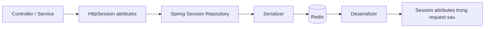
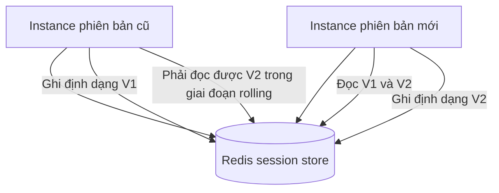

# Java Serialization, JSON và các đánh đổi về kích thước, tương thích

Spring Session lưu các attribute của `HttpSession` vào kho dữ liệu để request ở instance khác có thể đọc lại. Trước khi ghi, các giá trị này phải được tuần tự hóa thành dạng dữ liệu mà Redis hoặc kho lưu trữ có thể giữ; khi đọc, chúng phải được giải tuần tự hóa thành kiểu mà ứng dụng hiểu được. Lựa chọn Java Serialization hay JSON ảnh hưởng đến kích thước session, tốc độ đọc/ghi, khả năng tương thích khi triển khai phiên bản mới và rủi ro bảo mật.

Trong ứng dụng Spring Session Redis, cấu hình mặc định thường dùng Java/JDK serialization cho đối tượng session. Có thể thay serializer mặc định bằng JSON thông qua bean `springSessionDefaultRedisSerializer`. Quyết định này cần được đưa ra cùng thiết kế kiểu attribute, cách quản lý phiên bản dữ liệu và chiến lược triển khai nhiều instance. Serializer không chỉ là chi tiết kỹ thuật của Redis: một instance mới phải đọc được session do instance cũ đã ghi, ít nhất trong khoảng thời gian hai phiên bản cùng hoạt động.

## 1. Vì sao session cần tuần tự hóa?

Trong một request, ứng dụng làm việc với đối tượng Java như `HttpSession`, DTO hoặc collection. Redis không lưu trực tiếp đối tượng Java đang nằm trong heap của JVM. Spring Session chuyển các attribute thành byte hoặc cấu trúc dữ liệu phù hợp, lưu vào Redis, rồi tạo lại giá trị khi request sau đọc session.



Ví dụ, controller lưu một `CheckoutContext` vào session. Ở request tiếp theo, một instance khác có thể tải session từ Redis và khôi phục `CheckoutContext`. Điều này chỉ thành công nếu instance ghi và instance đọc dùng định dạng tương thích, cùng hiểu kiểu dữ liệu và các trường cần thiết.

Có ba khái niệm cần phân biệt:

- **Serialization:** chuyển đối tượng hoặc giá trị trong bộ nhớ thành byte/biểu diễn lưu trữ.
- **Deserialization:** đọc biểu diễn lưu trữ và tái tạo giá trị/đối tượng.
- **Schema hoặc cấu trúc dữ liệu:** quy ước về tên trường, kiểu, phiên bản và ý nghĩa của dữ liệu đã lưu.

Serializer không làm cho dữ liệu trở thành dữ liệu nghiệp vụ bền vững. Session vẫn có thể hết hạn, bị xóa khi logout hoặc bị loại bỏ theo chính sách Redis. Dữ liệu cần tồn tại lâu dài phải được lưu trong cơ sở dữ liệu nghiệp vụ.

## 2. Java Serialization hoạt động như thế nào?

Java Serialization là cơ chế chuẩn của Java để chuyển đối tượng thuộc lớp triển khai `java.io.Serializable` thành luồng byte. Khi dùng `JdkSerializationRedisSerializer`, dữ liệu được mã hóa theo định dạng serialization của Java và có thể được tái tạo thành đối tượng tương ứng ở JVM khác.

Một lớp đơn giản có thể được lưu trong session như sau:

```java
import java.io.Serial;
import java.io.Serializable;

public class CheckoutContext implements Serializable {
    @Serial
    private static final long serialVersionUID = 1L;

    private String cartId;
    private String deliveryOption;
    private int currentStep;

    public CheckoutContext() {
    }

    public CheckoutContext(String cartId,
                            String deliveryOption,
                            int currentStep) {
        this.cartId = cartId;
        this.deliveryOption = deliveryOption;
        this.currentStep = currentStep;
    }

    public String getCartId() {
        return cartId;
    }

    public String getDeliveryOption() {
        return deliveryOption;
    }

    public int getCurrentStep() {
        return currentStep;
    }
}
```

Lưu đối tượng vào session:

```java
CheckoutContext context = new CheckoutContext("cart-1024", "standard", 2);
session.setAttribute("checkout.context", context);
```

Với Java Serialization, các đối tượng nằm trong object graph cần tuần tự hóa phải tương thích với cơ chế serialization. Nếu một thuộc tính tham chiếu đến đối tượng không thể tuần tự hóa, thao tác lưu có thể thất bại với `NotSerializableException`. Vì vậy, không nên đưa entity JPA, proxy lazy, stream, socket, connection hoặc đối tượng gắn với tài nguyên runtime vào session.

### Vai trò của `serialVersionUID`

`serialVersionUID` định danh phiên bản serialization của một lớp. Khi giải tuần tự hóa, JVM so sánh UID trong dữ liệu đã lưu với UID của lớp hiện tại. Nếu không tương thích, có thể phát sinh `InvalidClassException`.

Nên khai báo UID tường minh thay vì để JVM tự tính từ cấu trúc lớp. Nếu không khai báo, một thay đổi tưởng như nhỏ trong khai báo lớp có thể làm UID được tính tự động thay đổi và khiến session cũ không đọc được.

```java
@Serial
private static final long serialVersionUID = 1L;
```

Giữ nguyên UID không đảm bảo mọi thay đổi cấu trúc đều tương thích. Ví dụ, đổi kiểu một trường, thay đổi quan hệ lớp hoặc thay đổi ý nghĩa dữ liệu vẫn có thể gây lỗi hoặc tạo giá trị sai. UID chỉ là một phần của cơ chế kiểm tra tương thích, không thay thế kiểm thử dữ liệu cũ.

### Thay đổi lớp và dữ liệu cũ

Java Serialization có một số quy tắc tương thích cho thay đổi lớp, nhưng cần đánh giá từng trường hợp:

- Thêm trường mới thường cho phép lớp mới đọc dữ liệu cũ; trường mới nhận giá trị mặc định nếu dữ liệu cũ không có trường đó.
- Xóa trường có thể được lớp mới bỏ qua khi đọc dữ liệu cũ.
- Đổi tên lớp hoặc package thường làm dữ liệu cũ không còn tìm thấy lớp tương ứng.
- Đổi kiểu trường hoặc thay đổi cấu trúc kế thừa có thể làm deserialization thất bại.
- Thay đổi `serialVersionUID` có thể gây `InvalidClassException`.
- Thay đổi ý nghĩa của trường mà vẫn giữ cùng kiểu có thể đọc thành công nhưng dữ liệu mang nghĩa cũ.

Ví dụ, phiên cũ chứa `currentStep = 2` nhưng phiên bản mới diễn giải số 2 thành một bước nghiệp vụ khác. JVM có thể đọc thành công, nhưng ứng dụng vẫn xử lý sai. Tương thích cú pháp không đồng nghĩa tương thích ngữ nghĩa.

## 3. JSON serialization

JSON biểu diễn dữ liệu bằng object, array, string, number, boolean và `null`. Nó dễ quan sát hơn byte stream của Java Serialization và có thể được đọc bằng nhiều ngôn ngữ. JSON thường phù hợp khi session attribute có cấu trúc rõ ràng, dùng DTO nhỏ và cần hỗ trợ triển khai nhiều phiên bản ứng dụng.

Ví dụ JSON cho `CheckoutContext`:

```json
{
  "cartId": "cart-1024",
  "deliveryOption": "standard",
  "currentStep": 2
}
```

JSON không tự lưu thông tin đầy đủ về lớp Java cần khôi phục. Khi dùng một serializer cho nhiều kiểu attribute khác nhau, cần quy ước type metadata hoặc dùng cấu trúc dữ liệu có kiểu được xác định trước. Nếu serializer ghi tên lớp Java vào JSON, đổi package hoặc đổi tên lớp cũng có thể ảnh hưởng đến việc đọc dữ liệu cũ.

### JSON với DTO có cấu trúc ổn định

Nên dùng các DTO nhỏ, chỉ chứa dữ liệu cần cho request tiếp theo:

```java
public record CheckoutContextJson(
        String cartId,
        String deliveryOption,
        int currentStep,
        int schemaVersion) {
}
```

Trường `schemaVersion` giúp ứng dụng nhận biết định dạng dữ liệu đã lưu. Khi cấu trúc thay đổi, có thể viết logic chuyển đổi từ phiên bản cũ sang phiên bản mới hoặc khôi phục một giá trị mặc định an toàn.

Jackson có thể chuyển DTO thành JSON và đọc JSON thành kiểu được chỉ định. Với kiểu cố định, serializer có thể biết chính xác lớp đích. Tuy nhiên, Spring Session thường lưu nhiều attribute có kiểu khác nhau trong cùng session, nên cấu hình serializer tổng quát cần xử lý thông tin kiểu một cách an toàn.

## 4. Cấu hình JSON serializer cho Spring Session Redis

Trong Spring Session Redis, có thể cung cấp bean `RedisSerializer<Object>` với tên `springSessionDefaultRedisSerializer` để thay serializer mặc định dùng cho attribute. Ví dụ cơ bản:

```java
import org.springframework.context.annotation.Bean;
import org.springframework.context.annotation.Configuration;
import org.springframework.data.redis.serializer.GenericJackson2JsonRedisSerializer;
import org.springframework.data.redis.serializer.RedisSerializer;

@Configuration
class SessionSerializationConfiguration {

    @Bean
    RedisSerializer<Object> springSessionDefaultRedisSerializer() {
        return new GenericJackson2JsonRedisSerializer();
    }
}
```

Bean có tên chính xác `springSessionDefaultRedisSerializer` được Spring Session Redis nhận diện trong cấu hình tương ứng. `GenericJackson2JsonRedisSerializer` được thiết kế cho các giá trị có kiểu khác nhau và sử dụng thông tin kiểu để tái tạo đối tượng. Cách cấu hình chi tiết và API serializer có thể thay đổi theo phiên bản Spring Data Redis/Spring Session; cần dùng phiên bản đồng bộ với Spring Boot của ứng dụng.

Nếu dùng JSON serializer tổng quát, hãy hiểu rõ cách type metadata được tạo và đọc. Deserialization đa hình có thể trở thành rủi ro nếu dữ liệu Redis có thể bị người không đáng tin cậy ghi vào. Khi tự cấu hình `ObjectMapper` và polymorphic typing, hãy giới hạn kiểu được phép bằng validator/allowlist cho các DTO cần thiết; không bật default typing không giới hạn cho mọi lớp trên classpath.

Ví dụ trên dùng constructor mặc định để minh họa điểm mở rộng của Spring Session, không phải khuyến nghị bỏ qua chính sách bảo mật kiểu dữ liệu. Với hệ thống có yêu cầu kiểm soát chặt, nên xây dựng serializer có allowlist rõ ràng, chỉ hỗ trợ các kiểu attribute đã định nghĩa và kiểm thử các payload không được phép.

### Cấu hình serializer với Spring Boot

Trong Spring Boot, có thể khai báo cùng bean trong một lớp `@Configuration`; auto-configuration Spring Session Redis sẽ dùng bean có tên quy ước nếu phiên bản đang dùng hỗ trợ điểm mở rộng đó:

```java
import org.springframework.context.annotation.Bean;
import org.springframework.context.annotation.Configuration;
import org.springframework.data.redis.serializer.GenericJackson2JsonRedisSerializer;
import org.springframework.data.redis.serializer.RedisSerializer;

@Configuration
class SessionJsonConfiguration {

    @Bean
    RedisSerializer<Object> springSessionDefaultRedisSerializer() {
        return new GenericJackson2JsonRedisSerializer();
    }
}
```

Không cần khai báo `@EnableRedisHttpSession` chỉ để thay serializer trong ứng dụng Boot đã dùng auto-configuration. Nếu cấu hình session thủ công, đặt bean serializer trong application context mà Redis session repository sử dụng. Không tạo nhiều bean cùng tên hoặc nhiều repository với serializer khác nhau một cách vô tình.

## 5. So sánh Java Serialization và JSON

Không có định dạng nào tốt nhất cho mọi ứng dụng. Lựa chọn cần dựa trên kiểu attribute, quy mô session, thời gian tồn tại của dữ liệu và cách triển khai phiên bản.

| Tiêu chí | Java/JDK Serialization | JSON |
|---|---|---|
| Dạng lưu | Byte stream nhị phân | Văn bản có cấu trúc |
| Khả năng quan sát | Khó đọc trực tiếp | Dễ đọc và kiểm tra hơn |
| Phụ thuộc Java class | Cao; cần lớp tương thích khi đọc | Có thể giảm phụ thuộc nếu dùng schema DTO ổn định |
| Metadata kiểu | Gắn với cơ chế Java Serialization | Cần kiểu đích hoặc type metadata khi có nhiều kiểu |
| Tương thích thay đổi lớp | Phụ thuộc UID và quy tắc serialization | Phụ thuộc tên trường, kiểu dữ liệu và chính sách schema |
| Kích thước | Nhị phân nhưng có overhead object graph/class descriptor | Có thể lớn do tên trường và ký tự; có thể nén |
| Đa ngôn ngữ | Không thuận tiện | Dễ tích hợp với hệ thống khác |
| Rủi ro chính | Deserialization gadget và phụ thuộc lớp | Polymorphic deserialization và schema/type mismatch |
| Phù hợp | Ứng dụng Java đồng nhất, lớp ổn định, thời gian lưu ngắn | DTO có cấu trúc, cần quan sát và kiểm soát schema |

JSON không mặc nhiên nhỏ hơn hoặc nhanh hơn Java Serialization. Tên trường lặp lại có thể làm JSON lớn hơn; Java Serialization cũng có metadata và tham chiếu object graph. Hiệu năng phụ thuộc kích thước object, số lượng attribute, serializer, CPU, network và Redis. Hãy đo trên dữ liệu thật thay vì chọn theo cảm giác.

## 6. Kích thước session và chi phí Redis

Mỗi session được lưu có chi phí bộ nhớ, network và thao tác serialize/deserialize. Một session lớn làm tăng:

- Dung lượng Redis cần cấp phát.
- Byte truyền giữa application instance và Redis.
- CPU để serialize và deserialize.
- Thời gian đọc/ghi ở request.
- Thời gian replication, backup và phục hồi dữ liệu.
- Nguy cơ vượt giới hạn kích thước request/response hoặc làm tăng latency đột biến.

Ví dụ, lưu toàn bộ giỏ hàng với hàng trăm dòng, entity sản phẩm và ảnh nhúng trong session sẽ tốn kém hơn nhiều so với lưu một `cartId`. Session nên giữ ngữ cảnh cần thiết cho request kế tiếp, còn dữ liệu nghiệp vụ có cấu trúc lớn nên nằm trong database hoặc object storage.

### Nên đo gì?

Khi so sánh serializer, đo ít nhất:

1. Kích thước byte sau serialization của một session điển hình và session lớn.
2. Thời gian serialize/deserialize ở mức percentile phù hợp.
3. CPU của application instance khi tải tăng.
4. Redis memory usage và lượng dữ liệu truyền qua mạng.
5. Tác động khi có nhiều session được đọc/ghi đồng thời.
6. Tác động của việc thêm trường hoặc thay đổi cấu trúc DTO.

Compression có thể giảm byte truyền và dung lượng, nhưng làm tăng CPU và có thể tăng latency. Chỉ bật khi số liệu đo cho thấy lợi ích rõ ràng. Tránh nén các payload rất nhỏ vì overhead có thể lớn hơn phần tiết kiệm.

## 7. Tương thích khi triển khai nhiều phiên bản

Trong rolling deployment, instance cũ và instance mới có thể chạy đồng thời. Cả hai cùng đọc/ghi session trong Redis. Một session do phiên bản mới ghi có thể được request chuyển đến instance cũ đọc ngay sau đó. Nếu hai phiên bản không hiểu cùng định dạng, người dùng có thể gặp lỗi ngẫu nhiên tùy load balancer chuyển request đến instance nào.

Ví dụ:



Trước khi rollout, xác định phiên bản nào có thể ghi và phiên bản nào có thể đọc từng schema. Một chiến lược an toàn thường gồm:

1. **Mở rộng khả năng đọc trước:** triển khai phiên bản có thể đọc cả dữ liệu cũ và mới, nhưng vẫn ghi định dạng cũ.
2. **Chuyển đổi ghi:** sau khi tất cả instance cũ không còn phục vụ request, cho phiên bản mới ghi định dạng mới.
3. **Thu hẹp hỗ trợ cũ:** chỉ bỏ logic đọc định dạng cũ sau khi session cũ đã hết hạn hoặc được chuyển đổi.

Đây là cách triển khai expand/contract. Với session có TTL ngắn, có thể chọn để session cũ tự hết hạn nếu trải nghiệm cho phép. Với session dài hạn, cần migration hoặc logic đọc nhiều phiên bản lâu hơn.

### Không đổi serializer giữa các instance đang chạy

Nếu instance A dùng JDK serialization còn instance B dùng JSON serializer, hai bên không thể mặc định đọc cùng byte payload. Không nên chuyển serializer ngay trong một rolling deployment mà không có chiến lược tương thích. Các lựa chọn gồm:

- Dùng một giai đoạn chuyển tiếp có khả năng đọc cả định dạng cũ và mới.
- Dùng namespace Redis mới cho serializer mới, sau đó chuyển client theo kế hoạch.
- Buộc người dùng đăng nhập lại và xóa session cũ nếu chấp nhận được.
- Để session cũ hết TTL trước khi đổi serializer, nếu thời hạn và yêu cầu sản phẩm cho phép.

Không chỉ đổi serializer bean rồi giả định dữ liệu cũ sẽ tự chuyển đổi. Redis không biết byte cũ được tạo bằng serializer nào nếu ứng dụng không có metadata hoặc cơ chế phân biệt.

## 8. Thiết kế attribute để dễ tương thích

Để session dễ được đọc qua nhiều phiên bản, nên lưu DTO nhỏ, có cấu trúc ổn định và ít phụ thuộc vào lớp nội bộ:

- Chỉ lưu trường cần cho bước tiếp theo; tránh lưu toàn bộ entity hoặc object graph.
- Ưu tiên kiểu dữ liệu cơ bản, enum có giá trị ổn định, chuỗi, số và DTO riêng.
- Tránh đổi tên package/lớp của kiểu Java được serialize trong thời gian session còn tồn tại.
- Với JSON, dùng tên trường ổn định và quy định rõ cách xử lý trường mới, trường bị thiếu và trường không còn dùng.
- Thêm `schemaVersion` khi có nhiều định dạng cần hỗ trợ.
- Không lưu trực tiếp proxy Hibernate, lazy collection, đối tượng request/response hoặc bean Spring.
- Không lưu thông tin bí mật không cần thiết; serializer không phải biện pháp mã hóa.

Ví dụ DTO có version:

```java
public record CheckoutSessionData(
        int schemaVersion,
        String cartId,
        String deliveryCode,
        Integer step) {
}
```

Khi đọc dữ liệu, ứng dụng có thể xử lý `step == null` như giá trị mặc định của schema cũ. Nếu schema version không được hỗ trợ, nên kết thúc luồng checkout và yêu cầu khôi phục từ database thay vì đoán nội dung.

## 9. Các kiểu dữ liệu thường gây lỗi

| Giá trị trong session | Rủi ro | Hướng xử lý |
|---|---|---|
| Entity JPA | Proxy lazy, quan hệ vòng, trạng thái stale | Lưu ID và đọc lại entity từ database |
| `HibernateProxy`/lazy collection | Phụ thuộc session persistence và không serialize ổn định | Chuyển sang DTO trước khi lưu |
| Đối tượng không `Serializable` với JDK serializer | `NotSerializableException` | Dùng DTO phù hợp hoặc serializer hỗ trợ kiểu đó |
| Đối tượng có class/package thường xuyên đổi | Dữ liệu cũ không tìm thấy kiểu | Dùng DTO ổn định hoặc quản lý migration |
| Collection mutable lớn | Kích thước và chi phí ghi tăng; khó nhận biết thay đổi sâu | Giữ mã tham chiếu, cập nhật attribute rõ ràng |
| `LocalDateTime`, `Instant`, enum | Cần định dạng/serializer nhất quán | Đăng ký module ngày giờ và quy ước enum ổn định |
| Class từ thư viện bên ngoài | Nâng cấp thư viện có thể đổi cấu trúc | Chuyển thành DTO của ứng dụng |

Đối với ngày giờ, nên chọn kiểu biểu diễn có timezone rõ ràng như `Instant` cho timestamp tuyệt đối. Với JSON, cấu hình module Jackson phù hợp để serialize/deserialize Java Time. Không dựa vào định dạng ngày giờ mặc định có thể khác giữa cấu hình ObjectMapper.

## 10. Bảo mật khi deserialization

Deserialization biến dữ liệu đã lưu thành đối tượng có thể được ứng dụng thực thi hoặc sử dụng. Nếu kẻ tấn công có thể ghi payload vào Redis hoặc làm giả dữ liệu đầu vào mà serializer chấp nhận, một số cơ chế deserialization đa hình có thể tạo rủi ro nghiêm trọng.

Các nguyên tắc quan trọng:

- Bảo vệ Redis bằng mạng riêng, xác thực, ACL và TLS khi phù hợp.
- Không cho client ghi trực tiếp dữ liệu session vào Redis.
- Không dùng Java native deserialization cho dữ liệu đến từ nguồn không tin cậy.
- Với JSON đa hình, giới hạn subtype bằng allowlist; tránh bật default typing không giới hạn.
- Chỉ serialize các kiểu DTO đã biết, không cho phép tùy ý tạo đối tượng từ class name do payload cung cấp.
- Cập nhật Spring, Spring Data Redis, Jackson và các thư viện liên quan khi có bản vá bảo mật.
- Không coi việc dữ liệu được lưu trong Redis là bằng chứng rằng nó luôn đáng tin cậy; Redis có thể bị truy cập trái phép hoặc dữ liệu có thể bị hỏng.

Java Serialization có lịch sử các lỗ hổng gadget chain trong hệ sinh thái Java. JSON cũng không tự động an toàn nếu dùng polymorphic type metadata để khởi tạo các kiểu tùy ý. Chọn JSON không loại bỏ nhu cầu kiểm soát kiểu được deserialize.

## 11. Lỗi serialization và hành vi request

Lỗi serialize có thể xuất hiện khi session được lưu ở cuối request hoặc ngay lúc attribute thay đổi tùy `FlushMode`. Lỗi deserialize có thể xảy ra khi request đọc session chứa payload không tương thích. Các biểu hiện thường gặp gồm:

- `NotSerializableException`: object graph chứa kiểu không hỗ trợ Java Serialization.
- `InvalidClassException`: lớp hiện tại không tương thích với dữ liệu JDK Serialization đã lưu, thường liên quan `serialVersionUID` hoặc cấu trúc lớp.
- Jackson mapping/type error: JSON không khớp kiểu đích, thiếu module hoặc type metadata không hợp lệ.
- `ClassNotFoundException`: JVM không có lớp được ghi trong payload cũ.
- Lỗi serializer khi thay đổi dependency hoặc cấu hình giữa các instance.

Không nên bắt mọi exception rồi âm thầm tạo session rỗng vì có thể che giấu lỗi dữ liệu và tạo trạng thái đăng nhập khó dự đoán. Hãy ghi log an toàn, gắn correlation ID, phân biệt lỗi Redis với lỗi payload và quyết định có yêu cầu người dùng đăng nhập lại hay khôi phục dữ liệu từ nguồn chuẩn.

## 12. Kiểm thử serializer và dữ liệu qua phiên bản

Một bộ kiểm thử tốt không chỉ xác nhận serializer đọc được đối tượng vừa ghi trong cùng JVM. Cần kiểm tra khả năng tương thích giữa dữ liệu được tạo ở phiên bản trước và đọc ở phiên bản hiện tại.

Các kiểm thử nên có:

1. Round-trip: serialize rồi deserialize các kiểu attribute thực tế.
2. Kích thước: đo byte của session điển hình và session lớn.
3. Dữ liệu cũ: dùng fixture được tạo từ phiên bản ứng dụng trước để đọc bằng phiên bản mới.
4. Dữ liệu mới: xác nhận phiên bản cũ có thể đọc payload mới trong giai đoạn rolling nếu thiết kế yêu cầu.
5. Trường thiếu/thừa: kiểm tra JSON khi thêm hoặc bỏ trường.
6. Kiểu không hợp lệ: xác nhận serializer từ chối payload hoặc subtype không nằm trong allowlist.
7. Kiểu khó: kiểm tra ngày giờ, enum, collection, null và object graph lồng nhau.
8. Redis integration: ghi session ở instance A và đọc ở instance B với cùng serializer/namespace.
9. Rollback: xác nhận phiên bản cũ có thể đọc dữ liệu đã được ghi trong giai đoạn chuyển tiếp, hoặc có kế hoạch xóa session rõ ràng.

Ví dụ kiểm thử round-trip với `RedisSerializer`:

```java
import static org.assertj.core.api.Assertions.assertThat;

import org.junit.jupiter.api.Test;
import org.springframework.data.redis.serializer.GenericJackson2JsonRedisSerializer;
import org.springframework.data.redis.serializer.RedisSerializer;

class SessionSerializerTest {

    private final RedisSerializer<Object> serializer =
            new GenericJackson2JsonRedisSerializer();

    @Test
    void serializesAndDeserializesSessionAttribute() {
        CheckoutSessionData input =
                new CheckoutSessionData(1, "cart-1024", "standard", 2);

        byte[] bytes = serializer.serialize(input);
        Object restored = serializer.deserialize(bytes);

        assertThat(restored).isInstanceOf(CheckoutSessionData.class);
        assertThat(restored).isEqualTo(input);
    }
}
```

Đây là ví dụ minh họa cho serializer và DTO tương thích với cấu hình Jackson đang dùng. Cần bổ sung module và allowlist type metadata theo chính sách bảo mật của ứng dụng. Test này chỉ chứng minh round-trip trong cùng cấu hình; nó không chứng minh tương thích giữa hai phiên bản. Để kiểm tra rolling deployment, cần lưu fixture từ bản cũ và đọc bằng serializer của bản mới.

## 13. Lựa chọn theo tình huống

| Tình huống | Hướng lựa chọn |
|---|---|
| Ứng dụng Java đồng nhất, session ngắn, DTO ít thay đổi | Java Serialization có thể đáp ứng nếu lớp tương thích và kiểm soát deserialization tốt |
| Cần quan sát payload và quản lý schema rõ | JSON với DTO ổn định, type handling có allowlist |
| Có nhiều ngôn ngữ cùng đọc dữ liệu | JSON hoặc định dạng schema độc lập ngôn ngữ |
| Rolling deployment nhiều phiên bản | Định dạng có chiến lược versioning và khả năng đọc chéo phiên bản |
| Session lớn hoặc latency cao | Giảm attribute, đo payload và tối ưu serializer dựa trên số liệu |
| Chỉ cần tham chiếu dữ liệu nghiệp vụ | Lưu ID trong session, dữ liệu chính ở database |

Không chuyển serializer chỉ vì JSON dễ đọc hơn. Hãy xác định vấn đề cần giải quyết: khả năng tương thích, quan sát, kích thước, hiệu năng hay tích hợp đa ngôn ngữ. Sau đó tạo bộ fixture, đo dữ liệu thật và lên kế hoạch chuyển đổi session cũ.

## 14. Quy trình triển khai thay đổi serializer

Khi thay đổi từ JDK Serialization sang JSON hoặc thay cấu trúc attribute, có thể thực hiện theo quy trình:

1. Liệt kê tất cả attribute hiện được lưu trong session và kiểu Java thực tế của chúng.
2. Xác định attribute nào cần giữ, attribute nào có thể thay bằng ID tham chiếu.
3. Thiết kế DTO và schema version cho định dạng mới.
4. Viết kiểm thử đọc fixture cũ và round-trip định dạng mới.
5. Xác định các phiên bản ứng dụng cùng tồn tại trong rolling deployment và khả năng đọc chéo của chúng.
6. Chọn namespace mới, migration hoặc thời gian chờ TTL nếu không thể đọc hai định dạng trong cùng namespace.
7. Triển khai theo hướng reader tương thích trước, writer chuyển đổi sau.
8. Theo dõi lỗi deserialize, kích thước session, Redis memory và latency sau rollout.
9. Chỉ bỏ hỗ trợ định dạng cũ khi session cũ đã hết hạn hoặc được chuyển đổi an toàn.

Nếu không thể bảo đảm tương thích, có thể chủ động hết hạn session cũ và yêu cầu người dùng đăng nhập lại. Đây là lựa chọn sản phẩm cần cân nhắc, nhưng thường an toàn hơn việc để một số request thất bại ngẫu nhiên vì serializer không đọc được payload.

## 15. Nguyên tắc thiết kế

- Giữ session nhỏ và chỉ lưu dữ liệu cần cho các request tiếp theo.
- Dùng DTO ổn định thay vì entity JPA, proxy hoặc object graph lớn.
- Với Java Serialization, khai báo `serialVersionUID` tường minh và kiểm thử class evolution.
- Với JSON, quản lý tên trường, kiểu dữ liệu, schema version và type metadata.
- Không bật polymorphic deserialization không giới hạn; dùng allowlist kiểu tin cậy.
- Đo kích thước và thời gian serialize/deserialize trên payload thực tế.
- Đảm bảo mọi instance trong giai đoạn rolling có thể đọc dữ liệu do phiên bản còn lại ghi.
- Không đổi serializer mà không có kế hoạch xử lý session cũ.
- Bảo vệ Redis và không ghi session ID, cookie hoặc attribute nhạy cảm vào log.
- Kiểm thử round-trip, fixture phiên bản cũ, rollback và lỗi dữ liệu không hợp lệ.

Trong Spring Session, Java Serialization và JSON đều có thể dùng để lưu attribute vào Redis, nhưng mỗi định dạng có cách biểu diễn, rủi ro và quy tắc tương thích riêng. Java Serialization gắn chặt với lớp Java và `serialVersionUID`; JSON dễ quan sát và quản lý schema hơn nhưng cần xử lý kiểu đa hình an toàn. Thiết kế DTO nhỏ, kiểm soát kích thước và bảo đảm tương thích giữa các phiên bản mới là yếu tố quyết định để session hoạt động ổn định khi ứng dụng chạy nhiều instance.
