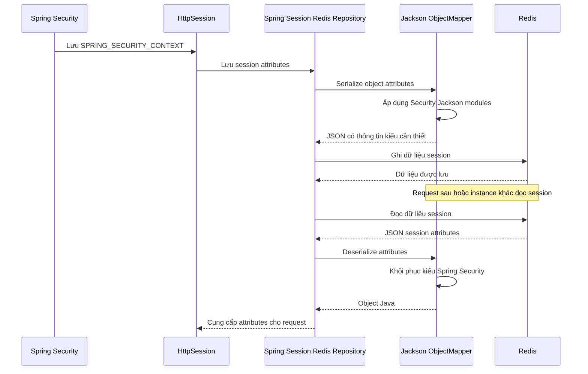

# ObjectMapper và các module dành cho dữ liệu Spring Security theo phiên bản

Khi Spring Session lưu `HttpSession` vào Redis, các session attributes phải được chuyển đổi thành dữ liệu có thể lưu trữ và khôi phục. Nếu ứng dụng dùng Spring Security với cơ chế lưu `SecurityContext` trong session, một trong các attributes quan trọng có thể là `SPRING_SECURITY_CONTEXT`. Giá trị này thường chứa `SecurityContext`, `Authentication`, principal và danh sách quyền. Một serializer JSON thông thường không nhất thiết biết cách tái tạo đúng các kiểu Spring Security đó.

`ObjectMapper` của Jackson chịu trách nhiệm chuyển object Java thành JSON và đọc JSON trở lại. Các module Jackson của Spring Security cung cấp cấu hình bổ sung, thường thông qua mixin và serializer/deserializer, để xử lý các kiểu bảo mật mà Spring Security hỗ trợ. Khi cấu hình Spring Session Data Redis, cần đăng ký đúng module theo phiên bản Spring Security và dùng cùng một serializer tương thích trên tất cả instance.

## 1. Vì sao cần module Jackson của Spring Security?

Spring Session lưu các attributes của `HttpSession`; nó không tự biến mọi object Java thành JSON theo một schema nghiệp vụ cố định. Nếu Spring Security lưu `SecurityContext` trong session, serializer phải hiểu được các kiểu cụ thể bên trong context.

Một context điển hình có thể chứa:

- `SecurityContextImpl` hoặc một implementation `SecurityContext` khác.
- `UsernamePasswordAuthenticationToken` hoặc loại `Authentication` khác.
- Principal như `UserDetails`, `User` hoặc class principal riêng của ứng dụng.
- Các `GrantedAuthority`, ví dụ `SimpleGrantedAuthority`.
- Các thuộc tính phụ tùy cơ chế xác thực, ví dụ thông tin OAuth2 hoặc JWT nếu ứng dụng dùng các module tương ứng.

Jackson cần biết cách biểu diễn và tái tạo những kiểu này. Nếu JSON chỉ chứa các trường mà không có thông tin kiểu hoặc không có deserializer phù hợp, quá trình đọc lại có thể thất bại hoặc tạo ra kiểu không đúng với kiểu mà Spring Security mong đợi.

Các module Spring Security cung cấp cấu hình Jackson dành cho một số kiểu framework. Chúng không tự động làm cho mọi class principal tùy chỉnh, mọi token bên thứ ba hoặc mọi object được đặt vào session trở nên tuần tự hóa được. Ứng dụng vẫn phải thiết kế các session attributes có kiểu rõ ràng và kiểm soát được.

## 2. Vị trí của ObjectMapper trong đường đi session

Trong ứng dụng Servlet, `SessionRepositoryFilter` chuyển API `HttpSession` sang Spring Session repository. Với Redis repository, serializer chuyển các metadata và attributes thành dữ liệu Redis. Khi Spring Security lưu `SecurityContext`, serializer cần xử lý được object đó khi ghi và khi đọc.



Đây là mô hình khái niệm. Cấu trúc Redis và cách serializer được gọi phụ thuộc repository implementation và phiên bản Spring Session Data Redis. Điểm quan trọng là cấu hình mapper phải dùng nhất quán cho cả serialize lẫn deserialize.

## 3. Chọn đúng dòng Jackson và Spring Security

Trước khi viết cấu hình, xác định các phiên bản thực tế của Spring Boot, Spring Session, Spring Security và Jackson trong dependency graph. Không lấy một ví dụ cấu hình từ một major release rồi ghép tùy ý với các thư viện ở major release khác.

| Thành phần | Điều cần đồng bộ |
|---|---|
| Spring Boot | BOM và dependency management quyết định các phiên bản tương thích được quản lý |
| Spring Session | Repository implementation và serializer integration phải phù hợp với Spring Data Redis đang dùng |
| Spring Security | Module Jackson phải thuộc dòng phát hành tương thích với các class Security được lưu trong session |
| Jackson | Module, `ObjectMapper`, serializer và package API phải thuộc cùng dòng Jackson |
| Custom principal | Class và serializer/mixin phải có mặt trên mọi instance đọc cùng session |

Với dòng Jackson 2, `ObjectMapper` thường nằm trong package `com.fasterxml.jackson.databind`, và module Spring Security quen thuộc được truy cập qua `SecurityJackson2Modules`. Các dòng framework mới có thể chuyển sang API hoặc package Jackson khác. Khi dự án dùng Jackson 3, không sao chép nguyên imports và cấu hình Jackson 2; hãy dùng module và hướng dẫn serialization tương ứng với đúng release Spring Security/Spring Session của dự án.

Trong dự án Spring Boot, ưu tiên để BOM của Boot quản lý phiên bản Spring Security, Spring Session, Spring Data Redis và Jackson. Nếu cần override một dependency, kiểm tra toàn bộ dependency graph để tránh có hai phiên bản Jackson hoặc Spring Security cùng xuất hiện trên classpath.

## 4. Đăng ký SecurityJackson2Modules với ObjectMapper

Với ứng dụng đang dùng Jackson 2 và phiên bản Spring Security cung cấp API `SecurityJackson2Modules`, có thể lấy danh sách module phù hợp từ class loader rồi đăng ký vào mapper.

```java
import com.fasterxml.jackson.databind.ObjectMapper;
import org.springframework.security.jackson2.SecurityJackson2Modules;

ObjectMapper objectMapper = new ObjectMapper();
objectMapper.registerModules(
        SecurityJackson2Modules.getModules(getClass().getClassLoader()));
```

`SecurityJackson2Modules.getModules(classLoader)` tìm các module Jackson dành cho những thành phần Spring Security hiện diện trên classpath. Vì vậy, danh sách module có thể khác nhau giữa hai ứng dụng nếu dependency Security khác nhau. Nếu ứng dụng dùng thêm OAuth2 Resource Server hoặc OAuth2 Client, hãy kiểm tra module tương ứng có sẵn trong dependency graph và được đăng ký theo hướng dẫn của release đang dùng.

Đăng ký module giúp Jackson biết cách xử lý các kiểu Spring Security được hỗ trợ. Nó không phải là lệnh cho phép serialize tùy ý mọi object. Custom principal, custom `Authentication` hoặc thuộc tính session riêng vẫn cần được xử lý rõ ràng.

## 5. Cấu hình serializer JSON cho Spring Session Data Redis

Spring Session Data Redis có thể dùng một bean `RedisSerializer<Object>` làm serializer mặc định cho session attributes. Với các cấu hình hỗ trợ cơ chế tìm bean theo tên, tên thường dùng là `springSessionDefaultRedisSerializer`.

Ví dụ dưới đây minh họa cấu hình Jackson 2. Các class được phép khôi phục qua polymorphic type metadata phải được giới hạn theo các kiểu thực tế mà ứng dụng cần lưu. Danh sách trong ví dụ là điểm bắt đầu cho một ứng dụng mẫu, không phải allowlist đầy đủ cho mọi loại Authentication.

```java
import com.fasterxml.jackson.annotation.JsonTypeInfo;
import com.fasterxml.jackson.databind.ObjectMapper;
import com.fasterxml.jackson.databind.jsontype.BasicPolymorphicTypeValidator;
import com.fasterxml.jackson.datatype.jsr310.JavaTimeModule;

import org.springframework.context.annotation.Bean;
import org.springframework.context.annotation.Configuration;
import org.springframework.data.redis.serializer.GenericJackson2JsonRedisSerializer;
import org.springframework.data.redis.serializer.RedisSerializer;
import org.springframework.security.jackson2.SecurityJackson2Modules;

@Configuration
class SessionRedisSerializationConfiguration {

    @Bean(name = "springSessionDefaultRedisSerializer")
    RedisSerializer<Object> springSessionDefaultRedisSerializer() {
        BasicPolymorphicTypeValidator typeValidator =
                BasicPolymorphicTypeValidator.builder()
                        .allowIfSubType("org.springframework.security.core.context.SecurityContextImpl")
                        .allowIfSubType("org.springframework.security.authentication.UsernamePasswordAuthenticationToken")
                        .allowIfSubType("org.springframework.security.core.authority.SimpleGrantedAuthority")
                        .allowIfSubType("org.springframework.security.core.userdetails.User")
                        .allowIfSubType("com.example.security.SessionPrincipal")
                        .allowIfSubType("java.util.ArrayList")
                        .build();

        ObjectMapper mapper = new ObjectMapper();
        mapper.registerModules(
                SecurityJackson2Modules.getModules(getClass().getClassLoader()));
        mapper.registerModule(new JavaTimeModule());
        mapper.activateDefaultTyping(
                typeValidator,
                ObjectMapper.DefaultTyping.NON_FINAL,
                JsonTypeInfo.As.PROPERTY);

        return new GenericJackson2JsonRedisSerializer(mapper);
    }
}
```

Thay `com.example.security.SessionPrincipal` bằng class principal thực tế nếu ứng dụng có lưu class đó. Bổ sung kiểu khác chỉ sau khi xác định rõ chúng có thể xuất hiện trong session và cần được khôi phục. Một số Authentication hoặc principal khác có thể cần module riêng, mixin hoặc serializer tùy chỉnh.

`GenericJackson2JsonRedisSerializer` cần thông tin kiểu để khôi phục object đa hình. Ví dụ cấu hình dùng `BasicPolymorphicTypeValidator` để giới hạn kiểu được chấp nhận. Không thay validator bằng cấu hình cho phép mọi subtype hoặc bật default typing rộng mà không có kiểm soát. Nếu ứng dụng đã có mapper được quản lý chung, không sửa mapper đó sau khi đã bắt đầu sử dụng; hãy tạo cấu hình serializer chuyên biệt cho Spring Session.

API constructor và cách cấu hình default typing có thể thay đổi theo phiên bản Spring Data Redis/Jackson. Hãy đối chiếu đúng Javadoc và tài liệu của release đang dùng trước khi áp dụng đoạn code. Điều quan trọng là serializer phải hỗ trợ cả kiểu dữ liệu cần lưu lẫn chính sách polymorphic deserialization an toàn.

## 6. Tại sao polymorphic type metadata cần được kiểm soát?

Một thuộc tính session được khai báo ở dạng `Object` có thể chứa nhiều implementation khác nhau. Ví dụ, một thuộc tính Authentication có thể là `UsernamePasswordAuthenticationToken`, `JwtAuthenticationToken` hoặc một loại token tùy chỉnh. Khi deserialize, Jackson cần biết implementation nào cần khởi tạo.

Polymorphic type metadata có thể lưu tên kiểu cụ thể cùng dữ liệu object. Điều này giúp tái tạo object đúng kiểu, nhưng cũng tạo rủi ro nếu mapper chấp nhận tùy ý class name từ dữ liệu đầu vào. Nếu dữ liệu Redis bị sửa hoặc bị đầu độc, deserializer quá rộng có thể cố khởi tạo kiểu không mong muốn.

Các nguyên tắc an toàn:

- Chỉ cho phép các class cần thiết và đáng tin cậy; ưu tiên allowlist hẹp.
- Không dùng `LaissezFaireSubTypeValidator` hoặc cơ chế chấp nhận mọi class cho dữ liệu session không hoàn toàn tin cậy.
- Bảo vệ Redis bằng xác thực, TLS, network isolation và quyền truy cập tối thiểu; serializer an toàn không thay thế bảo vệ kho dữ liệu.
- Không lưu password, access token hoặc credential thô trong session nếu không có nhu cầu rõ ràng. Spring Security có thể xóa credentials sau xác thực, nhưng ứng dụng cần xác nhận hành vi thực tế của Authentication đang dùng.
- Không deserialize dữ liệu Redis do nguồn ngoài kiểm soát hoặc dữ liệu được import từ môi trường không tin cậy.

`SecurityJackson2Modules` cung cấp cấu hình cho các kiểu Spring Security mà module hỗ trợ; nó không thay thế polymorphic type validator. Hai phần giải quyết hai vấn đề khác nhau: module giúp Jackson hiểu cấu trúc Security, validator giới hạn những subtype được phép khôi phục.

## 7. Xử lý custom principal và Authentication

Nhiều ứng dụng dùng một class principal riêng để mang user ID, tenant, display name hoặc thông tin nghiệp vụ. Nếu class đó được đặt trong `Authentication` và `SecurityContext` được lưu vào session, class principal cũng phải tuần tự hóa được.

Ví dụ DTO principal ổn định:

```java
import java.io.Serializable;

public record SessionPrincipal(
        String userId,
        String tenantId,
        String displayName) implements Serializable {
}
```

Record trên là ví dụ một principal nhỏ, chỉ chứa dữ liệu cần cho request. Khi dùng Jackson, kiểm tra phiên bản Jackson và cấu hình record support trong dự án. Nếu class cần constructor hoặc property mapping riêng, có thể bổ sung `@JsonCreator`, `@JsonProperty`, mixin hoặc custom serializer/deserializer.

Tránh đặt trực tiếp JPA entity, service, repository, request object hoặc object chứa credential vào principal. Những object này có thể có vòng tham chiếu, lazy proxy, dữ liệu quá lớn hoặc phụ thuộc class loader. Thay vào đó, lưu một principal DTO có schema ổn định và tải dữ liệu nghiệp vụ qua service khi cần.

Với custom `Authentication`, cần quyết định rõ:

1. Class có thực sự cần tồn tại trong session hay có thể lưu một representation nhỏ hơn?
2. Những trường nào được serialize và trường nào phải loại bỏ?
3. Constructor/deserializer có thể tái tạo object mà không cần gọi dịch vụ bên ngoài không?
4. Class có mặt ở mọi instance và tương thích qua rolling deployment không?
5. Class có nằm trong allowlist của polymorphic validator không?

Nếu một class thay đổi thường xuyên, cân nhắc tách DTO session ổn định khỏi model nghiệp vụ thay đổi nhanh.

## 8. Các module khác của Spring Security

`SecurityJackson2Modules` có thể phát hiện các module Security hiện diện trên classpath. Các module cụ thể phụ thuộc dependency và release. Một ứng dụng chỉ dùng username/password có tập kiểu cần xử lý khác với ứng dụng dùng OAuth2 Login, OAuth2 Resource Server, SAML hoặc các cơ chế xác thực mở rộng.

| Nhóm tính năng | Kiểu dữ liệu có thể xuất hiện | Điều cần kiểm tra |
|---|---|---|
| Form login / username-password | `SecurityContext`, `UsernamePasswordAuthenticationToken`, `UserDetails`, authorities | Module core, custom principal và credentials đã được xử lý |
| OAuth2 Client / Login | OAuth2 authentication, authorized client hoặc principal liên quan | Module phụ thuộc OAuth2 có mặt và tương thích phiên bản |
| OAuth2 Resource Server | JWT hoặc bearer token authentication | Kiểu token, claims và module liên quan có thể serialize/deserialize |
| Custom authentication | Class `Authentication` do ứng dụng định nghĩa | Custom serializer/mixin, type validator và class availability |

Không giả định mọi module đều được đăng ký chỉ vì `spring-security-core` có mặt. Hãy kiểm tra classpath, module discovery và bài kiểm thử round-trip cho đúng Authentication mà ứng dụng thực sự dùng. Tránh thêm dependency tùy tiện chỉ để làm một lỗi deserialize biến mất; trước tiên xác định kiểu cụ thể gây lỗi và module tương ứng theo tài liệu release.

## 9. Khác biệt giữa Jackson 2 và các dòng Jackson mới

Các ví dụ `SecurityJackson2Modules` và `GenericJackson2JsonRedisSerializer` trong bài này dành cho hệ sinh thái Jackson 2. Dòng framework mới có thể thay đổi package, module name, serializer class hoặc cách cấu hình polymorphic typing. Khi nâng cấp Spring Boot/Spring Security, không chỉ thay version dependency mà cần xem lại toàn bộ đường đi serialize.

Quy trình nâng cấp an toàn:

1. Xác định Jackson major version do Spring Boot BOM quản lý.
2. Xác định Spring Security release cung cấp module Jackson tương ứng.
3. Kiểm tra serializer class và API `ObjectMapper` của major version đó.
4. Chuyển đổi cấu hình type metadata/validator theo API mới; không mang nguyên imports Jackson 2 sang Jackson 3.
5. Tạo session bằng phiên bản cũ, đọc bằng phiên bản mới trong test tương thích nếu rolling deployment yêu cầu.
6. Tạo session bằng phiên bản mới, đọc bằng phiên bản cũ nếu quá trình rollback cần hỗ trợ chiều ngược lại.
7. Chỉ triển khai khi cả hai chiều tương thích cần thiết đã được kiểm chứng hoặc đã có kế hoạch buộc người dùng đăng nhập lại.

Không nên đoán tên module hoặc artifact chỉ từ tên package. Hãy dùng dependency management và tài liệu chính thức của phiên bản Spring Security đang được ứng dụng sử dụng.

## 10. Tính tương thích dữ liệu qua nhiều instance

Trong môi trường nhiều instance, mọi node đọc cùng session từ Redis. Nếu node A serialize bằng một ObjectMapper còn node B deserialize bằng mapper khác, session có thể đọc được ở A nhưng lỗi khi request chuyển sang B.

Các yếu tố cần đồng bộ:

- Spring Security modules và version của chúng.
- Jackson major version, module versions và serializer implementation.
- Type metadata property và polymorphic validator.
- Custom principal classes, mixins và serializer/deserializer.
- Quy tắc đặt tên property, xử lý null, enum và ngày giờ.
- Namespace Redis và cấu hình repository.

Khi rolling deployment, phiên được ghi bởi phiên bản mới có thể được đọc bởi phiên bản cũ đang còn phục vụ traffic. Nếu format không tương thích, người dùng có thể bị lỗi request hoặc buộc đăng nhập lại. Có thể xử lý bằng cách duy trì schema tương thích trong giai đoạn chuyển tiếp, dùng DTO có version, tách namespace theo version hoặc chủ động hết hạn session trong một đợt nâng cấp có kế hoạch.

Đừng đổi serializer trên một node đơn lẻ rồi để các node khác dùng serializer cũ trong khi cùng đọc/ghi một namespace Redis, trừ khi đã chứng minh hai định dạng tương thích.

## 11. Lỗi thường gặp khi deserialize SecurityContext

| Hiện tượng | Nguyên nhân có thể | Hướng xử lý |
|---|---|---|
| `InvalidTypeIdException` | Type metadata thiếu, class không nằm trong validator hoặc mapper không biết subtype | Kiểm tra JSON schema/type metadata, validator và module được đăng ký |
| `ClassNotFoundException` | Class principal/token không có trên classpath của instance đọc | Đồng bộ dependency và class deployment giữa các node |
| `InvalidDefinitionException` | Không có constructor/property mapping phù hợp hoặc thiếu serializer | Dùng DTO ổn định, `@JsonCreator`, mixin hoặc serializer phù hợp |
| `NoSuchMethodError` hoặc `NoClassDefFoundError` | Lệch version Spring Security/Jackson hoặc dependency bị override | Kiểm tra dependency tree và BOM |
| Đọc được ở node này nhưng lỗi ở node khác | Mapper, module, allowlist hoặc classpath giữa instance khác nhau | So sánh cấu hình runtime và test đọc chéo node |
| Principal bị thiếu trường sau khi đọc | JSON property naming hoặc schema thay đổi | Kiểm tra version dữ liệu, naming strategy và tương thích DTO |
| Lỗi khi rolling deployment | Phiên bản mới ghi format mà node cũ không hiểu | Dùng schema tương thích, migration hoặc kế hoạch invalidation session |

Khi log lỗi, chỉ ghi loại exception, tên class cần thiết và mã tương quan đã lọc. Không ghi toàn bộ JSON session, cookie hoặc session ID vào log. Một payload lỗi có thể chứa principal, quyền, thông tin người dùng hoặc credential.

## 12. Kiểm thử serializer độc lập

Trước khi kiểm thử qua HTTP, hãy kiểm tra serializer round-trip cho các kiểu thực tế được lưu. Bài kiểm thử này giúp phân biệt lỗi Jackson với lỗi Redis, cookie hoặc filter.

Ví dụ khung kiểm thử với Jackson 2:

```java
import static org.assertj.core.api.Assertions.assertThat;

import org.junit.jupiter.api.Test;
import org.springframework.data.redis.serializer.RedisSerializer;
import org.springframework.security.authentication.UsernamePasswordAuthenticationToken;
import org.springframework.security.core.authority.SimpleGrantedAuthority;
import org.springframework.security.core.context.SecurityContext;
import org.springframework.security.core.context.SecurityContextHolder;
import org.springframework.security.core.context.SecurityContextImpl;

class SessionSecuritySerializationTests {

    private final RedisSerializer<Object> serializer =
            new SessionRedisSerializationConfiguration()
                    .springSessionDefaultRedisSerializer();

    @Test
    void securityContextCanBeSerializedAndRestored() {
        var authentication = UsernamePasswordAuthenticationToken.authenticated(
                "user-42",
                null,
                java.util.List.of(new SimpleGrantedAuthority("ROLE_USER")));
        SecurityContext original = new SecurityContextImpl(authentication);

        byte[] bytes = serializer.serialize(original);
        Object restored = serializer.deserialize(bytes);

        assertThat(restored).isInstanceOf(SecurityContext.class);
        SecurityContext restoredContext = (SecurityContext) restored;
        assertThat(restoredContext.getAuthentication().getName())
                .isEqualTo("user-42");
        assertThat(restoredContext.getAuthentication().getAuthorities())
                .extracting("authority")
                .containsExactly("ROLE_USER");
    }
}
```

Đây là khung minh họa; constructor hoặc factory method của `UsernamePasswordAuthenticationToken`, allowlist và serializer API cần phù hợp với phiên bản Spring Security/Jackson thực tế. Nếu validator yêu cầu kiểu collection hoặc principal cụ thể, bổ sung chính xác kiểu đó sau khi kiểm tra dữ liệu test. Không nới validator thành chấp nhận mọi subtype chỉ để test chạy qua.

Nên bổ sung các ca kiểm thử:

1. Serialize/deserialize `SecurityContext` chứa Authentication chuẩn.
2. Round-trip custom principal và custom authorities.
3. Kiểm tra dữ liệu có ngày giờ, enum hoặc kiểu Java bổ sung nếu session sử dụng.
4. Xác nhận type không nằm trong allowlist bị từ chối.
5. Xác nhận credentials hoặc trường nhạy cảm không được lưu nếu chính sách yêu cầu loại bỏ.
6. Đọc dữ liệu fixture được tạo bởi phiên bản ứng dụng trước.

## 13. Kiểm thử tích hợp với Spring Session và Redis

Serializer unit test chưa chứng minh filter, repository và cookie hoạt động cùng nhau. Kiểm thử tích hợp nên khởi động ứng dụng với Redis thử nghiệm, đăng nhập bằng filter chain thật và gửi lại cookie session trong request tiếp theo.

Kịch bản cơ bản:

1. Khởi động Redis test instance và ứng dụng dùng Spring Session Data Redis.
2. Xác thực bằng cơ chế Spring Security thực tế.
3. Xác nhận response phát hành cookie session và `SecurityContext` được lưu trong session.
4. Gửi request kế tiếp kèm cookie; xác nhận principal và authorities được khôi phục đúng.
5. Gửi request sang instance thứ hai dùng cùng Redis và cùng serializer; xác nhận SecurityContext vẫn đọc được.
6. Kiểm tra logout/invalidate làm session không còn được sử dụng.
7. Thử đọc session được tạo từ fixture phiên bản trước trong giai đoạn rolling deployment.
8. Kiểm tra payload lỗi không bị ghi đầy đủ vào log.

Không chỉ tạo một `SecurityContext` thủ công trong test rồi kết luận tích hợp Spring Security hoàn chỉnh. Luồng đăng nhập thật có thể dùng loại Authentication, principal và module khác với object được tạo thủ công.

## 14. Quy trình xử lý khi nâng cấp hoặc đổi serializer

Thay serializer có thể làm các session đang tồn tại không đọc được. Trước khi triển khai:

- Lập danh sách kiểu attributes thực tế được lưu trong session, nhất là SecurityContext và principal.
- Xác nhận mapper cũ và mới đọc được dữ liệu cần thiết.
- Thử rolling deployment với ít nhất hai phiên bản ứng dụng trong môi trường staging.
- Kiểm tra phiên bản Jackson và Spring Security thực tế ở từng instance.
- Nếu không thể duy trì tương thích, chọn thời điểm invalidation session và thông báo/chuẩn bị luồng đăng nhập lại.
- Không xóa trực tiếp key Redis theo phỏng đoán cấu trúc nội bộ; dùng API Spring Session hoặc kế hoạch namespace migration.
- Theo dõi deserialize errors và tỷ lệ người dùng phải xác thực lại sau khi triển khai.

## 15. Nguyên tắc cần nhớ

- Spring Session lưu session attributes; nếu Spring Security lưu `SecurityContext` trong session, serializer phải xử lý được các kiểu Security bên trong.
- Với Jackson 2, đăng ký các module phù hợp qua `SecurityJackson2Modules.getModules(classLoader)` khi release Spring Security cung cấp API đó.
- Dùng serializer bean mà Spring Session Data Redis nhận diện, thường là `springSessionDefaultRedisSerializer`, và xác nhận đúng tên theo phiên bản.
- Polymorphic type metadata cần thiết cho một số object đa hình nhưng phải đi cùng validator allowlist hẹp.
- Module Spring Security không tự xử lý mọi custom principal hoặc mọi Authentication của bên thứ ba.
- Giữ Spring Boot, Spring Session, Spring Security, Spring Data Redis và Jackson trên các phiên bản tương thích.
- Mọi instance phải dùng mapper, module, validator và custom classes tương thích khi chia sẻ cùng Redis namespace.
- Kiểm thử round-trip SecurityContext, custom principal, kiểu bị cấm, dữ liệu phiên bản cũ và request qua nhiều instance.
- Không log raw session ID, cookie hoặc JSON session; tránh lưu credentials không cần thiết trong session.
