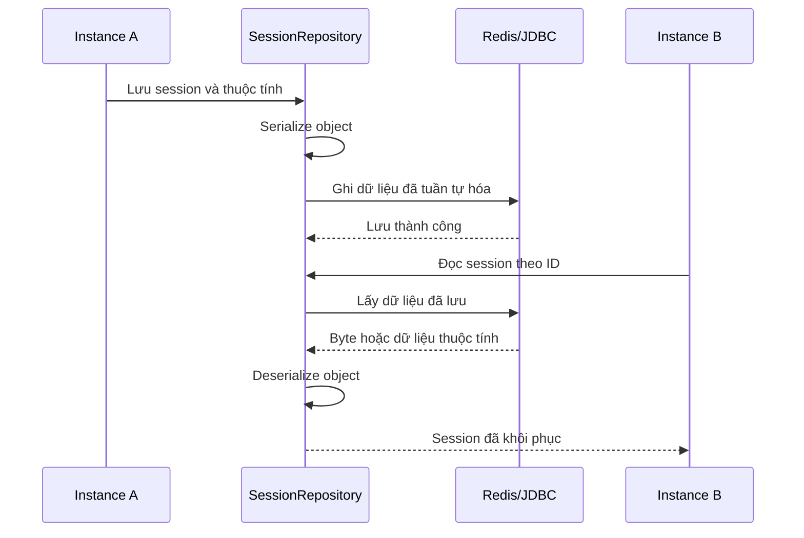
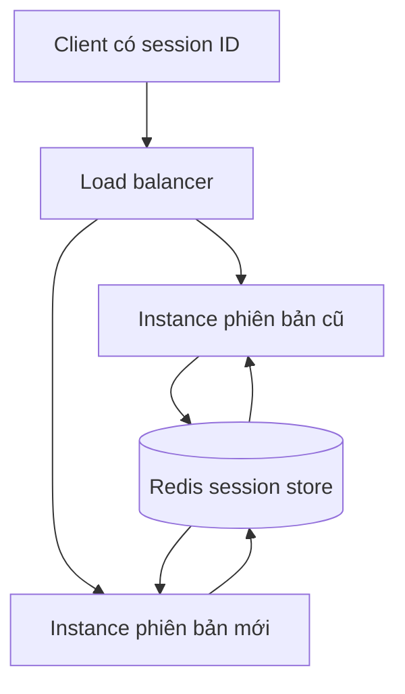

# Lớp không tuần tự hóa được, classloader và lỗi thiếu lớp khi đọc phiên

Spring Session lưu `HttpSession` trong kho dữ liệu dùng chung như Redis hoặc JDBC. Các thuộc tính trong phiên phải được chuyển thành dạng dữ liệu có thể lưu trữ và khôi phục. Nếu một object không thể tuần tự hóa, class không còn tồn tại ở phiên bản ứng dụng đang chạy hoặc classloader không tìm thấy đúng định nghĩa class, request có thể lỗi khi ghi hoặc đọc session.

Những lỗi này thường xuất hiện sau khi thêm một object mới vào session, đổi cấu trúc class, nâng dependency hoặc triển khai rolling update trong đó các instance chạy các phiên bản khác nhau. Vì session có thể tồn tại lâu hơn một request và được đọc bởi một instance khác, thiết kế kiểu dữ liệu và kế hoạch tương thích giữa các phiên bản là một phần của vận hành Spring Session.

## 1. Tuần tự hóa trong Spring Session

Tuần tự hóa (serialization) chuyển object trong bộ nhớ thành chuỗi byte hoặc một biểu diễn dữ liệu có thể lưu. Giải tuần tự hóa (deserialization) dựng lại object từ dữ liệu đã lưu. Với Spring Session, quá trình này áp dụng cho các thuộc tính `HttpSession` khi repository ghi và khôi phục phiên.

Ví dụ, ứng dụng lưu một thông tin giỏ hàng:

```java
HttpSession session = request.getSession(true);
session.setAttribute("cart", new CartSnapshot("cart-123", 2));
```

Spring Session không giữ object Java trên heap của instance để instance khác truy cập trực tiếp. Repository phải chuyển object thành dạng lưu trữ. Khi request tiếp theo đến một instance khác, instance đó đọc dữ liệu từ Redis/JDBC rồi giải tuần tự hóa thuộc tính để ứng dụng sử dụng.

Luồng khái quát:



Serializer phải được cấu hình nhất quán giữa các instance có thể đọc cùng một phiên. Nếu A ghi bằng một định dạng nhưng B đọc bằng serializer khác, hoặc B không có class tương ứng, phiên có thể không khôi phục được.

## 2. Lựa chọn dữ liệu có thể tuần tự hóa

Nếu dùng Java native serialization, object và toàn bộ object graph mà nó tham chiếu phải đáp ứng yêu cầu `Serializable`, trừ những trường được loại khỏi quá trình tuần tự hóa. Chỉ thêm `implements Serializable` cho lớp ngoài cùng chưa chắc đủ; một field bên trong có kiểu không serializable vẫn có thể làm thao tác ghi thất bại.

Ví dụ DTO nhỏ, ổn định:

```java
import java.io.Serializable;

public final class CartSnapshot implements Serializable {

    private static final long serialVersionUID = 1L;

    private final String cartId;
    private final int itemCount;

    public CartSnapshot(String cartId, int itemCount) {
        this.cartId = cartId;
        this.itemCount = itemCount;
    }

    public String getCartId() {
        return cartId;
    }

    public int getItemCount() {
        return itemCount;
    }
}
```

Với native serialization, `serialVersionUID` xác định phiên bản cấu trúc serialization của class. Khai báo rõ giúp tránh UID tự sinh thay đổi ngoài ý muốn khi compiler thấy class thay đổi. Tuy nhiên, giữ nguyên UID không làm mọi thay đổi class trở nên tương thích; đổi kiểu field, thay đổi quan hệ kế thừa hoặc thay đổi cách đọc dữ liệu vẫn có thể gây lỗi hoặc làm mất ý nghĩa dữ liệu.

Record cũng có thể triển khai `Serializable` nếu mọi component phù hợp:

```java
public record CartReference(String cartId, int itemCount)
        implements Serializable {
}
```

Đừng đưa toàn bộ object graph phức tạp vào session. Những loại dữ liệu sau thường không phù hợp:

- Entity ORM đang được quản lý, lazy proxy hoặc object phụ thuộc persistence context.
- `HttpServletRequest`, `HttpServletResponse`, stream, socket, file handle hoặc connection.
- Thread, executor, lock, callback gắn với một instance hoặc object có vòng đời ngắn.
- Service bean, repository, datasource hoặc object chứa dependency injection proxy.
- Object lớn, có nhiều tham chiếu hoặc dữ liệu nghiệp vụ thay đổi liên tục.

Ưu tiên DTO nhỏ, giá trị đơn giản, mã tham chiếu và cấu trúc ít thay đổi. Ví dụ lưu `cartId` rồi tải giỏ hàng từ dịch vụ nghiệp vụ thường an toàn và dễ nâng cấp hơn lưu cả entity giỏ hàng cùng toàn bộ quan hệ của nó.

## 3. Lỗi `NotSerializableException` khi ghi phiên

Với Java native serialization, lỗi `java.io.NotSerializableException` thường xảy ra khi repository cố ghi một object không triển khai `Serializable`, hoặc object đó chứa field không serializable.

Ví dụ gây lỗi:

```java
public class CheckoutState implements Serializable {
    private static final long serialVersionUID = 1L;

    private final String orderId;
    private final Object paymentGatewayClient;

    public CheckoutState(String orderId, Object paymentGatewayClient) {
        this.orderId = orderId;
        this.paymentGatewayClient = paymentGatewayClient;
    }
}
```

Field `paymentGatewayClient` đại diện cho một client/service đang chạy và không nên được lưu trong session. Dù lớp `CheckoutState` triển khai `Serializable`, serializer vẫn phải đi qua object graph và có thể thất bại tại field đó.

Cách sửa là chỉ lưu dữ liệu cần thiết để khôi phục quy trình:

```java
public record CheckoutReference(String orderId, String paymentAttemptId)
        implements Serializable {
}
```

Khi cần tiếp tục thanh toán, ứng dụng dùng `paymentAttemptId` để gọi dịch vụ thanh toán có kiểm soát quyền. Không lưu đối tượng client kết nối, credential hoặc callback vào session.

Có thể dùng `transient` cho field không nên tuần tự hóa:

```java
public final class ReportState implements Serializable {
    private static final long serialVersionUID = 1L;

    private final String reportId;
    private transient ReportRenderer renderer;

    // Constructor và phương thức nghiệp vụ
}
```

`transient` khiến field không được ghi bằng Java native serialization. Sau khi khôi phục, field đó thường có giá trị mặc định (`null` với reference type), nên phải được tái tạo hoặc inject lại qua một cơ chế phù hợp. Không dùng `transient` để che lỗi nếu code sau đó vẫn yêu cầu field phải tồn tại.

Lỗi ghi thường xảy ra khi session được lưu tại điểm flush/save, có thể gần cuối request. Hãy kiểm tra stack trace để tìm class/field không serializable và xem request nào đã đặt object đó vào session. Không bắt `SerializationException` rồi trả response thành công; session có thể chưa được lưu và request tiếp theo sẽ thấy trạng thái khác.

## 4. Lỗi thiếu lớp khi đọc phiên

Lỗi `ClassNotFoundException` xảy ra khi dữ liệu đã lưu tham chiếu đến một class mà classloader của instance đọc không tìm thấy. Ví dụ:

1. Instance A phiên bản cũ lưu `com.example.session.CartSnapshot` vào Redis.
2. Một lần triển khai mới đổi tên class thành `com.example.cart.CartState` và xóa class cũ khỏi artifact.
3. Instance B nhận request mang session ID cũ.
4. Serializer cố dựng lại `CartSnapshot` nhưng class đó không còn trên classpath.

Kết quả là giải tuần tự hóa thất bại dù Redis vẫn chứa byte hợp lệ. Dữ liệu tồn tại không có nghĩa phiên có thể được ứng dụng hiện tại đọc.

Các nguyên nhân thường gặp:

- Class đã bị đổi tên, chuyển package hoặc xóa.
- Module chứa class không còn là dependency của ứng dụng đang chạy.
- Dependency bị loại khỏi artifact hoặc bị scope sai.
- Các instance trong cùng cụm chạy artifact khác nhau và một phiên được ghi bởi phiên bản mới nhưng đọc bởi phiên bản cũ.
- Một ứng dụng khác dùng chung Redis namespace nhưng không có cùng model class.
- Serializer lưu tên class hoặc type metadata không còn khớp với cấu trúc code hiện tại.

Kiểm tra class được nêu trong exception, dependency tree/artifact đang triển khai và classpath của đúng instance gặp lỗi. Nếu class được đóng gói trong một module riêng, xác nhận module đó có trong artifact production, không chỉ trong IDE hoặc test classpath.

## 5. Classloader và quá trình giải tuần tự hóa

JVM có thể nạp các class cùng tên từ những classloader khác nhau. Trong ứng dụng Spring chạy độc lập thường có một classloader ứng dụng chính, nhưng servlet container, application server, plugin architecture, DevTools hoặc môi trường triển khai có thể tạo các ranh giới classloader riêng.

Native deserialization phải tìm class tương ứng để tạo object. `JdkSerializationRedisSerializer` của Spring Data Redis sử dụng classloader để phân giải class khi đọc dữ liệu. Nếu serializer dùng classloader không nhìn thấy module ứng dụng, quá trình đọc có thể ném `ClassNotFoundException`, ngay cả khi file JAR tồn tại ở một vị trí khác trong tiến trình.

Khi điều tra, kiểm tra:

- Class có nằm trong artifact đang chạy và có được nạp bởi classloader phù hợp không.
- Có nhiều bản JAR chứa cùng class hoặc các phiên bản dependency khác nhau không.
- Classloader của serializer có thể nhìn thấy class model trong module ứng dụng không.
- Context classloader hoặc cấu hình container có khác giữa request thread và worker thread không.
- Có class cùng tên nhưng được nạp bởi classloader khác, dẫn đến `ClassCastException` hoặc lỗi liên kết không.

Không giải quyết lỗi bằng cách tùy tiện chuyển mọi class sang system classloader hoặc đặt classloader toàn cục. Cách đó có thể phá vỡ cô lập module và gây xung đột dependency. Cần sửa dependency packaging, ranh giới classloader hoặc cấu hình serializer tại đúng ứng dụng.

Với native serialization, có thể khai báo serializer của Spring Session bằng bean có tên mà Spring Session nhận diện:

```java
@Configuration
public class SessionSerializationConfiguration {

    @Bean(name = "springSessionDefaultRedisSerializer")
    RedisSerializer<Object> springSessionDefaultRedisSerializer() {
        return new JdkSerializationRedisSerializer(
                getClass().getClassLoader());
    }
}
```

Ví dụ này chỉ minh họa việc chọn classloader ứng dụng cho serializer Java. Constructor và cơ chế chọn serializer cần được kiểm tra theo phiên bản Spring Data Redis/Spring Session đang dùng. Nếu dùng serializer khác, không giữ bean này một cách máy móc.

## 6. Lỗi `InvalidClassException` và serialVersionUID

Khi class tồn tại nhưng cấu trúc serialization không tương thích, Java có thể ném `java.io.InvalidClassException`. Một nguyên nhân phổ biến là `serialVersionUID` trong dữ liệu đã ghi khác UID của class hiện tại.

Ví dụ, phiên được ghi bằng class cũ có UID `1L`, nhưng class mới không khai báo UID và compiler sinh UID khác sau khi class thay đổi. Khi đọc, Java từ chối khôi phục object.

Khai báo UID rõ ràng từ đầu:

```java
private static final long serialVersionUID = 1L;
```

Điều này giúp quản lý phiên bản serialization có chủ đích, nhưng không phải cam kết tương thích tuyệt đối. Một số thay đổi cấu trúc có thể được Java serialization xử lý theo quy tắc mặc định, ví dụ field mới có thể nhận giá trị mặc định khi đọc dữ liệu cũ. Thay đổi kiểu field, thay đổi superclass hoặc invariant của object có thể làm dữ liệu không đọc được hoặc không còn hợp lệ về mặt nghiệp vụ.

Nếu cần giữ tương thích, phải kiểm thử bằng dữ liệu đã serialize từ phiên bản cũ và đọc bằng code mới. Một unit test tạo object mới rồi serialize/deserialize bằng cùng một phiên bản không kiểm tra được khả năng đọc session tồn tại từ production.

## 7. Thay đổi class trong rolling deployment

Trong cụm nhiều instance, các phiên có thể được ghi bởi phiên bản ứng dụng khác với phiên bản đọc chúng. Đây là tình huống dễ gây lỗi khi rolling deployment:



Giả sử phiên bản mới ghi thuộc tính kiểu `NewCartState`, trong khi instance cũ chỉ biết `OldCartState`. Nếu hai phiên bản dùng chung session store và request có thể đi đến bất kỳ instance nào, instance cũ có thể không giải tuần tự hóa được dữ liệu do instance mới ghi.

Trước khi triển khai, đánh giá tương thích theo các câu hỏi:

- Class nào đang được lưu trong session và có được đổi tên/xóa không?
- Field nào đổi kiểu, đổi tên hoặc thay đổi invariant?
- Serializer có lưu class name/type metadata không?
- Các instance cũ có thể đọc dữ liệu do instance mới ghi không?
- Các phiên cũ có thể tồn tại lâu hơn thời gian rolling deployment không?
- Có thể yêu cầu người dùng đăng nhập lại hoặc xóa session cũ theo kế hoạch không?

Các chiến lược thường dùng:

1. **Thay đổi tương thích ngược:** giữ class cũ và cấu trúc đọc tương thích trong suốt thời gian phiên cũ còn tồn tại.
2. **Đọc hai định dạng, chỉ ghi định dạng mới:** phiên bản chuyển tiếp có thể đọc dữ liệu cũ và mới, nhưng chỉ ghi cấu trúc mới sau khi mọi node có khả năng đọc nó.
3. **Version hóa thuộc tính:** dùng key như `cart.v1` và `cart.v2`, đọc theo version, chuyển đổi có kiểm soát rồi xóa key cũ khi hết thời hạn.
4. **Kết thúc phiên cũ:** nếu dữ liệu session không cần được giữ, triển khai thay đổi đồng bộ và yêu cầu xác thực lại sau khi xóa/để hết hạn phiên cũ.
5. **Migration có kiểm soát:** chuyển đổi dữ liệu đã lưu bằng một quy trình riêng, có đo lường, retry và phương án quay lại.

Không triển khai phiên bản mới có thể ghi định dạng mà phiên bản cũ không đọc được trong khi load balancer vẫn gửi request đến node cũ. Nếu không thể bảo đảm tương thích, cần một cửa sổ triển khai có điều phối hoặc kết thúc session cũ.

## 8. Serializer và định dạng dữ liệu

Spring Session Redis thường sử dụng serializer Java mặc định nếu ứng dụng không thay thế bean serializer dành cho session. Tuy nhiên, cấu hình cụ thể phụ thuộc phiên bản và auto-configuration; cần kiểm tra bean `springSessionDefaultRedisSerializer` và dependency thực tế thay vì giả định mọi ứng dụng đều dùng cùng một serializer.

Với native Java serialization, các lớp cần triển khai `Serializable`, class name/package và cấu trúc serialization phải tương thích giữa các node. Ưu điểm là có thể lưu object Java trực tiếp; nhược điểm là dữ liệu phụ thuộc mạnh vào class và phiên bản ứng dụng.

Một serializer JSON có thể giảm phụ thuộc vào byte stream native serialization, nhưng JSON vẫn có thể chứa type metadata hoặc phụ thuộc schema. Nếu đổi package hoặc type ID, dữ liệu cũ vẫn có thể không đọc được. Hãy ưu tiên DTO có schema rõ, field có ý nghĩa ổn định và quy tắc chuyển đổi version.

Nếu dùng Jackson cho object đa hình, tránh bật default typing rộng cho dữ liệu có thể bị sửa từ nguồn không tin cậy. Type metadata không được kiểm soát có thể mở ra nguy cơ tạo object ngoài allowlist. Cấu hình polymorphic type validator/allowlist phù hợp với các kiểu session được phép và không deserialize dữ liệu tùy ý từ client.

Việc đổi serializer không tự chuyển dữ liệu hiện có. Nếu Redis đang lưu Java serialized bytes nhưng phiên bản mới bắt đầu đọc JSON, các session cũ có thể lỗi ngay khi được truy cập. Migration cần có chiến lược đọc tương thích hoặc kết thúc phiên cũ, không chỉ thay bean serializer rồi triển khai.

## 9. Lưu ý với Spring Session JDBC

Spring Session JDBC cũng phải chuyển các thuộc tính phiên thành dữ liệu có thể lưu trong bảng attributes. Schema mặc định có bảng `SPRING_SESSION` và `SPRING_SESSION_ATTRIBUTES`; giá trị thuộc tính được lưu ở cột nhị phân phù hợp với schema của hệ quản trị. Cơ chế chuyển đổi mặc định và khả năng cấu hình converter phụ thuộc phiên bản Spring Session.

Vì vậy, lỗi class thiếu hoặc serialization không tương thích không chỉ xảy ra với Redis. Nếu database chứa byte của object được ghi từ phiên bản cũ, instance mới vẫn phải giải tuần tự hóa được object đó. Backup database có thể giữ các session cũ lâu hơn dự kiến; chỉ triển khai class mới không bảo đảm mọi byte cũ biến mất.

Khi dùng JDBC, kiểm tra converter/serialization configuration, schema, kiểu cột attribute và dữ liệu phiên cũ. Nếu cần thay đổi định dạng, dùng migration có version hoặc kế hoạch hết hạn session. Không chỉnh sửa trực tiếp byte trong `SPRING_SESSION_ATTRIBUTES` bằng SQL thủ công.

## 10. Quy trình điều tra lỗi đọc/ghi

Khi request lỗi lúc lưu hoặc khôi phục phiên, thực hiện theo thứ tự:

1. Xác định lỗi xảy ra ở đường ghi hay đường đọc. `NotSerializableException` thường liên quan đến ghi; `ClassNotFoundException` và `InvalidClassException` thường liên quan đến đọc.
2. Ghi nhận exception class, tên class gây lỗi, serializer đang hoạt động, repository, phiên bản ứng dụng và instance gặp lỗi.
3. Kiểm tra object graph của thuộc tính vừa thêm hoặc thay đổi; tìm field không serializable, proxy, entity hoặc object phụ thuộc runtime.
4. Kiểm tra class có nằm trong artifact production, dependency có bị thiếu và classloader có nhìn thấy class không.
5. So sánh phiên bản class/serializer giữa instance ghi dữ liệu và instance đọc dữ liệu.
6. Kiểm tra TTL và tuổi của session để xác định dữ liệu có phải từ một phiên bản triển khai cũ không.
7. Tạo test tái hiện bằng payload/session được ghi bởi phiên bản cũ và đọc bởi phiên bản mới.
8. Chọn cách khắc phục: thêm class tương thích, chuyển đổi dữ liệu, đổi serializer có kế hoạch hoặc kết thúc các session cũ.

Không log toàn bộ session attribute, session ID, access token hoặc dữ liệu cá nhân khi điều tra. Ghi tên class và loại exception thường đủ để khoanh vùng; nếu cần mẫu payload, dùng dữ liệu đã làm sạch trong môi trường test.

## 11. Phân biệt session không tồn tại với lỗi deserialize

Một session hết TTL hoặc bị xóa có thể khiến repository không tìm thấy dữ liệu và trả về `null`. Đây là trạng thái phiên không còn tồn tại. Lỗi deserialize là tình huống khác: dữ liệu có thể vẫn còn trong Redis/JDBC nhưng ứng dụng không thể dựng object từ dữ liệu đó.

Không bắt mọi `SerializationException`, `ClassNotFoundException` hoặc lỗi Redis rồi chuyển thành `session == null`. Cách làm này biến lỗi dữ liệu/hạ tầng thành trạng thái đăng xuất bình thường, che giấu lỗi triển khai và có thể khiến ứng dụng tạo session mới ngoài ý muốn.

Đối với endpoint cần xác thực:

- Session không tồn tại hoặc hết hạn: yêu cầu đăng nhập lại theo hợp đồng API.
- Redis/database không truy cập được: báo lỗi hạ tầng phù hợp, thường là lỗi server; không khẳng định người dùng đã đăng xuất.
- Session có dữ liệu nhưng deserialize thất bại: ghi nhận lỗi tương thích và xử lý theo quy trình vận hành; không coi đó là session rỗng.

Nếu tổ chức quyết định kết thúc các session lỗi do thay đổi không tương thích, hãy làm việc đó bằng quy trình có kiểm soát, có thông báo và audit phù hợp, thay vì âm thầm xóa mọi phiên khi gặp một exception.

## 12. Kiểm thử tương thích serialization

Kiểm thử cần bao phủ cả object graph, serializer và phiên bản triển khai:

| Ca kiểm thử | Cách thực hiện | Kết quả cần xác nhận |
|---|---|---|
| Object serializable | Lưu DTO đơn giản rồi đọc lại | Thuộc tính được khôi phục đúng |
| Field không serializable | Thêm object runtime vào graph | Ghi thất bại có thể định vị; thiết kế loại bỏ field đó |
| Field `transient` | Lưu rồi đọc object có field transient | Field nhận giá trị mặc định và được khởi tạo lại đúng cách |
| Class thiếu | Ghi payload bằng class cũ, đọc trong classpath thiếu class | Test tái hiện lỗi thiếu lớp |
| serialVersionUID khác | Ghi bằng class version A, đọc bằng version B không tương thích | Test nhận diện `InvalidClassException` |
| Thay đổi schema JSON | Ghi JSON cũ rồi đọc bằng DTO mới | Converter xử lý được hoặc báo lỗi có kiểm soát |
| Rolling deployment | Ghi ở phiên bản cũ, đọc ở phiên bản mới và ngược lại nếu cần | Các chiều tương thích được xác minh |
| Hai instance | A ghi session, B đọc cùng session từ Redis/JDBC | B có class và serializer tương thích |
| Serializer migration | Tạo session bằng định dạng cũ, chuyển đổi và đọc lại | Dữ liệu chuyển đổi đúng; lỗi được đo lường |
| Session cũ hết TTL | Để phiên cũ hết hạn rồi gửi lại ID | Repository không cố dùng payload đã hết hiệu lực |

Nên lưu một số fixture serialization được tạo từ artifact phiên bản trước trong test resources của dự án, nếu chính sách bảo mật cho phép và payload không chứa dữ liệu thật. Test phiên bản mới đọc fixture cũ là cách phát hiện sớm lỗi class evolution. Không dùng session production hoặc cookie người dùng làm fixture.

Với kiểm thử tích hợp, dùng Redis/JDBC test và cùng cấu hình serializer như production. Test chỉ serialize object rồi deserialize ngay trong cùng JVM không phát hiện được khác biệt classpath hoặc classloader giữa các instance.

## 13. Bảo mật dữ liệu tuần tự hóa

Session ID là bearer credential, còn dữ liệu serialized là đầu vào để ứng dụng tạo object. Redis hoặc database session phải được bảo vệ bằng quyền truy cập tối thiểu, mạng riêng, TLS khi cần và chính sách backup phù hợp.

Native Java deserialization có rủi ro khi ứng dụng giải tuần tự hóa byte không đáng tin cậy. Không cho client tự gửi serialized object vào session store; client chỉ gửi session ID do server tạo. Giới hạn quyền ghi vào Redis/JDBC, tránh dùng chung credential quá rộng và cân nhắc allowlist/filter cho các kiểu object được phép nếu nền tảng hỗ trợ.

Với JSON serializer, không bật polymorphic default typing rộng mà không có validator. Chỉ cho phép các kiểu DTO cần thiết, tránh để type metadata trong dữ liệu quyết định việc khởi tạo class tùy ý. Không lưu bí mật hoặc dữ liệu thanh toán nhạy cảm vào session chỉ vì serializer có thể ghi được chúng.

## 14. Nguyên tắc thiết kế và triển khai

- Lưu DTO nhỏ, ổn định hoặc mã tham chiếu; tránh entity ORM, proxy, service, connection và object runtime.
- Với Java serialization, kiểm tra toàn bộ object graph và khai báo `serialVersionUID` có chủ đích.
- Hiểu rằng `transient` loại field khỏi serialization và cần tái tạo field sau khi đọc.
- Giữ class và serializer tương thích giữa mọi instance có thể đọc cùng session.
- Xem classloader, dependency packaging và phiên bản artifact là một phần của đường đọc session.
- Khi rolling deployment, bảo đảm phiên bản cũ đọc được dữ liệu mới ghi hoặc dùng chiến lược migration/kết thúc session có điều phối.
- Đổi serializer phải có kế hoạch cho payload đang tồn tại trong Redis/JDBC.
- Phân biệt session không tồn tại với lỗi repository hoặc lỗi deserialize; không chuyển mọi lỗi thành đăng xuất.
- Kiểm thử fixture từ phiên bản cũ, classpath khác nhau và nhiều instance trước khi phát hành.
- Bảo vệ Redis/database, serializer và log; không ghi session ID hoặc nội dung phiên nhạy cảm ra ngoài.

Spring Session chỉ có thể khôi phục một thuộc tính khi instance đọc có serializer và class tương thích với dữ liệu đã lưu. Lựa chọn object đơn giản, quản lý class evolution, hiểu classloader và kiểm thử dữ liệu xuyên phiên bản giúp session tiếp tục hoạt động trong rolling deployment và khi nhiều instance cùng dùng Redis hoặc JDBC.
