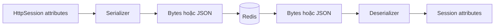

# Giới hạn dữ liệu không đáng tin khi giải tuần tự hóa

Spring Session lưu session attributes dưới dạng dữ liệu đã tuần tự hóa để có thể khôi phục ở request tiếp theo hoặc trên một instance Spring khác. Với Redis, dữ liệu này đi qua serializer trước khi được ghi và deserializer khi được đọc. Nếu dữ liệu đầu vào không đáng tin, việc giải tuần tự hóa có thể trở thành ranh giới tấn công: một payload được chế tạo có thể kích hoạt hành vi ngoài dự kiến trong quá trình tạo object, tiêu tốn tài nguyên hoặc khai thác thư viện nằm trên classpath.

Vì vậy, bảo vệ session store không chỉ là bảo vệ kết nối Redis. Ứng dụng cần giới hạn kiểu dữ liệu được chấp nhận, kích thước và độ phức tạp của payload, kiểm soát nguồn ghi, quản lý tương thích phiên bản và xử lý lỗi giải tuần tự hóa một cách an toàn.

## 1. Tuần tự hóa và giải tuần tự hóa trong Spring Session

Tuần tự hóa (serialization) chuyển object trong bộ nhớ thành dạng có thể lưu hoặc truyền đi, chẳng hạn byte array hay JSON. Giải tuần tự hóa (deserialization) đọc dữ liệu đó và dựng lại object.

Trong một luồng Spring Session Redis thông thường:

1. Controller hoặc Spring Security đặt attributes vào `HttpSession`.
2. Spring Session chuyển session và attributes cho repository.
3. Redis serializer chuyển object thành dữ liệu lưu trữ.
4. Ở request sau, repository đọc dữ liệu từ Redis.
5. Deserializer chuyển dữ liệu trở lại thành các object mà ứng dụng sử dụng.



Serializer là một phần của hợp đồng dữ liệu giữa các instance. Nếu một instance ghi theo định dạng mà instance khác không thể đọc, session có thể lỗi sau khi request được chuyển sang instance khác hoặc sau khi triển khai phiên bản mới.

## 2. Dữ liệu session có thể trở thành dữ liệu không đáng tin khi nào?

Trong thiết kế bình thường, client không gửi trực tiếp byte array của session vào Redis. Server mới là thành phần ghi session attributes. Tuy nhiên, không nên mặc định mọi dữ liệu trong Redis luôn đáng tin:

- Tài khoản hoặc thông tin xác thực Redis bị lộ, cho phép kẻ tấn công sửa key session.
- Một ứng dụng khác dùng chung Redis có quyền ghi vào cùng database hoặc namespace.
- Môi trường phát triển, staging hoặc công cụ vận hành nhập dữ liệu session từ nguồn không được kiểm chứng.
- Backup, snapshot hoặc dữ liệu di trú bị thay đổi trước khi được khôi phục.
- Lỗi phân quyền khiến một service không đáng tin có thể ghi dữ liệu vào key mà Spring Session đọc.
- Một lỗ hổng ở thành phần khác cho phép ghi tùy ý vào Redis hoặc vào dữ liệu session.

Kẻ tấn công cũng có thể cố chiếm quyền sử dụng một session ID hợp lệ. Điều đó khác với việc ghi payload tùy ý vào Redis, nhưng cả hai đều cho thấy session store phải được bảo vệ như dữ liệu nhạy cảm.

Ranh giới quan trọng là: **deserializer không nên được yêu cầu dựng mọi kiểu object chỉ vì dữ liệu có thể đọc được từ kho lưu trữ**. Quyền đọc Redis và quyền cung cấp một kiểu object cho ứng dụng phải được kiểm soát riêng.

## 3. Rủi ro khi giải tuần tự hóa Java native

Java native serialization có thể khôi phục object theo metadata kiểu được ghi trong stream. Khi `ObjectInputStream` đọc dữ liệu, nó có thể tạo các object và gọi logic giải tuần tự hóa tùy chỉnh như `readObject`, `readResolve` hoặc các hook liên quan.

Nếu classpath có các thư viện chứa gadget chain phù hợp, một payload được chế tạo có thể kết hợp các class đó để kích hoạt hành vi ngoài dự kiến trong lúc deserialize. Tác động có thể gồm thực thi lệnh, truy cập tài nguyên, thay đổi trạng thái hoặc các hiệu ứng nguy hiểm khác. Không phải mọi ứng dụng đều có cùng gadget chain; rủi ro phụ thuộc classpath, phiên bản thư viện và payload.

Các rủi ro không chỉ giới hạn ở thực thi mã:

- **Denial of Service:** payload có cấu trúc sâu, nhiều tham chiếu, mảng lớn hoặc object graph khổng lồ làm tiêu tốn CPU, heap và thời gian xử lý.
- **Memory exhaustion:** một payload nhỏ có thể yêu cầu tạo cấu trúc dữ liệu lớn hoặc lồng nhau.
- **Type confusion:** ứng dụng giả định attribute là một kiểu cụ thể nhưng dữ liệu được khôi phục có kiểu khác.
- **Unexpected side effects:** logic khởi tạo hoặc hook deserialization trong class có thể chạy khi object được dựng lại.

Nếu serializer dùng `JdkSerializationRedisSerializer`, dữ liệu được xử lý bằng cơ chế Java serialization. Hãy xác định serializer thực tế mà ứng dụng đang dùng; không suy luận chỉ từ việc ứng dụng có Spring Session Redis. Cấu hình có thể được thay đổi bởi Spring Boot, bean serializer tùy chỉnh hoặc phiên bản thư viện.

## 4. Không phải chỉ Java serialization mới có rủi ro

Chuyển sang JSON có thể giảm một số rủi ro gắn với Java native serialization, nhưng JSON không tự động an toàn. JSON deserializer vẫn có thể tạo object theo type metadata, chạy custom deserializer hoặc xử lý payload quá lớn và quá sâu.

Đặc biệt cần thận trọng với polymorphic typing:

- Bật default typing rộng khiến payload có thể chỉ định tên class cần dựng.
- Dùng type metadata dựa trên tên class đầy đủ từ dữ liệu không đáng tin có thể mở rộng phạm vi kiểu được deserialize.
- Custom deserializer có thể thực hiện thao tác ngoài dự kiến nếu được gọi với dữ liệu không hợp lệ.
- JSON lồng sâu, chuỗi cực dài hoặc mảng lớn có thể gây tiêu tốn tài nguyên ngay cả khi không có thực thi mã.

Không bật default typing không giới hạn chỉ để mọi attribute tùy ý được khôi phục về đúng class. Nếu cần polymorphism, dùng tập subtype cho phép rõ ràng, type discriminator ổn định do ứng dụng định nghĩa và kiểm tra payload trước khi tạo object.

## 5. Chỉ lưu kiểu dữ liệu nhỏ, rõ ràng và có kiểm soát

Session thường chỉ cần lưu một lượng nhỏ trạng thái ngắn hạn. Ưu tiên các kiểu đơn giản và DTO do ứng dụng kiểm soát, ví dụ:

- String, boolean, số nguyên hoặc giá trị enum ổn định.
- ID tham chiếu như `cartId`, `tenantId` hoặc mã giao dịch.
- DTO nhỏ chứa các trường cần thiết cho request tiếp theo.
- Danh sách hoặc map có giới hạn kích thước và kiểu phần tử được xác định.

Tránh lưu object graph lớn hoặc object gắn chặt với runtime:

- Entity ORM có lazy proxy, quan hệ vòng hoặc tham chiếu tới persistence context.
- `HttpServletRequest`, response, stream, socket hoặc file handle.
- Spring bean, service, thread, executor hoặc object quản lý tài nguyên.
- Object chứa dữ liệu bí mật không cần thiết cho request tiếp theo.
- Class nội bộ thay đổi thường xuyên theo từng lần triển khai.

Ví dụ, thay vì lưu toàn bộ entity `Order` với quan hệ khách hàng, sản phẩm và lazy collection, chỉ lưu mã đơn hàng:

```java
session.setAttribute("activeOrderId", order.getId());
```

Khi cần thông tin đơn hàng, ứng dụng tải lại từ service hoặc repository nghiệp vụ với kiểm tra quyền phù hợp. Cách này giảm kích thước session và giảm phụ thuộc serializer vào cấu trúc entity.

## 6. Dùng allowlist kiểu dữ liệu

Một nguyên tắc quan trọng là chỉ giải tuần tự hóa những kiểu mà ứng dụng chủ động cho phép. Allowlist giới hạn class có thể được tạo; denylist chỉ chặn một số class đã biết và thường không đủ vì gadget chain mới có thể xuất hiện trong thư viện khác.

Với Java native serialization, Java cung cấp `ObjectInputFilter` (từ Java 9) để giới hạn class và tài nguyên trong stream. Filter có thể từ chối:

- Class không nằm trong tập cho phép.
- Độ sâu object graph vượt ngưỡng.
- Số lượng tham chiếu vượt ngưỡng.
- Tổng byte stream quá lớn.
- Mảng có kích thước vượt ngưỡng.

Ví dụ minh họa cách xây dựng filter giới hạn class và độ phức tạp:

```java
private static final Set<Class<?>> ALLOWED_TYPES = Set.of(
        String.class,
        Integer.class,
        Long.class,
        Boolean.class,
        ArrayList.class,
        CartItemSnapshot.class
);

static ObjectInputFilter sessionInputFilter() {
    return info -> {
        if (info.depth() > 20
                || info.references() > 1_000
                || info.streamBytes() > 1_000_000
                || info.arrayLength() > 10_000) {
            return ObjectInputFilter.Status.REJECTED;
        }

        Class<?> type = info.serialClass();
        if (type == null) {
            return ObjectInputFilter.Status.UNDECIDED;
        }

        if (type.isPrimitive() || ALLOWED_TYPES.contains(type)) {
            return ObjectInputFilter.Status.ALLOWED;
        }

        if (type.isArray() && type.getComponentType().isPrimitive()) {
            return ObjectInputFilter.Status.ALLOWED;
        }

        return ObjectInputFilter.Status.REJECTED;
    };
}
```

Đây là ví dụ chính sách minh họa, không phải filter có thể sao chép nguyên trạng cho mọi ứng dụng. Một số collection có thể cần thêm kiểu hỗ trợ hoặc kiểu phần tử; hãy kiểm thử trên đúng object graph và JDK. Filter phải được gắn vào luồng `ObjectInputStream` thực sự dùng để deserialize. Việc khai báo một filter trong ứng dụng không tự động có nghĩa serializer Spring Session hiện tại đã sử dụng filter đó.

Nếu dùng serializer của Spring Data Redis hoặc Spring Session, cần tích hợp filter ở đúng serializer/deserializer hoặc thay serializer bằng implementation có chính sách rõ ràng. Không coi việc đặt một thuộc tính toàn cục hoặc một bean không được serializer sử dụng là biện pháp bảo vệ đã hoàn tất.

## 7. JSON với subtype được cho phép rõ ràng

Với JSON, ưu tiên mô hình dữ liệu có schema rõ ràng và ánh xạ discriminator sang các DTO được phép. Ví dụ payload có thể chứa loại logic ổn định:

```json
{
  "type": "cart-state-v1",
  "data": {
    "cartId": "CART-204",
    "itemCount": 3
  }
}
```

Deserializer chỉ chấp nhận các loại được khai báo:

```java
return switch (envelope.type()) {
    case "cart-state-v1" -> mapper.treeToValue(
            envelope.data(), CartState.class);
    case "preferences-v1" -> mapper.treeToValue(
            envelope.data(), UserPreferences.class);
    default -> throw new InvalidSessionPayloadException(
            "Unsupported session payload type");
};
```

Ví dụ này mô tả mẫu thiết kế cho serializer tùy chỉnh; nó không phải cấu hình đầy đủ cho `RedisSerializer<Object>` của mọi phiên bản Spring Session. Điểm cốt lõi là dữ liệu chỉ chọn được một type discriminator trong danh sách đã định nghĩa, không được tự chọn tên class Java bất kỳ.

Sau khi chuyển JSON thành DTO, vẫn cần validate các điều kiện nghiệp vụ: trường bắt buộc, độ dài chuỗi, số lượng phần tử, giá trị enum, ID thuộc tenant nào và quyền truy cập tài nguyên. Validation nghiệp vụ không thay thế giới hạn parser; parser phải giới hạn payload trước khi ứng dụng xử lý sâu.

## 8. Giới hạn kích thước và độ phức tạp

Một payload có kiểu hợp lệ vẫn có thể gây quá tải. Đặt giới hạn ở nhiều lớp:

| Lớp | Giới hạn nên cân nhắc | Mục tiêu |
|---|---|---|
| API đầu vào | Kích thước request và trường dữ liệu | Không cho client tạo dữ liệu quá lớn ngay từ đầu |
| Session attributes | Số lượng attribute, kích thước mỗi giá trị, tổng dung lượng session | Giữ session nhỏ và có thể dự đoán |
| Deserializer | Byte tối đa, độ sâu, số phần tử/tham chiếu, độ dài chuỗi/mảng | Chặn payload gây cạn tài nguyên |
| JSON parser | Nesting depth, string length, number length và các constraint tương ứng | Ngăn cấu trúc JSON quá sâu hoặc quá lớn |
| Redis | Memory limit, eviction policy, quota và giám sát | Bảo vệ kho dữ liệu dùng chung |
| Ứng dụng | Timeout xử lý, giới hạn concurrency và rate limit | Hạn chế chi phí xử lý khi tải tăng |

Không chọn một ngưỡng chung cho mọi hệ thống. Đo kích thước session bình thường, xác định giới hạn trên theo use case và để khoảng dự phòng hợp lý. Với Spring Session, một session lớn sẽ làm tăng chi phí serialization, network, memory và có thể làm chậm mọi request cần tải session.

## 9. Tính toàn vẹn và nguồn gốc dữ liệu

Allowlist và giới hạn payload kiểm soát dữ liệu có thể được dựng thành object. Chúng không chứng minh dữ liệu đến từ một writer hợp lệ. Nếu kẻ tấn công có thể ghi Redis, họ có thể thay đổi giá trị của một DTO hợp lệ để làm sai trạng thái nghiệp vụ.

Bảo vệ nguồn dữ liệu bằng nhiều lớp:

- Đặt Redis trong network riêng, không mở cổng trực tiếp ra Internet.
- Dùng ACL và tài khoản riêng cho từng service; chỉ cấp quyền trên key pattern cần thiết.
- Bật TLS khi dữ liệu đi qua mạng không hoàn toàn tin cậy.
- Dùng secret manager, xoay credential và giám sát truy cập bất thường.
- Tách namespace/database giữa ứng dụng và môi trường; không để service không liên quan ghi session key.
- Hạn chế quyền đọc backup, snapshot và công cụ debug chứa session data.

Nếu threat model yêu cầu phát hiện dữ liệu bị sửa, có thể cân nhắc MAC hoặc chữ ký trên payload với khóa được quản lý riêng, hoặc authenticated encryption. Mã hóa thông thường chỉ bảo vệ tính bí mật; nó không tự đảm bảo tính toàn vẹn nếu không có xác thực mật mã. Việc thêm MAC/encryption phải được tích hợp nhất quán vào serializer và có chiến lược quản lý, xoay vòng khóa.

Không dùng session ID làm chữ ký của session data. ID là khóa tra cứu, không chứng minh nội dung Redis chưa bị sửa.

## 10. Tương thích schema giữa nhiều instance

Trong rolling deployment, nhiều phiên bản ứng dụng có thể chạy cùng lúc và cùng đọc/ghi Redis. Nếu phiên bản mới đổi class, tên trường, package hoặc serializer, instance cũ có thể không giải mã được session mới và ngược lại.

Một số nguyên tắc giúp giảm rủi ro:

- Dùng DTO ổn định thay vì lưu class nội bộ gắn với implementation.
- Thêm trường theo hướng tương thích; có giá trị mặc định hoặc xử lý khi trường không tồn tại.
- Gắn version vào envelope/schema khi cần thay đổi định dạng lớn.
- Duy trì khả năng đọc dữ liệu cũ trong giai đoạn chuyển đổi nếu các instance cũ còn hoạt động.
- Chỉ bỏ hỗ trợ định dạng cũ sau khi session cũ đã hết TTL hoặc đã được di trú có kiểm soát.
- Kiểm thử đọc chéo giữa các phiên bản trước khi triển khai rolling update.

Với Java native serialization, `serialVersionUID` giúp kiểm soát tương thích của class ở một số trường hợp, nhưng không làm mọi thay đổi cấu trúc trở nên an toàn và cũng không giải quyết gadget chain. Không dùng nó thay thế allowlist và kiểm thử phiên bản.

## 11. Xử lý lỗi deserialization an toàn

Khi deserialize thất bại do class không được phép, dữ liệu sai định dạng hoặc phiên bản không tương thích, ứng dụng cần có hành vi xác định:

1. Từ chối payload lỗi và không tiếp tục sử dụng object chưa được xác minh.
2. Ghi log loại lỗi, serializer version, session key đã được che hoặc định danh tương quan; không ghi toàn bộ payload hay session ID dạng rõ.
3. Tăng metric cho lỗi deserialize, lỗi schema và payload bị từ chối.
4. Với session bị hỏng, có thể vô hiệu hóa session và yêu cầu người dùng xác thực lại theo chính sách ứng dụng.
5. Tránh xóa hàng loạt session chỉ vì một lỗi tạm thời của Redis hoặc một instance chưa tương thích.
6. Giữ lỗi kết nối kho dữ liệu riêng với lỗi payload; retry lỗi mạng không giải quyết payload độc hại hoặc sai schema.

Đặc biệt với `SecurityContext` hoặc thông tin xác thực lưu trong session, không chuyển lỗi deserialize thành trạng thái có quyền mặc định. Nếu không khôi phục được thông tin bảo mật, request phải đi theo luồng không xác thực hoặc bị từ chối theo chính sách bảo mật.

## 12. Kiểm thử bảo mật cho serializer

Kiểm thử serializer không chỉ xác nhận object hợp lệ được round-trip. Cần xác nhận payload ngoài chính sách bị từ chối trước khi được dùng:

- Class không nằm trong allowlist bị từ chối.
- JSON có type discriminator không được hỗ trợ bị từ chối.
- Object graph quá sâu hoặc có quá nhiều tham chiếu bị từ chối.
- Byte stream, chuỗi, mảng hoặc collection vượt giới hạn bị từ chối.
- Dữ liệu bị cắt cụt, sai encoding hoặc sai schema không làm ứng dụng rơi vào trạng thái bảo mật không an toàn.
- Session được ghi bởi phiên bản N có thể được phiên bản N+1 đọc trong giai đoạn rolling deployment.
- Instance khác có cùng cấu hình serializer có thể khôi phục DTO hợp lệ.
- Payload sai không làm lộ dữ liệu session, stack trace nhạy cảm hoặc bí mật trong log.

Với kiểm thử fuzz hoặc payload nguy hiểm, dùng môi trường cô lập và dữ liệu thử nghiệm. Không thử payload khai thác trên Redis hoặc ứng dụng production.

## 13. Checklist thiết kế serializer cho Spring Session

| Câu hỏi | Điều cần xác nhận |
|---|---|
| Serializer thực tế là gì? | Xác định bean/cấu hình và phiên bản thư viện đang dùng |
| Dữ liệu nào được lưu? | Chỉ attributes cần thiết, kiểu dữ liệu nhỏ và rõ ràng |
| Có thể deserialize class tùy ý không? | Dùng allowlist hoặc subtype được khai báo rõ; tránh polymorphic typing rộng |
| Có giới hạn tài nguyên không? | Giới hạn bytes, depth, references, arrays, strings và số phần tử |
| Ai có quyền ghi Redis? | ACL, network isolation, TLS, secret rotation và key namespace |
| Dữ liệu có được bảo vệ tính toàn vẹn không? | Đánh giá MAC/chữ ký/authenticated encryption nếu threat model yêu cầu |
| Rolling deployment có tương thích không? | Kiểm thử schema/version và đọc chéo giữa các instance |
| Khi deserialize lỗi thì sao? | Từ chối payload, log an toàn, metric và chính sách invalidate/re-authenticate |

## 14. Kết luận kỹ thuật

Giải tuần tự hóa là một ranh giới tin cậy vì nó biến dữ liệu lưu trữ thành object có thể thực thi hành vi trong ứng dụng. Java native serialization có rủi ro gadget chain và tiêu tốn tài nguyên; JSON cũng cần kiểm soát type metadata, parser và kích thước payload. Bảo vệ tốt bắt đầu từ việc chỉ lưu dữ liệu session tối thiểu, dùng kiểu DTO ổn định, allowlist các kiểu được phép, giới hạn độ sâu/kích thước và kiểm soát quyền ghi vào Redis.

Trong môi trường nhiều instance, serializer và schema phải tương thích qua các phiên bản triển khai. Khi dữ liệu không hợp lệ, hãy từ chối và xử lý session theo chính sách an toàn; không dùng fallback khiến trạng thái xác thực được chấp nhận ngoài dự kiến. Redis ACL/TLS bảo vệ đường vào kho dữ liệu, còn allowlist, giới hạn parser và kiểm tra tính toàn vẹn bảo vệ quá trình biến dữ liệu lưu trữ thành object trong ứng dụng. Cần phối hợp các lớp này để session không trở thành đường đưa dữ liệu không đáng tin vào runtime Spring.
