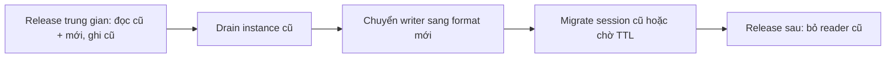

# Chiến lược đổi định dạng và xử lý phiên không còn đọc được

Session của Spring Session thường sống lâu hơn một request và có thể được đọc bởi nhiều phiên bản ứng dụng trong lúc triển khai rolling update. Vì vậy, thay đổi class Java, cấu trúc DTO, serializer hoặc định dạng JSON có thể khiến một instance mới không đọc được session do phiên bản cũ ghi, hoặc instance cũ không đọc được session mới ghi.

Khi lỗi giải tuần tự hóa xảy ra, request có thể thất bại dù Redis/JDBC vẫn truy cập được và dữ liệu session vẫn còn trong kho. Đây là vấn đề tương thích dữ liệu, khác với session hết hạn hoặc Redis mất kết nối. Một chiến lược tốt cần định nghĩa định dạng có thể tiến hóa, triển khai theo từng giai đoạn, kiểm thử dữ liệu giữa các phiên bản và có cách xử lý an toàn khi một session đã hỏng hoặc không còn tương thích.

Trong `SPRING_SESSION`, session được lưu trong kho chia sẻ như Redis hoặc JDBC để các instance Spring độc lập có thể dùng chung trạng thái. Do đó, định dạng session là một phần của giao thức giữa các phiên bản ứng dụng đang chạy đồng thời. Không nên coi việc đổi serializer là một thay đổi nội bộ đơn giản của một instance.

## 1. Vì sao định dạng session có thể bị lỗi?

Một session có thể chứa nhiều loại đối tượng: chuỗi, số, collection, DTO của ứng dụng, thông tin xác thực hoặc dữ liệu quy trình. Khi repository lưu session, các giá trị này được chuyển thành byte hoặc biểu diễn lưu trữ thông qua serializer/converter. Khi request tiếp theo đọc session, phiên bản ứng dụng hiện tại phải có khả năng giải mã và tái tạo đúng kiểu dữ liệu.

Các thay đổi dễ gây mất tương thích:

- Đổi tên class hoặc package của một DTO đang được lưu trong session.
- Xóa class cũ trong khi session cũ vẫn còn tồn tại.
- Thay đổi `serialVersionUID` hoặc cấu trúc class Java serialization theo cách không tương thích.
- Đổi tên field JSON, đổi kiểu dữ liệu hoặc thay đổi cách biểu diễn enum.
- Bật/tắt type metadata hoặc đổi chiến lược polymorphic deserialization.
- Chuyển từ Java serialization sang JSON, CBOR hoặc serializer tùy chỉnh.
- Thay đổi serializer ở một instance trong khi các instance khác vẫn dùng định dạng cũ.
- Một thuộc tính chứa object graph có class từ thư viện đã bị nâng cấp hoặc loại bỏ.

Ví dụ: phiên bản A lưu `com.example.checkout.CartDraft` bằng Java serialization. Phiên bản B chuyển class sang package `com.example.order.CartDraftV2` và loại bỏ class cũ. Một session được tạo trước khi triển khai B có thể không được B giải tuần tự hóa vì stream cũ tham chiếu tên class cũ. Việc đổi `serialVersionUID` không sửa được vấn đề tên class đã biến mất.

## 2. Xác định serializer thực tế trước khi đổi định dạng

Trước khi thay đổi, cần biết chính xác repository đang dùng cách lưu dữ liệu nào. Không nên giả định mọi ứng dụng Spring Session đều dùng cùng một serializer hoặc cùng một extension point.

| Kho lưu trữ | Điều cần xác minh |
|---|---|
| Redis | `RedisSerializer` nào được dùng cho session attributes, key/value nào được serialize, có type metadata hay không, bean serializer tùy chỉnh có được repository nhận không |
| JDBC | Cách repository chuyển đổi session attribute thành dữ liệu trong schema, loại cột lưu trữ, converter/serializer đang cấu hình và khả năng đọc dữ liệu cũ |
| Repository tùy chỉnh | Định dạng byte, version marker, encoding, schema và cách tương thích ngược/tiến |

Với Spring Session Redis, cấu hình thường có thể cung cấp bean `RedisSerializer<Object>` tên `springSessionDefaultRedisSerializer` để tùy chỉnh việc serialize session attribute. Ví dụ minh họa dùng JSON serializer:

```java
import org.springframework.context.annotation.Bean;
import org.springframework.context.annotation.Configuration;
import org.springframework.data.redis.serializer.GenericJackson2JsonRedisSerializer;
import org.springframework.data.redis.serializer.RedisSerializer;

@Configuration
public class SessionSerializationConfiguration {

    @Bean(name = "springSessionDefaultRedisSerializer")
    public RedisSerializer<Object> springSessionDefaultRedisSerializer() {
        return new GenericJackson2JsonRedisSerializer();
    }
}
```

Đây là ví dụ cấu hình cho Spring Session Redis; cần xác nhận API và cách cấu hình theo đúng phiên bản Spring Data Redis/Spring Session. `GenericJackson2JsonRedisSerializer` có thể lưu thông tin kiểu để tái tạo object polymorphic. Không nên bật cơ chế polymorphic type handling rộng cho dữ liệu không đáng tin cậy; hãy giới hạn kiểu được phép và ưu tiên DTO cụ thể. Đổi bean serializer này khi session cũ còn tồn tại có thể khiến dữ liệu cũ không đọc được.

Bean serializer dành cho Redis không tự động cấu hình cách serialize của Spring Session JDBC. Với JDBC hoặc repository khác, hãy dùng extension point mà implementation đó cung cấp và kiểm tra schema lưu trữ thực tế.

## 3. Chọn định dạng dữ liệu có thể tiến hóa

Một định dạng session tốt cần ổn định, nhỏ và dễ chuyển đổi. Nên lưu DTO chuyên biệt cho session thay vì lưu trực tiếp entity, proxy hoặc object graph lớn từ thư viện bên ngoài.

Ví dụ DTO có cấu trúc rõ ràng:

```java
import java.io.Serializable;
import java.util.List;

public final class CartSessionData implements Serializable {

    private static final long serialVersionUID = 1L;

    private int schemaVersion;
    private String cartId;
    private List<String> itemIds;

    public CartSessionData() {
    }

    public CartSessionData(
            int schemaVersion,
            String cartId,
            List<String> itemIds) {
        this.schemaVersion = schemaVersion;
        this.cartId = cartId;
        this.itemIds = itemIds;
    }

    public int getSchemaVersion() { return schemaVersion; }
    public String getCartId() { return cartId; }
    public List<String> getItemIds() { return itemIds; }
}
```

DTO này chỉ lưu mã giỏ hàng và danh sách ID sản phẩm, không nhúng toàn bộ entity. Trường `schemaVersion` giúp code nhận biết cấu trúc payload sau khi serializer đã tái tạo được đối tượng. Nó không tự giải quyết lỗi giải tuần tự hóa xảy ra trước khi code có thể đọc trường version.

Một số nguyên tắc thiết kế:

- Giữ thuộc tính session nhỏ; ưu tiên ID hoặc dữ liệu có thể dựng lại từ nguồn chính.
- Dùng tên thuộc tính session ổn định, có namespace như `app.checkout.cart`.
- Giữ tên class/package ổn định nếu dùng Java serialization hoặc type metadata dựa trên tên class.
- Với JSON, định nghĩa rõ field, kiểu, giá trị mặc định và chính sách khi gặp field không biết.
- Khi thêm field, ưu tiên field tùy chọn có giá trị mặc định hợp lý.
- Khi đổi kiểu field hoặc ý nghĩa field, dùng phiên bản schema mới và chuyển đổi tường minh.
- Tránh enum có thể bị đổi tên nếu giá trị enum được lưu trực tiếp; cân nhắc mã chuỗi ổn định và parser có fallback.
- Không lưu object phụ thuộc vào classloader, transaction, persistence context, socket, thread hoặc tài nguyên đang mở.

## 4. Java serialization và tương thích class

Java serialization có thể thuận tiện khi lưu object Java trực tiếp, nhưng định dạng stream phụ thuộc tên class, cấu trúc class và thông tin serialization. `serialVersionUID` được dùng để kiểm tra tương thích phiên bản class.

```java
public final class UserSessionContext implements Serializable {

    private static final long serialVersionUID = 1L;

    private String userId;
    private String tenantId;

    // Constructor, getter và các phương thức cần thiết.
}
```

Giữ `serialVersionUID` ổn định có thể giúp một số thay đổi field tương thích theo quy tắc Java serialization, nhưng không phải cam kết mọi thay đổi đều an toàn. Xóa field có thể làm mất dữ liệu; thêm field có thể nhận giá trị mặc định khi đọc stream cũ; thay đổi kiểu field hoặc hierarchy có thể gây lỗi; đổi tên class/package có thể gây `ClassNotFoundException` hoặc lỗi tương thích khác.

Nếu dùng Java serialization:

1. Định nghĩa `serialVersionUID` rõ ràng cho DTO được lưu lâu trong session.
2. Tránh đổi tên hoặc di chuyển class trong thời gian session cũ còn sống, trừ khi có chiến lược tương thích.
3. Kiểm thử deserialize các fixture được ghi bởi từng phiên bản ứng dụng cần hỗ trợ.
4. Không serialize entity/proxy Hibernate hoặc object graph phụ thuộc classloader và thư viện thay đổi nhanh.
5. Có kế hoạch hết hạn hoặc chuyển đổi session cũ trước khi loại bỏ class cũ.

Java serialization không phải lựa chọn tốt cho dữ liệu cần trao đổi giữa nhiều ngôn ngữ hoặc nhiều hệ thống. Nếu cần schema độc lập với class Java, cân nhắc JSON hoặc định dạng có schema rõ ràng, nhưng phải thiết kế type mapping và kiểm soát dữ liệu đầu vào.

## 5. JSON serialization và schema evolution

JSON dễ kiểm tra và ít gắn với tên class Java hơn nếu payload chỉ chứa cấu trúc dữ liệu. Tuy nhiên, JSON không tự động bảo đảm tương thích. Việc đổi field, kiểu, enum hoặc type metadata vẫn có thể khiến phiên bản mới không đọc được payload cũ.

Ví dụ payload có version:

```json
{
  "schemaVersion": 2,
  "cartId": "cart-742",
  "itemIds": ["sku-10", "sku-22"],
  "currency": "VND"
}
```

Code đọc payload có thể chuyển đổi version cũ sang cấu trúc hiện tại:

```java
public CartSessionData migrateCartPayload(JsonNode payload) {
    int version = payload.path("schemaVersion").asInt(1);

    return switch (version) {
        case 1 -> new CartSessionData(
                2,
                payload.path("cartId").asText(),
                readItemIds(payload.path("items"))
        );
        case 2 -> new CartSessionData(
                2,
                payload.path("cartId").asText(),
                readItemIds(payload.path("itemIds"))
        );
        default -> throw new UnsupportedSessionSchemaException(version);
    };
}
```

Ví dụ trên minh họa logic chuyển đổi sau khi JSON đã được parse thành `JsonNode`; các helper và exception cần được định nghĩa trong ứng dụng. Khi schema thay đổi, cần xác định hành vi cho field bị thiếu, field dư, kiểu dữ liệu không hợp lệ và version tương lai.

Các nguyên tắc tương thích JSON:

- Thêm field tùy chọn thường dễ tương thích hơn đổi tên hoặc đổi kiểu field hiện có.
- Đọc field cũ trong giai đoạn chuyển tiếp; chỉ bỏ field cũ sau khi mọi writer đã ngừng tạo nó và session cũ đã hết hạn/chuyển đổi.
- Không dựa vào cấu hình “ignore unknown properties” như chiến lược tương thích duy nhất; field không biết có thể mang ý nghĩa cần thiết cho phiên bản khác.
- Dùng mã enum ổn định, không phụ thuộc tên enum Java nếu tên có thể thay đổi.
- Nếu serializer ghi class name/type metadata, class rename vẫn có thể phá dữ liệu dù payload là JSON.
- Kiểm tra type metadata và polymorphic deserialization; chỉ cho phép các kiểu ứng dụng cần thiết.

## 6. Thêm version marker và chuyển đổi thuộc tính

Một cách thực tế là bọc mỗi thuộc tính phức tạp trong một cấu trúc có version. Điều này đặc biệt hữu ích khi ứng dụng muốn chuyển đổi dữ liệu theo từng thuộc tính thay vì phải thay toàn bộ session format cùng lúc.

Ví dụ một envelope logic:

```java
public record VersionedCartPayload(
        int schemaVersion,
        JsonNode payload) {
}
```

Khi đọc thuộc tính `app.checkout.cart`, service kiểm tra `schemaVersion`, chuyển payload về DTO hiện tại, rồi nếu cần có thể ghi lại phiên bản mới:

```java
CartSessionData cart = cartSessionConverter.read(rawValue);

if (cart.needsUpgrade()) {
    session.setAttribute("app.checkout.cart", cart.toCurrentFormat());
}
```

Đây là mẫu thiết kế; `rawValue` và converter phụ thuộc serializer mà ứng dụng sử dụng. Không phải serializer nào cũng trả raw JSON cho code ứng dụng; đôi khi deserialize lỗi xảy ra ngay khi repository tải session. Vì vậy, version marker ở bên trong object chỉ hữu ích khi outer serialization format vẫn đọc được.

Khi đổi một thuộc tính, có thể dùng quy trình lazy migration:

1. Đọc giá trị cũ bằng reader tương thích.
2. Chuyển sang DTO hiện tại.
3. Kiểm tra dữ liệu sau chuyển đổi.
4. Ghi lại thuộc tính ở format mới bằng `setAttribute`.
5. Đảm bảo `SaveMode` và `FlushMode` khiến thay đổi được lưu.
6. Theo dõi số session/attribute còn ở format cũ để biết khi nào có thể bỏ reader cũ.

Lazy migration giúp phân tán tải chuyển đổi theo hoạt động thực tế, nhưng session không được truy cập có thể không bao giờ được chuyển đổi. Hãy đặt thời hạn kết thúc hỗ trợ format cũ dựa trên session timeout và yêu cầu vận hành.

## 7. Chiến lược rolling deployment: đọc cũ và mới an toàn

Trong lúc triển khai nhiều instance, phiên bản cũ và mới có thể cùng truy cập Redis/JDBC. Một lỗi phổ biến là phiên bản mới bắt đầu ghi format mới ngay khi được đưa lên, trong khi instance cũ vẫn có thể nhận request và đọc session đó.

Một chiến lược an toàn thường theo mô hình **expand – migrate – contract**:

### Giai đoạn 1: Mở rộng khả năng đọc

Phát hành phiên bản trung gian có thể đọc cả format cũ và format mới, nhưng vẫn ghi format cũ. Ở giai đoạn này, mọi instance cũ và mới đều có thể đọc dữ liệu do writer hiện tại tạo ra.

### Giai đoạn 2: Loại bỏ instance cũ

Chờ rolling deployment hoàn tất, xác nhận không còn instance cũ xử lý request hoặc background task có thể đọc session. Kiểm tra cả worker, scheduler và tác vụ quản trị dùng chung repository.

### Giai đoạn 3: Chuyển writer sang format mới

Sau khi tất cả reader đều hỗ trợ format mới, bật writer mới. Trong giai đoạn này, reader tương thích vẫn có thể xử lý session cũ chưa được migrate.

### Giai đoạn 4: Migrate hoặc chờ session cũ hết hạn

Chuyển đổi session cũ khi chúng được truy cập, hoặc dùng tác vụ migration có kiểm soát. Nếu session có thời hạn ngắn và việc đăng nhập lại chấp nhận được, có thể để session cũ hết hạn theo chính sách.

### Giai đoạn 5: Thu hẹp khả năng đọc

Khi metrics xác nhận không còn dữ liệu format cũ, loại bỏ reader và class tương thích cũ trong một release sau.



Không bật ghi format mới trước khi mọi instance còn hoạt động có thể đọc nó. Nếu không thể triển khai reader tương thích, lựa chọn an toàn có thể là buộc session hết hạn có kiểm soát và yêu cầu người dùng xác thực lại sau khi chuyển đổi.

## 8. Dual-read, single-write và giới hạn của fallback

Một serializer tương thích có thể thử đọc định dạng mới trước, sau đó thử định dạng cũ nếu nhận diện được format marker. Tuy nhiên, fallback cần có giới hạn rõ ràng:

- Chỉ fallback cho lỗi format đã biết, không fallback cho lỗi Redis timeout, authentication hoặc network.
- Phân biệt dữ liệu cũ hợp lệ với payload bị hỏng hoặc bị sửa.
- Không thử vô hạn nhiều serializer trên cùng payload.
- Ghi log loại format và kết quả chuyển đổi nhưng không ghi payload nhạy cảm.
- Khi đọc format cũ thành công, chuyển đổi sang object hiện tại rồi ghi theo writer version được phép.
- Không ghi format mới khi vẫn còn instance cũ không thể đọc nó.

Dual-read/single-write không tự có sẵn chỉ bằng cách khai báo hai bean serializer. Nếu cần, phải triển khai một serializer hoặc adapter có format detection rõ ràng, hoặc dùng một lớp chuyển đổi ở cấp thuộc tính. Kiểm thử mọi nhánh: format cũ, format mới, marker thiếu, version không hỗ trợ, dữ liệu hỏng và lỗi datastore.

Không bắt tất cả `Exception` rồi thử serializer khác. Một lỗi `RedisConnectionFailureException` không phải dấu hiệu dữ liệu đang ở format cũ. Chỉ xử lý fallback cho nhóm lỗi deserialize được phân loại chính xác.

## 9. Xử lý session không còn đọc được

Khi repository tải session, lỗi có thể xảy ra ở nhiều tầng. Cách xử lý cần phân biệt nguyên nhân:

| Loại lỗi | Ví dụ | Hành vi phù hợp |
|---|---|---|
| Session không tồn tại hoặc đã hết hạn | Repository trả về không tìm thấy | Xử lý như phiên mới hoặc yêu cầu đăng nhập theo endpoint |
| Không tương thích serializer | `InvalidClassException`, `ClassNotFoundException`, JSON mapping/type error | Ghi nhận lỗi format, áp dụng reader tương thích hoặc thu hồi session bị lỗi theo quy trình |
| Dữ liệu bị hỏng | Byte stream bị cắt, JSON không hợp lệ, thiếu field bắt buộc | Cách ly/ghi nhận metadata an toàn, không dùng dữ liệu đó để cấp quyền |
| Redis/JDBC không truy cập được | Timeout, connection refused, authentication failure | Báo lỗi hạ tầng; không coi session là đã hết hạn hoặc tự động xóa |
| Lỗi ứng dụng khi dùng thuộc tính | `ClassCastException`, logic không xử lý version mới | Sửa mapping/logic; không xóa session hàng loạt để che lỗi |

Nếu chỉ một session không đọc được do format cũ hoặc dữ liệu hỏng, có thể cần xóa riêng session đó và yêu cầu người dùng đăng nhập lại. Nhưng không được xóa chỉ vì repository tạm thời không kết nối được. Xóa session khi Redis unavailable có thể làm mất dữ liệu hợp lệ và che giấu sự cố.

### 9.1. Phân loại lỗi trước khi thu hồi session

Một quy trình xử lý nên:

1. Xác định lỗi xảy ra khi kết nối datastore, đọc byte, deserialize hay xử lý DTO.
2. Chỉ đánh dấu session không thể đọc khi có bằng chứng lỗi thuộc định dạng/dữ liệu cụ thể.
3. Không trả nội dung serialized hoặc session ID đầy đủ vào log.
4. Nếu có reader cũ tương thích, thử chuyển đổi trong giới hạn đã định.
5. Nếu không thể phục hồi, xóa session bằng repository/API phù hợp khi datastore sẵn sàng và yêu cầu xác thực lại.
6. Ghi metrics về số session bị lỗi theo phiên bản format, không ghi thông tin cá nhân hoặc payload.

Không nên tự động tạo session mới cho mọi lỗi deserialize ngay trong filter mà không phân biệt lỗi. Một lỗi mapping có thể làm request thất bại trước khi controller chạy; nếu catch quá rộng và tiếp tục như anonymous, ứng dụng có thể che lỗi bảo mật hoặc làm sai hành vi nghiệp vụ.

### 9.2. Giữ lỗi datastore khác với lỗi dữ liệu

Nếu Redis timeout, ứng dụng không biết session còn tồn tại hay không. Đây là trạng thái không xác định, không phải session rỗng. Tùy API, nên trả lỗi dịch vụ tạm thời hoặc để cơ chế exception handling của ứng dụng xử lý. Không chuyển mọi lỗi thành `Mono.empty()`, `null` hoặc một session mới.

Với JDBC, lỗi kết nối database, transaction rollback hoặc lỗi đọc BLOB cũng cần được phân loại riêng với lỗi Java deserialization. Việc một cột dữ liệu không thể chuyển thành object không đồng nghĩa toàn bộ database đang lỗi.

## 10. Di chuyển dữ liệu session khi đổi serializer

Đổi serializer trên một kho đang có session hoạt động là một migration dữ liệu. Có ba lựa chọn phổ biến:

| Cách làm | Mô tả | Khi phù hợp |
|---|---|---|
| Chờ session hết hạn | Giữ reader cũ trong giai đoạn chuyển đổi, để session cũ tự hết hạn | Session timeout ngắn và có thể yêu cầu đăng nhập lại |
| Lazy migration | Chuyển session/attribute khi được đọc và ghi lại | Session được truy cập thường xuyên, có thể duy trì reader cũ |
| Batch migration | Đọc và chuyển đổi session bằng tác vụ quản trị có kiểm soát | Có nhiều session cần chuyển đổi hoặc thời hạn chuyển đổi rõ ràng |

Batch migration phải dùng đúng schema và API repository; không nên viết script tùy tiện sửa byte trong Redis hash hoặc BLOB JDBC. Nếu serializer mới không thể đọc byte cũ, cần một decoder cũ trong công cụ migration. Nếu dữ liệu cũ có class không còn trên classpath, công cụ migration có thể cần chạy với class cũ hoặc một module chuyển đổi chứa class tương thích.

Khi migration:

- Thử trên bản sao dữ liệu đại diện trước khi chạy production.
- Giới hạn tốc độ để không gây tải lớn lên Redis/JDBC.
- Có checkpoint và khả năng tiếp tục sau lỗi.
- Bảo đảm ghi lại session không làm mất TTL, last-accessed time, max inactive interval, principal index hoặc metadata cần thiết.
- Tránh ghi đè session vừa được request khác cập nhật; cần versioning/kiểm tra thay đổi hoặc cửa sổ bảo trì có kiểm soát.
- Theo dõi số session đã chuyển đổi, còn cũ, lỗi và bị loại bỏ.
- Có kế hoạch rollback ứng dụng và dữ liệu; writer mới có thể tạo dữ liệu mà phiên bản cũ không đọc được.

Nếu không có cách migration an toàn và session chỉ giữ trạng thái tạm, cho session cũ hết hạn có kiểm soát có thể ít rủi ro hơn chuyển đổi byte phức tạp.

## 11. Bảo mật khi giải tuần tự hóa

Dữ liệu session thường chứa thông tin xác thực hoặc trạng thái liên quan đến người dùng. Serializer phải được cấu hình như một ranh giới tin cậy:

- Không bật polymorphic deserialization rộng cho mọi class nếu dữ liệu có thể bị ghi bởi tác nhân không đáng tin cậy.
- Dùng allowlist kiểu dữ liệu và DTO chuyên biệt; hạn chế class được phép khởi tạo.
- Bảo vệ Redis/JDBC bằng xác thực, phân quyền tối thiểu, network isolation và TLS khi phù hợp.
- Không chấp nhận payload session từ client rồi deserialize trực tiếp bằng Java serialization.
- Không lưu mật khẩu, khóa bí mật hoặc token dài hạn trong session nếu không thực sự cần thiết.
- Giữ dependency serializer/Jackson được cập nhật và theo dõi advisory bảo mật.
- Không ghi raw serialized bytes, cookie hoặc session attributes vào log.

Java native serialization có lịch sử nhiều rủi ro khi deserialize dữ liệu không tin cậy. Với Spring Session, kho dữ liệu cần được bảo vệ để chỉ ứng dụng có quyền ghi; đồng thời vẫn nên ưu tiên DTO nhỏ, serializer có kiểm soát kiểu và cập nhật thư viện. Chuyển sang JSON không tự động làm dữ liệu an toàn nếu bật polymorphic type handling quá rộng.

## 12. Kiểm thử tương thích giữa các phiên bản

Kiểm thử serializer không nên chỉ kiểm tra object hiện tại serialize rồi deserialize lại chính nó. Cần có fixture được tạo bởi các phiên bản trước và kiểm tra khả năng đọc trong phiên bản mới.

| Kiểm thử | Cách thực hiện | Điều cần xác minh |
|---|---|---|
| Round-trip hiện tại | Serialize rồi deserialize DTO ở cùng phiên bản | Giá trị được giữ nguyên |
| Đọc fixture cũ | Dùng byte/JSON được tạo bởi release trước | Reader mới chuyển đổi đúng hoặc từ chối có kiểm soát |
| Tương thích ngược | Release cũ đọc dữ liệu do release mới ghi trong giai đoạn rollout | Chỉ bật writer mới khi reader cũ hỗ trợ |
| Field mới | Đọc payload cũ thiếu field mới | Giá trị mặc định có ý nghĩa |
| Field đổi tên/kiểu | Đọc payload có cấu trúc cũ | Có migration rõ ràng, không cast mù |
| Class/package rename | Đọc Java serialized stream hoặc type metadata cũ | Class tương thích được giữ lại hoặc migration xử lý |
| Unknown type | Payload chứa type không nằm trong allowlist | Từ chối an toàn, không khởi tạo tùy ý |
| Payload bị cắt/hỏng | Cố ý làm sai byte hoặc JSON | Lỗi được phân loại, không tạo quyền truy cập |
| Redis/JDBC unavailable | Ngắt datastore trong test | Lỗi hạ tầng không bị coi là session hết hạn |
| Rolling deployment | Chạy hai phiên bản cùng repository | Writer/reader tương thích trong mọi giai đoạn |
| Migration đồng thời | Request cập nhật trong lúc batch migration | Không ghi đè thay đổi mới hơn |

Nên giữ một tập fixture serialization trong kiểm thử của ứng dụng. Mỗi lần thay DTO, serializer hoặc dependency, thêm fixture cho format mới và tiếp tục giữ fixture cũ trong thời gian cần hỗ trợ. Integration test với Redis/JDBC thực tế giúp phát hiện khác biệt mà unit test serializer đơn lẻ không thể thấy.

## 13. Quan sát và vận hành khi thay đổi định dạng

Metrics giúp biết khi nào có thể bỏ hỗ trợ format cũ và khi nào cần xử lý lỗi dữ liệu. Nên theo dõi:

- Số lỗi deserialize theo loại exception và phiên bản ứng dụng.
- Số session/attribute đọc được theo từng schema version nếu ứng dụng có version marker.
- Số lần lazy migration thành công/thất bại.
- Số session bị thu hồi do không thể phục hồi.
- Redis/JDBC connection error, timeout và latency riêng biệt với lỗi serializer.
- Tỷ lệ session được tạo bởi từng phiên bản writer trong rolling deployment.

Không dùng session ID đầy đủ làm metric label vì cardinality cao và có thể làm lộ định danh. Nếu cần tương quan log, dùng mã tương quan không nhạy cảm hoặc hash có kiểm soát; không ghi cookie hay payload session.

Trước khi xóa class cũ hoặc tắt decoder cũ, xác minh metrics không còn ghi nhận dữ liệu cũ trong khoảng thời gian ít nhất bằng thời hạn session tối đa cộng thêm thời gian dự phòng cho các tác vụ nền. Nếu session có timeout tùy chỉnh dài hơn mặc định, phải tính đến timeout lớn nhất thực tế.

## 14. Lỗi thường gặp và cách khắc phục

| Triệu chứng | Nguyên nhân có thể | Cách xử lý |
|---|---|---|
| `InvalidClassException` | `serialVersionUID` hoặc cấu trúc class không tương thích | Giữ DTO tương thích, đọc fixture cũ hoặc chuyển đổi session |
| `ClassNotFoundException` | Class/package cũ đã bị xóa hoặc đổi tên | Giữ class adapter cũ trong giai đoạn chuyển tiếp hoặc migrate bằng decoder cũ |
| Jackson không map được field | Đổi tên/kiểu field, constructor hoặc type metadata không tương thích | Version schema, alias/migration và DTO rõ ràng |
| Một số instance đọc được session, số khác không | Serializer hoặc classpath giữa các instance khác nhau | Đồng bộ dependency, class và cấu hình serializer |
| Sau deploy người dùng bị logout hàng loạt | Writer mới tạo format mà reader cũ không hiểu | Áp dụng expand–migrate–contract và kiểm soát thời điểm đổi writer |
| Fallback biến Redis outage thành session rỗng | Bắt mọi exception rồi trả empty/null | Chỉ fallback cho lỗi deserialize đã phân loại |
| Migration làm mất TTL hoặc principal index | Tự ghi byte/khóa nội bộ không qua repository | Dùng API repository và xác minh metadata sau migration |
| Session hỏng được thử deserialize liên tục | Không có cơ chế đánh dấu/cách ly session lỗi | Ghi nhận lỗi, thu hồi session cụ thể khi datastore sẵn sàng và ngăn retry lặp vô hạn |
| JSON vẫn lỗi dù đã chuyển khỏi Java serialization | Type metadata hoặc schema vẫn phụ thuộc class Java | Dùng DTO ổn định, type allowlist và versioned payload |

## 15. Quy trình đổi định dạng an toàn

Khi cần thay serializer hoặc cấu trúc session, thực hiện theo trình tự:

1. Kiểm kê các thuộc tính session, kiểu dữ liệu, serializer, version và thời gian sống tối đa.
2. Xác định mọi instance, background task và công cụ quản trị có thể đọc/ghi session.
3. Chọn định dạng đích, DTO ổn định, type policy và version marker.
4. Tạo fixture từ dữ liệu phiên bản cũ và viết kiểm thử đọc chéo.
5. Phát hành reader tương thích trước, trong khi writer vẫn giữ format cũ.
6. Drain toàn bộ instance không đọc được format mới.
7. Chuyển writer sang format mới và theo dõi lỗi deserialize.
8. Lazy migrate, batch migrate hoặc để session cũ hết hạn theo chính sách.
9. Xử lý riêng session hỏng; phân biệt lỗi dữ liệu với Redis/JDBC unavailable.
10. Chỉ bỏ class/decoder cũ khi metrics xác nhận không còn session cần chúng.

Định dạng session là hợp đồng dữ liệu tồn tại xuyên qua nhiều request và nhiều phiên bản ứng dụng. Giữ DTO nhỏ, có version, reader tương thích và writer chuyển đổi theo giai đoạn giúp rolling deployment an toàn hơn. Khi một session không còn đọc được, hãy xác định đó là lỗi format, dữ liệu hỏng hay datastore unavailable trước khi quyết định chuyển đổi hoặc thu hồi; cách phân loại này ngăn ứng dụng biến sự cố hạ tầng thành logout hàng loạt và bảo vệ trạng thái xác thực của người dùng.
