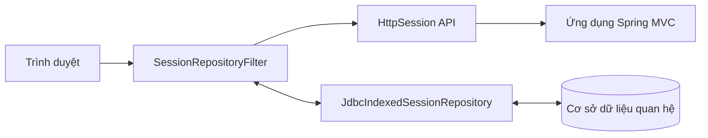
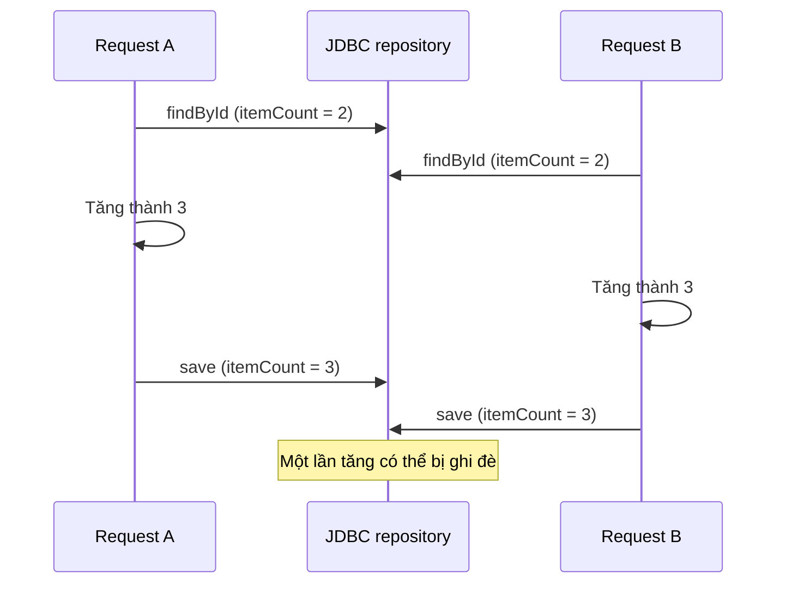

# JdbcIndexedSessionRepository và các thao tác quản lý phiên

Spring Session JDBC lưu trạng thái phiên trong cơ sở dữ liệu quan hệ và cho phép nhiều instance Spring cùng khôi phục session từ một `DataSource` dùng chung. Repository chính cho trường hợp này là `JdbcIndexedSessionRepository`. Ngoài các thao tác cơ bản theo session ID, repository còn hỗ trợ tìm session theo principal name, nhờ đó ứng dụng có thể quản lý các phiên đăng nhập của một người dùng trên nhiều thiết bị.

Để sử dụng repository đúng cách, cần hiểu cấu trúc bảng, vòng đời tạo–đọc–lưu–xóa, cách principal index hoạt động, việc dọn session hết hạn và các giới hạn về transaction cũng như cập nhật đồng thời. Những thao tác này giúp triển khai đăng xuất, quản lý thiết bị và vận hành nhiều instance một cách nhất quán.

## 1. Vai trò của JdbcIndexedSessionRepository

`JdbcIndexedSessionRepository` là implementation JDBC của hợp đồng `FindByIndexNameSessionRepository`. Nó cung cấp các thao tác `SessionRepository` thông thường và khả năng tìm session theo một index, phổ biến nhất là principal name.

Trong ứng dụng Servlet, Spring Session kết nối repository với API `HttpSession` thông qua `SessionRepositoryFilter`. Controller vẫn sử dụng `request.getSession()`, `getAttribute`, `setAttribute` và `invalidate`; repository chịu trách nhiệm lưu dữ liệu vào bảng session.



Các instance của cùng ứng dụng có thể chia sẻ session khi chúng cùng truy cập database, cùng schema/table, cùng cách serialization và cùng cấu hình session ID/cookie. Việc dùng chung database là điều kiện cần; các instance cũng phải có cấu hình tương thích để đọc dữ liệu mà instance khác đã ghi.

## 2. Cấu trúc bảng session

Spring Session JDBC thường sử dụng hai bảng chính:

- `SPRING_SESSION`: lưu metadata của session.
- `SPRING_SESSION_ATTRIBUTES`: lưu từng attribute đã được tuần tự hóa.

Bảng session tiêu chuẩn có các cột quan trọng sau:

| Cột | Ý nghĩa |
|---|---|
| `PRIMARY_ID` | Khóa chính nội bộ của hàng session |
| `SESSION_ID` | Session ID được dùng để nhận diện phiên qua request |
| `CREATION_TIME` | Thời điểm tạo session |
| `LAST_ACCESS_TIME` | Thời điểm truy cập gần nhất |
| `MAX_INACTIVE_INTERVAL` | Thời gian không hoạt động tối đa, tính bằng giây |
| `EXPIRY_TIME` | Thời điểm session hết hạn, thường được lưu dưới dạng epoch milliseconds |
| `PRINCIPAL_NAME` | Tên principal dùng cho truy vấn phiên theo người dùng |

Bảng attributes thường có các cột:

| Cột | Ý nghĩa |
|---|---|
| `SESSION_PRIMARY_ID` | Tham chiếu đến `PRIMARY_ID` của hàng session |
| `ATTRIBUTE_NAME` | Tên attribute trong session |
| `ATTRIBUTE_BYTES` | Dữ liệu attribute đã được serialize |

`PRIMARY_ID` và `SESSION_ID` phục vụ hai mục đích khác nhau. `PRIMARY_ID` là khóa nội bộ liên kết metadata với các hàng attributes; `SESSION_ID` là ID mà Spring Session dùng để tìm phiên từ cookie hoặc header. Schema chuẩn thường có unique index trên `SESSION_ID`, index trên `EXPIRY_TIME` để hỗ trợ dọn phiên hết hạn và index trên `PRINCIPAL_NAME` để tìm các phiên của một người dùng.

Kiểu dữ liệu vật lý khác nhau giữa các hệ quản trị cơ sở dữ liệu. Ví dụ, cột chứa byte có thể dùng `BLOB`, `BYTEA` hoặc kiểu tương ứng; kiểu khóa và cú pháp index cũng có thể khác. Hãy dùng schema script đi kèm đúng phiên bản Spring Session và đúng database platform, hoặc chuyển schema thành migration được quản lý bằng Flyway/Liquibase.

## 3. Cấu hình Spring Session JDBC

Trong Spring Boot, thêm module Spring Session JDBC tương ứng với dòng Boot đang sử dụng và cấu hình `DataSource`. Ví dụ với các thế hệ Boot dùng module `spring-session-jdbc`:

```xml
<dependency>
    <groupId>org.springframework.session</groupId>
    <artifactId>spring-session-jdbc</artifactId>
</dependency>
```

Boot 4.x sử dụng starter JDBC của Boot; hãy dùng artifact và dependency management theo đúng phiên bản dự án. Tránh tự ghim một phiên bản Spring Session không tương thích với Spring Boot.

Ví dụ cấu hình YAML:

```yaml
spring:
  session:
    timeout: 30m
    jdbc:
      initialize-schema: never
      table-name: SPRING_SESSION
      cleanup-cron: "0 * * * * *"

  datasource:
    url: ${SESSION_DB_URL:jdbc:postgresql://localhost:5432/app}
    username: ${SESSION_DB_USERNAME:app}
    password: ${SESSION_DB_PASSWORD:}
```

Trong ví dụ:

- `spring.session.timeout` đặt thời gian không hoạt động mặc định của session.
- `initialize-schema: never` cho biết schema đã được tạo và quản lý bên ngoài ứng dụng.
- `table-name` xác định tên bảng session theo cấu hình repository; tên bảng attributes được suy ra theo quy tắc của implementation.
- `cleanup-cron` điều khiển lịch dọn các hàng session hết hạn.
- `spring.datasource.*` cấu hình kết nối database mà repository sử dụng.

Các thuộc tính và giá trị mặc định có thể thay đổi theo phiên bản Spring Boot/Spring Session. Hãy kiểm tra configuration metadata và tài liệu của phiên bản đang dùng. Trong production, schema thường nên được tạo bằng migration có kiểm soát thay vì để mỗi instance tự chạy DDL lúc khởi động.

Boot có thể tự cấu hình `JdbcIndexedSessionRepository` khi dependency và `DataSource` phù hợp có trên classpath. Nếu dùng annotation `@EnableJdbcHttpSession` để cấu hình thủ công, auto-configuration Spring Session tương ứng sẽ lùi lại. Tránh bật đồng thời hai cách mà không kiểm soát các bean được đăng ký.

## 4. Tạo session bằng createSession()

Hợp đồng repository cung cấp `createSession()` để tạo một session mới. Sau khi tạo, ứng dụng có thể đặt attributes và metadata, rồi gọi `save()` để ghi phiên.

```java
static <S extends Session> String createSession(
        SessionRepository<S> repository, String cartId) {

    S session = repository.createSession();
    session.setAttribute("cartId", cartId);
    session.setMaxInactiveInterval(Duration.ofMinutes(30));

    repository.save(session);
    return session.getId();
}
```

Ví dụ dùng trực tiếp repository để minh họa hợp đồng. Trong ứng dụng Servlet thông thường, controller không cần gọi `createSession()` và `save()` bằng tay; filter quản lý session khi ứng dụng sử dụng `HttpSession`.

Khi một request đầu tiên gọi `request.getSession()`, Spring Session có thể tạo session mới nếu chưa có phiên hợp lệ và request yêu cầu tạo. Session ID được trả về client qua resolver đang cấu hình, thường là cookie. Dữ liệu metadata và attributes được lưu thông qua JDBC repository.

Không tạo session cho mọi request một cách vô điều kiện. Những endpoint chỉ đọc tài nguyên công khai có thể không cần session; việc tạo phiên không cần thiết làm tăng số hàng trong database và lượng dữ liệu cần dọn.

## 5. Đọc session bằng findById()

Khi có session ID, repository dùng `findById(id)` để khôi phục session:

```java
static <S extends Session> S loadSession(
        SessionRepository<S> repository, String sessionId) {

    return repository.findById(sessionId);
}
```

Nếu không có session hợp lệ với ID đó, phương thức trả về `null`. Nguyên nhân có thể là ID không tồn tại, session đã bị xóa hoặc đã hết hạn. Caller phải xử lý trường hợp này trước khi đọc attributes.

Trong Spring Session Servlet, `SessionRepositoryFilter` thường thực hiện việc tìm session theo ID được đọc từ cookie hoặc header. Nếu repository không khôi phục được phiên, ứng dụng được xử lý như request chưa có session hiện tại. Khi controller gọi `getSession()`, một session mới có thể được tạo tùy logic request.

Session ID là dữ liệu không đáng tin từ client. Có ID không đồng nghĩa người dùng đã được xác thực; ứng dụng phải kiểm tra `SecurityContext` hoặc cơ chế xác thực riêng và áp dụng phân quyền cho tài nguyên.

## 6. Cập nhật và lưu bằng save()

`save(session)` ghi trạng thái session vào database. Metadata như thời điểm truy cập gần nhất, timeout và thời điểm hết hạn được cập nhật; các attributes được serialize và lưu trong bảng attributes theo chính sách save mode.

Ví dụ cập nhật một attribute:

```java
static <S extends Session> void updateCart(
        SessionRepository<S> repository,
        String sessionId,
        String cartId) {

    S session = repository.findById(sessionId);
    if (session == null) {
        throw new IllegalStateException("Session không còn hợp lệ");
    }

    session.setAttribute("cartId", cartId);
    repository.save(session);
}
```

Với `HttpSession`, ứng dụng dùng `setAttribute`, `removeAttribute` và các phương thức API tương ứng. Spring Session theo dõi thay đổi và filter phối hợp lưu session theo flush mode. Với object mutable như `List` hoặc `Map`, nếu save mode chỉ lưu attributes đã được đặt, hãy gọi lại `setAttribute` sau khi sửa object để thay đổi được ghi nhận.

Lưu ý rằng serialization có thể thất bại nếu attribute không tương thích với serializer, và thao tác database có thể thất bại do constraint, timeout hoặc lỗi kết nối. Cần quan sát lỗi từ repository thay vì giả định `setAttribute` có nghĩa dữ liệu đã được commit xuống database ngay tại thời điểm gọi.

## 7. Xóa phiên bằng deleteById() và invalidate()

`deleteById(id)` yêu cầu repository xóa session theo ID. Với ứng dụng Servlet, cách thông thường là gọi `HttpSession.invalidate()`:

```java
@PostMapping("/logout")
public String logout(HttpServletRequest request) {
    HttpSession session = request.getSession(false);
    if (session != null) {
        session.invalidate();
    }
    return "redirect:/login";
}
```

Khi request được quản lý bởi Spring Session, việc invalidate được chuyển thành thao tác xóa qua repository. Schema JDBC chuẩn có khóa ngoại từ bảng attributes tới bảng session với hành vi xóa cascade, nhờ đó các hàng attributes liên quan được xóa cùng session row. Nếu schema tùy chỉnh không có cascade, phải bảo đảm logic xóa attributes và session row nhất quán.

Không chỉ xóa cookie ở client. Nếu dữ liệu phiên vẫn tồn tại trong database, ID bị lộ có thể còn được dùng. Ngược lại, sau khi repository đã xóa session, cookie cũ không thể khôi phục session đó. Resolver cần xóa cookie ở response theo đúng tên, domain và path đã dùng khi tạo cookie.

## 8. Tìm session theo principal name

Điểm khác biệt quan trọng của `JdbcIndexedSessionRepository` so với repository JDBC không có index là khả năng tìm các session theo principal. Repository triển khai `FindByIndexNameSessionRepository` và sử dụng cột `PRINCIPAL_NAME` trong bảng `SPRING_SESSION` làm index cho principal name.

Ví dụ tìm các phiên của người dùng `alice`:

```java
Map<String, ? extends Session> sessions =
    indexedRepository.findByIndexNameAndIndexValue(
        FindByIndexNameSessionRepository.PRINCIPAL_NAME_INDEX_NAME,
        "alice");
```

`indexedRepository` phải là bean triển khai `FindByIndexNameSessionRepository`. Kết quả là map có session ID làm key và session làm value. Index principal cho phép ứng dụng hiển thị phiên đang hoạt động hoặc thu hồi các phiên khác của cùng người dùng.

Trong tích hợp Spring Security, Spring Session có thể lấy principal name từ `SecurityContext` được lưu trong session. Với cơ chế xác thực tùy chỉnh, ứng dụng phải cung cấp principal name theo cách repository có thể lập index, thường thông qua attribute có tên `PRINCIPAL_NAME_INDEX_NAME`:

```java
session.setAttribute(
    FindByIndexNameSessionRepository.PRINCIPAL_NAME_INDEX_NAME,
    principalName);
```

Không lấy username do client gửi lên làm principal đã xác thực. API tìm phiên phải dùng principal lấy từ context đã xác minh và phải kiểm tra quyền trước khi hiển thị hoặc xóa session. Index hỗ trợ tìm kiếm, không tự thực hiện authorization.

## 9. Quản lý phiên trên nhiều thiết bị

Một người dùng có thể đăng nhập từ trình duyệt, điện thoại và máy tính bảng, mỗi thiết bị có một session ID. Khi cần quản lý các phiên, ứng dụng có thể truy vấn theo principal index rồi hiển thị metadata cần thiết như thời điểm tạo, lần truy cập cuối và thiết bị nếu ứng dụng tự lưu thông tin đó.

Ví dụ đăng xuất khỏi tất cả phiên của principal:

```java
Map<String, ? extends Session> sessions =
    indexedRepository.findByIndexNameAndIndexValue(
        FindByIndexNameSessionRepository.PRINCIPAL_NAME_INDEX_NAME,
        principalName);

for (String sessionId : sessions.keySet()) {
    indexedRepository.deleteById(sessionId);
}
```

Đoạn mã minh họa việc thu hồi theo index; trong hệ thống thật, `principalName` phải lấy từ danh tính đã xác thực hoặc từ thao tác quản trị đã được phân quyền. Cần quyết định có thu hồi cả session hiện tại hay chỉ các session khác. Nếu xóa nhiều phiên, các thao tác có thể được thực hiện riêng lẻ; hãy thiết kế hành vi khi một lần xóa thất bại giữa chừng và cung cấp khả năng retry an toàn.

`JdbcIndexedSessionRepository` lập index theo principal name, không phải một công cụ tìm kiếm tùy ý trên mọi session attribute. Nếu cần tìm theo tenant, loại thiết bị hoặc thông tin khác, hãy thiết kế index nghiệp vụ riêng hoặc lưu metadata trong bảng quản lý thiết bị phù hợp. Tránh truy vấn trực tiếp các blob attributes như một cơ chế tìm kiếm chung.

## 10. Hết hạn và dọn session cũ

Session hết hạn logic khi thời gian không hoạt động vượt `MAX_INACTIVE_INTERVAL`. Repository dùng `LAST_ACCESS_TIME` và `EXPIRY_TIME` để xác định session có còn hợp lệ. Một truy vấn theo session ID không nên khôi phục session đã hết hạn chỉ vì hàng vật lý vẫn còn trong database.

Database không tự xóa hàng chỉ vì cột `EXPIRY_TIME` đã qua thời điểm hiện tại. Spring Session JDBC sử dụng cơ chế cleanup định kỳ để xóa các hàng session hết hạn; lịch có thể được cấu hình bằng `spring.session.jdbc.cleanup-cron` trong các phiên bản Boot hỗ trợ thuộc tính này.

```yaml
spring:
  session:
    jdbc:
      cleanup-cron: "0 * * * * *"
```

Giá trị trên minh họa lịch chạy mỗi phút theo biểu thức cron của Spring. Thời điểm cleanup thực tế phụ thuộc lịch, tải database và thời gian truy vấn. Vì vậy, session có thể hết hạn logic trước khi hàng được xóa vật lý.

Không dùng việc hàng biến mất khỏi bảng làm điều kiện duy nhất để quyết định quyền truy cập. Cũng không nên chạy một câu lệnh xóa tùy tiện trên production nếu chưa đánh giá index, transaction, lock và ảnh hưởng đến session đang được cập nhật.

## 11. Transaction và tính nhất quán

JDBC repository thực hiện các thao tác lưu và xóa qua `DataSource`. Các câu lệnh liên quan đến session metadata và attributes cần được thực hiện nhất quán để tránh hàng session thiếu attributes hoặc attributes mồ côi. Schema chuẩn dùng khóa ngoại và cascade để hỗ trợ tính toàn vẹn tham chiếu.

Tuy nhiên, không nên suy ra rằng toàn bộ nghiệp vụ của request và việc lưu session luôn nằm trong cùng một transaction. Việc session được lưu qua filter có thể xảy ra ở giai đoạn hoàn tất request; transaction nghiệp vụ của controller/service có thể đã commit hoặc rollback theo cấu hình riêng. Nếu một nghiệp vụ yêu cầu cập nhật đơn hàng và session phải nguyên tử cùng nhau, hãy thiết kế transaction manager và ranh giới giao dịch rõ ràng, hoặc lưu trạng thái nghiệp vụ trong cùng mô hình dữ liệu phù hợp.

Khi ứng dụng có nhiều `DataSource`, cần xác định `DataSource` nào được Spring Session sử dụng. Có thể đánh dấu bean phù hợp bằng `@SpringSessionDataSource` theo cơ chế được phiên bản Spring Session hỗ trợ. Nếu repository session dùng database khác với transaction manager nghiệp vụ, không giả định một `@Transactional` sẽ bao phủ cả hai nguồn dữ liệu.

## 12. Cập nhật đồng thời và lost update

Hai request có thể cùng tải một session, sửa một attribute rồi lưu. Ví dụ cả hai request đọc `itemCount = 2`, cùng tăng lên 3 và ghi lại. Kết quả cuối có thể là 3 thay vì 4. JDBC transaction bảo đảm tính nhất quán của các câu lệnh trong transaction, nhưng không tự động biến chuỗi đọc–sửa–ghi giữa hai request thành thao tác nguyên tử.



Nếu dữ liệu có cập nhật đồng thời quan trọng, cân nhắc optimistic locking/version column trong mô hình nghiệp vụ, pessimistic locking, transaction isolation phù hợp hoặc chuyển dữ liệu đó sang bảng nghiệp vụ có cơ chế cập nhật nguyên tử. Không dùng session attributes làm kho giao dịch cho số dư, tồn kho hoặc dữ liệu cần bảo đảm chính xác cao.

## 13. SaveMode, FlushMode và serialization

JDBC repository cũng chịu ảnh hưởng của chính sách lưu attributes. `SaveMode` quyết định attributes nào được ghi; `FlushMode` quyết định thời điểm thay đổi được đẩy xuống repository.

- `ON_SET_ATTRIBUTE`: ghi attributes đã được đặt qua `setAttribute`; khi sửa object mutable lấy từ session, hãy gán lại attribute.
- `ON_GET_ATTRIBUTE`: đánh dấu attributes được đọc để lưu; có thể làm tăng ghi nếu request chỉ đọc nhiều attributes.
- `ALWAYS`: ghi tất cả attributes khi session được lưu; đơn giản hơn về dirty tracking nhưng tăng serialization và database I/O.
- `FlushMode.ON_SAVE`: gom thay đổi đến thời điểm lưu session.
- `FlushMode.IMMEDIATE`: đẩy thay đổi sớm hơn, có thể làm tăng số lần ghi.

Các giá trị và cách cấu hình phụ thuộc phiên bản. Dù dùng JDBC hay Redis, serializer phải tương thích giữa các instance và mọi kiểu attribute phải có thể serialize/deserialize. Tránh lưu entity ORM lớn, lazy proxy, servlet object hoặc object phụ thuộc vòng đời của một request.

## 14. Tùy chỉnh tên bảng và nhiều nguồn dữ liệu

Ứng dụng có thể cần đặt tên bảng riêng để tránh xung đột với schema hiện có. Spring Session JDBC hỗ trợ cấu hình table name ở repository/annotation hoặc qua properties của Boot tùy phiên bản. Khi đổi tên, phải bảo đảm cả bảng session và bảng attributes được tạo theo quy tắc mà implementation mong đợi; index và khóa ngoại cũng cần trỏ đúng bảng.

Nếu dùng annotation thủ công, có thể cấu hình thời hạn mặc định:

```java
@Configuration
@EnableJdbcHttpSession(maxInactiveIntervalInSeconds = 1800)
class JdbcSessionConfiguration {
}
```

Với nhiều `DataSource`, cấu hình `@SpringSessionDataSource` trên bean dành cho session và kiểm tra repository thực sự sử dụng nguồn đó. Không để session repository vô tình kết nối database nghiệp vụ khác chỉ vì bean đó được đánh dấu `@Primary`.

Thay đổi tên bảng hoặc schema cần migration có thứ tự. Khi rolling deployment, tất cả instance phải đọc/ghi cùng schema tương thích. Nếu triển khai phiên bản mới cần cột hoặc index mới, migration phải hoàn tất trước khi instance mới sử dụng cấu trúc đó; đồng thời cần đánh giá instance cũ có tiếp tục hoạt động được không.

## 15. Kiểm thử các thao tác quản lý phiên

Một bộ kiểm thử tích hợp nên xác minh toàn bộ vòng đời và các khả năng indexed:

1. Tạo session, đặt attribute và lưu; xác nhận session ID được tạo.
2. Tải session bằng `findById()` và kiểm tra attributes.
3. Cập nhật attribute, lưu lại và đọc từ request hoặc instance mới.
4. Xóa bằng `deleteById()` hoặc `HttpSession.invalidate()`; xác nhận ID cũ không còn khôi phục được session.
5. Tạo nhiều session với cùng principal và xác nhận truy vấn `findByIndexNameAndIndexValue` trả về đúng tập ID.
6. Thu hồi các phiên của principal và xác nhận các ID đó không còn hợp lệ.
7. Đặt timeout ngắn, chờ session hết hạn logic và kiểm tra cleanup xóa hàng cũ theo lịch.
8. Kiểm tra các hàng attributes được xóa cùng session theo schema và khóa ngoại thực tế.
9. Chạy hai request đồng thời cập nhật cùng attribute để xác định hành vi và kiểm chứng cơ chế bảo vệ nếu cần.
10. Gửi request qua hai instance khác nhau để xác nhận cả hai cùng dùng repository và serializer tương thích.

Nên kiểm thử với đúng loại database production (hoặc một container database tương thích), không chỉ dựa vào H2 nếu production dùng PostgreSQL, MySQL hay SQL Server. Kiểu BLOB, locking, index, transaction isolation và cú pháp schema có thể khác nhau.

## 16. Chẩn đoán lỗi thường gặp

| Triệu chứng | Nguyên nhân có thể | Hướng kiểm tra |
|---|---|---|
| Không tạo được repository | Thiếu `spring-session-jdbc`, thiếu `DataSource` hoặc auto-configuration không thỏa điều kiện | Kiểm tra dependency, bean `DataSource` và log auto-configuration |
| Lỗi thiếu bảng/cột | Schema chưa được tạo hoặc không đúng phiên bản | Kiểm tra migration và schema script tương ứng |
| Session ID tồn tại nhưng không khôi phục được | Session hết hạn, bị xóa hoặc instance dùng schema/table khác | Kiểm tra `SESSION_ID`, `EXPIRY_TIME`, table name và DataSource |
| Không tìm được phiên theo người dùng | `PRINCIPAL_NAME` không được điền hoặc principal index không khớp | Kiểm tra `SecurityContext` và index resolver |
| Xóa session nhưng còn attributes | Schema tùy chỉnh thiếu cascade hoặc thao tác xóa chưa hoàn tất | Kiểm tra khóa ngoại và transaction |
| Session hết hạn nhưng hàng vẫn tồn tại | Cleanup job chưa chạy hoặc đang chờ lịch | Kiểm tra `EXPIRY_TIME`, cron và log cleanup |
| Mất cập nhật khi nhiều request | Lost update do đọc–sửa–ghi | Xem xét locking, versioning hoặc transaction nghiệp vụ |
| Instance khác không đọc được attribute | Serializer hoặc class không tương thích | Kiểm tra kiểu dữ liệu, phiên bản và cấu hình serialization |

Khi quan sát database production, ưu tiên truy vấn có điều kiện trên `SESSION_ID`, `PRINCIPAL_NAME` hoặc `EXPIRY_TIME` và tận dụng index. Tránh quét toàn bộ bảng session thường xuyên nếu bảng lớn. Theo dõi số hàng session, số hàng attributes, độ trễ truy vấn, connection pool, deadlock, lỗi serialization và thời gian cleanup.

## 17. Chọn đúng thao tác theo nhu cầu

| Nhu cầu | API hoặc cơ chế |
|---|---|
| Tạo session mới | `createSession()` rồi `save()`; trong Servlet thường thông qua `request.getSession()` |
| Khôi phục theo session ID | `findById(id)`; filter thường thực hiện tự động |
| Cập nhật attributes/metadata | `setAttribute`, `removeAttribute`, thay đổi timeout rồi lưu theo flush policy |
| Đăng xuất phiên hiện tại | `HttpSession.invalidate()` hoặc `deleteById(id)` ở tầng repository |
| Tìm các phiên của người dùng | `findByIndexNameAndIndexValue` với principal index |
| Đăng xuất nhiều thiết bị | Tìm theo principal, xác thực quyền và thu hồi từng session |
| Dọn dữ liệu hết hạn | Cơ chế cleanup định kỳ của JDBC repository |

`JdbcIndexedSessionRepository` phù hợp khi ứng dụng muốn dùng cơ sở dữ liệu quan hệ làm session store và cần truy vấn các phiên theo principal. Để vận hành ổn định, hãy quản lý schema và index bằng migration, bảo đảm mọi instance dùng cùng `DataSource` và serializer tương thích, theo dõi cleanup, và thiết kế rõ quyền quản lý session. Các thao tác repository cung cấp nền tảng cho vòng đời phiên; transaction nghiệp vụ, bảo mật và tính nhất quán khi cập nhật đồng thời vẫn cần được thiết kế ở lớp ứng dụng.
