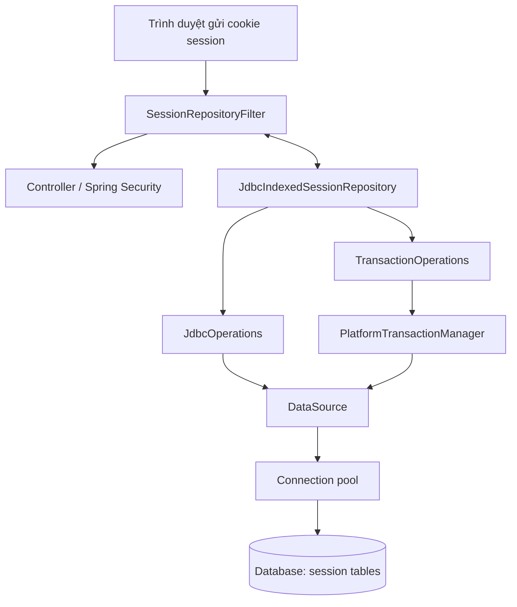

# DataSource, transaction manager và tài nguyên kết nối

Spring Session JDBC lưu trạng thái phiên trong các bảng của cơ sở dữ liệu quan hệ. Để hoạt động ổn định, ứng dụng cần một `DataSource` trỏ đến đúng database, một transaction manager quản lý các thao tác JDBC và một connection pool có dung lượng phù hợp. Ba thành phần này quyết định session được đọc/ghi ở đâu, các câu lệnh SQL tham gia transaction nào và request bị ảnh hưởng ra sao khi database chậm hoặc hết kết nối.

Trong ứng dụng Spring Boot đơn giản, Spring Session có thể dùng chung `DataSource` và transaction manager với phần nghiệp vụ. Hệ thống lớn hơn có thể tách database hoặc pool riêng cho session để cô lập tải. Mỗi lựa chọn có tác động khác nhau đến transaction boundary, dung lượng kết nối, vận hành và tính nhất quán. Bài học này hướng dẫn cấu hình và kiểm tra các thành phần đó, đồng thời giải thích các giới hạn cần tính đến khi chạy nhiều instance.

## 1. Kiến trúc lưu session qua JDBC

Khi ứng dụng Servlet dùng Spring Session JDBC, `SessionRepositoryFilter` bọc request/response để controller và Spring Security tiếp tục thao tác qua `HttpSession`. Filter dùng repository JDBC để tải và lưu session. Repository dùng các thao tác JDBC qua `JdbcOperations` và transaction operations được cấu hình cho ứng dụng.



Các thành phần có vai trò riêng:

| Thành phần | Vai trò |
| --- | --- |
| `DataSource` | Cung cấp kết nối JDBC đến database hoặc pool kết nối |
| `JdbcOperations` / `JdbcTemplate` | Thực thi SQL, quản lý lấy/trả connection và chuyển đổi lỗi JDBC |
| `PlatformTransactionManager` | Bắt đầu, commit hoặc rollback transaction trên tài nguyên được quản lý |
| `JdbcIndexedSessionRepository` | Triển khai lưu session, thuộc tính và các thao tác tra cứu cần thiết |
| Connection pool | Tái sử dụng connection, giới hạn số kết nối đồng thời và kiểm soát thời gian chờ |

Session repository là một phần của đường đi request. Khi filter cần khôi phục session, database phải sẵn sàng để đọc. Khi request kết thúc và session có thay đổi, repository cần connection để ghi. Vì vậy, database session chậm hoặc pool cạn có thể làm tăng độ trễ hoặc khiến request thất bại.

## 2. Cấu hình một DataSource dùng chung

Với ứng dụng chỉ có một database, cách đơn giản nhất là dùng cùng `DataSource` cho nghiệp vụ và Spring Session. Spring Boot thường tự cấu hình `DataSource` từ `spring.datasource.*`; khi có dependency Spring Session JDBC và cấu hình Servlet phù hợp, Boot có thể tự cấu hình repository JDBC.

Ví dụ dependency Gradle:

```groovy
dependencies {
    implementation("org.springframework.boot:spring-boot-starter-web")
    implementation("org.springframework.boot:spring-boot-starter-jdbc")
    implementation("org.springframework.session:spring-session-jdbc")
    runtimeOnly("org.postgresql:postgresql")
}
```

Nên dùng dependency management của Spring Boot để đồng bộ phiên bản Spring Session, Spring Framework và driver. Không tự ghép các phiên bản không tương thích.

Ví dụ `application.yml`:

```yaml
spring:
  datasource:
    url: jdbc:postgresql://localhost:5432/store
    username: store_app
    password: ${DB_PASSWORD}
    hikari:
      pool-name: application-pool
      maximum-pool-size: 20
      minimum-idle: 4
      connection-timeout: 3000
  session:
    timeout: 30m
    jdbc:
      initialize-schema: always
```

`initialize-schema: always` tiện cho môi trường phát triển hoặc test. Trong production, nên quản lý bảng Spring Session bằng Flyway, Liquibase hoặc công cụ migration đang dùng. Khi schema đã được tạo, cấu hình để ứng dụng không tự chạy DDL khi mỗi instance khởi động. Điều này tránh cấp quyền DDL không cần thiết cho tài khoản runtime và tránh nhiều instance đồng thời thực hiện khởi tạo schema.

Với một `DataSource`, Spring Boot thường có thể tạo `JdbcTemplate` và transaction manager JDBC tương ứng. Spring Session JDBC dùng các bean này để thực thi thao tác repository. Tránh tự khai báo thêm một `DataSource` hoặc repository nếu auto-configuration đã đáp ứng nhu cầu; cấu hình trùng lặp có thể khiến ứng dụng chọn sai bean hoặc không khởi động được vì thiếu bean duy nhất.

## 3. DataSource là nguồn kết nối, không phải một connection cố định

`DataSource` là factory cung cấp các `Connection`. Trong ứng dụng production, bean `DataSource` thường bọc một connection pool như HikariCP. Khi `JdbcTemplate` thực thi SQL, nó lấy connection từ `DataSource`, sử dụng connection trong phạm vi thao tác hoặc transaction rồi trả connection về pool.

Không nên lấy một `Connection` khi ứng dụng khởi động rồi giữ nó làm connection dùng chung cho mọi request. JDBC connection không phải tài nguyên thread-safe để chia sẻ tùy tiện giữa các request. Pool quản lý vòng đời connection và kiểm tra giới hạn tài nguyên.

Các thuộc tính cần quan tâm:

| Thuộc tính | Ý nghĩa | Cách cân nhắc |
| --- | --- | --- |
| JDBC URL | Địa chỉ database, database name và tham số driver | Dùng endpoint đúng môi trường; không để credential trong URL nếu có thể cấu hình riêng |
| Username/password | Danh tính truy cập database | Dùng secret manager hoặc biến môi trường; cấp quyền tối thiểu |
| `maximum-pool-size` | Số connection tối đa trong pool | Cân đối với giới hạn database và tổng số instance |
| `minimum-idle` | Số connection nhàn rỗi mục tiêu | Cân đối thời gian khởi tạo connection và tài nguyên database |
| `connection-timeout` | Thời gian chờ lấy connection từ pool | Đặt giới hạn hữu ích để request không chờ vô hạn |
| `max-lifetime` | Tuổi thọ tối đa của connection trong pool | Phối hợp với timeout của database/proxy để tránh giữ connection đã bị đóng ở phía server |
| `validation-timeout` | Thời gian tối đa kiểm tra connection | Đặt nhỏ hơn connection timeout và phù hợp với hạ tầng |

Các con số trong ví dụ chỉ để minh họa. Pool size không nên được đặt bằng số thread ứng dụng một cách máy móc. Cần xem số connection tối đa database cho phép, số instance, pool nghiệp vụ khác, tác vụ nền và nhu cầu của các ứng dụng cùng dùng database.

## 4. Transaction manager quản lý điều gì?

Spring dùng `PlatformTransactionManager` để điều khiển transaction. Với JDBC thuần, các lựa chọn phổ biến là `JdbcTransactionManager` hoặc `DataSourceTransactionManager`. Cả hai quản lý transaction cho một `DataSource`; `JdbcTransactionManager` bổ sung một số hỗ trợ chuyển đổi lỗi commit/rollback sang hệ thống exception của Spring JDBC.

Ví dụ khai báo rõ transaction manager khi cần tự cấu hình:

```java
import javax.sql.DataSource;

import org.springframework.context.annotation.Bean;
import org.springframework.context.annotation.Configuration;
import org.springframework.jdbc.support.JdbcTransactionManager;
import org.springframework.transaction.PlatformTransactionManager;

@Configuration
public class JdbcTransactionConfiguration {

    @Bean
    PlatformTransactionManager transactionManager(DataSource dataSource) {
        return new JdbcTransactionManager(dataSource);
    }
}
```

Trong nhiều ứng dụng Spring Boot, transaction manager đã được auto-configure khi có một `DataSource`. Chỉ khai báo bean riêng khi cần kiểm soát rõ ràng hoặc khi có nhiều nguồn dữ liệu. Với ứng dụng dùng JPA, `JpaTransactionManager` có thể quản lý transaction JPA và phối hợp JDBC trên cùng `DataSource` nếu được cấu hình đúng; tránh tạo nhiều transaction manager không cần thiết cho cùng một tài nguyên.

`@Transactional` thường dùng transaction manager được chọn bởi Spring. Nếu có nhiều manager, chỉ rõ bean cần dùng:

```java
@Transactional("businessTransactionManager")
public void updateOrder() {
    // Các thao tác nghiệp vụ tham gia transaction của database nghiệp vụ.
}
```

Tên qualifier phải trùng với bean transaction manager thực tế. Nếu không chỉ rõ khi có nhiều manager và không có một bean `@Primary`, Spring có thể không xác định được manager phù hợp.

## 5. Spring Session JDBC và transaction boundary

Repository JDBC cần transaction để nhóm các câu lệnh đọc/ghi session một cách phù hợp. Spring Boot cung cấp `TransactionOperations` cho repository dựa trên transaction manager được chọn. Với cấu hình thông thường, các thao tác repository được thực hiện trong transaction do thành phần đó quản lý.

Điều này không có nghĩa mọi thay đổi session tự động nằm trong cùng transaction với mọi thay đổi nghiệp vụ. Cần xem thời điểm repository save được gọi và transaction manager nào quản lý mỗi thao tác.

Trong luồng Servlet thông thường:

1. `SessionRepositoryFilter` tải session trước khi controller xử lý.
2. Service nghiệp vụ có thể mở transaction qua `@Transactional`.
3. Service commit hoặc rollback khi phương thức hoàn tất.
4. Controller trả về và request tiếp tục đi đến giai đoạn hoàn tất.
5. Filter lưu thay đổi session theo flush mode/repository ở cuối request.

Do transaction của service thường đã kết thúc trước khi filter lưu session, việc cập nhật session không nhất thiết commit cùng lúc với giao dịch nghiệp vụ. Nếu cập nhật đơn hàng thành công nhưng việc lưu session lỗi, đơn hàng có thể đã commit trong khi response gặp lỗi hoặc session không phản ánh trạng thái mới. Ngược lại, không nên dùng session làm nơi ghi nhận một sự kiện nghiệp vụ cần commit nguyên tử với đơn hàng.

Nếu cùng một `DataSource` và cùng transaction manager được dùng, các thao tác JDBC có thể tham gia cùng transaction khi chúng thực sự chạy trong phạm vi transaction đang mở và dùng propagation phù hợp (thường là `REQUIRED`). Nhưng không nên giả định điều đó chỉ vì hai thành phần trỏ đến cùng database. Transaction boundary thực tế phụ thuộc thời điểm gọi, manager, propagation và filter lifecycle.

Nếu nghiệp vụ cần bảo đảm thay đổi dữ liệu và trạng thái liên quan được commit nguyên tử, hãy lưu trạng thái quan trọng vào bảng nghiệp vụ trong cùng transaction. Session nên giữ tham chiếu hoặc dữ liệu giao diện có thể tái tạo.

## 6. Dùng chung DataSource hay tách DataSource cho session?

### 6.1. Dùng chung một DataSource

Đây là lựa chọn đơn giản khi ứng dụng đã có một database quan hệ:

- Ít cấu hình và ít pool connection hơn.
- Dễ quan sát và quản trị credential/schema.
- Có thể tận dụng cùng hạ tầng backup, monitoring và high availability.
- Có cơ hội dùng chung transaction manager nếu thao tác thực sự nằm trong cùng transaction boundary.

Đánh đổi là tải session cạnh tranh với truy vấn nghiệp vụ. Request web có thể phát sinh đọc session ở đầu request và ghi session ở cuối request. Khi số request tăng, các thao tác session có thể chiếm connection pool hoặc tăng tải database cùng với các câu SQL nghiệp vụ.

### 6.2. Tách DataSource hoặc pool cho session

Ứng dụng có thể dùng database riêng hoặc ít nhất một pool riêng cho Spring Session. Cách này giúp giới hạn ảnh hưởng của session traffic lên pool nghiệp vụ và cho phép điều chỉnh timeout, credential, monitoring riêng.

Đánh đổi:

- Tăng tổng số connection và chi phí vận hành.
- Phải quản lý thêm database/schema, backup, quyền và cảnh báo.
- Session transaction và business transaction thường là hai transaction độc lập.
- Không có atomic commit xuyên hai database chỉ vì chúng nằm trong cùng ứng dụng Spring.

Chọn tách khi có yêu cầu cô lập tải, chính sách bảo mật hoặc vòng đời vận hành khác nhau. Không tách chỉ vì muốn “tăng hiệu năng” mà chưa đo pool contention hoặc database load.

## 7. Cấu hình nhiều DataSource trong Spring Boot

Khi có nhiều `DataSource`, cần chỉ rõ nguồn nào dành cho Spring Session. Các phiên bản Spring Boot hỗ trợ qualifier `@SpringSessionDataSource` để đánh dấu `DataSource` dành cho session. Nếu cần chỉ rõ transaction manager riêng cho session, các phiên bản hỗ trợ `@SpringSessionTransactionManager` có thể dùng qualifier tương ứng. Hãy xác nhận hai annotation này có trong phiên bản Spring Boot dự án đang dùng.

Ví dụ cấu hình khái quát cho hai nguồn dữ liệu:

```java
import javax.sql.DataSource;

import com.zaxxer.hikari.HikariDataSource;
import org.springframework.boot.autoconfigure.session.SpringSessionDataSource;
import org.springframework.boot.autoconfigure.session.SpringSessionTransactionManager;
import org.springframework.boot.context.properties.ConfigurationProperties;
import org.springframework.boot.jdbc.DataSourceBuilder;
import org.springframework.context.annotation.Bean;
import org.springframework.context.annotation.Configuration;
import org.springframework.context.annotation.Primary;
import org.springframework.jdbc.support.JdbcTransactionManager;
import org.springframework.transaction.PlatformTransactionManager;

@Configuration
public class DataSourceConfiguration {

    @Bean
    @Primary
    @ConfigurationProperties("app.datasource.business")
    HikariDataSource businessDataSource() {
        return DataSourceBuilder.create()
                .type(HikariDataSource.class)
                .build();
    }

    @Bean
    @SpringSessionDataSource
    @ConfigurationProperties("app.datasource.session")
    HikariDataSource sessionDataSource() {
        return DataSourceBuilder.create()
                .type(HikariDataSource.class)
                .build();
    }

    @Bean
    @SpringSessionTransactionManager
    PlatformTransactionManager sessionTransactionManager(
            @SpringSessionDataSource DataSource dataSource) {
        return new JdbcTransactionManager(dataSource);
    }
}
```

Ví dụ này giả định phiên bản Spring Boot có các qualifier nói trên và ứng dụng đã cấu hình transaction manager cho database nghiệp vụ. Trong dự án thực tế, có thể cần khai báo `businessTransactionManager` riêng và đánh dấu `@Primary` hoặc dùng qualifier khi inject. Không tạo hai transaction manager cùng tên hoặc để một bean không rõ DataSource mà nó quản lý.

Ví dụ `application.yml` tương ứng:

```yaml
app:
  datasource:
    business:
      jdbc-url: jdbc:postgresql://db-business:5432/orders
      username: orders_app
      password: ${ORDERS_DB_PASSWORD}
      maximum-pool-size: 20
    session:
      jdbc-url: jdbc:postgresql://db-session:5432/sessions
      username: session_app
      password: ${SESSION_DB_PASSWORD}
      maximum-pool-size: 10
```

Tài khoản `session_app` chỉ cần quyền trên schema/bảng Spring Session và các thao tác cần thiết. Không cấp quyền quản trị database nếu ứng dụng chỉ cần đọc, ghi và dọn session.

## 8. Quản lý kết nối trong code ứng dụng

Khi cần viết truy vấn JDBC nghiệp vụ, ưu tiên `JdbcTemplate` hoặc `JdbcOperations` thay vì tự quản lý `Connection`:

```java
import org.springframework.jdbc.core.JdbcTemplate;
import org.springframework.stereotype.Repository;

@Repository
public class OrderRepository {

    private final JdbcTemplate jdbcTemplate;

    public OrderRepository(JdbcTemplate jdbcTemplate) {
        this.jdbcTemplate = jdbcTemplate;
    }

    public int markSubmitted(long orderId) {
        return jdbcTemplate.update(
                "UPDATE orders SET status = ? WHERE id = ?",
                "SUBMITTED", orderId);
    }
}
```

`JdbcTemplate` lấy connection từ `DataSource` và phối hợp với transaction đang gắn với thread nếu có. Không gọi `dataSource.getConnection()` trong service rồi tự giữ connection qua nhiều lớp; nếu buộc phải dùng JDBC API trực tiếp, dùng cơ chế hỗ trợ transaction của Spring như `DataSourceUtils` và bảo đảm release đúng cách.

Không chuyển JDBC `Connection` sang `@Async`, executor hoặc thread khác. Transaction JDBC của Spring thường gắn với thread hiện tại; thread mới không tự kế thừa transaction-bound connection. Với xử lý bất đồng bộ, mở transaction riêng trong tác vụ và dùng service/repository phù hợp.

## 9. Connection pool và dung lượng khi chạy nhiều instance

Mỗi instance ứng dụng thường có pool riêng. Nếu có `N` instance và mỗi instance cho phép tối đa `P` connection, số connection tối đa có thể đạt xấp xỉ `N × P` cho pool đó. Nếu tách business và session thành hai pool, tổng kết nối cần tính cả hai:

\[
C_{max} = N \times (P_{business} + P_{session})
\]

Ví dụ 6 instance, business pool 20 và session pool 10 có thể cho phép tối đa 180 connection từ ứng dụng đến database tương ứng nếu tất cả pool cùng đạt mức tối đa. Con số này chưa tính migration job, monitoring, DBA client và các service khác. Cần xác định giới hạn database trước khi tăng pool.

Những nguyên tắc vận hành:

- Đặt `connectionTimeout` để request không chờ vô hạn khi pool cạn.
- Theo dõi active, idle, pending connection và thời gian chờ lấy connection.
- Theo dõi thời gian SQL đọc/ghi session, số lần timeout và số lỗi kết nối.
- Chọn `maxLifetime` phù hợp với timeout của database/proxy; để pool chủ động thay connection trước khi hạ tầng đóng chúng.
- Không mở transaction quá lâu trong khi gọi dịch vụ HTTP hoặc thực hiện công việc chậm.
- Cân nhắc tải session theo số request, vì mỗi request có thể cần ít nhất một lần đọc session và một lần ghi nếu có thay đổi.
- Tính tổng connection của tất cả instance và tất cả pool, không chỉ một tiến trình local.

Pool lớn hơn không phải lúc nào cũng nhanh hơn. Nếu database đã đạt giới hạn CPU hoặc I/O, tăng connection có thể làm contention nặng hơn. Tối ưu truy vấn, index, session payload và tần suất ghi trước khi tăng pool một cách mù quáng.

## 10. Khi database session gặp sự cố

Spring Session JDBC nằm trên đường xử lý request, nên lỗi database có thể làm request không khôi phục được session hoặc không lưu được thay đổi. Các tình huống thường gặp:

| Sự cố | Biểu hiện có thể thấy | Hướng xử lý |
| --- | --- | --- |
| Database không truy cập được | Lỗi kết nối khi tải hoặc lưu session | Kiểm tra network, database health, credential và connection timeout |
| Pool cạn | Request chờ lấy connection rồi timeout | Kiểm tra active/pending, query chậm, leak và tổng pool trên các instance |
| Schema thiếu hoặc sai phiên bản | Lỗi SQL/table/column khi repository truy cập | Kiểm tra migration đã chạy đúng trước khi deploy app |
| Quyền database không đủ | Lỗi permission khi insert/update/delete hoặc cleanup | Cấp đúng quyền cho runtime user; tách quyền migration và runtime |
| Database chậm | p95/p99 request tăng dù CPU ứng dụng bình thường | Đo query latency, lock wait, I/O và connection acquisition |
| Database failover | Connection cũ bị đóng, request lỗi ngắn hạn | Xác minh pool phục hồi và retry policy; tránh retry dồn dập |

Không tự động chuyển sang `MapSessionRepository` trong production khi JDBC lỗi nếu không có thiết kế rõ. Fallback như vậy tạo hai nguồn session không đồng bộ: instance này đọc session từ database, instance khác đọc map cục bộ và người dùng có thể bị mất phiên hoặc có hành vi xác thực không nhất quán. Nên để lỗi được quan sát, xử lý theo chính sách availability của ứng dụng và khôi phục repository dùng chung.

Nếu cần retry, chỉ retry lỗi tạm thời có thể phục hồi, giới hạn số lần và dùng backoff. Không retry vô hạn các thao tác ghi session vì có thể làm tăng tải khi database đang quá tải. Ghi log exception và correlation ID nhưng không ghi cookie hoặc session ID.

## 11. Schema, migration và tác vụ cleanup

Spring Session JDBC cần schema phù hợp với phiên bản thư viện. Các bảng thường có tên `SPRING_SESSION` và `SPRING_SESSION_ATTRIBUTES`; bảng session lưu metadata như session ID, thời điểm tạo, lần truy cập gần nhất, thời điểm hết hạn và khoảng không hoạt động tối đa. Bảng attributes lưu các thuộc tính session được serialize.

Trong development có thể bật tự khởi tạo schema. Trong production, nên:

1. Dùng script schema tương ứng với đúng database vendor và phiên bản Spring Session.
2. Chạy migration trước khi deploy instance ứng dụng mới.
3. Cấp quyền DDL cho migration user, không nhất thiết cho runtime user.
4. Kiểm tra index trên cột hết hạn và các cột repository dùng để tìm session.
5. Cấu hình cleanup session hết hạn theo lịch phù hợp và theo dõi thời gian chạy.

Cleanup thường xóa session đã hết hạn khỏi bảng lưu trữ. Nếu database session dùng chung với workload nghiệp vụ, cleanup có thể tạo tải delete và lock. Theo dõi số row bị xóa, thời gian truy vấn và ảnh hưởng đến transaction khác. Không tự chạy lệnh xóa không giới hạn trên bảng session trong giờ cao điểm nếu chưa đo tác động.

## 12. Kiểm thử DataSource và transaction manager

Nên kiểm tra từ cấu hình bean đến hành vi repository:

1. Khởi động application context và xác nhận `DataSource` runtime có URL/database đúng.
2. Xác nhận `JdbcOperations` dùng đúng DataSource.
3. Xác nhận transaction manager quản lý đúng DataSource và được chọn cho Spring Session.
4. Tạo session qua HTTP, để request hoàn tất rồi kiểm tra row xuất hiện trong database session.
5. Gửi request tiếp theo với cookie cũ và xác nhận thuộc tính session được khôi phục.
6. Cập nhật session rồi xác nhận thay đổi được commit; thử rollback transaction nghiệp vụ và kiểm tra rõ session update có nằm trong cùng transaction hay không.
7. Với hai DataSource, xác nhận session row đi vào database session và dữ liệu nghiệp vụ đi vào database nghiệp vụ.
8. Mô phỏng pool cạn hoặc database gián đoạn trong môi trường test để xác minh timeout, log và phục hồi.
9. Chạy hai instance cùng dùng một DataSource session để xác nhận chia sẻ phiên.

Có thể dùng Testcontainers để chạy database phù hợp với production. H2 hữu ích cho một số kiểm thử nhanh nhưng không thay thế hoàn toàn PostgreSQL, MySQL hoặc database thật nếu ứng dụng phụ thuộc vào SQL dialect, lock hoặc index cụ thể.

Ví dụ kiểm tra cấu hình bằng `ApplicationRunner` trong profile chẩn đoán:

```java
@Bean
ApplicationRunner logDataSourceMetadata(DataSource dataSource) {
    return args -> {
        try (var connection = dataSource.getConnection()) {
            var metadata = connection.getMetaData();
            log.info("JDBC database={}, driver={}",
                    metadata.getDatabaseProductName(),
                    metadata.getDriverName());
        }
    };
}
```

Chỉ log metadata không nhạy cảm; không log JDBC URL có thể chứa credential, username nhạy cảm hoặc connection properties. Đặt runner trong profile chẩn đoán và tắt sau khi xác minh.

## 13. Checklist triển khai

Trước khi phát hành, xác nhận:

- [ ] `DataSource` runtime trỏ đúng database và schema dành cho session.
- [ ] Runtime user dùng secret được quản lý an toàn và có quyền tối thiểu.
- [ ] `JdbcTemplate`/`JdbcOperations` và repository dùng đúng DataSource.
- [ ] Transaction manager được chọn rõ ràng, nhất là khi có nhiều DataSource.
- [ ] Đã hiểu session save và business transaction có thể nằm ở hai transaction boundary khác nhau.
- [ ] Connection pool được tính trên tổng số instance và tất cả pool.
- [ ] Có metric cho active/idle/pending connections, acquisition latency, query latency và lỗi JDBC.
- [ ] Schema được migration trước khi ứng dụng mới khởi động; runtime user không có quyền DDL dư thừa.
- [ ] Cleanup session hết hạn không gây tải bất thường lên database.
- [ ] Đã kiểm thử database outage, pool exhaustion và phục hồi kết nối.
- [ ] Hai instance có thể đọc/ghi cùng session qua repository JDBC dùng chung.

## 14. Tự kiểm tra kiến thức

Bạn đã nắm được bài học nếu có thể trả lời:

- `DataSource`, `JdbcOperations` và `PlatformTransactionManager` đảm nhiệm các phần nào trong Spring Session JDBC?
- Vì sao một `DataSource` thường dùng chung phù hợp với ứng dụng đơn giản, và khi nào nên tách pool/session database?
- Transaction manager gắn với DataSource ra sao và vì sao `@Transactional` không tự bảo đảm session save cùng commit với giao dịch nghiệp vụ?
- Connection pool ảnh hưởng đến request khi nào và cần tính tổng connection qua nhiều instance như thế nào?
- Vì sao không nên chia sẻ một JDBC `Connection` giữa nhiều thread?
- Cần làm gì khi database session mất kết nối hoặc pool bị cạn?
- Vì sao không nên tự động fallback sang Map repository khi JDBC lỗi?
- Làm thế nào xác minh hai instance đang dùng cùng database session và cùng transaction manager phù hợp?

Spring Session JDBC phụ thuộc trực tiếp vào chất lượng cấu hình DataSource, transaction manager và connection pool. Một cấu hình đúng phải bảo đảm repository đọc/ghi đúng database, transaction boundary được hiểu rõ, pool không bị cạn dưới tải dự kiến và nhiều instance cùng nhìn thấy một nguồn session. Khi session chỉ giữ trạng thái tương tác ngắn hạn còn dữ liệu nghiệp vụ cần transaction riêng, việc tách rõ hai vai trò giúp hệ thống dễ vận hành và tránh kỳ vọng sai về tính nguyên tử.
