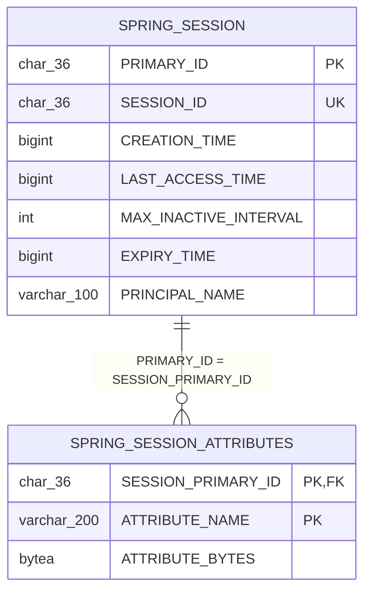
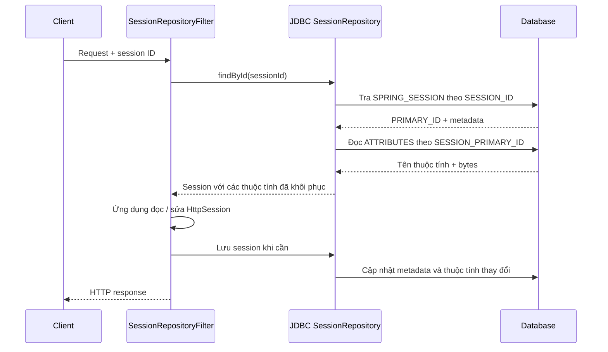

# Hai bảng SPRING_SESSION, SPRING_SESSION_ATTRIBUTES và quan hệ giữa chúng

Khi ứng dụng Spring chạy trên nhiều instance, việc lưu `HttpSession` trong bộ nhớ của từng Servlet container làm phiên phụ thuộc vào instance nhận request. Spring Session giải quyết vấn đề này bằng cách thay cơ chế lưu phiên bằng một `SessionRepository` dùng chung. Với kho JDBC, dữ liệu thường được đặt trong hai bảng: `SPRING_SESSION` lưu thông tin vòng đời và định danh của từng phiên; `SPRING_SESSION_ATTRIBUTES` lưu các thuộc tính ứng dụng gắn với phiên đó.

Hai bảng tạo thành quan hệ **một-nhiều (1:N)**: một phiên có thể có không, một hoặc nhiều thuộc tính, còn mỗi bản ghi thuộc tính chỉ thuộc về một phiên. Hiểu quan hệ này giúp cấu hình schema, truy vấn lỗi mất phiên, thiết kế việc đăng xuất, xử lý TTL và theo dõi tải cơ sở dữ liệu khi nhiều instance cùng sử dụng Spring Session.

## 1. Tại sao Spring Session JDBC cần hai bảng?

Một `HttpSession` gồm hai nhóm dữ liệu có mục đích khác nhau:

- **Metadata của phiên:** định danh, thời điểm tạo, lần truy cập gần nhất, thời gian không hoạt động tối đa và thời điểm hết hạn. Các trường này phục vụ tìm phiên theo ID và quyết định phiên còn hợp lệ.
- **Thuộc tính của phiên:** các cặp tên/giá trị do ứng dụng đặt bằng `setAttribute`, ví dụ `locale`, `cartId`, `userContext` hoặc thông tin bảo mật được framework quản lý.

Nếu dồn toàn bộ thuộc tính vào một cột của bảng metadata, việc cập nhật và lưu trữ sẽ khó quản lý ở mức từng thuộc tính. Spring Session JDBC dùng bảng con riêng để lưu mỗi thuộc tính thành một dòng. Cách thiết kế này cho phép session có số thuộc tính biến động mà không phải thêm cột cho từng thuộc tính nghiệp vụ.

| Bảng | Một dòng biểu diễn | Trách nhiệm chính |
|---|---|---|
| `SPRING_SESSION` | Một session | Định danh, thời điểm, thời hạn, principal |
| `SPRING_SESSION_ATTRIBUTES` | Một thuộc tính của session | Tên thuộc tính và giá trị đã được tuần tự hóa |

Một session vừa được tạo nhưng chưa có thuộc tính nghiệp vụ vẫn có thể có dòng trong `SPRING_SESSION` mà chưa có dòng tương ứng trong `SPRING_SESSION_ATTRIBUTES`. Ngược lại, một dòng thuộc tính không được phép tham chiếu đến một session không tồn tại nếu ràng buộc khóa ngoại được tạo đúng.

## 2. Sơ đồ quan hệ hai bảng



Chú ý hai khóa dễ nhầm:

- `SPRING_SESSION.PRIMARY_ID` là khóa chính nội bộ để các bản ghi thuộc tính liên kết với session.
- `SPRING_SESSION.SESSION_ID` là mã định danh phiên mà Spring Session dùng để tìm phiên; mã này thường được truyền tới client qua cookie hoặc header theo cấu hình `HttpSessionIdResolver`.

Trong bảng con, `SESSION_PRIMARY_ID` tham chiếu tới **`PRIMARY_ID`**, không phải `SESSION_ID`. Điều này cho phép implementation duy trì quan hệ nội bộ khi mã phiên phía client thay đổi, chẳng hạn theo cơ chế chống session fixation. Không tự xây dựng truy vấn JOIN dựa trên `SESSION_ID = SESSION_PRIMARY_ID`.

## 3. Schema JDBC minh họa với PostgreSQL

Dưới đây là cấu trúc tiêu biểu của Spring Session JDBC trên PostgreSQL. Đây là ví dụ giải thích các trường và ràng buộc; trong dự án thật phải dùng script schema đi cùng **phiên bản Spring Session và hệ quản trị cơ sở dữ liệu đang triển khai**, rồi quản lý bằng migration.

```sql
CREATE TABLE SPRING_SESSION (
    PRIMARY_ID CHAR(36) NOT NULL,
    SESSION_ID CHAR(36) NOT NULL,
    CREATION_TIME BIGINT NOT NULL,
    LAST_ACCESS_TIME BIGINT NOT NULL,
    MAX_INACTIVE_INTERVAL INT NOT NULL,
    EXPIRY_TIME BIGINT NOT NULL,
    PRINCIPAL_NAME VARCHAR(100),
    CONSTRAINT SPRING_SESSION_PK PRIMARY KEY (PRIMARY_ID)
);

CREATE UNIQUE INDEX SPRING_SESSION_IX1
    ON SPRING_SESSION (SESSION_ID);
CREATE INDEX SPRING_SESSION_IX2
    ON SPRING_SESSION (EXPIRY_TIME);
CREATE INDEX SPRING_SESSION_IX3
    ON SPRING_SESSION (PRINCIPAL_NAME);

CREATE TABLE SPRING_SESSION_ATTRIBUTES (
    SESSION_PRIMARY_ID CHAR(36) NOT NULL,
    ATTRIBUTE_NAME VARCHAR(200) NOT NULL,
    ATTRIBUTE_BYTES BYTEA NOT NULL,
    CONSTRAINT SPRING_SESSION_ATTRIBUTES_PK
        PRIMARY KEY (SESSION_PRIMARY_ID, ATTRIBUTE_NAME),
    CONSTRAINT SPRING_SESSION_ATTRIBUTES_FK
        FOREIGN KEY (SESSION_PRIMARY_ID)
        REFERENCES SPRING_SESSION (PRIMARY_ID)
        ON DELETE CASCADE
);
```

Kiểu `BYTEA` ở đây là của PostgreSQL; các database khác có thể dùng `BLOB`, `VARBINARY` hoặc kiểu nhị phân tương đương. Cú pháp index, khóa ngoại, kiểu ký tự và script khởi tạo cũng có thể khác. Ví dụ này không hàm ý rằng ứng dụng nên tự sửa DDL nội bộ của Spring Session.

### 3.1. Các cột của SPRING_SESSION

| Cột | Vai trò | Ghi chú |
|---|---|---|
| `PRIMARY_ID` | Khóa chính của dòng session | Khóa nội bộ được bảng thuộc tính tham chiếu |
| `SESSION_ID` | Định danh session dùng khi lookup | Có unique index để tránh trùng và tăng tốc truy vấn |
| `CREATION_TIME` | Thời điểm session được tạo | Thường lưu epoch milliseconds |
| `LAST_ACCESS_TIME` | Lần session được truy cập gần nhất | Thường lưu epoch milliseconds |
| `MAX_INACTIVE_INTERVAL` | Giới hạn không hoạt động | Đơn vị giây |
| `EXPIRY_TIME` | Mốc hết hạn tính toán | Thường lưu epoch milliseconds |
| `PRINCIPAL_NAME` | Tên principal khi repository xác định được | Có thể `NULL`; hỗ trợ tìm phiên theo người dùng |

Thông thường, với session có idle timeout dương, mốc hết hạn gần tương ứng:

```text
EXPIRY_TIME =
    LAST_ACCESS_TIME + MAX_INACTIVE_INTERVAL * 1000
```

Vì các trường thời gian thường dùng milliseconds còn timeout dùng seconds, cần nhân với 1.000 khi tính toán. Đây là quan hệ giải thích logic thông thường; repository vẫn là thành phần quyết định session hợp lệ theo implementation và chính sách timeout được cấu hình.

### 3.2. Các cột của SPRING_SESSION_ATTRIBUTES

| Cột | Vai trò | Ghi chú |
|---|---|---|
| `SESSION_PRIMARY_ID` | Khóa ngoại đến phiên cha | Tham chiếu `SPRING_SESSION.PRIMARY_ID` |
| `ATTRIBUTE_NAME` | Tên thuộc tính | Ví dụ `cartId`, `locale`, `SPRING_SECURITY_CONTEXT` |
| `ATTRIBUTE_BYTES` | Biểu diễn nhị phân của giá trị thuộc tính | Được serializer/converter ghi và đọc |

Khóa chính kép `(SESSION_PRIMARY_ID, ATTRIBUTE_NAME)` đảm bảo một session chỉ có tối đa một dòng cho mỗi tên thuộc tính. Nếu ứng dụng cập nhật `cartId`, repository cập nhật giá trị tương ứng thay vì tạo thêm một dòng `cartId` thứ hai cho cùng session.

## 4. Ví dụ một session có nhiều thuộc tính

Giả sử một người dùng có session ID `s-abc`, principal `linh` và ứng dụng đã lưu hai thuộc tính:

```java
HttpSession session = request.getSession();
session.setAttribute("locale", "vi-VN");
session.setAttribute("cartId", "CART-908");
```

Ở mức khái niệm, database chứa:

**SPRING_SESSION**

| PRIMARY_ID | SESSION_ID | PRINCIPAL_NAME | MAX_INACTIVE_INTERVAL |
|---|---|---|---:|
| `p-001` | `s-abc` | `linh` | 1800 |

**SPRING_SESSION_ATTRIBUTES**

| SESSION_PRIMARY_ID | ATTRIBUTE_NAME | ATTRIBUTE_BYTES |
|---|---|---|
| `p-001` | `locale` | Dữ liệu nhị phân đã serialize từ `vi-VN` |
| `p-001` | `cartId` | Dữ liệu nhị phân đã serialize từ `CART-908` |

Các mã ngắn trong bảng chỉ dùng để minh họa quan hệ; schema thực tế ở trên dùng cột ký tự độ dài 36 cho định danh. `ATTRIBUTE_BYTES` không nhất thiết chứa chữ `vi-VN` ở dạng UTF-8 nguyên văn. Nội dung thực phụ thuộc serializer; với Java serialization, chúng là bytes theo định dạng object của Java.

Khi request tiếp theo mang `SESSION_ID = s-abc` đến instance B, Spring Session JDBC tìm dòng phiên, dùng `PRIMARY_ID` để đọc các dòng thuộc tính, giải tuần tự hóa rồi cung cấp lại giá trị thông qua `HttpSession.getAttribute(...)`.

## 5. Trình tự đọc và ghi phiên qua JDBC



Đây là luồng khái niệm. Thời điểm ghi SQL, số câu lệnh và cách tối ưu cập nhật phụ thuộc `SaveMode`, repository, phiên bản Spring Session và ranh giới giao dịch. Không suy ra rằng mỗi lần `getAttribute` đều lập tức thực hiện một câu `SELECT` mới, hay mỗi lần `setAttribute` đều lập tức ghi database.

### 5.1. Khởi tạo phiên

Khi `getSession()` tạo phiên mới và phiên được lưu thành công, repository cần có dòng metadata trong `SPRING_SESSION`. Nếu ứng dụng đặt thuộc tính, các giá trị tương ứng được ghi trong `SPRING_SESSION_ATTRIBUTES`.

### 5.2. Đọc phiên

Repository tra cứu theo `SESSION_ID`, kiểm tra thời hạn và khôi phục các thuộc tính. Ứng dụng tiếp tục dùng API Servlet thông thường; controller không cần tự viết câu SQL đọc hai bảng.

### 5.3. Cập nhật thuộc tính

Khi gọi `setAttribute("cartId", "CART-909")`, repository có thể ghi đè `ATTRIBUTE_BYTES` của dòng có cùng `SESSION_PRIMARY_ID` và `ATTRIBUTE_NAME`. Khi gọi `removeAttribute("cartId")`, repository loại bỏ thuộc tính tương ứng theo cơ chế lưu của nó.

### 5.4. Xóa session

Khi `invalidate()` hoặc repository xóa một session, dòng cha được loại khỏi `SPRING_SESSION`. Theo ràng buộc `ON DELETE CASCADE` trong schema ví dụ, database tự xóa các dòng con của session đó. Các session khác không bị ảnh hưởng.

## 6. Truy vấn quan sát hai bảng bằng SQL

Thông thường, nghiệp vụ nên sử dụng `HttpSession` hoặc API `SessionRepository`. Các câu SQL sau phù hợp cho kiểm tra vận hành và điều tra lỗi ở môi trường được kiểm soát. Dùng tham số truy vấn thay vì ghép session ID hoặc username vào chuỗi SQL.

### 6.1. Tra metadata theo session ID

```sql
SELECT PRIMARY_ID,
       SESSION_ID,
       CREATION_TIME,
       LAST_ACCESS_TIME,
       MAX_INACTIVE_INTERVAL,
       EXPIRY_TIME,
       PRINCIPAL_NAME
FROM SPRING_SESSION
WHERE SESSION_ID = :sessionId;
```

Nếu không có dòng, session ID không tồn tại trong bảng hiện tại. Nếu có dòng nhưng `EXPIRY_TIME` đã qua, session có thể đã hết hạn về mặt logic dù tác vụ cleanup chưa xóa dòng. Cần phân biệt với lỗi kết nối database, vì không truy vấn được bảng không có nghĩa session đã hết hạn.

### 6.2. JOIN để xem tên thuộc tính

```sql
SELECT s.SESSION_ID,
       a.ATTRIBUTE_NAME
FROM SPRING_SESSION s
LEFT JOIN SPRING_SESSION_ATTRIBUTES a
    ON a.SESSION_PRIMARY_ID = s.PRIMARY_ID
WHERE s.SESSION_ID = :sessionId
ORDER BY a.ATTRIBUTE_NAME;
```

`LEFT JOIN` giúp thấy dòng session ngay cả khi session chưa có thuộc tính. Dùng `INNER JOIN` thì session không có thuộc tính sẽ không xuất hiện trong kết quả. Chỉ cần quan sát tên thuộc tính để điều tra thông thường; không nhất thiết truy xuất toàn bộ `ATTRIBUTE_BYTES` chứa dữ liệu nhạy cảm.

### 6.3. Đếm số thuộc tính của mỗi session

```sql
SELECT s.SESSION_ID,
       COUNT(a.ATTRIBUTE_NAME) AS ATTRIBUTE_COUNT
FROM SPRING_SESSION s
LEFT JOIN SPRING_SESSION_ATTRIBUTES a
    ON a.SESSION_PRIMARY_ID = s.PRIMARY_ID
GROUP BY s.SESSION_ID
ORDER BY ATTRIBUTE_COUNT DESC;
```

Truy vấn này có thể tốn tài nguyên trên bảng lớn. Khi vận hành thực tế, đặt giới hạn phạm vi, dùng metric của repository hoặc chạy ngoài giờ cao điểm; không đưa truy vấn tổng hợp toàn bảng vào đường xử lý request.

### 6.4. Xem các session đã quá hạn

```sql
SELECT SESSION_ID, EXPIRY_TIME
FROM SPRING_SESSION
WHERE EXPIRY_TIME < :nowEpochMillis
ORDER BY EXPIRY_TIME;
```

`:nowEpochMillis` phải là thời điểm hiện tại theo epoch milliseconds, cùng đơn vị với cột `EXPIRY_TIME`. Kết quả là những dòng có mốc hết hạn trong quá khứ mà cơ sở dữ liệu chưa dọn, không phải bằng chứng rằng Spring Session vẫn cho phép sử dụng chúng.

## 7. Khóa, chỉ mục và ràng buộc toàn vẹn

Các chỉ mục trong schema JDBC không chỉ phục vụ tốc độ; chúng thể hiện những cách truy cập thường gặp:

| Ràng buộc/chỉ mục | Cột | Mục đích |
|---|---|---|
| Primary key `SPRING_SESSION_PK` | `PRIMARY_ID` | Xác định duy nhất dòng session cha |
| Unique index `SPRING_SESSION_IX1` | `SESSION_ID` | Tra cứu nhanh session ID và ngăn trùng định danh |
| Index `SPRING_SESSION_IX2` | `EXPIRY_TIME` | Hỗ trợ tìm/dọn session hết hạn |
| Index `SPRING_SESSION_IX3` | `PRINCIPAL_NAME` | Hỗ trợ tìm session theo principal |
| Composite primary key bảng attributes | `SESSION_PRIMARY_ID, ATTRIBUTE_NAME` | Một tên thuộc tính xuất hiện tối đa một lần trong một session |
| Foreign key `SPRING_SESSION_ATTRIBUTES_FK` | `SESSION_PRIMARY_ID → PRIMARY_ID` | Không cho thuộc tính trỏ đến phiên cha không tồn tại; hỗ trợ cascade delete |

Với key kép bắt đầu bằng `SESSION_PRIMARY_ID`, database thường có thể tìm các thuộc tính của một session hiệu quả mà không cần tạo thêm index trùng lặp trên chính cặp cột đó. Nếu thay đổi hoặc thêm index, phải đo bằng execution plan và tải thực tế.

Không tùy ý bỏ khóa ngoại hoặc unique index để tăng tốc ghi. Việc bỏ ràng buộc có thể tạo thuộc tính mồ côi, trùng `SESSION_ID` hoặc làm cleanup không còn đúng. Bất kỳ thay đổi schema nào cũng cần được kiểm chứng với câu SQL và phiên bản Spring Session đang dùng.

## 8. Hết hạn là trạng thái logic; cleanup là xóa vật lý

JDBC không có cơ chế TTL tự động như Redis key expiration. Spring Session JDBC lưu thời điểm hết hạn trong `EXPIRY_TIME` và sử dụng logic repository để không khôi phục phiên đã hết hạn. Một job cleanup chạy định kỳ có thể xóa các dòng phiên quá hạn.

Ví dụ session có:

- `LAST_ACCESS_TIME`: 10:00:00.
- `MAX_INACTIVE_INTERVAL`: 1800 giây, tức 30 phút.
- `EXPIRY_TIME`: tương ứng khoảng 10:30:00.

Nếu người dùng không hoạt động tiếp, sau 10:30 session không còn được xem là hợp lệ. Tuy nhiên, đến lúc cleanup thực thi, dòng trong `SPRING_SESSION` có thể vẫn còn; những dòng thuộc tính trong bảng con cũng chưa bị xóa.

Khi cleanup xóa dòng cha, `ON DELETE CASCADE` loại bỏ các dòng con. Vì thế, không nên cố kết luận số phiên hoạt động chỉ bằng `SELECT COUNT(*) FROM SPRING_SESSION`: kết quả có thể bao gồm phiên đã hết hạn nhưng chưa được dọn.

Khi kiểm tra hiệu quả cleanup, quan sát cả số dòng hết hạn, tổng kích thước hai bảng, thời gian chạy job, độ trễ truy vấn và số lần khóa tranh chấp. Tránh chạy thêm tác vụ xóa thủ công song song với cleanup chuẩn khi chưa hiểu giao dịch và khóa được sử dụng.

## 9. PRINCIPAL_NAME và tra cứu phiên theo người dùng

`PRINCIPAL_NAME` là thông tin phục vụ tìm phiên theo principal; nó không phải khóa ngoại đến bảng người dùng của ứng dụng. Spring Session có thể xác định principal từ thông tin phiên theo cơ chế indexing mà phiên bản repository hỗ trợ.

Một số trường hợp `PRINCIPAL_NAME` có thể là `NULL`:

- Phiên ẩn danh vừa được tạo nhưng chưa gắn trạng thái xác thực.
- Ứng dụng không đưa principal vào session theo quy tắc repository đang dùng.
- Một phiên chứa dữ liệu tạm thời nhưng không đại diện cho một người dùng đã xác thực.

Một người dùng có thể có nhiều dòng `SPRING_SESSION` nếu đăng nhập trên nhiều thiết bị. Vì vậy, index trên `PRINCIPAL_NAME` **không unique**.

```sql
SELECT SESSION_ID, LAST_ACCESS_TIME, EXPIRY_TIME
FROM SPRING_SESSION
WHERE PRINCIPAL_NAME = :principalName
  AND EXPIRY_TIME > :nowEpochMillis
ORDER BY LAST_ACCESS_TIME DESC;
```

Đây là câu SQL quan sát. Nếu muốn quản lý và thu hồi phiên theo người dùng từ ứng dụng, hãy ưu tiên API `FindByIndexNameSessionRepository` hoặc chức năng Spring Security phù hợp. Kết quả tìm theo principal không tự cho biết quyền hiện hành: ứng dụng vẫn cần áp dụng chính sách bảo mật khi xử lý request.

## 10. Định danh session, đổi ID và logout

### 10.1. SESSION_ID khác PRIMARY_ID

`SESSION_ID` là khóa lookup mà client có thể mang qua cookie hoặc header. `PRIMARY_ID` là định danh nội bộ của bản ghi để lưu thuộc tính. Khi Spring Security đổi session ID nhằm chống session fixation, mã session gửi cho client có thể thay đổi; repository đảm nhiệm việc cập nhật và duy trì quan hệ với thuộc tính.

Không tự sửa `SESSION_ID` bằng câu `UPDATE` thủ công để mô phỏng rotation. Hãy dùng API của Servlet/Spring Security và để Spring Session xử lý các cập nhật liên quan.

### 10.2. Logout và cascade

Trong Servlet, ứng dụng có thể kết thúc phiên bằng:

```java
HttpSession existing = request.getSession(false);
if (existing != null) {
    existing.invalidate();
}
```

Nếu Spring Security quản lý logout, nên dùng cơ chế logout của Security và kiểm tra việc invalidation đúng repository. Khi session bị xóa, database xử lý quan hệ cha-con theo foreign key. Client cũng cần nhận chỉ dẫn xóa cookie hoặc header session ID phù hợp.

Chỉ xóa cookie phía trình duyệt mà không invalidate session phía server sẽ để lại session còn hiệu lực cho đến khi hết hạn hoặc bị thu hồi. Đây là lý do không nên dùng thao tác xóa cookie làm phương tiện thu hồi phiên duy nhất.

## 11. Tuần tự hóa ATTRIBUTE_BYTES

Giá trị của `HttpSession.setAttribute` là object Java, còn cột `ATTRIBUTE_BYTES` lưu bytes. Spring Session JDBC sử dụng cơ chế chuyển đổi object thành mảng byte và giải tuần tự hóa khi đọc. Cấu hình mặc định thường dựa vào Java serialization thông qua các converter của Spring; có thể tùy chỉnh nếu phiên bản thư viện hỗ trợ.

Ví dụ:

```java
session.setAttribute("userId", 42L);
session.setAttribute("cartId", "CART-908");
```

Database sẽ có các dòng thuộc tính mang tên `userId` và `cartId`, mỗi dòng lưu dữ liệu đã serialize. Không diễn giải `ATTRIBUTE_BYTES` là JSON hoặc UTF-8 trừ khi ứng dụng thật sự đã cấu hình serializer tương ứng.

Những quy tắc quan trọng:

- Các class chứa trong session phải tương thích với serializer và phiên bản code đang chạy.
- Với Java serialization, object cần triển khai `Serializable` và object graph bên trong cũng phải serialize được.
- Không lưu resource đang mở, ORM proxy phức tạp, bean ứng dụng hoặc graph dữ liệu quá lớn.
- Khi đổi class/package, serializer hoặc dữ liệu DTO, cần kế hoạch tương thích với phiên còn trong database.
- Không xem serialization như mã hóa: dữ liệu thuộc tính vẫn cần quyền truy cập database và bảo vệ transport/storage.

Nếu instance A ghi thuộc tính bằng một serializer mà instance B không hiểu, B có thể tìm được dòng `SPRING_SESSION` nhưng thất bại khi khôi phục `ATTRIBUTE_BYTES`. Lỗi này dễ xuất hiện trong rolling deployment khi hai phiên bản cấu hình khác nhau.

## 12. Tích hợp Spring Session JDBC trong ứng dụng

Một ứng dụng Spring Boot dùng Gradle Kotlin DSL có thể khai báo:

```kotlin
dependencies {
    implementation("org.springframework.boot:spring-boot-starter-jdbc")
    implementation("org.springframework.session:spring-session-jdbc")
    runtimeOnly("org.postgresql:postgresql")
}
```

Khai báo kết nối trong cấu hình ứng dụng, ví dụ:

```yaml
spring:
  datasource:
    url: jdbc:postgresql://db.internal:5432/appdb
    username: app_user
```

Mật khẩu phải được cung cấp từ môi trường hoặc secret manager. Nếu chọn cấu hình tường minh trên Servlet, ví dụ:

```java
import org.springframework.context.annotation.Configuration;
import org.springframework.session.jdbc.config.annotation.web.http.EnableJdbcHttpSession;

@Configuration
@EnableJdbcHttpSession(maxInactiveIntervalInSeconds = 1800)
public class JdbcSessionConfiguration {
}
```

Nếu Spring Boot đã tự cấu hình Spring Session, cần kiểm tra cơ chế được dùng để tránh tạo repository/filter trùng lặp. Schema phải được tạo trước khi repository thực hiện thao tác. Trên production, nên quản lý bảng/index bằng migration theo script chính thức của Spring Session, thay vì giả định ứng dụng luôn tự tạo bảng lúc khởi động.

Tất cả instance phải dùng cùng database, schema/table prefix, serializer và chính sách session tương thích. Nếu instance A đọc bảng trong schema `app_a` còn B đọc bảng trong schema `app_b`, chúng không chia sẻ phiên dù cookie chứa cùng ID.

## 13. Đồng thời, giao dịch và áp lực lên cơ sở dữ liệu

Spring Session JDBC đưa trạng thái phiên về một nguồn dùng chung, nhưng hai request đồng thời vẫn có thể cùng sửa một session:

1. Request A đọc `cartId` hoặc một thuộc tính khác.
2. Request B đọc cùng session và thay đổi thuộc tính.
3. Cả hai thực hiện lưu theo thời điểm riêng.
4. Kết quả cuối phụ thuộc chính sách lưu, thứ tự cập nhật và mức cô lập giao dịch.

Không coi toàn bộ vòng đời của `HttpSession` là một giao dịch nghiệp vụ nguyên tử. Với dữ liệu cần tránh mất cập nhật, dùng database nghiệp vụ cùng cơ chế versioning/locking phù hợp; session nên giữ tham chiếu nhỏ như `cartId`.

Việc lưu session qua JDBC tạo lưu lượng đọc/ghi bổ sung trên mỗi request liên quan. Các điểm nên theo dõi gồm độ trễ truy vấn tìm `SESSION_ID`, thời gian ghi thuộc tính, số session đang hoạt động, kích thước bảng thuộc tính, connection pool, lock contention và thời gian cleanup.

Không nên thêm nhiều thuộc tính lớn chỉ vì JDBC cho phép lưu dạng bytes. Một session lớn làm tăng I/O, chi phí serialization và độ trễ khôi phục trên các instance.

## 14. Lỗi schema và dữ liệu thường gặp

| Biểu hiện | Nguyên nhân có thể | Cách kiểm tra |
|---|---|---|
| Lỗi `relation/table does not exist` | Chưa chạy schema migration hoặc ứng dụng kết nối sai schema | Kiểm tra connection string, search path và migration |
| Lỗi foreign key khi ghi thuộc tính | Dòng cha chưa tồn tại hoặc thứ tự ghi/transaction không đúng | Kiểm tra `PRIMARY_ID` và `SESSION_PRIMARY_ID` |
| Session tồn tại nhưng không đọc được thuộc tính | Serializer khác nhau hoặc bytes không còn tương thích | Kiểm tra log deserialization và phiên bản DTO |
| Tìm session bằng cookie không ra | `SESSION_ID` không tồn tại, hết hạn hoặc instance trỏ sai DB | Tra cứu theo `SESSION_ID` và xác minh `EXPIRY_TIME` |
| Sau logout vẫn còn dòng session | Logout chưa invalidate, cleanup chưa chạy hoặc truy vấn sai môi trường | Kiểm tra luồng logout và thời điểm dữ liệu bị xóa |
| Bảng còn nhiều phiên quá hạn | Cleanup không chạy hoặc tải/xung đột khiến job chậm | Đếm dòng `EXPIRY_TIME` quá hạn, xem lịch và log cleanup |
| Truy vấn người dùng thiếu session | `PRINCIPAL_NAME` `NULL` hoặc index/principal chưa được thiết lập | Kiểm tra quy tắc xác định principal |
| Truy vấn chậm | Thiếu index chuẩn, bảng lớn, attributes nặng hoặc pool quá nhỏ | Xem execution plan, index, thống kê DB, metric |
| Attribute mồ côi | Ràng buộc FK bị thiếu/bỏ hoặc thao tác sửa dữ liệu trực tiếp | Kiểm tra DDL và quan hệ `SESSION_PRIMARY_ID` |

Không khắc phục bằng cách xóa toàn bộ hai bảng hoặc chạy `TRUNCATE ... CASCADE` trên production: thao tác đó có thể làm tất cả người dùng mất session. Chỉ thực hiện migration hoặc bảo trì dữ liệu theo phạm vi đã xác minh.

## 15. Kiểm thử quan hệ cha-con với repository thật

Để chứng minh hai bảng hoạt động đúng, nên chạy integration test với database tương ứng thay vì chỉ mock `HttpSession`:

1. Khởi động ứng dụng có `spring-session-jdbc` và schema đúng phiên bản.
2. Gửi request tạo session; lưu hai thuộc tính đơn giản.
3. Kiểm tra một dòng trong `SPRING_SESSION` theo `SESSION_ID`.
4. Dùng `PRIMARY_ID` để tìm chính xác hai dòng trong `SPRING_SESSION_ATTRIBUTES`.
5. Gửi request mới với cùng cookie qua instance thứ hai, xác nhận hai thuộc tính được khôi phục.
6. Cập nhật một thuộc tính, xác nhận dữ liệu mới được lưu mà không tạo hai dòng cùng tên.
7. Xóa một thuộc tính, xác nhận thuộc tính còn lại vẫn tồn tại.
8. Invalidate session rồi kiểm tra rằng dòng cha và các dòng con đều bị xóa.
9. Tạo session timeout ngắn; xác minh session bị từ chối sau thời hạn và cleanup sau đó loại bỏ dữ liệu vật lý.
10. Thử rolling deployment với hai phiên bản DTO/serializer để xác nhận cả hai đọc được dữ liệu đang tồn tại.

Ví dụ kiểm thử mức ứng dụng có thể sử dụng `MockMvc` hoặc HTTP client thực. Phần kiểm tra bảng nên dùng `JdbcTemplate` với tham số được bind; tránh nhúng session ID trực tiếp vào SQL. Với PostgreSQL, có thể dùng Testcontainers để tạo database thử nghiệm có cùng DDL với production.

### 15.1. Các assertion quan trọng

| Bước | Điều kiện kiểm chứng |
|---|---|
| Tạo session | `SPRING_SESSION.SESSION_ID` xuất hiện đúng một lần |
| Ghi hai thuộc tính | Có hai dòng con trỏ tới `PRIMARY_ID` |
| Cập nhật thuộc tính | Khóa kép `(SESSION_PRIMARY_ID, ATTRIBUTE_NAME)` vẫn duy nhất |
| Đọc qua instance B | Giá trị sau deserialize bằng giá trị đã ghi |
| Logout/invalidate | Dòng cha không còn; dòng con bị cascade delete |
| Quá hạn trước cleanup | Repository từ chối session dù dòng SQL có thể chưa bị dọn |
| Cleanup | Số dòng quá hạn giảm mà không xóa phiên còn hợp lệ |

## 16. Nguyên tắc ghi nhớ

- `SPRING_SESSION` lưu **một dòng cho một phiên**, gồm định danh và metadata vòng đời.
- `SPRING_SESSION_ATTRIBUTES` lưu **một dòng cho một thuộc tính**, chứa tên và dữ liệu đã serialize.
- Bảng con dùng `SESSION_PRIMARY_ID` tham chiếu `SPRING_SESSION.PRIMARY_ID`, không tham chiếu `SESSION_ID`.
- Khóa chính kép ngăn hai thuộc tính cùng tên trong một phiên; foreign key cùng `ON DELETE CASCADE` hỗ trợ dọn dữ liệu con khi phiên bị xóa.
- `EXPIRY_TIME` quyết định thời điểm hết hạn về mặt dữ liệu; cleanup vật lý có thể chạy muộn hơn.
- `PRINCIPAL_NAME` là thông tin tra cứu, không phải bằng chứng độc lập rằng người dùng còn quyền truy cập.
- Thay đổi serializer, schema hoặc cấu hình datasource phải tương thích giữa các instance.
- Ưu tiên quản lý session qua Spring Session API; dùng SQL chủ yếu để quan sát và điều tra có kiểm soát.

Hai bảng JDBC tách trạng thái phiên thành metadata và thuộc tính nhị phân, giúp nhiều instance Spring cùng đọc và ghi một session từ cơ sở dữ liệu dùng chung. Khi hiểu khóa `PRIMARY_ID`, `SESSION_ID` và `SESSION_PRIMARY_ID`, cùng cơ chế serialization, expiration và cascade delete, người phát triển có thể theo dõi chính xác vòng đời session và tránh những lỗi dễ phát sinh khi triển khai hệ thống nhiều instance.
