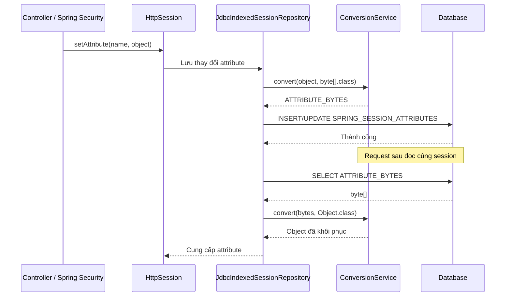

# Dữ liệu thuộc tính dạng nhị phân và chuyển đổi giá trị

Spring Session JDBC lưu metadata của phiên trong bảng `SPRING_SESSION` và lưu từng session attribute trong bảng `SPRING_SESSION_ATTRIBUTES`. Cột `ATTRIBUTE_BYTES` chứa biểu diễn nhị phân của giá trị attribute. Khi ứng dụng gọi `HttpSession.setAttribute()`, Spring Session phải chuyển object Java thành `byte[]` trước khi ghi xuống database; khi đọc phiên, repository chuyển các byte đó trở lại object Java.

Quá trình chuyển đổi này ảnh hưởng trực tiếp khả năng khôi phục session sau khi request chuyển sang instance khác hoặc sau khi ứng dụng được nâng cấp. Nếu các instance dùng serializer khác nhau, class không tương thích hoặc dữ liệu nhị phân không còn giải mã được, người dùng có thể gặp lỗi khi đọc session. Vì vậy, cần hiểu định dạng lưu trữ, `ConversionService`, serializer mặc định và cách thay đổi định dạng có kiểm soát.

## 1. Metadata phiên và bảng lưu attributes

Với schema JDBC mặc định của Spring Session, dữ liệu được chia thành hai nhóm:

- `SPRING_SESSION` chứa metadata như `PRIMARY_ID`, `SESSION_ID`, `CREATION_TIME`, `LAST_ACCESS_TIME`, `MAX_INACTIVE_INTERVAL`, `EXPIRY_TIME` và có thể có `PRINCIPAL_NAME` tùy schema.
- `SPRING_SESSION_ATTRIBUTES` chứa từng attribute, thường gồm `SESSION_PRIMARY_ID`, `ATTRIBUTE_NAME` và `ATTRIBUTE_BYTES`.

Ví dụ minh họa cấu trúc logic:

| SESSION_PRIMARY_ID | ATTRIBUTE_NAME | ATTRIBUTE_BYTES |
|---|---|---|
| ID nội bộ của bản ghi phiên | `cartSnapshot` | Dãy byte của object giỏ hàng |
| ID nội bộ của bản ghi phiên | `SPRING_SECURITY_CONTEXT` | Dãy byte của SecurityContext |
| ID nội bộ của bản ghi phiên | `preferredLocale` | Dãy byte của Locale hoặc kiểu tương ứng |

`SESSION_PRIMARY_ID` liên kết attribute với bản ghi metadata phiên. Nó không phải cookie session ID mà trình duyệt gửi. `ATTRIBUTE_NAME` cho biết tên thuộc tính; `ATTRIBUTE_BYTES` chứa payload đã được serialize. Schema SQL cụ thể có thể khác theo database và phiên bản Spring Session. Cột binary có thể được khai báo là `BLOB`, `BYTEA`, `VARBINARY` hoặc kiểu tương đương do schema dialect cung cấp.

Tách metadata khỏi payload giúp repository truy vấn thời hạn, principal hoặc danh sách session mà không cần deserialize toàn bộ attributes. Đồng thời, mỗi attribute có thể được lưu/cập nhật riêng theo cơ chế repository. Tuy nhiên, payload vẫn phụ thuộc serializer và class mà ứng dụng sử dụng.

## 2. Đường đi chuyển đổi từ object sang byte[]

Khi ứng dụng đặt một giá trị vào session, repository cần chuyển giá trị đó thành dữ liệu nhị phân để ghi vào `ATTRIBUTE_BYTES`. Khi nạp session, quá trình được đảo ngược.



`JdbcIndexedSessionRepository` sử dụng `ConversionService` để chuyển đổi giữa object attribute và `byte[]`. Cấu hình mặc định của Spring Session JDBC dùng cơ chế tuần tự hóa Java. Ứng dụng có thể cung cấp `ConversionService` riêng để dùng định dạng khác, nhưng converter phải hỗ trợ cả hai chiều và phải xử lý mọi kiểu attribute thực tế mà ứng dụng lưu.

## 3. Cách tuần tự hóa mặc định

Trong cấu hình mặc định, Spring Session JDBC dùng converter dựa trên Java serialization để chuyển object thành byte array và khôi phục object từ byte array. Vì vậy, giá trị được lưu phải đáp ứng yêu cầu tuần tự hóa của Java.

Ví dụ một attribute đơn giản:

```java
import java.io.Serializable;

public final class CartSnapshot implements Serializable {

    private static final long serialVersionUID = 1L;

    private final String cartId;
    private final int itemCount;

    public CartSnapshot(String cartId, int itemCount) {
        this.cartId = cartId;
        this.itemCount = itemCount;
    }

    public String getCartId() {
        return cartId;
    }

    public int getItemCount() {
        return itemCount;
    }
}
```

Có thể đặt object vào session:

```java
HttpSession session = request.getSession();
session.setAttribute("cartSnapshot", new CartSnapshot("CART-42", 3));
```

Với Java serialization, object và toàn bộ object graph mà nó tham chiếu phải tuần tự hóa được. Nếu một trường tham chiếu tới class không triển khai `Serializable`, thao tác serialize có thể thất bại với `NotSerializableException`. Việc class ngoài cùng triển khai `Serializable` chưa bảo đảm mọi object bên trong đều hợp lệ.

`serialVersionUID` xác định version của serialized class. Khai báo giá trị ổn định giúp kiểm soát tương thích khi class được thay đổi. Nếu không khai báo, Java có thể tính UID mặc định dựa trên cấu trúc class; thay đổi class có thể làm UID thay đổi và dữ liệu cũ không đọc được. Tuy nhiên, giữ nguyên UID cũng không bảo đảm mọi thay đổi field đều tương thích về mặt nghiệp vụ. Cần kiểm thử dữ liệu được ghi bởi phiên bản ứng dụng trước.

## 4. Những gì không nên lưu trong session

Session attributes được serialize và giữ qua nhiều request. Hãy lưu dữ liệu nhỏ, ổn định và cần thiết cho việc tiếp tục xử lý request. Tránh lưu:

- `HttpServletRequest`, `HttpServletResponse`, `ServletContext` hoặc object gắn với vòng đời request.
- JDBC `Connection`, Hibernate `Session`, EntityManager, transaction hoặc repository/service bean.
- Socket, stream, file handle, thread, executor hoặc tài nguyên đang mở.
- JPA entity có lazy proxy, quan hệ hai chiều hoặc đồ thị object lớn.
- Object chứa cache, trạng thái mutable dùng chung hoặc dữ liệu có thể thay đổi thường xuyên.
- Password, secret, access token hoặc credential thô nếu không có nhu cầu và kiểm soát rõ ràng.

Thay vì lưu một entity lớn, thường chỉ cần lưu `userId`, `cartId`, locale hoặc một DTO snapshot nhỏ. Khi cần dữ liệu nghiệp vụ mới nhất, dùng ID để truy vấn database nghiệp vụ. Cách này giảm kích thước BLOB, giảm lỗi tương thích và tránh lưu một bản sao cũ của dữ liệu.

## 5. Lỗi thường gặp với Java serialization

| Lỗi/hiện tượng | Nguyên nhân có thể | Cách xử lý |
|---|---|---|
| `NotSerializableException` | Một object hoặc field trong object graph không triển khai `Serializable` | Thay bằng DTO serializable hoặc loại trường không cần thiết |
| `InvalidClassException` | `serialVersionUID` không khớp hoặc cấu trúc class không tương thích | Xác định phiên bản dữ liệu, kiểm thử migration hoặc buộc tạo session mới theo kế hoạch |
| `ClassNotFoundException` | Instance đọc không có class từng được instance ghi sử dụng | Đồng bộ classpath và triển khai tương thích giữa các node |
| `StreamCorruptedException` | Byte payload không phải Java serialization hợp lệ hoặc bị ghi dở/hỏng | Kiểm tra serializer ghi, schema migration và tính toàn vẹn dữ liệu |
| `EOFException` | Payload thiếu hoặc bị cắt | Kiểm tra lỗi ghi, kiểu cột binary và đường truyền dữ liệu |
| Session đọc được ở node này nhưng lỗi ở node khác | Các instance khác version class hoặc class loader | Đồng bộ artifact, kiểm tra rolling deployment và test đọc chéo |

Không xử lý lỗi bằng cách bắt mọi exception rồi trả về `null` cho attribute. Cách đó có thể làm mất dữ liệu âm thầm và khiến lỗi bảo mật hoặc nghiệp vụ khó phát hiện. Hãy log loại exception, tên attribute đã được phép ghi log và mã tương quan; không log raw byte array hoặc toàn bộ object.

## 6. ConversionService trong Spring Session JDBC

`ConversionService` là abstraction của Spring để chuyển đổi giữa các kiểu. Spring Session JDBC dùng nó để chuyển đổi attribute giữa `Object` và `byte[]`. Điều này tạo điểm mở rộng để ứng dụng chọn định dạng serialization phù hợp.

Trong các cấu hình Spring Session JDBC hỗ trợ bean tùy chỉnh, bean có tên `springSessionConversionService` được dùng làm conversion service cho repository. Một cấu hình converter dựa trên Java serialization có thể được biểu diễn như sau:

```java
import org.springframework.core.convert.ConversionService;
import org.springframework.core.convert.support.GenericConversionService;
import org.springframework.core.serializer.support.DeserializingConverter;
import org.springframework.core.serializer.support.SerializingConverter;
import org.springframework.context.annotation.Bean;
import org.springframework.context.annotation.Configuration;

@Configuration
class JdbcSessionConversionConfiguration {

    @Bean(name = "springSessionConversionService")
    ConversionService springSessionConversionService() {
        GenericConversionService conversionService =
                new GenericConversionService();
        conversionService.addConverter(
                Object.class, byte[].class, new SerializingConverter());
        conversionService.addConverter(
                byte[].class, Object.class, new DeserializingConverter());
        return conversionService;
    }
}
```

Đoạn code trên minh họa cặp converter Java serialization. Trong một ứng dụng thực tế, cần xác nhận đúng tên bean và cơ chế auto-configuration của phiên bản Spring Session đang dùng. Nếu Spring Boot hoặc cấu hình JDBC đã tạo conversion service mặc định, hãy thay thế bean theo cơ chế được hỗ trợ thay vì tạo nhiều conversion service cạnh tranh.

Một conversion service tùy chỉnh phải hỗ trợ hai chiều:

- `Object` thành `byte[]` khi ghi attribute.
- `byte[]` thành `Object` khi đọc attribute.

Nếu chỉ đăng ký chiều ghi, request sau sẽ không khôi phục được session. Nếu chiều đọc trả về kiểu khác với kiểu mà code ứng dụng mong đợi, lỗi có thể chỉ xuất hiện khi request gọi `getAttribute()` và ép kiểu.

## 7. Dùng JSON thay cho Java serialization

Một số ứng dụng muốn payload dễ kiểm tra trong môi trường phát triển, tương thích đa ngôn ngữ hoặc có schema rõ ràng. Khi đó có thể dùng Jackson để chuyển DTO thành JSON rồi mã hóa JSON thành `byte[]` lưu trong cột binary.

JSON không tự giải quyết việc khôi phục kiểu Java. Nếu repository yêu cầu chuyển `byte[]` thành `Object`, converter cần biết kiểu đích. Không nên lưu tên class tùy ý từ payload rồi cho Jackson khởi tạo bất kỳ class nào. Cách an toàn hơn là dùng type ID ổn định do ứng dụng quản lý và ánh xạ ID tới một tập class cho phép.

Ví dụ dưới đây minh họa converter cho một DTO session đã được allowlist:

```java
import java.io.IOException;
import java.util.Map;

import com.fasterxml.jackson.databind.JsonNode;
import com.fasterxml.jackson.databind.ObjectMapper;
import com.fasterxml.jackson.databind.node.ObjectNode;
import org.springframework.core.convert.converter.Converter;

final class SessionAttributeToBytes implements Converter<Object, byte[]> {

    private final ObjectMapper mapper;
    private final Map<Class<?>, String> typeIds;

    SessionAttributeToBytes(ObjectMapper mapper,
            Map<Class<?>, String> typeIds) {
        this.mapper = mapper;
        this.typeIds = typeIds;
    }

    @Override
    public byte[] convert(Object source) {
        String typeId = typeIds.get(source.getClass());
        if (typeId == null) {
            throw new IllegalArgumentException(
                    "Unsupported session attribute type: "
                            + source.getClass().getName());
        }

        ObjectNode envelope = mapper.createObjectNode();
        envelope.put("type", typeId);
        envelope.set("value", mapper.valueToTree(source));
        try {
            return mapper.writeValueAsBytes(envelope);
        } catch (IOException ex) {
            throw new IllegalArgumentException(
                    "Cannot serialize session attribute", ex);
        }
    }
}

final class SessionAttributeFromBytes implements Converter<byte[], Object> {

    private final ObjectMapper mapper;
    private final Map<String, Class<?>> allowedTypes;

    SessionAttributeFromBytes(ObjectMapper mapper,
            Map<String, Class<?>> allowedTypes) {
        this.mapper = mapper;
        this.allowedTypes = allowedTypes;
    }

    @Override
    public Object convert(byte[] source) {
        try {
            JsonNode envelope = mapper.readTree(source);
            String typeId = envelope.path("type").asText();
            Class<?> targetType = allowedTypes.get(typeId);
            if (targetType == null) {
                throw new IllegalArgumentException(
                        "Unknown session attribute type id: " + typeId);
            }
            return mapper.treeToValue(envelope.path("value"), targetType);
        } catch (IOException ex) {
            throw new IllegalArgumentException(
                    "Cannot deserialize session attribute", ex);
        }
    }
}
```

Đăng ký converter với `GenericConversionService`:

```java
@Bean(name = "springSessionConversionService")
ConversionService springSessionConversionService(ObjectMapper objectMapper) {
    Map<Class<?>, String> writeTypes = Map.of(
            CartSnapshot.class, "cart-snapshot-v1");
    Map<String, Class<?>> readTypes = Map.of(
            "cart-snapshot-v1", CartSnapshot.class);

    GenericConversionService conversionService =
            new GenericConversionService();
    conversionService.addConverter(
            new SessionAttributeToBytes(objectMapper, writeTypes));
    conversionService.addConverter(
            new SessionAttributeFromBytes(objectMapper, readTypes));
    return conversionService;
}
```

Đây là ví dụ minh họa cho tập attribute DTO được kiểm soát. Nếu ứng dụng lưu thêm `SecurityContext`, principal, locale hoặc kiểu framework khác, cần bổ sung serializer/deserializer và type ID tương ứng theo đúng phiên bản Spring Security/Jackson. Không dùng converter này nguyên trạng nếu nó không bao phủ tất cả kiểu session mà ứng dụng thực tế lưu.

Trong production, nên dùng một `ObjectMapper` được cấu hình rõ ràng cho session attributes, có module cần thiết và không bật polymorphic typing rộng. Type ID trong envelope là ID do ứng dụng quản lý, không phải class name bất kỳ do payload cung cấp.

## 8. Version hóa payload và tương thích schema

Khi định dạng attribute thay đổi, dữ liệu cũ vẫn có thể nằm trong bảng JDBC cho đến khi session hết hạn hoặc bị xóa. Vì vậy, converter mới có thể phải đọc payload do phiên bản cũ ghi.

Một envelope JSON có thể thêm version:

```json
{
  "type": "cart-snapshot",
  "version": 2,
  "value": {
    "cartId": "CART-42",
    "itemCount": 3,
    "currency": "VND"
  }
}
```

Khi đọc, converter kiểm tra `type` và `version`, sau đó chọn DTO hoặc migration function phù hợp. Ví dụ, version 1 có thể không có trường `currency`; converter có thể gán giá trị mặc định đã được nghiệp vụ phê duyệt. Không tự suy đoán giá trị mặc định nếu nó ảnh hưởng tiền tệ, quyền truy cập hoặc trạng thái nghiệp vụ.

Các chiến lược thường dùng:

- Duy trì backward-compatible deserializer trong suốt thời gian session cũ còn hiệu lực.
- Dùng DTO có version và chuyển đổi từng version sang model hiện tại.
- Giới hạn thời gian sống session để giảm khoảng thời gian phải hỗ trợ format cũ.
- Thực hiện migration dữ liệu có kiểm soát nếu cần thay đổi payload diện rộng.
- Chủ động invalidation session trong một đợt triển khai nếu không thể đảm bảo tương thích, đồng thời chuẩn bị luồng đăng nhập lại.

Không thay serializer trên một instance trong khi các instance khác vẫn đọc/ghi cùng bảng bằng format không tương thích. Trong rolling deployment, mọi node có thể nhận request của cùng một người dùng; serializer phải tương thích trong toàn bộ giai đoạn chuyển tiếp.

## 9. Kích thước payload và hiệu năng JDBC

Mỗi session attribute có thể tạo một hàng trong `SPRING_SESSION_ATTRIBUTES`. Một session chứa nhiều attributes lớn sẽ làm tăng:

- Kích thước database và chi phí backup.
- Số byte truyền qua JDBC khi đọc/ghi session.
- Thời gian serialize/deserialize và thời gian request.
- I/O, buffer pool pressure và replication traffic.
- Thời gian cleanup khi xóa session và các attribute liên quan.

Hãy lưu DTO nhỏ thay vì object graph lớn. Nếu dữ liệu có thể tái tạo từ database nghiệp vụ, chỉ lưu khóa tham chiếu. Đặt giới hạn kích thước hợp lý cho attribute ở tầng ứng dụng và đo payload thực tế trước khi thay đổi serializer.

Không đọc `ATTRIBUTE_BYTES` trực tiếp trong SQL console chỉ để xem nội dung. Cột binary có thể chứa object serialization hoặc JSON có dữ liệu cá nhân và bảo mật. Nếu cần thống kê, ưu tiên truy vấn `COUNT(*)`, tổng kích thước payload hoặc số hàng theo session mà không xuất raw bytes. Quyền truy cập bảng session cần được giới hạn như dữ liệu xác thực.

## 10. Tương thích giữa các instance

Trong môi trường nhiều instance, mọi node kết nối cùng database session. Node A có thể ghi attribute; node B sẽ deserialize attribute đó ở request tiếp theo. Vì vậy, các node cần thống nhất:

- Cùng serializer và conversion rules.
- Cùng version DTO hoặc khả năng đọc tương thích các version đang tồn tại.
- Cùng custom principal và các class được lưu trong session.
- Cùng timezone, format ngày giờ, enum mapping và quy tắc null nếu dùng JSON.
- Cùng cấu hình Spring Session/JDBC schema.

Một class có thể serialize được trên node A nhưng không tồn tại hoặc không tương thích trên node B. Lỗi thường xuất hiện sau load balancing, khi request được chuyển sang instance khác. Test chỉ chạy trên một node không đủ để xác nhận khả năng đọc chéo.

Khi deploy rolling, cần xem xét cả chiều đọc mới dữ liệu cũ và khả năng rollback. Nếu node mới ghi payload mà node cũ không hiểu, rollback có thể làm các session mới hỏng. Có thể triển khai theo hai pha: trước tiên phát hành phiên bản có khả năng đọc format cũ và mới nhưng vẫn ghi format cũ; sau khi mọi node đã nâng cấp, chuyển sang ghi format mới; cuối cùng loại bỏ reader cũ khi session cũ đã hết hạn.

## 11. Bảo mật dữ liệu nhị phân

Việc dữ liệu được lưu dưới dạng `BLOB` không làm nó tự động an toàn. Java serialization và JSON đều có thể chứa dữ liệu nhạy cảm. Một người có quyền đọc database có thể lấy payload và cố gắng giải mã nếu biết format hoặc có class phù hợp.

Các biện pháp cần cân nhắc:

- Giới hạn quyền đọc/ghi bảng `SPRING_SESSION` và `SPRING_SESSION_ATTRIBUTES` cho tài khoản ứng dụng và nhóm vận hành cần thiết.
- Bảo vệ kết nối database bằng TLS và thông tin xác thực được quản lý an toàn.
- Không lưu credential không cần thiết trong session; tránh ghi raw payload vào log hoặc backup debug.
- Nếu cần mã hóa payload ở cấp ứng dụng, thiết kế key management, rotation và version hóa ciphertext trước khi triển khai.
- Không deserialize payload từ nguồn không tin cậy. Với JSON polymorphic, dùng type ID/allowlist hẹp.
- Cân nhắc rủi ro Java deserialization khi database hoặc dữ liệu có thể bị sửa bởi bên không đáng tin cậy; chỉ dùng object graph và class được kiểm soát.

Mã hóa payload làm tăng độ phức tạp cho rotation và phục hồi. Nếu mất encryption key, session có thể không còn đọc được. Hãy thử quy trình backup/restore và key rotation trước khi áp dụng.

## 12. Kiểm thử chuyển đổi giá trị

Kiểm thử nên bao phủ cả hai chiều chuyển đổi và việc lưu qua repository thật.

1. **Round-trip cơ bản:** serialize một DTO session rồi deserialize; xác nhận giá trị và kiểu được giữ đúng.
2. **Object graph:** kiểm tra các field lồng nhau, collection, enum, ngày giờ và null nếu ứng dụng sử dụng.
3. **Kiểu không hỗ trợ:** xác nhận converter từ chối class ngoài allowlist với lỗi rõ ràng.
4. **Dữ liệu hỏng:** kiểm tra byte array bị cắt, sai format hoặc version không hỗ trợ; ứng dụng phải phát hiện thay vì trả object giả.
5. **Backward compatibility:** đọc fixture do phiên bản trước tạo.
6. **Forward/rollback compatibility:** xác nhận node cũ có thể xử lý dữ liệu mới nếu yêu cầu triển khai cần điều đó.
7. **JDBC integration:** ghi session qua `JdbcIndexedSessionRepository`, đọc lại từ database và xác nhận attributes được khôi phục.
8. **Cross-instance:** ghi bằng instance A và đọc bằng instance B với cùng schema và converter.
9. **SecurityContext:** nếu session lưu Spring Security context, kiểm thử Authentication, authorities và principal thật của ứng dụng.
10. **Kích thước:** đo thời gian và số byte với payload gần kích thước production.

Đối với Java serialization, giữ fixture byte array từ phiên bản class cũ để kiểm tra `serialVersionUID` và tương thích. Đối với JSON, giữ fixture từng version và kiểm tra migration function. Không dùng dữ liệu session thật của người dùng làm fixture; tạo dữ liệu giả không chứa thông tin cá nhân hoặc credential.

## 13. Lỗi thường gặp khi vận hành

| Hiện tượng | Nguyên nhân có thể | Hướng điều tra |
|---|---|---|
| Lỗi khi gọi `getAttribute()` | Deserializer không khôi phục được payload hoặc class không có trên classpath | Xem exception type, converter và version class; không dump payload |
| `NotSerializableException` khi lưu | Attribute chứa object không serializable | Xác định class trong object graph và thay bằng DTO phù hợp |
| `InvalidClassException` sau deploy | `serialVersionUID` hoặc cấu trúc class thay đổi | Kiểm thử fixture cũ, migration hoặc kế hoạch hết hạn session |
| JSON không khôi phục đúng class | Thiếu type ID, allowlist hoặc converter mapping | Kiểm tra schema envelope và registry type ID |
| Instance A đọc được, instance B lỗi | Converter/classpath khác nhau giữa node | Đồng bộ version và chạy test đọc chéo |
| Bảng attributes tăng dung lượng nhanh | Payload lớn hoặc quá nhiều attributes trên mỗi session | Đo số hàng, kích thước trung bình và giảm object graph |
| Deploy mới làm nhiều người bị đăng xuất/lỗi request | Format mới không đọc được payload cũ | Triển khai converter tương thích trước khi chuyển định dạng ghi |
| SQL console hiển thị dữ liệu khó đọc | `ATTRIBUTE_BYTES` là binary serialization hoặc JSON encoded bytes | Không cố đọc raw payload trên production; dùng tool chẩn đoán đã lọc |

Khi điều tra, ghi nhận tên attribute nếu được phép, loại converter, exception class, application version và mã tương quan request. Không ghi byte array, session ID, principal hoặc toàn bộ object graph vào log.

## 14. Quy trình thay đổi serializer an toàn

Khi chuyển từ Java serialization sang JSON hoặc thay đổi schema payload, thực hiện theo trình tự:

1. Liệt kê các loại session attributes hiện đang được lưu, bao gồm `SecurityContext` nếu có.
2. Tạo fixture giả đại diện cho các kiểu và version đang tồn tại.
3. Xây converter đọc được format cũ trước khi bắt đầu ghi format mới.
4. Kiểm thử round-trip, lỗi dữ liệu hỏng, type không được phép và đọc chéo instance.
5. Triển khai phiên bản có thể đọc cả format cũ và mới trên toàn bộ node.
6. Sau khi mọi node đã hỗ trợ format mới, chuyển writer sang format mới.
7. Theo dõi lỗi deserialize và session lookup trong giai đoạn chuyển đổi.
8. Chỉ bỏ reader cũ sau khi hết thời gian tồn tại tối đa của session cũ hoặc sau migration/invalidation đã được kiểm soát.
9. Kiểm tra rollback plan; phiên bản cũ có thể không đọc được payload mới nếu chưa thiết kế tương thích ngược.

Nếu không thể duy trì tương thích, chọn thời điểm xóa phiên có kế hoạch bằng API Spring Session hoặc quy trình hỗ trợ chính thức. Không tự `DELETE` hàng loạt từ bảng attributes mà bỏ qua quan hệ metadata và logic repository.

## 15. Nguyên tắc cần nhớ

- `SPRING_SESSION_ATTRIBUTES.ATTRIBUTE_BYTES` chứa biểu diễn nhị phân của từng session attribute; `ATTRIBUTE_NAME` xác định tên attribute.
- Spring Session JDBC dùng `ConversionService` để chuyển `Object` thành `byte[]` và khôi phục `byte[]` thành object.
- Cấu hình mặc định dựa trên Java serialization; object graph phải tuần tự hóa được và class cần tương thích khi deserialize.
- `serialVersionUID` giúp kiểm soát version Java serialization nhưng không thay thế kiểm thử tương thích dữ liệu.
- Có thể cung cấp `springSessionConversionService` để dùng converter riêng; phải hỗ trợ cả hai chiều và tất cả kiểu attribute thực tế.
- JSON vẫn cần schema/type mapping; dùng type ID ổn định và allowlist class, không cho payload tự chọn class tùy ý.
- Giữ serializer, DTO, classpath và conversion rules nhất quán giữa các instance.
- Version hóa payload và triển khai reader tương thích trước khi chuyển writer trong rolling deployment.
- Giữ session attributes nhỏ, tránh lưu tài nguyên hoặc entity lớn; không xuất raw BLOB hoặc session data vào log.
# Dữ liệu thuộc tính dạng nhị phân và chuyển đổi giá trị

## Mục tiêu bài học

Spring Session JDBC lưu thông tin phiên trong các bảng quan hệ. Mỗi thuộc tính của session có thể là String, số, collection hoặc object Java do ứng dụng định nghĩa. Cơ sở dữ liệu không lưu trực tiếp object Java, vì vậy repository phải chuyển giá trị thành dạng nhị phân trước khi ghi và khôi phục object khi đọc lại.

Bài học này giải thích vai trò của cột `ATTRIBUTE_BYTES`, cơ chế chuyển đổi hai chiều giữa object và byte array, ảnh hưởng của kiểu dữ liệu và JDBC driver, cũng như cách kiểm tra và xử lý lỗi mà không làm lộ nội dung session.

Sau bài học, bạn có thể:

- Mô tả cấu trúc bảng `SPRING_SESSION_ATTRIBUTES` và ý nghĩa của cột nhị phân.
- Phân biệt chuyển đổi kiểu SQL, chuyển đổi JDBC và serialization object Java.
- Giải thích cách Spring Session JDBC chuyển thuộc tính thành byte và khôi phục lại giá trị.
- Nhận biết giới hạn của Java serialization và yêu cầu tương thích của object graph.
- Chọn DTO phù hợp để lưu trong session.
- Hiểu khi nào cần tùy chỉnh cơ chế chuyển đổi thuộc tính.
- Kiểm tra kích thước và trạng thái dữ liệu nhị phân mà không đọc hoặc công bố bí mật trong session.
- Kiểm thử round-trip, tương thích phiên bản và lỗi khi deserialize.

## 1. Vì sao thuộc tính session được lưu dưới dạng nhị phân?

Một session có thể chứa nhiều kiểu dữ liệu:

~~~java
session.setAttribute("locale", "vi");
session.setAttribute("cartCount", 3);
session.setAttribute("cartSnapshot", cartSnapshot);
~~~

Cơ sở dữ liệu quan hệ lưu dữ liệu trong các cột có kiểu SQL như VARCHAR, INTEGER, TIMESTAMP, BLOB hoặc kiểu nhị phân tương đương. Nó không thể lưu một object Java đang tồn tại trong heap của JVM như một object có thể dùng trực tiếp sau khi ứng dụng khởi động lại.

Spring Session JDBC phải thực hiện hai bước:

1. Chuyển giá trị thuộc tính Java thành byte array để ghi vào cột nhị phân.
2. Đọc byte array từ JDBC result set rồi chuyển ngược thành object Java khi tải session.

Luồng dữ liệu:

~~~text
Object Java trong HttpSession
          |
          | serialization / conversion
          v
       byte[]
          |
          | JDBC parameter binding
          v
SPRING_SESSION_ATTRIBUTES.ATTRIBUTE_BYTES
          |
          | JDBC result retrieval
          v
       byte[]
          |
          | deserialization / conversion
          v
Object Java được khôi phục
~~~

Nhờ đó, session có thể được lưu trong cơ sở dữ liệu dùng chung và được khôi phục bởi một instance Spring khác. Instance đọc phải có khả năng hiểu định dạng byte mà instance ghi đã tạo ra.

Serialization là chuyển đổi biểu diễn dữ liệu. Nó không mặc nhiên mã hóa bí mật, nén dữ liệu hoặc xác thực tính toàn vẹn của nội dung.

## 2. Cấu trúc bảng thuộc tính trong Spring Session JDBC

Schema mặc định của Spring Session JDBC thường tách thông tin session và các thuộc tính thành hai bảng:

- `SPRING_SESSION` lưu định danh, thời điểm tạo, lần truy cập gần nhất, thời hạn không hoạt động và thông tin chỉ mục nếu được sử dụng.
- `SPRING_SESSION_ATTRIBUTES` lưu từng thuộc tính session dưới dạng một hàng có tên thuộc tính và dữ liệu nhị phân.

Ví dụ schema PostgreSQL minh họa:

~~~sql
CREATE TABLE SPRING_SESSION_ATTRIBUTES (
    SESSION_PRIMARY_ID CHAR(36) NOT NULL,
    ATTRIBUTE_NAME VARCHAR(200) NOT NULL,
    ATTRIBUTE_BYTES BYTEA NOT NULL,
    CONSTRAINT SPRING_SESSION_ATTRIBUTES_PK
        PRIMARY KEY (SESSION_PRIMARY_ID, ATTRIBUTE_NAME),
    CONSTRAINT SPRING_SESSION_ATTRIBUTES_FK
        FOREIGN KEY (SESSION_PRIMARY_ID)
        REFERENCES SPRING_SESSION(PRIMARY_ID)
        ON DELETE CASCADE
);
~~~

Đây là ví dụ theo kiểu dữ liệu PostgreSQL. Schema script của Spring Session có thể dùng kiểu nhị phân khác tùy hệ quản trị:

| Hệ quản trị | Kiểu nhị phân thường gặp |
|---|---|
| PostgreSQL | `BYTEA` |
| MySQL hoặc MariaDB | `BLOB` hoặc biến thể BLOB |
| SQL Server | `VARBINARY(MAX)` |
| Oracle | `BLOB` |

Hãy dùng schema script dành cho đúng database và phiên bản Spring Session. Không tự thay cột nhị phân bằng VARCHAR hoặc TEXT chỉ để có thể xem nội dung bằng SQL.

### Ý nghĩa các cột

| Cột | Vai trò |
|---|---|
| `SESSION_PRIMARY_ID` | Tham chiếu đến khóa chính nội bộ của hàng session trong `SPRING_SESSION` |
| `ATTRIBUTE_NAME` | Tên thuộc tính được đặt trong HttpSession |
| `ATTRIBUTE_BYTES` | Byte đã serialize của giá trị thuộc tính |

Khóa chính ghép giữa `SESSION_PRIMARY_ID` và `ATTRIBUTE_NAME` cho phép một session có nhiều thuộc tính, mỗi thuộc tính có một hàng riêng. Khóa ngoại liên kết hàng thuộc tính với hàng session. Với schema có `ON DELETE CASCADE`, xóa hàng session cũng xóa các hàng thuộc tính liên quan.

Cần phân biệt `PRIMARY_ID` với `SESSION_ID` trong bảng session. `PRIMARY_ID` là khóa nội bộ dùng cho quan hệ trong database; `SESSION_ID` là định danh phiên được Spring Session sử dụng để tìm session từ request. Không nên công bố các giá trị này trong giao diện quản trị hoặc log không được bảo vệ.

Tên bảng, cột và kiểu dữ liệu có thể thay đổi khi ứng dụng tùy chỉnh schema hoặc nâng cấp phiên bản. Luôn đối chiếu schema script đang dùng thay vì giả định mọi hệ thống có cấu trúc giống ví dụ.

## 3. Ba lớp chuyển đổi cần phân biệt

Khi một thuộc tính được lưu vào JDBC, có ba lớp chuyển đổi khác nhau:

1. **Serialization object**: chuyển object Java thành byte array và ngược lại.
2. **JDBC binding và retrieval**: truyền byte array vào PreparedStatement và lấy dữ liệu nhị phân từ ResultSet hoặc BLOB.
3. **SQL type mapping**: ánh xạ kiểu cột của hệ quản trị sang kiểu mà JDBC driver hỗ trợ.

Ví dụ, một object `CartSnapshot` được serialize thành `byte[]`. Repository gửi byte array đến cột `BYTEA` hoặc `BLOB`. Khi đọc, driver trả dữ liệu nhị phân về cho repository, sau đó cơ chế deserialization khôi phục `CartSnapshot`.

JDBC driver không tự biết cách tạo lại object nghiệp vụ chỉ từ byte array. Ngược lại, serializer không chịu trách nhiệm mở kết nối hoặc thực hiện câu lệnh SQL.

### Chuyển đổi kiểu SQL không phải serialization

Nếu cột là `BLOB`, JDBC driver có thể biểu diễn dữ liệu qua `Blob` hoặc byte array tùy cách repository truy cập. Nếu cột là `BYTEA`, driver PostgreSQL thường ánh xạ dữ liệu thành byte array.

Những chuyển đổi đó chỉ xử lý cách lấy và gửi dữ liệu nhị phân. Bước khôi phục object Java vẫn do serializer hoặc conversion mechanism của Spring Session đảm nhiệm.

Vì vậy, ép kiểu cột bằng SQL CAST không thể thay thế deserialization. Byte array của một object Java không nhất thiết là văn bản UTF-8, JSON hoặc chuỗi có thể đọc trực tiếp.

## 4. Spring Session JDBC chuyển đổi thuộc tính như thế nào?

Repository JDBC cần một cơ chế chuyển đổi hai chiều:

- Giá trị thuộc tính bất kỳ được ứng dụng hỗ trợ thành `byte[]`.
- `byte[]` thành object Java tương ứng khi tải thuộc tính.

Trong các cấu hình Spring Session JDBC phổ biến, cơ chế mặc định dựa trên Java serialization thông qua các converter của Spring như `SerializingConverter` và `DeserializingConverter`. Cấu hình và extension point cụ thể có thể khác theo phiên bản thư viện.

Luồng ghi:

1. Controller hoặc service gọi `session.setAttribute(name, value)`.
2. Spring Session đánh dấu thuộc tính cần lưu theo `SaveMode`.
3. Repository chuyển object thành byte array bằng conversion/serialization mechanism.
4. JDBC ghi byte array vào `ATTRIBUTE_BYTES`.
5. Transaction của repository hoàn tất theo cấu hình.

Luồng đọc:

1. Request gửi Session ID hợp lệ.
2. Repository tìm hàng session tương ứng.
3. Repository đọc các hàng thuộc tính.
4. JDBC driver trả dữ liệu nhị phân.
5. Conversion/serialization mechanism deserialize byte thành object.
6. Ứng dụng truy cập giá trị qua `session.getAttribute(name)`.

Không nên viết SQL riêng để tự giải mã dữ liệu session trong luồng request. Hãy để Spring Session repository đảm nhiệm việc đọc và khôi phục thuộc tính.

### Ví dụ với converter của Spring

Đoạn code sau minh họa cặp converter Java serialization độc lập:

~~~java
import org.springframework.core.convert.converter.Converter;
import org.springframework.core.serializer.support.DeserializingConverter;
import org.springframework.core.serializer.support.SerializingConverter;

public class AttributeSerializationExample {

    private final Converter<Object, byte[]> serializer =
            new SerializingConverter();

    private final Converter<byte[], Object> deserializer =
            new DeserializingConverter();

    public byte[] encode(Object value) {
        return serializer.convert(value);
    }

    public Object decode(byte[] bytes) {
        return deserializer.convert(bytes);
    }
}
~~~

Ví dụ giúp thấy rõ hai chiều chuyển đổi. Nó không phải cấu hình repository hoàn chỉnh và không nên được dùng để tự ghi vào bảng Spring Session. Khi cần thay đổi conversion mechanism, hãy dùng extension point được tài liệu hóa cho đúng phiên bản Spring Session JDBC đang triển khai.

## 5. Java serialization và yêu cầu với object graph

Java serialization có thể chuyển object thành luồng byte nếu lớp và các object được tham chiếu đáp ứng yêu cầu serialization.

Ví dụ DTO nhỏ:

~~~java
import java.io.Serializable;
import java.util.List;

public record CartLine(String productId, int quantity)
        implements Serializable {
}

public record CartSnapshot(List<CartLine> lines)
        implements Serializable {
}
~~~

Ứng dụng lưu snapshot:

~~~java
HttpSession session = request.getSession();
session.setAttribute(
        "cartSnapshot",
        new CartSnapshot(List.of(new CartLine("BOOK-01", 2)))
);
~~~

Ví dụ dùng Java record, yêu cầu Java 16 trở lên. Với phiên bản Java cũ hơn, có thể dùng class thông thường triển khai `Serializable`.

### Toàn bộ object graph phải tương thích

Nếu `CartSnapshot` chứa `List<CartLine>` thì các phần tử trong danh sách cũng cần đáp ứng yêu cầu của serializer. Một object cha có `implements Serializable` không làm cho mọi object con tự động trở nên serializable.

Các lỗi thường gặp:

- Một field tham chiếu đến object không hỗ trợ serialization.
- Collection chứa phần tử không serialize được.
- Object giữ tham chiếu đến socket, stream, thread hoặc connection.
- Entity ORM có proxy hoặc quan hệ lazy không thể khôi phục sau khi request kết thúc.
- Class thay đổi giữa các phiên bản khiến dữ liệu cũ không deserialize được.

Nên ưu tiên DTO nhỏ, chỉ chứa dữ liệu cần thiết cho request tiếp theo. Nếu cần dữ liệu nghiệp vụ mới nhất, lưu ID rồi truy vấn lại từ database nghiệp vụ.

### serialVersionUID

Với class Java serialization truyền thống, `serialVersionUID` giúp xác định tính tương thích của class khi deserialize dữ liệu đã ghi trước đó.

Ví dụ:

~~~java
import java.io.Serializable;

public class CartSnapshot implements Serializable {

    private static final long serialVersionUID = 1L;

    private String cartId;
    private int itemCount;

    public CartSnapshot() {
    }

    public CartSnapshot(String cartId, int itemCount) {
        this.cartId = cartId;
        this.itemCount = itemCount;
    }

    public String getCartId() {
        return cartId;
    }

    public int getItemCount() {
        return itemCount;
    }
}
~~~

Đặt `serialVersionUID` rõ ràng giúp tránh thay đổi UID ngoài ý muốn do thay đổi cấu trúc class. Tuy nhiên, giữ nguyên UID không đảm bảo mọi thay đổi field đều tương thích về mặt nghiệp vụ. Cần kiểm thử dữ liệu cũ và quy tắc khởi tạo field mới.

## 6. Chuyển đổi giá trị và ConversionService

Spring cung cấp `ConversionService` để chuyển đổi giữa các kiểu Java. Trong ngữ cảnh lưu thuộc tính session, cần phân biệt:

- Chuyển đổi kiểu ứng dụng, ví dụ String thành LocalDate.
- Serialization, ví dụ DTO thành byte array.
- Deserialization, ví dụ byte array thành DTO.

Các thao tác này liên quan nhưng không giống nhau.

Spring Session JDBC có cơ chế chuyển đổi thuộc tính để biến object thành byte và khôi phục object. Một số phiên bản cho phép tùy chỉnh conversion service hoặc converter thông qua API cấu hình repository. Cần kiểm tra extension point chính thức của phiên bản dự án trước khi viết cấu hình.

Nếu tùy chỉnh, cần có đủ hai chiều:

| Chiều | Đầu vào | Đầu ra |
|---|---|---|
| Ghi | Object thuộc tính | byte array |
| Đọc | byte array | Object thuộc tính |

Chỉ cung cấp converter ghi mà không có converter đọc sẽ tạo ra dữ liệu có thể lưu nhưng không thể khôi phục. Ngược lại, converter đọc không tương thích với định dạng đang được ghi cũng gây lỗi khi tải session.

### Ví dụ chiến lược chuyển đổi tùy chỉnh

Giả sử ứng dụng muốn dùng định dạng JSON cho một DTO cụ thể. Có thể thiết kế converter theo hướng:

~~~text
CartSnapshot
     |
     | JSON encoder
     v
UTF-8 byte[]
     |
     | JDBC binary column
     v
ATTRIBUTE_BYTES

ATTRIBUTE_BYTES
     |
     | JSON decoder
     v
CartSnapshot
~~~

Converter cần xác định rõ kiểu DTO, phiên bản schema, cách xử lý field thiếu và dữ liệu không hợp lệ. Không nên dùng một JSON decoder tổng quát có thể khởi tạo mọi class tùy ý từ type metadata không được kiểm soát.

Nếu repository của phiên bản đang dùng không hỗ trợ extension point phù hợp, không nên sửa trực tiếp bảng hoặc thay đổi byte trong SQL. Hãy chọn cách cấu hình được hỗ trợ hoặc lưu dữ liệu theo một mô hình riêng bên ngoài session.

## 7. Dữ liệu nhị phân không phải văn bản có thể đọc bằng SQL

Cột `ATTRIBUTE_BYTES` có thể chứa byte Java serialization hoặc định dạng nhị phân khác. Mở cột này trong database client có thể hiển thị ký tự rác, byte escape hoặc dữ liệu rất dài.

Không nên:

- Dùng `CAST(ATTRIBUTE_BYTES AS VARCHAR)` để đoán nội dung object.
- Dùng `CONVERT` hoặc đổi encoding tùy tiện để đọc byte.
- Xuất toàn bộ cột nhị phân ra CSV hoặc log.
- Dùng `SELECT *` trên bảng thuộc tính trong công cụ quản trị.
- Sao chép dữ liệu session production sang môi trường không được bảo vệ.

Dữ liệu session có thể chứa trạng thái đăng nhập, thông tin người dùng, token nội bộ hoặc dữ liệu quy trình. Việc cột ở dạng nhị phân không làm dữ liệu trở nên vô hại.

### Quan sát kích thước mà không đọc nội dung

Trong PostgreSQL, có thể kiểm tra tên thuộc tính và số byte bằng `OCTET_LENGTH` mà không lấy nội dung nhị phân:

~~~sql
SELECT
    ATTRIBUTE_NAME,
    OCTET_LENGTH(ATTRIBUTE_BYTES) AS SIZE_BYTES
FROM SPRING_SESSION_ATTRIBUTES
WHERE SESSION_PRIMARY_ID = :primaryId
ORDER BY ATTRIBUTE_NAME;
~~~

Đây là ví dụ PostgreSQL. Hệ quản trị khác có hàm đo kích thước nhị phân tương ứng, chẳng hạn `DATALENGTH` trên SQL Server hoặc `OCTET_LENGTH` trên một số hệ quản trị khác.

Ngay cả tên thuộc tính và kích thước cũng có thể tiết lộ thông tin về cấu trúc ứng dụng. Chỉ chạy truy vấn trong công cụ vận hành có quyền phù hợp, tránh đưa kết quả vào báo cáo công khai và không trả dữ liệu này cho người dùng cuối.

### Thống kê tổng hợp

Để theo dõi dung lượng, thường nên dùng thống kê tổng hợp thay vì xem từng thuộc tính:

- Số hàng trong bảng thuộc tính.
- Tổng số byte của dữ liệu thuộc tính.
- Kích thước trung bình và phân vị theo nhóm.
- Số session hết hạn đang chờ cleanup.
- Tốc độ tăng dung lượng theo thời gian.

Các phép đo kích thước cần dùng hàm phù hợp với database. Không chạy full table scan liên tục trên bảng lớn chỉ để cập nhật dashboard; hãy cân nhắc lịch lấy mẫu, thống kê database hoặc metric ở tầng ứng dụng.

## 8. Kiểu cột và JDBC driver

Kiểu nhị phân cụ thể phụ thuộc database. Schema script của Spring Session cung cấp kiểu cột phù hợp cho từng nền tảng được hỗ trợ.

Ví dụ:

| Database | Cột nhị phân | Ghi chú |
|---|---|---|
| PostgreSQL | BYTEA | JDBC thường xử lý dưới dạng byte array |
| MySQL | BLOB | Có nhiều giới hạn kích thước khác nhau giữa BLOB, MEDIUMBLOB và LONGBLOB |
| SQL Server | VARBINARY(MAX) | Phù hợp với dữ liệu nhị phân lớn, nhưng vẫn cần giới hạn kích thước ở ứng dụng |
| Oracle | BLOB | Có thể được truy cập qua JDBC Blob hoặc byte array tùy driver và cách binding |

Không nên tự chọn cột lớn nhất chỉ để tránh lỗi. Session attributes nên nhỏ; payload lớn làm tăng dung lượng database, thời gian ghi, backup và tải mạng.

### Giới hạn kích thước

Mỗi hệ quản trị và driver có giới hạn riêng về kích thước LOB, packet, parameter và bộ nhớ. Một session chứa object quá lớn có thể gây:

- Request chậm khi serialize và ghi dữ liệu.
- Tăng thời gian giữ transaction hoặc connection.
- Tăng dung lượng database và log giao dịch.
- Tăng chi phí backup, replication và restore.
- Tăng thời gian đọc session ở request tiếp theo.

Nếu cần lưu file, ảnh hoặc dữ liệu lớn, hãy lưu trong object storage hoặc hệ thống dữ liệu phù hợp rồi chỉ giữ ID tham chiếu trong session.

## 9. Cập nhật thuộc tính và lưu byte mới

Khi thuộc tính session thay đổi, repository phải chuyển giá trị mới thành byte và cập nhật hàng tương ứng trong bảng thuộc tính.

Ví dụ:

~~~java
CartSnapshot updated =
        new CartSnapshot(List.of(new CartLine("BOOK-02", 1)));

session.setAttribute("cartSnapshot", updated);
~~~

Với object khả biến, chỉ sửa field hoặc collection bên trong có thể không được cơ chế theo dõi thay đổi nhận biết như mong muốn. Nên tạo giá trị mới hoặc gọi lại `setAttribute` sau khi thay đổi.

Spring Session có các chế độ lưu thuộc tính và thời điểm flush. Chi tiết phụ thuộc phiên bản và cấu hình:

- `SaveMode` xác định thuộc tính nào cần được ghi khi session được lưu.
- `FlushMode` xác định thay đổi được ghi ngay hay gom lại đến thời điểm lưu.

Không nên coi việc ghi byte mới là transaction nghiệp vụ cho toàn bộ dữ liệu ứng dụng. Nếu một request đồng thời cập nhật cùng session, hai request vẫn có thể đọc snapshot cũ rồi ghi đè dữ liệu của nhau.

Với dữ liệu cần đảm bảo không mất cập nhật, hãy lưu trạng thái nghiệp vụ trong bảng riêng có transaction, version hoặc cơ chế cập nhật nguyên tử phù hợp. Session chỉ nên giữ ngữ cảnh nhỏ phục vụ request.

## 10. Thay đổi class và tương thích khi rolling deployment

Dữ liệu nhị phân có thể tồn tại lâu hơn một phiên bản ứng dụng. Khi triển khai nhiều instance hoặc nâng cấp ứng dụng, phiên bản mới có thể đọc dữ liệu do phiên bản cũ ghi.

Ví dụ:

1. App A ghi `CartSnapshot` theo cấu trúc class cũ.
2. Phiên bản mới được triển khai ở App B.
3. Request tiếp theo đến App B.
4. App B deserialize byte cũ bằng class mới.
5. Nếu schema không tương thích, request có thể lỗi hoặc dữ liệu bị khôi phục thiếu field.

### Các thay đổi có rủi ro

- Đổi tên package hoặc class.
- Đổi tên field hoặc kiểu field.
- Xóa class đang được lưu trong session.
- Thay đổi `serialVersionUID`.
- Thay serializer hoặc converter.
- Thay cấu trúc collection hoặc kiểu lồng nhau.
- Nâng Java hoặc thư viện làm thay đổi khả năng deserialize.

### Chiến lược chuyển đổi

| Chiến lược | Cách thực hiện | Tác động |
|---|---|---|
| Giữ tương thích ngược | Phiên bản mới đọc được byte do phiên bản cũ ghi | Cần kiểm thử fixture cũ |
| Version hóa DTO | Lưu version và chuyển đổi sang model mới khi đọc | Tăng logic migration |
| Chuyển đổi có kiểm soát | Đọc và ghi lại session theo schema mới | Cần xử lý lỗi và session đang hoạt động |
| Chờ session hết hạn | Giữ định dạng cũ đến khi TTL tự loại bỏ session | Người dùng có thể phải đăng nhập lại |
| Cắt chuyển đồng bộ | Drain writer cũ rồi chuyển sang định dạng mới | Có thể cần cửa sổ bảo trì |

Không nên thay converter rồi giả định mọi hàng cũ tự được chuyển đổi. Database chỉ lưu byte, không hiểu class Java hoặc schema object.

Nếu cần duy trì trải nghiệm người dùng, hãy tạo fixture từ dữ liệu phiên bản cũ trong môi trường test và xác minh phiên bản mới có thể đọc. Không dùng dữ liệu production thật chứa bí mật làm fixture.

## 11. Bảo mật khi lưu và chuyển đổi dữ liệu nhị phân

Dữ liệu nhị phân có thể chứa thông tin nhạy cảm như dữ liệu cá nhân, trạng thái xác thực hoặc token nội bộ. Cần bảo vệ cả lúc lưu, truyền và khi vận hành.

Các nguyên tắc:

- Dùng tài khoản database có quyền tối thiểu.
- Không cấp quyền đọc bảng session cho người dùng hoặc dịch vụ không cần thiết.
- Dùng TLS cho kết nối ứng dụng đến database khi môi trường yêu cầu.
- Bật encryption at rest theo chính sách hạ tầng.
- Không log byte array, session attributes hoặc Session ID.
- Giới hạn truy cập công cụ SQL và audit thao tác quản trị.
- Không deserialize dữ liệu do nguồn không tin cậy ghi vào database.
- Giữ thư viện và converter được cập nhật.
- Không xem Java serialization là cơ chế mã hóa hoặc kiểm tra toàn vẹn.

Java deserialization có thể nguy hiểm nếu dữ liệu đầu vào bị kiểm soát bởi tác nhân không tin cậy. Hạn chế quyền ghi database, kiểm soát classpath và chỉ lưu các DTO được ứng dụng quản lý. Nếu dùng serializer có polymorphic typing, cần giới hạn kiểu được phép.

### Mã hóa ở tầng ứng dụng

Nếu yêu cầu nghiệp vụ bắt buộc mã hóa thuộc tính trước khi lưu, cần thiết kế cơ chế mã hóa có quản lý khóa, rotation và version. Không chỉ mã hóa toàn bộ byte bằng một khóa cố định đặt trong source code.

Một thiết kế encryption cần xác định:

- Thuật toán và mode được chấp thuận.
- Nguồn và vòng đời khóa.
- Nonce/IV và authentication tag.
- Version định dạng ciphertext.
- Cách rotation khóa khi session cũ vẫn còn.
- Xử lý lỗi khi giải mã không thành công.

Đây là lớp bảo vệ riêng, không phải trách nhiệm mặc định của cột BLOB hoặc serializer.

## 12. Cấu hình schema và migration

Spring Session JDBC cần hai bảng session và attributes cùng các index/constraint tương ứng. Trong môi trường phát triển, Spring Boot có thể khởi tạo schema theo cấu hình như:

~~~properties
spring.session.jdbc.initialize-schema=always
~~~

Trong production, nên quản lý schema bằng công cụ migration như Flyway hoặc Liquibase theo quy trình của tổ chức. Dùng schema script phù hợp với hệ quản trị và phiên bản Spring Session.

Không nên:

- Đổi `ATTRIBUTE_BYTES` thành kiểu text để xem dữ liệu.
- Xóa khóa ngoại hoặc khóa chính để tăng tốc mà không đánh giá tác động.
- Thay đổi tên cột nội bộ mà không cấu hình repository tương ứng.
- Chạy schema initialization phá hủy dữ liệu session đang hoạt động.
- Nâng phiên bản Spring Session mà không kiểm tra thay đổi schema.

Khi thay đổi schema, kiểm thử trên bản sao database hoặc môi trường staging với dữ liệu đại diện. Đảm bảo phiên bản ứng dụng cũ và mới có thể cùng hoạt động trong giai đoạn rollout nếu chiến lược triển khai yêu cầu.

## 13. Kiểm thử chuyển đổi giá trị

Cần kiểm thử cả serializer/converter và luồng repository JDBC thật.

### Unit test round-trip

Round-trip kiểm tra object sau khi serialize rồi deserialize có giữ được dữ liệu mong đợi.

Ví dụ với converter Java serialization:

~~~java
import static org.assertj.core.api.Assertions.assertThat;

import java.util.List;
import org.junit.jupiter.api.Test;
import org.springframework.core.serializer.support.DeserializingConverter;
import org.springframework.core.serializer.support.SerializingConverter;

class SessionAttributeConversionTest {

    private final SerializingConverter serializer =
            new SerializingConverter();

    private final DeserializingConverter deserializer =
            new DeserializingConverter();

    @Test
    void shouldRestoreSessionAttribute() {
        CartSnapshot original = new CartSnapshot(
                List.of(new CartLine("BOOK-01", 2))
        );

        byte[] bytes = serializer.convert(original);
        Object restored = deserializer.convert(bytes);

        assertThat(restored).isInstanceOf(CartSnapshot.class);

        CartSnapshot actual = (CartSnapshot) restored;
        assertThat(actual.lines()).hasSize(1);
        assertThat(actual.lines().get(0).productId()).isEqualTo("BOOK-01");
        assertThat(actual.lines().get(0).quantity()).isEqualTo(2);
    }

    record CartLine(String productId, int quantity)
            implements java.io.Serializable {
    }

    record CartSnapshot(List<CartLine> lines)
            implements java.io.Serializable {
    }
}
~~~

Đây là test minh họa converter. Test production cần dùng đúng converter và cấu hình repository thực tế. Nếu ứng dụng dùng custom conversion service, phải kiểm tra đúng cặp converter ghi/đọc.

### Integration test với JDBC repository

Một integration test nên:

1. Khởi động database test cùng hệ quản trị phù hợp.
2. Khởi tạo schema Spring Session JDBC.
3. Khởi động application context có repository JDBC.
4. Gửi request tạo session và lưu DTO.
5. Giữ cookie hoặc Session ID từ response.
6. Gửi request mới để tải lại session.
7. Xác minh thuộc tính được khôi phục đúng kiểu và giá trị.
8. Cập nhật thuộc tính rồi xác minh dữ liệu mới được lưu.
9. Invalidate session và xác minh hàng session cùng hàng thuộc tính được xử lý theo schema.
10. Lặp lại test với dữ liệu được ghi bởi phiên bản DTO cũ nếu hỗ trợ rolling deployment.

Mock `HttpSession` không kiểm tra dữ liệu nhị phân, JDBC binding, transaction hoặc serialization. Cần integration test với repository thật.

### H2 và database production

H2 hữu ích cho test nhanh, nhưng không đại diện đầy đủ cho BLOB, BYTEA, LOB handling, transaction và giới hạn driver của mọi database production.

Nếu production dùng PostgreSQL, MySQL, SQL Server hoặc Oracle, hãy chạy thêm integration test với đúng hệ quản trị bằng Testcontainers hoặc môi trường kiểm thử tương đương. Điều này giúp phát hiện khác biệt về kiểu nhị phân và JDBC driver.

## 14. Chẩn đoán lỗi dữ liệu nhị phân

| Triệu chứng | Nguyên nhân có thể | Hướng kiểm tra |
|---|---|---|
| Lỗi khi lưu thuộc tính | Object graph không serialize được | Kiểm tra class và các field lồng nhau |
| Lỗi khi đọc session | Byte không tương thích với converter hiện tại | Xác minh serializer, phiên bản class và dữ liệu cũ |
| ClassNotFoundException | Class được serialize không còn trong classpath | Kiểm tra package/class đã đổi tên hoặc bị loại bỏ |
| InvalidClassException | serialVersionUID hoặc cấu trúc class không tương thích | Kiểm tra UID và fixture dữ liệu cũ |
| Lỗi SQL khi ghi BLOB | Kiểu cột, giới hạn kích thước hoặc driver không phù hợp | Kiểm tra schema theo database và JDBC driver |
| Lỗi đọc BLOB | Cách lấy dữ liệu nhị phân không tương thích với driver | Kiểm tra repository và phiên bản driver |
| Request chậm khi lưu session | Object lớn hoặc serialize quá nhiều thuộc tính | Đo kích thước và giảm payload session |
| App A đọc được, App B lỗi | Converter hoặc DTO giữa các instance không tương thích | So sánh cấu hình và class giữa instance |

Khi điều tra, xác định lỗi nằm ở bước serialize, JDBC write, JDBC read hay deserialize. Không xuất byte array thật ra log để tìm hiểu nội dung.

Có thể ghi metadata chẩn đoán an toàn như tên converter, loại exception, tên thuộc tính đã được che hoặc mã correlation không nhạy cảm. Hạn chế log tên thuộc tính nếu tên đó tiết lộ thông tin nghiệp vụ.

## 15. Những nhầm lẫn thường gặp

**“ATTRIBUTE_BYTES là JSON nên có thể đọc trực tiếp.”**  
Không. Cột này chứa byte theo converter đang dùng. Nếu dùng Java serialization, dữ liệu không phải JSON hay UTF-8 text.

**“JDBC driver tự khôi phục object Java.”**  
Driver chỉ cung cấp dữ liệu nhị phân theo kiểu JDBC. Spring Session conversion mechanism mới khôi phục object.

**“Thay kiểu cột thành TEXT giúp debug dễ hơn.”**  
Thay đổi đó phá hợp đồng schema nhị phân và có thể làm repository không ghi hoặc đọc được dữ liệu.

**“RedisSerializer bean cũng điều khiển JDBC session.”**  
Không. Bean `springSessionDefaultRedisSerializer` là cấu hình của Spring Session Redis. JDBC repository có cơ chế chuyển đổi thuộc tính riêng.

**“Chỉ object cha cần Serializable.”**  
Các object trong graph được serialize cũng phải đáp ứng yêu cầu của serializer.

**“Giữ serialVersionUID là mọi thay đổi đều tương thích.”**  
UID ổn định không đảm bảo ý nghĩa field hoặc cấu trúc dữ liệu mới tương thích với dữ liệu cũ.

**“Có thể xóa hàng attributes bằng SQL để sửa lỗi session.”**  
Làm vậy có thể khiến session còn tồn tại nhưng thiếu thuộc tính hoặc mất trạng thái nghiệp vụ. Hãy dùng repository API và quy trình quản trị có kiểm soát.

**“H2 test pass nghĩa là BLOB production chắc chắn hoạt động.”**  
Kiểu cột, driver và LOB behavior khác nhau giữa các database. Cần kiểm thử với hệ quản trị production.

## 16. Tự kiểm tra

1. Vì sao Spring Session JDBC lưu thuộc tính trong cột nhị phân?
2. `SPRING_SESSION_ATTRIBUTES` có vai trò gì?
3. `SESSION_PRIMARY_ID` liên kết với cột nào của bảng session?
4. Serialization khác JDBC type mapping như thế nào?
5. Vì sao dữ liệu `ATTRIBUTE_BYTES` không thể mặc định đọc như UTF-8 hoặc JSON?
6. Java serialization yêu cầu điều gì ở object graph?
7. `serialVersionUID` giúp ích gì và không bảo đảm điều gì?
8. Vì sao cần converter cho cả chiều ghi và chiều đọc?
9. Vì sao không nên lưu entity JPA, socket hoặc HttpServletRequest trong session?
10. Vì sao thay đổi converter cần kế hoạch tương thích khi rolling deployment?
11. Có thể kiểm tra kích thước thuộc tính mà không đọc nội dung nhị phân bằng cách nào?
12. Vì sao integration test với database production tương đương quan trọng hơn chỉ dùng mock?

### Gợi ý trả lời

1. Vì thuộc tính có thể là object Java; repository phải chuyển chúng thành byte để lưu trong database.
2. Bảng lưu từng thuộc tính theo session, với tên thuộc tính và dữ liệu nhị phân.
3. `SESSION_PRIMARY_ID` tham chiếu `SPRING_SESSION.PRIMARY_ID`.
4. Serialization chuyển object Java thành byte và ngược lại; JDBC type mapping xử lý cách driver truyền dữ liệu SQL như BLOB hoặc BYTEA.
5. Vì byte có thể là Java serialization hoặc định dạng nhị phân khác, không phải văn bản.
6. Các object được tham chiếu trong graph phải tương thích với serializer được dùng.
7. UID giúp kiểm soát định danh phiên bản class trong Java serialization, nhưng không bảo đảm mọi thay đổi field tương thích về nghiệp vụ.
8. Nếu thiếu converter đọc, dữ liệu có thể ghi được nhưng không khôi phục được; thiếu converter ghi thì không tạo được byte theo định dạng mong muốn.
9. Những object đó gắn với vòng đời request, connection hoặc persistence context và không phù hợp để serialize/chia sẻ.
10. Instance mới có thể không đọc được byte do instance cũ ghi.
11. Dùng hàm đo kích thước nhị phân của database, ví dụ `OCTET_LENGTH` trên PostgreSQL, mà không chọn nội dung byte.
12. Mock không mô phỏng đầy đủ schema, driver, LOB binding, transaction và serialization của repository thật.

## Kết luận

Spring Session JDBC lưu mỗi thuộc tính session trong `SPRING_SESSION_ATTRIBUTES`, với tên thuộc tính và byte đã chuyển đổi nằm trong `ATTRIBUTE_NAME` và `ATTRIBUTE_BYTES`. Repository chuyển object Java thành byte array khi ghi, sau đó dùng cơ chế conversion/deserialization để khôi phục object khi tải session. Kiểu cột nhị phân phụ thuộc hệ quản trị, chẳng hạn BYTEA, BLOB, VARBINARY hoặc BLOB của Oracle.

Hãy phân biệt serialization với JDBC type mapping, dùng DTO nhỏ và ổn định, kiểm soát toàn bộ object graph, đồng thời kiểm thử dữ liệu cũ khi thay đổi class hoặc converter. Không đọc, log hay công bố byte thuộc tính session trong công cụ vận hành; chỉ quan sát metadata và kích thước khi cần. Với thay đổi định dạng, cần kế hoạch tương thích hoặc migration để các instance trong rolling deployment vẫn đọc được dữ liệu do nhau ghi.

