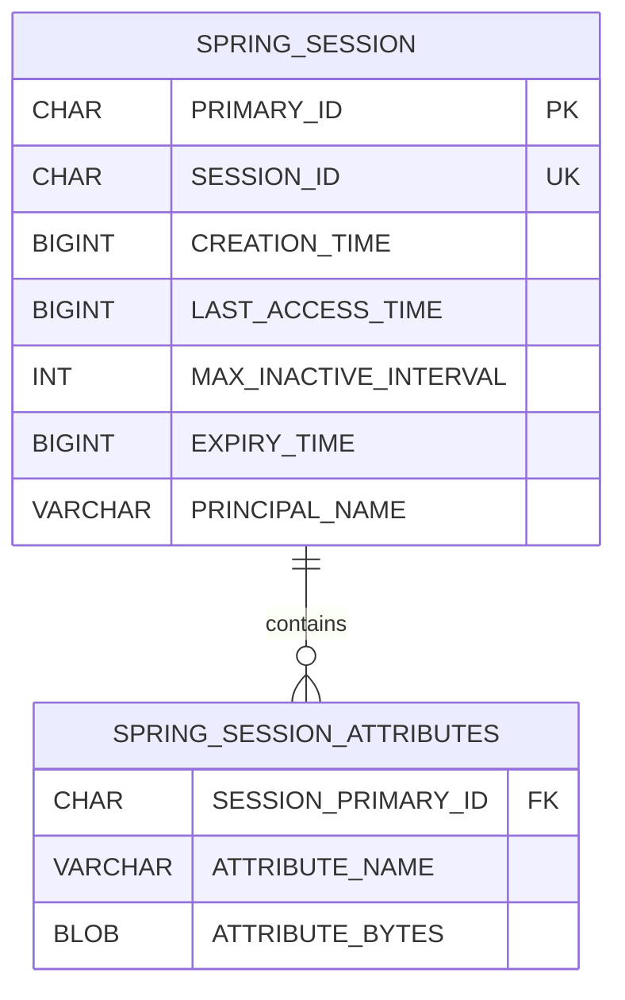

# Khởi tạo schema cho môi trường học và quản lý bằng công cụ migration

Spring Session JDBC lưu phiên vào các bảng quan hệ. Trước khi ứng dụng có thể đọc hoặc ghi `HttpSession`, cơ sở dữ liệu phải có schema tương thích với phiên bản Spring Session đang dùng. Trong môi trường học, có thể để Spring Boot chạy script khởi tạo schema hoặc chạy script đi kèm Spring Session bằng tay. Khi đưa ứng dụng vào môi trường dùng chung và production, nên quản lý thay đổi schema bằng công cụ migration như Flyway hoặc Liquibase để lịch sử thay đổi có thể kiểm soát, xem xét và triển khai lặp lại.

Schema chuẩn của Spring Session JDBC thường gồm bảng `SPRING_SESSION` để lưu metadata phiên và bảng `SPRING_SESSION_ATTRIBUTES` để lưu từng attribute. Hai bảng liên kết với nhau bằng `PRIMARY_ID`. Các chỉ mục trên `SESSION_ID`, `EXPIRY_TIME` và `PRINCIPAL_NAME` phục vụ tra cứu phiên, dọn phiên hết hạn và tìm phiên theo người dùng. Cần tạo đúng khóa, kiểu dữ liệu, chỉ mục và quan hệ khóa ngoại; chỉ tạo hai bảng với tên đúng là chưa đủ.

## 1. Khi nào cần khởi tạo schema?

`JdbcIndexedSessionRepository` đọc và ghi dữ liệu theo cấu trúc bảng mà Spring Session JDBC mong đợi. Nếu schema chưa tồn tại, request đầu tiên cần tạo hoặc tải session có thể thất bại với lỗi SQL như table not found. Nếu bảng tồn tại nhưng thiếu cột, kiểu dữ liệu, khóa hoặc chỉ mục cần thiết, ứng dụng có thể khởi động thành công nhưng lỗi khi thao tác session hoặc hoạt động kém hiệu quả.

Schema cần được tạo trước khi bật lưu session JDBC trong ứng dụng. Việc tạo schema là một bước triển khai cơ sở dữ liệu, tách biệt với việc tạo bean `DataSource` và cấu hình `@EnableJdbcHttpSession`.

Trong quá trình phát triển, có thể dùng script tự động để tiết kiệm thao tác. Trong môi trường có dữ liệu quan trọng, việc tạo hoặc sửa bảng cần có lịch sử migration và quy trình triển khai rõ ràng. Không nên để nhiều instance ứng dụng cùng tự chạy một script tạo bảng khi khởi động.

## 2. Cấu trúc schema Spring Session JDBC

Schema chuẩn thường có hai bảng chính:



### Bảng `SPRING_SESSION`

Bảng này lưu một hàng cho mỗi session. Các cột thường gặp:

| Cột | Vai trò |
|---|---|
| `PRIMARY_ID` | Khóa chính nội bộ của hàng session; được dùng để liên kết với bảng attributes |
| `SESSION_ID` | Định danh session mà Spring Session dùng để tìm phiên từ request/cookie |
| `CREATION_TIME` | Thời điểm tạo session, thường lưu dưới dạng epoch milliseconds |
| `LAST_ACCESS_TIME` | Thời điểm truy cập gần nhất, thường lưu dưới dạng epoch milliseconds |
| `MAX_INACTIVE_INTERVAL` | Khoảng không hoạt động tối đa, tính bằng giây |
| `EXPIRY_TIME` | Thời điểm hết hạn được tính từ thông tin truy cập và timeout, thường là epoch milliseconds |
| `PRINCIPAL_NAME` | Tên principal nếu session được liên kết với người dùng đã xác thực |

`PRIMARY_ID` là primary key của hàng trong database. `SESSION_ID` có unique index để không có hai session đang tồn tại cùng một ID và để repository tra cứu nhanh theo ID nhận từ client. Hai cột này có ý nghĩa khác nhau; không được gộp chúng hoặc thay một cột bằng cột còn lại khi tự tạo schema.

### Bảng `SPRING_SESSION_ATTRIBUTES`

Bảng này lưu các attribute của session. Mỗi hàng tương ứng một attribute:

| Cột | Vai trò |
|---|---|
| `SESSION_PRIMARY_ID` | Khóa ngoại trỏ đến `SPRING_SESSION.PRIMARY_ID` |
| `ATTRIBUTE_NAME` | Tên attribute trong `HttpSession` |
| `ATTRIBUTE_BYTES` | Dữ liệu attribute đã được tuần tự hóa thành byte |

Khóa chính ghép thường gồm `SESSION_PRIMARY_ID` và `ATTRIBUTE_NAME`, vì tên attribute chỉ cần duy nhất trong phạm vi một session. Khóa ngoại thường có `ON DELETE CASCADE`, để khi hàng session bị xóa thì các attribute liên quan cũng được xóa theo.

## 3. PRIMARY_ID và SESSION_ID không phải cùng một định danh

Hai định danh có vai trò riêng:

- `PRIMARY_ID` là định danh nội bộ của hàng session trong database. Nó làm khóa chính và là điểm liên kết từ bảng attributes đến hàng session.
- `SESSION_ID` là định danh phiên được Spring Session sử dụng khi xử lý request. Resolver thường trao đổi giá trị này với client thông qua cookie hoặc header.

Repository có thể nhận `SESSION_ID` từ cookie, tìm hàng tương ứng rồi dùng `PRIMARY_ID` để đọc các attribute. Bảng attributes không cần lưu `SESSION_ID` ở từng hàng; nó chỉ cần `SESSION_PRIMARY_ID` tham chiếu đến hàng cha.

Ví dụ quan hệ:

```text
SPRING_SESSION
+--------------------------------------+--------------------------------------+
| PRIMARY_ID                           | SESSION_ID                           |
+--------------------------------------+--------------------------------------+
| 9f6d... (khóa hàng nội bộ)            | 7a21... (ID phiên trong cookie)       |
+--------------------------------------+--------------------------------------+

SPRING_SESSION_ATTRIBUTES
+--------------------------------------+------------------+
| SESSION_PRIMARY_ID                   | ATTRIBUTE_NAME   |
+--------------------------------------+------------------+
| 9f6d...                              | cartId           |
| 9f6d...                              | checkout.step    |
+--------------------------------------+------------------+
```

Khi session ID được thay đổi trong một quy trình như bảo vệ chống session fixation, `SESSION_ID` có thể được cập nhật trong khi `PRIMARY_ID` vẫn giữ vai trò định danh hàng nội bộ. Vì vậy, bảng attributes vẫn liên kết với cùng hàng session qua `SESSION_PRIMARY_ID`. Không dùng `PRIMARY_ID` làm cookie, URL hoặc mã định danh người dùng.

## 4. Script schema đi kèm Spring Session

Spring Session JDBC cung cấp các script schema theo hệ quản trị cơ sở dữ liệu. Các script này là điểm khởi đầu đáng tin cậy vì chúng khớp với cấu trúc mà repository của phiên bản thư viện mong đợi.

Trong dependency `spring-session-jdbc`, script thường nằm trong classpath dưới package `org/springframework/session/jdbc/`, với tên theo nền tảng như `schema-@@platform@@.sql`. Tên cụ thể và danh sách nền tảng được hỗ trợ phụ thuộc phiên bản. Hãy dùng script đi kèm đúng phiên bản Spring Session mà ứng dụng đang chạy, thay vì sao chép một schema tìm thấy từ phiên bản cũ hoặc một blog không rõ nguồn.

Có thể mở file JAR dependency hoặc xem tài nguyên trong classpath để tìm script tương ứng. Khi cần tùy chỉnh, so sánh thay đổi với script gốc và ghi nhận lý do của từng khác biệt. Các thay đổi phải giữ nguyên những cột và ràng buộc mà repository cần.

## 5. Khởi tạo tự động trong Spring Boot cho môi trường học

Spring Boot có thể tự chạy script khởi tạo schema JDBC của Spring Session. Ví dụ cấu hình cho môi trường học dùng cơ sở dữ liệu nhúng:

```yaml
spring:
  session:
    jdbc:
      initialize-schema: always
      table-name: SPRING_SESSION
  datasource:
    url: jdbc:h2:mem:sessionlab;DB_CLOSE_DELAY=-1
    username: sa
    password:
```

`initialize-schema` điều khiển thời điểm Boot chạy script schema. Các giá trị thường dùng:

| Giá trị | Ý nghĩa |
|---|---|
| `embedded` | Chạy script khi nhận diện datasource là cơ sở dữ liệu nhúng |
| `always` | Luôn chạy script khởi tạo theo cấu hình |
| `never` | Không tự chạy script schema |

Trong một số phiên bản Spring Boot, mặc định thường chỉ khởi tạo schema cho embedded database. Hãy kiểm tra tài liệu và metadata của phiên bản Boot đang dùng, không dựa vào mặc định của một dự án khác.

`always` thuận tiện khi tạo môi trường học mới hoặc test database dùng một lần. Nó không có nghĩa mọi script đều an toàn để chạy lặp trên một schema đã có bảng; script tạo bảng có thể thất bại nếu đối tượng đã tồn tại. Đừng bật `always` cho production chỉ để tránh quản lý migration.

### Chỉ định script schema riêng

Spring Boot có thể cho phép chỉ định vị trí script thông qua thuộc tính `spring.session.jdbc.schema`. Ví dụ:

```yaml
spring:
  session:
    jdbc:
      initialize-schema: always
      schema: classpath:db/session/schema.sql
```

Script tùy chỉnh phải phù hợp với hệ quản trị cơ sở dữ liệu và phiên bản Spring Session. Khi đã dùng công cụ migration để quản lý schema, đặt `initialize-schema: never` để Boot không chạy thêm script tạo bảng ngoài lịch sử migration.

## 6. Khởi tạo thủ công trong Spring không dùng Boot

Với ứng dụng Spring Servlet truyền thống, có thể chạy script schema bằng công cụ quản trị database hoặc qua bước triển khai riêng. Sau đó cấu hình repository:

```java
import org.springframework.context.annotation.Configuration;
import org.springframework.session.jdbc.config.annotation.web.http.EnableJdbcHttpSession;

@Configuration
@EnableJdbcHttpSession(maxInactiveIntervalInSeconds = 1800)
public class JdbcSessionConfiguration {
    // DataSource được khai báo trong cấu hình Spring.
    // Schema SPRING_SESSION và SPRING_SESSION_ATTRIBUTES phải có sẵn.
}
```

`@EnableJdbcHttpSession` bật hạ tầng repository và filter, nhưng không nên được hiểu là một migration tool. Trong mô hình này, nhóm vận hành hoặc bước triển khai phải bảo đảm schema đã được tạo trước khi ứng dụng nhận request.

Nếu ứng dụng dùng `web.xml` hoặc Servlet initializer, vẫn cần đăng ký `springSessionRepositoryFilter` theo mô hình Servlet của ứng dụng. Việc schema có sẵn không tự đăng ký filter và việc filter đã đăng ký không tự tạo schema.

## 7. Ví dụ migration SQL cho PostgreSQL

Flyway thường quản lý migration bằng các file phiên bản như `V1__create_spring_session_tables.sql`. Ví dụ sau minh họa cấu trúc tương đương trên PostgreSQL. Các hệ quản trị khác cần điều chỉnh kiểu dữ liệu và cú pháp theo script chính thức của Spring Session.

```sql
CREATE TABLE SPRING_SESSION (
    PRIMARY_ID CHAR(36) NOT NULL,
    SESSION_ID CHAR(36) NOT NULL,
    CREATION_TIME BIGINT NOT NULL,
    LAST_ACCESS_TIME BIGINT NOT NULL,
    MAX_INACTIVE_INTERVAL INTEGER NOT NULL,
    EXPIRY_TIME BIGINT NOT NULL,
    PRINCIPAL_NAME VARCHAR(100),
    CONSTRAINT SPRING_SESSION_PK PRIMARY KEY (PRIMARY_ID)
);

CREATE UNIQUE INDEX SPRING_SESSION_IX1
    ON SPRING_SESSION (SESSION_ID);

CREATE INDEX SPRING_SESSION_IX2
    ON SPRING_SESSION (EXPIRY_TIME);

CREATE INDEX SPRING_SESSION_IX3
    ON SPRING_SESSION (PRINCIPAL_NAME);

CREATE TABLE SPRING_SESSION_ATTRIBUTES (
    SESSION_PRIMARY_ID CHAR(36) NOT NULL,
    ATTRIBUTE_NAME VARCHAR(200) NOT NULL,
    ATTRIBUTE_BYTES BYTEA NOT NULL,
    CONSTRAINT SPRING_SESSION_ATTRIBUTES_PK
        PRIMARY KEY (SESSION_PRIMARY_ID, ATTRIBUTE_NAME),
    CONSTRAINT SPRING_SESSION_ATTRIBUTES_FK
        FOREIGN KEY (SESSION_PRIMARY_ID)
        REFERENCES SPRING_SESSION (PRIMARY_ID)
        ON DELETE CASCADE
);
```

PostgreSQL dùng `BYTEA` cho dữ liệu nhị phân; các hệ quản trị khác có thể dùng `BLOB` hoặc kiểu tương ứng. Không dùng nguyên văn đoạn SQL này cho mọi database. Hãy kiểm tra script theo đúng nền tảng trong dependency Spring Session và so sánh với phiên bản PostgreSQL đang chạy.

Các index có mục đích cụ thể:

- Unique index trên `SESSION_ID` hỗ trợ tìm session theo ID và bảo đảm không trùng ID.
- Index trên `EXPIRY_TIME` hỗ trợ truy vấn/dọn các session đã hết hạn.
- Index trên `PRINCIPAL_NAME` hỗ trợ tìm phiên theo người dùng khi repository và ứng dụng dùng chức năng index đó.
- Khóa chính ghép trên bảng attributes hỗ trợ tìm và cập nhật attribute theo session cùng tên attribute.

## 8. Quản lý schema bằng Flyway

Flyway quản lý thay đổi schema bằng các migration có phiên bản. Mỗi migration được ghi nhận trong bảng lịch sử `flyway_schema_history`; Flyway dùng lịch sử đó để biết migration nào đã chạy và kiểm tra checksum.

Cấu trúc thư mục thông dụng:

```text
src/main/resources/
  db/
    migration/
      V1__create_spring_session_tables.sql
      V2__add_session_metadata_index.sql
```

Migration đầu tiên chứa schema session chuẩn. Migration tiếp theo chỉ chứa thay đổi mới cần triển khai, không sửa nội dung migration đã áp dụng ở môi trường dùng chung.

Ví dụ cấu hình Spring Boot khi Flyway là chủ sở hữu schema:

```yaml
spring:
  flyway:
    enabled: true
    locations: classpath:db/migration
  session:
    jdbc:
      initialize-schema: never
      table-name: SPRING_SESSION
```

Trong cấu hình này, Flyway chạy migration trước khi ứng dụng sử dụng repository; Spring Boot không chạy script session độc lập. Hãy bảo đảm migration được áp dụng trước khi phiên bản ứng dụng mới bắt đầu nhận traffic.

### Quy tắc khi viết migration

- Đặt tên migration theo quy ước và giữ thứ tự phiên bản duy nhất.
- Dùng script đúng hệ quản trị và phiên bản database.
- Tạo đầy đủ bảng, khóa, index và foreign key mà Spring Session cần.
- Không sửa migration đã chạy trên môi trường chia sẻ; tạo migration mới để thay đổi schema.
- Kiểm tra checksum và lịch sử migration trước khi triển khai.
- Kiểm thử migration trên database cùng loại với production.
- Không để mọi instance ứng dụng tự cạnh tranh chạy DDL trong lúc rollout; tổ chức một bước migration có quyền và thứ tự rõ ràng.

Nếu cần thêm index, trước tiên xác định query thực tế và kiểm tra execution plan. Index bổ sung làm tăng chi phí ghi và dung lượng; không thêm chỉ mục trùng hoặc không có mục đích.

## 9. Quản lý schema bằng Liquibase

Liquibase cũng quản lý schema theo changelog. Có thể mô tả bảng, khóa và index bằng XML, YAML, JSON hoặc SQL formatted changelog. Mỗi changeSet có định danh và được ghi vào bảng `DATABASECHANGELOG` để theo dõi việc áp dụng.

Ví dụ cấu trúc changelog:

```text
src/main/resources/
  db/
    changelog/
      db.changelog-master.yaml
      changes/
        001-create-spring-session.yaml
        002-add-session-index.yaml
```

Master changelog include các changeSet theo thứ tự. ChangeSet tạo `SPRING_SESSION` và `SPRING_SESSION_ATTRIBUTES`, bao gồm primary key, unique index, index expiration/principal và foreign key cascade. Khi cần hỗ trợ nhiều database, có thể dùng cú pháp trừu tượng của Liquibase hoặc tách changeSet theo `dbms` để xử lý kiểu nhị phân và cú pháp khác nhau.

Không nên để Flyway và Liquibase cùng quản lý một tập bảng trong cùng môi trường nếu không có thiết kế phối hợp rõ ràng. Chọn một công cụ làm nguồn lịch sử migration chính cho schema session để tránh hai bảng lịch sử không phản ánh cùng một trạng thái.

## 10. Phân biệt schema session với schema JPA

Spring Session JDBC dùng các bảng riêng để lưu session. Các bảng này không phải entity JPA của ứng dụng và không nên để Hibernate tự suy ra hoặc tạo bằng `ddl-auto`.

Ví dụ cấu hình sau điều khiển schema JPA, không thay thế migration Spring Session:

```yaml
spring:
  jpa:
    hibernate:
      ddl-auto: validate
```

`ddl-auto: validate` yêu cầu Hibernate kiểm tra mapping entity của ứng dụng. Nó không tạo `SPRING_SESSION` và `SPRING_SESSION_ATTRIBUTES` thay cho Spring Session. Dùng Flyway/Liquibase hoặc script Spring Session cho các bảng session, còn schema entity nghiệp vụ có thể được quản lý cùng công cụ migration theo chính sách của dự án.

Không đưa các bảng session vào entity JPA chỉ để tiện thao tác. Repository Spring Session đã quản lý vòng đời, serialization và truy vấn session; ứng dụng nên dùng `HttpSession` hoặc API Spring Session thay vì sửa trực tiếp bảng trong logic nghiệp vụ.

## 11. Tùy chỉnh tên bảng và schema

Spring Session JDBC thường dùng tên bảng mặc định `SPRING_SESSION` và `SPRING_SESSION_ATTRIBUTES`. Nếu tổ chức cần prefix hoặc schema riêng, hãy cấu hình `tableName`/`spring.session.jdbc.table-name` theo API phiên bản đang dùng và tạo migration khớp với cấu hình đó.

Ví dụ cấu hình Boot:

```yaml
spring:
  session:
    jdbc:
      table-name: APP_SESSION
      initialize-schema: never
```

Khi dùng tên bảng tùy chỉnh, phải xác định cách repository suy ra tên bảng attributes theo quy ước của phiên bản thư viện, rồi kiểm tra SQL thực tế. Không chỉ đổi tên bảng cha trong database mà quên bảng attributes, index, constraint hoặc cấu hình repository.

Tên schema database cũng cần nhất quán giữa tài khoản chạy migration và tài khoản ứng dụng. Nếu migration tạo bảng trong schema `app_data` nhưng connection của ứng dụng tìm bảng trong schema mặc định khác, request có thể báo table not found dù bảng thực tế đã tồn tại.

## 12. Thứ tự triển khai an toàn

Với môi trường có traffic, migration nên được triển khai theo thứ tự:

1. Xác định database, schema, tên bảng và phiên bản Spring Session.
2. Chuẩn bị migration và review SQL trước khi áp dụng.
3. Sao lưu hoặc xác nhận phương án phục hồi theo chính sách database.
4. Chạy migration bằng tài khoản có quyền DDL trước khi deploy ứng dụng cần schema mới.
5. Xác nhận bảng, index, primary key và foreign key đã tồn tại.
6. Cấu hình ứng dụng không tự chạy script tạo bảng nếu migration tool đang quản lý.
7. Deploy ứng dụng và kiểm tra tạo, đọc, cập nhật, hết hạn, logout session.
8. Theo dõi lỗi SQL, latency và truy vấn dọn session sau rollout.

Nếu cần đổi schema đang có dữ liệu, ưu tiên cách expand/contract: thêm cấu trúc mới mà phiên bản cũ vẫn hoạt động, chuyển ứng dụng, rồi mới loại bỏ cấu trúc cũ sau khi không còn phụ thuộc. Không xóa bảng session đang được ứng dụng sử dụng chỉ để chạy lại script khởi tạo.

## 13. Kiểm tra schema sau khi khởi tạo

Sau migration, cần xác nhận cấu trúc thực tế bằng công cụ database. Có thể kiểm tra:

- Hai bảng session và attributes tồn tại trong đúng schema.
- `PRIMARY_ID` là primary key của bảng session.
- `SESSION_ID` có unique constraint/index.
- `SESSION_PRIMARY_ID` tham chiếu `SPRING_SESSION.PRIMARY_ID`.
- Khóa ngoại có hành vi cascade khi xóa session.
- `ATTRIBUTE_NAME` nằm trong khóa chính ghép cùng `SESSION_PRIMARY_ID`.
- Index trên `EXPIRY_TIME` và `PRINCIPAL_NAME` có mặt theo schema chuẩn.
- Các kiểu nhị phân và kiểu số phù hợp với database.
- Tài khoản ứng dụng có quyền SELECT/INSERT/UPDATE/DELETE cần thiết nhưng không nhất thiết có quyền DDL.

Một truy vấn kiểm tra cơ bản:

```sql
SELECT PRIMARY_ID,
       SESSION_ID,
       CREATION_TIME,
       LAST_ACCESS_TIME,
       MAX_INACTIVE_INTERVAL,
       EXPIRY_TIME,
       PRINCIPAL_NAME
FROM SPRING_SESSION;
```

Trong production, chỉ truy vấn metadata cần thiết và tránh xuất session ID hoặc principal nhạy cảm ra nơi không được bảo vệ. Không sửa dữ liệu session bằng SQL thủ công khi ứng dụng đang chạy.

## 14. Kiểm thử schema và migration

Nên kiểm thử migration trên đúng loại database mà ứng dụng sử dụng. H2 có thể hữu ích cho test nhanh, nhưng không bảo đảm cú pháp, kiểu dữ liệu, index, locking và transaction giống PostgreSQL, MySQL, Oracle hoặc SQL Server.

Một bộ kiểm thử tích hợp nên:

1. Tạo database trống cho test.
2. Chạy Flyway hoặc Liquibase từ trạng thái chưa có schema.
3. Khởi động ứng dụng với Spring Session JDBC.
4. Tạo session và lưu một vài attribute.
5. Đọc lại session bằng cookie/session ID trong request tiếp theo.
6. Xác nhận hàng session và hàng attributes được tạo đúng quan hệ.
7. Invalidate session và xác nhận hàng cha cùng các attribute liên quan được xóa theo cơ chế repository/schema.
8. Chạy migration trên database đã có dữ liệu mẫu để kiểm tra nâng cấp.
9. Khởi động ứng dụng với `initialize-schema: never` để xác nhận migration đã cung cấp đầy đủ schema.

Nếu dùng Testcontainers, chọn image database cùng major version với môi trường triển khai hoặc phiên bản được hỗ trợ. Test migration trên database thật giúp phát hiện lỗi như sai kiểu BLOB/BYTEA, khác biệt identifier casing, index syntax hoặc giới hạn độ dài cột.

## 15. Lỗi thường gặp và cách xử lý

| Hiện tượng | Nguyên nhân có thể | Cách kiểm tra |
|---|---|---|
| `table not found` khi request tạo session | Chưa chạy schema hoặc sai schema/database | Kiểm tra datasource, schema hiện tại và migration history |
| Thiếu cột khi lưu session | Script không đúng phiên bản hoặc migration tùy chỉnh thiếu cột | So sánh schema với script của dependency đang dùng |
| Không thể lưu attribute nhị phân | Dùng sai kiểu BLOB/BYTEA hoặc giới hạn cột | Kiểm tra kiểu dữ liệu theo DB vendor |
| Vi phạm unique trên `SESSION_ID` | Schema thiếu unique index hoặc dữ liệu bị trùng do thao tác sai | Kiểm tra index và không tự tạo ID session |
| Xóa session nhưng attributes còn lại | Thiếu foreign key cascade hoặc thao tác xóa không qua repository | Kiểm tra FK và đường xóa dữ liệu |
| Boot báo bảng đã tồn tại | Script `always` chạy trên schema đã được migration tạo | Đặt `initialize-schema: never` khi dùng Flyway/Liquibase |
| Flyway checksum mismatch | Migration đã áp dụng bị sửa nội dung | Khôi phục file migration cũ và tạo migration mới |
| App không thấy bảng đã tạo | Migration và app dùng schema/catalog khác nhau | So sánh JDBC URL, default schema và quyền tài khoản |
| Query session chậm khi dọn phiên | Thiếu index `EXPIRY_TIME` hoặc index không được dùng | Kiểm tra index và execution plan |

## 16. Nguyên tắc thiết kế

- Dùng script schema đúng phiên bản Spring Session JDBC.
- Trong môi trường học, có thể dùng `initialize-schema: always` với database dùng một lần.
- Trong môi trường chia sẻ/production, chọn Flyway hoặc Liquibase làm nguồn quản lý schema.
- Khi migration tool quản lý bảng session, đặt `spring.session.jdbc.initialize-schema: never`.
- Tạo đầy đủ `SPRING_SESSION`, `SPRING_SESSION_ATTRIBUTES`, khóa, index và foreign key.
- Giữ nguyên vai trò khác nhau của `PRIMARY_ID` và `SESSION_ID`; bảng attributes tham chiếu `PRIMARY_ID`.
- Không dùng Hibernate `ddl-auto` thay cho migration Spring Session.
- Chạy migration trước khi deploy ứng dụng cần schema mới và kiểm thử trên đúng database vendor.
- Không sửa migration đã chạy; tạo migration mới và dùng quy trình expand/contract khi thay đổi schema có dữ liệu.
- Tách quyền DDL của migration khỏi quyền DML thường ngày của ứng dụng nếu kiến trúc vận hành cho phép.

Schema JDBC là một phần của hợp đồng giữa Spring Session và database. Khởi tạo đúng các bảng, cột, khóa và index giúp repository tìm session, lưu attribute và dọn dữ liệu hết hạn đúng cách. Dùng script tự động cho môi trường học là tiện lợi; dùng Flyway hoặc Liquibase cho môi trường có dữ liệu giúp schema được quản lý theo phiên bản và triển khai nhất quán giữa các instance.
