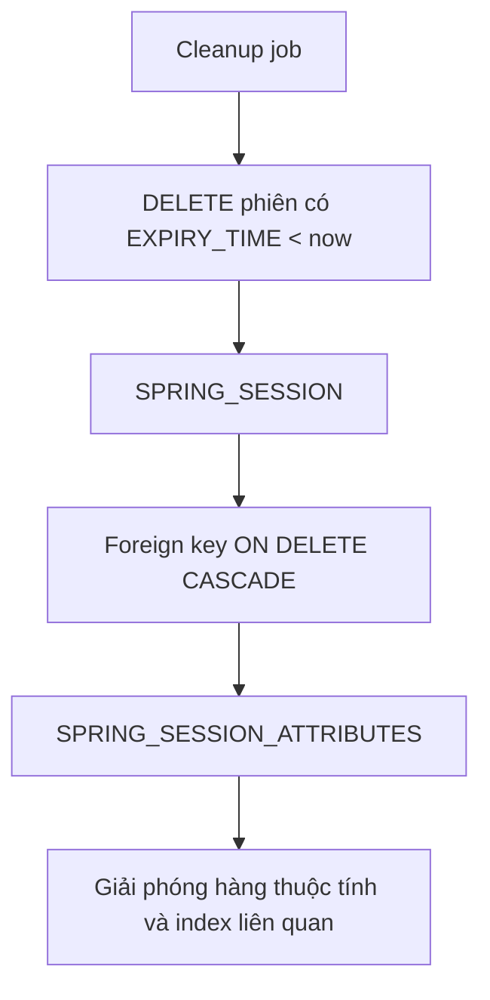

# Lịch xóa phiên hết hạn và chi phí dọn dữ liệu

Spring Session JDBC lưu metadata của `HttpSession` trong bảng `SPRING_SESSION` và các thuộc tính trong `SPRING_SESSION_ATTRIBUTES`. Khi người dùng không hoạt động đủ lâu, phiên hết hiệu lực theo `maxInactiveInterval`. Tuy nhiên, bản ghi đã hết hạn có thể vẫn còn nằm trong database cho đến khi được xóa. Spring Session cung cấp một cleanup job định kỳ để xóa các phiên hết hạn cùng các thuộc tính liên quan.

Lịch cleanup ảnh hưởng trực tiếp đến dung lượng bảng, tải SQL, lock, transaction log và thời gian giữ dữ liệu phiên đã hết hiệu lực. Cần phân biệt thời điểm phiên không còn được chấp nhận với thời điểm database dọn bản ghi vật lý. Điều chỉnh lịch xóa là bài toán vận hành database; nó không phải cách thay thế cho chính sách timeout hoặc kiểm tra session hợp lệ.

## 1. Hết hạn logic và xóa vật lý là hai việc khác nhau

Spring Session xác định thời điểm hết hạn dựa trên lần truy cập gần nhất và khoảng không hoạt động tối đa. Với một phiên có `lastAccessTime` là 10:00 và `maxInactiveInterval` là 30 phút, thời điểm hết hạn là khoảng 10:30.

Trong schema JDBC, `EXPIRY_TIME` lưu mốc hết hạn, thường dưới dạng epoch milliseconds. Khi một request tìm phiên theo ID, `JdbcIndexedSessionRepository` khôi phục session và kiểm tra `isExpired()`. Nếu phiên đã hết hạn, repository xóa phiên đó và trả về không có session. Vì vậy, một phiên hết hạn không cần chờ cleanup job mới bị từ chối.

Cleanup job xử lý phần còn lại: các phiên đã hết hạn nhưng không có request nào truy cập lại để kích hoạt việc xóa theo ID. Nó quét và xóa các bản ghi có `EXPIRY_TIME` nhỏ hơn thời điểm hiện tại.

| Khái niệm | Ý nghĩa | Tác động |
|---|---|---|
| Hết hạn logic | Phiên vượt quá `maxInactiveInterval` | Repository không khôi phục phiên như một session còn hiệu lực |
| Xóa khi truy cập | `findById` phát hiện phiên hết hạn và xóa theo ID | Bản ghi có thể được dọn trước lần chạy cleanup định kỳ |
| Cleanup định kỳ | Job xóa các bản ghi đã hết hạn còn tồn tại | Thu hồi dung lượng bảng và index, dọn thuộc tính liên quan |

Không tăng timeout chỉ để giảm số lần cleanup và cũng không giảm timeout chỉ để làm bảng nhỏ hơn. Timeout phải phản ánh yêu cầu bảo mật và trải nghiệm người dùng; cleanup chỉ quyết định thời điểm thu hồi dữ liệu đã hết hạn khỏi database.

## 2. Dữ liệu nào được xóa?

Schema mặc định của Spring Session JDBC có hai bảng:

- `SPRING_SESSION`: metadata của phiên, gồm `PRIMARY_ID`, `SESSION_ID`, `LAST_ACCESS_TIME`, `MAX_INACTIVE_INTERVAL` và `EXPIRY_TIME`.
- `SPRING_SESSION_ATTRIBUTES`: các thuộc tính được serialize, liên kết với phiên qua `SESSION_PRIMARY_ID`.

Khóa ngoại trong schema chuẩn tham chiếu `SPRING_SESSION_ATTRIBUTES.SESSION_PRIMARY_ID` đến `SPRING_SESSION.PRIMARY_ID` và dùng `ON DELETE CASCADE`. Vì vậy, khi cleanup xóa một hàng phiên ở bảng cha, database tự xóa các hàng thuộc tính của phiên đó.



Nếu schema tùy chỉnh bỏ khóa ngoại cascade, cleanup chỉ xóa hàng cha có thể để lại các thuộc tính mồ côi. Hãy giữ ràng buộc tương ứng hoặc thiết kế câu lệnh dọn bảng attributes một cách an toàn trong cùng quy trình. Không giả định rằng repository sẽ tự xử lý mọi schema tùy chỉnh giống schema mặc định.

## 3. Lịch cleanup mặc định

`@EnableJdbcHttpSession` cấu hình lịch cleanup qua thuộc tính `cleanupCron`. Mặc định Spring Session JDBC chạy cleanup mỗi phút bằng cron expression:

```text
0 * * * * *
```

Đây là cron sáu trường của Spring: giây, phút, giờ, ngày trong tháng, tháng và ngày trong tuần. `0 * * * * *` có nghĩa là chạy ở giây 0 của mỗi phút.

Job mặc định thực hiện một câu lệnh xóa các phiên có `EXPIRY_TIME` nhỏ hơn thời điểm hiện tại. Với schema mặc định, câu SQL tương đương:

```sql
DELETE FROM SPRING_SESSION
WHERE EXPIRY_TIME < ?;
```

Tham số `?` được repository gán bằng thời điểm hiện tại tính theo epoch milliseconds. Việc xóa được thực hiện trong transaction thông qua `TransactionOperations`. Nếu database có foreign key cascade như schema chuẩn, các thuộc tính liên quan cũng được xóa.

Job mặc định có chủ đích đơn giản. Nó phù hợp với nhu cầu dọn phiên định kỳ thông thường, nhưng không phải một framework batch tổng quát để điều phối hàng triệu bản ghi theo nhiều bước, phân vùng hoặc quy tắc nghiệp vụ phức tạp.

## 4. Tùy chỉnh tần suất bằng cleanupCron

Có thể đổi cron trực tiếp trên annotation:

```java
import org.springframework.context.annotation.Configuration;
import org.springframework.session.jdbc.config.annotation.web.http.EnableJdbcHttpSession;

@Configuration
@EnableJdbcHttpSession(cleanupCron = "0 */5 * * * *")
public class JdbcSessionConfiguration {
}
```

Ví dụ này chạy cleanup mỗi 5 phút. Nếu dùng Spring Boot, cấu hình bằng property:

```yaml
spring:
  session:
    jdbc:
      cleanup-cron: "0 */5 * * * *"
```

Một số lịch thường dùng:

| Cron expression | Tần suất | Đánh đổi chính |
|---|---|---|
| `0 * * * * *` | Mỗi phút, mặc định | Backlog thường nhỏ hơn nhưng job được gọi thường xuyên |
| `0 */5 * * * *` | Mỗi 5 phút | Giảm số lần chạy, chấp nhận bản ghi hết hạn tồn tại lâu hơn |
| `0 */15 * * * *` | Mỗi 15 phút | Ít lần chạy hơn nhưng mỗi lần có thể xóa nhiều bản ghi hơn |
| `0 0 * * * *` | Mỗi giờ | Giảm tần suất, dễ tạo đợt xóa lớn nếu lượng session cao |

Cron càng thưa, thời gian bản ghi hết hạn còn nằm trong database càng dài và số hàng cần xóa trong một lần càng có thể lớn. Cron càng dày, job tạo thêm hoạt động truy vấn, transaction và tải trên database. Chọn tần suất từ số liệu session thực tế và năng lực database, không chỉ từ một con số mặc định.

## 5. Vô hiệu hóa cleanup job mặc định

Nếu ứng dụng dùng một job riêng, ví dụ Spring Batch hoặc lịch bảo trì tập trung, có thể tắt job mặc định bằng `Scheduled.CRON_DISABLED`:

```java
import org.springframework.context.annotation.Configuration;
import org.springframework.scheduling.annotation.Scheduled;
import org.springframework.session.jdbc.config.annotation.web.http.EnableJdbcHttpSession;

@Configuration
@EnableJdbcHttpSession(cleanupCron = Scheduled.CRON_DISABLED)
public class JdbcSessionConfiguration {
}
```

Giá trị tương ứng của hằng số này là `-`. Khi tắt job, ứng dụng vẫn kiểm tra session hết hạn trong luồng truy cập theo ID; chỉ có việc dọn các hàng hết hạn không được truy cập cần được giao cho một quy trình khác.

Không tắt cleanup rồi để database tự tăng trưởng vô hạn. Trước khi vô hiệu hóa, phải có lịch thay thế, chủ sở hữu vận hành, metric, cảnh báo và kiểm thử xác nhận các hàng cha lẫn hàng thuộc tính đều được dọn.

## 6. Mỗi instance ứng dụng có thể chạy cleanup riêng

Trong cụm nhiều instance, mỗi application context có một `JdbcIndexedSessionRepository`. Repository khởi tạo scheduler riêng và đăng ký cleanup theo `cleanupCron`. Vì vậy, nếu tất cả node cùng dùng cấu hình mặc định, nhiều node có thể chạy cùng câu lệnh cleanup trên cùng database.

Các câu lệnh `DELETE` giống nhau thường vẫn cho kết quả dữ liệu hợp lệ: một node có thể xóa các hàng trước, node khác chạy sau sẽ không còn hàng đó để xóa. Tuy nhiên, nếu chúng chạy đồng thời, database vẫn phải xử lý cạnh tranh khóa, truy cập index và transaction. Với lượng dữ liệu lớn, các lần chạy trùng có thể tăng tải mà không đem lại lợi ích tương ứng.

Các lựa chọn vận hành:

1. Giữ cleanup mặc định trên mọi node khi tải nhỏ và database chịu được các lần chạy trùng; đo trước khi thay đổi.
2. Chỉ bật cleanup trên một node được chọn bằng profile hoặc cấu hình triển khai, các node còn lại dùng `Scheduled.CRON_DISABLED`.
3. Tắt job trong tất cả application node và chạy một job tập trung có điều phối, ví dụ Spring Batch hoặc scheduler của nền tảng.
4. Dùng distributed lock/leader election nếu cần chọn một node thực hiện job nhưng vẫn muốn failover khi node đó dừng.

Nếu chỉ bật job trên một node cố định, cần có kế hoạch khi node đó bị dừng hoặc không thể truy cập database. Một job tập trung hoặc leader election phải có cơ chế chuyển quyền và cảnh báo khi cleanup ngừng chạy.

## 7. Chi phí của một lần cleanup

Lệnh xóa có vẻ đơn giản nhưng chi phí phụ thuộc số lượng hàng và cấu trúc liên quan. Database phải tìm các hàng hết hạn, xóa bản ghi session, duy trì index, thực hiện cascade tới thuộc tính, ghi transaction log và xử lý các phiên bản dữ liệu theo cơ chế storage engine.

Các yếu tố ảnh hưởng:

- **Số phiên hết hạn:** càng nhiều hàng thỏa `EXPIRY_TIME < now`, càng nhiều công việc xóa.
- **Số thuộc tính mỗi phiên:** mỗi session có thể có nhiều hàng trong `SPRING_SESSION_ATTRIBUTES`; cascade làm tăng số hàng phải xóa.
- **Kích thước thuộc tính:** thuộc tính nhị phân lớn làm tăng dung lượng lưu và chi phí ghi/backup, dù cleanup xóa theo hàng cha.
- **Index:** index trên `EXPIRY_TIME` giúp tìm vùng dữ liệu hết hạn; index và foreign key liên quan cũng cần được cập nhật khi xóa.
- **Transaction log/redo/WAL:** xóa nhiều hàng tạo lượng log lớn và có thể làm tăng độ trễ replica hoặc backup.
- **Lock và cạnh tranh:** transaction xóa lớn có thể giữ khóa lâu và ảnh hưởng request đang đọc/ghi session hoặc workload nghiệp vụ.
- **Bảo trì storage engine:** database có thể cần vacuum, purge hoặc cơ chế thu hồi không gian riêng sau khi xóa.

Không thể ước lượng chi phí chỉ từ số session. Một hệ thống có 100.000 phiên với một thuộc tính nhỏ mỗi phiên có thể có chi phí khác đáng kể so với 100.000 phiên chứa nhiều object lớn.

## 8. Index EXPIRY_TIME rất quan trọng

Schema Spring Session JDBC mặc định tạo index trên `EXPIRY_TIME`. Cleanup query lọc theo cột này:

```sql
SELECT COUNT(*)
FROM SPRING_SESSION
WHERE EXPIRY_TIME < ?;
```

Truy vấn đếm này có thể dùng để đo backlog trong quá trình giám sát hoặc kiểm thử. Tham số `?` cần là epoch milliseconds hiện tại, cùng đơn vị với giá trị lưu trong cột.

Nếu bỏ index `EXPIRY_TIME`, database có thể phải quét nhiều hoặc toàn bộ bảng để tìm session hết hạn. Khi bảng lớn, cleanup sẽ tăng I/O và có thể ảnh hưởng request session. Không xóa index chỉ để giảm chi phí ghi nếu chưa đo cả chi phí đọc và cleanup.

Kiểm tra execution plan bằng công cụ của DBMS. Với PostgreSQL, dùng `EXPLAIN`/`EXPLAIN ANALYZE` trên truy vấn tương ứng trong môi trường kiểm thử; với MySQL, Oracle hoặc SQL Server, dùng công cụ execution plan tương ứng. Theo dõi số hàng ước tính so với số hàng thực tế và tình trạng thống kê optimizer.

Giữ predicate trực tiếp trên `EXPIRY_TIME`. Bọc cột trong hàm chuyển đổi hoặc ép kiểu ở điều kiện lọc có thể làm giảm khả năng sử dụng index. Vì cột là epoch milliseconds, truyền đúng kiểu số và đơn vị thay vì so sánh với chuỗi ngày giờ.

## 9. Tần suất và kích thước backlog

Có thể ước lượng lượng dữ liệu chờ xóa từ tốc độ hết hạn và khoảng thời gian giữa các lần cleanup. Nếu trung bình có 2.000 phiên hết hạn mỗi phút và cleanup chạy mỗi 5 phút, một lần chạy có thể gặp khoảng 10.000 phiên mới hết hạn, chưa tính backlog từ các lần chạy thất bại.

Đây chỉ là ước lượng ban đầu. Lượng phiên hết hạn thực tế còn phụ thuộc giờ đăng nhập cao điểm, timeout của từng loại phiên, logout chủ động, số phiên bị thu hồi và số lần cleanup thất bại.

| Cấu hình | Lợi ích | Rủi ro cần đo |
|---|---|---|
| Cleanup thường xuyên | Backlog và thời gian lưu bản ghi hết hạn thường thấp hơn | Chi phí khởi chạy truy vấn/transaction lặp lại |
| Cleanup thưa | Ít lần truy vấn định kỳ | Mỗi lần xóa có thể lớn, tăng log, lock và độ trễ |
| Cleanup theo giờ thấp điểm | Hạn chế ảnh hưởng giờ cao điểm | Bản ghi hết hạn tồn tại lâu hơn; cần đủ dung lượng |
| Cleanup theo batch nhỏ | Giới hạn kích thước transaction và thời gian lock | Cần quản lý checkpoint, retry và tính đầy đủ của batch |

Không cần xóa ngay tại đúng mili giây session hết hạn để bảo đảm an toàn truy cập. Repository đã kiểm tra trạng thái hết hạn khi tìm theo ID. Có thể chọn khoảng cleanup dài hơn nếu database cần tránh tải cao điểm, miễn là dung lượng và chính sách lưu trữ chấp nhận được.

## 10. Khi nào cần batch cleanup?

Cleanup mặc định của Spring Session JDBC được thiết kế đơn giản. Nó chạy một câu lệnh `DELETE` theo `EXPIRY_TIME` trong transaction; không cung cấp đầy đủ tính năng batch processing như phân trang, checkpoint, retry theo chunk hoặc điều phối job dài.

Khi số phiên rất lớn hoặc một lần xóa gây transaction dài, cân nhắc tắt cleanup mặc định và triển khai quy trình batch riêng. Spring Batch là lựa chọn được Spring Session đề xuất cho nhu cầu xử lý batch phức tạp hơn.

Một batch cleanup nên:

1. Chọn một lượng giới hạn `PRIMARY_ID` có `EXPIRY_TIME` nhỏ hơn mốc hiện tại.
2. Xóa theo lô nhỏ trong transaction ngắn.
3. Dùng foreign key cascade hoặc xóa bảng attributes theo thứ tự đúng.
4. Lưu checkpoint hoặc có thể chạy lại an toàn sau lỗi.
5. Giới hạn tốc độ để không tranh chấp connection và I/O với request ứng dụng.
6. Ghi nhận số phiên đã xóa, số lần retry, thời gian mỗi chunk và backlog còn lại.
7. Có cơ chế dừng, tiếp tục và cảnh báo khi job bị treo hoặc không chạy.

SQL giới hạn batch phụ thuộc DBMS. PostgreSQL, MySQL, Oracle và SQL Server có cú pháp khác nhau cho giới hạn hàng trong câu lệnh xóa. Không sao chép một câu lệnh batch từ database khác rồi dùng trực tiếp trong production.

Nếu dùng `SessionRepositoryCustomizer` để thay query cleanup mặc định, phải giữ đúng hợp đồng tham số của repository. Query mặc định nhận một tham số thời điểm hết hạn; custom query phải tương thích với cách repository bind tham số và với placeholder `%TABLE_NAME%`. Một custom query có thêm `?` mà repository không truyền thêm giá trị sẽ thất bại khi chạy.

## 11. Tùy chỉnh câu lệnh xóa theo expiry time

Spring Session cho phép tùy chỉnh câu lệnh xóa thông qua `JdbcIndexedSessionRepository.setDeleteSessionsByExpiryTimeQuery`. Có thể cấu hình bằng `SessionRepositoryCustomizer`:

```java
@Configuration
@EnableJdbcHttpSession
public class JdbcSessionCleanupConfiguration {

    @Bean
    SessionRepositoryCustomizer<JdbcIndexedSessionRepository> cleanupQueryCustomizer() {
        return repository -> repository.setDeleteSessionsByExpiryTimeQuery("""
                DELETE FROM %TABLE_NAME%
                WHERE EXPIRY_TIME < ?
                """);
    }
}
```

Ví dụ giữ nguyên logic mặc định để minh họa điểm mở rộng. Trong thực tế, chỉ thay query khi có lý do cụ thể như cú pháp tối ưu theo DBMS, phân vùng dữ liệu hoặc điều kiện bổ sung đã được phản ánh trong schema. Placeholder `%TABLE_NAME%` được repository thay bằng tên bảng cấu hình.

Không thêm điều kiện dựa trên cột không có trong schema mặc định. Nếu thêm cột phân vùng/tenant, cần migration, quy tắc ghi session và query cleanup đồng bộ. Cũng không đổi query thành một câu lệnh xóa chỉ bảng cha nếu schema không có cascade và không có bước dọn thuộc tính tương ứng.

## 12. Quan sát cleanup job

`JdbcIndexedSessionRepository` ghi log mức DEBUG với số session đã dọn, theo dạng thông báo `Cleaned up N expired sessions`. Có thể bật logger của repository ở DEBUG trong thời gian điều tra:

```yaml
logging:
  level:
    org.springframework.session.jdbc.JdbcIndexedSessionRepository: DEBUG
```

Không nhất thiết giữ DEBUG lâu dài nếu log volume lớn. Trong vận hành thường xuyên, nên có metric hoặc dashboard riêng cho:

- Thời điểm cleanup thành công gần nhất.
- Thời lượng mỗi lần chạy.
- Số phiên bị xóa mỗi lần.
- Số hàng đã hết hạn còn tồn tại trước/sau cleanup.
- Số lần job lỗi hoặc bỏ lỡ lịch.
- Kích thước bảng session và attributes.
- Database CPU/I/O, lock wait, deadlock và transaction log/WAL growth.
- Connection pool utilization và độ trễ truy vấn session.

Nếu cleanup không chạy, số hàng `EXPIRY_TIME < now` sẽ tăng theo thời gian. Nếu job chạy nhưng luôn xóa rất ít trong khi backlog lớn, kiểm tra query, index, table name, schema, transaction rollback và lỗi database.

## 13. Xử lý khi cleanup thất bại

Cleanup có thể thất bại do database unavailable, timeout, thiếu quyền DELETE, schema sai, index/constraint lỗi hoặc transaction rollback. Khi job thất bại, các hàng chưa xóa vẫn tồn tại; điều đó không tự làm cho phiên đã hết hạn trở thành hợp lệ. Repository vẫn kiểm tra `isExpired()` khi tìm theo session ID.

Quy trình xử lý:

1. Kiểm tra log và exception tại thời điểm cleanup dự kiến.
2. Kiểm tra kết nối, quyền DELETE và trạng thái transaction manager.
3. Đếm backlog bằng điều kiện `EXPIRY_TIME < now`.
4. Kiểm tra execution plan và index expiry.
5. Kiểm tra foreign key cascade và bảng attributes.
6. Khôi phục database hoặc quyền truy cập rồi chạy lại cleanup theo lịch hoặc quy trình vận hành đã định.
7. Theo dõi backlog giảm và xác nhận không còn hàng mồ côi.

Không xóa toàn bộ bảng session để xử lý backlog. Hành động đó đăng xuất tất cả người dùng và có thể làm mất trạng thái phiên còn hợp lệ. Luôn lọc theo expiry time và xác nhận phạm vi trước khi chạy SQL thủ công.

## 14. Đồng hồ hệ thống và mốc hết hạn

Spring Session JDBC lưu thời điểm theo epoch milliseconds và tính `EXPIRY_TIME` từ thời gian truy cập cộng với khoảng không hoạt động. Cleanup so sánh cột này với thời gian hiện tại của JVM đang chạy job. Nếu các instance có clock skew lớn, một node có thể xem phiên hết hạn sớm hơn hoặc muộn hơn node khác.

Đồng bộ đồng hồ của các application node bằng NTP hoặc cơ chế quản lý thời gian của nền tảng. Không dùng múi giờ hiển thị để tính toán `EXPIRY_TIME`; epoch milliseconds là mốc tuyệt đối. Khi kiểm tra bằng SQL, truyền giá trị epoch milliseconds và không so sánh trực tiếp với timestamp theo múi giờ nếu chưa chuyển đổi chính xác.

## 15. Kiểm thử lịch và hành vi cleanup

Kiểm thử cần tách việc từ chối session hết hạn khỏi việc job định kỳ xóa bản ghi:

| Ca kiểm thử | Cách thực hiện | Kết quả cần xác nhận |
|---|---|---|
| Timeout logic | Tạo session có timeout ngắn, đợi quá hạn rồi gọi `findById` | Repository trả về không có session và xóa phiên đã hết hạn theo luồng truy cập |
| Cleanup định kỳ | Tạo session hết hạn nhưng không truy cập lại, sau đó chạy cleanup | Hàng trong `SPRING_SESSION` được xóa |
| Attributes cascade | Tạo session có nhiều attributes rồi cleanup | Hàng tương ứng trong `SPRING_SESSION_ATTRIBUTES` cũng bị xóa |
| Cron tùy chỉnh | Cấu hình cron test ngắn hoặc gọi cleanup có kiểm soát | Job chạy theo lịch và backlog giảm |
| Tắt job mặc định | Dùng `Scheduled.CRON_DISABLED` | Job mặc định không chạy; job thay thế vẫn phải dọn dữ liệu |
| Nhiều instance | Khởi động hai node cùng database | Xác nhận số job thực tế và không tạo tải trùng ngoài dự kiến |
| Database outage | Làm database không truy cập được khi cleanup | Job báo lỗi; dữ liệu không bị xóa một phần ngoài transaction |
| Batch retry | Dừng batch giữa các chunk rồi chạy lại | Job tiếp tục an toàn và không bỏ sót phiên hết hạn |
| Schema thiếu cascade | Test schema tùy chỉnh không có FK cascade | Phát hiện hàng attributes mồ côi hoặc yêu cầu bước xóa bổ sung |
| Clock skew | Dùng clock test khác nhau giữa các node | Xác nhận ảnh hưởng và chính sách đồng bộ thời gian |

Để kiểm thử cleanup định kỳ ổn định, có thể gọi `cleanUpExpiredSessions()` trực tiếp trong integration test thay vì chờ cron thật. Nếu kiểm tra scheduler, dùng môi trường test riêng và cron ngắn; tránh làm test phụ thuộc vào timing không xác định.

Test nên dùng cùng DBMS với production khi xác minh cascade, index và cú pháp custom query. H2 có thể giúp kiểm tra logic cơ bản nhưng không thay thế kiểm thử PostgreSQL, MySQL, Oracle hoặc SQL Server nếu production dùng các hệ đó.

## 16. Những sai lầm thường gặp

| Sai lầm | Hệ quả | Cách tránh |
|---|---|---|
| Cho rằng session chỉ hết hạn khi cleanup chạy | Có thể thiết kế authorization phụ thuộc nhầm vào job dọn dữ liệu | Dựa vào kiểm tra expiry của repository khi đọc session |
| Đặt cron quá thưa mà không đo backlog | Bảng và attributes giữ dữ liệu hết hạn lâu, lần xóa có thể rất lớn | Theo dõi backlog, chọn tần suất theo tải và dung lượng |
| Đặt cron quá dày trên mọi node | Nhiều câu lệnh xóa trùng, tăng tải và lock contention | Đo số lần chạy và cân nhắc một node/job tập trung |
| Bỏ index `EXPIRY_TIME` | Cleanup có thể phải quét bảng lớn | Giữ index chuẩn và kiểm tra execution plan |
| Tắt job mặc định nhưng không có job thay thế | Dữ liệu hết hạn tích tụ lâu dài | Có scheduler/batch owner, cảnh báo và runbook |
| Bỏ foreign key cascade | Hàng thuộc tính có thể còn lại sau khi xóa session | Giữ cascade hoặc dọn child rows đúng thứ tự |
| Dùng custom query thêm placeholder không được bind | Job lỗi khi thực thi | Giữ số lượng và thứ tự tham số theo hợp đồng repository |
| Dùng SQL batch của DBMS khác | Lỗi cú pháp hoặc khóa không như dự kiến | Viết và kiểm thử query riêng theo dialect |
| Xóa thủ công toàn bộ bảng session | Người dùng bị đăng xuất hàng loạt và mất trạng thái | Chỉ xóa theo `EXPIRY_TIME` đã xác minh |

## 17. Nguyên tắc vận hành

- Giữ tách biệt timeout session và lịch dọn dữ liệu vật lý.
- Hiểu lịch mặc định `0 * * * * *` chạy mỗi phút và xóa session hết hạn cùng attributes.
- Dùng `cleanupCron` hoặc `spring.session.jdbc.cleanup-cron` để thay đổi tần suất.
- Dùng `Scheduled.CRON_DISABLED` chỉ khi đã có quy trình cleanup thay thế.
- Trong cụm nhiều node, tính đến việc mỗi instance có thể chạy một cleanup scheduler riêng.
- Giữ index trên `EXPIRY_TIME` và foreign key cascade cho bảng attributes theo schema chuẩn.
- Theo dõi số hàng hết hạn, số hàng bị xóa, thời lượng job và tải database.
- Chọn cron cân bằng giữa backlog, chi phí truy vấn định kỳ và kích thước transaction.
- Dùng Spring Batch hoặc job riêng khi cần cleanup theo chunk, checkpoint và retry.
- Khi custom query, giữ hợp đồng tham số và kiểm thử trên đúng DBMS.
- Đồng bộ đồng hồ giữa các instance và xử lý lỗi database có giám sát.
- Không dùng cleanup job làm cơ chế quyết định quyền truy cập hoặc thay thế logout/invalidate.

## Tài liệu tham khảo

- [Spring Session JDBC – Customizing the Expired Sessions Clean-Up Job](https://docs.spring.io/spring-session/reference/configuration/jdbc.html#jdbc-cleanup-expired-sessions)
- [EnableJdbcHttpSession API](https://docs.spring.io/spring-session/reference/3.5/api/java/org/springframework/session/jdbc/config/annotation/web/http/EnableJdbcHttpSession.html)
- [JdbcIndexedSessionRepository API](https://docs.spring.io/spring-session/reference/api/java/org/springframework/session/jdbc/JdbcIndexedSessionRepository.html)
- [Spring Batch Reference Documentation](https://docs.spring.io/spring-batch/reference/)

Spring Session JDBC mặc định dọn các phiên hết hạn mỗi phút bằng một câu lệnh xóa theo `EXPIRY_TIME`, đồng thời xóa attributes nhờ quan hệ cascade của schema chuẩn. Repository vẫn từ chối phiên đã hết hạn ngay khi tìm theo ID; cleanup job chỉ thu hồi dữ liệu vật lý còn tồn tại. Chọn cron dựa trên backlog và năng lực database, theo dõi tác động của index, transaction và cascade, đồng thời chuyển sang Spring Batch hoặc một job có điều phối khi quy mô dữ liệu đòi hỏi xử lý theo lô.
