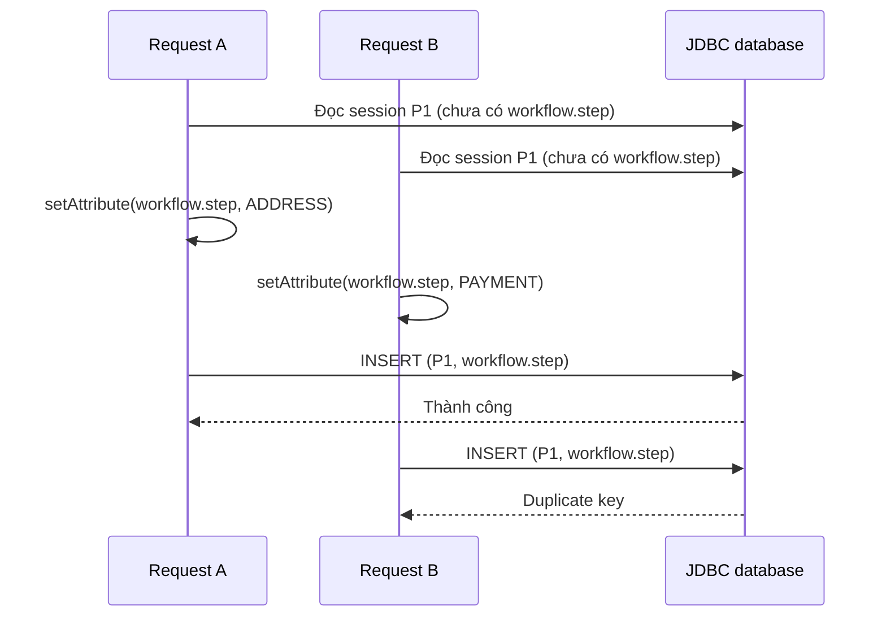

# Tranh chấp thêm thuộc tính, duplicate key và truy vấn cập nhật phù hợp

Spring Session JDBC lưu mỗi session trong bảng session và lưu các thuộc tính của session trong bảng thuộc tính riêng. Khi hai request cùng sử dụng một session, chúng có thể cùng đọc trạng thái ban đầu rồi cùng thêm hoặc sửa một thuộc tính. Nếu cả hai cùng cho rằng một thuộc tính chưa tồn tại, hai thao tác `INSERT` có thể tranh chấp trên khóa chính của bảng thuộc tính và một thao tác gặp lỗi duplicate key. Nếu cả hai cùng cập nhật một thuộc tính đã có, kết quả có thể phụ thuộc thứ tự commit và gây mất cập nhật.

Đây là vấn đề quan trọng khi ứng dụng Spring chạy nhiều instance và dùng một database chung làm session store. JDBC repository giúp chia sẻ session giữa các máy chủ, nhưng việc lưu session không tự biến mọi chuỗi đọc–sửa–ghi thành một giao dịch nghiệp vụ có khóa độc quyền. Cần hiểu khóa duy nhất của schema, phân biệt xung đột insert với update, chọn truy vấn phù hợp với database và xác định dữ liệu nào có thể chấp nhận chính sách last-write-wins.

## 1. Cấu trúc lưu thuộc tính của Spring Session JDBC

Schema JDBC tiêu chuẩn tách thông tin phiên và thuộc tính phiên thành hai bảng chính:

- `SPRING_SESSION` lưu định danh nội bộ, session ID, thời điểm tạo, thời điểm truy cập gần nhất, thời gian không hoạt động tối đa, thời điểm hết hạn và principal name nếu được lập chỉ mục.
- `SPRING_SESSION_ATTRIBUTES` lưu các thuộc tính theo từng dòng, gồm khóa tham chiếu tới session, tên thuộc tính và dữ liệu đã serialize.

Một cấu trúc khái quát:

```sql
CREATE TABLE SPRING_SESSION (
    PRIMARY_ID CHAR(36) NOT NULL,
    SESSION_ID CHAR(36) NOT NULL,
    CREATION_TIME BIGINT NOT NULL,
    LAST_ACCESS_TIME BIGINT NOT NULL,
    MAX_INACTIVE_INTERVAL INT NOT NULL,
    EXPIRY_TIME BIGINT NOT NULL,
    PRINCIPAL_NAME VARCHAR(100),
    CONSTRAINT SPRING_SESSION_PK PRIMARY KEY (PRIMARY_ID),
    CONSTRAINT SPRING_SESSION_IX1 UNIQUE (SESSION_ID)
);

CREATE TABLE SPRING_SESSION_ATTRIBUTES (
    SESSION_PRIMARY_ID CHAR(36) NOT NULL,
    ATTRIBUTE_NAME VARCHAR(200) NOT NULL,
    ATTRIBUTE_BYTES BLOB NOT NULL,
    CONSTRAINT SPRING_SESSION_ATTRIBUTES_PK
        PRIMARY KEY (SESSION_PRIMARY_ID, ATTRIBUTE_NAME),
    CONSTRAINT SPRING_SESSION_ATTRIBUTES_FK
        FOREIGN KEY (SESSION_PRIMARY_ID)
        REFERENCES SPRING_SESSION (PRIMARY_ID)
);
```

Đây là DDL minh họa theo dạng phổ biến; kiểu cột nhị phân, độ dài chuỗi, tên constraint và cú pháp có thể khác theo database và phiên bản Spring Session. Hãy dùng schema script đúng dialect đi kèm phiên bản thư viện trước khi tùy chỉnh.

Khóa chính ghép `(SESSION_PRIMARY_ID, ATTRIBUTE_NAME)` bảo đảm một session chỉ có một dòng cho mỗi tên thuộc tính. Đây là điều kiện quan trọng giúp repository tìm, cập nhật và xóa thuộc tính một cách xác định.

Ví dụ session `PRIMARY_ID = P1` có ba thuộc tính:

| SESSION_PRIMARY_ID | ATTRIBUTE_NAME | Ý nghĩa |
|---|---|---|
| P1 | `app.user.context` | Ngữ cảnh người dùng |
| P1 | `app.ui.locale` | Ngôn ngữ giao diện |
| P1 | `app.cart.id` | Mã giỏ hàng |

Nếu một request thêm `app.checkout.draft`, repository cần tạo một dòng mới. Nếu một request khác cùng thêm tên thuộc tính đó trước khi request đầu hoàn tất, cả hai có thể cùng phát lệnh insert cho khóa ghép giống nhau.

## 2. Duplicate key khi hai request cùng thêm thuộc tính

Giả sử session `P1` chưa có thuộc tính `app.workflow.step`. Hai request A và B cùng nhận cookie session ID, được chuyển tới hai thread hoặc hai instance Spring:

1. A đọc session và thấy `app.workflow.step` chưa tồn tại.
2. B cũng đọc session và thấy thuộc tính chưa tồn tại.
3. A gọi `setAttribute("app.workflow.step", "ADDRESS")`.
4. B gọi `setAttribute("app.workflow.step", "PAYMENT")`.
5. Khi lưu, cả A và B có thể chọn đường insert vì snapshot của mỗi request đều xem thuộc tính là mới.
6. Một transaction insert thành công; transaction còn lại đụng khóa chính `(P1, app.workflow.step)` và nhận duplicate key.



Duplicate key ở đây không nhất thiết có nghĩa schema sai. Nó có thể là kết quả hợp lệ của hai request cạnh tranh trên cùng một thuộc tính mới. Tuy nhiên, không nên mặc định mọi lỗi duplicate key đều có thể bỏ qua: lỗi có thể xuất phát từ việc insert trùng session row, ID bị tái sử dụng, dữ liệu migration hoặc constraint khác.

## 3. Phân biệt xung đột trên session row và attribute row

Hai bảng có các khóa duy nhất khác nhau, nên cần đọc đúng constraint trong exception:

| Vị trí xung đột | Khóa thường gặp | Nguyên nhân cần kiểm tra |
|---|---|---|
| `SPRING_SESSION` primary key | `PRIMARY_ID` | Hai lần tạo cùng bản ghi nội bộ, retry insert không idempotent hoặc ID bị dùng lại |
| `SPRING_SESSION` unique session ID | `SESSION_ID` | Session ID trùng, luồng tạo session bị lặp hoặc dữ liệu được khôi phục/import không nhất quán |
| `SPRING_SESSION_ATTRIBUTES` primary key | `(SESSION_PRIMARY_ID, ATTRIBUTE_NAME)` | Hai request cùng insert một tên thuộc tính cho cùng session |
| Foreign key attribute → session | `SESSION_PRIMARY_ID` | Attribute insert xảy ra khi session cha không còn hoặc chưa được tạo thành công |

Đừng bắt mọi `DuplicateKeyException` rồi coi là thành công. Trước khi xử lý, xác định bảng, constraint, session ID liên quan (dùng mã tương quan an toàn thay vì ghi cookie) và thao tác SQL gây lỗi. Duplicate ở bảng attribute có thể được giải quyết bằng upsert theo chính sách rõ ràng; duplicate ở bảng session có thể cần kiểm tra luồng tạo và ID.

## 4. Cập nhật thuộc tính đã tồn tại cũng có thể mất dữ liệu

Duplicate key thường nổi bật khi hai request cùng thêm một thuộc tính mới. Với thuộc tính đã tồn tại, hai request có thể cùng đọc giá trị cũ rồi ghi giá trị mới. Ví dụ:

1. A và B cùng đọc `app.cart.count = 1`.
2. A tính giá trị mới là `2`.
3. B cũng tính giá trị mới là `2`.
4. A cập nhật dòng thuộc tính thành `2`.
5. B cập nhật dòng đó thành `2`.

Nếu nghiệp vụ mong hai thao tác tăng tạo ra `3`, kết quả `2` là lost update. Câu lệnh `UPDATE` thành công ở cả hai request nhưng một thao tác logic đã bị mất.

Một trường hợp khác là A xóa thuộc tính trong khi B cập nhật snapshot cũ. Nếu B lưu sau A, thuộc tính có thể được tạo lại hoặc ghi đè trở lại. Nếu A lưu sau B, giá trị B vừa cập nhật có thể biến mất. `SaveMode` và `FlushMode` quyết định thuộc tính nào và khi nào được lưu; chúng không cung cấp khóa độc quyền cho toàn bộ chuỗi đọc–sửa–ghi.

Với dữ liệu có thể chấp nhận cập nhật cuối cùng thắng, cần ghi rõ chính sách đó. Với số lượng giỏ hàng, hạn mức, trạng thái thanh toán hoặc quyền truy cập, hãy đưa phép cập nhật vào bảng nghiệp vụ và dùng transaction, optimistic locking hoặc câu lệnh nguyên tử.

## 5. Truy vấn insert, update và delete thuộc tính

Repository JDBC cần thực hiện các thao tác cơ bản trên bảng thuộc tính. Dạng SQL khái quát:

```sql
-- Thêm thuộc tính mới
INSERT INTO SPRING_SESSION_ATTRIBUTES
    (SESSION_PRIMARY_ID, ATTRIBUTE_NAME, ATTRIBUTE_BYTES)
VALUES (?, ?, ?);

-- Cập nhật thuộc tính đã tồn tại
UPDATE SPRING_SESSION_ATTRIBUTES
SET ATTRIBUTE_BYTES = ?
WHERE SESSION_PRIMARY_ID = ?
  AND ATTRIBUTE_NAME = ?;

-- Xóa một thuộc tính
DELETE FROM SPRING_SESSION_ATTRIBUTES
WHERE SESSION_PRIMARY_ID = ?
  AND ATTRIBUTE_NAME = ?;
```

Các câu lệnh trên mô tả ý nghĩa, không phải bản sao đảm bảo đúng thứ tự tham số của mọi phiên bản repository. Khi thay câu SQL mà Spring Session sử dụng, phải giữ nguyên hợp đồng tham số, kiểu dữ liệu, tên bảng/cột và số hàng bị tác động mà implementation mong đợi.

Với thuộc tính mới, insert tạo dòng theo khóa ghép. Với thuộc tính đã tồn tại, update thay byte đã serialize. Với xóa, delete loại bỏ dòng thuộc tính. Foreign key và cascade behavior phụ thuộc schema; repository cũng cần xóa các thuộc tính khi session cha bị xóa hoặc hết hạn.

## 6. Khi nào nên dùng UPSERT?

UPSERT kết hợp insert và update trong một câu lệnh logic: nếu khóa chưa tồn tại thì thêm dòng; nếu đã tồn tại thì cập nhật. Nó hữu ích khi hai request cùng cố thêm một thuộc tính và ứng dụng muốn quy định rõ giá trị nào được giữ.

Ví dụ chính sách **last writer wins**: nếu dòng chưa tồn tại thì insert; nếu đã tồn tại thì thay `ATTRIBUTE_BYTES` bằng giá trị của câu lệnh đang chạy. Khi request thứ hai gặp cùng khóa, nó không nhận duplicate key mà thực hiện nhánh update.

UPSERT giải quyết xung đột insert ở cấp một dòng. Nó không giải quyết lost update ở cấp nghiệp vụ nếu cả hai request đều tính giá trị từ cùng snapshot cũ. Nếu A và B cùng tính `count=2`, UPSERT vẫn có thể ghi `2` hai lần. Muốn tăng bộ đếm đúng, cần phép toán nguyên tử trên dữ liệu nghiệp vụ hoặc khóa/version phù hợp.

## 7. Cú pháp UPSERT theo từng database

Không có một cú pháp UPSERT duy nhất dùng được trên mọi database. Truy vấn tùy chỉnh phải theo dialect thực tế.

### 7.1. PostgreSQL: ON CONFLICT

PostgreSQL hỗ trợ `ON CONFLICT` với constraint hoặc danh sách cột xung đột:

```sql
INSERT INTO SPRING_SESSION_ATTRIBUTES
    (SESSION_PRIMARY_ID, ATTRIBUTE_NAME, ATTRIBUTE_BYTES)
VALUES (?, ?, ?)
ON CONFLICT (SESSION_PRIMARY_ID, ATTRIBUTE_NAME)
DO UPDATE SET ATTRIBUTE_BYTES = EXCLUDED.ATTRIBUTE_BYTES;
```

`EXCLUDED.ATTRIBUTE_BYTES` là giá trị mà câu insert định ghi. Khi khóa ghép đã tồn tại, câu lệnh cập nhật dòng hiện có. Cú pháp này nhắm đúng xung đột trên cặp khóa thuộc tính; vẫn cần bảo đảm foreign key session cha tồn tại và xử lý lỗi constraint khác.

Nếu muốn chính sách **không ghi đè giá trị đã có**, có thể dùng `DO NOTHING`, nhưng khi đó request thứ hai không áp dụng giá trị mới. Chỉ chọn cách này khi semantics nghiệp vụ thực sự là “first writer wins” hoặc thuộc tính chỉ được khởi tạo một lần.

### 7.2. MySQL và MariaDB: ON DUPLICATE KEY UPDATE

MySQL/MariaDB hỗ trợ `ON DUPLICATE KEY UPDATE`:

```sql
INSERT INTO SPRING_SESSION_ATTRIBUTES
    (SESSION_PRIMARY_ID, ATTRIBUTE_NAME, ATTRIBUTE_BYTES)
VALUES (?, ?, ?)
ON DUPLICATE KEY UPDATE
    ATTRIBUTE_BYTES = VALUES(ATTRIBUTE_BYTES);
```

Trong các phiên bản MySQL mới, hàm `VALUES(column)` trong nhánh update đã bị đánh dấu deprecated; cú pháp alias của hàng insert có thể được dùng theo phiên bản. MariaDB có khác biệt riêng về hỗ trợ cú pháp. Hãy kiểm tra phiên bản server và viết câu lệnh theo đúng dialect.

`ON DUPLICATE KEY UPDATE` được kích hoạt bởi bất kỳ unique key nào có xung đột. Với bảng thuộc tính chuẩn, khóa chính ghép là xung đột dự kiến. Nếu bảng có thêm unique constraint, cần xác minh câu lệnh không vô tình cập nhật một dòng khác khi constraint không mong muốn bị trùng.

### 7.3. Oracle: MERGE

Oracle hỗ trợ `MERGE` để cập nhật dòng khớp hoặc insert khi chưa có:

```sql
MERGE INTO SPRING_SESSION_ATTRIBUTES target
USING (
    SELECT ? AS SESSION_PRIMARY_ID,
           ? AS ATTRIBUTE_NAME,
           ? AS ATTRIBUTE_BYTES
    FROM dual
) source
ON (
    target.SESSION_PRIMARY_ID = source.SESSION_PRIMARY_ID
    AND target.ATTRIBUTE_NAME = source.ATTRIBUTE_NAME
)
WHEN MATCHED THEN
    UPDATE SET target.ATTRIBUTE_BYTES = source.ATTRIBUTE_BYTES
WHEN NOT MATCHED THEN
    INSERT (SESSION_PRIMARY_ID, ATTRIBUTE_NAME, ATTRIBUTE_BYTES)
    VALUES (source.SESSION_PRIMARY_ID,
            source.ATTRIBUTE_NAME,
            source.ATTRIBUTE_BYTES);
```

`MERGE` giúp diễn đạt upsert trong một statement, nhưng hành vi khi nhiều transaction đồng thời chạm cùng khóa vẫn cần được kiểm tra theo isolation level và phiên bản Oracle. Không giả định `MERGE` luôn miễn nhiễm duplicate key hoặc deadlock.

### 7.4. SQL Server: UPDATE/INSERT có khóa hoặc retry

SQL Server hỗ trợ `MERGE`, nhưng trong nhiều hệ thống người vận hành chọn mẫu update-then-insert có transaction và locking rõ ràng để kiểm soát race. Ví dụ minh họa:

```sql
BEGIN TRANSACTION;

UPDATE SPRING_SESSION_ATTRIBUTES WITH (UPDLOCK, SERIALIZABLE)
SET ATTRIBUTE_BYTES = @attributeBytes
WHERE SESSION_PRIMARY_ID = @sessionPrimaryId
  AND ATTRIBUTE_NAME = @attributeName;

IF @@ROWCOUNT = 0
BEGIN
    INSERT INTO SPRING_SESSION_ATTRIBUTES
        (SESSION_PRIMARY_ID, ATTRIBUTE_NAME, ATTRIBUTE_BYTES)
    VALUES (@sessionPrimaryId, @attributeName, @attributeBytes);
END;

COMMIT TRANSACTION;
```

Đây là mẫu SQL minh họa, cần đánh giá index, isolation, deadlock và cách Spring Session bind tham số trước khi dùng làm custom query. Có thể cần xử lý retry khi gặp deadlock hoặc duplicate race tùy cấu hình và workload.

## 8. Chọn chính sách khi hai request thêm cùng thuộc tính

Trước khi thay SQL insert bằng UPSERT, xác định kết quả mong muốn:

| Chính sách | Cách xử lý khi khóa đã tồn tại | Khi phù hợp |
|---|---|---|
| First writer wins | Bỏ qua giá trị insert sau (`DO NOTHING` hoặc tương đương) | Thuộc tính khởi tạo một lần, giá trị đầu tiên là chuẩn |
| Last writer wins | Update bằng payload của request ghi sau | Thuộc tính giao diện hoặc trạng thái tạm chấp nhận ghi đè |
| Reject conflict | Trả lỗi xung đột để caller đọc lại và quyết định | Cần phát hiện request cạnh tranh thay vì âm thầm ghi đè |
| Optimistic concurrency | So sánh version rồi update khi version còn đúng | Dữ liệu cần phát hiện cập nhật dựa trên snapshot cũ |
| Atomic business operation | Dùng câu lệnh nghiệp vụ như `count = count + ?` trong transaction | Bộ đếm, hạn mức hoặc số lượng không được mất cập nhật |

Không có chính sách nào đúng cho mọi thuộc tính. Với `app.ui.locale`, last writer wins có thể hợp lý. Với `app.checkout.payment-status`, ghi đè tùy thứ tự request có thể gây trạng thái sai; dữ liệu này cần được quản lý ở kho nghiệp vụ có quy tắc chuyển trạng thái rõ ràng.

## 9. Tùy chỉnh SQL của JdbcIndexedSessionRepository

Spring Session JDBC cung cấp `JdbcIndexedSessionRepository` và các extension point để tùy chỉnh schema hoặc câu SQL theo database. Trong Spring Boot, có thể dùng `SessionRepositoryCustomizer<JdbcIndexedSessionRepository>` để điều chỉnh repository sau khi được cấu hình. Một ví dụ phổ biến là đổi table name hoặc các truy vấn mà repository sử dụng.

```java
import org.springframework.context.annotation.Bean;
import org.springframework.context.annotation.Configuration;
import org.springframework.session.jdbc.JdbcIndexedSessionRepository;
import org.springframework.session.config.SessionRepositoryCustomizer;

@Configuration
public class JdbcSessionRepositoryConfiguration {

    @Bean
    SessionRepositoryCustomizer<JdbcIndexedSessionRepository>
            jdbcSessionRepositoryCustomizer() {
        return repository -> {
            repository.setTableName("APP_SESSION");
            // Có thể tùy chỉnh các query được phiên bản repository hỗ trợ.
        };
    }
}
```

Ví dụ trên minh họa điểm mở rộng; package, setter và khả năng thay từng câu SQL phụ thuộc phiên bản Spring Session JDBC. Trước khi triển khai, kiểm tra API đúng phiên bản và mã nguồn/schema script đi kèm dependency. Không giả định mọi phiên bản đều cho phép thay một query attribute độc lập.

Khi tùy chỉnh câu insert/update/delete thuộc tính, cần bảo đảm:

- Giữ đúng ý nghĩa các cột và thứ tự bind parameter mà repository yêu cầu.
- Dùng tên bảng và schema đồng nhất với cấu hình table prefix/table name.
- Không bỏ qua foreign key hoặc constraint cần thiết.
- Trả về row count phù hợp với logic repository nếu implementation dựa vào số hàng cập nhật.
- Bảo đảm update không vô tình cập nhật nhiều dòng.
- Giữ thao tác xóa session, xóa thuộc tính và cleanup hết hạn tương thích với schema mới.
- Kiểm thử cả trường hợp insert mới, update cũ, delete, session không tồn tại và xung đột đồng thời.

Nếu custom upsert chỉ thay câu insert attribute nhưng repository còn dùng một câu update khác khi thuộc tính đã tồn tại, cần xác minh cả hai đường đi. Nếu custom SQL thay đổi số hàng bị tác động hoặc không báo lỗi theo cách repository mong đợi, trạng thái trong bộ nhớ có thể khác trạng thái trong database.

## 10. Retry duplicate key đúng cách

Một cách khác để xử lý insert cạnh tranh là bắt duplicate key rồi thử update. Đây là mô hình insert-first, update-on-conflict:

1. Thử insert thuộc tính.
2. Nếu thành công, hoàn tất.
3. Nếu database báo đúng constraint khóa thuộc tính đã tồn tại, thực hiện update dòng đó.
4. Nếu update không tìm thấy dòng hoặc lỗi thuộc constraint khác, truyền lỗi lên để xử lý.

Không nên bắt `DataIntegrityViolationException` chung chung rồi chạy update mà không xác định constraint. Lỗi có thể là foreign key vi phạm, dữ liệu quá dài, cột không null bị thiếu hoặc lỗi unique ở bảng session. Chỉ retry khi lỗi được phân loại là duplicate của đúng khóa thuộc tính.

Retry phải nằm trong ranh giới transaction phù hợp. Một số database đánh dấu transaction hiện tại là failed sau lỗi constraint; PostgreSQL chẳng hạn yêu cầu rollback tới savepoint hoặc kết thúc transaction trước khi chạy statement tiếp theo. Vì vậy, không phải lúc nào cũng có thể bắt exception rồi tiếp tục update trong cùng transaction. Cần dùng upsert native hoặc cơ chế retry transaction mới theo đặc tính database.

Nếu retry toàn bộ thao tác save, cần xem thao tác có idempotent hay không. Không lặp vô hạn; dùng số lần retry giới hạn, backoff phù hợp và metrics để phát hiện contention tăng cao.

## 11. Transaction isolation và khóa

Isolation level quyết định các transaction nhìn thấy thay đổi của nhau như thế nào. Với session attribute, vấn đề thường là cả hai request cùng đọc snapshot cũ rồi cùng ghi. `READ COMMITTED` không tự ngăn lost update; `REPEATABLE READ` hoặc `SERIALIZABLE` cũng không nên được chọn chỉ dựa trên tên mức cô lập mà không kiểm thử database thực tế.

Một số lựa chọn:

- **Unique constraint:** bắt buộc để ngăn hai dòng cùng session và attribute name. Đây là lớp bảo vệ cuối cùng cho tính duy nhất.
- **UPSERT:** xử lý insert/update tại một khóa theo semantics của database.
- **Row-level lock:** khóa dòng session hoặc attribute trong transaction khi cần tuần tự hóa thao tác. Khóa có thể làm tăng thời gian chờ và deadlock.
- **Optimistic locking:** thêm version và cập nhật với điều kiện version cũ còn đúng. Cần schema/repository tùy chỉnh; không phải tính năng tự động của mọi session attribute.
- **Serializable transaction:** có thể phát hiện hoặc ngăn một số anomaly nhưng tăng khả năng serialization failure và retry.
- **Atomic business SQL:** thực hiện phép toán trong database thay vì đọc giá trị cũ về ứng dụng rồi ghi lại.

Không nên khóa toàn bộ session trong thời gian dài để bảo vệ một thuộc tính nhỏ. Nếu cần nhất quán mạnh cho dữ liệu nghiệp vụ, đặt transaction và khóa ở bảng nghiệp vụ thay vì biến session thành kho giao dịch.

## 12. Kiểm tra row count và trạng thái thực tế

Khi tùy chỉnh câu SQL, row count có thể có ý nghĩa. Ví dụ update một thuộc tính dự kiến phải tác động một dòng. Nếu update trả về 0, có thể thuộc tính chưa tồn tại, session đã bị xóa hoặc điều kiện WHERE không khớp. Nếu tác động nhiều hơn một dòng, constraint hoặc điều kiện truy vấn có vấn đề.

Đối với một upsert, database driver có thể báo row count khác nhau tùy nhánh insert/update và cấu hình JDBC. Không giả định mọi dialect đều trả cùng con số. Hãy đọc cách repository dùng kết quả `update()` và viết integration test theo driver thực tế.

Sau khi xảy ra duplicate key hoặc retry, cần xác minh trạng thái cuối bằng truy vấn repository hoặc đọc lại session trong transaction/request mới. Không chỉ dựa vào việc không còn exception để kết luận dữ liệu đúng.

## 13. Tương tác với SaveMode và FlushMode

`SaveMode` quyết định thuộc tính nào được lưu, còn `FlushMode` quyết định thời điểm repository ghi session. Với JDBC, các chính sách này ảnh hưởng thời điểm và số lượng câu SQL phát sinh, nhưng không thay thế khóa database hoặc optimistic concurrency.

- `ON_SET_ATTRIBUTE` phù hợp khi ứng dụng dùng `setAttribute` và `removeAttribute` tường minh. Nếu hai request cùng thêm thuộc tính mới, repository vẫn có thể phát hai insert cạnh tranh.
- `ON_GET_ATTRIBUTE` có thể khiến nhiều thuộc tính được đưa vào tập lưu sau khi đọc, tăng số update/insert trong request có truy cập session.
- `ALWAYS` có thể ghi nhiều thuộc tính hơn và làm tăng contention trên bảng attribute.
- `ON_SAVE` gom thay đổi tới thời điểm save theo vòng đời request.
- `IMMEDIATE` có thể đẩy thao tác ghi sớm hơn, nhưng không biến các lần ghi thành một thao tác nguyên tử.

Nếu đang điều tra duplicate key, hãy ghi nhận SaveMode, FlushMode, số request đồng thời và SQL thực tế. Thay đổi mode có thể làm lỗi ít xuất hiện hơn hoặc xuất hiện ở thời điểm khác, nhưng phải xử lý nguyên nhân cạnh tranh ở repository/database.

## 14. Kiểm thử tranh chấp thuộc tính

Kiểm thử đơn luồng không phát hiện được race condition. Cần dùng database thật hoặc container của đúng engine và chạy các request đồng thời cùng một session ID.

| Trường hợp | Cách kiểm thử | Điều cần xác minh |
|---|---|---|
| Insert thuộc tính mới | Hai transaction cùng thêm một tên thuộc tính | Duplicate được xử lý theo chính sách đã chọn |
| Insert khác tên | Hai request thêm hai thuộc tính khác nhau | Cả hai thuộc tính được lưu, không mất dữ liệu không liên quan |
| Update cùng thuộc tính | Hai request ghi giá trị khác nhau | Chính sách last-writer, conflict hoặc versioning rõ ràng |
| Delete và update | Một request xóa, request khác cập nhật | Kết quả phù hợp chính sách, không có trạng thái bất ngờ |
| Duplicate ở session row | Tạo/retry session với ID trùng trong test | Lỗi được phân loại khác duplicate attribute |
| Foreign key conflict | Xóa session cha trong lúc insert attribute | Transaction thất bại có kiểm soát; không để orphan row |
| Upsert native | Chạy trên đúng dialect và JDBC driver | Insert và update hoạt động đúng; row count được hiểu đúng |
| Retry duplicate | Mô phỏng constraint cụ thể | Chỉ lỗi đúng constraint được retry; transaction phục hồi đúng |
| SaveMode khác nhau | Chạy test với ON_SET_ATTRIBUTE và ALWAYS | SQL phát sinh và kết quả được xác minh |
| Nhiều instance | Hai app context cùng database và session cookie | Hành vi nhất quán xuyên instance |
| Deadlock/serialization failure | Tạo contention có kiểm soát | Retry giới hạn, không nhân đôi side effect |

Dùng barrier/latch trong test để đồng bộ hai request ngay sau khi cả hai đọc cùng snapshot, rồi cho chúng ghi đồng thời. Điều này giúp tái hiện race ổn định hơn so với việc gửi hai HTTP request ngẫu nhiên.

Không chỉ kiểm tra response status. Sau khi cả hai request hoàn tất, đọc lại session bằng repository ở một transaction mới và xác minh từng thuộc tính, index principal, thời hạn và trạng thái session cha.

## 15. Chẩn đoán lỗi trong production

Khi xuất hiện duplicate key hoặc mất thuộc tính, thu thập bằng chứng trước khi đổi SQL:

1. Xác định database engine/version, JDBC driver và phiên bản Spring Session JDBC.
2. Xác định constraint và bảng phát sinh lỗi từ SQLState, vendor error code và exception chain.
3. Kiểm tra lỗi xảy ra ở insert session, insert attribute, update attribute hay delete.
4. Ghi nhận request correlation ID, instance, thời điểm, SaveMode và FlushMode; tránh ghi session ID/cookie đầy đủ.
5. Kiểm tra số request đồng thời trên cùng session và các lần retry.
6. Đọc lại session qua repository để xác định trạng thái cuối.
7. Đối chiếu row count và SQL query tùy chỉnh với schema thực tế.
8. Nếu cần, bật SQL logging có kiểm soát trong môi trường staging; không log `ATTRIBUTE_BYTES` hoặc dữ liệu session nhạy cảm ở production.

Duplicate key tăng đột biến có thể cho thấy một endpoint tạo cùng thuộc tính trong nhiều request, một retry không idempotent hoặc một thay đổi SQL đã làm sai nhánh insert/update. Lost update thường khó thấy hơn vì SQL vẫn thành công; cần metrics nghiệp vụ và test concurrency để phát hiện.

## 16. Lỗi thường gặp và cách khắc phục

| Triệu chứng | Nguyên nhân có thể | Cách xử lý |
|---|---|---|
| `DuplicateKeyException` trên attribute PK | Hai request cùng insert cùng tên thuộc tính | Dùng upsert theo dialect hoặc retry có phân loại constraint |
| Duplicate key trên `SESSION_ID` | Luồng tạo session lặp hoặc ID bị trùng | Điều tra tạo session, retry và dữ liệu import; không xử lý như attribute conflict |
| Thuộc tính mất dù không có lỗi SQL | Lost update do hai request cùng ghi snapshot cũ | Dùng versioning hoặc chuyển phép cập nhật sang bảng nghiệp vụ |
| Thuộc tính bị tạo lại sau khi xóa | Request cũ lưu snapshot sau thao tác delete | Xác định chính sách delete/update và đồng bộ bằng version/transaction phù hợp |
| Upsert không chạy trên database khác | Dùng cú pháp riêng dialect | Cung cấp query theo engine và kiểm thử đúng driver |
| Retry tiếp tục thất bại trong cùng transaction | Database đã đánh dấu transaction rollback-only/failed | Dùng upsert native, savepoint hoặc retry transaction mới theo engine |
| Custom query cập nhật 0 dòng | WHERE sai, session/attribute không tồn tại hoặc bind sai thứ tự | Kiểm tra placeholder, kiểu tham số và hợp đồng row count |
| Update nhiều dòng | Điều kiện WHERE thiếu session ID hoặc attribute name | Ràng buộc đủ khóa ghép và giữ unique constraint |
| `ALWAYS` làm database tải cao | Ghi lại toàn bộ session attributes quá thường xuyên | Chọn SaveMode phù hợp và giảm kích thước session |
| Test không tái hiện race | Test tuần tự hoặc dùng mock repository | Dùng database thật và đồng bộ request bằng barrier/latch |

## 17. Quy trình chọn truy vấn và chính sách cập nhật

Khi tùy chỉnh Spring Session JDBC để xử lý tranh chấp thuộc tính, thực hiện theo thứ tự:

1. Xác nhận schema thực tế và khóa duy nhất trên `SPRING_SESSION` cùng `SPRING_SESSION_ATTRIBUTES`.
2. Xác định xung đột nằm ở insert session, insert attribute, update hay delete.
3. Xác định semantics cho thuộc tính: first writer wins, last writer wins, reject conflict hay optimistic concurrency.
4. Giữ unique constraint làm hàng rào bảo vệ; không bỏ constraint chỉ để tránh duplicate key.
5. Chọn truy vấn phù hợp dialect: `ON CONFLICT`, `ON DUPLICATE KEY UPDATE`, `MERGE` hoặc update/insert có locking.
6. Khi custom SQL, giữ đúng placeholder, bind order, table/column mapping và row-count contract của repository.
7. Không bắt mọi `DuplicateKeyException`; chỉ retry lỗi đúng constraint và tôn trọng trạng thái transaction của database.
8. Dùng transaction/versioning hoặc atomic SQL cho dữ liệu nghiệp vụ cần tránh lost update.
9. Kiểm thử hai request đồng thời trên đúng database engine, sau đó đọc lại session qua repository.
10. Theo dõi duplicate, deadlock, retry, latency và lỗi custom query sau triển khai.

Duplicate key trên bảng thuộc tính thường là dấu hiệu hai request cùng tạo một khóa `(session, attribute name)`. UPSERT có thể giải quyết insert cạnh tranh theo chính sách ghi đã chọn, nhưng không tự giải quyết mọi lost update. Câu SQL tùy chỉnh phải giữ đúng hợp đồng của `JdbcIndexedSessionRepository`, đúng dialect và đúng ranh giới transaction. Khi tách bạch xung đột insert, update và delete, ứng dụng Spring Session có thể lưu session qua nhiều instance ổn định hơn mà không làm yếu tính toàn vẹn của database.
