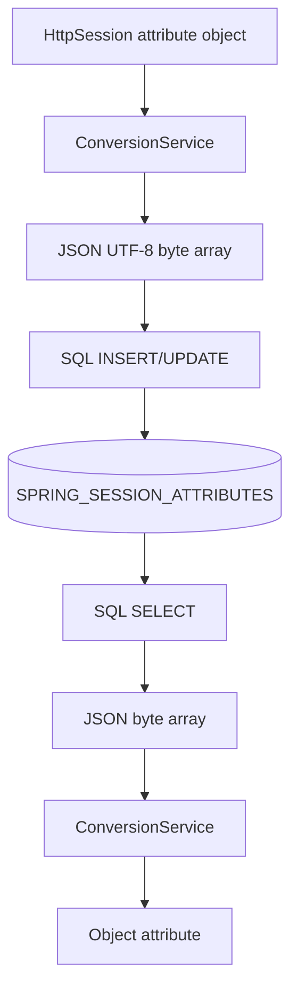

# Lưu thuộc tính dưới dạng JSON bằng conversion service và SQL tương ứng

Spring Session JDBC lưu mỗi session attribute dưới dạng dữ liệu nhị phân trong bảng `SPRING_SESSION_ATTRIBUTES`. Mặc định, dữ liệu attribute được tuần tự hóa bằng cơ chế Java serialization. Khi hệ thống cần dữ liệu dễ quan sát hơn, tương thích với nhiều ngôn ngữ hoặc kiểm soát schema rõ ràng, có thể thay cơ chế này bằng JSON thông qua `ConversionService`.

Việc chuyển sang JSON liên quan đến cả hai chiều chuyển đổi: object thành byte để ghi xuống database và byte thành object khi khôi phục session. Đồng thời, kiểu cột và câu SQL phải tương thích với dữ liệu mà repository bind vào JDBC. Cách triển khai an toàn thường là lưu JSON UTF-8 trong cột nhị phân hiện có; nếu muốn dùng kiểu JSON native của database, cần xử lý thêm khác biệt về JDBC binding và kiểu kết quả.

## 1. Vị trí của ConversionService trong luồng JDBC

`JdbcIndexedSessionRepository` sử dụng `ConversionService` để chuyển đổi session attributes khi ghi và đọc. Luồng lưu một attribute có thể mô tả như sau:

1. Ứng dụng gọi `HttpSession.setAttribute(name, value)`.
2. `SessionRepositoryFilter` ghi nhận thay đổi và chuyển session tới JDBC repository theo chính sách flush/save.
3. Repository yêu cầu `ConversionService` chuyển `value` thành `byte[]`.
4. JDBC ghi byte array vào cột `ATTRIBUTE_BYTES`.
5. Khi khôi phục session, repository đọc byte array từ database.
6. `ConversionService` chuyển byte array thành object attribute để ứng dụng sử dụng.



`ConversionService` là ranh giới chuyển đổi kiểu dữ liệu; repository vẫn quản lý vòng đời session, câu truy vấn và transaction của nó. Chỉ thay serializer không tự động thay đổi cách repository tìm session, tính timeout hoặc lập chỉ mục principal.

## 2. Schema JDBC mặc định lưu attributes dưới dạng byte

Spring Session JDBC thường dùng hai bảng:

- `SPRING_SESSION`: metadata của session, gồm ID, thời điểm tạo, lần truy cập gần nhất, thời hạn và principal name.
- `SPRING_SESSION_ATTRIBUTES`: một hàng cho mỗi attribute, gồm session primary ID, tên attribute và dữ liệu đã serialize.

Schema PostgreSQL minh họa:

```sql
CREATE TABLE SPRING_SESSION (
    PRIMARY_ID CHAR(36) NOT NULL,
    SESSION_ID CHAR(36) NOT NULL,
    CREATION_TIME BIGINT NOT NULL,
    LAST_ACCESS_TIME BIGINT NOT NULL,
    MAX_INACTIVE_INTERVAL INTEGER NOT NULL,
    EXPIRY_TIME BIGINT NOT NULL,
    PRINCIPAL_NAME VARCHAR(100),
    CONSTRAINT SPRING_SESSION_PK PRIMARY KEY (PRIMARY_ID)
);

CREATE UNIQUE INDEX SPRING_SESSION_IX1
    ON SPRING_SESSION (SESSION_ID);
CREATE INDEX SPRING_SESSION_IX2
    ON SPRING_SESSION (EXPIRY_TIME);
CREATE INDEX SPRING_SESSION_IX3
    ON SPRING_SESSION (PRINCIPAL_NAME);

CREATE TABLE SPRING_SESSION_ATTRIBUTES (
    SESSION_PRIMARY_ID CHAR(36) NOT NULL,
    ATTRIBUTE_NAME VARCHAR(200) NOT NULL,
    ATTRIBUTE_BYTES BYTEA NOT NULL,
    CONSTRAINT SPRING_SESSION_ATTRIBUTES_PK
        PRIMARY KEY (SESSION_PRIMARY_ID, ATTRIBUTE_NAME),
    CONSTRAINT SPRING_SESSION_ATTRIBUTES_FK
        FOREIGN KEY (SESSION_PRIMARY_ID)
        REFERENCES SPRING_SESSION (PRIMARY_ID)
        ON DELETE CASCADE
);
```

Đây là schema minh họa cho PostgreSQL; phải dùng script đúng với phiên bản Spring Session và database platform của dự án. Với MySQL có thể dùng `BLOB`, SQL Server có `VARBINARY(MAX)`, còn Oracle có kiểu LOB tương ứng. Không sao chép nguyên kiểu `BYTEA` sang hệ quản trị khác.

Điểm quan trọng là `ATTRIBUTE_BYTES` được thiết kế để lưu byte array. JSON cũng có thể được mã hóa thành byte UTF-8 và lưu trong cột này. Như vậy, repository vẫn bind `byte[]` theo cách mặc định và câu SQL insert/select attributes không cần đổi chỉ vì nội dung byte bây giờ là JSON.

## 3. Cấu hình ConversionService riêng cho Spring Session

Spring Session JDBC cho phép tùy chỉnh `ConversionService` dùng cho attributes. Trong cấu hình Spring Boot, có thể cung cấp bean `springSessionConversionService` theo quy ước của phiên bản đang sử dụng; nếu tự cấu hình `JdbcIndexedSessionRepository`, có thể đặt conversion service trực tiếp trên repository bằng API tương ứng.

Ví dụ cấu hình bean:

```java
@Configuration
class JdbcSessionSerializationConfiguration {

    @Bean("springSessionConversionService")
    ConversionService springSessionConversionService(ObjectMapper objectMapper) {
        GenericConversionService conversionService =
                new GenericConversionService();

        conversionService.addConverter(
                new SessionAttributeToJsonBytesConverter(objectMapper));
        conversionService.addConverter(
                new JsonBytesToSessionAttributeConverter(objectMapper));

        return conversionService;
    }
}
```

Các converter cần đáp ứng hai hướng chuyển đổi:

| Nguồn | Đích | Vai trò |
|---|---|---|
| Object attribute được cho phép | `byte[]` | Serialize thành JSON UTF-8 để ghi vào JDBC |
| `byte[]` đọc từ JDBC | Object attribute | Parse JSON và dựng lại kiểu dữ liệu được cho phép |

Tên bean, cách Spring Boot phát hiện bean và API customizer có thể thay đổi theo dòng Spring Boot/Spring Session. Nếu cấu hình thủ công, cần xác nhận repository thực tế nhận đúng `ConversionService`; không chỉ khai báo một bean bất kỳ rồi giả định nó đã được sử dụng.

## 4. Thiết kế JSON có type discriminator rõ ràng

Khi repository khôi phục attribute, nó cần biết object thuộc kiểu nào. Một cột `ATTRIBUTE_BYTES` chỉ chứa byte; JSON object thông thường không nhất thiết cho biết class Java tương ứng. Có thể dùng một envelope gồm mã kiểu logic và dữ liệu:

```json
{
  "type": "cart-snapshot-v1",
  "data": {
    "cartId": "CART-204",
    "itemCount": 3
  }
}
```

`type` là mã do ứng dụng định nghĩa, không phải tên class Java tùy ý. Khi đọc, converter ánh xạ mã này sang một tập DTO cho phép. Ví dụ:

```java
Map<String, Class<?>> allowedTypes = Map.of(
        "cart-snapshot-v1", CartSnapshot.class,
        "preferences-v1", UserPreferencesSnapshot.class
);
```

Cách này giúp định dạng lưu trữ ổn định hơn khi package hoặc tên class thay đổi. Nó cũng tránh việc payload tự chỉ định bất kỳ class nào để deserializer dựng lên.

Không bật Jackson default typing không giới hạn chỉ để giải quyết vấn đề thiếu thông tin kiểu. Polymorphic deserialization rộng có thể tạo ra rủi ro bảo mật nếu dữ liệu trong database bị sửa hoặc bị ghi từ nguồn không tin cậy. Hãy dùng allowlist type ID, kiểm tra schema và giới hạn kích thước payload.

## 5. Ví dụ converter Object thành JSON byte array

Converter ghi cần từ chối kiểu không được hỗ trợ thay vì âm thầm serialize mọi object:

```java
final class SessionAttributeToJsonBytesConverter
        implements Converter<Object, byte[]> {

    private final ObjectMapper mapper;
    private final Map<Class<?>, String> typeIds;

    SessionAttributeToJsonBytesConverter(ObjectMapper mapper) {
        this.mapper = mapper;
        this.typeIds = Map.of(
                CartSnapshot.class, "cart-snapshot-v1",
                UserPreferencesSnapshot.class, "preferences-v1"
        );
    }

    @Override
    public byte[] convert(Object source) {
        String typeId = this.typeIds.get(source.getClass());
        if (typeId == null) {
            throw new IllegalArgumentException(
                    "Unsupported session attribute type: "
                            + source.getClass().getName());
        }

        ObjectNode envelope = this.mapper.createObjectNode();
        envelope.put("type", typeId);
        envelope.set("data", this.mapper.valueToTree(source));

        try {
            return this.mapper.writeValueAsBytes(envelope);
        }
        catch (JsonProcessingException ex) {
            throw new IllegalArgumentException(
                    "Cannot serialize session attribute as JSON", ex);
        }
    }
}
```

`ObjectMapper.writeValueAsBytes` tạo byte array UTF-8. Ví dụ dùng exact class mapping để làm rõ allowlist; nếu cần hỗ trợ subclass, phải thiết kế ánh xạ có kiểm soát và tránh chấp nhận kiểu tùy ý. Những kiểu như `String`, `Integer` hoặc `Boolean` có thể được thêm vào danh sách với type ID riêng nếu ứng dụng thật sự lưu chúng.

Nếu ứng dụng lưu `List` hoặc `Map`, nên dùng DTO có kiểu phần tử xác định thay vì serialize collection không định kiểu. Type erasure của Java khiến việc khôi phục `List<Object>` một cách an toàn và chính xác khó hơn khôi phục một DTO cụ thể.

## 6. Ví dụ converter JSON byte array thành Object

Converter đọc cần kiểm tra envelope, type ID và cấu trúc dữ liệu trước khi trả object:

```java
final class JsonBytesToSessionAttributeConverter
        implements Converter<byte[], Object> {

    private final ObjectMapper mapper;
    private final Map<String, Class<?>> allowedTypes;

    JsonBytesToSessionAttributeConverter(ObjectMapper mapper) {
        this.mapper = mapper;
        this.allowedTypes = Map.of(
                "cart-snapshot-v1", CartSnapshot.class,
                "preferences-v1", UserPreferencesSnapshot.class
        );
    }

    @Override
    public Object convert(byte[] source) {
        try {
            JsonNode root = this.mapper.readTree(source);
            String typeId = root.path("type").asText(null);
            JsonNode data = root.get("data");

            Class<?> targetType = this.allowedTypes.get(typeId);
            if (targetType == null || data == null || data.isNull()) {
                throw new IllegalArgumentException(
                        "Unsupported or invalid session attribute payload");
            }

            return this.mapper.treeToValue(data, targetType);
        }
        catch (IOException ex) {
            throw new IllegalArgumentException(
                    "Cannot deserialize session attribute JSON", ex);
        }
    }
}
```

Đây là mẫu converter minh họa. Cần bổ sung giới hạn kích thước byte đầu vào, kiểm tra trường bắt buộc và validation nghiệp vụ phù hợp. Với dữ liệu hỏng hoặc type ID không được hỗ trợ, từ chối payload và xử lý session theo chính sách an toàn; không trả một object mặc định có thể khiến trạng thái xác thực bị chấp nhận sai.

## 7. SQL tương ứng khi JSON được lưu trong cột nhị phân

Với cách lưu JSON UTF-8 vào `ATTRIBUTE_BYTES`, câu lệnh SQL có thể giữ cấu trúc mặc định. Ví dụ PostgreSQL:

```sql
-- Lưu hoặc thay thế một attribute
INSERT INTO SPRING_SESSION_ATTRIBUTES
    (SESSION_PRIMARY_ID, ATTRIBUTE_NAME, ATTRIBUTE_BYTES)
VALUES (?, ?, ?);

-- Đọc tất cả attributes của một session
SELECT ATTRIBUTE_NAME, ATTRIBUTE_BYTES
FROM SPRING_SESSION_ATTRIBUTES
WHERE SESSION_PRIMARY_ID = ?;
```

JDBC driver nhận tham số thứ ba là byte array và lưu vào `BYTEA`. Khi đọc, driver trả dữ liệu dạng byte array để `ConversionService` chuyển thành object. Các truy vấn metadata session vẫn thao tác trên bảng `SPRING_SESSION` như trước.

Nếu đổi tên bảng hoặc cột, cần cập nhật schema và tất cả SQL repository sử dụng. Không chỉ sửa câu `INSERT` mà quên `SELECT`, `UPDATE`, `DELETE`, truy vấn principal và cleanup. Các câu SQL cần giữ đúng số lượng, thứ tự và kiểu tham số mà repository bind. Với `JdbcIndexedSessionRepository`, nên dùng cơ chế tùy chỉnh được phiên bản hỗ trợ (ví dụ repository customizer và các setter SQL tương ứng) thay vì sửa trực tiếp thư viện.

## 8. Có nên dùng cột JSON/JSONB native không?

Một số database có kiểu JSON native, ví dụ PostgreSQL `JSONB` hoặc kiểu `JSON` ở một số hệ quản trị. Kiểu này hỗ trợ truy vấn JSON bằng SQL, index theo nội dung và kiểm tra cấu trúc ở database. Tuy nhiên, repository Spring Session JDBC mặc định làm việc với `byte[]` cho `ATTRIBUTE_BYTES`.

Chỉ đổi cột từ `BYTEA` sang `JSONB` không đủ để có tích hợp đúng:

- Prepared statement có thể bind `byte[]` như binary value thay vì JSON text.
- PostgreSQL JDBC có thể trả kiểu `PGobject` cho JSONB, không phải `byte[]` mà converter mong đợi.
- Câu SQL cần cast hoặc bind đúng kiểu dữ liệu JSON.
- Mapping kết quả cần chuyển kiểu JSON native về dạng đầu vào mà `ConversionService` hỗ trợ.
- Cần cập nhật schema, migration và mọi SQL liên quan.

Nếu mục tiêu chỉ là lưu attributes ở định dạng JSON, lưu byte UTF-8 trong `BYTEA`/`BLOB` thường là phương án ít thay đổi và tương thích hơn. Nếu thật sự cần truy vấn nội dung attribute bằng JSON operators hoặc tạo index trên trường JSON, hãy thiết kế repository/JDBC mapping riêng, hoặc mở rộng các điểm tùy chỉnh SQL và row conversion có kiểm thử trên đúng database. Không coi `ConversionService` đơn lẻ là đủ để chuyển cột nhị phân thành kiểu JSON native.

## 9. Tùy chỉnh câu SQL và tên bảng

`JdbcIndexedSessionRepository` có các truy vấn cho việc tạo, đọc, cập nhật, xóa session, thao tác attributes, tìm theo principal và dọn phiên hết hạn. Khi schema có tên bảng hoặc cột riêng, toàn bộ nhóm truy vấn liên quan phải nhất quán với schema mới.

Ví dụ nếu đổi tên bảng:

```sql
CREATE TABLE APP_SESSION (
    PRIMARY_ID CHAR(36) NOT NULL PRIMARY KEY,
    SESSION_ID CHAR(36) NOT NULL UNIQUE,
    CREATION_TIME BIGINT NOT NULL,
    LAST_ACCESS_TIME BIGINT NOT NULL,
    MAX_INACTIVE_INTERVAL INTEGER NOT NULL,
    EXPIRY_TIME BIGINT NOT NULL,
    PRINCIPAL_NAME VARCHAR(100)
);

CREATE INDEX APP_SESSION_EXPIRY_IX ON APP_SESSION (EXPIRY_TIME);
CREATE INDEX APP_SESSION_PRINCIPAL_IX ON APP_SESSION (PRINCIPAL_NAME);

CREATE TABLE APP_SESSION_ATTRIBUTES (
    SESSION_PRIMARY_ID CHAR(36) NOT NULL,
    ATTRIBUTE_NAME VARCHAR(200) NOT NULL,
    ATTRIBUTE_BYTES BYTEA NOT NULL,
    PRIMARY KEY (SESSION_PRIMARY_ID, ATTRIBUTE_NAME),
    FOREIGN KEY (SESSION_PRIMARY_ID)
        REFERENCES APP_SESSION (PRIMARY_ID) ON DELETE CASCADE
);
```

Tên bảng có thể được cấu hình qua properties hoặc repository customization tùy phiên bản. Nếu chỉ đổi tên bảng nhưng giữ nguyên cột và kiểu dữ liệu, các SQL mặc định có thể được điều chỉnh bằng table-name support của repository. Nếu đổi tên cột, đổi kiểu hoặc thay quan hệ, cần cấu hình SQL tương ứng qua API được cung cấp hoặc triển khai repository tùy chỉnh.

Khi viết SQL tùy chỉnh, cần giữ nguyên ngữ nghĩa của repository:

- `SESSION_ID` phải duy nhất để một ID ánh xạ tới một session.
- `PRIMARY_ID` phải liên kết đúng với bảng attributes.
- Các thao tác cập nhật phải cập nhật `LAST_ACCESS_TIME`, `MAX_INACTIVE_INTERVAL` và `EXPIRY_TIME` đúng cách.
- Truy vấn principal phải dùng cột `PRINCIPAL_NAME` để hỗ trợ `FindByIndexNameSessionRepository`.
- Cleanup phải xóa session hết hạn và attributes liên quan mà không để lại dữ liệu mồ côi.
- Các câu lệnh phải giữ thứ tự tham số và kiểu dữ liệu mà repository mong đợi.

Không thay câu SQL bằng một truy vấn đơn giản chỉ lưu `ATTRIBUTE_BYTES` mà bỏ qua khóa ngoại, index hoặc metadata expiry. Những chi tiết đó cần thiết để session hoạt động đúng khi có nhiều instance.

## 10. Quản lý schema bằng migration

Trong production, nên quản lý schema session bằng Flyway hoặc Liquibase. Một migration cần tạo bảng, primary key, unique index, index expiry/principal và foreign key theo đúng database.

Ví dụ cấu hình Boot khi schema đã được migration quản lý:

```yaml
spring:
  session:
    jdbc:
      initialize-schema: never
      table-name: APP_SESSION
```

Thuộc tính `table-name` và vị trí namespace có thể khác theo phiên bản Boot. Kiểm tra configuration metadata trước khi triển khai. Tránh để từng instance tự chạy schema initialization trong môi trường nhiều instance, vì các lần khởi động đồng thời có thể cạnh tranh DDL hoặc làm migration khó kiểm soát.

Khi đổi định dạng attributes từ Java serialization sang JSON, dữ liệu cũ trong `ATTRIBUTE_BYTES` không tự chuyển đổi. Nếu ứng dụng triển khai phiên bản mới chỉ đọc JSON trong khi Redis/JDBC còn lưu Java serialization, session cũ có thể lỗi khi khôi phục. Cần chọn chiến lược chuyển đổi:

1. Cho phép đọc song song định dạng cũ và mới trong một giai đoạn chuyển tiếp, nếu có thể thực hiện an toàn.
2. Dùng version marker để phân biệt payload; không thử đoán định dạng chỉ bằng cách bắt mọi exception rồi deserialize theo nhiều cách không kiểm soát.
3. Di trú dữ liệu theo batch hoặc để session cũ hết TTL trước khi ngừng hỗ trợ định dạng cũ.
4. Có kế hoạch cho rolling deployment khi instance cũ và mới cùng chạy.
5. Kiểm thử rollback: phiên bản cũ có thể không đọc JSON mới, vì vậy cần phối hợp thứ tự rollout và ghi dữ liệu.

Nếu không cần giữ phiên hiện tại, có thể chủ động invalidate session cũ và yêu cầu người dùng đăng nhập lại tại thời điểm chuyển đổi. Đây thường là phương án đơn giản hơn so với duy trì hai serializer lâu dài.

## 11. Bảo mật và giới hạn dữ liệu JSON

JSON dễ quan sát hơn byte stream Java, nhưng không tự động an toàn. Cần bảo vệ quá trình parse và ánh xạ type:

- Chỉ cho phép các DTO và type ID đã định nghĩa.
- Không bật Jackson default typing rộng trên dữ liệu session không đáng tin.
- Giới hạn kích thước byte, độ sâu JSON, số phần tử và độ dài chuỗi.
- Validate trường bắt buộc và giá trị sau khi parse.
- Không lưu mật khẩu, access token hoặc dữ liệu nhạy cảm nếu không cần thiết.
- Bảo vệ database bằng tài khoản riêng, quyền tối thiểu, network isolation và TLS.
- Không ghi payload session hoặc giá trị session ID dạng rõ vào log.

Nếu một service không đáng tin có quyền ghi vào bảng session, nó có thể thay đổi JSON hợp lệ để thao túng trạng thái nghiệp vụ ngay cả khi deserializer chỉ cho phép DTO. Allowlist bảo vệ kiểu object; phân quyền database và kiểm tra tính toàn vẹn bảo vệ nguồn gốc dữ liệu. Hai lớp này giải quyết các vấn đề khác nhau.

## 12. Kiểm thử round-trip và SQL

Một bộ kiểm thử tích hợp nên xác minh cả conversion và repository:

1. Tạo session và đặt một DTO được cho phép, ví dụ `CartSnapshot`.
2. Lưu session qua `JdbcIndexedSessionRepository`.
3. Kiểm tra `ATTRIBUTE_BYTES` chứa JSON UTF-8 với type ID mong đợi, không phải Java serialization stream.
4. Đọc lại session qua repository và xác nhận DTO có đúng giá trị.
5. Kiểm tra một type ID không được hỗ trợ bị từ chối.
6. Kiểm tra JSON sai định dạng, payload quá lớn và thiếu trường bắt buộc.
7. Xác nhận truy vấn tìm theo principal vẫn hoạt động.
8. Xác nhận delete session xóa cả attributes theo foreign key/cascade.
9. Kiểm tra cleanup session hết hạn và index database.
10. Kiểm tra instance phiên bản mới đọc được dữ liệu đã ghi bởi instance khác.

Không chỉ kiểm tra converter riêng lẻ. Converter có thể hoạt động nhưng repository không dùng đúng bean, SQL bind sai kiểu hoặc schema không khớp. Cần ít nhất một test tích hợp dùng cùng database engine với môi trường triển khai hoặc một phiên bản container tương thích.

## 13. Lỗi thường gặp và cách chẩn đoán

| Triệu chứng | Nguyên nhân có thể | Hướng kiểm tra |
|---|---|---|
| Attribute vẫn là Java serialization | Repository đang dùng conversion service mặc định hoặc bean tùy chỉnh chưa được inject | Kiểm tra bean name, customizer và repository thực tế |
| Lỗi không tìm thấy converter | Thiếu converter cho Object → `byte[]` hoặc `byte[]` → Object | Kiểm tra hai chiều chuyển đổi và kiểu đích repository yêu cầu |
| JSON lưu được nhưng không đọc lại | Thiếu type ID, schema thay đổi hoặc decoder không có DTO tương ứng | Kiểm tra envelope, allowlist và phiên bản schema |
| Lỗi bind cột JSON native | JDBC driver nhận `byte[]` thay vì JSON/JSONB type | Kiểm tra SQL cast, JDBC parameter và row mapping |
| Lỗi thiếu cột hoặc bảng | Migration không đồng bộ với `table-name`/SQL | So sánh schema thực tế và toàn bộ query repository |
| Instance mới đọc được, instance cũ lỗi | Hai phiên bản không tương thích định dạng attribute | Thiết kế chuyển đổi có version hoặc rollout có kiểm soát |
| Session mất attributes sau khi xóa | Foreign key/cascade hoặc SQL delete tùy chỉnh sai | Kiểm tra thứ tự delete và quan hệ bảng |
| Không tìm thấy session theo principal | SQL principal query hoặc index `PRINCIPAL_NAME` không đúng | Kiểm tra cột, index và cách principal được lưu |

Khi debug, ghi nhận loại converter, phiên bản serializer, tên bảng và mã lỗi SQL. Không log nội dung session, byte payload hoặc session ID nguyên vẹn. Với database lớn, kiểm tra execution plan và index cho `SESSION_ID`, `EXPIRY_TIME` và `PRINCIPAL_NAME`; tránh quét toàn bộ bảng attributes để tìm dữ liệu JSON nếu chưa thiết kế index phù hợp.

## 14. Quy trình triển khai thực tế

1. Xác định các kiểu attribute thực sự cần lưu và chuyển chúng thành DTO nhỏ, ổn định.
2. Chọn định dạng JSON envelope có type ID rõ ràng và allowlist kiểu.
3. Viết converter cho hai chiều Object ↔ `byte[]` và đăng ký vào `ConversionService` mà repository JDBC thực sự sử dụng.
4. Giữ cột `ATTRIBUTE_BYTES` dạng nhị phân nếu chỉ cần lưu JSON; chọn kiểu phù hợp với database platform.
5. Nếu đổi tên bảng/cột hoặc dùng kiểu JSON native, cập nhật schema và toàn bộ SQL/binding/row mapping tương ứng.
6. Quản lý schema bằng migration; kiểm tra index, primary key và foreign key.
7. Lập kế hoạch tương thích dữ liệu cũ và rolling deployment.
8. Kiểm thử round-trip qua repository, truy vấn principal, expiry cleanup và nhiều instance.
9. Theo dõi lỗi conversion, lỗi SQL, kích thước session và độ trễ database sau triển khai.

## 15. Kết luận kỹ thuật

`ConversionService` cho phép `JdbcIndexedSessionRepository` chuyển session attributes giữa object trong ứng dụng và byte lưu trong database. Khi dùng JSON, nên thiết kế envelope có type ID được cho phép rõ ràng, converter hai chiều và DTO ổn định. Lưu JSON UTF-8 trong cột `ATTRIBUTE_BYTES` dạng `BYTEA`/`BLOB` thường giữ được SQL binding mặc định và giảm số thay đổi cần thiết.

Nếu muốn dùng cột JSON/JSONB native hoặc đổi tên cột, cần tùy chỉnh cả schema, SQL, JDBC binding và mapping kết quả; chỉ thay converter là chưa đủ. Trong mọi trường hợp, phải giữ đúng khóa, index, expiry metadata và quan hệ attributes để repository tiếp tục quản lý session chính xác. Kiểm thử qua repository thật và giữa các phiên bản ứng dụng là bước cần thiết trước khi triển khai JSON serialization trong môi trường nhiều instance.
