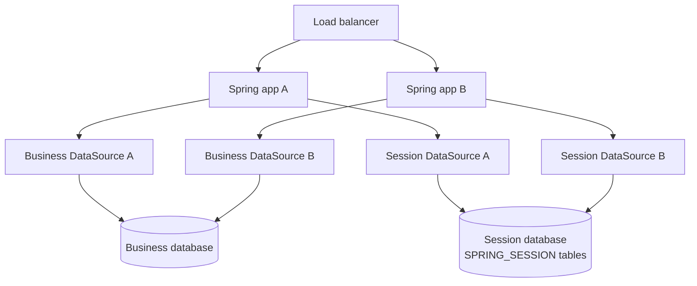

# DataSource riêng cho phiên và @SpringSessionDataSource

Một ứng dụng Spring thường có nhiều loại dữ liệu với tải và yêu cầu vận hành khác nhau. Dữ liệu nghiệp vụ có thể nằm trong database chính, trong khi session HTTP được lưu bằng Spring Session JDBC. Khi cả hai dùng chung một `DataSource`, request nghiệp vụ và thao tác đọc/ghi session cùng cạnh tranh connection pool, quyền truy cập và tài nguyên database.

Spring Session JDBC cho phép chọn một `DataSource` riêng cho repository session bằng qualifier `@SpringSessionDataSource`. Ứng dụng có thể giữ database nghiệp vụ làm `@Primary`, đồng thời đánh dấu nguồn kết nối dành cho session. Điều này giúp kiểm soát pool, credential, schema và transaction cho session mà không thay đổi cách các repository nghiệp vụ truy cập database chính.

## 1. DataSource của ứng dụng và DataSource của session

`DataSource` là abstraction của JDBC dùng để cấp kết nối đến database. Một bean `DataSource` thường bao gồm JDBC URL, driver, thông tin xác thực và cấu hình pool kết nối.

Trong ứng dụng chỉ có một database, Spring Session JDBC thường dùng chính `DataSource` đó. Khi ứng dụng có nhiều nguồn dữ liệu, cần xác định rõ nguồn nào dành cho session.

Ví dụ một ứng dụng thương mại điện tử có thể có:

| Nguồn dữ liệu | Trách nhiệm | Dữ liệu tiêu biểu |
|---|---|---|
| Business DataSource | Đọc/ghi dữ liệu nghiệp vụ | Đơn hàng, sản phẩm, khách hàng |
| Session DataSource | Lưu trạng thái HTTP session | `SPRING_SESSION`, `SPRING_SESSION_ATTRIBUTES` |
| Reporting DataSource | Truy vấn báo cáo, phân tích | View hoặc bản sao chỉ đọc |

Hai `DataSource` không nhất thiết phải trỏ đến hai máy chủ database vật lý khác nhau. Chúng có thể dùng hai connection pool và credential khác nhau trên cùng một database, hoặc trỏ đến hai database độc lập. Lựa chọn phụ thuộc mục tiêu cô lập tải, bảo mật và tính sẵn sàng.

## 2. Spring Session chọn DataSource nào theo mặc định?

Khi chỉ có một bean `DataSource`, Spring Session JDBC có thể sử dụng bean đó. Khi có nhiều bean, mặc định Spring Session sử dụng `@Primary` `DataSource` của application context nếu không có qualifier dành riêng cho session.

Hành vi mặc định này tiện cho ứng dụng đơn giản, nhưng có thể không phù hợp nếu database nghiệp vụ đang là primary còn session cần một nguồn riêng.

Ví dụ, ứng dụng có:

- `businessDataSource` được đánh dấu `@Primary` để `JdbcTemplate` và repository nghiệp vụ dùng database chính.
- `sessionDataSource` dành riêng cho Spring Session JDBC.

Nếu chỉ khai báo hai bean mà không đánh dấu bean session, Spring Session có thể tiếp tục chọn primary DataSource. Khi đó, ứng dụng vẫn khởi động nhưng session vẫn được lưu ở database nghiệp vụ. Để chọn đúng nguồn, hãy đánh dấu bean session bằng `@SpringSessionDataSource`.

## 3. @SpringSessionDataSource là gì?

`@SpringSessionDataSource` là qualifier annotation của Spring Session JDBC, nằm trong package:

```java
org.springframework.session.jdbc.config.annotation.SpringSessionDataSource
```

Annotation này đánh dấu bean `DataSource` mà `JdbcIndexedSessionRepository` cần sử dụng. Nó không tạo connection pool, không tạo database và không khởi tạo schema. Ứng dụng vẫn phải định nghĩa bean `DataSource` cùng cấu hình kết nối phù hợp.

Ví dụ tối thiểu:

```java
@Configuration(proxyBeanMethods = false)
@EnableJdbcHttpSession
public class SessionConfiguration {

    @Bean
    @SpringSessionDataSource
    DataSource sessionDataSource() {
        // Tạo DataSource dành cho Spring Session.
        return createSessionDataSource();
    }
}
```

Khi repository được cấu hình, Spring Session nhận biết nguồn kết nối có qualifier này và dùng nó để thực hiện các thao tác session. Tên bean không phải yếu tố quyết định; qualifier mới là dấu hiệu lựa chọn dành cho Spring Session.

Chỉ đánh dấu một `DataSource` dành cho session trong cùng application context. Nếu có nhiều bean cùng mang qualifier này, việc chọn nguồn có thể trở nên mơ hồ hoặc thất bại khi khởi tạo.

## 4. Cấu hình hai DataSource bằng Spring Boot

Với Spring Boot, có thể định nghĩa riêng cấu hình cho database nghiệp vụ và database session. Ví dụ sau dùng HikariCP và hai nhóm thuộc tính riêng.

```java
@Configuration(proxyBeanMethods = false)
public class DataSourceConfiguration {

    @Bean
    @Primary
    @ConfigurationProperties("app.datasource.business")
    HikariDataSource businessDataSource() {
        return DataSourceBuilder.create()
                .type(HikariDataSource.class)
                .build();
    }

    @Bean
    @SpringSessionDataSource
    @ConfigurationProperties("app.datasource.session")
    HikariDataSource sessionDataSource() {
        return DataSourceBuilder.create()
                .type(HikariDataSource.class)
                .build();
    }
}
```

Cấu hình tương ứng trong `application.yml`:

```yaml
app:
  datasource:
    business:
      jdbc-url: ${BUSINESS_DB_URL}
      username: ${BUSINESS_DB_USERNAME}
      password: ${BUSINESS_DB_PASSWORD}
      driver-class-name: org.postgresql.Driver
      maximum-pool-size: 20
    session:
      jdbc-url: ${SESSION_DB_URL}
      username: ${SESSION_DB_USERNAME}
      password: ${SESSION_DB_PASSWORD}
      driver-class-name: org.postgresql.Driver
      maximum-pool-size: 8
```

Trong ví dụ này, `businessDataSource` là primary để các thành phần ứng dụng thông thường tiếp tục dùng database nghiệp vụ. `sessionDataSource` có qualifier `@SpringSessionDataSource` để Spring Session JDBC chọn đúng nguồn.

Vì đang bind trực tiếp vào `HikariDataSource`, thuộc tính URL dùng tên `jdbc-url`. Nếu dùng `DataSourceProperties` để tạo pool, có thể dùng thuộc tính `url` ở lớp properties rồi gọi `initializeDataSourceBuilder()` để xử lý khác biệt giữa `url` và `jdbcUrl` của pool.

Cần có dependency JDBC driver tương ứng và dependency Spring Session JDBC. Nếu dự án dùng starter hoặc BOM của Spring Boot, nên để dependency management chọn các phiên bản tương thích.

## 5. Kết hợp với Spring Boot auto-configuration

Trong ứng dụng Spring Boot, khi có Spring Session JDBC trên classpath và cấu hình store phù hợp, Boot có thể tự cấu hình repository và `SessionRepositoryFilter`. Bean `@SpringSessionDataSource` cho phép chỉ định nguồn kết nối riêng trong context có nhiều DataSource.

Ví dụ dependency Maven:

```xml
<dependency>
    <groupId>org.springframework.boot</groupId>
    <artifactId>spring-boot-starter-session-jdbc</artifactId>
</dependency>
```

Nếu dự án dùng dependency `spring-session-jdbc` trực tiếp thay cho starter, cần bảo đảm các dependency JDBC và auto-configuration phù hợp có mặt.

Có thể cấu hình timeout và schema initialization bằng thuộc tính Boot tương ứng với phiên bản đang sử dụng:

```yaml
spring:
  session:
    timeout: 30m
    jdbc:
      initialize-schema: never
      table-name: SPRING_SESSION
```

`initialize-schema: never` thường phù hợp khi schema đã được quản lý bằng Flyway hoặc Liquibase. Việc tạo schema phải diễn ra trên database mà session DataSource trỏ tới, không phải mặc nhiên trên database nghiệp vụ.

Khi dùng auto-configuration, không cần thêm `@EnableJdbcHttpSession` chỉ để chỉ định DataSource. Nếu chủ động dùng cấu hình tường minh bằng `@EnableJdbcHttpSession`, vẫn có thể đánh dấu bean DataSource bằng `@SpringSessionDataSource`. Tránh bật cả auto-configuration và cấu hình tường minh trùng nhau nếu chưa xác định rõ cơ chế nào chịu trách nhiệm đăng ký repository và filter.

## 6. Kết hợp với @EnableJdbcHttpSession

Trong ứng dụng cấu hình Spring thuần hoặc khi chủ động quản lý Spring Session bằng Java configuration, `@EnableJdbcHttpSession` bật `JdbcIndexedSessionRepository` và filter tích hợp Servlet.

Ví dụ:

```java
@Configuration(proxyBeanMethods = false)
@EnableJdbcHttpSession
public class SessionConfiguration {

    @Bean
    @SpringSessionDataSource
    DataSource sessionDataSource() {
        return DataSourceBuilder.create()
                .type(HikariDataSource.class)
                .url("jdbc:postgresql://session-db:5432/session_store")
                .username("session_app")
                .password("change-me")
                .build();
    }
}
```

Đoạn code minh họa vị trí của qualifier; trong production, thông tin kết nối nên được đưa ra cấu hình bên ngoài và quản lý bằng secret store. Cần bổ sung driver PostgreSQL, pool phù hợp và schema Spring Session trên database đích.

`@EnableJdbcHttpSession` không tự tạo database vật lý. Nó cấu hình repository và filter trong ứng dụng; database phải tồn tại, truy cập được và có các bảng Spring Session tương ứng.

## 7. DataSource riêng có thể trỏ đến database hay schema riêng

Có ba cách tổ chức thường gặp:

| Cách tổ chức | Mức cô lập | Điểm cần cân nhắc |
|---|---|---|
| Cùng database, cùng schema, pool riêng | Cô lập connection pool | Vẫn dùng chung CPU, I/O, storage và giới hạn database |
| Cùng database, schema riêng | Tách namespace và quyền theo schema | Cần cấu hình schema mặc định, migration và quyền truy cập |
| Database hoặc cluster riêng | Cô lập tài nguyên và vận hành cao hơn | Tăng chi phí, backup, monitoring và quản lý failover |

Dùng pool riêng trên cùng database có thể là bước đầu hợp lý nếu mục tiêu là tránh session chiếm hết pool của ứng dụng. Nếu session có lưu lượng lớn hoặc cần chính sách lưu trữ riêng, schema/database riêng có thể giúp kiểm soát quyền và vòng đời dữ liệu tốt hơn.

Tên bảng Spring Session mặc định thường là `SPRING_SESSION` và `SPRING_SESSION_ATTRIBUTES`. Nếu nhiều ứng dụng dùng chung schema, hãy cân nhắc table name hoặc schema riêng để tránh xung đột. Tên bảng cần được cấu hình đồng nhất trên tất cả instance của cùng ứng dụng.

## 8. Quyền database tối thiểu cho session DataSource

Một lợi ích quan trọng của DataSource riêng là có thể dùng credential chỉ có quyền trên các bảng session. Ứng dụng không cần quyền đọc hoặc ghi bảng đơn hàng, khách hàng hay thanh toán chỉ để duy trì session.

Tùy cách quản lý schema, tài khoản runtime của session thường cần quyền:

- `SELECT` để tìm session và thuộc tính.
- `INSERT` để tạo session hoặc thuộc tính.
- `UPDATE` để cập nhật thời điểm truy cập và dữ liệu phiên.
- `DELETE` để xóa session và dữ liệu thuộc tính liên quan.

Tài khoản runtime thường không cần quyền `CREATE TABLE`, `ALTER TABLE` hoặc quyền quản trị database. Một tài khoản migration riêng có thể được cấp quyền DDL trong giai đoạn triển khai.

Ví dụ mô hình quyền:

```text
session_migrator:
  - CREATE / ALTER schema session
  - chạy migration Spring Session

session_runtime:
  - SELECT / INSERT / UPDATE / DELETE
  - chỉ trên SPRING_SESSION và SPRING_SESSION_ATTRIBUTES
```

Nếu session DataSource trỏ đến database riêng, hãy cấu hình TLS, xác thực và network policy như với dữ liệu nhạy cảm khác. Session có thể chứa SecurityContext hoặc thông tin người dùng; việc tách database không làm dữ liệu session trở nên công khai hay ít nhạy cảm hơn.

## 9. Transaction manager khi có nhiều DataSource

Khi có nhiều DataSource, ứng dụng thường có nhiều `PlatformTransactionManager` tương ứng. Spring Session JDBC cần transaction manager phù hợp với DataSource được chọn.

Theo cấu hình mặc định, Spring Session JDBC tìm primary transaction manager trong application context. Nếu transaction manager primary gắn với database nghiệp vụ nhưng repository session sử dụng session DataSource riêng, cần chỉ rõ transaction manager dành cho Spring Session bằng `@SpringSessionTransactionManager`.

Ví dụ:

```java
@Configuration(proxyBeanMethods = false)
public class TransactionConfiguration {

    @Bean
    @Primary
    PlatformTransactionManager businessTransactionManager(
            @Qualifier("businessDataSource") DataSource dataSource) {
        return new DataSourceTransactionManager(dataSource);
    }

    @Bean
    @SpringSessionTransactionManager
    PlatformTransactionManager sessionTransactionManager(
            @SpringSessionDataSource DataSource dataSource) {
        return new DataSourceTransactionManager(dataSource);
    }
}
```

`@SpringSessionTransactionManager` là qualifier dành cho transaction manager mà Spring Session JDBC sử dụng. Đặt qualifier này trên bean manager gắn với session DataSource giúp repository không vô tình thực hiện transaction trên database nghiệp vụ.

Nếu cần tùy chỉnh cách repository quản lý transaction, Spring Session JDBC còn hỗ trợ `TransactionOperations` qua bean có tên `springSessionTransactionOperations`. Đây là extension point nâng cao; chỉ thay đổi khi đã hiểu tác động đến tính nhất quán, rollback và thời điểm lưu session.

## 10. Giao dịch session và giao dịch nghiệp vụ không tự động nguyên tử

Khi session và dữ liệu nghiệp vụ nằm ở hai DataSource khác nhau, một transaction cục bộ không thể tự động bao phủ cả hai database. Ví dụ, một request tạo đơn hàng trong business database và cập nhật thuộc tính session trong session database. Hai thao tác này không tự động commit hoặc rollback như một transaction duy nhất.

Spring Session JDBC thực hiện các thao tác repository trong transaction riêng; mặc định transaction có propagation `REQUIRES_NEW` để tránh bị ảnh hưởng ngoài dự kiến bởi transaction hiện có. Vì vậy, việc ghi session có thể được commit độc lập với transaction nghiệp vụ của request.

Hãy tránh lưu trạng thái nghiệp vụ quan trọng chỉ trong session với giả định nó sẽ commit đồng thời cùng database chính. Session phù hợp với trạng thái tương tác tạm thời như ID giỏ hàng hoặc bước hiện tại của một quy trình. Đơn hàng, thanh toán và tồn kho phải được lưu trong transaction nghiệp vụ tương ứng.

Nếu nghiệp vụ yêu cầu phối hợp nhiều database, cần thiết kế transaction phân tán hoặc quy trình nhất quán kiểu saga/outbox theo yêu cầu thực tế. Không nên cố biến `@SpringSessionDataSource` thành cơ chế giao dịch xuyên database.

## 11. Connection pool và giới hạn tài nguyên

Tách DataSource cho session thường đồng nghĩa có thêm connection pool. Điều này cô lập tải giữa session và nghiệp vụ, nhưng tổng số connection mà ứng dụng mở tới database sẽ tăng.

Ví dụ có 6 instance ứng dụng, mỗi instance có:
- Business pool tối đa 20 connection.
- Session pool tối đa 8 connection.

Tổng mức tối đa lý thuyết có thể đạt `6 × (20 + 8) = 168` connection, chưa tính job nền và các dịch vụ khác. Database phải đủ giới hạn connection và tài nguyên xử lý cho tổng tải đó.

Khi sizing pool, hãy dựa trên:
- Số instance tối đa trong autoscaling hoặc rolling deployment.
- Lưu lượng request cần đọc/ghi session.
- Thời gian query và transaction.
- Số connection cần dành cho migration, cleanup job và quản trị.
- Giới hạn connection của database và các ứng dụng dùng chung.

Không đặt pool session quá lớn chỉ vì session được truy cập ở hầu hết request. Hãy đo thời gian chờ connection, số connection active/idle, query latency và timeout. Nếu session database quá tải, request cần session có thể bị chậm hoặc thất bại ngay cả khi business database vẫn khỏe.

## 12. Schema và migration trên session DataSource

Các bảng Spring Session phải tồn tại trên database mà `@SpringSessionDataSource` lựa chọn. Nếu ứng dụng có schema trên business database nhưng session DataSource trỏ sang một database trống, repository sẽ gặp lỗi thiếu bảng khi đọc hoặc ghi session.

Trong production, nên quản lý schema session bằng Flyway hoặc Liquibase. Migration phải kết nối đến đúng session database và tạo các bảng, khóa chính, index cùng foreign key theo script phù hợp với DBMS.

Một quy trình triển khai an toàn:
1. Tạo database/schema dành cho session.
2. Tạo credential migration và credential runtime riêng.
3. Chạy migration Spring Session trên đúng database đích.
4. Cấu hình bean session DataSource và transaction manager.
5. Khởi động ứng dụng và xác nhận repository truy cập đúng schema.
6. Chạy kiểm thử tạo, đọc, cập nhật, hết hạn và xóa session.

Nếu dùng Spring Boot schema initialization trong môi trường phát triển, hãy xác minh initializer đang dùng đúng DataSource. Không dựa vào việc ứng dụng khởi động thành công để kết luận schema đã được tạo ở database dự định.

## 13. Nhiều instance phải dùng cùng session DataSource logic

Trong hệ thống nhiều instance, mỗi instance cần truy cập cùng kho session logic. Chúng có thể có connection pool riêng, nhưng phải trỏ đến cùng database/schema, dùng cùng table name và cấu hình tương thích.



Mỗi instance có thể tạo pool kết nối riêng tới session database. Nếu instance A dùng schema `SESSION_A` còn instance B dùng `SESSION_B`, chúng sẽ không nhìn thấy cùng session dù cookie chứa cùng session ID.

Cần giữ nhất quán:
- JDBC URL hoặc endpoint database.
- Schema và table name.
- Credential có quyền tương đương.
- Transaction manager được chọn.
- Timeout, serialization và phiên bản schema tương thích.

Khi failover hoặc chuyển database, cần cập nhật cấu hình đồng bộ và có kế hoạch giữ dữ liệu session. Nếu session database bị thay thế bằng một kho rỗng, người dùng có thể phải đăng nhập lại.

## 14. Chẩn đoán khi Spring Session dùng nhầm DataSource

Một số triệu chứng thường gặp:

| Triệu chứng | Nguyên nhân có thể | Cách kiểm tra |
|---|---|---|
| Session tables xuất hiện ở business DB | Spring Session dùng primary DataSource | Kiểm tra bean có `@SpringSessionDataSource` và cấu hình repository |
| Lỗi thiếu bảng ở session DB | Migration chạy nhầm database hoặc chưa chạy | Kiểm tra JDBC URL của session DataSource và schema |
| Repository không khởi tạo được vì nhiều bean | Có nhiều DataSource nhưng không rõ bean được chọn | Kiểm tra qualifier và bean definitions |
| Session query chạy trên business DB | Session repository đang nhận sai DataSource | Kiểm tra transaction/query log và cấu hình bean |
| Transaction lỗi hoặc không tìm thấy manager | Repository dùng transaction manager không gắn với session DB | Kiểm tra `@SpringSessionTransactionManager` |
| Hết connection trong session pool | Pool quá nhỏ, query chậm hoặc cleanup cạnh tranh | Theo dõi active/pending connection và database metrics |

Quy trình chẩn đoán:
1. Xác nhận có đúng một bean `@SpringSessionDataSource` trong application context.
2. Kiểm tra bean đó thực sự trỏ đến JDBC URL và schema mong muốn.
3. Xác nhận repository là `JdbcIndexedSessionRepository` và được tạo trong context.
4. Kiểm tra transaction manager dành cho session nếu có nhiều manager.
5. Kiểm tra bảng và quyền của tài khoản runtime trên database đích.
6. Dùng log SQL hoặc database audit ở môi trường kiểm thử để xác nhận query đi đúng nơi.
7. Tạo session mới, đọc lại bằng request tiếp theo và kiểm tra dữ liệu trong session database.

Không log password, JDBC URL có chứa credential hoặc nội dung session nhạy cảm. Có thể ghi nhận tên bean, database host đã được che, schema và trạng thái kết nối để hỗ trợ chẩn đoán.

## 15. Kiểm thử DataSource riêng

Một bài kiểm thử tích hợp nên xác nhận rằng Spring Session thực sự sử dụng DataSource được đánh dấu, còn repository nghiệp vụ vẫn dùng business DataSource.

Có thể chuẩn bị hai database test riêng:
- Business database có bảng kiểm thử nghiệp vụ.
- Session database có schema Spring Session.

Sau khi khởi động application context:
1. Gọi endpoint tạo session.
2. Xác nhận bản ghi xuất hiện trong session database.
3. Xác nhận không có bản ghi session tương ứng trong business database.
4. Gửi request tiếp theo với cookie session và xác nhận thuộc tính được khôi phục.
5. Kiểm tra `JdbcTemplate` hoặc repository nghiệp vụ vẫn truy cập business database.
6. Logout và xác nhận session bị xóa khỏi session database.
7. Nếu có hai transaction manager, xác nhận repository session dùng manager được qualifier riêng.
8. Chạy nhiều instance hoặc nhiều application context cùng session database để xác nhận chia sẻ phiên.

Không chỉ kiểm tra bean có annotation. Hãy kiểm tra hành vi thực tế và dữ liệu được ghi vào đúng database. Kiểm thử này có thể phát hiện lỗi cấu hình mà một bài test chỉ xác nhận ApplicationContext khởi động không phát hiện được.

## 16. Khi nào nên tách DataSource cho session?

Một DataSource riêng hữu ích khi session có tải đọc/ghi đáng kể, database nghiệp vụ cần giới hạn connection riêng, đội vận hành muốn cấp quyền tối thiểu cho session hoặc hệ thống cần quản lý vòng đời session độc lập.

Tuy nhiên, tách DataSource cũng tạo thêm pool, credential, migration, transaction manager, giám sát và điểm lỗi. Nếu ứng dụng nhỏ và session load không đáng kể, dùng primary DataSource có thể đơn giản hơn. Hãy tách khi có mục tiêu vận hành cụ thể và đo được lợi ích.

Trước khi triển khai, xác nhận:
- Bean session DataSource được đánh dấu `@SpringSessionDataSource`.
- Business DataSource vẫn được chọn đúng cho repository nghiệp vụ.
- Transaction manager cho session được chọn đúng khi có nhiều manager.
- Schema Spring Session đã được tạo trên database đích.
- Credential runtime có quyền tối thiểu.
- Pool sizing phù hợp với số instance tối đa.
- Tất cả instance cùng trỏ đến một session database/schema.
- Integration test chứng minh session được ghi, đọc và xóa đúng nguồn.

`@SpringSessionDataSource` giúp Spring Session JDBC chọn rõ DataSource dành cho session trong ứng dụng có nhiều nguồn kết nối. Khi kết hợp với primary DataSource cho nghiệp vụ, transaction manager phù hợp, schema riêng và quyền database tối thiểu, ứng dụng có thể cô lập tải session và vận hành session độc lập hơn. Sự tách biệt này cần được triển khai nhất quán trên mọi instance và kiểm thử bằng dữ liệu thực tế.

