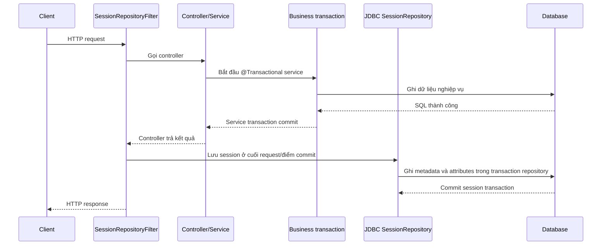

# TransactionOperations và ranh giới giao dịch lưu phiên

Spring Session JDBC lưu metadata và thuộc tính `HttpSession` trong database. Mỗi lần tạo, đọc, cập nhật hoặc xóa phiên có thể thực hiện một hay nhiều câu lệnh SQL. Để các câu lệnh liên quan được thực thi với ranh giới giao dịch rõ ràng, Spring Session JDBC sử dụng cơ chế giao dịch của Spring, trong đó `TransactionOperations` là abstraction cho việc chạy một callback bên trong transaction.

Hiểu ranh giới này đặc biệt quan trọng khi ứng dụng vừa cập nhật dữ liệu nghiệp vụ, vừa thay đổi session trong cùng một request. Một transaction của service không tự động bao trùm thao tác lưu session do `SessionRepositoryFilter` thực hiện ở cuối request. Muốn hai thay đổi cùng commit hoặc cùng rollback, phải bảo đảm chúng tham gia cùng transaction manager, cùng transaction context và đúng thời điểm lưu.

## 1. TransactionOperations là gì?

`TransactionOperations` thuộc Spring transaction abstraction. Nó cung cấp phương thức `execute` để chạy một `TransactionCallback` trong một transaction do `PlatformTransactionManager` quản lý. `TransactionTemplate` là implementation phổ biến của interface này.

Ví dụ:

```java
TransactionTemplate transactionTemplate =
        new TransactionTemplate(transactionManager);

String result = transactionTemplate.execute(status -> {
    orderRepository.save(order);
    return "saved";
});
```

`TransactionTemplate` yêu cầu transaction manager bắt đầu hoặc tham gia transaction theo propagation được cấu hình, chạy callback rồi commit nếu callback kết thúc bình thường. Nếu callback ném exception phù hợp với quy tắc rollback, transaction sẽ rollback. Có thể gọi `status.setRollbackOnly()` để đánh dấu rollback mà không cần ném exception ra ngoài callback.

`TransactionOperations` giúp tách logic nghiệp vụ khỏi cách quản lý transaction. Spring Session JDBC cũng có thể dùng abstraction này để bao quanh các thao tác repository. Nhờ đó, việc lưu metadata và thuộc tính phiên có thể được thực hiện trong một transaction JDBC theo cấu hình của repository.

## 2. Transaction manager và DataSource phải khớp

Transaction manager xác định tài nguyên nào được quản lý trong transaction. Với Spring Session JDBC, các thao tác session sử dụng `DataSource` của repository. Nếu muốn thao tác nghiệp vụ và thao tác session tham gia cùng một transaction, thông thường chúng phải dùng cùng database resource và cùng transaction manager tương thích.

Ví dụ cấu hình transaction manager JDBC:

```java
@Bean
PlatformTransactionManager transactionManager(DataSource dataSource) {
    return new JdbcTransactionManager(dataSource);
}
```

`JdbcTransactionManager` quản lý transaction cho JDBC và phối hợp với `JdbcTemplate`/`DataSource` tương ứng. Trong các phiên bản Spring Framework cũ hơn, `DataSourceTransactionManager` thường được sử dụng. Spring Boot có thể tự cấu hình transaction manager khi có `DataSource` và dependency phù hợp; không tạo thêm bean chỉ để lặp lại cấu hình tự động.

Nếu ứng dụng có nhiều `DataSource`, cần xác định rõ transaction manager nào quản lý bảng nghiệp vụ và transaction manager nào quản lý bảng Spring Session. Hai transaction manager riêng biệt không tự tạo thành một giao dịch nguyên tử. Một transaction commit thành công trong database A không thể được rollback chỉ vì database B thất bại.

## 3. TransactionOperations trong repository JDBC

Repository Spring Session JDBC cần thực hiện các thao tác như lưu bản ghi session và lưu các thuộc tính tương ứng. Tùy phiên bản Spring Session, `JdbcIndexedSessionRepository` được cấu hình với `TransactionOperations` để điều khiển transaction bao quanh các thao tác JDBC.

Một `TransactionTemplate` có thể được tạo từ transaction manager:

```java
@Bean
TransactionOperations sessionTransactionOperations(
        PlatformTransactionManager transactionManager) {
    TransactionTemplate template = new TransactionTemplate(transactionManager);
    template.setPropagationBehavior(
            TransactionDefinition.PROPAGATION_REQUIRED);
    return template;
}
```

Khi tự cấu hình `JdbcIndexedSessionRepository`, truyền `TransactionOperations` vào điểm cấu hình/constructor mà phiên bản Spring Session đang dùng cung cấp. API khởi tạo repository có thể thay đổi giữa các phiên bản. Nếu Spring Boot đã tự cấu hình repository, hãy kiểm tra cơ chế customization của đúng phiên bản trước khi thay thế bean; không tạo một repository thứ hai cạnh tranh với repository đang được `SessionRepositoryFilter` sử dụng.

`PROPAGATION_REQUIRED` có nghĩa thao tác repository tham gia transaction hiện có nếu transaction đó được quản lý bởi cùng transaction manager; nếu chưa có, nó tạo transaction mới. Đây thường là hành vi phù hợp để một thao tác JDBC có thể tham gia transaction bao quanh khi được gọi bên trong callback/service.

Không nhầm việc repository có transaction nội bộ với việc toàn bộ request HTTP nằm trong một transaction. TransactionOperations của repository chỉ bao quanh các thao tác mà repository thực hiện tại thời điểm nó được gọi.

## 4. SessionRepositoryFilter lưu session vào thời điểm nào?

Trong ứng dụng Servlet, `SessionRepositoryFilter` bọc request và response để ánh xạ `HttpSession` sang session do repository quản lý. Controller có thể gọi `setAttribute`, `removeAttribute` hoặc `invalidate` trong lúc xử lý request. Với chế độ lưu thông thường, thay đổi session được đẩy đến repository khi filter hoàn tất request hoặc khi response đi qua điểm commit được wrapper theo dõi.

Luồng điển hình:



Sơ đồ thể hiện một tình huống phổ biến: transaction của service kết thúc trước khi filter lưu session. Vì vậy, nếu database nghiệp vụ commit thành công nhưng thao tác lưu session thất bại, hai kết quả có thể khác nhau. Đây không nhất thiết là lỗi của `TransactionOperations`; đó là hệ quả của hai transaction có ranh giới khác nhau.

Thứ tự chính xác phụ thuộc cách response được commit, flush mode, cấu hình filter và việc ứng dụng có mở transaction bao quanh request hay không. Hãy xác định transaction thực tế bằng log/trace transaction và kiểm thử thay vì giả định controller trả về đồng nghĩa mọi thay đổi session đã được lưu.

## 5. Vì sao @Transactional của service không tự bao trùm session save?

Ví dụ service:

```java
@Service
public class OrderService {

    @Transactional
    public Order createOrder() {
        Order order = orderRepository.save(new Order());
        return order;
    }
}
```

Controller gọi service rồi cập nhật session:

```java
@PostMapping("/orders")
public String create(HttpServletRequest request) {
    Order order = orderService.createOrder();

    request.getSession(true).setAttribute("lastOrderId", order.getId());
    return "redirect:/orders/" + order.getId();
}
```

Trong cách tổ chức này, transaction `createOrder()` thường commit khi phương thức service trả về. Session attribute được đặt sau đó và repository lưu ở giai đoạn filter hoàn tất request. Do đó, nếu ghi session thất bại, đơn hàng vẫn có thể đã được commit.

Điều này thường chấp nhận được nếu session chỉ giữ thông tin tiện ích như đơn hàng gần nhất để điều hướng giao diện. Không nên coi session attribute là bản ghi nghiệp vụ duy nhất hoặc giả định nó cùng transaction với đơn hàng.

Nếu nghiệp vụ yêu cầu cả thay đổi database và session phải cùng thành công, cần đưa thao tác `SessionRepository.save` vào cùng transaction với thay đổi nghiệp vụ, sử dụng cùng transaction manager và propagation phù hợp. Điều đó đòi hỏi chủ động quản lý session qua repository thay vì chỉ dựa vào lần save tự động cuối request, hoặc một thiết kế khác bảo đảm cùng ranh giới transaction.

## 6. Ghép cập nhật nghiệp vụ và session trong cùng transaction

Ví dụ dưới đây minh họa việc gọi repository session ngay trong callback transaction:

```java
@Service
public class CheckoutService {

    private final OrderRepository orderRepository;
    private final SessionRepository<?> sessionRepository;
    private final TransactionOperations transactionOperations;

    public CheckoutService(OrderRepository orderRepository,
                           SessionRepository<?> sessionRepository,
                           TransactionOperations transactionOperations) {
        this.orderRepository = orderRepository;
        this.sessionRepository = sessionRepository;
        this.transactionOperations = transactionOperations;
    }

    public String checkout(String sessionId) {
        return transactionOperations.execute(status -> {
            Order order = orderRepository.save(new Order());
            updateSessionAttribute(sessionRepository, sessionId,
                    "lastOrderId", order.getId());

            return order.getId();
        });
    }

    private static <S extends Session> void updateSessionAttribute(
            SessionRepository<S> repository, String sessionId,
            String attributeName, Object attributeValue) {
        S session = repository.findById(sessionId);
        if (session != null) {
            session.setAttribute(attributeName, attributeValue);
            repository.save(session);
        }
    }
}
```

Đoạn code minh họa về mặt transaction; kiểu generic thực tế của `SessionRepository` phải khớp implementation Spring Session được inject. Điều kiện để hai thao tác cùng transaction là repository session và `OrderRepository` dùng cùng database resource/transaction manager, và transaction operations của repository tham gia transaction hiện tại (thường là `REQUIRED`).

Không nên gọi `sessionRepository.save` bằng một transaction manager khác rồi kết luận hai thay đổi nguyên tử. Cũng không nên vừa sửa cùng một session qua `HttpSession` trong request vừa chủ động load/save lại phiên qua repository nếu chưa hiểu cơ chế dirty tracking và thời điểm filter save; hai bản session có thể là hai snapshot và ghi đè lẫn nhau.

Nếu thao tác nghiệp vụ và session nằm ở hai database khác nhau, transaction cục bộ không thể đảm bảo atomicity xuyên hai kho. Cần cân nhắc outbox/saga hoặc chấp nhận session là trạng thái phụ có thể tái tạo.

## 7. Propagation và tác động đến transaction lưu phiên

Propagation xác định cách một thao tác tham gia transaction hiện có:

| Propagation | Hành vi | Tác động khi dùng cho session |
|---|---|---|
| `REQUIRED` | Tham gia transaction hiện tại hoặc tạo transaction mới | Phù hợp khi muốn repository session tham gia transaction nghiệp vụ cùng manager |
| `REQUIRES_NEW` | Tạm dừng transaction hiện tại và tạo transaction độc lập | Session có thể commit dù transaction nghiệp vụ bên ngoài rollback; thường không phù hợp nếu cần atomicity |
| `SUPPORTS` | Tham gia nếu có transaction; nếu không thì chạy không có transaction | Có thể khiến thao tác không có transaction khi gọi ngoài transaction |
| `MANDATORY` | Yêu cầu phải có transaction hiện tại | Hữu ích khi muốn buộc caller cung cấp transaction; nếu không có sẽ lỗi |
| `NOT_SUPPORTED` | Tạm dừng transaction hiện tại và chạy ngoài transaction | Tách thao tác session khỏi transaction nghiệp vụ |
| `NEVER` | Yêu cầu không có transaction hiện tại | Thường không phù hợp với thao tác cần transaction JDBC |

Ví dụ cấu hình propagation cho `TransactionTemplate`:

```java
TransactionTemplate template = new TransactionTemplate(transactionManager);
template.setPropagationBehavior(TransactionDefinition.PROPAGATION_REQUIRED);
```

Không đặt `REQUIRES_NEW` chỉ để tránh lock hoặc làm session lưu nhanh hơn. Nếu session commit riêng, business transaction rollback không thể tự xóa thay đổi session đã commit. Chọn propagation theo yêu cầu nhất quán và kiểm thử kết quả khi callback lỗi.

## 8. Isolation và đồng thời khi cập nhật phiên

Isolation level điều khiển cách transaction nhìn thấy thay đổi của transaction khác trong database. Các mức như `READ_COMMITTED`, `REPEATABLE_READ` hoặc `SERIALIZABLE` có ý nghĩa khác nhau tùy DBMS. Repository session thường thực hiện thao tác đọc/ghi ngắn; không nên nâng isolation toàn hệ thống lên mức cao chỉ để giải quyết race condition của một session.

Hai request có thể cùng đọc session rồi cùng ghi các thuộc tính. Dù repository dùng transaction, transaction không tự hợp nhất hai object session được khôi phục độc lập. Ví dụ A và B cùng đọc `cart` cũ, A thêm sản phẩm X, B thêm Y, rồi B lưu snapshot sau cùng; cập nhật X có thể bị ghi đè.

Các biện pháp phù hợp tùy nghiệp vụ:

- Lưu mã tham chiếu trong session và đưa dữ liệu giỏ hàng/số dư/trạng thái đơn hàng vào bảng nghiệp vụ có transaction.
- Dùng optimistic locking/version column ở bảng nghiệp vụ.
- Dùng thao tác nguyên tử ở tầng database cho bộ đếm hoặc cập nhật cộng dồn.
- Giữ transaction ngắn và tránh gọi dịch vụ mạng trong lúc transaction đang mở.
- Kiểm thử hai request đồng thời cùng dùng một session.

TransactionOperations đảm bảo các câu lệnh JDBC thuộc cùng transaction có commit/rollback nhất quán; nó không cung cấp khóa phân tán trên toàn bộ `HttpSession` và không bảo đảm không có lost update ở cấp object.

## 9. Rollback khi lưu session thất bại

Nếu repository session lưu metadata và attributes trong cùng transaction, lỗi SQL giữa các câu lệnh có thể khiến transaction đó rollback, tránh trạng thái nửa ghi trong phạm vi transaction. Phạm vi rollback phụ thuộc cách repository và transaction manager thực thi các câu lệnh.

Tuy nhiên, nếu transaction nghiệp vụ đã commit trước khi filter lưu session, rollback session không thể rollback nghiệp vụ đã commit. Ví dụ đơn hàng đã được tạo nhưng `SPRING_SESSION_ATTRIBUTES` lỗi do database mất kết nối; đơn hàng vẫn tồn tại.

Không nên bắt lỗi lưu session rồi trả redirect thành công như thể mọi trạng thái đã được ghi. Hãy xác định nghiệp vụ nào là nguồn dữ liệu chuẩn và response nào cần trả khi session save thất bại. Nếu client retry request tạo đơn hàng, dùng idempotency key hoặc khóa nghiệp vụ duy nhất để tránh tạo đơn hàng trùng.

Đối với session chỉ chứa trạng thái tiện ích, ứng dụng có thể cho người dùng tiếp tục bằng cách tải lại trạng thái từ database ở request sau. Với session giữ trạng thái xác thực, lỗi ghi/đọc cần được xử lý thận trọng; không tạo phiên rỗng rồi xem đó là người dùng đã xác thực.

## 10. Transaction synchronization và tác vụ sau commit

Spring cung cấp transaction synchronization để đăng ký callback khi transaction hoàn tất. Ví dụ, `TransactionSynchronizationManager` có thể đăng ký `afterCommit` để thực hiện tác vụ chỉ nên chạy sau khi transaction nghiệp vụ đã commit.

```java
TransactionSynchronizationManager.registerSynchronization(
        new TransactionSynchronization() {
            @Override
            public void afterCommit() {
                // Phát tín hiệu hoặc khởi chạy tác vụ sau khi transaction commit.
            }
        }
);
```

Callback `afterCommit` hữu ích cho tác vụ phụ thuộc vào dữ liệu đã commit. Nó không tự tạo transaction mới cho các thao tác ghi database trong callback; nếu cần ghi tiếp, hãy mở transaction phù hợp. Nó cũng không đảm bảo tác vụ được thực hiện nếu tiến trình chết ngay sau commit nhưng trước khi callback chạy xong.

Với thông báo hoặc công việc phải được giao bền vững, transactional outbox thường phù hợp hơn: ghi một outbox record trong cùng transaction nghiệp vụ, rồi worker đọc và gửi sau. Không dùng callback trong bộ nhớ làm cơ chế duy nhất cho thông điệp quan trọng.

Không dựa vào `afterCommit` để làm cho session save cuối request trở thành một phần của transaction đã kết thúc. Session save do filter thực hiện có thể xảy ra ở thời điểm khác. Nếu cần session và business data cùng transaction, phải tổ chức lời gọi repository trong chính transaction đó.

## 11. Timeout và độ dài transaction

Transaction timeout giới hạn thời gian một transaction được phép chạy. Session repository nên thực hiện các thao tác ngắn: đọc metadata, ghi attributes, cập nhật thời điểm truy cập hoặc xóa phiên. Không nên giữ transaction database mở trong toàn bộ thời gian người dùng tải file, gọi API bên ngoài hoặc chờ một quy trình lâu.

Có thể cấu hình timeout cho `TransactionTemplate`:

```java
TransactionTemplate template = new TransactionTemplate(transactionManager);
template.setTimeout(5);
```

Giá trị `5` chỉ là ví dụ; timeout phù hợp phụ thuộc DBMS, connection pool, latency và workload. Nếu timeout quá ngắn, lưu session có thể thất bại dưới tải; nếu quá dài, transaction treo có thể giữ connection và lock lâu.

Transaction timeout của Spring không thay thế timeout kết nối/socket của JDBC driver hoặc query timeout ở DBMS. Cần cấu hình và giám sát đồng bộ các giới hạn liên quan.

## 12. Đọc và ghi session bên trong @Transactional

Có thể dùng `@Transactional` ở service để quản lý thao tác JDBC nghiệp vụ. Nếu service chủ động gọi `SessionRepository` và repository tham gia cùng transaction manager, các thao tác đó có thể cùng transaction:

```java
@Transactional
public void updateOrderAndSession(String sessionId, String orderId) {
    orderRepository.markProcessed(orderId);
    updateSessionAttribute(sessionRepository, sessionId,
            "lastProcessedOrder", orderId);
}
```

Trong ví dụ này, `updateSessionAttribute` là helper generic tương tự ví dụ trước, nhận `SessionRepository<S>` với kiểu session cụ thể của repository.

Điều kiện quan trọng:

- `orderRepository` và session repository dùng cùng transaction manager hoặc cùng transaction context tương thích.
- TransactionOperations của session repository tham gia transaction hiện tại, không tách sang `REQUIRES_NEW`.
- Session được lưu qua repository trong khi transaction còn mở.
- Không có một lần save muộn từ filter ghi snapshot cũ đè lên phiên vừa được cập nhật trực tiếp.

Điều kiện cuối cùng đặc biệt quan trọng khi cùng một request vừa dùng `HttpSession` wrapper vừa thao tác trực tiếp với `SessionRepository`. Tránh hai đường ghi trên cùng session trong một request nếu chưa thiết kế cách đồng bộ. Nếu cần làm như vậy, hãy kiểm soát nguồn dữ liệu session duy nhất và viết integration test xác nhận thứ tự ghi.

## 13. Kiểm thử ranh giới transaction

Kiểm thử nên xác minh transaction thực tế thay vì chỉ xác nhận phương thức có annotation:

| Ca kiểm thử | Cách thực hiện | Kết quả cần xác nhận |
|---|---|---|
| Repository save bình thường | Tạo session và lưu thuộc tính | Metadata và attributes được commit |
| Lỗi giữa các câu lệnh lưu | Làm một thao tác SQL trong save thất bại | Các thay đổi thuộc transaction repository rollback theo thiết kế |
| Business rollback | Ghi order rồi ném exception trong cùng transaction với session repository | Cả hai thay đổi rollback nếu thật sự cùng transaction manager/context |
| Business commit trước session save | Service commit rồi mô phỏng lỗi filter save | Business data vẫn commit; session save thất bại độc lập |
| `REQUIRED` | Gọi repository trong transaction hiện tại | Repository tham gia transaction hiện có khi dùng cùng manager |
| `REQUIRES_NEW` | Cố ý dùng transaction độc lập trong test | Session có thể commit dù transaction ngoài rollback |
| Hai DataSource | Dùng transaction manager khác nhau | Xác nhận không có atomicity tự động giữa hai kho |
| Concurrent update | Hai request cùng sửa thuộc tính session | Phát hiện lost update và xác minh chiến lược xử lý |
| Transaction timeout | Mô phỏng thao tác DB chậm | Transaction bị giới hạn theo cấu hình và lỗi được xử lý |
| Nhiều instance | Ghi session từ instance A, đọc ở B | Cùng database và transaction policy được sử dụng nhất quán |

Một test quan trọng là cố ý gây lỗi sau khi ghi business row nhưng trước khi session save hoàn tất, rồi kiểm tra trạng thái của cả hai. Test này làm rõ ranh giới commit thật sự và tránh kỳ vọng sai rằng filter sẽ rollback transaction service đã kết thúc.

Khi dùng `@Transactional` trong test, lưu ý test framework có thể rollback transaction ở cuối test. Nếu cần kiểm tra commit nhìn thấy từ một connection khác, phải chủ động commit hoặc chạy test qua HTTP request/transaction boundary thực tế.

## 14. Quan sát transaction và lỗi repository

Khi session save chậm hoặc thất bại, theo dõi:

- Thời gian của transaction repository và số lần gọi SQL.
- Connection pool usage, số connection chờ và timeout.
- Deadlock, lock wait, serialization failure và lỗi constraint.
- Tỷ lệ lỗi khi ghi bảng `SPRING_SESSION` và `SPRING_SESSION_ATTRIBUTES`.
- Thời điểm filter lưu session so với thời điểm service transaction commit.
- Số request có business commit nhưng session save thất bại.

Log transaction cần đủ để liên kết request, service và repository nhưng không chứa session ID dạng rõ, cookie hoặc nội dung thuộc tính nhạy cảm. Có thể dùng request correlation ID, endpoint, instance, transaction outcome và mã lỗi database.

Nếu dùng nhiều transaction manager, đặt tên rõ ràng cho từng manager và chỉ định manager phù hợp tại `@Transactional` hoặc `TransactionTemplate`. Tránh phụ thuộc vào bean `@Primary` khi ứng dụng có nhiều database vì có thể khiến service vô tình dùng sai transaction manager.

## 15. Nguyên tắc thiết kế

- Hiểu `TransactionOperations` là abstraction thực thi callback trong transaction; `TransactionTemplate` là implementation phổ biến.
- Dùng cùng transaction manager và DataSource khi cần business data và session save cùng transaction.
- Hiểu session save qua `SessionRepositoryFilter` thường xảy ra ở cuối request/điểm commit, có thể sau khi transaction của service đã kết thúc.
- Không coi `@Transactional` trên service là transaction bao trùm toàn bộ request HTTP.
- Chọn propagation rõ ràng; `REQUIRED` tham gia transaction hiện có, còn `REQUIRES_NEW` tạo ranh giới độc lập.
- Không dùng transaction để thay thế kiểm soát lost update ở cấp session object.
- Giữ transaction ngắn; không giữ connection trong khi gọi dịch vụ mạng hoặc stream response.
- Phân biệt lỗi session save với kết quả commit của nghiệp vụ; dùng idempotency cho request có thể retry.
- Không trộn cập nhật `HttpSession` và repository trực tiếp trên cùng session nếu chưa kiểm soát thứ tự save.
- Kiểm thử rollback, commit, timeout, nhiều DataSource và request đồng thời bằng database thực tế.

`TransactionOperations` giúp Spring Session JDBC thực thi các thao tác lưu phiên trong một transaction có kiểm soát. Điều quyết định tính nguyên tử không chỉ là repository có transaction, mà là thao tác session và dữ liệu nghiệp vụ có thật sự tham gia cùng transaction manager, cùng context và cùng thời điểm commit hay không. Khi ranh giới được xác định rõ, ứng dụng có thể xử lý lỗi, retry và vận hành session nhất quán hơn trong môi trường nhiều instance.
