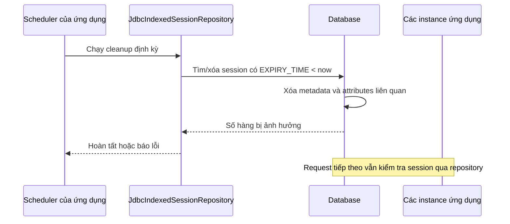

# Tùy chỉnh tác vụ cleanup và phối hợp khi có nhiều bản chạy ứng dụng

Spring Session JDBC lưu metadata và thuộc tính phiên trong database. Khi một phiên không còn hoạt động quá thời hạn, phiên phải bị xem là hết hạn ngay cả khi hàng dữ liệu của nó chưa được xóa vật lý. Một tác vụ cleanup định kỳ sẽ dọn các bản ghi hết hạn để giải phóng dung lượng và giảm dữ liệu cũ trong bảng. Khi ứng dụng chạy nhiều instance cùng dùng một database, cần cấu hình lịch dọn phù hợp, tránh tạo tải không cần thiết và bảo đảm các node không làm hỏng dữ liệu phiên đang hoạt động.

`JdbcIndexedSessionRepository` có cơ chế cleanup các phiên hết hạn; Spring Session JDBC tích hợp lịch chạy cleanup và cho phép điều chỉnh cron. Trong môi trường nhiều instance, mỗi instance có thể khởi tạo lịch của riêng nó. Vì vậy, cần hiểu tác động của việc nhiều node chạy cùng một câu lệnh dọn, khi nào có thể để tất cả cùng chạy và khi nào nên điều phối một tác vụ duy nhất bằng scheduler hoặc distributed lock.

## 1. Hết hạn phiên và xóa vật lý là hai việc khác nhau

Thời hạn phiên thường được xác định bởi `maxInactiveInterval`, thời điểm truy cập gần nhất và thời điểm hết hạn được lưu trong bảng session. Với schema JDBC chuẩn, cột `EXPIRY_TIME` biểu diễn mốc hết hạn để repository xác định phiên nào không còn hợp lệ.

Cần phân biệt:

- **Hết hạn về mặt logic:** phiên đã vượt thời hạn không hoạt động. Request mới mang session ID đó không được xem là phiên hợp lệ.
- **Cleanup vật lý:** hàng session hết hạn và các hàng attributes liên quan được xóa khỏi database.

Một phiên có thể đã hết hạn về logic nhưng vẫn còn hàng trong database cho tới lần cleanup tiếp theo. Điều này không có nghĩa người dùng vẫn được đăng nhập. Repository phải áp dụng quy tắc hết hạn khi tra cứu session; tác vụ cleanup chủ yếu thu hồi dữ liệu đã hết hạn.

Ví dụ: timeout là 30 phút, người dùng không gửi request từ 10:00. Phiên có thể hết hạn lúc 10:30. Nếu cleanup chạy mỗi 5 phút và lần gần nhất chạy lúc 10:28, hàng dữ liệu có thể còn tới lần chạy tiếp theo sau 10:30. Trong khoảng đó, request mới vẫn phải bị xử lý theo trạng thái hết hạn.

Không nên rút ngắn thời hạn xác thực chỉ để giảm dung lượng bảng, cũng không nên kéo dài timeout vì cleanup chạy chậm. Timeout là chính sách phiên; cron cleanup là chính sách bảo trì dữ liệu.

## 2. Cấu trúc dữ liệu mà cleanup xử lý

Với `JdbcIndexedSessionRepository`, schema chuẩn thường có bảng metadata `SPRING_SESSION` và bảng thuộc tính `SPRING_SESSION_ATTRIBUTES`. Một hàng trong bảng session đại diện cho một phiên; nhiều hàng trong bảng attributes lưu các thuộc tính đã serialize của phiên đó.

| Thành phần | Vai trò trong cleanup |
| --- | --- |
| `EXPIRY_TIME` | Xác định hàng session đã đến hạn xóa hay chưa |
| `PRIMARY_ID` | Khóa nội bộ của hàng session và liên kết tới attributes |
| `SPRING_SESSION_ATTRIBUTES` | Chứa dữ liệu thuộc tính cần được dọn cùng phiên |
| Index trên `EXPIRY_TIME` | Giúp database tìm các hàng hết hạn mà không phải quét toàn bộ bảng trong mọi trường hợp |
| Foreign key/cascade hoặc câu lệnh dọn liên quan | Bảo đảm attributes không bị bỏ lại khi session bị xóa |

Tên bảng và chi tiết SQL phụ thuộc cấu hình `table-name`, schema và phiên bản Spring Session. Nếu đã đổi tên bảng, cleanup phải sử dụng cùng repository và schema mà ứng dụng đang dùng. Không tạo một tác vụ riêng chỉ xóa `SPRING_SESSION` mặc định trong khi repository thực tế dùng `APP_SESSION`.

Index `EXPIRY_TIME` là thành phần quan trọng khi bảng lớn. Hãy giữ nguyên index do schema script chính thức cung cấp, hoặc xác minh migration đã tạo index tương đương. Trước khi thay đổi index, kiểm tra execution plan trên database production-like; index sai hoặc thiếu có thể làm tác vụ cleanup quét nhiều hàng và gây tải I/O.

## 3. Cấu hình cron cleanup trong Spring Boot

Spring Boot cung cấp property `spring.session.jdbc.cleanup-cron` để điều chỉnh lịch cleanup của Spring Session JDBC ở các phiên bản hỗ trợ property này. Ví dụ chạy mỗi 5 phút:

```yaml
spring:
  session:
    jdbc:
      cleanup-cron: "0 */5 * * * *"
      table-name: APP_SESSION
      initialize-schema: never
```

Cron của Spring có sáu trường, bắt đầu bằng giây, rồi phút, giờ, ngày trong tháng, tháng và thứ trong tuần. Biểu thức `0 */5 * * * *` có nghĩa chạy tại giây 0 của mỗi phút chia hết cho 5. Không nhầm cú pháp này với cron Unix thường có năm trường.

Nếu cấu hình bằng Java, `@EnableJdbcHttpSession` ở các phiên bản hỗ trợ có thuộc tính `cleanupCron`:

```java
@Configuration
@EnableJdbcHttpSession(
    tableName = "APP_SESSION",
    cleanupCron = "0 */5 * * * *"
)
class JdbcSessionConfiguration {
}
```

Hãy chọn một đường cấu hình nhất quán. Nếu Spring Boot đã auto-configure repository, tránh thêm cấu hình `@EnableJdbcHttpSession` thứ hai chỉ để chỉnh cron mà chưa kiểm tra tác động tới repository và filter hiện có. Property và annotation có thể khác theo phiên bản Spring Session/Boot; xác nhận metadata cấu hình của đúng phiên bản dự án.

Giá trị mặc định của cleanup trong các phiên bản phổ biến thường là chạy định kỳ mỗi phút (`0 * * * * *`), nhưng hãy xác nhận với phiên bản đang triển khai. Nếu tự xây dựng tác vụ `@Scheduled`, bảo đảm scheduling được kích hoạt và scheduler được quản lý đúng. Không đăng ký một tác vụ cleanup thủ công trùng với tác vụ Spring Session mặc định mà không có chủ đích.

## 4. Chọn chu kỳ cleanup phù hợp

Chu kỳ ngắn giúp hàng hết hạn được dọn sớm hơn nhưng làm tăng tần suất truy vấn database. Chu kỳ dài giảm số lần chạy nhưng làm dữ liệu hết hạn tồn tại lâu hơn.

| Chu kỳ | Ưu điểm | Chi phí/rủi ro |
| --- | --- | --- |
| Mỗi phút | Dữ liệu cũ được dọn tương đối sớm | Nhiều lần chạy hơn, đặc biệt khi có nhiều instance |
| Mỗi 5 phút | Cân bằng cho nhiều ứng dụng web thông thường | Hàng hết hạn có thể tồn tại lâu hơn vài phút |
| Mỗi 15–30 phút | Giảm tần suất truy vấn | Bảng có thể tích lũy nhiều hàng hết hạn giữa các lần chạy |
| Theo khung giờ thấp tải | Tránh thời điểm database bận | Hàng hết hạn tồn tại lâu; cần bảo đảm không vi phạm giới hạn dung lượng/vận hành |

Không có một chu kỳ đúng cho mọi hệ thống. Cân nhắc số session mới mỗi phút, timeout phiên, kích thước attributes, năng lực database, SLA và độ trễ cleanup chấp nhận được. Nếu bảng tăng nhanh, không nên chỉ tăng tần suất lên mức rất cao; hãy kiểm tra index, execution plan, số hàng bị xóa mỗi lần và tác động lên transaction.

Một nguyên tắc thực tế là đặt cleanup đủ thường xuyên để dữ liệu hết hạn không tích lũy quá mức, nhưng đủ thưa để database xử lý các thao tác session bình thường. Theo dõi thời gian chạy thực tế trước khi thay đổi cron.

## 5. Nhiều instance cùng chạy cleanup

Trong triển khai nhiều instance, mỗi JVM có thể tạo lịch cleanup khi khởi động. Nếu ba instance cùng dùng một `DataSource`, cùng bảng và cùng cron, có thể có ba tác vụ cùng chạy một câu lệnh xóa các hàng đã hết hạn.

Một câu lệnh cleanup có điều kiện như `EXPIRY_TIME` nhỏ hơn thời điểm hiện tại thường có tính idempotent ở mức dữ liệu: sau khi một transaction xóa hàng hết hạn, lần chạy sau không còn hàng đó để xóa lần nữa. Database quản lý khóa hàng và transaction để các lệnh xóa đồng thời không làm cùng một hàng tồn tại thành hai bản ghi bị xóa. Tuy nhiên, điều đó không có nghĩa chạy trùng là miễn phí.

Khi nhiều node chạy cùng cleanup, có thể phát sinh:

- Nhiều truy vấn giống nhau cùng lúc và tăng CPU/I/O database.
- Transaction cạnh tranh trên cùng tập hàng hết hạn.
- Lock wait hoặc deadlock với các thao tác session khác, tùy database, isolation level và khối lượng dữ liệu.
- Nhiều lần ghi log và metric cho cùng một khoảng cleanup.
- Tải tăng đột ngột sau khi nhiều instance cùng khởi động hoặc phục hồi sau sự cố.

Với hệ thống nhỏ, để mỗi instance chạy cleanup định kỳ có thể chấp nhận được nếu truy vấn nhẹ, có index phù hợp và database chịu được tải. Với hệ thống lớn hoặc bảng có nhiều session, nên cân nhắc một tác vụ cleanup duy nhất hoặc giới hạn mức song song.

## 6. Khi nào cần một cleanup owner duy nhất?

Nếu cleanup là truy vấn nhỏ, nhanh và idempotent, việc tất cả node chạy cùng có thể đơn giản và đủ an toàn. Nếu tác vụ tốn nhiều tài nguyên, kéo dài hoặc ảnh hưởng đáng kể tới database, một scheduler owner duy nhất giúp giảm truy vấn trùng.

Các cách điều phối thường gặp:

| Cách | Mô tả | Khi phù hợp |
| --- | --- | --- |
| Một instance chuyên trách | Chỉ một deployment chạy tác vụ cleanup | Có thể quản lý role worker riêng và theo dõi availability |
| Distributed lock | Các node cùng thử lấy lock dùng chung; chỉ node giữ lock chạy cleanup | Ứng dụng cần failover tự động giữa nhiều node |
| Quartz với JDBC JobStore | Scheduler dùng database để phối hợp trigger giữa nhiều node | Hệ thống đã vận hành Quartz hoặc cần lịch phức tạp |
| Database scheduler | Job chạy trong database hoặc dịch vụ quản trị database | DBA quản lý tập trung và database hỗ trợ scheduler |

Không nên dùng biến static, `synchronized`, file lock cục bộ hoặc boolean trong bộ nhớ để chọn leader. Những cơ chế này chỉ phối hợp trong một JVM hoặc một máy, không ngăn được instance khác chạy cùng tác vụ.

Nếu dùng distributed lock như ShedLock, cần lưu lock trong kho chia sẻ được mọi instance truy cập, thường là cùng database hoặc một dịch vụ lock phù hợp. Đặt `lockAtMostFor` dài hơn thời gian cleanup tối đa dự kiến để lock không hết hạn khi task còn chạy; đồng thời theo dõi trường hợp task vượt lease vì hai node có thể cùng chạy nếu lock hết hạn quá sớm. `lockAtLeastFor` có thể hạn chế việc chạy lặp quá sát nhau nhưng không thay thế thiết kế cron đúng.

Ví dụ minh họa mẫu khóa lịch cho một tác vụ ứng dụng:

```java
@Component
class SessionCleanupJob {

    private final SessionCleanupService cleanupService;

    SessionCleanupJob(SessionCleanupService cleanupService) {
        this.cleanupService = cleanupService;
    }

    @Scheduled(cron = "${app.session.cleanup-cron:0 */5 * * * *}")
    @SchedulerLock(
        name = "springSessionJdbcCleanup",
        lockAtMostFor = "PT3M",
        lockAtLeastFor = "PT10S"
    )
    public void run() {
        cleanupService.cleanExpiredSessions();
    }
}
```

Đây là mẫu điều phối, giả định ứng dụng đã tích hợp thư viện scheduler lock và `SessionCleanupService` gọi một API cleanup công khai được hỗ trợ bởi phiên bản đang dùng. Không sao chép đoạn mã rồi gọi một method nội bộ không được hỗ trợ. Nếu đã dùng scheduled cleanup tích hợp của Spring Session, phải tắt hoặc điều chỉnh cơ chế mặc định theo cách được tài liệu phiên bản cho phép trước khi thêm job có lock, để tránh hai lịch cùng chạy.

## 7. Transaction, khóa và cleanup theo lô

Cleanup cần xóa đúng những phiên đã hết hạn tại thời điểm xử lý. Repository và database chịu trách nhiệm phối hợp xóa metadata và attributes theo schema. Nếu database có foreign key `ON DELETE CASCADE`, việc xóa hàng cha có thể dọn attributes liên quan; nếu schema hoặc repository dùng câu lệnh riêng, cần bảo đảm cả hai phần được dọn trong cách thức nhất quán.

Không tự viết SQL xóa hàng session mà bỏ qua bảng attributes, foreign key hoặc index. Cũng không xóa session chỉ dựa trên `LAST_ACCESS_TIME` nếu repository dùng `EXPIRY_TIME` và quy tắc timeout cụ thể. Sử dụng cleanup tích hợp của Spring Session là lựa chọn mặc định; chỉ thay bằng SQL riêng khi đã kiểm tra schema, transaction, dialect và hành vi của đúng phiên bản.

Với bảng lớn, một câu lệnh xóa hàng triệu bản ghi có thể giữ lock lâu, tạo nhiều WAL/undo log và gây áp lực lên replication hoặc vacuum. Nếu cần cleanup theo lô, hãy dùng cơ chế được hỗ trợ hoặc thiết kế job riêng có giới hạn số hàng mỗi lần, transaction ngắn và khoảng nghỉ giữa các batch. Không giả định repository mặc định đã chia batch theo cách ứng dụng mong muốn; đo execution time và số hàng thực tế.

Index trên `EXPIRY_TIME` giúp truy vấn lọc hàng hết hạn hiệu quả. Tuy nhiên, khi phần lớn bảng đều hết hạn, index không bảo đảm thao tác xóa luôn rẻ. Theo dõi execution plan, lock wait, dead tuple/vacuum trên PostgreSQL hoặc chỉ số tương ứng của database đang dùng.

## 8. Race condition giữa cleanup và request đang cập nhật session

Trong hệ thống nhiều instance, request và cleanup có thể xảy ra đồng thời. Ví dụ request A vừa tải session, còn tác vụ cleanup B kiểm tra thời hạn và xóa hàng khi phiên đã hết hạn. Hoặc một request cập nhật session gần thời điểm `EXPIRY_TIME` vượt qua ngưỡng cleanup.

Repository phải áp dụng quy tắc hết hạn khi đọc và ghi; tác vụ cleanup chỉ nên xóa các hàng thỏa điều kiện hết hạn. Ứng dụng không nên tự kéo dài session bằng cách cập nhật trực tiếp `EXPIRY_TIME` ngoài API repository. Nếu request đã bắt đầu với một session sắp hết hạn, kết quả cuối cùng phụ thuộc thời điểm truy cập, transaction và implementation. Cần kiểm thử hành vi tại ranh giới timeout thay vì giả định request đang chạy luôn được bảo vệ khỏi cleanup.

Các biện pháp giảm rủi ro:

1. Dùng cùng phiên bản Spring Session và cùng cấu hình timeout trên tất cả instance.
2. Đồng bộ đồng hồ hệ điều hành của các node và database bằng NTP hoặc cơ chế thời gian chuẩn của hạ tầng.
3. Không cập nhật bảng session trực tiếp từ nghiệp vụ; dùng repository/Servlet API để lưu thay đổi.
4. Giữ transaction ngắn và tránh thao tác nghiệp vụ dài trong khi giữ session/database transaction.
5. Kiểm thử request đồng thời ở thời điểm trước, đúng và sau idle timeout.

Đồng hồ lệch có thể khiến node tính thời điểm hết hạn khác nhau. Nếu các node chạy với cấu hình timeout hoặc timezone không thống nhất, hệ thống có thể quan sát hiện tượng phiên hết hạn sớm/muộn không ổn định. Các mốc epoch thường không phụ thuộc timezone, nhưng đồng bộ thời gian thực vẫn rất quan trọng.

## 9. Nhiều ứng dụng hoặc nhiều phiên bản cùng dùng bảng session

Khi nhiều instance của cùng ứng dụng dùng chung database, các node phải thống nhất table name, schema, datasource, serializer và phiên bản schema. Nếu một node chạy cleanup trên bảng khác hoặc dùng schema khác, cleanup có thể không dọn dữ liệu mà repository khác tạo ra.

Nếu hai ứng dụng độc lập cùng dùng một database, nên tách bảng hoặc schema session riêng, trừ khi có thiết kế chia sẻ session rõ ràng. Dùng chung bảng nhưng khác timeout, serializer hoặc cách định danh principal có thể gây lỗi khó chẩn đoán. Tên bảng tùy chỉnh và schema namespace cần đồng bộ với repository trên tất cả node.

Trong rolling deployment, các phiên bản cũ và mới có thể cùng truy cập bảng. Cleanup không nên xóa dữ liệu chỉ vì ứng dụng mới không hiểu một thuộc tính; điều đó thuộc vấn đề tương thích serialization/migration. Trước khi thay đổi schema hoặc serializer, xác minh các instance đang chạy song song có thể đọc dữ liệu session và dùng cùng quy tắc hết hạn.

## 10. Cleanup có phát sự kiện nghiệp vụ cho từng phiên không?

Không nên dùng tác vụ cleanup bulk như cơ chế thông báo nghiệp vụ đáng tin cậy. Cleanup chủ yếu xóa các hàng hết hạn; tùy repository và phiên bản, thao tác dọn theo lô có thể không phát một sự kiện ứng dụng riêng cho từng phiên đã bị xóa như một thao tác xóa phiên chủ động.

Nếu hệ thống cần thông báo người dùng, thu hồi token phụ, đóng WebSocket hoặc audit chính xác mỗi lần phiên hết hạn, hãy kiểm tra semantics sự kiện của repository JDBC đang dùng. Với yêu cầu cần bảo đảm giao nhận, dùng cơ chế event bền vững riêng như outbox hoặc job/event store; không giả định một cron SQL delete sẽ tạo ra một domain event cho từng session.

Tương tự, không dùng số hàng cleanup làm số người dùng vừa đăng xuất trong khoảng thời gian đó. Một hàng có thể đã hết hạn từ lâu, hoặc bị xóa do tác vụ bảo trì. Metrics cleanup mô tả công việc lưu trữ, không thay thế audit xác thực.

## 11. Theo dõi hiệu quả và cảnh báo

Các chỉ số hữu ích:

- Thời điểm lần cleanup thành công gần nhất trên từng deployment hoặc scheduler owner.
- Thời gian chạy và số hàng bị xóa mỗi lần.
- Tỷ lệ cleanup lỗi, timeout hoặc rollback.
- Lock wait, deadlock và thời gian chờ transaction trên database.
- Số hàng hết hạn còn tồn tại và độ trễ từ expiry tới physical deletion.
- Kích thước bảng session/attributes và tốc độ tăng trưởng.
- Execution plan và mức sử dụng index `EXPIRY_TIME`.
- Số scheduler instance cùng thực thi nếu không dùng distributed lock.

Có thể dùng truy vấn read-only để ước lượng số hàng hết hạn, theo đúng tên bảng và schema thực tế:

```sql
SELECT COUNT(*)
FROM APP_SESSION
WHERE EXPIRY_TIME < ?;
```

Tham số phải là mốc thời gian theo cùng đơn vị mà schema Spring Session đang lưu, thường là epoch milliseconds. Ví dụ chỉ minh họa cách quan sát; không thay thế repository cleanup và cần cân nhắc chi phí `COUNT` trên bảng lớn. Dùng execution plan và giới hạn tần suất giám sát.

Log cleanup nên có thời gian bắt đầu/kết thúc, số hàng đã xử lý nếu API cung cấp, mã node và correlation/job ID. Không log session ID hoặc session attributes. Nếu cleanup chạy trên nhiều node, metric nên gắn nhãn deployment/instance để nhận biết tác vụ trùng.

## 12. Kiểm thử cleanup trong môi trường nhiều instance

Kiểm thử đơn vị một method cleanup không đủ để chứng minh coordination giữa nhiều node. Hãy dùng database thật hoặc Testcontainers và chạy ít nhất hai application context dùng chung schema.

| Kịch bản | Điều cần xác minh |
| --- | --- |
| Phiên còn hạn | Cleanup không xóa phiên đang hoạt động |
| Phiên đã hết hạn | Cleanup xóa metadata và attributes theo schema |
| Cron tùy chỉnh | Tác vụ chạy theo lịch đã cấu hình và không chạy quá dày |
| Hai instance cùng chạy | Không có dữ liệu phiên hợp lệ bị xóa; tải/lock được quan sát |
| Một cleanup owner với distributed lock | Chỉ một node giữ lock thực thi tại một thời điểm |
| Node giữ lock bị dừng | Node khác có thể lấy lock sau khi lease hết hạn |
| Task chạy lâu hơn lease | Phát hiện nguy cơ hai node cùng cleanup và điều chỉnh lock duration |
| Request cập nhật sát thời điểm hết hạn | Hành vi phù hợp với timeout và transaction của repository |
| Database timeout/deadlock | Lỗi được log, retry có giới hạn và lần sau có thể tiếp tục |
| Rolling deployment | Các phiên bản cùng dùng đúng bảng, schema và timeout |

Để kiểm tra nhiều instance, tạo session chưa hết hạn và session đã hết hạn bằng repository hoặc test fixture hợp lệ. Cho hai node cùng thực hiện cleanup, sau đó xác minh phiên còn hạn vẫn đọc được từ cả hai node và phiên hết hạn không còn được khôi phục. Không dùng `Thread.sleep` dài trong test nếu có thể đặt timeout ngắn hoặc điều khiển thời gian bằng test fixture phù hợp.

Nếu dùng distributed lock, kiểm thử cả trường hợp node chết trước khi nhả lock, tác vụ vượt thời hạn lock và database tạm thời không khả dụng. Lock chỉ điều phối người chạy; nó không thay thế transaction hoặc điều kiện xóa an toàn trong repository.

## 13. Lỗi thường gặp và cách xử lý

**Bảng session tăng dù đã cấu hình timeout.** Timeout chỉ làm phiên hết hạn về logic; cần xác minh cleanup task thực sự được đăng ký và chạy. Kiểm tra cron, log startup, quyền DELETE, bảng/schema đúng và index `EXPIRY_TIME`.

**Mỗi instance đều chạy cleanup và database bị tải cao.** Kiểm tra số node và lịch thực tế. Có thể tăng khoảng cron, giảm số instance chạy scheduler hoặc dùng một cleanup owner có distributed lock/Quartz/database scheduler. Trước khi đổi, đo số hàng bị xóa và thời gian query.

**Cleanup xóa session attributes không hết hoặc để lại dữ liệu mồ côi.** Kiểm tra foreign key/cascade và schema attributes. Không chỉ xóa bảng metadata; dùng DDL chuẩn và repository cleanup đúng phiên bản.

**Một số node xóa phiên sớm hơn node khác.** So sánh timeout, phiên bản, datasource/schema và đồng hồ hệ thống. Kiểm tra các node có cùng đơn vị thời gian và cùng cấu hình repository.

**Task cleanup chạy nhưng không có log số hàng.** API hoặc mức log của phiên bản có thể không phát số liệu đó. Thêm metrics an toàn ở tầng scheduler/database hoặc dùng truy vấn quan sát read-only; không sửa repository nội bộ chỉ để lấy log.

**Cleanup custom làm mất phiên đang được cập nhật.** Kiểm tra câu điều kiện xóa, transaction và race với request. Dùng API cleanup được hỗ trợ, so sánh `EXPIRY_TIME` đúng đơn vị và không viết SQL xóa toàn bảng hoặc dựa trên `LAST_ACCESS_TIME` sai quy tắc.

**Distributed lock không ngăn được hai node chạy cùng.** Kiểm tra lock store có thực sự dùng chung, lock name có thống nhất, lease có hết hạn khi task vẫn chạy và mọi node có dùng cùng cấu hình lock. Tăng `lockAtMostFor` dựa trên thời gian chạy xấu nhất có đo lường; thêm cảnh báo task vượt lease.

## 14. Quy trình triển khai đề xuất

1. Xác nhận repository JDBC và schema đang được dùng; kiểm tra `EXPIRY_TIME` cùng index tương ứng.
2. Chọn cron theo tốc độ tạo phiên, timeout, dung lượng database và SLA cleanup.
3. Cấu hình `spring.session.jdbc.cleanup-cron` hoặc `cleanupCron` của `@EnableJdbcHttpSession` theo đúng phiên bản.
4. Xác nhận scheduled cleanup chỉ được đăng ký theo chủ đích; không tạo job thủ công trùng với lịch tích hợp.
5. Với nhiều instance, đo tải khi các node cùng chạy; nếu cần, chuyển sang một scheduler owner hoặc distributed lock.
6. Đảm bảo mọi node dùng chung table/schema, timeout, datasource và đồng hồ được đồng bộ.
7. Kiểm thử phiên còn hạn, hết hạn, cleanup đồng thời, lock failover và request sát timeout.
8. Theo dõi thời gian chạy, số hàng dọn, lock wait, lỗi và độ trễ physical cleanup.

Cleanup trong Spring Session JDBC là công việc bảo trì dữ liệu hết hạn, còn quyết định phiên có hợp lệ cho request là trách nhiệm của repository và timeout policy. Khi chọn cron phù hợp, giữ index expiry, quản lý transaction và điều phối lịch có chủ đích giữa nhiều instance, ứng dụng có thể dọn dữ liệu cũ mà không gây tải database không cần thiết hoặc làm ảnh hưởng phiên còn hiệu lực.
# Tùy chỉnh tác vụ cleanup và phối hợp khi có nhiều bản chạy ứng dụng

Spring Session JDBC lưu metadata phiên trong bảng `SPRING_SESSION` và các thuộc tính trong `SPRING_SESSION_ATTRIBUTES`. Khi một phiên vượt quá idle timeout, repository không còn được phép xem phiên đó là hợp lệ. Tuy nhiên, các hàng đã hết hạn vẫn cần được dọn khỏi database để tránh bảng session tăng không giới hạn.

Spring Session JDBC cung cấp tác vụ cleanup định kỳ để xóa các phiên đã hết hạn. Trong ứng dụng chạy nhiều instance, mỗi instance có thể khởi động cùng tác vụ này. Điều đó làm phát sinh câu hỏi vận hành: nên chạy cleanup thường xuyên đến mức nào, nhiều instance cùng chạy có ảnh hưởng gì, và khi nào cần một cơ chế điều phối để chỉ một instance thực hiện tại một thời điểm?

## 1. Phân biệt hết hạn logic và cleanup vật lý

Idle timeout xác định khoảng thời gian phiên được phép không có request. Spring Session lưu các mốc như `LAST_ACCESS_TIME`, `MAX_INACTIVE_INTERVAL` và `EXPIRY_TIME` trong `SPRING_SESSION`. Khi `EXPIRY_TIME` đã qua, phiên được xem là hết hạn và không nên được trả về như một session hợp lệ.

Cleanup là thao tác xóa dữ liệu hết hạn khỏi database. Hai việc này không nhất thiết xảy ra cùng thời điểm:

- **Hết hạn logic:** repository xác định phiên đã vượt deadline và không chấp nhận phiên cho request tiếp theo.
- **Cleanup vật lý:** tác vụ nền chạy câu lệnh SQL để xóa hàng metadata hết hạn cùng các session attributes liên quan.

Ví dụ, session có idle timeout 30 phút và hết hạn lúc 10:30. Nếu cleanup chạy mỗi năm phút, hàng dữ liệu có thể được xóa ở lần chạy sau 10:30. Trong khoảng chờ đó, dữ liệu có thể vẫn tồn tại trong database nhưng không được xem là phiên hợp lệ.

Không dùng sự tồn tại của hàng trong `SPRING_SESSION` làm căn cứ cấp quyền. Request phải đi qua Spring Session repository và các kiểm tra bảo mật tương ứng. Cleanup chủ yếu quản lý dung lượng và vòng đời vật lý của dữ liệu.

## 2. Cách Spring Session JDBC thực hiện cleanup

`JdbcIndexedSessionRepository` là repository JDBC dùng cho Servlet session và hỗ trợ tra cứu theo chỉ mục. Tác vụ cleanup tìm các phiên có `EXPIRY_TIME` nhỏ hơn thời điểm hiện tại và xóa chúng khỏi bảng session. Các session attributes liên quan được xử lý theo quan hệ schema và logic repository.

Schema mặc định của Spring Session JDBC thường tạo index trên `EXPIRY_TIME` để câu lệnh tìm/xóa phiên hết hạn không phải quét toàn bộ bảng khi số lượng session lớn. Tên index và cú pháp DDL có thể khác theo database. Khi dùng schema tùy chỉnh, cần giữ index phù hợp với truy vấn cleanup.

Luồng khái quát:



Cleanup không phải thao tác xóa session đang hoạt động theo ý muốn của ứng dụng. Điều kiện hết hạn phải dựa trên `EXPIRY_TIME` do Spring Session quản lý. Không tự viết câu SQL xóa theo `LAST_ACCESS_TIME` hoặc `CREATION_TIME` nếu chưa tính đúng idle timeout và semantics của repository.

## 3. Điều chỉnh lịch cleanup

Spring Session JDBC cho phép cấu hình cron để điều chỉnh tần suất chạy cleanup. Với Spring Boot, thuộc tính thường dùng là `spring.session.jdbc.cleanup-cron`. Ví dụ chạy mỗi năm phút:

```yaml
spring:
  session:
    jdbc:
      cleanup-cron: "0 */5 * * * *"
```

Cron của Spring có sáu trường, bắt đầu bằng giây. `0 */5 * * * *` nghĩa là chạy ở giây 0 của mỗi phút chia hết cho 5. Ví dụ chạy mỗi phút:

```yaml
spring:
  session:
    jdbc:
      cleanup-cron: "0 * * * * *"
```

Trong cấu hình Java dùng `@EnableJdbcHttpSession`, có thể đặt `cleanupCron`:

```java
import org.springframework.context.annotation.Configuration;
import org.springframework.session.jdbc.config.annotation.web.http.EnableJdbcHttpSession;

@Configuration
@EnableJdbcHttpSession(
        maxInactiveIntervalInSeconds = 1800,
        cleanupCron = "0 */5 * * * *")
class JdbcSessionConfiguration {
}
```

Hai cách cấu hình trên là lựa chọn tương ứng với cách ứng dụng bật Spring Session JDBC. Trong ứng dụng Spring Boot, hãy kiểm tra phiên bản đang dùng và cấu hình auto-configuration thực tế trước khi thêm annotation tường minh. Không tạo hai repository hoặc hai filter chỉ để thay đổi cron.

Giá trị mặc định thường gặp của Spring Session JDBC là `0 * * * * *`, tức mỗi phút. Hãy kiểm tra Javadoc và property metadata của phiên bản dự án vì default hoặc cách binding có thể thay đổi giữa các release.

### Chọn tần suất dựa trên tải

Tần suất cleanup là một quyết định vận hành:

| Tần suất | Ưu điểm | Đánh đổi |
|---|---|---|
| Mỗi phút | Dữ liệu hết hạn được dọn tương đối sớm | Tăng số lần truy vấn database |
| Mỗi 5–15 phút | Giảm tần suất chạy, phù hợp nhiều hệ thống có lượng session vừa phải | Hàng hết hạn tồn tại lâu hơn trước khi cleanup |
| Thưa hơn | Giảm tải định kỳ trên database | Bảng session và index có thể tăng nhanh hơn |

Không có một tần suất tối ưu cho mọi ứng dụng. Hãy dựa trên số session đồng thời, tốc độ tạo/hết hạn, dung lượng database, thời gian cleanup và mục tiêu vận hành. Nếu cleanup mỗi phút chỉ xóa vài hàng và chạy rất nhanh, giữ lịch mặc định có thể hợp lý. Nếu bảng lớn và câu lệnh cleanup gây tải cao, cần đo trước khi tăng tần suất hoặc thay đổi chiến lược.

## 4. Tác động của nhiều instance cùng chạy cleanup

Trong triển khai nhiều instance, mỗi node thường khởi động cùng cấu hình Spring Session JDBC. Nếu lịch cleanup được bật trên mọi node, mỗi node có thể chạy tác vụ tại cùng thời điểm.

Điều này không đồng nghĩa dữ liệu sẽ bị xóa sai. Database quản lý cạnh tranh ghi thông qua transaction, khóa hàng và cơ chế isolation. Một lần chạy có thể xóa các hàng hết hạn; lần chạy khác có thể không còn hàng phù hợp để xóa. Tuy vậy, nhiều tác vụ đồng thời có thể:

- Lặp lại cùng truy vấn và tăng tải database.
- Cạnh tranh khóa trên các hàng session hết hạn.
- Tạo thêm I/O, CPU và transaction log.
- Tăng nguy cơ lock wait hoặc deadlock khi có workload khác cập nhật/xóa cùng dữ liệu.
- Làm thời gian phản hồi của các request dùng chung connection pool tăng lên.

Với hệ thống nhỏ hoặc vừa, cleanup chạy trên nhiều instance có thể vẫn chấp nhận được nếu truy vấn nhanh và database chịu tải tốt. Không nên mặc định cần distributed lock cho mọi triển khai. Hãy đo tải và thời gian cleanup trước khi tăng độ phức tạp điều phối.

## 5. Khi nào nên để mọi instance chạy?

Cho phép cleanup trên mọi instance là cách đơn giản khi:

- Số instance ít và số session hết hạn mỗi chu kỳ không lớn.
- Truy vấn cleanup dùng index trên `EXPIRY_TIME` và có thời gian chạy thấp.
- Database có đủ năng lực xử lý các lần chạy đồng thời.
- Cleanup có thể chạy lặp lại mà không gây tác dụng phụ nghiệp vụ.
- Monitoring không cho thấy lock wait, deadlock hoặc connection pool pressure đáng kể.

Trong trường hợp này, giữ lịch giống nhau giữa các node giúp cấu hình đơn giản. Tuy nhiên, hãy tránh chọn cron quá dày chỉ để dữ liệu biến mất gần đúng thời điểm hết hạn. Việc session bị từ chối phải do repository quyết định; cleanup có thể chạy chậm hơn một chút mà không làm session hết hạn trở nên hợp lệ.

## 6. Khi nào cần chỉ định một runner hoặc distributed lock?

Khi database chịu tải đáng kể hoặc cleanup mất nhiều thời gian, có thể chọn một trong các chiến lược:

1. **Một instance chuyên chạy cleanup:** tách vai trò scheduler khỏi các instance phục vụ request. Chỉ instance này bật cleanup job.
2. **External scheduler:** dùng Kubernetes CronJob, scheduler nền tảng hoặc công cụ vận hành để gọi một tác vụ cleanup theo lịch.
3. **Distributed lock:** mọi instance có thể được cấu hình lịch, nhưng chỉ instance giữ được lock dùng chung mới thực hiện cleanup.
4. **Leader election:** một node được chọn làm leader trong nhóm; khi leader rời hệ thống, node khác tiếp quản.

Khóa trong bộ nhớ như `synchronized`, `ReentrantLock` hoặc biến boolean chỉ phối hợp thread trong một JVM. Nó không ngăn instance khác chạy cleanup. Muốn phối hợp nhiều node, lock phải được lưu ở nơi dùng chung như database hoặc Redis, hoặc dùng cơ chế leader election có bảo đảm phù hợp.

### Distributed lock cần những thuộc tính nào?

- Tất cả node dùng cùng một lock store và cùng lock name.
- Lock có thời hạn để tránh bị giữ vĩnh viễn nếu node chết.
- Thời hạn lock đủ dài cho cleanup bình thường, có biên độ an toàn.
- Khi job chạy lâu hơn dự kiến, cơ chế gia hạn hoặc giới hạn thời gian phải ngăn hai runner cùng làm việc ngoài ý muốn.
- Việc mất lock hoặc node bị pause phải được xử lý; lock không thay thế tính idempotent của cleanup.
- Theo dõi lock acquisition, thời gian giữ lock và số lần job bị bỏ qua.

## 7. Ví dụ điều phối bằng ShedLock

ShedLock là một thư viện có thể phối hợp các tác vụ `@Scheduled` giữa nhiều instance bằng lock lưu trong database hoặc kho dùng chung. Với JDBC, có thể dùng một bảng lock riêng trong cùng database. Bảng này là hạ tầng điều phối, không phải bảng session.

Một job tùy chỉnh có thể mang `@SchedulerLock`:

```java
import net.javacrumbs.shedlock.spring.annotation.SchedulerLock;
import org.springframework.scheduling.annotation.Scheduled;
import org.springframework.stereotype.Component;
import org.springframework.session.jdbc.JdbcIndexedSessionRepository;

@Component
class CoordinatedSessionCleanup {

    private final JdbcIndexedSessionRepository sessionRepository;

    CoordinatedSessionCleanup(JdbcIndexedSessionRepository sessionRepository) {
        this.sessionRepository = sessionRepository;
    }

    @Scheduled(cron = "${app.session.cleanup-cron:0 */5 * * * *}")
    @SchedulerLock(
            name = "spring-session-jdbc-cleanup",
            lockAtMostFor = "PT2M")
    void cleanUpExpiredSessions() {
        sessionRepository.cleanUpExpiredSessions();
    }
}
```

Đây là mẫu tích hợp cho phiên bản Spring Session có phương thức cleanup công khai tương ứng; hãy xác nhận tên và khả năng truy cập trong Javadoc của dependency thực tế trước khi dùng. Khi tự quản lý job như ví dụ, cần tắt lịch cleanup tích hợp của repository bằng cấu hình cron disable được phiên bản Spring Session hỗ trợ, nếu không hai lịch vẫn có thể chạy song song. Giá trị `lockAtMostFor` phải lớn hơn thời gian cleanup bình thường và được điều chỉnh theo số hàng có thể xóa; ví dụ hai phút chỉ là giá trị minh họa.

ShedLock cần được cấu hình `LockProvider` dùng chung và schema lock đã được tạo. Với JDBC, provider dựa trên database giúp các instance phối hợp qua cùng kho. Nếu database hỗ trợ, sử dụng thời gian của database cho thao tác lock giúp giảm ảnh hưởng của clock skew giữa các máy. Không chỉ thêm annotation rồi giả định lock hoạt động; cần xác nhận bảng lock, provider, transaction và logs ở môi trường staging.

Nếu không muốn tự gọi phương thức repository, có thể chọn một instance chuyên dụng và để Spring Session quản lý cleanup tích hợp. Cách này đơn giản hơn khi môi trường triển khai có thể bảo đảm chỉ một instance chạy scheduler.

## 8. Tắt hoặc chuyển lịch cleanup tích hợp

Một số phiên bản Spring Framework hỗ trợ cron expression đặc biệt `-` để vô hiệu hóa một phương thức `@Scheduled`. Nếu phiên bản Spring Session JDBC của ứng dụng truyền `cleanupCron` trực tiếp tới cơ chế này, có thể dùng sentinel đó khi chuyển cleanup sang một job do ứng dụng quản lý:

```yaml
spring:
  session:
    jdbc:
      cleanup-cron: "-"
```

Chỉ dùng cách này sau khi xác nhận phiên bản Spring Session/Boot thực sự hỗ trợ. Sau khi tắt lịch tích hợp, phải có job thay thế đã được kiểm thử; nếu không, session hết hạn sẽ không được dọn vật lý theo lịch và bảng có thể tăng liên tục.

Một lựa chọn khác là triển khai một profile hoặc deployment riêng cho scheduler. Các instance web vẫn dùng chung database và repository nhưng không bật scheduled cleanup; deployment scheduler bật cleanup và được giám sát riêng. Phải bảo đảm không có hai scheduler độc lập cùng được kích hoạt ngoài dự kiến.

## 9. Database index và hiệu năng câu lệnh cleanup

Cleanup thường lọc theo `EXPIRY_TIME`. Khi bảng session lớn, index phù hợp giúp database tìm các hàng hết hạn hiệu quả hơn. Schema mặc định của Spring Session JDBC thường có index cho cột này; nếu dùng schema tùy chỉnh hoặc migration riêng, hãy kiểm tra index vẫn tồn tại.

Các bước đánh giá:

1. Xem execution plan của câu lệnh cleanup trên database staging với lượng dữ liệu gần production.
2. Xác nhận optimizer có thể dùng index `EXPIRY_TIME`.
3. Theo dõi số hàng bị xóa mỗi lần chạy và thời gian câu lệnh.
4. Theo dõi lock wait, deadlock, transaction log và connection pool.
5. Kiểm tra cascade hoặc cơ chế xóa session attributes có thực hiện hiệu quả.
6. Đánh giá tăng trưởng bảng và index theo thời gian.

Không tự thêm hoặc xóa index theo phỏng đoán. Index cần phù hợp với schema dialect và câu SQL của phiên bản repository. Nếu muốn thay câu lệnh cleanup, hãy dùng extension point được hỗ trợ trong phiên bản Spring Session đang dùng và giữ đúng semantics xóa session cùng attributes. Tránh sửa trực tiếp source SQL nội bộ hoặc viết một lệnh chỉ xóa metadata khiến attributes mồ côi.

## 10. Cleanup cạnh tranh với request cập nhật session

Một request có thể cập nhật session gần thời điểm cleanup kiểm tra `EXPIRY_TIME`. Database sẽ điều phối các thao tác đồng thời bằng transaction và khóa. Tuy nhiên, ứng dụng vẫn cần kiểm thử tình huống biên: session hết hạn vừa được request sử dụng, request refresh timeout gần cùng lúc job cleanup chạy, hoặc hai node xử lý request và cleanup đồng thời.

Không giả định distributed lock của cleanup tự khóa tất cả request cập nhật session. Lock chỉ điều phối các runner cleanup cùng tham gia lock protocol; request bình thường của `JdbcIndexedSessionRepository` không nhất thiết lấy lock đó.

Các quy tắc an toàn:

- Dùng logic expiration của Spring Session và repository thay vì tự so sánh timestamp ở controller.
- Không tăng idle timeout bằng SQL trực tiếp trong lúc cleanup đang chạy.
- Kiểm thử transaction isolation và hành vi cập nhật/xóa của database thực tế.
- Thiết kế để người dùng có thể phải đăng nhập lại nếu session đã hết hạn; không coi việc cleanup là thao tác đảm bảo giữ phiên.
- Nếu có dữ liệu nghiệp vụ phụ thuộc session, lưu dữ liệu đó trong kho nghiệp vụ với vòng đời riêng, không phụ thuộc hàng session tồn tại.

## 11. Xử lý lỗi và retry

Cleanup là tác vụ nền nên cần quan sát và xử lý lỗi riêng với request người dùng. Các lỗi có thể gồm database unavailable, connection timeout, deadlock, lock wait timeout, schema sai hoặc thiếu quyền DELETE.

Khi job thất bại:

- Ghi log loại lỗi, tên instance, thời điểm và thời lượng; không log session ID hoặc attributes.
- Ghi metric số lần cleanup thất bại và lần thành công gần nhất.
- Để lịch chạy sau thử lại theo chu kỳ; tránh vòng lặp retry nhanh gây áp lực thêm lên database.
- Với deadlock hoặc lỗi tạm thời, cân nhắc retry có giới hạn và backoff ở tầng điều phối nếu repository/job không tự xử lý.
- Không đánh dấu job thành công nếu câu lệnh cleanup chưa hoàn tất.
- Cảnh báo khi thời gian từ lần cleanup thành công gần nhất vượt ngưỡng vận hành.

Nếu database tạm ngừng, session hết hạn logic vẫn phải bị từ chối qua repository. Các hàng vật lý có thể tồn tại lâu hơn cho tới khi database hoạt động và cleanup chạy lại. Điều này làm tăng dung lượng nhưng không nên khiến ứng dụng chấp nhận session đã hết hạn.

## 12. Quan sát tác vụ cleanup

Dashboard vận hành nên theo dõi các chỉ số sau:

| Chỉ số | Ý nghĩa |
|---|---|
| `cleanup_last_success_timestamp` | Thời điểm lần cleanup thành công gần nhất |
| `cleanup_duration` | Thời gian chạy mỗi lần cleanup |
| `cleanup_rows_deleted` | Số session bị xóa trong mỗi lần chạy |
| `cleanup_failures_total` | Tổng số lần cleanup thất bại |
| `cleanup_lock_acquired` | Job có lấy được distributed lock hay không |
| `cleanup_lock_wait_duration` | Thời gian chờ lock nếu có |
| Database lock waits/deadlocks | Mức độ tranh chấp với request hoặc tác vụ khác |
| Session table size | Tốc độ tăng trưởng dữ liệu session và attributes |

Metrics nên gắn với `service`, `environment` và instance ở mức phù hợp. Không dùng session ID, principal hoặc giá trị attribute làm label. Nếu nhiều instance đều chạy cleanup, cần phân biệt lần chạy đã thực hiện với lần chạy không có hàng cần xóa để tránh hiểu sai số liệu.

## 13. Kiểm thử cleanup trong môi trường nhiều instance

Kiểm thử đơn vị có thể xác nhận cron property được bind và job gọi repository. Nhưng để xác minh phối hợp nhiều instance, cần integration test với database thật hoặc container database tương ứng.

Kịch bản nên có:

1. Tạo session với idle timeout ngắn và xác nhận metadata `EXPIRY_TIME` được lưu.
2. Chạy cleanup sau khi session hết hạn và xác nhận metadata cùng attributes liên quan được xóa.
3. Chạy cleanup hai lần liên tiếp và xác nhận lần thứ hai không làm hỏng dữ liệu hoặc phát sinh lỗi do session đã biến mất.
4. Khởi chạy hai instance với cùng cron và database; xác nhận concurrent cleanup không làm hỏng request hoặc tạo deadlock kéo dài.
5. Nếu dùng distributed lock, kích hoạt job đồng thời ở hai node và xác nhận chỉ một node lấy được lock.
6. Dừng node đang giữ lock; xác nhận lock hết hạn hoặc được giải phóng theo thiết kế và node khác có thể tiếp quản.
7. Giả lập database timeout/deadlock; xác nhận metrics, log và lần chạy sau hoạt động đúng.
8. Gửi request cập nhật session đồng thời với cleanup để kiểm tra hành vi ở ranh giới hết hạn.
9. Kiểm tra execution plan với số lượng session lớn và xác nhận index expiry được sử dụng.
10. Xác nhận không có scheduled cleanup tích hợp chạy song song với job tùy chỉnh ngoài dự kiến.

Không dựa vào `Thread.sleep()` dài trong unit test. Có thể gọi cleanup trực tiếp trong integration test hoặc dùng cron ngắn với thời gian chờ giới hạn. Khi test nhiều instance, mỗi instance phải dùng cùng database schema và cấu hình repository như production.

## 14. Quy trình triển khai thay đổi lịch cleanup

Khi thay đổi cron hoặc cách điều phối, thực hiện theo trình tự:

1. Đo thời gian và số hàng bị xóa của cleanup hiện tại.
2. Xác định database có đủ khả năng cho nhiều instance cùng chạy hay không.
3. Chọn giữ cleanup trên mọi node, một scheduler riêng hoặc distributed lock.
4. Nếu dùng job riêng, xác nhận cách tắt lịch tích hợp và cách gọi cleanup được hỗ trợ trong đúng phiên bản.
5. Tạo schema lock nếu dùng ShedLock và kiểm thử lock provider trong staging.
6. Kiểm tra index `EXPIRY_TIME` và execution plan.
7. Triển khai cùng cấu hình giữa các instance, tránh giai đoạn không có cleanup runner.
8. Theo dõi cleanup duration, failures, lock state và kích thước bảng sau triển khai.
9. Xác nhận rollback có thể khôi phục lịch cleanup trước mà không bật hai lịch cùng lúc.

## 15. Nguyên tắc cần nhớ

- Hết hạn logic được xác định bởi metadata phiên và repository; cleanup chỉ xóa dữ liệu đã hết hạn khỏi database.
- Spring Session JDBC cung cấp lịch cleanup có thể tùy chỉnh qua `spring.session.jdbc.cleanup-cron` hoặc `cleanupCron` trên `@EnableJdbcHttpSession`, tùy cách cấu hình và phiên bản.
- Cron của Spring có sáu trường; chọn chu kỳ dựa trên số session, tải database và thời gian cleanup.
- Nhiều instance có thể cùng chạy cleanup; điều này làm tăng truy vấn và cạnh tranh database, dù thao tác xóa theo điều kiện hết hạn thường có thể chạy lặp.
- Chỉ dùng distributed lock khi đo đạc cho thấy cần điều phối; lock phải nằm ở kho dùng chung, không phải trong bộ nhớ một JVM.
- Khi tự quản lý job, tắt lịch tích hợp theo cơ chế được phiên bản hỗ trợ và bảo đảm luôn có một cleanup runner.
- Giữ index trên `EXPIRY_TIME`, kiểm tra execution plan và theo dõi lock wait/deadlock.
- Kiểm thử cleanup đồng thời với request cập nhật session và với nhiều instance trên database thực tế.
- Không xóa trực tiếp metadata hoặc attributes bằng SQL tùy tiện; dùng repository hoặc extension point được hỗ trợ.
