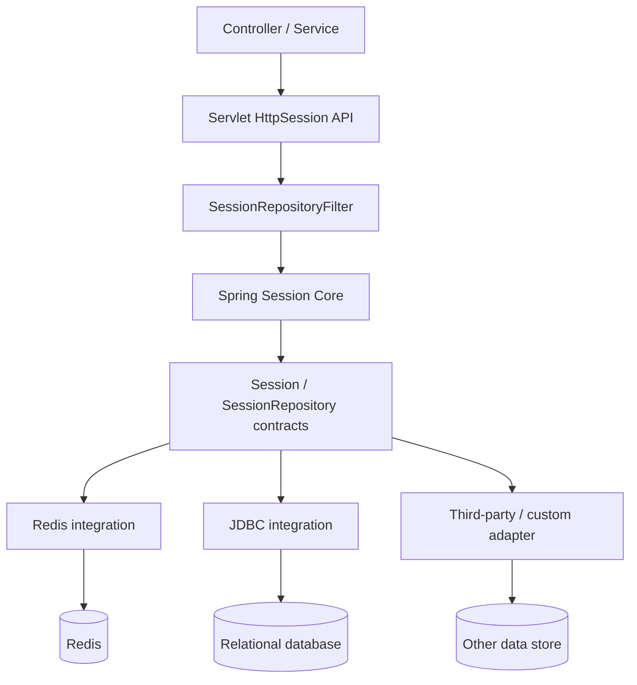

# Phân biệt module lõi, tích hợp đi kèm và phần mở rộng do nhóm khác duy trì

Spring Session cung cấp một mô hình quản lý session độc lập với một máy chủ ứng dụng cụ thể. Ứng dụng làm việc qua các API như `HttpSession` và `SessionRepository`, còn implementation lưu phiên có thể dùng Redis, JDBC hoặc một kho dữ liệu khác. Hệ sinh thái được chia thành nhiều artifact và lớp tích hợp: module lõi định nghĩa hợp đồng và cơ chế chung; các tích hợp đi kèm kết nối hợp đồng đó với kho dữ liệu được dự án hỗ trợ; phần mở rộng bên thứ ba bổ sung adapter hoặc tính năng do nhóm khác duy trì.

Phân biệt đúng ba nhóm giúp chọn dependency phù hợp, hiểu ai chịu trách nhiệm sửa lỗi, đánh giá khả năng tương thích khi nâng cấp và tránh coi một adapter cộng đồng như tính năng được Spring Session bảo đảm. Tên artifact, kho dữ liệu được hỗ trợ và mức bảo trì có thể thay đổi theo release; cần xác minh trên đúng phiên bản dự án định triển khai.

## 1. Bức tranh kiến trúc

Spring Session tách API sử dụng session khỏi nơi lưu trữ. Controller thường tiếp tục dùng `HttpSession`; filter tích hợp Servlet kết nối request với repository; repository lưu và tải session từ kho dữ liệu.



Ba nhóm thành phần có trách nhiệm khác nhau:

1. **Module lõi:** cung cấp abstraction, API session, cơ chế tích hợp chung và hợp đồng mà repository phải tuân thủ.
2. **Tích hợp đi kèm dự án:** triển khai hợp đồng lõi cho một công nghệ lưu trữ hoặc nền tảng cụ thể, được phát hành trong hệ sinh thái Spring Session.
3. **Phần mở rộng bên thứ ba:** adapter, starter hoặc tính năng do tổ chức/cộng đồng khác phát triển và chịu trách nhiệm bảo trì.

Ứng dụng có thể dùng đồng thời module lõi và một tích hợp lưu trữ. Phần mở rộng bên thứ ba chỉ nên được thêm khi có nhu cầu rõ ràng và đã đánh giá chất lượng, khả năng tương thích cùng rủi ro vận hành.

## 2. Module lõi: hợp đồng và hành vi chung

Artifact trung tâm của Spring Session là `spring-session-core`. Đây là nền tảng chung mà các tích hợp lưu trữ dựa vào. Module lõi định nghĩa các abstraction và thành phần không phụ thuộc vào một database cụ thể.

Các thành phần quan trọng thường gồm:

- `Session`: biểu diễn một phiên, gồm ID, thời điểm tạo, thời điểm truy cập, thời hạn không hoạt động và các attribute.
- `SessionRepository<S extends Session>`: hợp đồng tạo, tìm, lưu và xóa session.
- `FindByIndexNameSessionRepository`: mở rộng hợp đồng để tra cứu session theo chỉ mục, thường dùng principal name.
- `MapSession`: implementation session cơ bản được dùng bởi một số repository và tình huống kiểm thử.
- `SessionRepositoryFilter`: kết nối repository với Servlet API, để ứng dụng sử dụng `HttpSession`.
- Các abstraction về resolver session ID, sự kiện vòng đời và hỗ trợ tích hợp web.

Module lõi không quyết định rằng mọi session phải nằm trong Redis hay JDBC. Nó định nghĩa cách các thành phần khác nhau giao tiếp. Nhờ vậy, controller không phải biết session đang được lưu trong Redis, bảng SQL hay một kho dữ liệu khác.

### Hợp đồng repository

Một repository triển khai `SessionRepository` phải đáp ứng các thao tác chính:

| Phương thức | Trách nhiệm |
|---|---|
| `createSession()` | Tạo một session mới, có ID và timeout ban đầu |
| `save(session)` | Lưu trạng thái session và attribute theo hợp đồng implementation |
| `findById(id)` | Tìm session theo ID; trả về `null` nếu không còn phiên hợp lệ |
| `deleteById(id)` | Xóa session theo ID |

Một adapter chỉ triển khai các chữ ký phương thức mà không xử lý đúng timeout, cập nhật attribute, xóa phiên và tính nhất quán vẫn chưa phải một repository an toàn. Khi tự viết implementation, cần xem xét cả semantics của session và cách filter gọi repository trong suốt vòng đời request.

### Module lõi không thay thế tích hợp lưu trữ

Chỉ thêm `spring-session-core` thường chưa đủ để kết nối một ứng dụng với Redis hoặc JDBC. Cần thêm artifact cung cấp repository tương ứng và cấu hình connection factory. Module lõi là hợp đồng và cơ chế chung; integration module mới biết cách đọc/ghi dữ liệu trong kho cụ thể.

## 3. Tích hợp đi kèm Spring Session

Các tích hợp đi kèm được phát triển để kết nối Spring Session với một công nghệ lưu trữ cụ thể. Chúng thường được phát hành thành artifact riêng để người dùng chỉ kéo dependency cần thiết.

Hai tích hợp phổ biến trong phạm vi module này là:

| Artifact | Vai trò | Thành phần lưu trữ thường dùng |
|---|---|---|
| `spring-session-data-redis` | Repository và cấu hình tích hợp Redis | Spring Data Redis, `RedisConnectionFactory` |
| `spring-session-jdbc` | Repository và cấu hình tích hợp JDBC | JDBC `DataSource` và schema quan hệ |

Các artifact tích hợp dựa trên API lõi và cung cấp implementation phù hợp với công nghệ tương ứng. Ví dụ, Redis integration cung cấp repository Redis; JDBC integration cung cấp repository đọc/ghi các bảng Spring Session. Tên implementation và cấu hình chi tiết có thể thay đổi theo phiên bản.

Không nên hiểu “đi kèm” là mọi công nghệ lưu trữ đều có sẵn trong mọi phiên bản. Danh sách module chính thức, mức hỗ trợ và trạng thái bảo trì cần được xác nhận từ tài liệu/release notes của phiên bản đang sử dụng.

### Redis integration

Khi dùng Redis, dependency `spring-session-data-redis` cung cấp repository lưu session vào Redis. Ứng dụng cần một `RedisConnectionFactory`, thường được cung cấp bởi Spring Data Redis hoặc Spring Boot.

Với cấu hình Spring truyền thống, có thể bật session Redis bằng `@EnableRedisHttpSession`. Với Spring Boot, auto-configuration có thể cấu hình repository khi dependency và Redis connection properties phù hợp đã có.

```xml
<dependency>
    <groupId>org.springframework.session</groupId>
    <artifactId>spring-session-data-redis</artifactId>
</dependency>
```

Ví dụ cấu hình Boot tối giản:

```yaml
spring:
  data:
    redis:
      host: redis.internal.example
      port: 6379
  session:
    timeout: 30m
    redis:
      namespace: portal:sessions
```

Đây là ví dụ định hướng; prefix và thuộc tính cấu hình kết nối phụ thuộc phiên bản Spring Boot. Redis integration chịu trách nhiệm chuyển session thành cấu trúc lưu trữ Redis, xử lý TTL và các tính năng repository mà phiên bản cung cấp. Ứng dụng vẫn phải quản lý bảo mật kết nối, dung lượng, eviction, backup/failover và serialization.

### JDBC integration

Khi dùng cơ sở dữ liệu quan hệ, dependency `spring-session-jdbc` cung cấp repository JDBC. Ứng dụng cần `DataSource` và schema tương thích gồm các bảng Spring Session. Spring Boot có thể hỗ trợ khởi tạo schema cho môi trường học; môi trường dùng chung nên quản lý schema bằng migration tool.

```xml
<dependency>
    <groupId>org.springframework.session</groupId>
    <artifactId>spring-session-jdbc</artifactId>
</dependency>
```

Với cấu hình Servlet truyền thống, `@EnableJdbcHttpSession` bật repository JDBC. Với Boot, cấu hình tương ứng có thể đặt trong `application.yml`:

```yaml
spring:
  session:
    jdbc:
      initialize-schema: never
      table-name: SPRING_SESSION
    timeout: 30m
```

Trong ví dụ này, schema đã được quản lý bên ngoài bằng Flyway hoặc Liquibase nên Boot không tự chạy script khởi tạo. JDBC integration dựa vào database transaction, index và schema phù hợp; cần theo dõi tải đọc/ghi, truy vấn dọn phiên hết hạn và connection pool.

## 4. Tích hợp chính thức và Spring Boot auto-configuration

Spring Session và Spring Boot là các dự án có ranh giới trách nhiệm riêng. Spring Session cung cấp API session và repository; Spring Boot cung cấp cơ chế auto-configuration, externalized configuration và tích hợp ứng dụng.

Một số điểm cần phân biệt:

- `spring-session-core`, `spring-session-data-redis` và `spring-session-jdbc` là các artifact thuộc hệ sinh thái Spring Session.
- Spring Boot có thể tự cấu hình các bean cần thiết khi phát hiện dependency và thuộc tính phù hợp.
- Auto-configuration không biến mọi repository bên thứ ba thành tích hợp được Spring Session bảo đảm.
- Một starter hoặc module cấu hình do bên thứ ba phát hành có vòng đời và chính sách tương thích riêng, dù nó có thể sử dụng Spring Boot.

Khi dùng Boot, nên để dependency management của Spring Boot quản lý các phiên bản Spring Framework, Spring Data và Spring Session tương thích. Tránh tự nâng riêng một artifact Spring Session mà không kiểm tra release train, vì có thể dẫn đến lỗi binary compatibility hoặc thiếu API mà integration module mong đợi.

Nếu cần tùy chỉnh sâu, trước tiên kiểm tra bean nào do auto-configuration tạo ra và điều kiện nào khiến cấu hình đó hoạt động. Chỉ thay thế bean cần thiết; không bật thêm annotation hoặc đăng ký filter trùng nếu Boot đã tạo hạ tầng session.

## 5. Phần mở rộng do nhóm khác duy trì

Phần mở rộng bên thứ ba có thể cung cấp repository cho một kho dữ liệu chưa có integration chính thức trong phiên bản Spring Session đang dùng, hoặc bổ sung tính năng đặc thù cho một nền tảng. Các phần mở rộng này có thể rất hữu ích, nhưng không mặc nhiên có cùng mức kiểm thử, hỗ trợ và lịch phát hành với module chính thức.

Ví dụ về loại phần mở rộng có thể gặp:

- Adapter cho một database hoặc key-value store khác.
- Starter giúp tự động cấu hình một repository tùy chỉnh.
- Bridge tích hợp session với một nền tảng cloud hoặc dịch vụ quản lý phiên.
- Extension cung cấp cách mã hóa/giải mã dữ liệu hoặc metadata riêng.
- Repository nội bộ do tổ chức tự duy trì cho hạ tầng đặc thù.

Các ví dụ này mô tả nhóm giải pháp, không phải xác nhận rằng một artifact cụ thể đang được Spring Session hỗ trợ chính thức. Trước khi chọn, cần xác định rõ chủ sở hữu mã nguồn, chính sách phát hành và kênh xử lý lỗi bảo mật.

### Ai chịu trách nhiệm khi có lỗi?

Với module lõi hoặc integration chính thức, có thể tra cứu issue tracker, release notes và chính sách hỗ trợ của dự án tương ứng. Với extension bên thứ ba, nhóm duy trì extension chịu trách nhiệm phát hành bản sửa và xác nhận tương thích. Spring Session core team không nhất thiết có nghĩa vụ sửa lỗi trong mã của extension.

Ngay cả khi extension được viết bởi một công ty lớn, vẫn cần xác minh artifact đó có nằm trong phạm vi hỗ trợ của dự án hay không. Tên package bắt đầu bằng `org.springframework` hoặc việc dependency xuất hiện trong một ví dụ trên mạng không đủ để chứng minh trạng thái hỗ trợ.

## 6. Cách nhận diện một dependency thuộc nhóm nào

Không nên phân loại chỉ dựa trên tên artifact. Hãy kiểm tra nhiều nguồn:

1. **Group ID và artifact ID:** cho biết tọa độ dependency, nhưng không tự chứng minh mức hỗ trợ.
2. **Repository nguồn:** kiểm tra tổ chức sở hữu mã nguồn, nhóm maintainer và vị trí module trong repository.
3. **Tài liệu chính thức:** xác nhận artifact có được liệt kê trong tài liệu Spring Session của phiên bản đang dùng không.
4. **Release notes:** xem module được phát hành cùng release train nào và có ghi chú tương thích không.
5. **Issue tracker:** xác định nơi báo lỗi và cách nhóm phát triển xử lý issue.
6. **Lịch phát hành:** xem extension có phát hành tương thích với các phiên bản Spring Framework/Boot mới không.
7. **Dependency tree:** xác định phiên bản transitives thực tế và tránh xung đột với module chính thức.

Ví dụ về cách phân loại:

| Dấu hiệu | Nhận định ban đầu | Việc cần xác minh |
|---|---|---|
| Artifact thuộc tổ chức Spring Session và được liệt kê trong tài liệu release | Có khả năng là module chính thức | Phiên bản, phạm vi hỗ trợ và repository maintainer |
| Artifact dùng `org.springframework.session` nhưng không có trong tài liệu phiên bản | Chưa đủ bằng chứng | Repository nguồn và lịch sử phát hành |
| Artifact do một vendor phát hành để kết nối kho dữ liệu riêng | Extension/vendor integration | SLA, bảo mật, compatibility matrix và hỗ trợ dài hạn |
| Adapter do nhóm nội bộ viết | Custom extension | Người sở hữu, quy trình review, test và kế hoạch bảo trì |

## 7. Tương thích phiên bản và quản lý dependency

Spring Session phụ thuộc vào các API của Spring Framework, Spring Data và đôi khi Spring Security. Một repository extension có thể biên dịch với phiên bản cũ nhưng không tương thích khi nâng Spring Session hoặc Spring Boot.

Khi thêm extension, hãy kiểm tra:

- Phiên bản Spring Session mà extension khai báo hỗ trợ.
- Phiên bản Spring Boot và Spring Framework tương ứng.
- Phiên bản Spring Data Redis/JDBC hoặc client database mà extension cần.
- Java baseline và Servlet/Jakarta namespace mà artifact sử dụng.
- Có sử dụng API nội bộ hoặc class không được đánh dấu public extension point không.
- Có kéo theo phiên bản transitives xung đột với BOM của ứng dụng không.

Không override dependency chỉ để làm build xanh nếu chưa hiểu API bị thay đổi. Một dependency tree sạch ở compile time chưa chứng minh repository hoạt động đúng khi tạo, tải, cập nhật và xóa session.

Với Maven, có thể xem dependency tree để phát hiện phiên bản bị kéo vào ngoài ý muốn:

```bash
mvn dependency:tree
```

Với Gradle:

```bash
./gradlew dependencies --configuration runtimeClasspath
```

Khi cần xem lý do chọn phiên bản:

```bash
./gradlew dependencyInsight --dependency spring-session-core --configuration runtimeClasspath
```

Các lệnh này chỉ giúp hiểu classpath; vẫn cần integration test với kho dữ liệu thực tế.

## 8. Tiêu chí đánh giá extension bên thứ ba

Trước khi đưa extension vào hệ thống, đánh giá ít nhất các khía cạnh sau:

| Tiêu chí | Câu hỏi cần trả lời |
|---|---|
| Chủ sở hữu | Tổ chức hoặc nhóm nào chịu trách nhiệm? Có maintainer đang hoạt động không? |
| Hoạt động dự án | Lần phát hành gần nhất, issue/PR và mức độ phản hồi ra sao? |
| Tương thích | Có ma trận Spring Session, Boot, Framework, Java và database không? |
| Chất lượng | Có unit test, integration test, test nhiều instance và test lỗi mạng không? |
| Bảo mật | Có quy trình công bố lỗ hổng, cập nhật dependency và xử lý deserialization không? |
| Vận hành | Có hướng dẫn TTL, cleanup, backup, failover, migration và quan sát không? |
| Hiệu năng | Có benchmark hoặc giới hạn tải được mô tả không? |
| Giấy phép | License có tương thích chính sách sử dụng của tổ chức không? |
| Thoát khỏi extension | Có thể chuyển sang repository khác mà không đổi mã nghiệp vụ lớn không? |

Một extension ít người dùng không nhất thiết là lựa chọn sai, nhưng tổ chức phải hiểu chi phí sở hữu lâu dài. Nếu không có maintainer bên ngoài, đội dự án có thể phải fork, vá bảo mật và duy trì compatibility matrix của riêng mình.

## 9. Khi nào nên tự viết repository?

Spring Session cung cấp extension point `SessionRepository` để tích hợp một kho dữ liệu riêng. Tuy nhiên, tự viết repository không chỉ là ánh xạ `save()` sang một lệnh insert. Implementation phải xử lý đúng vòng đời session và các yêu cầu mà ứng dụng mong đợi.

Trước khi tự viết, hãy xác định:

- Kho dữ liệu có hỗ trợ truy vấn theo session ID hiệu quả không?
- Có cơ chế TTL/expiration hoặc công việc cleanup không?
- Có bảo đảm nhất quán khi nhiều request cập nhật cùng session không?
- Attribute được serialize bằng định dạng nào và cách nâng cấp schema ra sao?
- `save` có idempotent không và xử lý retry như thế nào?
- Có cần `FindByIndexNameSessionRepository` để tra cứu theo principal không?
- Cách phát sự kiện tạo/xóa/hết hạn session được triển khai thế nào?
- Làm sao bảo đảm filter không ghi lại session đã bị invalidate?
- Cách xử lý lỗi kết nối, timeout, failover và dữ liệu không đọc được?

Nếu cần principal index, implementation có thể mở rộng `FindByIndexNameSessionRepository`. Nếu chỉ cần CRUD session theo ID, `SessionRepository` có thể đủ. Không nên khai báo hỗ trợ một interface index nếu implementation không duy trì index chính xác.

### Phác thảo một adapter

Ví dụ sau mô tả hình dạng của một adapter tùy chỉnh, không phải repository hoàn chỉnh:

```java
import org.springframework.session.Session;
import org.springframework.session.SessionRepository;

public class CustomSessionRepository<S extends Session>
        implements SessionRepository<S> {

    @Override
    public S createSession() {
        // Tạo session với ID an toàn và timeout mặc định.
        throw new UnsupportedOperationException("Implement with the chosen store");
    }

    @Override
    public void save(S session) {
        // Serialize và lưu metadata/attributes theo một thao tác nhất quán.
        throw new UnsupportedOperationException("Implement with the chosen store");
    }

    @Override
    public S findById(String id) {
        // Tải session nếu còn hợp lệ; trả null nếu không tồn tại/hết hạn.
        throw new UnsupportedOperationException("Implement with the chosen store");
    }

    @Override
    public void deleteById(String id) {
        // Xóa session và dữ liệu phụ trợ liên quan.
        throw new UnsupportedOperationException("Implement with the chosen store");
    }
}
```

Các `UnsupportedOperationException` chỉ là chỗ đánh dấu phần cần triển khai; không được đưa nguyên ví dụ này vào ứng dụng chạy thật. Một adapter hoàn chỉnh cần test hợp đồng, kiểm thử đồng thời, timeout, serialization, invalidate, principal index nếu có và hành vi khi kho dữ liệu ngừng hoạt động.

## 10. Giữ mã nghiệp vụ độc lập với repository

Một mục tiêu quan trọng của Spring Session là controller và service không phụ thuộc trực tiếp vào công nghệ lưu trữ. Ví dụ, controller chỉ dùng `HttpSession`:

```java
import jakarta.servlet.http.HttpSession;
import org.springframework.web.bind.annotation.PostMapping;
import org.springframework.web.bind.annotation.RestController;

@RestController
class WorkflowController {

    @PostMapping("/workflow/next")
    String next(HttpSession session) {
        Integer step = (Integer) session.getAttribute("workflow.step");
        int nextStep = step == null ? 1 : step + 1;
        session.setAttribute("workflow.step", nextStep);
        return "Bước hiện tại: " + nextStep;
    }
}
```

Khi chuyển từ Redis sang JDBC, controller không cần biết repository thay đổi. Phần thay đổi tập trung ở dependency, cấu hình connection, schema và vận hành. Tuy nhiên, không phải mọi khác biệt đều biến mất: timeout, serialization, index, concurrency, hiệu năng và semantics của từng kho dữ liệu vẫn cần được kiểm thử.

Tránh để service nghiệp vụ gọi trực tiếp Redis key hoặc SQL của bảng session. Làm như vậy sẽ khóa mã nghiệp vụ vào implementation và khiến việc thay repository khó khăn hơn.

## 11. Bảo trì và trách nhiệm vận hành

Mức hỗ trợ của module ảnh hưởng đến cách tổ chức vận hành:

- **Module lõi:** theo dõi release Spring Session, API thay đổi, advisory bảo mật và tương thích Spring Framework/Boot.
- **Tích hợp đi kèm:** ngoài lõi, theo dõi phiên bản client và server của kho dữ liệu, schema, TTL, serialization, index, cleanup và failover.
- **Extension bên thứ ba:** theo dõi cả release của Spring Session lẫn lịch phát hành riêng của extension; kiểm tra issue tracker, security response và compatibility matrix của maintainer.
- **Adapter nội bộ:** tổ chức owner rõ ràng, review mã, kiểm thử hợp đồng, tài liệu vận hành và người thay thế khi maintainer rời nhóm.

Trong mọi trường hợp, ứng dụng cần giám sát lỗi đọc/ghi session, latency repository, timeout, kích thước session, số phiên hoạt động và lỗi serialization. Với nhiều instance, cần xác nhận các instance dùng cùng kho dữ liệu và cấu hình tương thích.

## 12. Kiểm thử một tích hợp hoặc extension

Một extension có thể biên dịch nhưng vẫn không đáp ứng đúng semantics session. Bộ kiểm thử cần đi qua API Spring Session và đường request thực tế:

1. Tạo session mới và xác nhận ID không dễ đoán, không trùng.
2. Lưu nhiều attribute và tải lại session từ request sau.
3. Cập nhật, xóa attribute và xác nhận thay đổi được lưu đúng.
4. Kiểm tra timeout, expiration và cleanup.
5. Gọi `invalidate()` và xác nhận session không được khôi phục.
6. Gửi cùng session qua hai instance để xác nhận repository dùng chung.
7. Gửi hai request đồng thời cập nhật cùng session và đánh giá chính sách xung đột.
8. Mô phỏng kho dữ liệu timeout, mất kết nối và khởi động lại.
9. Kiểm tra serialization giữa phiên bản ứng dụng cũ và mới.
10. Nếu có principal index, kiểm tra tra cứu, đổi principal và xóa index.
11. Nếu có sự kiện, kiểm tra hành vi khi subscriber offline và xử lý trùng.

Nên có contract test dùng chung cho mọi implementation repository. Khi thay Redis integration bằng JDBC hoặc adapter bên thứ ba, chạy lại cùng bộ test để phát hiện khác biệt semantics trước khi triển khai.

## 13. Quy trình chọn module cho một ứng dụng

Có thể ra quyết định theo thứ tự sau:

1. Xác định ứng dụng cần Servlet `HttpSession`, reactive session hay một cơ chế khác. Chọn đúng mô hình tích hợp.
2. Xác định kho dữ liệu đáp ứng yêu cầu chia sẻ giữa các instance, độ trễ, durability, TTL và năng lực vận hành.
3. Kiểm tra Spring Session có integration chính thức cho kho đó trong phiên bản mục tiêu không.
4. Nếu có, dùng artifact tương ứng và phiên bản được quản lý tương thích với Spring Boot/Framework.
5. Nếu không có, tìm extension bên thứ ba và đánh giá maintainer, bảo mật, tương thích, test và chi phí hỗ trợ.
6. Chỉ tự viết repository khi có yêu cầu đặc thù và tổ chức đủ năng lực duy trì.
7. Giữ mã nghiệp vụ phụ thuộc vào API session chung, không phụ thuộc key nội bộ của kho dữ liệu.
8. Kiểm thử vòng đời, concurrency, expiration, failover và rolling deployment trên topology gần production.

## 14. Bảng quyết định nhanh

| Nhu cầu | Lựa chọn thường hợp lý | Trách nhiệm cần theo dõi |
|---|---|---|
| Muốn dùng API session chung | `spring-session-core` cùng tích hợp phù hợp | API và semantics chung |
| Lưu session trong Redis | `spring-session-data-redis` | Redis, TTL, serialization, notification và failover |
| Lưu session trong SQL | `spring-session-jdbc` | Schema, migration, index, transaction và cleanup |
| Dùng kho chưa có integration chính thức | Extension bên thứ ba hoặc adapter nội bộ | Maintainer, compatibility, security và contract tests |
| Muốn thay kho dữ liệu về sau | Giữ controller/service dùng abstraction Spring Session | Tránh phụ thuộc trực tiếp key/schema nội bộ |

## 15. Nguyên tắc thiết kế

- Dùng module lõi làm hợp đồng chung và chọn integration artifact theo kho lưu trữ thực tế.
- Không nhầm artifact riêng với tính năng tự động có trong core.
- Xác minh module nào được tài liệu chính thức của đúng release liệt kê và duy trì.
- Không coi extension bên thứ ba là được Spring Session bảo đảm chỉ vì nó dùng API Spring.
- Đánh giá maintainer, lịch phát hành, compatibility matrix, bảo mật, license và khả năng thay thế trước khi đưa extension vào production.
- Quản lý phiên bản dependency theo BOM/release train tương thích; kiểm tra dependency tree khi có xung đột.
- Nếu tự viết repository, tuân thủ đầy đủ semantics của `SessionRepository` và kiểm thử vòng đời, concurrency, expiration, serialization.
- Giữ mã nghiệp vụ dùng `HttpSession` hoặc API chung; tránh phụ thuộc vào Redis key hoặc bảng session trực tiếp.
- Theo dõi repository latency, lỗi serialization, timeout, số session và tình trạng kho lưu trữ trong vận hành.

Spring Session được thiết kế để mã ứng dụng không bị ràng buộc vào một máy chủ hay một kho session cụ thể. Module lõi cung cấp abstraction; tích hợp đi kèm triển khai abstraction cho những kho dữ liệu được dự án hỗ trợ; extension bên thứ ba mở rộng phạm vi nhưng mang theo trách nhiệm bảo trì riêng. Phân biệt rõ ba nhóm, xác minh compatibility và kiểm thử cùng một hợp đồng repository sẽ giúp ứng dụng chọn được giải pháp phù hợp mà vẫn giữ khả năng thay đổi hạ tầng session trong tương lai.
