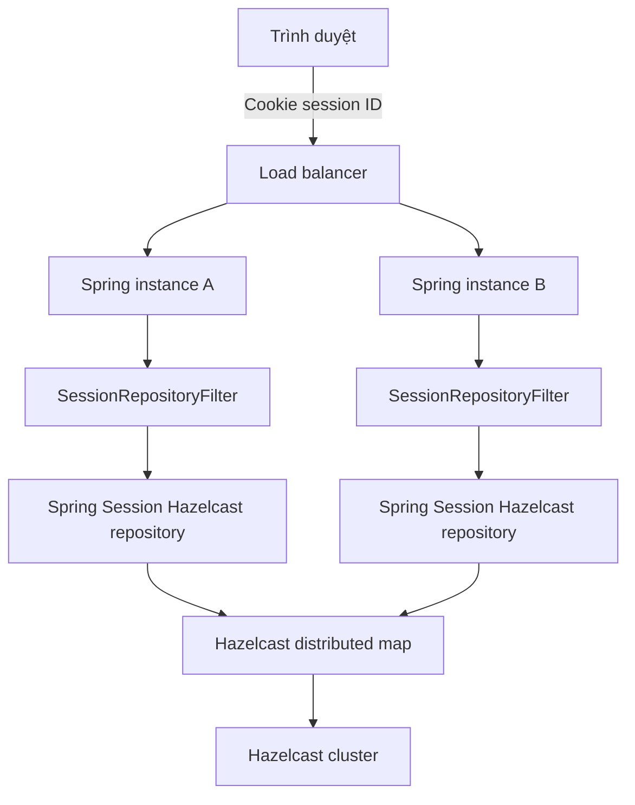
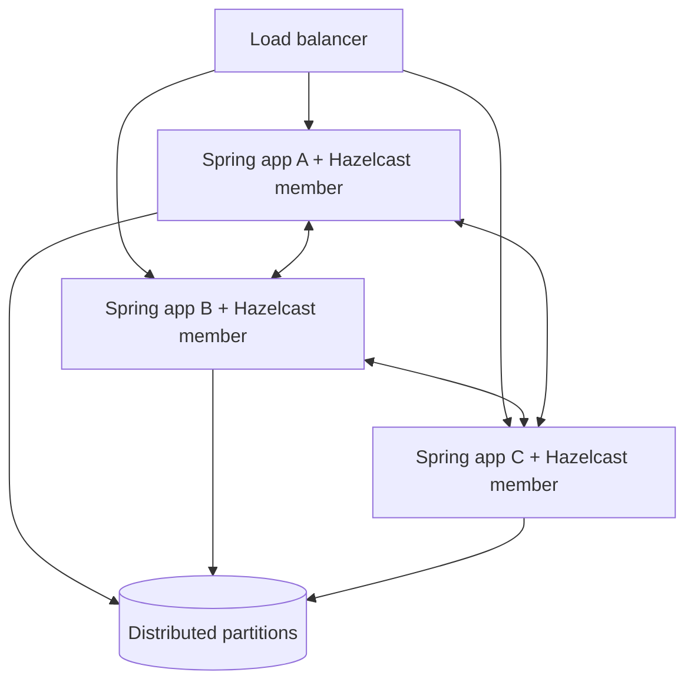
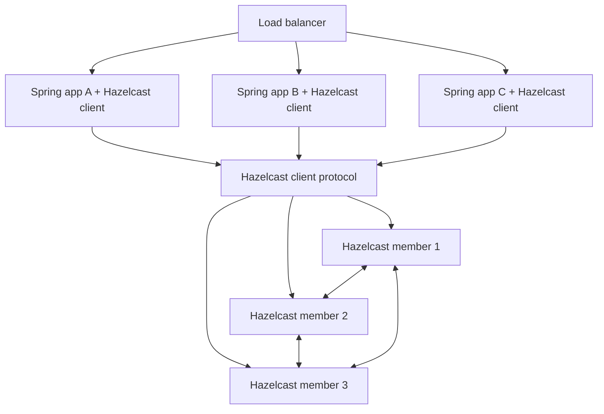

# Kho Hazelcast nhúng, client-server và các yêu cầu triển khai

Spring Session có thể dùng Hazelcast làm kho lưu session phân tán. Ứng dụng Servlet tiếp tục thao tác với HttpSession, còn session được lưu trong distributed map của Hazelcast để nhiều instance cùng truy cập. Hazelcast có hai topology phổ biến: **embedded/member**, trong đó mỗi tiến trình ứng dụng cũng là một thành viên cluster; và **client-server**, trong đó cluster Hazelcast chạy riêng còn ứng dụng kết nối bằng client.

Hai topology ảnh hưởng khác nhau đến triển khai, mở rộng, bộ nhớ, discovery, bảo mật và xử lý sự cố. Bài học này giải thích cách Spring Session kết nối với HazelcastInstance, cách chọn topology, yêu cầu mạng và cấu hình map, cùng các vấn đề TTL, backup, serialization, rolling deployment và kiểm thử nhiều node.

## 1. Hazelcast trong kiến trúc Spring Session

Spring Session thay lớp lưu session mặc định của Servlet container bằng một SessionRepository. Với integration Hazelcast, repository dùng distributed map để lưu session và thuộc tính phiên. SessionRepositoryFilter bọc request/response, đọc session ID từ cookie hoặc resolver, tải session qua repository và lưu thay đổi theo chính sách Spring Session.



Các instance Spring cần dùng cùng cluster và cùng cấu hình map. Khi request đầu được xử lý ở A và request tiếp theo đến B, B phải tra cứu được cùng session ID trong distributed map. Cookie chỉ mang định danh; dữ liệu phiên nằm trong Hazelcast.

Hazelcast không thay thế filter, cookie serializer hoặc cơ chế xác thực. Nó cung cấp kho dữ liệu dùng chung; thuộc tính session, timeout và vòng đời vẫn được quản lý qua Spring Session.

## 2. Dependency và cấu hình tích hợp

Với phiên bản Spring Session có module Hazelcast, ứng dụng có thể thêm dependency:

```groovy
dependencies {
    implementation("org.springframework.boot:spring-boot-starter-web")
    implementation("org.springframework.session:spring-session-hazelcast")
    implementation("com.hazelcast:hazelcast")
}
```

Dùng Spring Boot dependency management hoặc BOM phù hợp để chọn phiên bản Spring Session và Hazelcast tương thích. Không tự ghép phiên bản mới với integration cũ mà chưa kiểm tra compatibility. Tên module, annotation và API cấu hình có thể thay đổi theo dòng phiên bản; ví dụ sau minh họa mô hình Servlet phổ biến.

Spring Session Hazelcast thường được bật bằng annotation tích hợp và một bean HazelcastInstance:

```java
import com.hazelcast.core.HazelcastInstance;
import org.springframework.context.annotation.Bean;
import org.springframework.context.annotation.Configuration;
import org.springframework.session.hazelcast.config.annotation.web.http.EnableHazelcastHttpSession;

@Configuration
@EnableHazelcastHttpSession
public class HazelcastSessionConfiguration {

    @Bean(destroyMethod = "shutdown")
    HazelcastInstance hazelcastInstance() {
        // Trả về member hoặc client theo topology triển khai.
        return createHazelcastInstance();
    }
}
```

createHazelcastInstance() là hàm minh họa cần thay bằng cấu hình member hoặc client ở các phần sau; đây không phải API Hazelcast có sẵn. Integration dùng bean HazelcastInstance để truy cập map. Chỉ đăng ký một cách tạo repository/filter; tránh vừa bật annotation vừa tự đăng ký filter/repository trùng lặp.

Nếu phiên bản integration không cung cấp EnableHazelcastHttpSession hoặc có API khác, dùng cơ chế mà tài liệu đúng phiên bản hỗ trợ. Nguyên tắc kiến trúc vẫn là repository Spring Session dùng một HazelcastInstance kết nối tới cluster chứa distributed map session.

## 3. Topology embedded/member

Ở topology embedded, mỗi tiến trình Spring Boot khởi tạo một Hazelcast member. Các member khám phá nhau và tạo thành cluster. Ứng dụng vừa xử lý HTTP vừa tham gia lưu trữ và phân phối dữ liệu Hazelcast.



### 3.1. Khởi tạo member

Ví dụ cấu hình embedded member:

```java
import com.hazelcast.config.Config;
import com.hazelcast.core.Hazelcast;
import com.hazelcast.core.HazelcastInstance;

@Bean(destroyMethod = "shutdown")
HazelcastInstance hazelcastMember() {
    Config config = new Config();
    config.setClusterName("shop-session-cluster");

    // Tắt multicast nếu môi trường không hỗ trợ multicast discovery.
    config.getNetworkConfig()
            .getJoin()
            .getMulticastConfig()
            .setEnabled(false);

    // Production phải cấu hình TCP/IP member list hoặc discovery plugin.
    return Hazelcast.newHazelcastInstance(config);
}
```

Đoạn code tắt multicast để nhấn mạnh rằng production cần cấu hình discovery rõ ràng. Nếu tắt multicast mà không bật TCP/IP discovery hoặc plugin discovery, các member có thể không tìm thấy nhau và mỗi tiến trình hình thành cluster riêng. Khi đó session bị chia thành nhiều nhóm dữ liệu độc lập.

Trong môi trường nhỏ có địa chỉ member ổn định, có thể dùng TCP/IP member list. Với Kubernetes hoặc cloud có địa chỉ pod thay đổi, nên dùng discovery mechanism phù hợp nền tảng thay vì hard-code IP. Discovery phải nhất quán trên mọi member và chỉ cho phép node thuộc cluster được tham gia.

### 3.2. Ưu điểm và chi phí

Ưu điểm:

- Không cần vận hành cluster Hazelcast tách biệt ngay từ đầu.
- Mỗi member ứng dụng trực tiếp tham gia phân phối partition và backup.
- Phù hợp với hệ thống nhỏ hoặc môi trường mà ứng dụng và kho session có cùng vòng đời.
- Có thể tăng dung lượng cluster bằng cách tăng application instance nếu CPU và heap còn đủ.

Chi phí và giới hạn:

- Mỗi instance dành heap, CPU và network cho Hazelcast ngoài workload HTTP.
- Scale ứng dụng đồng thời làm thay đổi số member, gây partition migration và network traffic.
- Rolling deployment hoặc restart ứng dụng cũng làm membership cluster thay đổi.
- GC pause hoặc sự cố ở ứng dụng có thể ảnh hưởng khả năng phục vụ dữ liệu cluster.
- Cần quản lý discovery, firewall, cluster identity và compatibility trên mọi application node.

Embedded phù hợp khi quy mô và yêu cầu vận hành cho phép ghép vòng đời ứng dụng với cluster. Nếu cần scale độc lập hoặc deployment thường xuyên, cân nhắc client-server.

## 4. Topology client-server

Ở topology client-server, Hazelcast cluster chạy trên các node riêng. Các tiến trình Spring Boot khởi tạo Hazelcast client để kết nối cluster. Client không trở thành member, không sở hữu partition và không tham gia phân phối dữ liệu.



Ví dụ tạo Hazelcast client:

```java
import com.hazelcast.client.HazelcastClient;
import com.hazelcast.client.config.ClientConfig;
import com.hazelcast.core.HazelcastInstance;

@Bean(destroyMethod = "shutdown")
HazelcastInstance hazelcastClient() {
    ClientConfig clientConfig = new ClientConfig();
    clientConfig.setClusterName("shop-session-cluster");
    clientConfig.getNetworkConfig()
            .addAddress("hz-session-1.internal:5701",
                        "hz-session-2.internal:5701",
                        "hz-session-3.internal:5701");

    return HazelcastClient.newHazelcastClient(clientConfig);
}
```

Địa chỉ trong ví dụ là endpoint member hoặc endpoint được expose cho client trong mạng nội bộ. Production cần bổ sung TLS, authentication/credentials, retry và connection timeout theo Hazelcast version và chính sách hạ tầng. Không expose cổng cluster ra Internet.

### 4.1. Ưu điểm và chi phí

Ưu điểm:

- Scale application instance độc lập với số Hazelcast member.
- Restart ứng dụng ít làm thay đổi membership của cluster dữ liệu.
- Có thể cấp tài nguyên, giám sát, backup và nâng cấp Hazelcast riêng.
- Các ứng dụng khác có thể dùng chung cluster nếu có phân vùng dữ liệu và quyền phù hợp.

Chi phí và giới hạn:

- Cần triển khai và vận hành cluster Hazelcast riêng.
- Request session phụ thuộc kết nối mạng từ ứng dụng đến cluster.
- Cần quản lý client connection, reconnect, timeout, TLS và authentication.
- Sự cố cluster có thể ảnh hưởng đồng thời nhiều application instance.
- Cần thiết kế quota/isolation để workload khác không làm session traffic bị thiếu tài nguyên.

Client-server thường phù hợp khi session store là hạ tầng dùng chung quan trọng, ứng dụng có nhiều instance hoặc deployment thường xuyên, và đội vận hành muốn scale cluster dữ liệu độc lập.

## 5. So sánh embedded và client-server

| Tiêu chí | Embedded/member | Client-server |
| --- | --- | --- |
| Hazelcast chạy ở đâu? | Trong JVM ứng dụng | Trong cluster riêng |
| Thành phần ứng dụng | Hazelcast member | Hazelcast client |
| Phân phối partition | Member ứng dụng tham gia | Hazelcast member chuyên dụng |
| Scale ứng dụng | Làm thay đổi membership cluster | Scale client độc lập |
| Tài nguyên heap | Dùng chung heap ứng dụng | Heap session store nằm ở member |
| Deployment | Restart ứng dụng làm member join/leave | Restart client ít ảnh hưởng membership |
| Network | Member-to-member | Client-to-member và member-to-member |
| Phù hợp | Hệ thống nhỏ, vòng đời đơn giản | Production nhiều instance, cần cô lập vận hành |

Không topology nào tự động bảo đảm session không mất. Cả hai đều cần cấu hình backup, xử lý member failure, quản lý cluster và kiểm thử tình huống mất node.

## 6. Cluster name, discovery và network

Mọi member trong cùng cluster phải dùng cùng cluster name và cấu hình bảo mật tương thích. Client cũng phải chỉ định đúng cluster name. Cluster name giúp ngăn node vô tình tham gia nhầm cluster; nó không thay thế authentication hoặc network isolation.

Các yêu cầu mạng:

- Mở cổng member-to-member giữa Hazelcast members theo cấu hình.
- Mở cổng client-to-member từ application subnet đến cluster.
- Chỉ cho phép nguồn kết nối được phê duyệt; không mở cổng cluster công khai.
- Cấu hình discovery theo môi trường: TCP/IP, Kubernetes discovery hoặc plugin tương ứng.
- Đảm bảo DNS/service discovery phản ánh member đang hoạt động.
- Kiểm tra NAT, firewall, security group và network policy không chặn cluster traffic.
- Cấu hình TLS và authentication nếu hạ tầng yêu cầu; bảo vệ secret của client.

Không dùng multicast discovery trong production cloud/Kubernetes nếu nền tảng không hỗ trợ multicast đáng tin cậy. Không dùng danh sách IP cũ khi pod hoặc VM có thể thay đổi địa chỉ. Discovery sai có thể khiến các member tạo cluster riêng; triệu chứng là mỗi instance nhìn thấy session của nhóm mình nhưng không thấy session do node khác tạo.

## 7. Distributed map và cấu hình dữ liệu session

Spring Session Hazelcast lưu session trong distributed map. Hazelcast chia dữ liệu map thành partition và phân phối trên các member. Các bản sao backup có thể được lưu ở member khác để tiếp tục phục vụ khi một member mất.

Khi triển khai, cần xác định:

- Tên map mà integration Spring Session sử dụng hoặc được cấu hình.
- Số backup đồng bộ và bất đồng bộ phù hợp yêu cầu availability.
- TTL/max idle policy của map có tương thích timeout session.
- Memory limit, eviction policy và giới hạn kích thước session.
- Serialization format và class compatibility giữa các node.
- Quyền truy cập map và network segment được phép sử dụng.

Không đặt map TTL ngắn hơn idle timeout của session nếu integration không chủ động gia hạn theo cùng semantics. Nếu Hazelcast tự xóa entry trước khi Spring Session xem phiên hết hạn, người dùng bị mất session sớm. Ngược lại, map entry sống lâu hơn session có thể chiếm bộ nhớ cho đến khi cleanup chạy. Hãy kiểm tra cách repository áp dụng expiration trong phiên bản đang dùng trước khi đặt TTL ở MapConfig; tránh cấu hình TTL cạnh tranh với chính sách repository.

Ví dụ khái niệm về MapConfig:

```java
MapConfig sessionMap = new MapConfig("map-name-used-by-session-integration");
sessionMap.setBackupCount(1);
config.addMapConfig(sessionMap);
```

Tên map ở đây là placeholder. Cần xác định tên map thực tế mà phiên bản Spring Session Hazelcast đang dùng rồi mới áp dụng cấu hình. Không tự tạo map có tên gần giống và cho rằng repository sẽ sử dụng nó. MapConfig không khớp tên map sẽ không tác động đến dữ liệu session.

Backup count là số bản sao dữ liệu trên member khác theo chính sách Hazelcast. Backup trong memory giúp chịu lỗi member đơn lẻ, nhưng không tương đương backup bền vững hoặc bản sao lưu database. Nếu toàn cluster mất dữ liệu hoặc restart mà không có persistence phù hợp, session có thể mất và người dùng phải đăng nhập lại.

## 8. TTL, max inactive interval và cleanup

Spring Session xác định idle timeout theo session. Hazelcast lưu entry trong map và có cơ chế expiration/eviction riêng. Hai lớp thời hạn cần được cấu hình tương thích:

1. Spring Session quyết định một phiên đã hết hạn theo maxInactiveInterval.
2. Hazelcast quản lý thời gian tồn tại của map entry và giải phóng dữ liệu theo map policy.

Không dùng eviction theo LRU làm cơ chế thay thế session timeout. Eviction do thiếu bộ nhớ có thể xóa session còn hiệu lực; người dùng bị đăng xuất sớm dù chưa hết idle timeout. Nếu bật eviction, cần hiểu chính sách và xác định hành vi ứng dụng khi session bị loại khỏi map.

Với map session, cần theo dõi:

- Số entry session đang lưu.
- Memory used và số lượng entry bị evict/expired.
- Phân bố kích thước session attributes.
- Thời gian lưu session và tần suất gia hạn.
- Lỗi serialization/deserialization.
- Tình trạng cleanup và event listener nếu integration cung cấp sự kiện vòng đời.

Không giả định entry bị xóa đúng vào mili giây TTL về 0. Expiration có thể chạy bất đồng bộ. Khi cần hành động nghiệp vụ quan trọng lúc session hết hạn, thiết kế listener idempotent và cơ chế đối soát; không dựa vào thời điểm entry biến mất để đảm bảo exactly-once.

## 9. Serialization và tương thích rolling deployment

Session attributes có thể được lưu dưới dạng object. Khi member Hazelcast hoặc application node trao đổi dữ liệu, chúng phải hiểu định dạng serialization và class tương ứng. Nếu một node ghi object theo class version mới trong khi node khác vẫn chạy code cũ không đọc được, request có thể lỗi khi khôi phục session.

Nguyên tắc thiết kế:

- Ưu tiên kiểu dữ liệu đơn giản, nhỏ và ổn định như string, number, boolean, enum có kiểm soát và DTO rõ ràng.
- Tránh lưu entity ORM có lazy proxy, object gắn persistence context, Spring bean, request/response object hoặc object chứa connection.
- Nếu dùng Java serialization, hiểu rủi ro tương thích class và kiểm soát serialVersionUID; không xem Java serialization là định dạng bền vững cho mọi lần nâng cấp.
- Với Hazelcast serialization chuyên dụng, chọn serializer có schema/versioning rõ ràng và cấu hình giống nhau trên các member/client cần giải mã.
- Khi rolling deployment, bảo đảm phiên bản cũ và mới đọc được dữ liệu session do nhau ghi trong thời gian cùng chạy.
- Không đổi class package, tên field hoặc định dạng session attribute đột ngột nếu session cũ vẫn còn hiệu lực.

Một chiến lược an toàn là lưu ID hoặc trạng thái tối thiểu trong session, còn dữ liệu nghiệp vụ nằm trong database. Khi cần đổi cấu trúc session, có thể đọc cả định dạng cũ và mới trong giai đoạn chuyển tiếp, sau đó ngừng ghi định dạng cũ khi toàn bộ node đã nâng cấp.

## 10. Availability, backup và split-brain

Hazelcast là hệ thống phân tán; cần chuẩn bị cho member failure, network partition, rolling restart và cluster merge. Backup count có thể giúp dữ liệu partition được phục vụ khi member chính mất, nhưng kết quả phụ thuộc cấu hình backup, thời điểm replication và loại failure.

Các điểm cần quyết định:

- Số member tối thiểu để phân phối partition và backup.
- Backup count phù hợp với mức độ mất session có thể chấp nhận.
- Chính sách khi cluster không đủ member hoặc không truy cập được.
- Split-brain protection và merge policy theo topology, phiên bản Hazelcast và yêu cầu session.
- Có cần persistence hoặc backup dữ liệu theo edition/capability Hazelcast đang sử dụng không.
- Ứng dụng phản hồi thế nào khi session store tạm thời không khả dụng.

Session thường có thể chấp nhận mất trong một số sự cố nếu người dùng chỉ cần đăng nhập lại; dữ liệu nghiệp vụ thì không. Không dùng session map làm nguồn lưu duy nhất cho đơn hàng, thanh toán hoặc dữ liệu cần durability cao.

Khi cluster tách mạng thành hai nhóm, mỗi nhóm có thể có góc nhìn khác nhau về dữ liệu. Khi merge, policy quyết định cách xử lý xung đột map entry. Không giả định mọi cập nhật session tự hợp nhất theo ý nghiệp vụ. Kiểm thử split-brain/merge theo topology được hỗ trợ và chọn policy có hành vi rõ ràng.

Nếu cluster hoàn toàn không khả dụng, request cần đọc hoặc ghi session có thể thất bại. Không tự động chuyển từng application instance sang map cục bộ như fallback, vì điều đó tạo nhiều nguồn session không đồng bộ. Xác định timeout, lỗi HTTP phù hợp, retry có giới hạn và kế hoạch phục hồi cluster.

## 11. Bảo mật Hazelcast cluster

Session map chứa dữ liệu liên quan đến phiên xác thực. Người có quyền đọc map có thể lấy session attributes và có thể tìm được session ID tùy integration. Bảo vệ cluster tương đương bảo vệ một kho credential:

- Chỉ mở member/client port trong mạng riêng và giới hạn nguồn truy cập.
- Dùng TLS giữa client và member, cũng như giữa các member khi yêu cầu.
- Bật authentication/identity cho client theo khả năng Hazelcast version/edition.
- Tạo quyền tối thiểu cho map session; không cho client không liên quan đọc toàn bộ map.
- Bảo vệ cluster name, credential, certificate và secret bằng secret manager.
- Không bật Management Center hoặc endpoint quản trị ra Internet.
- Che session ID, cookie và session attributes trong log, tracing và công cụ giám sát.
- Cập nhật Hazelcast và Spring Session theo bản vá bảo mật được hỗ trợ.

Không xem cluster name hoặc địa chỉ IP nội bộ là cơ chế xác thực. Network segmentation cần đi cùng authentication và TLS.

## 12. Triển khai và vận hành nhiều instance

Trước khi đưa vào production, xác định rõ topology và vòng đời.

**Với embedded:**

- Mỗi application instance khởi tạo đúng một Hazelcast member.
- Tất cả member có cluster name và discovery config giống nhau.
- Cấu hình heap đủ cho cả ứng dụng và partition/backup session.
- Rolling deployment cần theo dõi member join/leave và partition migration.
- Không để dev instance vô tình tham gia production cluster.

**Với client-server:**

- Cluster Hazelcast được triển khai và scale độc lập.
- Ứng dụng khởi tạo Hazelcast client, không khởi tạo member.
- Client dùng đúng cluster name và danh sách endpoint/service discovery.
- Cấu hình connection timeout, retry, TLS, authentication và lifecycle shutdown.
- Theo dõi số client, connection, request queue và tải trên member.

Trong cả hai mô hình:

- Mọi application instance dùng cùng cluster và cùng map/session configuration.
- Mọi node dùng phiên bản tương thích và serialization config giống nhau.
- Cookie name, path, domain, SameSite và session timeout phải thống nhất.
- Session map không bị chia namespace ngoài ý muốn giữa các phiên bản ứng dụng.
- Có runbook cho cluster unavailable, member loss, client reconnect và session loss.

## 13. Kiểm thử topology và hành vi session

Kiểm thử chỉ chạy một instance local không chứng minh cluster hoạt động đúng. Nên có integration test với ít nhất hai application instance và Hazelcast member/client theo topology dự kiến.

Các kịch bản cần có:

1. Tạo session qua instance A, lưu cookie và marker test.
2. Gửi cookie đó đến instance B, xác nhận B đọc được cùng marker.
3. Cập nhật thuộc tính qua B rồi đọc lại qua A.
4. Logout qua A, sau đó dùng cookie cũ gọi B và xác nhận session không còn hợp lệ.
5. Để session không hoạt động vượt idle timeout và xác minh hết hạn.
6. Dừng một Hazelcast member và kiểm tra session có còn truy cập được theo backup policy.
7. Restart một application instance trong embedded mode và quan sát member leave/join, partition migration.
8. Restart application client trong client-server mode và xác nhận client reconnect tới cluster.
9. Thử rolling deployment với hai phiên bản ứng dụng và session attribute tương thích.
10. Thử dữ liệu serialization không tương thích trong môi trường test để xác nhận lỗi được phát hiện và log không lộ session ID.
11. Mô phỏng Hazelcast cluster unavailable để xác nhận timeout và cách ứng dụng phản hồi.

Dùng Hazelcast cluster test riêng hoặc giải pháp test tương ứng phiên bản Hazelcast. Không dùng chung cluster production cho test. Với test đa instance, bảo đảm request thực sự đến hai tiến trình khác nhau thay vì để sticky session luôn đưa request về cùng node.

## 14. Chẩn đoán lỗi phổ biến

| Triệu chứng | Nguyên nhân có thể | Hướng kiểm tra |
| --- | --- | --- |
| A tạo session nhưng B không đọc được | Hai member/client vào hai cluster khác nhau; cluster name hoặc discovery sai | So sánh cluster name, member list, discovery và map name |
| Mỗi app instance có session riêng | Mỗi tiến trình khởi tạo cluster đơn member do discovery không hoạt động | Kiểm tra cluster membership và network policy |
| Ứng dụng không khởi động | Hazelcast member/client không kết nối hoặc annotation/dependency không tương thích | Kiểm tra version, bean HazelcastInstance, startup log |
| Session mất khi restart app | Embedded cluster không còn member/backup hoặc dữ liệu không persistent | Kiểm tra backup topology và persistence capability |
| Session bị mất sớm | Map TTL/eviction ngắn hơn session timeout | Kiểm tra MapConfig, eviction và repository expiration |
| Lỗi deserialize khi rolling deploy | Class/serializer không tương thích giữa phiên bản | Kiểm tra session attributes và serializer version |
| Request tăng độ trễ | Cluster network, partition migration, member GC hoặc client retry | Theo dõi latency, GC, queue, connection và cluster events |
| Client liên tục reconnect | DNS, firewall, TLS, authentication hoặc cluster endpoint sai | Kiểm tra endpoint, certificate, credentials và timeout |

Khi chẩn đoán, ghi cluster health, member count, map size và correlation ID. Không ghi session ID, cookie hoặc nội dung session vào log. Tránh xóa map hoặc sửa entry nội bộ bằng tay khi chưa xác định ảnh hưởng đến tất cả instance.

## 15. Các lỗi thiết kế thường gặp

- **Khởi tạo member trong mọi ứng dụng dù muốn client-server:** làm ứng dụng vô tình gia nhập cluster và tiêu thụ tài nguyên member.
- **Tắt multicast nhưng quên discovery khác:** mỗi node có thể tạo cluster riêng.
- **Dùng cluster name khác nhau giữa các node:** client hoặc member không kết nối được cluster mong muốn.
- **Không cấu hình backup:** mất member có thể làm mất partition session đang giữ.
- **Đặt map TTL quá ngắn:** Hazelcast xóa session trước idle timeout của Spring Session.
- **Bật eviction không hiểu tác động:** session còn hạn vẫn có thể bị loại khỏi map khi thiếu memory.
- **Lưu object không tương thích:** rolling deployment làm node cũ không deserialize được session mới.
- **Coi backup trong memory là backup bền vững:** toàn cluster restart hoặc mất dữ liệu vẫn có thể làm mất phiên.
- **Mở cluster port công khai:** tăng nguy cơ truy cập trái phép vào dữ liệu session.
- **Chỉ test một node:** không phát hiện discovery sai hoặc session không chia sẻ giữa instance.

## 16. Checklist chọn topology và triển khai

Trước khi phát hành, xác nhận:

- [ ] Đã chọn embedded/member hoặc client-server dựa trên cách scale và vận hành.
- [ ] Spring Session integration và Hazelcast version tương thích.
- [ ] Mỗi ứng dụng dùng đúng một HazelcastInstance phù hợp topology.
- [ ] Embedded member có discovery hoạt động; client-server có endpoint và cluster name chính xác.
- [ ] Tất cả node dùng cùng cluster name, map name và cấu hình session.
- [ ] TTL/eviction của map không xung đột với idle timeout của Spring Session.
- [ ] Backup count và chính sách persistence phù hợp mức mất session chấp nhận được.
- [ ] Session attributes có serialization ổn định qua rolling deployment.
- [ ] TLS, authentication, network segmentation và quyền map được cấu hình.
- [ ] Đã kiểm thử hai application instance đọc/ghi cùng một session.
- [ ] Đã kiểm thử member/client restart, cluster unavailable và session expiration.
- [ ] Có monitoring cho member health, client connection, map size, memory, backup và serialization errors.

## 17. Tự kiểm tra kiến thức

Bạn đã hiểu bài học nếu có thể trả lời:

- Hazelcast embedded khác client-server ở vị trí member và cách phân phối tài nguyên như thế nào?
- Vì sao ứng dụng client-server không nên khởi tạo một member mới trong mỗi JVM?
- HazelcastInstance được Spring Session dùng để làm gì?
- Vì sao tắt multicast mà không cấu hình discovery thay thế có thể tạo nhiều cluster riêng?
- Map TTL và eviction có thể làm session hết hạn sớm như thế nào?
- Backup count khác persistence/backup bền vững ở điểm nào?
- Vì sao session attributes cần tương thích serialization trong rolling deployment?
- Cần kiểm thử những tình huống nào để chứng minh nhiều instance dùng cùng Hazelcast cluster?

Hazelcast có thể cung cấp kho session dùng chung cho Spring Session theo cả topology embedded và client-server. Embedded giúp bắt đầu đơn giản nhưng ghép vòng đời ứng dụng với cluster; client-server tách workload và cho phép scale độc lập nhưng cần vận hành hạ tầng Hazelcast riêng. Dù chọn mô hình nào, cần cấu hình discovery, map TTL, backup, serialization, network security và kiểm thử qua nhiều instance để bảo đảm session được chia sẻ và có hành vi rõ ràng khi node hoặc cluster gặp sự cố.
