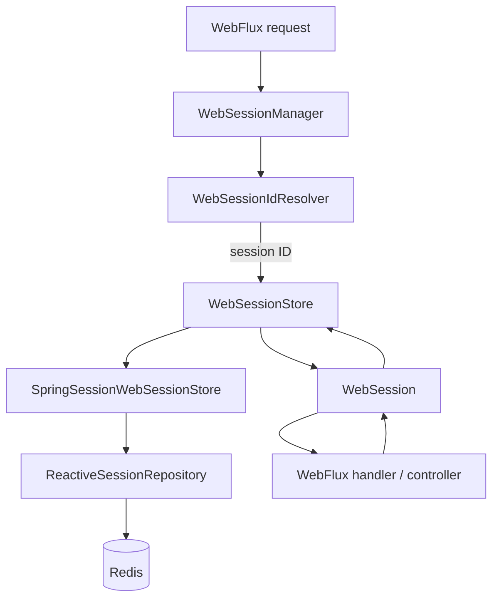
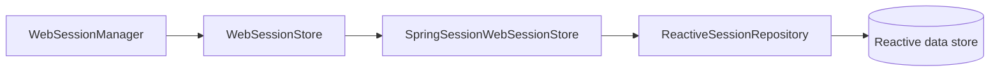

# `WebSessionManager`, `WebSessionStore` và các điểm tích hợp

Spring WebFlux quản lý phiên qua API reactive `WebSession`, khác với API Servlet `HttpSession` thường dùng trong Spring MVC. Khi tích hợp Spring Session vào WebFlux, ba thành phần cần hiểu là `WebSessionManager` điều phối vòng đời phiên cho request, `WebSessionStore` định nghĩa cách tạo/tìm/xóa phiên, và repository reactive của Spring Session lưu dữ liệu vào kho dùng chung như Redis.

Sự khác biệt này không chỉ là đổi tên API. WebFlux xử lý request theo mô hình reactive, vì vậy việc tải và lưu session phải được biểu diễn bằng `Mono` và không chặn event-loop. Spring Session cung cấp adapter để kết nối `ReactiveSessionRepository` với `WebSessionStore`, nhờ đó ứng dụng vẫn thao tác bằng `WebSession` còn dữ liệu phiên được chia sẻ giữa nhiều instance.

## 1. Phân biệt WebFlux session với Servlet session

Spring MVC trên Servlet sử dụng `HttpSession`, `SessionRepositoryFilter` và `SessionRepository` đồng bộ. WebFlux sử dụng `WebSession`, `WebSessionManager` và `WebSessionStore`, với các thao tác trả về kiểu reactive.

| Thành phần | Servlet stack | WebFlux stack |
|---|---|---|
| API phiên của ứng dụng | `HttpSession` | `WebSession` |
| Bộ điều phối phiên | `SessionRepositoryFilter` | `WebSessionManager` |
| Hợp đồng lưu trữ web | `SessionRepository` | `WebSessionStore` |
| Repository Spring Session | `SessionRepository<S>` | `ReactiveSessionRepository<S>` |
| ID resolver | `HttpSessionIdResolver` | `WebSessionIdResolver` |
| Cách xử lý | Đồng bộ theo Servlet request | Reactive, thường trả `Mono` |
| Tích hợp Redis | `@EnableRedisHttpSession` | `@EnableRedisWebSession` |

Không nên cấu hình `@EnableRedisHttpSession` cho ứng dụng WebFlux thuần. Annotation đó bật hạ tầng Servlet và `HttpSession`. Với WebFlux, dùng cấu hình reactive tương ứng và repository triển khai `ReactiveSessionRepository`.



WebFlux không yêu cầu ứng dụng đổi sang một mô hình session hoàn toàn khác về mặt nghiệp vụ. Nó thay đổi API và cách thực thi để session có thể được tải, cập nhật và lưu mà không chặn luồng xử lý reactive.

## 2. `WebSession` là gì?

`WebSession` là abstraction của Spring WebFlux cho một phiên gắn với request. Nó cung cấp ID, attribute map, thời điểm tạo/truy cập, thời gian không hoạt động tối đa và các thao tác lưu hoặc kết thúc phiên.

Các thao tác thường dùng:

- `getId()`: lấy session ID hiện tại.
- `getAttributes()`: truy cập map các attribute của phiên.
- `getCreationTime()` và `getLastAccessTime()`: lấy thông tin thời gian của phiên.
- `getMaxIdleTime()` / `setMaxIdleTime(...)`: đọc hoặc đặt khoảng không hoạt động tối đa.
- `isStarted()` và `isExpired()`: kiểm tra trạng thái vòng đời.
- `save()`: lưu phiên theo API reactive, trả về `Mono<Void>`.
- `invalidate()`: vô hiệu hóa phiên, trả về `Mono<Void>`.
- `changeSessionId()`: thay đổi định danh phiên theo API reactive.

Ứng dụng có thể nhận `WebSession` trong handler hoặc controller và thao tác với attribute:

```java
import org.springframework.web.bind.annotation.PostMapping;
import org.springframework.web.bind.annotation.RestController;
import org.springframework.web.server.WebSession;
import reactor.core.publisher.Mono;

@RestController
class CartController {

    @PostMapping("/cart/start")
    Mono<String> start(WebSession session) {
        session.getAttributes().put("cart.reference", "cart-2048");
        session.getAttributes().put("cart.step", 1);
        return Mono.just("Đã tạo ngữ cảnh giỏ hàng");
    }
}
```

Đoạn mã cập nhật attribute trong session. WebFlux quản lý thời điểm commit và lưu phiên thông qua `WebSessionManager`; trong code ứng dụng, không cần tự gọi repository để lưu từng attribute. Với luồng xử lý cần điều khiển rõ thời điểm lưu, có thể dùng `session.save()` và nối `Mono` đó vào chuỗi reactive thay vì gọi rồi bỏ qua kết quả.

## 3. `WebSessionManager` điều phối request

`WebSessionManager` là hợp đồng mà WebFlux sử dụng để lấy `WebSession` cho một `ServerWebExchange`. Phương thức chính là:

```java
Mono<WebSession> getSession(ServerWebExchange exchange);
```

Manager xử lý các việc ở biên HTTP:

1. Đọc session ID từ request bằng `WebSessionIdResolver`.
2. Yêu cầu store tìm phiên theo ID.
3. Nếu không có phiên hợp lệ, cung cấp phiên mới khi ứng dụng cần tạo session.
4. Cung cấp `WebSession` cho handler/controller qua cơ chế argument resolution.
5. Khi response hoàn tất, điều phối lưu session hoặc hết hạn ID phía client khi cần.

WebFlux có `DefaultWebSessionManager` làm implementation mặc định. Nó có thể được cấu hình với một `WebSessionStore` và một `WebSessionIdResolver`. Nếu không dùng Spring Session, store mặc định có thể giữ session trong bộ nhớ tiến trình. Khi cần chia sẻ phiên giữa nhiều instance, cần thay bằng store được nối với repository dùng chung.

Manager là thành phần điều phối request; nó không tự định nghĩa cấu trúc Redis hay JDBC. Việc lưu trữ thuộc về store và repository.

## 4. `WebSessionStore` định nghĩa thao tác lưu trữ phía WebFlux

`WebSessionStore` là hợp đồng lưu trữ mà `WebSessionManager` sử dụng. Các thao tác chính được biểu diễn reactive:

| Phương thức | Vai trò |
|---|---|
| `createWebSession()` | Tạo `WebSession` mới, trả về `Mono<WebSession>` |
| `retrieveSession(id)` | Tìm phiên theo ID, trả về `Mono<WebSession>` |
| `removeSession(id)` | Xóa phiên theo ID, trả về `Mono<Void>` |

`WebSessionStore` làm việc với abstraction `WebSession`. Nó không yêu cầu controller biết kiểu session cụ thể hoặc cách serialize attribute. Một implementation store có thể chuyển tiếp các thao tác này đến repository Spring Session.

Nếu tự viết `WebSessionStore`, phải xử lý đúng việc tạo ID, timeout, lưu attribute, xóa phiên và các trạng thái invalidate. Không chỉ triển khai ba phương thức để biên dịch; cần bảo đảm hành vi khi session mới chưa được lưu, request kết thúc, session hết hạn hoặc nhiều request cùng truy cập một ID.

## 5. `ReactiveSessionRepository` là hợp đồng lưu trữ của Spring Session

Spring Session định nghĩa `ReactiveSessionRepository<S extends Session>` cho kho lưu trữ có API reactive. Các thao tác thường gồm:

| Phương thức | Kết quả | Vai trò |
|---|---|---|
| `createSession()` | `Mono<S>` | Tạo session mới |
| `save(session)` | `Mono<Void>` | Lưu trạng thái session |
| `findById(id)` | `Mono<S>` | Tìm session theo ID; không có thì hoàn tất rỗng |
| `deleteById(id)` | `Mono<Void>` | Xóa session theo ID |

Điểm khác biệt so với `SessionRepository` đồng bộ là các thao tác truy cập kho dữ liệu được biểu diễn trong publisher. Caller phải subscribe thông qua chuỗi reactive; không có kết quả nếu tạo `Mono` rồi bỏ qua nó.

Ví dụ minh họa thao tác repository ở tầng hạ tầng:

```java
import org.springframework.session.MapSession;
import org.springframework.session.ReactiveSessionRepository;
import reactor.core.publisher.Mono;

class SessionLookupService {
    private final ReactiveSessionRepository<MapSession> repository;

    SessionLookupService(ReactiveSessionRepository<MapSession> repository) {
        this.repository = repository;
    }

    Mono<MapSession> find(String sessionId) {
        return repository.findById(sessionId);
    }

    Mono<Void> remove(String sessionId) {
        return repository.deleteById(sessionId);
    }
}
```

Kiểu `MapSession` ở đây chỉ minh họa generic type; repository Redis thực tế có thể dùng kiểu session riêng. Trong ứng dụng thông thường, controller nên dùng `WebSession`, còn việc gọi repository trực tiếp dành cho adapter, tác vụ quản trị hoặc hạ tầng có chủ đích.

## 6. Adapter `SpringSessionWebSessionStore`

Spring Session cung cấp `SpringSessionWebSessionStore` để nối `ReactiveSessionRepository` với `WebSessionStore`. Adapter này chuyển đổi giữa API WebFlux và session abstraction của Spring Session.



Adapter giúp tránh việc tự viết lớp chuyển đổi cho mỗi ứng dụng. `WebSessionManager` vẫn làm việc với `WebSession`; repository Spring Session vẫn làm việc với `Session`. Adapter giữ trách nhiệm ánh xạ thao tác và trạng thái giữa hai abstraction.

Khi tự cấu hình WebFlux với repository reactive, có thể cấu hình manager dùng store này. Ví dụ sau minh họa cấu trúc wiring; generic session type phải khớp implementation repository thực tế:

```java
import org.springframework.context.annotation.Bean;
import org.springframework.context.annotation.Configuration;
import org.springframework.session.MapSession;
import org.springframework.session.ReactiveSessionRepository;
import org.springframework.session.web.server.SpringSessionWebSessionStore;
import org.springframework.web.server.session.DefaultWebSessionManager;
import org.springframework.web.server.session.WebSessionManager;

@Configuration
class WebSessionConfiguration {

    @Bean
    WebSessionManager webSessionManager(
            ReactiveSessionRepository<MapSession> repository) {
        DefaultWebSessionManager manager = new DefaultWebSessionManager();
        manager.setSessionStore(new SpringSessionWebSessionStore<>(repository));
        return manager;
    }
}
```

Ví dụ minh họa cách kết nối các abstraction; trong ứng dụng thực tế, repository bean phải được cung cấp bởi integration module tương ứng và kiểu `S` phải khớp với kiểu session của repository đó. Nếu annotation hoặc auto-configuration đã tạo `WebSessionManager` và store, không khai báo thêm manager thứ hai gây xung đột.

## 7. Resolver định danh: `WebSessionIdResolver`

`WebSessionIdResolver` quy định cách đọc session ID từ request và phát hành hoặc hết hạn ID trong response. Đây là phần giao tiếp với client, tách biệt với nơi lưu session.

Các thao tác của resolver gồm:

- `resolveSessionIds(exchange)`: đọc danh sách ID từ request.
- `setSessionId(exchange, id)`: ghi ID mới vào response.
- `expireSession(exchange)`: yêu cầu client xóa hoặc hết hạn ID.

WebFlux cung cấp resolver dựa trên cookie như `CookieWebSessionIdResolver` và resolver dựa trên header như `HeaderWebSessionIdResolver`. Với trình duyệt, cookie thường là lựa chọn phù hợp; với API client có thể tự quản lý header, header resolver là một lựa chọn.

Ví dụ cấu hình cookie resolver:

```java
import org.springframework.context.annotation.Bean;
import org.springframework.context.annotation.Configuration;
import org.springframework.web.server.session.CookieWebSessionIdResolver;
import org.springframework.web.server.session.WebSessionIdResolver;

@Configuration
class WebSessionIdConfiguration {

    @Bean
    WebSessionIdResolver webSessionIdResolver() {
        CookieWebSessionIdResolver resolver = new CookieWebSessionIdResolver();
        resolver.addCookieInitializer(builder -> builder
                .name("APPSESSION")
                .path("/")
                .httpOnly(true)
                .secure(true)
                .sameSite("Lax"));
        return resolver;
    }
}
```

API cấu hình cookie có thể khác giữa các phiên bản Spring Framework. Trong production, cần dùng HTTPS, cấu hình `Secure`, `HttpOnly`, `SameSite`, domain và path phù hợp. Nếu chạy sau reverse proxy, chỉ tin forwarded headers từ proxy đáng tin cậy.

Resolver không lưu session và không xác thực người dùng. Session ID vẫn là thông tin mang quyền truy cập phiên; không đưa nó vào URL, log hoặc analytics.

## 8. Bật Spring Session cho WebFlux với Redis

Với WebFlux và Redis, dùng integration reactive của Spring Session. Cấu hình Java truyền thống thường sử dụng `@EnableRedisWebSession`; cấu hình Servlet dùng `@EnableRedisHttpSession` là một mô hình khác.

```java
import org.springframework.context.annotation.Configuration;
import org.springframework.session.data.redis.config.annotation.web.server.EnableRedisWebSession;

@Configuration
@EnableRedisWebSession(maxInactiveIntervalInSeconds = 1800)
class RedisWebSessionConfiguration {
    // RedisConnectionFactory được cung cấp bởi Spring Data Redis.
}
```

Annotation bật repository Redis reactive và hạ tầng WebFlux tương ứng theo phiên bản Spring Session. Ứng dụng cần dependency Redis integration, Spring Data Redis và một Redis client phù hợp. Khi dùng Spring Boot, auto-configuration reactive có thể cung cấp một phần hạ tầng; kiểm tra đúng điều kiện và property của phiên bản Boot đang dùng.

Không trộn cấu hình Redis Servlet và WebFlux trong cùng ứng dụng mà không có kiến trúc rõ ràng. Một ứng dụng có cả `DispatcherServlet` và WebFlux có thể có nhiều application context và hai loại session API; cần xác định rõ request nào dùng stack nào và không đăng ký filter/manager trùng.

### Timeout và namespace

Có thể cấu hình thời gian không hoạt động tối đa và namespace Redis để phân biệt ứng dụng/môi trường. Tên thuộc tính Boot hoặc thuộc tính annotation phụ thuộc phiên bản. Mọi instance của cùng ứng dụng phải dùng cùng namespace và cấu hình tương thích để chia sẻ session.

TTL session ở server và thời hạn cookie ở client là hai khái niệm khác nhau. Cookie còn tồn tại không bảo đảm session vẫn tồn tại trong Redis; request mang ID hết hạn sẽ được xử lý như không có phiên hợp lệ.

## 9. Điểm tích hợp với Spring Security WebFlux

Spring Security WebFlux làm việc với `WebFilter` và reactive security context. Khi cần lưu `SecurityContext` trong session, cơ chế repository bảo mật phải sử dụng cùng `WebSession` mà WebFlux quản lý.

`WebSessionServerSecurityContextRepository` là một lựa chọn lưu `SecurityContext` trong `WebSession`. Vì vậy, việc cấu hình đúng `WebSessionManager`, store và resolver ảnh hưởng trực tiếp đến khả năng duy trì trạng thái đăng nhập giữa các request.

Các điểm cần xác nhận:

- WebFlux session infrastructure đã được cấu hình trước khi xử lý request bảo mật.
- `WebSessionManager` dùng store backed bởi repository reactive dùng chung.
- Security context repository lưu vào đúng `WebSession`.
- Logout invalidate session và xóa security context theo cấu hình.
- Cookie/header resolver phát hành và hết hạn ID đúng cách.
- Nhiều instance dùng cùng Redis và namespace.

Không nên lưu một bản `SecurityContext` riêng trong cache tùy tiện bên cạnh `WebSession`; điều đó dễ tạo hai nguồn trạng thái xác thực không đồng nhất. Nếu dùng stateless token authentication, cần quyết định rõ có cần WebSession hay không.

## 10. Reactive nghĩa là không chặn event-loop

WebFlux được thiết kế để xử lý nhiều request đồng thời với số lượng thread giới hạn. Nếu một thao tác session gọi JDBC đồng bộ hoặc một client Redis blocking ngay trên event-loop, request có thể chặn các request khác và làm tăng latency toàn ứng dụng.

Các nguyên tắc cần giữ:

- Dùng `ReactiveSessionRepository` và driver reactive khi có integration phù hợp.
- Không gọi `block()` trong controller, handler hoặc filter reactive.
- Không dùng `Thread.sleep()` hoặc JDBC blocking trực tiếp trên event-loop.
- Không subscribe thủ công bên trong service rồi bỏ publisher khỏi chuỗi trả về.
- Nối thao tác lưu/xóa vào `Mono`/`Flux` để framework quản lý subscription và lỗi.
- Nếu buộc phải gọi API blocking, cách ly trên scheduler phù hợp như `boundedElastic` và đánh giá kỹ giới hạn tải; đây là cầu nối, không biến kho blocking thành reactive thực sự.

Spring Session JDBC là tích hợp đồng bộ dựa trên JDBC `DataSource`; không nên giả định nó tự cung cấp `ReactiveSessionRepository` cho WebFlux. Nếu yêu cầu WebFlux reactive end-to-end, chọn một repository reactive được hỗ trợ hoặc xây dựng adapter phù hợp với kho dữ liệu reactive. Không đặt `JdbcTemplate` trực tiếp trong `WebSessionStore` rồi gọi trên event-loop.

## 11. Lưu và invalidate session trong chuỗi reactive

Trong controller WebFlux, thao tác thay đổi attribute có thể thực hiện trực tiếp trên `WebSession`, còn `save()` và `invalidate()` trả về publisher. Khi cần thực hiện logout, hãy trả publisher để WebFlux xử lý đúng vòng đời:

```java
import org.springframework.web.bind.annotation.PostMapping;
import org.springframework.web.bind.annotation.RestController;
import org.springframework.web.server.WebSession;
import reactor.core.publisher.Mono;

@RestController
class ReactiveLogoutController {

    @PostMapping("/api/logout")
    Mono<Void> logout(WebSession session) {
        return session.invalidate();
    }
}
```

Không gọi `session.invalidate()` rồi bỏ qua `Mono<Void>`; nếu không subscribe, thao tác reactive có thể không được thực thi. Trong ứng dụng Spring Security, nên dùng logout flow đã cấu hình để xóa `SecurityContext`, invalidate session và xử lý cookie/header thống nhất.

Nếu cần lưu sớm trước khi hoàn tất response, nối `session.save()` vào chuỗi:

```java
return session.save()
        .then(Mono.just("Đã lưu phiên"));
```

Chỉ gọi save sớm khi có lý do. Việc lưu phiên nhiều lần trong một request có thể tăng I/O; cần hiểu flush/save behavior của repository được chọn.

## 12. Nhiều request đồng thời và giới hạn nhất quán

Một WebSession có thể được dùng bởi nhiều request đồng thời, chẳng hạn hai tab trình duyệt cùng gửi request. Mỗi request có thể tải bản session riêng, thay đổi attribute rồi lưu. Repository reactive không tự động biến toàn bộ chuỗi đọc-sửa-ghi thành một giao dịch nguyên tử.

Ví dụ, hai request cùng đọc `cart.quantity = 1`, một request tăng lên 2 và request kia tăng lên 3. Nếu cả hai ghi toàn bộ trạng thái, giá trị cuối có thể phụ thuộc thứ tự lưu. Điều này là vấn đề concurrency của dữ liệu session, không được giải quyết chỉ bằng cách dùng `Mono`.

Để giảm rủi ro:

- Không lưu dữ liệu giao dịch quan trọng hoặc bộ đếm cần cập nhật nguyên tử trong session.
- Đưa dữ liệu chuẩn vào database nghiệp vụ với transaction, optimistic locking hoặc atomic operation phù hợp.
- Giữ session attribute nhỏ và tách các trường ít thay đổi nếu repository hỗ trợ cập nhật chi tiết.
- Kiểm thử nhiều request cùng session, logout đồng thời với request cập nhật và thay đổi session ID.
- Xác định hành vi khi session bị xóa giữa lúc một request đang xử lý.

Nếu một request đã tải session trước khi request khác invalidate, request đang chạy có thể vẫn giữ bản dữ liệu trong bộ nhớ. Việc invalidate không hủy thread/request đã bắt đầu. Với thao tác nhạy cảm, kiểm tra trạng thái xác thực và quyền ở thời điểm thực hiện nghiệp vụ.

## 13. Kiểm thử WebFlux session

Kiểm thử cần đi qua WebFlux stack, không chỉ unit test repository. `WebTestClient` có thể gửi request, giữ cookie và xác minh trạng thái session qua nhiều lần gọi.

Một bộ kiểm thử tích hợp nên gồm:

1. Gửi request đầu tiên không có session ID và tạo attribute.
2. Xác nhận response phát hành cookie hoặc header session ID theo resolver.
3. Gửi request tiếp theo với cùng ID và xác nhận attribute được tải lại.
4. Gửi request cập nhật attribute rồi xác nhận request kế tiếp đọc được thay đổi.
5. Gọi logout/invalidate và xác nhận ID cũ không khôi phục session.
6. Kiểm tra `WebSessionIdResolver` hết hạn cookie/header đúng scope.
7. Tạo session trên instance A và đọc trên instance B cùng repository.
8. Kiểm tra Redis timeout, mất kết nối và độ trễ repository.
9. Gửi request đồng thời dùng chung session để quan sát chính sách cập nhật.
10. Xác nhận không có blocking call trên event-loop trong đường xử lý session.

Ví dụ định hướng dùng `WebTestClient`:

```java
import static org.springframework.test.web.reactive.server.WebTestClient.bindToApplicationContext;

import org.springframework.context.ApplicationContext;
import org.springframework.test.web.reactive.server.WebTestClient;

class WebSessionIntegrationTest {
    WebTestClient client(ApplicationContext context) {
        return bindToApplicationContext(context)
                .configureClient()
                .build();
    }
}
```

Đoạn mã chỉ minh họa cách tạo client; test thực tế cần cấu hình application context, endpoint kiểm thử và cookie jar hoặc chuyển cookie từ response sang request kế tiếp. Với Redis, nên dùng instance riêng cho test và namespace riêng để tránh tác động dữ liệu ngoài test.

## 14. Lỗi tích hợp thường gặp

| Hiện tượng | Nguyên nhân có thể | Cách kiểm tra |
|---|---|---|
| Session mới ở mọi request | Cookie/header không được gửi lại, resolver sai hoặc manager/store không dùng chung | Kiểm tra `Set-Cookie`, request cookie và `WebSessionIdResolver` |
| Không inject được `WebSession` | Ứng dụng đang chạy Servlet stack hoặc cấu hình WebFlux không đầy đủ | Kiểm tra loại web application và WebFlux context |
| Repository không tương thích kiểu reactive | Dùng `SessionRepository` đồng bộ thay cho `ReactiveSessionRepository` | Kiểm tra interface repository được inject |
| Request bị chậm hàng loạt | Blocking JDBC/client call trên event-loop | Tìm `block()`, `JdbcTemplate` hoặc blocking I/O trong reactive chain |
| Login không tồn tại qua request | Security context repository và WebSessionManager không dùng cùng session | Kiểm tra cấu hình Spring Security WebFlux |
| Logout nhưng cookie vẫn gửi | Resolver không hết hạn đúng cookie hoặc frontend giữ header cũ | Kiểm tra response và cơ chế xóa ID phía client |
| Instance khác không thấy session | Redis/namespace/serialization khác nhau | So sánh cấu hình mọi instance |
| Attribute cập nhật bị mất | Request đồng thời ghi đè hoặc publisher save không được nối | Kiểm tra concurrency và chuỗi reactive |

## 15. Checklist chọn và cấu hình điểm tích hợp

- Ứng dụng thực sự dùng WebFlux và API `WebSession`.
- Có `WebSessionManager` được cấu hình với `WebSessionStore` phù hợp.
- Store dùng `SpringSessionWebSessionStore` hoặc implementation tương thích.
- Repository triển khai `ReactiveSessionRepository` và dùng client không blocking.
- Dùng `@EnableRedisWebSession` cho Redis WebFlux; không nhầm với annotation Servlet.
- `WebSessionIdResolver` được cấu hình đúng cookie/header, domain, path và thuộc tính bảo mật.
- Spring Security WebFlux lưu `SecurityContext` trong đúng WebSession nếu dùng session-based authentication.
- Mọi instance dùng chung repository, namespace, serialization và timeout.
- Đã kiểm thử tạo, đọc, cập nhật, logout, expiration, concurrency và failover.
- Không gọi blocking I/O hoặc `block()` trên event-loop.

`WebSessionManager` điều phối cách WebFlux lấy và kết thúc phiên; `WebSessionStore` cung cấp thao tác tạo, tìm và xóa phiên; `SpringSessionWebSessionStore` nối store với `ReactiveSessionRepository` của Spring Session. Khi các thành phần này được cấu hình thống nhất với resolver và Spring Security WebFlux, ứng dụng có thể giữ trạng thái session dùng chung giữa nhiều instance mà vẫn duy trì cách xử lý reactive, không chặn event-loop.
