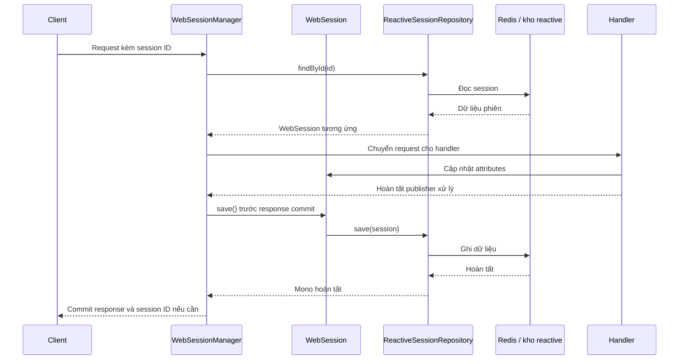

# Lưu phiên trước khi phản hồi được commit

Trong Spring WebFlux, `WebSession` được thao tác theo mô hình reactive. Các thao tác lưu session thường trả về `Mono<Void>`, vì vậy việc ghi phiên vào repository là một phần của chuỗi xử lý bất đồng bộ. Nếu response được commit trước khi thao tác lưu hoàn tất, client có thể nhận phản hồi thành công trong khi dữ liệu session chưa được ghi hoặc cookie session ID chưa được cập nhật đúng.

Spring Session tích hợp với WebFlux thông qua `WebSessionManager`, `WebSessionStore` và `ReactiveSessionRepository`. Trong luồng request thông thường, WebFlux phối hợp lưu session trước khi commit response. Khi ứng dụng cần bảo đảm một thay đổi đã được lưu trước khi tiếp tục một bước xử lý cụ thể, hãy đưa `WebSession.save()` vào reactive chain và chỉ phát response sau khi `Mono` đó hoàn tất.

## 1. Vì sao thời điểm commit response quan trọng?

Trong WebFlux, response không nhất thiết được gửi đi ngay khi controller trả về một object. Handler trả về một `Mono` hoặc `Flux`; framework subscribe vào publisher và ghi kết quả xuống response. Response được **commit** khi status/header và phần đầu của body bắt đầu được gửi tới client. Sau khi commit, ứng dụng không thể tùy ý thay đổi status hoặc header, chẳng hạn thêm cookie session ID mới.

Session cũng được lưu bất đồng bộ. Với Spring Session reactive, repository thường ghi session vào Redis hoặc kho dữ liệu reactive thông qua một `Mono<Void>`. Nếu ứng dụng khởi chạy thao tác lưu nhưng không đưa publisher đó vào chuỗi response, framework không có bảo đảm rằng việc lưu sẽ hoàn tất trước khi response được commit.

Ví dụ sai về mặt sequencing:

```java
return exchange.getSession().map(session -> {
    session.getAttributes().put("cartId", cartId);
    session.save().subscribe(); // Không chờ việc lưu hoàn tất
    return "Đã cập nhật giỏ hàng";
});
```

`subscribe()` tạo một subscription độc lập. Chuỗi trả về cho WebFlux có thể hoàn tất ngay, trong khi lệnh ghi session vẫn đang chạy hoặc thất bại ở phía sau. Client có thể nhận phản hồi trước khi trạng thái mới được lưu. Lỗi của subscription độc lập cũng không được chuyển tự nhiên vào chuỗi xử lý request.

Nguyên tắc cần giữ là: **mọi thao tác bất đồng bộ cần hoàn tất trước response phải được compose vào publisher mà handler trả về**.

## 2. Các thành phần quản lý WebSession

Trong ứng dụng WebFlux, API session là `org.springframework.web.server.WebSession`, không phải `HttpSession` của Servlet.

| Thành phần | Trách nhiệm |
|---|---|
| `WebSession` | API để đọc/ghi attributes, xem ID, đặt timeout, đổi ID, lưu hoặc vô hiệu hóa phiên |
| `WebSessionManager` | Tìm hoặc tạo WebSession cho request và phối hợp vòng đời phiên với response |
| `WebSessionStore` | Tạo, khôi phục và lưu WebSession |
| `ReactiveSessionRepository` | Hợp đồng reactive để tạo, tìm, lưu và xóa dữ liệu session |
| `WebSessionIdResolver` | Đọc session ID từ request và gửi ID về client, thường qua cookie |

Spring Session cung cấp tích hợp reactive để kết nối `WebSession` với `ReactiveSessionRepository`. Với Redis, repository dùng kết nối reactive; với các kho khác, cần implementation reactive tương ứng. Controller thường chỉ thao tác với `WebSession` và không cần gọi trực tiếp repository.

Luồng khái quát:



Sơ đồ thể hiện trình tự logic. Chi tiết adapter, thời điểm gọi repository và xử lý cookie thuộc implementation WebFlux/Spring Session của phiên bản đang sử dụng.

## 3. WebFlux phối hợp lưu session trước commit như thế nào?

`WebSessionManager` quản lý việc gắn session vào request exchange và phối hợp với response lifecycle. Trong luồng tích hợp tiêu chuẩn, framework đăng ký xử lý lưu session ở giai đoạn trước khi response được commit. Khi response sắp commit, việc lưu session được đưa vào chuỗi reactive; response chỉ tiếp tục commit sau khi callback lưu hoàn tất.

Điều này có ý nghĩa ở hai khía cạnh:

1. **Dữ liệu session:** attributes và metadata cần được lưu qua `ReactiveSessionRepository` trước khi request kết thúc.
2. **Session ID phía client:** nếu phiên mới được tạo hoặc ID được thay đổi, resolver cần có cơ hội gửi cookie/header chứa ID mới trước khi response headers được gửi.

Với request thông thường, ứng dụng không cần tự gọi `save()` sau mọi `setAttribute`. WebFlux/Spring Session quản lý lưu session trong response lifecycle. Tuy nhiên, nếu code thực hiện một chuỗi nghiệp vụ cần xác nhận việc lưu đã hoàn tất trước khi phát ra một kết quả tiếp theo, có thể gọi `session.save()` tường minh và compose kết quả.

Không được nhầm `save()` với `subscribe()`. `save()` tạo publisher mô tả thao tác lưu; thao tác chỉ được thực thi khi publisher được subscribe. WebFlux subscribe publisher trả về từ handler. Vì vậy hãy trả publisher kết hợp với `save()` thay vì tự subscribe bên trong controller.

## 4. Gọi WebSession.save() và chờ hoàn tất

`WebSession.save()` trả về `Mono<Void>`. Có thể dùng `then`, `thenReturn` hoặc `flatMap` để đảm bảo bước tiếp theo chỉ chạy sau khi lưu hoàn tất.

Ví dụ với controller nhận `ServerWebExchange`:

```java
@RestController
class CartController {

    @PostMapping("/cart")
    Mono<ResponseEntity<Void>> updateCart(ServerWebExchange exchange) {
        return exchange.getSession()
                .flatMap(session -> {
                    session.getAttributes().put("cartId", "CART-204");
                    session.getAttributes().put("itemCount", 3);

                    return session.save()
                            .thenReturn(ResponseEntity.noContent().build());
                });
    }
}
```

Trong ví dụ, hai attributes được cập nhật trước khi gọi `save()`. `thenReturn(...)` chỉ phát `ResponseEntity` sau khi publisher lưu hoàn tất. Nếu thao tác repository lỗi, publisher lỗi và response success không được tạo ra từ nhánh `thenReturn`.

Một ví dụ khác dùng functional endpoint:

```java
public Mono<ServerResponse> updatePreferences(ServerRequest request) {
    return request.session()
            .flatMap(session -> {
                session.getAttributes().put("theme", "dark");
                session.getAttributes().put("locale", "vi-VN");

                return session.save()
                        .then(ServerResponse.noContent().build());
            });
}
```

Đây là cách thể hiện rõ thứ tự: lấy session, thay đổi attributes, lưu, rồi mới tạo response. Với request thông thường, cơ chế tự động của WebSessionManager có thể đã đảm bảo lưu trước commit; gọi `save()` tường minh hữu ích khi code cần ranh giới hoàn tất rõ ràng ngay trong chuỗi nghiệp vụ.

## 5. Chỉ lưu sau khi hoàn tất mọi thay đổi cần thiết

Gọi `save()` trước khi thay đổi attributes không lưu được các thay đổi xảy ra sau đó. Ví dụ:

```java
return exchange.getSession()
        .flatMap(session -> session.save()
                .then(Mono.fromRunnable(() ->
                        session.getAttributes().put("theme", "dark")))
                .thenReturn("ok"));
```

Ở đây việc lưu hoàn tất trước khi attribute `theme` được đặt. Nếu không có lần save nào sau đó, thay đổi có thể không được ghi theo ý định. Thứ tự đúng là thay đổi trạng thái trước, sau đó lưu:

```java
return exchange.getSession()
        .flatMap(session -> {
            session.getAttributes().put("theme", "dark");
            return session.save().thenReturn("ok");
        });
```

Nếu có nhiều bước cập nhật session, hãy gom chúng trước một lần save khi phù hợp. Điều này tránh ghi nhiều lần và giúp ranh giới dữ liệu cần lưu dễ kiểm soát. Tuy nhiên, nếu một bước phụ thuộc vào việc session đã được lưu bền vững, hãy đặt bước đó sau `save()` trong reactive chain.

## 6. Không dùng block() hoặc subscription tách rời

WebFlux dựa trên mô hình non-blocking. Không gọi `block()` để đợi repository trong request handler:

```java
// Không nên làm trong handler WebFlux
session.save().block();
```

`block()` chặn thread đang xử lý request và có thể làm giảm khả năng mở rộng hoặc gây deadlock trong một số ngữ cảnh scheduler. Tương tự, `subscribe()` bên trong controller tạo một luồng xử lý tách rời khỏi publisher chính.

Hãy compose publisher:

| Mục đích | Cách compose |
|---|---|
| Chờ save rồi trả một giá trị | `session.save().thenReturn(value)` |
| Chờ save rồi chạy một publisher khác | `session.save().then(nextPublisher)` |
| Lấy kết quả từ thao tác tiếp theo sau save | `session.save().then(nextMono)` |
| Chạy nhiều thao tác độc lập và chờ tất cả | `Mono.when(operationA, operationB)` nếu không có phụ thuộc thứ tự |

Không dùng `Mono.when` để chạy song song các thao tác phụ thuộc lẫn nhau trên cùng session. Các thay đổi session nên được thực hiện theo thứ tự xác định, sau đó mới lưu.

## 7. Tạo session mới và gửi session ID

Một `WebSession` mới có thể được tạo khi request gọi `exchange.getSession()` hoặc `request.session()`. Việc chỉ lấy session để đọc có thể chưa cần tạo một session được lưu bền vững. Khi ứng dụng bắt đầu phiên hoặc thêm attributes, session trở thành phiên cần lưu.

Ví dụ khởi tạo trạng thái đăng nhập sau khi xác thực thành công:

```java
public Mono<ServerResponse> login(ServerRequest request) {
    return request.session()
            .flatMap(session -> {
                session.getAttributes().put("principal", "alice");
                session.getAttributes().put("authenticated", true);

                return session.save()
                        .then(ServerResponse.ok()
                                .bodyValue(Map.of("status", "authenticated")));
            });
}
```

Trong ứng dụng thực tế, principal phải đến từ quá trình xác thực đã được kiểm tra, không lấy trực tiếp từ một giá trị client tự khai báo. Ví dụ chỉ minh họa cách lưu trạng thái phiên.

Sau khi session được lưu và response được commit, `WebSessionIdResolver` gửi session ID về client, thường qua cookie `SESSION` trong cấu hình mặc định Spring Session WebFlux. Client gửi lại cookie ở request tiếp theo. Nếu dùng resolver qua header, ID được trao đổi qua header tương ứng.

Lưu ý rằng việc gọi `save()` lưu dữ liệu session; việc ghi cookie ID là một phần của tích hợp session manager/resolver với response lifecycle. Không tự ghi cookie thủ công nếu Spring Session đã quản lý ID, vì có thể tạo cookie trùng hoặc không đồng bộ với repository.

## 8. Đổi session ID và lưu trước khi trả response

Sau khi xác thực thành công, ứng dụng có thể cần đổi session ID để giảm nguy cơ session fixation. Trong WebFlux, `WebSession.changeSessionId()` trả về publisher; phải compose nó vào chuỗi reactive và xử lý theo đúng thứ tự với việc cập nhật trạng thái:

```java
return exchange.getSession()
        .flatMap(session -> {
            session.getAttributes().put("principal", principalName);
            session.getAttributes().put("authenticated", true);

            return session.changeSessionId()
                    .then(session.save())
                    .thenReturn(ResponseEntity.noContent().build());
        });
```

Ví dụ thể hiện cả hai thao tác trong cùng publisher. Hành vi cụ thể khi đổi ID và lưu phụ thuộc implementation của WebSessionStore/Spring Session; hãy kiểm thử rằng ID mới được gửi cho client và ID cũ không còn được chấp nhận theo chính sách bảo mật.

Không phát response thành công trước khi hoàn tất việc đổi ID/lưu session nếu response đó báo rằng đăng nhập đã hoàn tất. Nếu thao tác đổi ID hoặc save thất bại, luồng cần đi vào nhánh lỗi thay vì gửi thành công giả.

## 9. Invalidate và đăng xuất

Đăng xuất reactive cũng là thao tác bất đồng bộ. `WebSession.invalidate()` trả về `Mono<Void>`, do đó phải chờ nó hoàn tất trước khi trả response:

```java
public Mono<ServerResponse> logout(ServerRequest request) {
    return request.session()
            .flatMap(session -> session.invalidate()
                    .then(ServerResponse.noContent().build()));
}
```

Việc invalidate yêu cầu store/repository thu hồi phiên. Resolver sẽ phối hợp xóa session ID phía client trong response lifecycle. Nếu chỉ xóa cookie mà không invalidate session phía máy chủ, ID bị lộ có thể vẫn còn hiệu lực. Nếu chỉ xóa session ở repository nhưng không expire cookie, trình duyệt có thể tiếp tục gửi ID cũ; request sau không khôi phục được phiên cũ và có thể tạo session mới nếu ứng dụng yêu cầu.

## 10. Xử lý lỗi khi lưu session

Nếu Redis hoặc repository reactive không truy cập được, `session.save()` có thể phát lỗi. Khi save nằm trong chuỗi response, lỗi được truyền theo reactive pipeline và ứng dụng có thể xử lý bằng `onErrorResume`, `onErrorMap` hoặc cơ chế xử lý lỗi toàn cục.

Ví dụ:

```java
return exchange.getSession()
        .flatMap(session -> {
            session.getAttributes().put("workflowStep", "confirmed");

            return session.save()
                    .thenReturn(ResponseEntity.noContent().build());
        })
        .onErrorResume(SessionRepositoryUnavailableException.class, ex ->
                Mono.just(ResponseEntity.status(HttpStatus.SERVICE_UNAVAILABLE)
                        .build()));
```

Tên exception trong ví dụ là exception ứng dụng có thể dùng để chuẩn hóa lỗi; repository thực tế có thể phát exception khác, vì vậy cần ánh xạ theo stack đang dùng. Không bắt mọi lỗi rồi trả `200 OK` như thể session đã lưu thành công.

Khi lỗi xảy ra trước commit, ứng dụng thường còn khả năng trả status phù hợp như `503 Service Unavailable`. Nếu response đã commit hoặc body streaming đã bắt đầu, không thể đổi status/header; lỗi có thể làm stream bị kết thúc bất thường. Đây là lý do phải đặt thao tác lưu cần thiết trước khi bắt đầu phát body.

Không retry vô hạn thao tác lưu. Retry cần giới hạn số lần, có backoff và xem xét tính lặp an toàn. Nếu lỗi là serialization hoặc dữ liệu không hợp lệ, retry kết nối không giải quyết được nguyên nhân.

## 11. Response streaming và các thao tác bất đồng bộ tách rời

Với response streaming bằng `Flux`, body có thể được gửi từng phần và response thường commit khi phần đầu tiên được ghi. Nếu session phải được cập nhật trước khi stream bắt đầu, hãy lưu trước khi trả publisher body:

```java
public Mono<ServerResponse> streamReport(ServerRequest request) {
    return request.session()
            .flatMap(session -> {
                session.getAttributes().put("reportStarted", true);

                return session.save()
                        .then(ServerResponse.ok()
                                .contentType(MediaType.TEXT_EVENT_STREAM)
                                .body(reportEvents(), ReportEvent.class));
            });
}
```

Nếu cập nhật session được thực hiện bên trong một callback không thuộc publisher response, chẳng hạn `subscribe()` độc lập, framework không thể bảo đảm callback đó hoàn tất trước commit. Hãy đưa mọi thay đổi cần thiết vào chuỗi reactive chính trước khi tạo response streaming.

Không giữ một `WebSession` rồi tiếp tục sửa nó từ background task sau khi response đã kết thúc, trừ khi ứng dụng có thiết kế lưu trữ riêng và quản lý vòng đời rõ ràng. Session gắn với request và response; công việc nền kéo dài cần truyền dữ liệu cần thiết vào một service/job có cơ chế persistence riêng.

## 12. Tự đăng ký beforeCommit khi nào?

Spring WebFlux cung cấp `ServerHttpResponse.beforeCommit(...)` để đăng ký một callback reactive chạy trước khi response được commit. Session manager tích hợp thường đã dùng response lifecycle để lưu session và cập nhật session ID. Vì vậy, controller bình thường không cần tự đăng ký thêm callback để lưu `WebSession`.

Callback `beforeCommit` có thể hữu ích cho một tích hợp hạ tầng tùy chỉnh cần bổ sung thao tác trước commit. Khi dùng, callback phải trả về `Mono<Void>` mô tả công việc cần hoàn tất; không gọi `subscribe()` bên trong callback. Callback cũng phải được đăng ký trước khi response commit. Không đăng ký callback quá muộn sau khi body đã bắt đầu được ghi.

Tránh đăng ký hai lần cùng một thao tác save nếu session manager đã thực hiện nó. Ghi trùng có thể tăng I/O, gây khó theo dõi thứ tự cập nhật và làm lộ lỗi thiết kế. Trước khi thêm callback thủ công, hãy xác định rõ ai đang sở hữu việc lưu session trong cấu hình hiện tại.

## 13. Những tình huống thường gặp

| Tình huống | Hành vi cần có | Cách xử lý |
|---|---|---|
| Thêm attribute rồi trả response thông thường | Session được lưu trước khi response commit theo tích hợp mặc định | Để WebSessionManager quản lý; không tự subscribe |
| Cần chắc chắn save xong trước một bước tiếp theo | Bước tiếp theo chỉ chạy sau save | Dùng `session.save().then(...)` |
| Gọi `save().subscribe()` trong handler | Save chạy độc lập, response không chờ | Compose publisher vào chuỗi trả về |
| Gọi `block()` trong WebFlux | Chặn thread xử lý reactive | Dùng `flatMap`, `then`, `thenReturn` |
| Save lỗi khi Redis không sẵn sàng | Chuỗi reactive phát lỗi | Ánh xạ lỗi trước commit, không trả success giả |
| Sửa session sau khi response đã commit | Cookie/header và response không còn sửa được | Hoàn tất thay đổi và save trước khi bắt đầu response |
| Sửa session từ background task sau request | Nằm ngoài vòng đời request | Dùng persistence/job riêng hoặc thiết kế task có quản lý vòng đời |
| Streaming response cần trạng thái đã lưu | Body không bắt đầu trước save | Compose save trước `ServerResponse.body(...)` |

## 14. Kiểm thử thứ tự save và response commit

Kiểm thử nên xác minh thứ tự thực tế, không chỉ xác nhận controller gọi `save()`:

1. Gửi request tạo hoặc cập nhật WebSession.
2. Theo dõi lời gọi `ReactiveSessionRepository.save()` và xác nhận nó được subscribe.
3. Dùng repository giả lập có độ trễ để chứng minh response chưa commit trước khi save hoàn tất.
4. Xác nhận response chỉ phát status thành công sau khi save hoàn tất.
5. Cho repository phát lỗi và xác nhận response đi vào nhánh lỗi trước commit.
6. Kiểm tra cookie/session ID mới xuất hiện trong response khi session được tạo hoặc ID thay đổi.
7. Gửi request tiếp theo với ID nhận được và xác nhận attributes được khôi phục.
8. Kiểm tra logout: repository xóa session và response expire ID phía client.
9. Với streaming response, xác nhận thao tác save hoàn tất trước khi body publisher bắt đầu phát dữ liệu.
10. Chạy kiểm thử tích hợp với kho reactive thực tế và nhiều instance nếu hệ thống triển khai phân tán.

Trong unit test, có thể dùng `StepVerifier` để xác minh publisher hoàn tất và thứ tự các side effect. Trong integration test, kiểm tra dữ liệu qua repository sau response để chứng minh trạng thái đã thực sự được ghi, thay vì chỉ kiểm tra object trong cùng request.

## 15. Chẩn đoán lỗi thường gặp

| Triệu chứng | Nguyên nhân có thể | Hướng kiểm tra |
|---|---|---|
| Client nhận response nhưng attribute không tồn tại ở request sau | Save chạy tách rời hoặc session chưa được lưu | Kiểm tra `subscribe()` tự gọi, flush lifecycle và repository save |
| Response chờ lâu trước khi commit | Repository chậm hoặc save bị retry | Đo latency repository, timeout và connection pool |
| Không có cookie session ID | Session chưa started, resolver/cookie config hoặc response đã commit | Kiểm tra session lifecycle, resolver và header `Set-Cookie` |
| Save lỗi nhưng API vẫn trả 200 | Lỗi bị nuốt hoặc publisher save không nằm trong response chain | Kiểm tra `onErrorResume` và sequencing |
| Session mất khi chuyển instance | Instance khác repository/namespace hoặc serializer không tương thích | So sánh reactive repository và cấu hình giữa các instance |
| Streaming response bỏ lỡ cập nhật cuối | Thay đổi xảy ra sau khi body bắt đầu phát | Lưu trước khi tạo hoặc subscribe body publisher |
| Logout vẫn dùng được session | Chỉ xóa cookie hoặc không chờ `invalidate()` | Compose invalidate và xác minh repository đã xóa phiên |

Khi điều tra, ghi nhận correlation ID, loại thao tác repository, thời gian save và loại lỗi. Không ghi session ID hoặc cookie nguyên vẹn. Phân biệt lỗi kết nối, timeout, serialization và lỗi logic session; mỗi loại cần cách xử lý khác nhau.

## 16. Quy trình viết handler an toàn

Khi một handler WebFlux cần cập nhật session và trả response, có thể theo trình tự:

1. Lấy `WebSession` từ `ServerWebExchange` hoặc `ServerRequest`.
2. Xác thực và kiểm tra quyền trước khi đặt trạng thái nhạy cảm.
3. Thực hiện tất cả thay đổi attributes cần thiết.
4. Nếu cần một ranh giới lưu rõ ràng trước bước tiếp theo, gọi `session.save()`.
5. Compose publisher save với publisher tạo response bằng `then`, `thenReturn` hoặc `flatMap`.
6. Để WebSessionManager và resolver hoàn tất việc lưu ở response lifecycle và gửi ID/cookie phù hợp.
7. Xử lý lỗi repository trước khi response commit; không chuyển lỗi thành success giả.
8. Kiểm thử cả response, cookie và dữ liệu khôi phục được từ request tiếp theo.

Trong luồng bình thường, tích hợp WebFlux/Spring Session tự phối hợp lưu phiên trước commit. Gọi `save()` tường minh khi cần đảm bảo một bước cụ thể chỉ diễn ra sau khi repository đã hoàn tất ghi. Dù theo cách nào, publisher phải được compose vào reactive chain; không block hoặc tạo subscription tách rời. Điều đó giữ cho dữ liệu session, session ID và response cùng tuân theo một thứ tự có thể kiểm soát.
