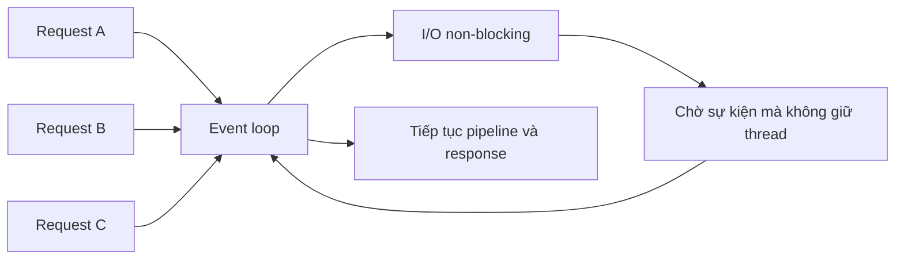

# Không chặn luồng xử lý sự kiện bằng repository đồng bộ

Spring WebFlux xử lý request theo mô hình reactive, thường chạy trên một số lượng nhỏ event-loop thread được tái sử dụng cho nhiều kết nối. Mỗi thao tác I/O trong pipeline cần trả quyền điều khiển cho event loop cho đến khi có kết quả. Nếu một repository session đồng bộ thực hiện truy vấn JDBC, Redis blocking hoặc thao tác mạng ngay trên event loop, thread đó bị giữ lại trong thời gian chờ. Nhiều request cùng lúc có thể làm cạn event loop, tăng độ trễ và khiến toàn bộ ứng dụng mất khả năng phản hồi.

Spring Session WebFlux dùng mô hình `WebSession` và `ReactiveSessionRepository`. Repository reactive trả về `Mono` để thao tác đọc, ghi, xóa được ghép vào pipeline mà không chặn thread xử lý sự kiện. Khi phải tích hợp tạm thời một repository đồng bộ, cần cô lập lời gọi blocking trên scheduler dành cho tác vụ blocking và hiểu rõ giới hạn của cách chuyển tiếp này.

## 1. Event loop trong WebFlux hoạt động như thế nào?

WebFlux thường dùng Reactor Netty. Thay vì tạo một thread riêng cho mỗi request, server dùng một nhóm event-loop thread để nhận dữ liệu socket, xử lý sự kiện I/O và tiếp tục các pipeline đã sẵn sàng.

Một event loop có thể phục vụ nhiều kết nối. Khi pipeline gọi một API I/O non-blocking, API đó đăng ký thao tác và trả về ngay; event loop có thể xử lý kết nối khác. Khi dữ liệu đến, Reactor tiếp tục pipeline trên thread phù hợp.

Luồng khái quát:



Lợi ích này chỉ xuất hiện khi các thao tác trong pipeline không chặn. Một lời gọi blocking có thể giữ event-loop thread trong lúc chờ database hoặc mạng. Trong thời gian đó, event loop không thể xử lý các kết nối khác được phân công cho nó.

WebFlux không tự biến mọi thư viện thành non-blocking. Nếu controller trả về `Mono` nhưng bên trong gọi JDBC đồng bộ, toàn bộ đoạn gọi JDBC vẫn là blocking.

## 2. Vì sao repository session đồng bộ gây vấn đề?

Một repository đồng bộ thường có các phương thức trả kết quả trực tiếp:

```java
Session createSession();
Session findById(String id);
void save(Session session);
void deleteById(String id);
```

Các phương thức này chỉ trả về sau khi thao tác lưu trữ hoàn tất hoặc thất bại. Nếu gọi chúng trên event loop, thread sẽ chờ trong thời gian truy vấn.

Ví dụ không an toàn:

```java
@GetMapping("/profile")
Mono<Profile> profile(ServerWebExchange exchange) {
    return exchange.getSession()
            .map(webSession -> {
                // Lời gọi blocking trong callback của pipeline.
                Session session = blockingRepository.findById(
                        webSession.getId()
                );
                return profileFrom(session);
            });
}
```

Đoạn ví dụ còn minh họa một sai lầm kiến trúc: WebFlux đã cung cấp `WebSession` thông qua session manager, nên controller không nên tự tra cứu một repository Servlet đồng bộ theo cùng ID. Nếu có nhu cầu truy cập session, hãy dùng API `WebSession`. Nếu cần một kho dữ liệu riêng, tích hợp nó bằng API reactive.

Một lời gọi blocking dù chỉ mất vài chục mili giây cũng có thể gây tác động lớn khi nhiều request đồng thời. Khi event loop bị giữ, request khác có thể phải chờ trước cả khi được xử lý, khiến latency tăng theo tải.

## 3. Dấu hiệu event loop đang bị chặn

Các triệu chứng thường thấy:

- Độ trễ tăng mạnh khi số request đồng thời tăng, dù CPU chưa đạt mức tối đa.
- Nhiều request độc lập cùng bị chậm khi một truy vấn database lâu.
- Thread dump cho thấy các thread có tên dạng `reactor-http-nio-*` đang chờ trong JDBC driver, socket read hoặc lời gọi đồng bộ.
- Log cảnh báo về blocking call trên thread non-blocking khi có BlockHound.
- Throughput giảm nhanh khi thêm một đoạn gọi Redis/JDBC đồng bộ vào filter hoặc controller.
- Timeout và lỗi gateway xuất hiện theo cụm khi một dependency chậm.

Cần phân biệt event-loop blocking với database quá tải. Database chậm có thể là nguyên nhân ban đầu, nhưng nếu thao tác đồng bộ chạy trên event loop thì một truy vấn chậm còn làm nghẽn xử lý nhiều request khác.

Theo dõi thêm connection pool, thời gian truy vấn, queue scheduler, số thread đang hoạt động và latency theo percentile. Chỉ nhìn CPU hoặc số lượng request trung bình có thể bỏ sót tình trạng event loop bị giữ.

## 4. Spring Session WebFlux dùng WebSession và repository reactive

Trong Servlet, Spring Session thay thế `HttpSession` thông qua `SessionRepositoryFilter` và `SessionRepository`. Trong WebFlux, mô hình khác:

| Servlet | WebFlux |
|---|---|
| `HttpSession` | `WebSession` |
| `SessionRepository` | `ReactiveSessionRepository` |
| `SessionRepositoryFilter` | `WebSessionManager` / `WebSessionStore` |
| `HttpSessionIdResolver` | `WebSessionIdResolver` |
| Cookie hoặc header resolver cho Servlet | Cookie hoặc header resolver cho WebFlux |

`ReactiveSessionRepository` cung cấp thao tác bất đồng bộ, thường có dạng:

```java
Mono<S> createSession();
Mono<S> findById(String id);
Mono<Void> save(S session);
Mono<Void> deleteById(String id);
```

`WebSession` là abstraction mà handler WebFlux sử dụng. `SpringSessionWebSessionStore` kết nối session manager của WebFlux với repository reactive của Spring Session. Session ID được resolve qua `WebSessionIdResolver`, ví dụ cookie resolver hoặc header resolver.

Không dùng `SessionRepositoryFilter` hay `HttpSession` để cấu hình session cho WebFlux. Đó là các API thuộc Servlet stack. Tương tự, `@EnableJdbcHttpSession` là cấu hình Servlet/JDBC đồng bộ, không tự trở thành repository reactive chỉ vì controller trả về `Mono`.

## 5. Dùng Redis reactive cho WebFlux

Spring Session cung cấp tích hợp Redis reactive cho WebFlux. Cấu hình reactive dùng `@EnableRedisWebSession` cùng `ReactiveRedisConnectionFactory`. Với Lettuce, connection factory có thể hỗ trợ cả API Redis đồng bộ và reactive, nhưng phần tích hợp WebFlux cần sử dụng giao diện reactive.

Ví dụ cấu hình:

```java
import org.springframework.context.annotation.Configuration;
import org.springframework.session.data.redis.config.annotation.web.server.EnableRedisWebSession;
import org.springframework.data.redis.connection.ReactiveRedisConnectionFactory;
import org.springframework.data.redis.connection.lettuce.LettuceConnectionFactory;
import org.springframework.context.annotation.Bean;

@Configuration(proxyBeanMethods = false)
@EnableRedisWebSession(maxInactiveIntervalInSeconds = 1800)
public class ReactiveSessionConfiguration {

    @Bean
    ReactiveRedisConnectionFactory reactiveRedisConnectionFactory() {
        return new LettuceConnectionFactory("localhost", 6379);
    }
}
```

Ví dụ minh họa cho cấu hình Spring Session Redis reactive; trong ứng dụng thực tế, host, port, password, TLS và timeout cần được đưa ra cấu hình môi trường hoặc secret store. Cần dùng phiên bản Spring Session và Spring Data Redis tương thích với Spring Boot của dự án.

Với auto-configuration của Spring Boot, có thể cấu hình kết nối Redis qua properties và để Boot thiết lập các thành phần phù hợp. Nếu dùng cấu hình tường minh với `@EnableRedisWebSession`, tránh bật thêm một cấu hình session khác cùng tạo repository hoặc WebSession manager.

Redis reactive giúp các thao tác mạng được biểu diễn dưới dạng publisher. Điều đó không có nghĩa mọi công việc trong pipeline đều tự động non-blocking: serializer tùy chỉnh, callback hoặc mã ứng dụng vẫn có thể gọi thư viện blocking. Cần kiểm tra toàn bộ đường đi của request.

## 6. Truy cập WebSession theo kiểu reactive

Trong WebFlux, `ServerWebExchange.getSession()` trả về `Mono<WebSession>`. Ứng dụng nên ghép thao tác đọc và cập nhật thuộc tính vào pipeline.

Ví dụ đọc thuộc tính:

```java
@GetMapping("/cart")
Mono<CartView> cart(ServerWebExchange exchange) {
    return exchange.getSession()
            .map(session -> session.getAttribute("cartId"))
            .flatMap(cartService::findCart);
}
```

Ví dụ cập nhật thuộc tính:

```java
@PostMapping("/cart")
Mono<Void> rememberCart(
        ServerWebExchange exchange,
        @RequestBody CartRequest request) {

    return exchange.getSession()
            .doOnNext(session ->
                    session.getAttributes().put("cartId", request.cartId()))
            .then();
}
```

`getAttributes()` trả về map thuộc tính session trong bộ nhớ của phiên hiện tại. Việc truy cập map này là thao tác cục bộ; việc tìm session ban đầu và lưu thay đổi được quản lý bởi WebFlux session infrastructure.

Thông thường, WebFlux session manager lưu các thay đổi theo vòng đời response. Khi cần chủ động yêu cầu lưu trước một bước xử lý khác, có thể gọi `WebSession.save()` và ghép publisher trả về vào pipeline:

```java
return exchange.getSession()
        .flatMap(session -> {
            session.getAttributes().put("workflowStep", "confirmed");
            return session.save();
        });
```

Không gọi `subscribe()` thủ công trong controller để kích hoạt lưu session. Hãy trả về publisher để framework quản lý subscription, lỗi, hủy request và thời điểm commit response.

## 7. Không gọi block() trong pipeline

Một cách phổ biến nhưng nguy hiểm là gọi `block()` để lấy giá trị từ publisher:

```java
@GetMapping("/account")
Mono<Account> account(ServerWebExchange exchange) {
    WebSession session = exchange.getSession().block(); // Không dùng
    String accountId = session.getAttribute("accountId");
    return accountService.findById(accountId);
}
```

`block()` chờ kết quả đồng bộ trên thread hiện tại. Nếu thread hiện tại là event loop, nó bị chặn. Trong một số trường hợp Reactor có thể phát hiện và ném lỗi khi block trên non-blocking thread; trong trường hợp khác, thread vẫn bị giữ và gây nghẽn.

Hãy giữ dữ liệu trong pipeline bằng `map`, `flatMap`, `zip` và các toán tử phù hợp:

```java
@GetMapping("/account")
Mono<Account> account(ServerWebExchange exchange) {
    return exchange.getSession()
            .map(session -> session.getAttribute("accountId"))
            .flatMap(accountService::findById);
}
```

Tránh cả các dạng chờ đồng bộ tương đương như `blockFirst()`, `blockLast()`, `Future.get()` hoặc `join()` trong event-loop path. Không tạo một subscription độc lập bằng `subscribe()` trong controller rồi trả response trước khi công việc hoàn tất; cách đó làm mất liên kết với vòng đời request và xử lý lỗi.

## 8. Khi nào cần adapter cho repository đồng bộ?

Đôi khi hệ thống hiện có repository đồng bộ mà chưa thể thay thế ngay. Có thể tạo một adapter triển khai `ReactiveSessionRepository` và chuyển từng thao tác blocking sang scheduler chuyên dùng cho blocking work.

Đây là giải pháp chuyển tiếp, không biến driver đồng bộ thành driver reactive. Thread pool vẫn phải chờ I/O, chỉ có điều nó không chiếm event-loop thread. Số thread và hàng đợi của scheduler có giới hạn; nếu database chậm hoặc lưu lượng vượt khả năng xử lý, queue vẫn có thể tăng và request vẫn timeout.

Adapter phải bảo đảm:
- Không gọi repository đồng bộ trước khi publisher được subscribe.
- Mỗi lời gọi blocking được thực thi trên scheduler dành cho blocking work.
- Lỗi đồng bộ được chuyển thành lỗi của publisher.
- Không tạo subscription thủ công bên trong adapter.
- Có giới hạn concurrency và queue phù hợp với connection pool.
- Scheduler có vòng đời và được dispose khi ứng dụng dừng.

## 9. Ví dụ adapter dùng boundedElastic

Giả sử đã có một `SessionRepository<S>` đồng bộ và cần một cầu nối tạm thời:

```java
final class BlockingSessionRepositoryAdapter<S extends Session>
        implements ReactiveSessionRepository<S> {

    private final SessionRepository<S> delegate;
    private final Scheduler blockingScheduler;

    BlockingSessionRepositoryAdapter(
            SessionRepository<S> delegate,
            Scheduler blockingScheduler) {
        this.delegate = delegate;
        this.blockingScheduler = blockingScheduler;
    }

    @Override
    public Mono<S> createSession() {
        return Mono.fromCallable(delegate::createSession)
                .subscribeOn(blockingScheduler);
    }

    @Override
    public Mono<S> findById(String id) {
        return Mono.fromCallable(() -> delegate.findById(id))
                .subscribeOn(blockingScheduler);
    }

    @Override
    public Mono<Void> save(S session) {
        return Mono.fromRunnable(() -> delegate.save(session))
                .subscribeOn(blockingScheduler)
                .then();
    }

    @Override
    public Mono<Void> deleteById(String id) {
        return Mono.fromRunnable(() -> delegate.deleteById(id))
                .subscribeOn(blockingScheduler)
                .then();
    }
}
```

Ví dụ giả định phiên bản Spring Session có các chữ ký reactive repository tương ứng với API trên. Cần kiểm tra interface thực tế của phiên bản dự án khi triển khai adapter.

Có thể tạo scheduler có giới hạn:

```java
@Bean(destroyMethod = "dispose")
Scheduler sessionBlockingScheduler() {
    return Schedulers.newBoundedElastic(
            12,
            2000,
            "session-blocking"
    );
}
```

Các con số là ví dụ, không phải cấu hình tối ưu mặc định. `threadCap` giới hạn số thread thực thi đồng thời; `queuedTaskCap` giới hạn số tác vụ chờ theo cấu hình Reactor. Cần sizing theo connection pool, thời gian truy vấn, số replica và tải thực tế. Không đặt pool thread lớn hơn nhiều lần giới hạn connection database mà không có lý do.

## 10. Vì sao subscribeOn phải đặt đúng chỗ?

Trong adapter, `Mono.fromCallable` hoặc `Mono.fromRunnable` trì hoãn lời gọi blocking cho đến khi có subscription. `subscribeOn(blockingScheduler)` chuyển việc thực thi nguồn sang scheduler đã chọn.

Cách đúng:

```java
Mono.fromCallable(() -> blockingRepository.findById(id))
        .subscribeOn(Schedulers.boundedElastic());
```

Cách sai:

```java
Mono.just(blockingRepository.findById(id))
        .publishOn(Schedulers.boundedElastic());
```

Ở ví dụ sai, `blockingRepository.findById(id)` được gọi ngay khi tạo `Mono.just`, trên thread hiện tại. `publishOn` chỉ chuyển các toán tử phía sau nó sang scheduler khác; nó không di chuyển lời gọi đã xảy ra.

Một lỗi tương tự là gọi phương thức blocking bên trong một biểu thức được đánh giá trước khi tạo publisher. Hãy đặt lời gọi bên trong `fromCallable` hoặc `fromRunnable` rồi dùng `subscribeOn`.

## 11. BoundedElastic chỉ là cầu nối, không phải giải pháp reactive hoàn chỉnh

Dùng boundedElastic có thể giữ event loop không phải chờ JDBC, nhưng vẫn có các giới hạn:

- Mỗi truy vấn vẫn chiếm một worker thread trong suốt thời gian I/O.
- Số worker và queue hữu hạn; khi quá tải, tác vụ phải chờ hoặc bị từ chối.
- Connection pool database có giới hạn riêng; tăng thread không làm database xử lý nhanh hơn.
- ThreadLocal transaction hoặc security context có thể không tự truyền qua scheduler boundary.
- Hủy request không nhất thiết dừng được truy vấn JDBC đang chạy.
- Adapter không tự cung cấp backpressure cho hệ thống database theo nghĩa một driver reactive thực thụ.
- Nếu repository đồng bộ còn được gọi từ filter, listener hoặc service khác ngoài adapter, event loop vẫn có thể bị chặn.

Nếu cần dùng JDBC lâu dài, hãy xem đây là một vùng blocking được cô lập và giám sát. Với workload cao, cân nhắc chuyển session store sang reactive Redis hoặc xây dựng repository dựa trên driver reactive phù hợp.

## 12. Không dùng scheduler không phù hợp

Không nên chuyển tác vụ JDBC sang `Schedulers.parallel()` hoặc `Schedulers.immediate()`. Scheduler parallel được thiết kế cho tác vụ CPU-bound ngắn, không phải các lời gọi I/O có thể chờ lâu. Việc giữ worker parallel trong lúc đợi database có thể làm cạn các worker dành cho tác vụ tính toán.

`Schedulers.boundedElastic()` là lựa chọn Reactor thường dùng để cô lập blocking I/O. Với ứng dụng có tải session riêng, một bounded elastic scheduler riêng giúp quan sát queue và giới hạn tài nguyên độc lập hơn.

Không nên tạo scheduler mới cho từng request. Tạo một scheduler dùng chung trong application context, đặt tên dễ nhận biết, cấu hình giới hạn và dispose khi ứng dụng dừng.

## 13. Transaction và context propagation

JDBC transaction thường gắn với thread thông qua cơ chế đồng bộ của Spring transaction manager. Khi adapter chuyển thao tác sang scheduler khác, transaction đang tồn tại trên event-loop thread không tự động chuyển sang worker thread.

Điều này có nghĩa:
- Không giả định một transaction JDBC mở trong controller bao phủ thao tác repository session chạy trên boundedElastic.
- Không gọi blocking JDBC trong reactive transaction và kỳ vọng transaction manager R2DBC quản lý nó.
- Nếu cần transaction cho phần blocking, tạo ranh giới transaction phù hợp trong vùng blocking, thường qua một service proxy chạy trên worker thread.
- Không dùng transaction session như transaction nghiệp vụ xuyên nhiều kho.

Reactive transaction manager dựa trên Reactor Context thay vì ThreadLocal truyền thống. Khi chuyển scheduler, Reactor Context có thể tiếp tục đi theo subscription, nhưng các API dựa trên ThreadLocal cần cấu hình context propagation riêng nếu cần. Hãy kiểm thử security context, tracing và transaction khi có scheduler boundary.

## 14. Repository reactive và lưu trữ JDBC

`spring-session-jdbc` cung cấp repository JDBC đồng bộ cho Servlet `HttpSession`. Nó không trở thành non-blocking khi được gọi từ WebFlux handler. Nếu ứng dụng cần WebFlux native, hãy dùng một implementation `ReactiveSessionRepository` tương thích.

Nếu bắt buộc lưu session trong relational database:
- Có thể dùng adapter boundedElastic như giải pháp chuyển tiếp, với giới hạn tải rõ ràng.
- Hoặc xây dựng implementation reactive dựa trên R2DBC nếu schema, transaction và các yêu cầu session được thiết kế để hỗ trợ.
- Hoặc đặt một dịch vụ session riêng phía sau giao thức reactive/non-blocking.
- Không giả định Spring Session JDBC có sẵn adapter R2DBC chỉ vì cả hai đều truy cập SQL.

Một implementation reactive cần xử lý create, find, save, delete, timeout, serialization và các trường hợp cạnh tranh. Cần đảm bảo các thao tác này có semantics nhất quán khi nhiều request cùng cập nhật một session.

## 15. Không gọi Redis blocking trong WebFlux

Redis có cả API đồng bộ và reactive trong Spring Data Redis. Cùng một ứng dụng có thể có bean `RedisConnectionFactory` và `ReactiveRedisConnectionFactory`, nhưng gọi `RedisTemplate` đồng bộ trên event loop vẫn là blocking.

Nếu tự viết code truy cập Redis trong WebFlux:
- Dùng `ReactiveRedisTemplate` hoặc API reactive tương ứng.
- Ghép kết quả bằng `Mono` và `Flux`.
- Không gọi `RedisTemplate.opsForValue().get()` trong callback event loop.
- Không dùng `block()` để chuyển publisher thành kết quả đồng bộ.

Khi dùng Spring Session reactive Redis, để repository và WebSession integration quản lý thao tác session. Không tự truy cập cấu trúc key nội bộ của repository để cập nhật session vì định dạng key, serialization và expiration là chi tiết triển khai có thể thay đổi.

## 16. Tích hợp với Spring Security WebFlux

Spring Security WebFlux làm việc với `SecurityWebFilterChain` và reactive security context. Nếu lưu security context trong WebSession, quá trình đọc và ghi session phải nằm trong pipeline reactive.

Không gọi `SecurityContextRepository.load()` theo kiểu đồng bộ giả định. Dùng các API reactive của Spring Security WebFlux và bảo đảm session repository được cấu hình đúng trước security filter chain.

Khi chẩn đoán request bị chậm sau đăng nhập, kiểm tra cả:
- Thời gian đọc session và security context.
- Thời gian xác thực hoặc gọi identity provider.
- Lời gọi blocking trong custom `WebFilter` hoặc authentication manager.
- Các thao tác lưu session khi response hoàn tất.
- Scheduler và connection pool của kho session.

Một session repository reactive không thể bù cho một custom security filter gọi JDBC hoặc HTTP client đồng bộ trên event loop.

## 17. Xử lý timeout, lỗi và hủy request

Repository reactive cần phát lỗi vào publisher để pipeline có thể xử lý bằng `onErrorResume`, `retryWhen` hoặc cơ chế lỗi ở WebExceptionHandler. Không nuốt lỗi bằng cách trả session rỗng cho mọi trường hợp, vì lỗi kết nối kho session khác với session ID không tồn tại.

Phân biệt:
- Session ID không tìm thấy hoặc đã hết hạn: request được xử lý như chưa có phiên.
- Redis/JDBC timeout: kho session không phản hồi đúng hạn; cần trả lỗi phù hợp và quan sát sự cố.
- Lỗi serialization: dữ liệu session không thể khôi phục; cần chẩn đoán phiên bản serializer và payload.
- Request bị hủy: không nên tạo subscription độc lập để tiếp tục ghi session ngoài vòng đời request trừ khi nghiệp vụ yêu cầu và có cơ chế riêng.

Retry chỉ nên áp dụng cho lỗi tạm thời, có giới hạn số lần và backoff. Retry quá rộng có thể làm tăng tải vào kho dữ liệu đang quá tải. Với thao tác ghi, cần xác định tính idempotent và nguy cơ request đã ghi thành công nhưng response bị mất.

## 18. Kiểm thử để phát hiện blocking

### BlockHound

BlockHound có thể phát hiện một số lời gọi blocking trên thread được đánh dấu non-blocking trong lúc test. Cấu hình test cần tương thích với phiên bản Reactor và JDK:

```java
@BeforeAll
static void installBlockHound() {
    BlockHound.install();
}
```

Khi BlockHound phát hiện JDBC hoặc một API blocking trên event loop, test có thể thất bại với thông tin thread và stack trace. Một số thư viện/JDK cần integration hoặc allowlist riêng; không nên thêm allowlist rộng chỉ để làm test xanh.

### WebTestClient và StepVerifier

Dùng `WebTestClient` để kiểm tra endpoint WebFlux và `StepVerifier` để kiểm tra publisher của repository:

```java
StepVerifier.create(reactiveSessionRepository.findById(sessionId))
        .expectNextMatches(session -> session.getId().equals(sessionId))
        .verifyComplete();
```

Ngoài kiểm thử chức năng, hãy:
- Ghi nhận tên thread tại các điểm truy cập repository.
- Xác nhận blocking adapter chạy trên thread `session-blocking-*`, không phải `reactor-http-nio-*`.
- Tạo tải đồng thời và đo p95/p99 latency.
- Làm chậm datastore trong test để xem event loop có tiếp tục phục vụ request độc lập không.
- Kiểm tra queue scheduler, connection pool và hành vi timeout.
- Kiểm thử hủy request khi repository đang thực hiện thao tác.

Test không nên chỉ xác nhận endpoint trả HTTP 200. Cần chứng minh thao tác blocking được cô lập và hệ thống vẫn có giới hạn tài nguyên khi datastore chậm.

## 19. Quan sát khi vận hành

Các chỉ số cần theo dõi gồm:
- Event-loop pending tasks, event-loop latency và thời gian xử lý request.
- Số lỗi BlockHound trong test hoặc cảnh báo blocking của công cụ giám sát.
- Số worker đang hoạt động và queue của boundedElastic.
- Connection pool active/idle/pending và acquire timeout.
- Redis command latency hoặc JDBC query latency.
- Tỷ lệ lỗi, timeout và retry của repository.
- Kích thước session, serialization time và số lần save.
- Số session bị lỗi khôi phục sau rolling deployment.

Khi event loop chậm, tìm stack trace thread trước khi tăng số event loop. Tăng số event loop có thể che một phần triệu chứng nhưng không sửa lời gọi blocking. Khi boundedElastic queue tăng, kiểm tra query chậm và pool database trước khi tăng thread cap.

## 20. Quy trình lựa chọn an toàn

Trước khi tích hợp repository session vào WebFlux:

1. Xác định ứng dụng chạy Servlet hay WebFlux.
2. Dùng `WebSession` và `ReactiveSessionRepository` cho WebFlux.
3. Ưu tiên store có API reactive, ví dụ reactive Redis.
4. Không gọi `SessionRepository` đồng bộ trên event loop.
5. Nếu cần adapter, bọc từng lời gọi bằng `fromCallable` hoặc `fromRunnable` và `subscribeOn(boundedElastic)`.
6. Giới hạn scheduler theo khả năng của datastore và connection pool.
7. Không dùng `block()`, `Future.get()` hoặc subscription thủ công trong request pipeline.
8. Kiểm thử bằng BlockHound, WebTestClient và tải đồng thời.
9. Theo dõi event-loop latency, scheduler queue và datastore latency sau triển khai.

WebFlux chỉ giữ được khả năng xử lý non-blocking khi toàn bộ đường đi của request tôn trọng mô hình reactive. Repository session đồng bộ có thể làm nghẽn event loop dù controller trả về `Mono`. Ưu tiên `ReactiveSessionRepository` cùng store reactive; nếu phải chuyển tiếp từ repository blocking, cô lập nó trên boundedElastic có giới hạn, kiểm thử và giám sát rõ ràng.
