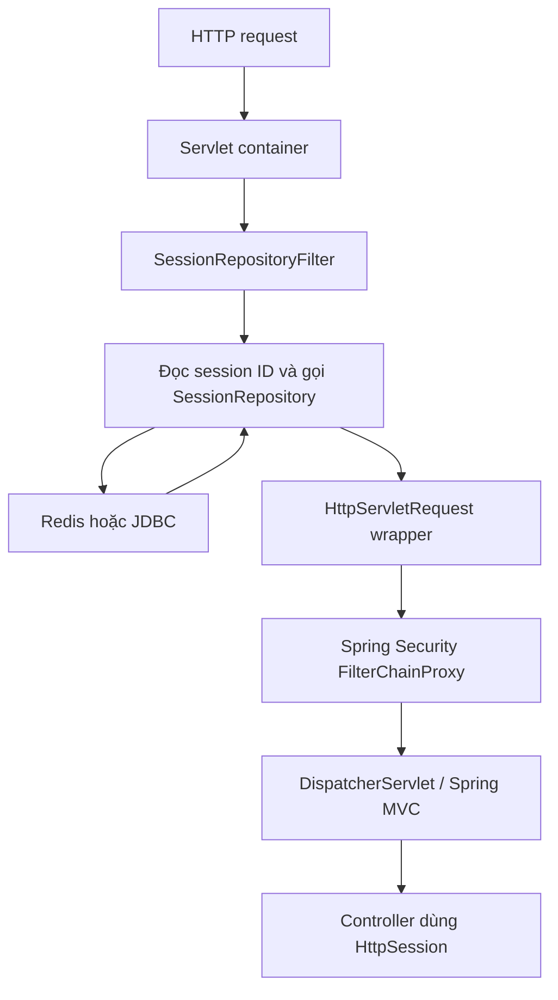
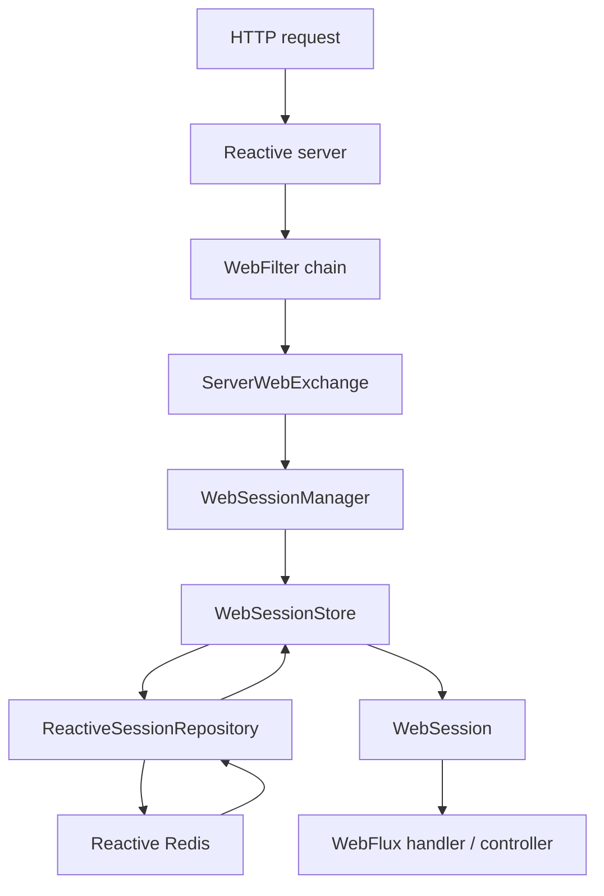

# Phân biệt cấu hình WebFlux với SessionRepositoryFilter của Servlet

Spring Session hỗ trợ lưu phiên cho hai mô hình web khác nhau của Spring: Servlet và reactive WebFlux. Cả hai đều có thể dùng kho dữ liệu chia sẻ như Redis, nhưng cách tích hợp vào request pipeline không giống nhau. Ứng dụng Servlet dùng `HttpSession` và `SessionRepositoryFilter`; ứng dụng WebFlux dùng `WebSession`, `WebSessionManager` và repository reactive. Chọn nhầm cơ chế có thể khiến filter không chạy, session không được lưu, request bị blocking hoặc trạng thái đăng nhập không được khôi phục.

Điều đầu tiên cần xác định là ứng dụng thực sự chạy web stack nào. Việc thêm `spring-boot-starter-webflux` vào build không tự động biến một ứng dụng Spring MVC thành reactive. Nếu cả starter Servlet và WebFlux cùng có mặt, Spring Boot thường chọn Spring MVC theo mặc định. Khi đó, `SessionRepositoryFilter` vẫn là thành phần tích hợp session phù hợp. Cần hiểu rõ runtime application type trước khi chọn annotation, repository, filter và security configuration.

## 1. Hai cách tích hợp Spring Session

Spring Session thay thế nơi lưu trữ phiên mặc định bằng một repository có thể chia sẻ giữa các instance. Phần API mà ứng dụng nhìn thấy phụ thuộc web stack:

| Thành phần | Servlet | WebFlux |
| --- | --- | --- |
| API phiên | `HttpSession` | `WebSession` |
| Request context | `HttpServletRequest` / `HttpServletResponse` | `ServerWebExchange` |
| Thành phần tích hợp chính | `SessionRepositoryFilter` | `WebSessionManager` và `WebSessionStore` |
| Repository contract | `SessionRepository` | `ReactiveSessionRepository` |
| Kiểu thao tác | Blocking/đồng bộ | Reactive, trả `Mono`/`Flux` |
| Filter chain | Servlet `Filter` và `FilterChain` | `WebFilter` và `WebFilterChain` |
| Spring Security | `SecurityFilterChain` | `SecurityWebFilterChain` |
| Cookie/session ID | `HttpSessionIdResolver` và cookie serializer của Spring Session | `WebSessionIdResolver`, thường là `CookieWebSessionIdResolver` |
| Kiểm thử HTTP | `MockMvc` và Servlet container | `WebTestClient` và reactive server |

Hai cách tích hợp không phải hai tên gọi cho cùng một filter. `SessionRepositoryFilter` chỉ tham gia Servlet filter chain và bọc `HttpServletRequest`/`HttpServletResponse`. Trong WebFlux, session được lấy từ `ServerWebExchange` và quản lý bằng các thành phần reactive; không có Servlet filter chain để `SessionRepositoryFilter` can thiệp.

## 2. Spring Boot chọn web stack nào?

Spring Boot quyết định loại web application từ các dependency và cấu hình runtime. Các trường hợp thường gặp:

- Chỉ có Servlet web starter: ứng dụng thường chạy Spring MVC trên Servlet container.
- Chỉ có WebFlux starter và reactive server phù hợp: ứng dụng thường chạy WebFlux.
- Có cả `spring-boot-starter-web` và `spring-boot-starter-webflux`: Boot thường ưu tiên Spring MVC. WebFlux dependency có thể được thêm chỉ để dùng `WebClient`.
- Muốn ép ứng dụng chạy reactive khi có nhiều dependency: có thể cấu hình `spring.main.web-application-type=reactive`, nhưng cần bảo đảm các thành phần và server thực sự tương thích với reactive stack.

Ví dụ cấu hình application type:

```yaml
spring:
  main:
    web-application-type: reactive
```

Chỉ đặt giá trị `reactive` khi mục tiêu triển khai là WebFlux. Nếu ứng dụng cần Spring MVC, không ép reactive chỉ vì một service sử dụng `Mono` hoặc `WebClient`. Một ứng dụng MVC có thể gọi WebClient mà vẫn chạy trên Servlet stack; kiểu trả về của một service không tự quyết định loại server.

Khi kiểm tra runtime, xem startup log, loại server được khởi tạo, các bean request/handler tương ứng và filter chain thực tế. Không chỉ nhìn vào dependency trong `pom.xml` hoặc `build.gradle` để kết luận ứng dụng là reactive.

## 3. SessionRepositoryFilter thuộc Servlet stack

Trong ứng dụng Servlet, `SessionRepositoryFilter` là Servlet `Filter`. Filter đọc session ID từ request thông qua resolver, tìm phiên trong `SessionRepository`, rồi bọc request và response để các thành phần phía sau sử dụng `HttpSession` như bình thường. Khi response hoàn tất, Spring Session lưu các thay đổi theo cấu hình repository.

Luồng đơn giản:



Filter này cần chạy trước Spring Security và mọi filter khác có thể gọi `request.getSession()`. Nếu một filter đứng trước gọi `getSession()` khi request chưa được Spring Session bọc, nó có thể tạo hoặc sử dụng phiên của Servlet container thay vì phiên trong repository dùng chung.

Spring Boot và Spring Session có thể tự đăng ký filter khi dependency và cấu hình phù hợp. Không tự tạo thêm `SessionRepositoryFilter` nếu auto-configuration đã tạo một filter. Hai filter quản lý cùng request có thể gây wrapper chồng nhau, session ID không nhất quán hoặc trạng thái phiên khó chẩn đoán.

## 4. WebFlux dùng WebSessionManager và WebSessionStore

Trong WebFlux, `ServerWebExchange` cung cấp `getSession()` trả về `Mono<WebSession>`. `WebSessionManager` chịu trách nhiệm lấy hoặc tạo phiên cho exchange. `WebSessionStore` là abstraction lưu trữ phiên; Spring Session kết nối nó với `ReactiveSessionRepository` để dữ liệu được lưu trong kho chia sẻ.

Luồng đơn giản:



Thành phần reactive không bọc Servlet request và cũng không tạo `HttpSession`. Controller truy cập phiên qua `exchange.getSession()` hoặc cơ chế argument resolution tương ứng. Các thao tác như đổi ID và invalidate trả publisher, nên phải được kết hợp vào reactive pipeline.

Không đăng ký `SessionRepositoryFilter` cho WebFlux. Không thêm `OncePerRequestFilter` Servlet để đọc `WebSession`. Nếu cần logic trước controller, dùng `WebFilter` và thao tác với `ServerWebExchange`.

## 5. Chọn annotation và repository đúng web stack

Spring Session Data Redis cung cấp cấu hình cho cả Servlet và WebFlux. Các annotation thường gặp có tên gần giống nhau nhưng phục vụ hai mô hình khác nhau:

| Cấu hình | Dùng cho | Repository/API tương ứng |
| --- | --- | --- |
| `@EnableRedisHttpSession` | Servlet | Repository Redis blocking cho `HttpSession` |
| `@EnableRedisWebSession` | WebFlux | Repository Redis reactive cho `WebSession` |

Ví dụ cấu hình Servlet:

```java
@Configuration
@EnableRedisHttpSession
class ServletSessionConfiguration {
}
```

Ví dụ cấu hình WebFlux:

```java
@Configuration
@EnableRedisWebSession
class ReactiveSessionConfiguration {
}
```

Hai ví dụ là các lựa chọn thay thế theo web stack, không phải hai annotation nên bật cùng lúc trong một ứng dụng. Nếu cùng khai báo, ứng dụng có thể tạo các repository, manager hoặc filter không tương thích với loại request đang chạy.

Với Spring Boot, auto-configuration có thể tự chọn cơ chế dựa trên web application type và dependency. Trước khi thêm annotation thủ công, kiểm tra xem Boot đã cấu hình repository và integration bean chưa. Nếu cần tự cấu hình, hãy dùng đúng annotation cho stack và tránh tạo thêm bean trùng.

## 6. Cấu hình Redis dùng chung nhưng connection/repository khác nhau

Hai stack có thể dùng cùng một Redis server, nhưng client API mà repository yêu cầu khác nhau. Servlet repository truyền thống dùng kết nối Redis theo kiểu blocking; WebFlux repository cần reactive Redis connection factory và thao tác reactive.

Ví dụ cấu hình endpoint Redis trong Spring Boot 3:

```yaml
spring:
  data:
    redis:
      host: redis.internal
      port: 6379
      username: ${REDIS_USERNAME:default}
      password: ${REDIS_PASSWORD}
      timeout: 2s
  session:
    timeout: 30m
    redis:
      namespace: portal:sessions
```

Property prefix và khả năng auto-configuration phụ thuộc phiên bản Spring Boot. Trong một ứng dụng WebFlux, cần xác nhận reactive Redis client/connection factory được tạo. Trong Servlet application, repository phải nhận connection factory tương thích với implementation blocking. Không giả định một `RedisConnectionFactory` bất kỳ có thể thay thế cho reactive factory.

Tất cả instance của cùng một ứng dụng phải thống nhất Redis endpoint, namespace, serializer và session timeout. Nếu ứng dụng Servlet và WebFlux độc lập dùng chung Redis, nên đặt namespace riêng trừ khi có thiết kế chia sẻ phiên tương thích rõ ràng. Không chia sẻ cùng keyspace chỉ vì cả hai đều gọi dữ liệu là “session”; cấu trúc session và serialization có thể khác nhau.

## 7. Khác biệt giữa Servlet JDBC repository và WebFlux

Spring Session JDBC truyền thống triển khai repository blocking cho Servlet session. JDBC driver thực hiện I/O đồng bộ; một truy vấn thường giữ thread cho tới khi database trả kết quả. Đây là mô hình phù hợp với Servlet request thread nhưng không phải reactive repository.

WebFlux yêu cầu repository reactive cho session store để không chặn event loop. Việc gọi JDBC blocking trong controller reactive có thể làm giảm throughput và gây nghẽn event loop. Bọc lời gọi trong `Mono.just(...)` không biến nó thành non-blocking vì method blocking đã chạy trước khi publisher được tạo.

Nếu ứng dụng WebFlux cần đọc một hệ thống legacy blocking, có thể cô lập lời gọi trên scheduler phù hợp, ví dụ `Schedulers.boundedElastic()`, nhưng điều đó chỉ chuyển việc chờ sang thread pool. Nó không biến Spring Session JDBC thành WebFlux session repository. Đối với session cốt lõi, ưu tiên repository reactive được hỗ trợ bởi Spring Session.

## 8. Spring Security cũng phải theo đúng stack

Servlet và WebFlux có security filter chain riêng:

| Servlet | WebFlux |
| --- | --- |
| `SecurityFilterChain` | `SecurityWebFilterChain` |
| `FilterChainProxy` | `WebFilterChainProxy` và `WebFilter` |
| `SecurityContextRepository` | `ServerSecurityContextRepository` |
| `HttpSessionSecurityContextRepository` | `WebSessionServerSecurityContextRepository` |
| `HttpSession` | `WebSession` |

Trong Servlet, Spring Security có thể lưu `SecurityContext` vào `HttpSession`. Trong WebFlux, `WebSessionServerSecurityContextRepository` có thể lưu context vào `WebSession`. Một cấu hình bảo mật của Servlet không tự chuyển thành cấu hình reactive bằng cách đổi controller sang trả `Mono`.

Ví dụ WebFlux security:

```java
@Bean
SecurityWebFilterChain webFluxSecurity(ServerHttpSecurity http) {
    return http
            .authorizeExchange(exchange -> exchange
                    .pathMatchers("/public/**", "/login").permitAll()
                    .anyExchange().authenticated())
            .formLogin(Customizer.withDefaults())
            .build();
}
```

Ví dụ Servlet security có dạng `SecurityFilterChain` nhận `HttpSecurity`. Không khai báo hai kiểu chain rồi mong chúng quản lý cùng một request pipeline. Hãy xác định loại application context và chọn đúng security DSL.

## 9. Cookie và resolver phụ thuộc stack

Servlet Spring Session thường dùng `HttpSessionIdResolver` và `CookieSerializer` để đọc/ghi session ID. WebFlux dùng `WebSessionIdResolver`, thường là `CookieWebSessionIdResolver`. Hai resolver có API và cách cấu hình khác nhau.

Trong cả hai trường hợp, cookie session nên được bảo vệ bằng `HttpOnly`, `Secure` và `SameSite` phù hợp. Nếu TLS kết thúc ở reverse proxy, ứng dụng cần nhận biết đúng scheme hoặc cấu hình cookie secure tường minh. Chỉ tin forwarded headers do proxy tin cậy ghi lại; không cho client tùy ý điều khiển scheme hoặc host mà backend sử dụng.

Không dùng session ID trong URL hoặc log. Cookie chỉ mang định danh; dữ liệu phiên được lưu ở repository. Nếu trình duyệt không gửi lại cookie, kiểm tra domain, path, `Secure`, `SameSite`, HTTPS và proxy trước khi kết luận repository mất dữ liệu.

## 10. Cách nhận biết cấu hình nhầm

Các dấu hiệu sau thường chỉ ra ứng dụng đang trộn hai stack:

| Triệu chứng | Nguyên nhân có thể | Hướng kiểm tra |
| --- | --- | --- |
| `SessionRepositoryFilter` không xuất hiện trong ứng dụng WebFlux | Đang mong đợi Servlet filter trong reactive pipeline | Kiểm tra application type và dùng WebSession integration |
| Controller WebFlux không có `HttpServletRequest` | Đang dùng API Servlet trong reactive controller | Dùng `ServerWebExchange` và `WebSession` |
| `HttpSession` lưu được ở node A nhưng node B không đọc được | Filter/repository hoặc namespace không thống nhất | Kiểm tra đúng Servlet repository, filter order và Redis namespace |
| WebFlux event loop bị chặn | Gọi JDBC/Redis blocking hoặc `.block()` | Dùng reactive repository/client và trả publisher |
| Security context mất ở request tiếp theo | Dùng sai security chain/repository | Kiểm tra `SecurityContextRepository` hay `ServerSecurityContextRepository` |
| Cookie được phát nhưng request sau không gửi lại | Resolver/cookie policy không phù hợp | Kiểm tra `HttpSessionIdResolver` hoặc `WebSessionIdResolver`, path/domain/SameSite/Secure |
| Cả hai loại session config cùng được khởi tạo | Annotation hoặc auto-configuration bị chồng | Kiểm tra bean repository, manager và filter thực tế |

Một lỗi thường gặp là thêm WebFlux dependency vào ứng dụng MVC chỉ để dùng `WebClient`, rồi bật `@EnableRedisWebSession`. Nếu Boot vẫn chạy MVC, request thật vẫn đi qua Servlet stack và cấu hình reactive session không thay thế `SessionRepositoryFilter`. Ngược lại, khi ứng dụng chạy WebFlux, bật `@EnableRedisHttpSession` không tạo ra WebSession reactive.

## 11. Kiểm thử theo đúng runtime

Không dùng một bộ kiểm thử để suy ra cả hai integration. Kiểm thử cần chạy trong đúng loại server và xác minh cả session ID, dữ liệu lưu trữ lẫn request kế tiếp.

| Mục kiểm thử | Servlet | WebFlux |
| --- | --- | --- |
| Công cụ HTTP | `MockMvc` hoặc embedded Servlet container | `WebTestClient` hoặc reactive server |
| Session API | `HttpSession` | `WebSession` |
| Kiểm tra filter/chain | `SessionRepositoryFilter` và `SecurityFilterChain` | `WebSessionManager`/store và `SecurityWebFilterChain` |
| Repository | `SessionRepository` blocking | `ReactiveSessionRepository` |
| Kiểm tra nhiều instance | Cookie từ node A gửi tới node B | Cookie từ node A gửi tới node B |
| Logout | Invalidate `HttpSession` và xóa cookie | Reactive `WebSession.invalidate()` và resolver xử lý ID |

Các tình huống cần có:

1. Request đầu không có cookie và chưa cần tạo session.
2. Ghi thuộc tính phiên, nhận cookie session ID và gửi cookie ở request kế tiếp.
3. Đăng nhập và xác minh security context được khôi phục ở request sau.
4. Đổi session ID sau xác thực, xác minh ID cũ không còn dùng cho phiên đã xác thực.
5. Logout và gửi lại cookie cũ để xác nhận server đã thu hồi phiên.
6. Gửi request tới instance khác dùng cùng Redis repository/namespace.
7. Kiểm tra timeout và lỗi kết nối repository.
8. Với WebFlux, xác minh không có blocking I/O trên event loop.

Trong kiểm thử tích hợp, dùng Redis thật hoặc Testcontainers để xác minh serialization, TTL và chia sẻ phiên. Mock repository hữu ích cho service unit test nhưng không chứng minh filter, cookie resolver hoặc runtime web stack được cấu hình đúng.

## 12. Quy trình chọn cấu hình đúng

1. Xác định ứng dụng thực sự chạy Servlet hay WebFlux qua dependency, Boot application type và server được khởi tạo.
2. Nếu là Servlet, dùng `HttpSession`, `SessionRepositoryFilter`, repository blocking và `@EnableRedisHttpSession` hoặc auto-configuration tương ứng.
3. Nếu là WebFlux, dùng `WebSession`, `WebSessionManager`/`WebSessionStore`, repository reactive và `@EnableRedisWebSession` hoặc auto-configuration tương ứng.
4. Chọn đúng Redis connection factory/client và cấu hình namespace, timeout, serializer đồng nhất trên các instance.
5. Cấu hình security chain và security context repository đúng web stack.
6. Cấu hình cookie/session ID resolver tương ứng, kiểm tra HTTPS và reverse proxy.
7. Tránh khai báo đồng thời Servlet filter và WebFlux session manager cho cùng runtime; không tạo bean repository trùng.
8. Kiểm thử login, persistence, đổi ID, logout, timeout và nhiều instance bằng công cụ đúng stack.

## 13. Kết luận kiến trúc

`SessionRepositoryFilter` là cầu nối của Spring Session với Servlet `HttpSession`; nó không phải thành phần chung cho mọi ứng dụng Spring. WebFlux quản lý `WebSession` qua `WebSessionManager`, `WebSessionStore` và repository reactive. Redis có thể là kho dữ liệu dùng chung cho cả hai mô hình, nhưng client API, repository, cookie resolver, security chain và cách xử lý request phải tương thích với web stack.

Khi phân biệt rõ runtime Servlet và WebFlux, ứng dụng tránh được lỗi cấu hình chồng chéo, session không được chia sẻ và blocking event loop. Với Spring Session, chọn đúng cơ chế tích hợp từ đầu là điều kiện để dữ liệu phiên, cookie và trạng thái xác thực hoạt động nhất quán giữa nhiều instance.
