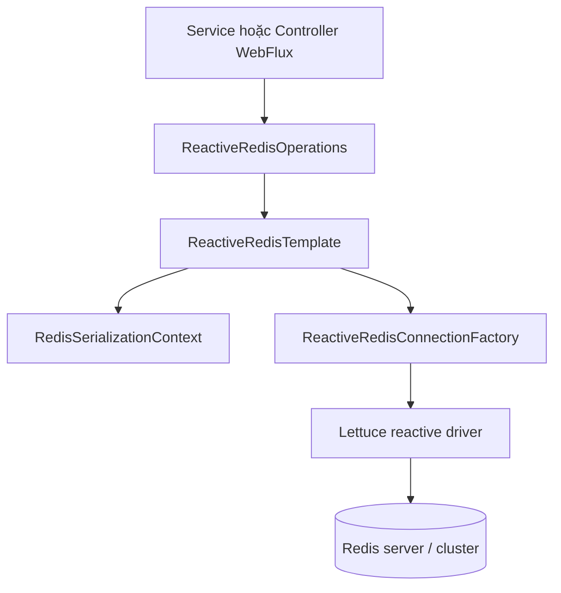

# ReactiveRedisConnectionFactory, ReactiveRedisOperations và serializer

Trong ứng dụng Spring WebFlux, truy cập Redis nên giữ nguyên mô hình reactive từ tầng kết nối đến tầng nghiệp vụ. `ReactiveRedisConnectionFactory` cung cấp kết nối Redis không chặn; `ReactiveRedisOperations` định nghĩa các thao tác dữ liệu trả về `Mono` hoặc `Flux`; `ReactiveRedisTemplate` là triển khai phổ biến của interface này và thực hiện tuần tự hóa/giải tuần tự hóa theo `RedisSerializationContext`.

Ba thành phần có trách nhiệm khác nhau:

- `ReactiveRedisConnectionFactory` quản lý việc tạo kết nối reactive tới Redis, thường được triển khai bởi Lettuce.
- `ReactiveRedisOperations` cung cấp API cấp cao cho value, hash, list, set, sorted set và các cấu trúc Redis khác.
- Serializer xác định cách key, value và trường hash được chuyển thành byte để lưu trong Redis và khôi phục lại khi đọc.

Spring Session có thể dùng chính hạ tầng reactive này để lưu `WebSession` thông qua `ReactiveRedisSessionRepository`. Khi đó, ứng dụng WebFlux tiếp tục làm việc với `WebSession`, còn repository sử dụng `ReactiveRedisOperations` để lưu dữ liệu phiên trong Redis dùng chung. Cấu hình serializer cho cache nghiệp vụ và serializer cho Spring Session cần được hiểu riêng để tránh thay đổi định dạng dữ liệu ngoài ý muốn.

## 1. Kiến trúc truy cập Redis theo reactive

### 1.1. Luồng dữ liệu



Ứng dụng gọi API cấp cao của `ReactiveRedisOperations`. `ReactiveRedisTemplate` chuyển key/value thành dạng dữ liệu Redis theo serialization context, lấy kết nối qua factory, thực hiện lệnh và chuyển kết quả về kiểu Java. Kết quả được biểu diễn bằng `Mono<T>` cho không hoặc một phần tử và `Flux<T>` cho một chuỗi phần tử.

Không nên đưa `RedisConnection` đồng bộ vào luồng WebFlux rồi gọi lệnh blocking. Một lệnh blocking có thể giữ event-loop thread, làm chậm nhiều request khác cùng được xử lý trên thread đó. Hãy dùng reactive driver và API reactive xuyên suốt đường xử lý.

### 1.2. Phân biệt reactive với chỉ trả về `Mono`

Một phương thức trả `Mono` không tự động bảo đảm toàn bộ công việc bên trong là non-blocking. Nếu service gọi JDBC blocking, `Thread.sleep`, `RedisTemplate` đồng bộ hoặc `.block()` trước khi trả `Mono`, luồng vẫn có thể chặn thread.

Reactive cần được duy trì từ nguồn I/O đến response:

1. Dùng `ReactiveRedisConnectionFactory` và `ReactiveRedisOperations`.
2. Kết hợp kết quả bằng các operator Reactor như `map`, `flatMap`, `then`, `zip`.
3. Trả `Mono`/`Flux` cho controller WebFlux.
4. Để framework subscribe vào pipeline trong quá trình xử lý request.
5. Không tự `subscribe()` trong service nghiệp vụ và không gọi `.block()` trong request path.

## 2. `ReactiveRedisConnectionFactory`

### 2.1. Hợp đồng và vai trò

`org.springframework.data.redis.connection.ReactiveRedisConnectionFactory` là interface factory cho kết nối Redis reactive. Nó cung cấp các phương thức như `getReactiveConnection()` và `getReactiveClusterConnection()` để lấy kết nối tương ứng. Interface này có từ Spring Data Redis 2.0 và là abstraction thread-safe.

Triển khai thường gặp là `LettuceConnectionFactory`. Lettuce dựa trên Netty và cung cấp API Redis reactive phù hợp với WebFlux. Factory được quản lý như một Spring bean để ứng dụng và các template có thể dùng chung.

Factory không phải repository session, không định nghĩa kiểu dữ liệu ứng dụng và không tự chọn serializer. Nó chỉ cung cấp kết nối tới Redis. Các trách nhiệm về key/value encoding thuộc `RedisSerializationContext` hoặc cấu hình repository.

### 2.2. Cấu hình bằng Spring Boot

Trong ứng dụng Spring Boot, cách đơn giản là thêm dependency Redis phù hợp và cấu hình kết nối:

```yaml
spring:
  data:
    redis:
      host: localhost
      port: 6379
      # username: app-user
      # password: ${REDIS_PASSWORD}
      # connect-timeout: 2s
```

Spring Boot auto-configuration có thể tạo `RedisConnectionFactory` dùng Lettuce; factory này cũng cung cấp reactive connection cho WebFlux. Không cần tự khai báo một `LettuceConnectionFactory` thứ hai nếu auto-configuration đã cung cấp factory phù hợp.

Trong môi trường production, thông tin xác thực nên lấy từ secret manager hoặc biến môi trường. Cấu hình TLS, ACL, database index, cluster/sentinel và timeout theo hạ tầng thật. Không ghi password hoặc URI có credential vào log.

### 2.3. Khai báo factory thủ công

Nếu không dùng auto-configuration, có thể khai báo Lettuce factory:

```java
import org.springframework.context.annotation.Bean;
import org.springframework.context.annotation.Configuration;
import org.springframework.data.redis.connection.ReactiveRedisConnectionFactory;
import org.springframework.data.redis.connection.lettuce.LettuceConnectionFactory;

@Configuration
public class ReactiveRedisConfiguration {

    @Bean
    ReactiveRedisConnectionFactory reactiveRedisConnectionFactory() {
        return new LettuceConnectionFactory("localhost", 6379);
    }
}
```

`LettuceConnectionFactory` triển khai `ReactiveRedisConnectionFactory`. Factory cần được Spring quản lý vòng đời; không tạo mới một factory cho mỗi request hoặc mỗi lần gọi service. Khi ứng dụng cần cả thao tác đồng bộ và reactive, cân nhắc dùng cùng factory được cấu hình đúng thay vì mở nhiều nhóm kết nối không cần thiết.

### 2.4. Kết nối đơn, cluster và topology

`getReactiveConnection()` cung cấp kết nối reactive tới Redis; `getReactiveClusterConnection()` dành cho Redis Cluster khi driver và topology được cấu hình hỗ trợ. Việc dùng cluster không chỉ là thay host: cần xác định seed nodes, routing theo hash slot, chính sách redirect, timeout và hành vi khi node/shard mất kết nối.

Trong phần lớn ứng dụng, không cần gọi trực tiếp hai phương thức trên. `ReactiveRedisTemplate` sử dụng factory và quản lý thao tác kết nối. Chỉ dùng API connection mức thấp khi cần một lệnh hoặc nhóm lệnh chưa được abstraction cấp cao hỗ trợ. Khi dùng callback qua template, để template quản lý vòng đời connection; không tự đóng connection bên trong callback.

## 3. `ReactiveRedisOperations` và `ReactiveRedisTemplate`

### 3.1. Interface và triển khai

`ReactiveRedisOperations<K, V>` là interface truy cập Redis reactive. `ReactiveRedisTemplate<K, V>` triển khai interface này. Hai tham số generic biểu diễn kiểu key và kiểu value mà template mong đợi ở tầng Java; serializer chịu trách nhiệm chuyển chúng thành dạng byte tương ứng trong Redis.

Template thực hiện serialization/deserialization tự động, đồng thời quản lý việc dùng kết nối. Nó thread-safe sau khi được cấu hình và có thể được inject, tái sử dụng bởi nhiều service.

Ví dụ tạo template chuỗi:

```java
import org.springframework.context.annotation.Bean;
import org.springframework.context.annotation.Configuration;
import org.springframework.data.redis.connection.ReactiveRedisConnectionFactory;
import org.springframework.data.redis.core.ReactiveStringRedisTemplate;

@Configuration
public class ReactiveRedisTemplateConfiguration {

    @Bean
    ReactiveStringRedisTemplate reactiveStringRedisTemplate(
            ReactiveRedisConnectionFactory connectionFactory) {
        return new ReactiveStringRedisTemplate(connectionFactory);
    }
}
```

`ReactiveStringRedisTemplate` là template tiện ích dùng serialization chuỗi cho key và value. Nó phù hợp với cache đơn giản, counter dạng chuỗi hoặc dữ liệu đã được ứng dụng chuyển thành text.

### 3.2. Các nhóm thao tác

`ReactiveRedisOperations` cung cấp các view theo kiểu dữ liệu Redis:

| API | Cấu trúc Redis | Trường hợp dùng |
|---|---|---|
| `opsForValue()` | String/value | Cache một giá trị, counter, token tham chiếu |
| `opsForHash()` | Hash | Một record có nhiều field |
| `opsForList()` | List | Danh sách có thứ tự, hàng đợi đơn giản |
| `opsForSet()` | Set | Tập phần tử duy nhất |
| `opsForZSet()` | Sorted set | Xếp hạng hoặc dữ liệu có score |
| `opsForStream()` | Stream | Dòng sự kiện và consumer group nếu cấu hình phù hợp |

Ngoài ra còn có các thao tác key, expiration, transaction và callback ở mức thấp. Chọn cấu trúc theo truy vấn cần thực hiện; đừng dùng một Redis hash cho mọi loại dữ liệu nếu value hoặc TTL độc lập là yêu cầu quan trọng.

### 3.3. Ví dụ service reactive

Giả sử ứng dụng lưu snapshot nhỏ của giỏ hàng trong Redis trong 15 phút:

```java
import java.time.Duration;

import org.springframework.data.redis.core.ReactiveRedisOperations;
import org.springframework.stereotype.Service;
import reactor.core.publisher.Mono;

@Service
public class CartCacheService {

    private final ReactiveRedisOperations<String, CartSnapshot> redis;

    public CartCacheService(ReactiveRedisOperations<String, CartSnapshot> redis) {
        this.redis = redis;
    }

    public Mono<Boolean> save(String cartId, CartSnapshot snapshot) {
        String key = "portal:cart:" + cartId;
        return this.redis.opsForValue()
            .set(key, snapshot, Duration.ofMinutes(15));
    }

    public Mono<CartSnapshot> find(String cartId) {
        String key = "portal:cart:" + cartId;
        return this.redis.opsForValue().get(key);
    }

    public Mono<Boolean> delete(String cartId) {
        String key = "portal:cart:" + cartId;
        return this.redis.delete(key).map(deleted -> deleted > 0);
    }
}
```

`CartSnapshot` là DTO của ứng dụng; serializer ở phần sau sẽ quyết định cách ghi/đọc object. Các phương thức trả về `Mono` để caller có thể ghép tiếp với logic nghiệp vụ. Không gọi `subscribe()` trong `save`, `find` hoặc `delete`; nếu tự subscribe ở service, lỗi có thể không quay về caller và request có thể kết thúc trước khi công việc hoàn tất.

Controller WebFlux có thể trả trực tiếp publisher:

```java
@RestController
@RequestMapping("/api/carts")
public class CartController {

    private final CartCacheService cache;

    public CartController(CartCacheService cache) {
        this.cache = cache;
    }

    @GetMapping("/{cartId}")
    public Mono<CartSnapshot> find(@PathVariable String cartId) {
        return this.cache.find(cartId);
    }
}
```

Nếu Redis không có key, `opsForValue().get` trả `Mono.empty()`, không phát ra `null`. Dùng `switchIfEmpty` nếu cần fallback tới database hoặc trả 404. Reactive Streams không cho phép phát một phần tử `null`.

### 3.4. Ghép các thao tác

Có thể ghép nhiều thao tác Redis trong cùng pipeline:

```java
public Mono<CartSnapshot> findOrCreate(String cartId) {
    return find(cartId)
        .switchIfEmpty(Mono.defer(() -> loadFromDatabase(cartId)
            .flatMap(snapshot -> save(cartId, snapshot).thenReturn(snapshot))));
}
```

`Mono.defer` giúp trì hoãn việc tạo pipeline fallback đến lúc có subscription. `flatMap` ghép thao tác bất đồng bộ tiếp theo; `thenReturn` bỏ kết quả boolean của lệnh ghi và phát snapshot đã tải. Nếu có nhiều thao tác độc lập, có thể dùng `Mono.zip` hoặc `Mono.when`, nhưng cần hiểu rằng ghép reactive không tự tạo transaction Redis.

### 3.5. `execute` và callback mức thấp

Khi API cấp cao chưa hỗ trợ lệnh cần thiết, `ReactiveRedisOperations.execute(...)` cho phép chạy `ReactiveRedisCallback` trên reactive connection và trả `Flux<T>`. Template vẫn quản lý serialization và connection theo callback contract.

Không tự quản lý transaction bên trong callback và không gọi các phương thức vòng đời connection như `close()`. Nếu cần transaction Redis, hãy dùng cơ chế transaction phù hợp của Spring Data Redis và kiểm tra giới hạn của Redis transaction; không nhầm nó với transaction database phân tán.

## 4. `RedisSerializationContext`

### 4.1. Serializer cho từng loại dữ liệu

`RedisSerializationContext<K,V>` mô tả cách serialize và deserialize các thành phần:

- Key: tên key Redis.
- Value: giá trị được lưu dưới key.
- Hash key: tên field bên trong Redis hash.
- Hash value: giá trị của field trong hash.
- String: serialization cho chuỗi dùng trong một số thao tác.

Mỗi vị trí có một `SerializationPair<T>`, gồm bộ đọc và bộ ghi tương ứng. Điều này quan trọng vì key thường nên là chuỗi dễ quan sát, trong khi value có thể là DTO JSON hoặc byte array. Không nhất thiết dùng cùng một serializer cho mọi vị trí.

### 4.2. Context chuỗi có sẵn

Nếu cả key và value đều là chuỗi, dùng:

```java
RedisSerializationContext<String, String> context = RedisSerializationContext.string();
```

Hoặc dùng `ReactiveStringRedisTemplate`, vốn áp dụng string serialization mặc định. Khi dữ liệu là JSON string do ứng dụng tự chuyển đổi, cần thống nhất ai chịu trách nhiệm parse JSON để tránh serialize JSON hai lần.

### 4.3. Context cho DTO

Với DTO, có thể tạo `RedisSerializationContext` riêng. Ví dụ dưới đây dùng một `RedisSerializer<CartSnapshot>` tùy chỉnh:

```java
import org.springframework.context.annotation.Bean;
import org.springframework.context.annotation.Configuration;
import org.springframework.data.redis.connection.ReactiveRedisConnectionFactory;
import org.springframework.data.redis.core.ReactiveRedisTemplate;
import org.springframework.data.redis.serializer.RedisSerializationContext;
import org.springframework.data.redis.serializer.StringRedisSerializer;

@Configuration
public class CartRedisTemplateConfiguration {

    @Bean
    ReactiveRedisTemplate<String, CartSnapshot> cartRedisTemplate(
            ReactiveRedisConnectionFactory connectionFactory,
            CartSnapshotRedisSerializer cartSerializer) {

        var keyPair = RedisSerializationContext.SerializationPair
            .fromSerializer(new StringRedisSerializer());
        var valuePair = RedisSerializationContext.SerializationPair
            .fromSerializer(cartSerializer);

        RedisSerializationContext<String, CartSnapshot> context =
            RedisSerializationContext.<String, CartSnapshot>newSerializationContext()
                .key(keyPair)
                .value(valuePair)
                .hashKey(keyPair)
                .hashValue(valuePair)
                .build();

        return new ReactiveRedisTemplate<>(connectionFactory, context);
    }
}
```

Template này chỉ định rõ kiểu value là `CartSnapshot`. Nếu cần hash có nhiều kiểu field value khác nhau, nên dùng một template/serialization context phù hợp với mô hình đó thay vì ép mọi giá trị vào một serializer sai kiểu.

## 5. Viết một serializer JSON có kiểu rõ ràng

### 5.1. DTO ổn định

Ví dụ DTO đơn giản:

```java
public class CartSnapshot {

    private String cartId;
    private int itemCount;

    public CartSnapshot() {
    }

    public CartSnapshot(String cartId, int itemCount) {
        this.cartId = cartId;
        this.itemCount = itemCount;
    }

    public String getCartId() {
        return this.cartId;
    }

    public void setCartId(String cartId) {
        this.cartId = cartId;
    }

    public int getItemCount() {
        return this.itemCount;
    }

    public void setItemCount(int itemCount) {
        this.itemCount = itemCount;
    }
}
```

DTO không chứa entity, service, repository hoặc object phụ thuộc vòng đời request. Nó có cấu trúc nhỏ và có thể được giữ tương thích giữa các phiên bản ứng dụng.

### 5.2. Cài đặt `RedisSerializer`

```java
import java.io.IOException;

import com.fasterxml.jackson.core.JsonProcessingException;
import com.fasterxml.jackson.databind.ObjectMapper;
import org.springframework.data.redis.serializer.RedisSerializer;
import org.springframework.data.redis.serializer.SerializationException;
import org.springframework.stereotype.Component;

@Component
public class CartSnapshotRedisSerializer implements RedisSerializer<CartSnapshot> {

    private final ObjectMapper objectMapper;

    public CartSnapshotRedisSerializer(ObjectMapper objectMapper) {
        this.objectMapper = objectMapper.copy();
    }

    @Override
    public byte[] serialize(CartSnapshot value) throws SerializationException {
        if (value == null) {
            return null;
        }
        try {
            return this.objectMapper.writeValueAsBytes(value);
        }
        catch (JsonProcessingException ex) {
            throw new SerializationException("Cannot serialize CartSnapshot", ex);
        }
    }

    @Override
    public CartSnapshot deserialize(byte[] source) throws SerializationException {
        if (source == null || source.length == 0) {
            return null;
        }
        try {
            return this.objectMapper.readValue(source, CartSnapshot.class);
        }
        catch (IOException ex) {
            throw new SerializationException("Cannot deserialize CartSnapshot", ex);
        }
    }
}
```

Serializer này dùng kiểu đích cố định nên không cần lấy tên class từ payload. Nó cũng dùng bản sao `ObjectMapper` để cấu hình cho dữ liệu Redis mà không làm thay đổi mapper dùng cho HTTP JSON. Trong dự án thực tế, cần xác minh constructor, module Jackson và cách xử lý field thiếu theo phiên bản Jackson/Spring Data Redis đang dùng.

### 5.3. Lựa chọn serializer

| Serializer | Đặc điểm | Khi nên dùng |
|---|---|---|
| `StringRedisSerializer` | Chuyển chuỗi thành UTF-8 bytes | Key, text, JSON string do ứng dụng tự quản lý |
| `JdkSerializationRedisSerializer` | Dùng Java native serialization | Chỉ khi cần tương thích với dữ liệu Java serialization hiện có và kiểm soát chặt classpath |
| Jackson JSON serializer | Lưu JSON, dễ quan sát và có thể tiến hóa schema | DTO có hợp đồng rõ ràng, cần tương thích giữa phiên bản |
| Serializer tự viết | Kiểm soát hoàn toàn format và kiểu đích | Giao thức dữ liệu chuyên biệt hoặc cần migration có kiểm soát |
| Byte array/ByteBuffer | Không tự chuyển đổi thành object nghiệp vụ | Khi ứng dụng đã quản lý format nhị phân riêng |

Spring Data Redis cung cấp nhiều serializer trong package `org.springframework.data.redis.serializer`. `RedisSerializer` thường làm việc với `byte[]`; reactive serialization context còn biểu diễn các cặp reader/writer cho dữ liệu reactive. <Link url="https://docs.spring.io/spring-data/redis/reference/redis/template.html" title="Spring Data Redis: serialization và template" />

### 5.4. Key và value không nên dùng chung một định dạng tùy tiện

Key thường nên là chuỗi dễ đọc như `portal:cart:cart-204`, giúp vận hành và chẩn đoán dễ hơn. Nếu dùng JDK Serialization cho key, `redis-cli` sẽ hiển thị byte không đọc được và công cụ quan sát khó sử dụng. Value có thể dùng JSON hoặc định dạng nhị phân tùy yêu cầu.

Hash key cũng thường nên là chuỗi field ổn định như `cartId`, `itemCount`. Hash value cần serializer tương thích với từng kiểu giá trị. Việc chọn serializer riêng cho key, value, hash key và hash value giúp định dạng lưu trữ minh bạch hơn.

## 6. Reactive Redis và Spring Session WebFlux

### 6.1. Dùng `WebSession`, không dùng `HttpSession`

Ứng dụng Spring WebFlux sử dụng `org.springframework.web.server.WebSession`. Đây là API session dành cho reactive web stack. Spring Session tích hợp bằng cách cung cấp `WebSessionManager` backed by `ReactiveSessionRepository`, giúp nhiều instance dùng chung trạng thái phiên mà không phụ thuộc vào bộ nhớ của một server.

Trong mô hình này:

- WebFlux quản lý `WebSession` trong request reactive.
- Spring Session cung cấp `ReactiveSessionRepository`.
- `ReactiveRedisSessionRepository` lưu phiên qua `ReactiveRedisOperations`.
- `ReactiveRedisConnectionFactory` cung cấp kết nối Redis reactive.

Đừng đưa `HttpSession` hoặc `SessionRepositoryFilter` của Servlet vào ứng dụng WebFlux thuần. Đó là hai tích hợp khác nhau: Servlet dùng `HttpSession`/`SessionRepositoryFilter`; WebFlux dùng `WebSession`/`WebSessionManager`.

### 6.2. Cấu hình bằng `@EnableRedisWebSession`

Ví dụ cấu hình reactive Spring Session:

```java
import org.springframework.context.annotation.Configuration;
import org.springframework.data.redis.connection.ReactiveRedisConnectionFactory;
import org.springframework.data.redis.connection.lettuce.LettuceConnectionFactory;
import org.springframework.context.annotation.Bean;
import org.springframework.session.data.redis.config.annotation.web.server.EnableRedisWebSession;

@Configuration(proxyBeanMethods = false)
@EnableRedisWebSession(
    maxInactiveIntervalInSeconds = 1800,
    redisNamespace = "portal:reactive-session"
)
public class ReactiveWebSessionConfiguration {

    @Bean
    ReactiveRedisConnectionFactory reactiveRedisConnectionFactory() {
        return new LettuceConnectionFactory("localhost", 6379);
    }
}
```

`@EnableRedisWebSession` tạo `WebSessionManager` backed by Redis và cần một `ReactiveRedisConnectionFactory`. `maxInactiveIntervalInSeconds` đặt timeout mặc định 30 phút; `redisNamespace` tách key của ứng dụng khỏi namespace của ứng dụng khác. <Link url="https://docs.spring.io/spring-session/reference/web-session.html" title="Spring Session WebSession Integration" />

Nếu dùng Spring Boot starter cho Spring Session Redis trong ứng dụng reactive, auto-configuration có thể thay thế nhu cầu khai báo annotation thủ công. Chọn một cơ chế cấu hình rõ ràng và kiểm tra auto-configuration đã back off khi khai báo `@EnableRedisWebSession`.

### 6.3. Cấu hình serializer cho Spring Session

Serializer của `ReactiveRedisTemplate<String, CartSnapshot>` ở phần trước chỉ áp dụng cho template cache nghiệp vụ đó. Nó không tự động có nghĩa repository session dùng cùng template hoặc cùng kiểu dữ liệu.

Để tùy chỉnh serializer thuộc tính của Spring Session Redis, cung cấp bean `RedisSerializer<Object>` có tên chính xác `springSessionDefaultRedisSerializer`. Cấu hình reactive `RedisWebSessionConfiguration` sử dụng bean này làm serializer mặc định của repository session khi có mặt.

Ví dụ với Jackson serializer:

```java
import com.fasterxml.jackson.databind.ObjectMapper;
import org.springframework.context.annotation.Bean;
import org.springframework.context.annotation.Configuration;
import org.springframework.data.redis.serializer.GenericJackson2JsonRedisSerializer;
import org.springframework.data.redis.serializer.RedisSerializer;

@Configuration
public class SpringSessionSerializationConfiguration {

    @Bean
    RedisSerializer<Object> springSessionDefaultRedisSerializer(ObjectMapper objectMapper) {
        return new GenericJackson2JsonRedisSerializer(objectMapper.copy());
    }
}
```

Tên bean là một phần của hợp đồng cấu hình. Nếu dùng tên khác, Spring Session có thể tiếp tục dùng serializer mặc định. Với ứng dụng lưu `SecurityContext`, custom `UserDetails` hoặc các kiểu đặc biệt, cần đăng ký Jackson module/deserializer tương ứng của Spring Security theo phiên bản đang dùng. Tài liệu Spring Session mô tả bean serializer và yêu cầu tên này cho Redis session. <Link url="https://docs.spring.io/spring-session/reference/configuration/redis.html" title="Spring Session Redis: JSON serialization" />

Lưu ý: tên class Jackson serializer có thể thay đổi theo thế hệ Spring Data Redis/Jackson. Hãy dùng serializer tương thích với BOM của dự án. Không bật polymorphic default typing không giới hạn chỉ để giải mã mọi kiểu object.

### 6.4. Repository reactive không phải `ReactiveRedisOperations` của ứng dụng

`ReactiveRedisSessionRepository` là repository session chuyên dụng được xây dựng trên `ReactiveRedisOperations`. Nó quản lý schema key, session ID, timeout và thuộc tính session theo quy tắc của Spring Session.

`ReactiveRedisTemplate` mà ứng dụng tự tạo thường phục vụ cache hoặc dữ liệu nghiệp vụ. Dùng chung Redis server là bình thường, nhưng nên tách namespace và serializer để tránh ghi đè dữ liệu session. Không tự ghi key vào namespace nội bộ của Spring Session nếu không tuân theo format và vòng đời mà repository mong đợi.

## 7. Save mode và thời điểm ghi

### 7.1. Reactive pipeline không đồng nghĩa ghi ngay

Một lệnh Redis chỉ thực thi khi reactive publisher được subscribe. Với Spring Session WebFlux, `WebSessionManager` phối hợp với `ReactiveSessionRepository` để lưu thay đổi của phiên trong vòng đời request. Vì vậy, cần phân biệt:

- Khi ứng dụng tạo pipeline reactive.
- Khi pipeline được subscribe và lệnh thực sự chạy.
- Khi session repository ghi thay đổi vào Redis ở bước lưu phiên.

`ReactiveRedisSessionRepository` tạo session có thể theo dõi thay đổi và tối ưu bằng cách chỉ ghi phần dữ liệu cần cập nhật. Điều này giảm lượng dữ liệu ghi khi thuộc tính được đọc nhiều lần nhưng chỉ thay đổi một lần.

### 7.2. `SaveMode`

Reactive Redis WebSession cung cấp `SaveMode` để xác định thuộc tính nào được ghi khi session được lưu:

| Chế độ | Hành vi tổng quát | Đánh đổi |
|---|---|---|
| `ON_SET_ATTRIBUTE` | Chỉ ghi các thuộc tính được đặt hoặc thay đổi | Mặc định phù hợp với phần lớn ứng dụng; giảm ghi dữ liệu không đổi |
| `ON_GET_ATTRIBUTE` | Ghi cả thuộc tính được đọc và được thay đổi | Có thể cần khi ứng dụng mutate object mutable sau khi đọc mà không gọi lại `setAttribute` |
| `ALWAYS` | Ghi tất cả thuộc tính session | Dễ hiểu nhưng có thể tăng lượng dữ liệu và chi phí ghi |

`@EnableRedisWebSession` có thuộc tính `saveMode`; mặc định là `ON_SET_ATTRIBUTE`. Có thể cấu hình qua annotation hoặc tùy chỉnh `ReactiveRedisSessionRepository` theo API của phiên bản đang dùng. <Link url="https://docs.spring.io/spring-session/reference/api/java/org/springframework/session/data/redis/config/annotation/web/server/EnableRedisWebSession.html" title="EnableRedisWebSession và SaveMode" />

Với `ON_SET_ATTRIBUTE`, nếu lấy một object mutable từ session rồi thay đổi field bên trong mà không gọi lại `session.setAttribute(...)`, repository có thể không nhận biết thay đổi đó. Có thể dùng object bất biến, đặt lại thuộc tính sau khi sửa hoặc chọn save mode phù hợp. Không chọn `ALWAYS` chỉ để che giấu một mô hình cập nhật session không rõ ràng.

`SaveMode` quyết định phạm vi thuộc tính được ghi lại; nó không phải chế độ flush tức thời. Reactive Redis WebSession không cung cấp cùng `FlushMode.ON_SAVE`/`IMMEDIATE` như một số cấu hình Servlet Redis. Đừng sao chép cấu hình flush của Servlet repository sang reactive repository nếu API reactive không có thuộc tính đó.

Không coi save mode là transaction nghiệp vụ hoặc cơ chế optimistic locking. Nếu nhiều request cùng cập nhật giỏ hàng hoặc quy trình thanh toán, hãy thiết kế tính nhất quán ở tầng dữ liệu nghiệp vụ.

## 8. Xử lý lỗi reactive

### 8.1. Không nuốt lỗi Redis

Các lỗi kết nối, timeout, authentication hoặc serialization sẽ được biểu diễn thành error signal trong `Mono`/`Flux`. Dùng `onErrorMap`, `onErrorResume` hoặc exception handler ở ranh giới phù hợp để chuyển thành lỗi ứng dụng có ý nghĩa.

Ví dụ fallback cho cache không bắt buộc:

```java
public Mono<CartSnapshot> findCart(String cartId) {
    return this.cache.find(cartId)
        .onErrorResume(redisError -> this.cartRepository.findById(cartId));
}
```

Ví dụ này chỉ phù hợp khi Redis là cache và database là nguồn dữ liệu chính. Nếu Redis là kho session xác thực, không được coi lỗi Redis như session không tồn tại rồi âm thầm cấp một trạng thái xác thực mặc định. Với session, lỗi kho dữ liệu phải được xử lý theo hướng fail-safe và được quan sát rõ ràng.

### 8.2. Retry có điều kiện

Có thể dùng retry có giới hạn cho lỗi kết nối tạm thời:

```java
return redis.opsForValue().get(key)
    .retryWhen(Retry.backoff(2, Duration.ofMillis(100))
        .filter(this::isTransientRedisFailure));
```

Không retry vô hạn và không retry mọi lỗi. Lỗi authentication, sai serializer hoặc dữ liệu hỏng thường không tự biến mất khi thử lại. Với lệnh ghi, cần xem thao tác có idempotent không trước khi retry; một số lệnh tăng counter hoặc append list có thể tạo tác dụng lặp.

### 8.3. Timeout và cancellation

Có thể đặt timeout cho pipeline:

```java
return redis.opsForValue().get(key)
    .timeout(Duration.ofSeconds(2));
```

Khi client hủy request hoặc timeout, publisher có thể bị cancel. Không nên dựa vào một lệnh reactive chưa hoàn tất để thực hiện side effect bắt buộc. Với công việc cần bảo đảm thực hiện, dùng cơ chế hàng đợi hoặc transaction/outbox bền vững phù hợp.

### 8.4. Tránh `.block()` và `.subscribe()` trong service

Hai mẫu sau cần tránh trong request path:

```java
// Sai: chặn thread đang xử lý reactive request.
CartSnapshot snapshot = redis.opsForValue().get(key).block();

// Sai: tách việc thực thi khỏi pipeline và mất khả năng truyền lỗi về caller.
redis.opsForValue().delete(key).subscribe();
```

Thay bằng cách trả publisher:

```java
public Mono<Boolean> deleteCart(String key) {
    return redis.delete(key).map(count -> count > 0);
}
```

Chỉ subscribe ở ranh giới ứng dụng được thiết kế để sở hữu vòng đời subscription, ví dụ một worker hoặc scheduler có quản lý. Controller WebFlux không cần tự subscribe publisher trả về.

## 9. Bảo mật và tương thích serializer

### 9.1. Không tin dữ liệu Redis tuyệt đối

Redis thường nằm trong mạng nội bộ nhưng vẫn cần được bảo vệ bằng ACL, authentication, TLS và network segmentation. Nếu kẻ tấn công có thể ghi payload vào Redis, serializer có thể nhận dữ liệu không đáng tin cậy.

Java native serialization có rủi ro khi giải mã payload không tin cậy, đặc biệt khi classpath có gadget classes. Spring Data Redis khuyến nghị cân nhắc định dạng khác như JSON thay vì native Java serialization cho môi trường không tin cậy. JSON cũng cần kiểm soát type metadata và không bật polymorphic typing quá rộng. <Link url="https://docs.spring.io/spring-data/redis/reference/redis/template.html" title="Spring Data Redis serialization security guidance" />

### 9.2. Tương thích giữa các instance

Trong cụm nhiều node, mọi instance cần dùng định dạng tương thích:

- Cùng serializer hoặc reader có thể giải mã format đang tồn tại.
- Cùng key prefix và namespace.
- Cùng schema DTO và cách xử lý field thiếu.
- Cùng quy tắc type metadata nếu JSON polymorphic được dùng.
- Cùng cấu hình Spring Security modules nếu session chứa SecurityContext.

Khi thay serializer, hãy triển khai reader tương thích trước writer mới. Có thể giữ serializer cũ trong giai đoạn chuyển tiếp, dùng version marker hoặc namespace mới, và chỉ bỏ hỗ trợ format cũ sau khi session cũ hết hạn.

### 9.3. Không dùng một serializer cho mọi dữ liệu nếu hợp đồng khác nhau

Cache giỏ hàng, dữ liệu session và message Pub/Sub có thể có schema và thời hạn khác nhau. Dùng serializer riêng theo template hoặc repository giúp thay đổi một loại dữ liệu không làm hỏng loại còn lại. Tách namespace theo ứng dụng và mục đích để giảm nguy cơ xung đột key.

## 10. Kiểm thử reactive Redis

### 10.1. Kiểm thử serializer round-trip

Kiểm tra serializer độc lập trước:

```java
@Test
void serializesAndDeserializesCartSnapshot() {
    CartSnapshot original = new CartSnapshot("cart-204", 3);

    byte[] bytes = serializer.serialize(original);
    CartSnapshot restored = serializer.deserialize(bytes);

    assertThat(restored.getCartId()).isEqualTo("cart-204");
    assertThat(restored.getItemCount()).isEqualTo(3);
}
```

Ngoài round-trip, cần kiểm thử field thiếu, field không biết, payload hỏng và dữ liệu được ghi bởi phiên bản DTO cũ. Không chỉ kiểm tra serializer ghi và đọc cùng một phiên bản vì điều đó không phát hiện lỗi rolling deployment.

### 10.2. Kiểm thử template bằng StepVerifier

Ví dụ:

```java
StepVerifier.create(cartCacheService.save("cart-204", new CartSnapshot("cart-204", 3)))
    .expectNext(true)
    .verifyComplete();

StepVerifier.create(cartCacheService.find("cart-204"))
    .assertNext(snapshot -> assertThat(snapshot.getItemCount()).isEqualTo(3))
    .verifyComplete();
```

Test này cần Redis test instance thật hoặc container được khởi tạo cho test. Dùng namespace riêng và dọn dữ liệu sau khi chạy để tránh test ảnh hưởng lẫn nhau.

### 10.3. Kiểm thử Spring Session WebFlux

Với `@EnableRedisWebSession` hoặc Boot auto-configuration, kiểm thử:

1. Request đầu tiên tạo `WebSession` và response gửi cookie session ID.
2. Request tiếp theo dùng cookie đọc được thuộc tính đã lưu.
3. Request chuyển sang instance khác vẫn đọc được session từ Redis dùng chung.
4. Session hết hạn theo inactivity timeout và request tiếp theo không còn được xác thực.
5. Logout/invalidate xóa session trong repository.
6. Lỗi Redis hoặc deserialize không làm ứng dụng cấp quyền dựa trên session không thể xác minh.

Kiểm tra response và repository sau khi request hoàn tất; không gọi `.block()` trong ứng dụng chỉ để chờ test. Trong test, dùng `WebTestClient`, `StepVerifier` hoặc công cụ reactive test phù hợp.

### 10.4. Kiểm thử tải và hủy request

Kiểm thử thêm các tình huống nhiều request đồng thời dùng cùng session, Redis chậm, mất kết nối, timeout, cancellation và pool cạn kết nối. Quan sát event-loop thread để phát hiện lệnh blocking. Đo p95/p99 latency, tỷ lệ lỗi, số connection và thời gian serialize/deserialize.

## 11. Vận hành và chẩn đoán

| Hiện tượng | Nguyên nhân có thể | Hướng kiểm tra |
|---|---|---|
| Request WebFlux bị chậm dù Redis nhanh | Có `.block()`, lệnh blocking hoặc xử lý CPU nặng trên event loop | Kiểm tra thread dump, Reactor hooks và code request path |
| Không kết nối được Redis | Sai host/port, credential, TLS, firewall hoặc topology | Kiểm tra factory, health indicator và log kết nối đã che secret |
| Đọc value lỗi deserialize | Serializer khác nhau giữa node, class không có hoặc JSON không tương thích | Kiểm tra template context, payload version và classpath |
| Key Redis không đọc được bằng redis-cli | Key dùng Java serialization thay vì String serializer | Kiểm tra key serializer; ưu tiên key dạng chuỗi dễ quan sát |
| `Mono.empty()` bị hiểu là lỗi | Key không tồn tại và API không phát phần tử | Dùng `switchIfEmpty` hoặc xử lý cache miss rõ ràng |
| Session không được lưu | Pipeline chưa được subscribe hoặc WebSession chưa commit | Kiểm tra response lifecycle và repository integration |
| Session khác nhau giữa các node | Namespace, serializer hoặc timeout không đồng nhất | So sánh cấu hình runtime của các instance |
| Redis connection tăng bất thường | Tạo nhiều factory/template hoặc quản lý connection sai | Dùng bean singleton, để template quản lý connection và kiểm tra pool |
| Retry tạo dữ liệu trùng | Retry lệnh ghi không idempotent | Xem lại semantics của lệnh, idempotency key và retry filter |
| Serialization tốn CPU | DTO lớn, object graph sâu hoặc JSON mapper cấu hình nặng | Giảm dữ liệu session, đo serializer và cache cấu hình phù hợp |

Theo dõi latency Redis, connection pool, timeout, error rate, số session đang hoạt động, kích thước payload và lỗi deserialize. Không ghi session ID, access token hoặc toàn bộ session attribute vào log. Nếu dùng Redis Cluster, theo dõi topology và lỗi redirect; nếu dùng TLS, theo dõi chứng thư và thời gian handshake.

## 12. Quy trình chọn cấu hình

Khi thiết kế truy cập Redis reactive cho Spring Session và WebFlux, hãy thực hiện theo thứ tự:

1. Xác nhận ứng dụng chạy WebFlux reactive hay Servlet; WebFlux dùng `WebSession`, Servlet dùng `HttpSession`.
2. Chọn Lettuce và cấu hình một `ReactiveRedisConnectionFactory` dùng chung.
3. Dùng `ReactiveRedisTemplate` hoặc `ReactiveStringRedisTemplate` cho dữ liệu ứng dụng; inject qua `ReactiveRedisOperations` để code ít phụ thuộc implementation.
4. Chọn serializer riêng cho key, value, hash key và hash value trong `RedisSerializationContext`.
5. Dùng DTO nhỏ, ổn định; ưu tiên JSON có schema rõ ràng và kiểm soát type metadata.
6. Nếu lưu WebSession, bật Spring Session reactive qua `@EnableRedisWebSession` hoặc Boot auto-configuration.
7. Nếu tùy chỉnh session serializer, dùng bean `springSessionDefaultRedisSerializer` đúng tên và kiểm thử với SecurityContext nếu có.
8. Giữ toàn bộ request path non-blocking; không `.block()` hoặc tự `subscribe()` trong service/controller.
9. Kiểm thử serializer round-trip, cache miss, timeout, logout, lỗi Redis và request chuyển giữa nhiều instance.
10. Khi thay schema hoặc serializer, triển khai reader tương thích trước writer mới và theo dõi lỗi deserialize trong thời gian chuyển tiếp.

`ReactiveRedisConnectionFactory` là nền tảng kết nối; `ReactiveRedisOperations` là hợp đồng thao tác; `ReactiveRedisTemplate` triển khai hợp đồng đó và dùng `RedisSerializationContext` để chuyển đổi dữ liệu. Spring Session reactive xây dựng `ReactiveRedisSessionRepository` trên cùng abstraction để lưu `WebSession` trong Redis. Khi giữ rõ ranh giới giữa kết nối, thao tác, serializer và repository session, ứng dụng có thể duy trì pipeline non-blocking, kiểm soát định dạng dữ liệu và chia sẻ session an toàn giữa nhiều instance.

## Tài liệu tham khảo

- [Spring Data Redis — Reactive Redis access và ReactiveRedisTemplate](https://docs.spring.io/spring-data/redis/reference/redis/template.html)
- [Spring Data Redis API — ReactiveRedisConnectionFactory](https://docs.spring.io/spring-data/redis/reference/api/java/org/springframework/data/redis/connection/ReactiveRedisConnectionFactory.html)
- [Spring Data Redis API — ReactiveRedisTemplate](https://docs.spring.io/spring-data/redis/reference/api/java/org/springframework/data/redis/core/ReactiveRedisTemplate.html)
- [Spring Data Redis API — RedisSerializationContext](https://docs.spring.io/spring-data/redis/reference/api/java/org/springframework/data/redis/serializer/RedisSerializationContext.html)
- [Spring Session — WebSession Integration](https://docs.spring.io/spring-session/reference/web-session.html)
- [Spring Session API — ReactiveRedisSessionRepository](https://docs.spring.io/spring-session/reference/api/java/org/springframework/session/data/redis/ReactiveRedisSessionRepository.html)
- [Spring Session — Redis Configuration và serializer](https://docs.spring.io/spring-session/reference/configuration/redis.html)
