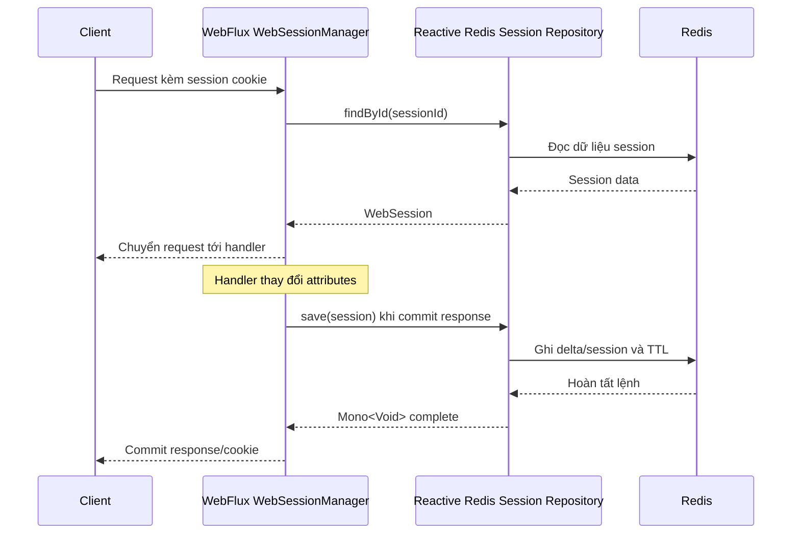

# Namespace, TTL, dữ liệu thay đổi và thời điểm ghi của repository

Khi Spring Session WebFlux lưu phiên trong Redis, repository cần xác định dữ liệu thuộc ứng dụng nào, phiên còn hợp lệ trong bao lâu, thuộc tính nào đã thay đổi và khi nào những thay đổi đó được ghi xuống Redis. Bốn vấn đề này liên quan với nhau nhưng được điều khiển bởi các cấu hình khác nhau: namespace phân vùng key, timeout/TTL điều khiển thời hạn, `SaveMode` xác định tập thuộc tính cần lưu và `FlushMode` quyết định thời điểm repository flush dữ liệu.

Hiểu đúng các chính sách này đặc biệt quan trọng khi nhiều instance Spring cùng dùng một Redis. Các instance của cùng một ứng dụng phải thống nhất namespace, serializer và chính sách session; các ứng dụng độc lập cần namespace riêng. Một thuộc tính mutable được sửa tại chỗ có thể không được nhận biết nếu chế độ lưu chỉ theo dõi thao tác set/remove. Và việc thay đổi `WebSession` trong controller không có nghĩa Redis đã được ghi ngay tại dòng code đó: WebFlux quản lý quá trình lưu theo vòng đời response và repository reactive.

Trong phạm vi `SPRING_SESSION`, bài học này tập trung vào Redis reactive và `WebSession`, nhằm giúp cấu hình namespace và TTL rõ ràng, kiểm soát thay đổi dữ liệu và hiểu ranh giới ghi của repository khi ứng dụng chạy trên nhiều instance.

## 1. Vai trò của namespace

Namespace là tiền tố dùng để phân biệt nhóm key Spring Session trong Redis. Nó giúp tách dữ liệu phiên của các ứng dụng, môi trường hoặc tenant triển khai độc lập trên cùng một Redis deployment.

Ví dụ, hai ứng dụng cùng kết nối một Redis:

| Ứng dụng | Namespace minh họa | Mục đích |
|---|---|---|
| Cổng khách hàng | `customer-portal:session` | Chứa session của cổng khách hàng |
| Trang quản trị | `admin-console:session` | Chứa session của trang quản trị |
| Môi trường staging | `staging:orders:session` | Tránh trộn session staging với production |

Nếu hai ứng dụng độc lập dùng cùng namespace, chúng có thể đụng key hoặc diễn giải dữ liệu của nhau bằng serializer/cấu trúc khác nhau. Namespace khác nhau giúp cô lập keyspace ở mức quy ước lưu trữ, nhưng không phải cơ chế phân quyền Redis. Người dùng Redis vẫn có thể truy cập các key nếu ACL cho phép; cần bảo vệ Redis bằng tài khoản, key pattern, mạng và TLS phù hợp.

### 1.1. Cấu hình namespace cho WebFlux

Với Spring Session Redis reactive, có thể cấu hình namespace qua `@EnableRedisWebSession`:

```java
import org.springframework.context.annotation.Configuration;
import org.springframework.session.FlushMode;
import org.springframework.session.SaveMode;
import org.springframework.session.data.redis.config.annotation.web.server.EnableRedisWebSession;

@Configuration
@EnableRedisWebSession(
        redisNamespace = "customer-portal:session",
        maxInactiveIntervalInSeconds = 1800,
        flushMode = FlushMode.ON_SAVE,
        saveMode = SaveMode.ON_SET_ATTRIBUTE
)
public class ReactiveSessionConfiguration {
}
```

Ví dụ đặt namespace riêng, idle timeout 30 phút, flush khi repository save và chỉ lưu các thuộc tính được set/remove. Cấu hình cần có `ReactiveRedisConnectionFactory` và dependency Spring Session Data Redis tương thích.

Tên thuộc tính annotation và các giá trị mặc định cần được đối chiếu với phiên bản Spring Session của dự án. Spring Boot cũng có thể cung cấp thuộc tính cấu hình cho namespace, timeout và các mode; không trộn annotation và properties với các giá trị mâu thuẫn mà không xác định nguồn cấu hình có hiệu lực.

### 1.2. Các instance của cùng ứng dụng phải dùng chung namespace

Nếu instance A ghi session vào namespace `customer-portal:session` còn instance B đọc namespace `customer-portal:v2:session`, B sẽ không tìm thấy session do A tạo. Hai instance có thể cùng Redis host, port, database và credentials nhưng vẫn không chia sẻ session vì key prefix khác nhau.

Vì vậy, tất cả instance thuộc cùng một ứng dụng và cùng một session domain phải thống nhất:

- Redis deployment, database/index và namespace.
- Serializer và định dạng thuộc tính session.
- Session timeout và cách gia hạn TTL.
- Quy tắc cookie/session ID và principal index nếu có.
- Phiên bản Spring Session tương thích trong giai đoạn rolling deployment.

### 1.3. Đổi namespace là một lần chuyển dữ liệu

Đổi namespace không tự di chuyển key từ prefix cũ sang prefix mới. Sau khi đổi, ứng dụng mới tìm trong keyspace mới; session cũ có thể vẫn còn trong Redis dưới namespace trước đó cho tới khi TTL/cleanup xử lý.

Trước khi đổi namespace, cần chọn một chiến lược:

1. Chấp nhận người dùng đăng nhập lại và để session cũ hết hạn.
2. Chạy migration có kiểm soát từ namespace cũ sang namespace mới, bảo toàn TTL và metadata cần thiết.
3. Triển khai lớp tương thích đọc namespace cũ trong thời gian chuyển tiếp, nếu implementation và yêu cầu bảo mật cho phép.

Không chạy hai phiên bản cùng ghi một session domain vào hai namespace khác nhau rồi kỳ vọng chúng tự đồng bộ. Khi migration, tránh sao chép key nội bộ bằng script tùy tiện; cấu trúc key và metadata thuộc implementation Spring Session.

## 2. Timeout logic và TTL của Redis

Spring Session có thời hạn không hoạt động (idle timeout). Với cấu hình `maxInactiveIntervalInSeconds = 1800`, session được xem là hết hạn sau 30 phút không hoạt động theo quy tắc của repository.

TTL là thời gian còn lại mà Redis giữ một key trước khi expiration loại bỏ key đó. Hai khái niệm có liên hệ nhưng không hoàn toàn giống nhau:

- **Idle timeout** là chính sách session: ứng dụng không chấp nhận một phiên đã quá thời gian không hoạt động.
- **Redis TTL** là cơ chế lưu trữ: key có thể bị Redis loại bỏ khi thời hạn của key đạt tới.
- **Absolute timeout** là giới hạn tổng thời gian sống tính từ một mốc như lúc xác thực; nó cần được thiết kế riêng nếu nghiệp vụ yêu cầu.

Không dùng TTL của Redis làm absolute timeout. Nếu mỗi lần session hoạt động hợp lệ lại được gia hạn, một session có thể tồn tại lâu hơn tổng thời gian dự kiến nếu chỉ có idle timeout.

### 2.1. Cấu hình idle timeout mặc định

Có thể đặt thời hạn mặc định bằng annotation:

```java
@Configuration
@EnableRedisWebSession(maxInactiveIntervalInSeconds = 1800)
public class ReactiveSessionConfiguration {
}
```

Giá trị được tính bằng giây. Chọn thời hạn dựa trên độ nhạy cảm dữ liệu và trải nghiệm người dùng. Phiên quản trị có thể cần idle timeout ngắn; một quy trình nhập liệu dài có thể cần timeout dài hơn nhưng nên lưu bản nháp ở kho nghiệp vụ để tránh mất dữ liệu.

### 2.2. Timeout riêng cho một WebSession

`WebSession` cho phép đặt thời gian không hoạt động cho session cụ thể bằng `setMaxIdleTime(Duration)`:

```java
@PostMapping("/workflow/start")
public Mono<String> startWorkflow(WebSession session) {
    session.setMaxIdleTime(Duration.ofMinutes(10));
    session.getAttributes().put("app.workflow.type", "approval");
    return Mono.just("started");
}
```

Ví dụ đặt idle timeout 10 phút cho một quy trình. Khi thay đổi timeout, repository cần lưu trạng thái session và cập nhật expiration theo chính sách của implementation. Hãy kiểm tra kết quả bằng integration test với Redis; đừng chỉ kiểm tra giá trị `getMaxIdleTime()` trong object đang ở bộ nhớ.

### 2.3. TTL được gia hạn khi session hoạt động

Trong một session repository, thời điểm truy cập gần nhất và timeout được dùng để tính thời điểm hết hạn. Khi session được truy cập và lưu theo vòng đời request, repository có thể cập nhật TTL tương ứng. Cách và thời điểm chính xác phụ thuộc implementation và flush policy.

Một số lưu ý:

- Không giả định mọi lần đọc thuộc tính đều tạo ngay một lệnh ghi TTL.
- Không giả định TTL của mọi key phụ trợ bằng đúng TTL của session hash.
- Redis expiration có thể dọn vật lý bất đồng bộ; key đã hết hạn không nên được coi là session hợp lệ chỉ vì metadata phụ còn tồn tại.
- Nếu dùng `FlushMode.ON_SAVE`, việc cập nhật session và thời hạn có thể được gom tới thời điểm repository save.
- Nếu dùng `FlushMode.IMMEDIATE`, repository có thể đẩy thay đổi xuống Redis sớm hơn theo khả năng implementation.

Khi cần xác minh, dùng `TTL` hoặc `PTTL` trên key thuộc môi trường test và đúng namespace. Không phụ thuộc vào tên key nội bộ cố định giữa các phiên bản; hãy xác định key qua cấu hình và tài liệu implementation hiện tại.

## 3. TTL của session không phải thời hạn dữ liệu nghiệp vụ

Session nên giữ trạng thái ngắn hạn như mã giỏ hàng, locale hoặc ID bản nháp. Nếu một bản nháp cần tồn tại 7 ngày trong khi session chỉ có idle timeout 30 phút, dữ liệu bản nháp không nên chỉ nằm trong session.

Thiết kế phù hợp:

1. Lưu bản nháp trong database hoặc kho nghiệp vụ với thời hạn riêng.
2. Lưu `draftId` trong session để liên kết người dùng với bản nháp hiện tại.
3. Khi session hết hạn, bản nháp vẫn tồn tại theo retention policy của nghiệp vụ.
4. Khi người dùng đăng nhập lại, kiểm tra quyền sở hữu bản nháp trước khi khôi phục.

Không tăng TTL session lên nhiều ngày chỉ để giữ một object nghiệp vụ. Việc đó kéo dài thời gian một session ID bị đánh cắp có thể được sử dụng và làm tăng dung lượng session store.

## 4. SaveMode: thuộc tính nào được lưu?

`SaveMode` quyết định tập thuộc tính session được đưa vào thao tác lưu. Với Spring Session Redis, các chế độ thường gặp là:

| SaveMode | Phạm vi thuộc tính | Hệ quả |
|---|---|---|
| `ON_SET_ATTRIBUTE` | Thuộc tính được set hoặc remove | Hiệu quả khi code thay thế/xóa thuộc tính tường minh |
| `ON_GET_ATTRIBUTE` | Thuộc tính được đọc hoặc thay đổi | Hỗ trợ trường hợp lấy object mutable rồi sửa nội dung bên trong |
| `ALWAYS` | Tất cả thuộc tính session | Dễ bảo đảm mọi thuộc tính được đưa vào lần save, nhưng có thể ghi nhiều dữ liệu hơn |

`ON_SET_ATTRIBUTE` thường phù hợp khi ứng dụng dùng `put`, `setAttribute` hoặc `remove` để biểu diễn thay đổi. Tuy nhiên, nếu lấy một object mutable từ session rồi sửa object đó tại chỗ, thao tác nội bộ có thể không được nhận diện là một lần set attribute.

### 4.1. Cấu hình SaveMode

```java
@Configuration
@EnableRedisWebSession(saveMode = SaveMode.ON_SET_ATTRIBUTE)
public class ReactiveSessionConfiguration {
}
```

Với mode này, code nên thay thế giá trị thuộc tính sau khi tạo phiên bản mới thay vì chỉ sửa một object được giữ bằng tham chiếu.

Ví dụ dễ bỏ sót thay đổi:

```java
@SuppressWarnings("unchecked")
List<String> items =
        (List<String>) session.getAttributes().get("app.cart.items");

if (items != null) {
    items.add("sku-42");
}
```

Đoạn code sửa list tại chỗ. Nếu repository chỉ theo dõi set/remove, thay đổi bên trong list có thể không được đánh dấu để lưu.

Cách rõ ràng hơn:

```java
@SuppressWarnings("unchecked")
List<String> current =
        (List<String>) session.getAttributes().get("app.cart.items");

List<String> updated = current == null
        ? new ArrayList<>()
        : new ArrayList<>(current);
updated.add("sku-42");

session.getAttributes().put("app.cart.items", updated);
```

Việc đặt lại thuộc tính làm thay đổi được nhận biết theo `ON_SET_ATTRIBUTE`. Dùng DTO bất biến hoặc copy-on-write cũng giảm rủi ro hai request cùng sửa một object mutable.

### 4.2. Khi nào cân nhắc ON_GET_ATTRIBUTE hoặc ALWAYS?

`ON_GET_ATTRIBUTE` hữu ích khi code cần đọc object mutable rồi sửa nội dung mà không thay thế object. Việc đọc thuộc tính đưa nó vào tập thuộc tính được lưu theo semantics của mode. Đổi lại, một request đọc nhiều thuộc tính có thể làm tăng dữ liệu serialize và số byte ghi xuống Redis.

`ALWAYS` đưa tất cả thuộc tính vào lần save. Nó đơn giản hóa việc phát hiện thay đổi lồng nhau, nhưng tăng chi phí serialize và I/O, đặc biệt khi session chứa object lớn. Đây không phải cơ chế khóa đồng thời; nó cũng không ngăn request cũ ghi đè snapshot mới.

Chọn mode dựa trên cách code thay đổi dữ liệu, kích thước session, tần suất request và số lệnh Redis đo được. Đừng bật `ALWAYS` chỉ để che một lỗi mutable object mà có thể sửa bằng cách thay thế thuộc tính.

## 5. FlushMode: khi nào repository ghi dữ liệu?

`FlushMode` quyết định thời điểm thay đổi được đẩy xuống Redis. Nó trả lời câu hỏi khác với `SaveMode`:

- `SaveMode`: lưu thuộc tính nào?
- `FlushMode`: lưu vào thời điểm nào?

Hai mode thường dùng:

| FlushMode | Ý nghĩa | Đánh đổi |
|---|---|---|
| `ON_SAVE` | Repository ghi khi thao tác `save` được gọi trong vòng đời session | Có thể gom nhiều thay đổi trong request trước khi flush |
| `IMMEDIATE` | Repository đẩy thay đổi xuống kho sớm nhất theo khả năng implementation | Có thể tăng số lần ghi và I/O; không đồng nghĩa mỗi lệnh Map là một Redis transaction đồng bộ |

### 5.1. ON_SAVE và response commit

Trong WebFlux, `WebSessionManager` phối hợp load/save session theo vòng đời request. Controller thường chỉ thay đổi attributes; framework gọi thao tác lưu trong quá trình commit response. Với `ON_SAVE`, các thay đổi được gom theo ranh giới save đó.

Ví dụ:

```java
@PostMapping("/preferences")
public Mono<ResponseEntity<Void>> updatePreferences(
        @RequestBody PreferencesRequest request,
        WebSession session) {

    session.getAttributes().put("app.preferences.theme", request.theme());
    session.getAttributes().put("app.preferences.locale", request.locale());

    return Mono.just(ResponseEntity.noContent().build());
}
```

Controller không gọi `subscribe()` để lưu. WebFlux quản lý commit session trong response lifecycle. Hai thay đổi thuộc tính có thể được ghi trong cùng một lần save theo implementation.

Điều này cũng có nghĩa lỗi Redis có thể xuất hiện trong giai đoạn commit, sau khi code controller đã thay đổi object `WebSession`. Integration test phải kiểm tra response và trạng thái Redis, không chỉ kiểm tra controller đã gọi `put`.

### 5.2. IMMEDIATE không có nghĩa synchronous

Trong repository reactive, I/O vẫn được biểu diễn bằng publisher. `IMMEDIATE` mô tả chính sách flush của repository, không biến Redis call thành thao tác blocking và không cho phép gọi `block()` trong event loop.

Không giả định mỗi lần `session.getAttributes().put(...)` tự trả về một `Mono` để caller chờ Redis. API Map có thao tác đồng bộ; việc ghi thực tế vẫn được quản lý bởi session implementation và vòng đời repository. Hãy kiểm tra tài liệu phiên bản đang dùng để xác định các điểm flush cụ thể.

## 6. Kết hợp SaveMode và FlushMode

Hai cấu hình phối hợp để quyết định lượng dữ liệu và thời điểm ghi:

| SaveMode | FlushMode | Hành vi khái quát |
|---|---|---|
| `ON_SET_ATTRIBUTE` | `ON_SAVE` | Lưu các thuộc tính set/remove khi request/session được save |
| `ON_SET_ATTRIBUTE` | `IMMEDIATE` | Giữ phạm vi thay đổi set/remove và flush sớm theo implementation |
| `ON_GET_ATTRIBUTE` | `ON_SAVE` | Đưa thuộc tính được đọc/ghi vào lần save ở ranh giới commit |
| `ON_GET_ATTRIBUTE` | `IMMEDIATE` | Flush sớm các thay đổi/thuộc tính được theo dõi |
| `ALWAYS` | `ON_SAVE` | Lưu toàn bộ thuộc tính ở lần save |
| `ALWAYS` | `IMMEDIATE` | Có thể tạo nhiều công việc serialize/ghi nhất; cần đo tải kỹ |

Không có mode nào cung cấp transaction nghiệp vụ cho nhiều request. `IMMEDIATE` không giải quyết lost update; `ALWAYS` không biến collection mutable thành dữ liệu thread-safe. Nếu nhiều request cập nhật cùng một session, repository vẫn cần xử lý theo semantics cập nhật của nó và ứng dụng phải chấp nhận hoặc kiểm soát xung đột.

## 7. Thời điểm ghi của WebSession

Trong WebFlux, một `WebSession` có thể được tạo lười (lazy) và chỉ được lưu khi được start hoặc có thay đổi cần duy trì. `WebSessionManager` quản lý việc tìm session từ request, cung cấp session cho handler và gọi lưu trong quá trình commit response.

Luồng tổng quát:



Sơ đồ mô tả luồng khái quát. Chi tiết lệnh Redis, thời điểm cập nhật TTL, xử lý session mới và response cookie phụ thuộc repository/phiên bản. Điều cần giữ là thao tác lưu là một phần của reactive lifecycle; framework nối publisher lưu vào quá trình commit.

### 7.1. Lưu tường minh bằng WebSession.save()

`WebSession` cung cấp `save()` trả về `Mono<Void>`. Có thể dùng khi luồng cần chờ thao tác lưu hoàn tất trước khi tiếp tục:

```java
@PostMapping("/workflow/confirm")
public Mono<ResponseEntity<Void>> confirm(WebSession session) {
    session.getAttributes().put("app.workflow.confirmed", true);

    return session.save()
            .thenReturn(ResponseEntity.noContent().build());
}
```

Publisher được nối vào chuỗi bằng `thenReturn`, vì vậy lỗi save được truyền tới caller và response không được tạo như thể thao tác đã thành công. WebFlux vẫn quản lý response commit theo vòng đời request; chỉ dùng save tường minh khi có lý do cần ranh giới đó, tránh gọi lặp không cần thiết.

Không viết:

```java
session.save().subscribe();
return Mono.just(ResponseEntity.noContent().build());
```

Cách này tạo subscription tách rời, response có thể hoàn tất trước khi save, lỗi lưu bị tách khỏi request và không có bảo đảm về thứ tự.

### 7.2. Thao tác trực tiếp với ReactiveSessionRepository

Nếu service nền thao tác repository trực tiếp theo session ID, service phải nối `save` vào publisher:

```java
public Mono<String> updateSession(
        String sessionId,
        String workflowId) {
    return repository.findById(sessionId)
            .switchIfEmpty(Mono.error(
                    new SessionNotFoundException(sessionId)))
            .flatMap(session -> {
                session.setAttribute("app.workflow.id", workflowId);
                return repository.save(session)
                        .thenReturn(session.getId());
            });
}
```

Khác với việc sửa `WebSession` trong controller, luồng repository trực tiếp không có `WebSessionManager` của request để tự gọi save thay cho service. Nếu bỏ qua `repository.save(session)`, thay đổi trong object không được bảo đảm ghi xuống Redis.

## 8. Dữ liệu mutable và chiến lược thay thế thuộc tính

Session attributes thường là `Map<String, Object>`. Giá trị bên trong có thể là object mutable như `ArrayList`, `HashMap` hoặc DTO có setter. Việc thay đổi object lồng nhau không nhất thiết làm map nhận biết rằng một thuộc tính đã được cập nhật.

Ví dụ không nên dùng nếu chỉ theo dõi set/remove:

```java
CartState cart = session.getAttribute("app.cart");
cart.addItem("sku-42");
```

Giải pháp ưu tiên là tạo bản mới và đặt lại:

```java
CartState current = session.getAttribute("app.cart");
CartState updated = current.withAddedItem("sku-42");
session.getAttributes().put("app.cart", updated);
```

Mẫu này dễ kiểm tra, giảm mutation ngoài ý muốn và hoạt động rõ ràng với `ON_SET_ATTRIBUTE`. Nếu dùng Java bean mutable, có thể copy dữ liệu sang object mới rồi `put` lại.

`ON_GET_ATTRIBUTE` có thể theo dõi thuộc tính được đọc, nhờ đó việc sửa object mutable sau khi đọc có cơ hội được lưu. Nhưng nó không phải giải pháp đồng thời: hai request có thể cùng lấy hai bản object riêng, sửa rồi ghi đè lẫn nhau. Dữ liệu quan trọng cần versioning hoặc transaction ở kho nghiệp vụ.

## 9. Xóa thuộc tính và xóa session

Để xóa một thuộc tính, dùng `session.getAttributes().remove("attributeName")`. Thay đổi này được theo dõi như một thao tác remove theo SaveMode tương ứng. Không xóa trực tiếp field hoặc key nội bộ của Redis.

```java
@PostMapping("/draft/clear")
public Mono<Void> clearDraft(WebSession session) {
    session.getAttributes().remove("app.draft.data");
    return Mono.empty();
}
```

Trong request WebFlux, việc commit session vẫn do `WebSessionManager` quản lý. Nếu endpoint cần xác nhận xóa đã được ghi trước khi trả response, nối `session.save()` vào chuỗi thay vì subscribe riêng.

Xóa thuộc tính khác với `session.invalidate()`. Invalidate kết thúc toàn bộ session, còn remove chỉ loại bỏ một entry. Khi logout, dùng cơ chế Spring Security/WebFlux security phù hợp để xóa context, invalidate session và xử lý cookie; không chỉ remove một thuộc tính tùy chỉnh.

## 10. TTL, namespace và thay đổi cấu hình trong rolling deployment

Trong triển khai nhiều instance, thay đổi namespace hoặc timeout cần được thực hiện có kế hoạch.

### 10.1. Tất cả instance phải cùng namespace

Trong thời gian rolling update, node cũ và node mới vẫn cần đọc được cùng keyspace nếu chúng phục vụ cùng session domain. Không triển khai một phần instance với namespace mới trước khi có chiến lược migration.

### 10.2. Thay đổi TTL

Giảm idle timeout có thể khiến session hiện tại hết hạn sớm hơn dự kiến. Tăng timeout có thể kéo dài thời gian lưu session và tăng bộ nhớ Redis. Thay đổi annotation/configuration không nhất thiết cập nhật tức thì mọi key đã tồn tại; repository có thể cập nhật TTL khi session được truy cập và lưu tiếp theo.

Trước khi thay đổi:

- Xác định timeout hiện tại và timeout tối đa tùy chỉnh trên từng session.
- Kiểm tra TTL thực tế của session mới và session cũ trong test.
- Xác định cách xử lý session đã tạo trước deploy.
- Đánh giá tác động tới Redis memory, expiration events và trải nghiệm đăng nhập.

### 10.3. Thay đổi namespace

Đổi namespace thường làm session cũ không còn được nhìn thấy bởi cấu hình mới. Nếu chấp nhận logout, có thể để key cũ hết TTL. Nếu cần giữ phiên, phải có migration/compatibility layer được thiết kế và kiểm thử; không chỉ thay chuỗi prefix trong annotation.

## 11. Kiểm thử namespace và TTL

Integration test nên xác minh namespace thực sự phân tách dữ liệu và mọi instance cùng namespace có thể đọc session.

| Trường hợp | Cách kiểm tra | Kết quả mong đợi |
|---|---|---|
| Namespace cơ bản | Tạo session với namespace A | Key session nằm trong keyspace A theo implementation |
| Namespace tách biệt | Tạo session ở A, truy vấn bằng repository B | B không đọc nhầm session của A |
| Nhiều instance cùng namespace | Tạo session ở instance A, đọc ở B | B đọc được cùng session và thuộc tính |
| Namespace không đồng nhất | A và B cấu hình khác namespace | Session không được chia sẻ; cấu hình mismatch được phát hiện |
| Idle timeout | Tạo session với timeout ngắn | Session không còn hợp lệ sau thời gian không hoạt động theo repository |
| TTL gia hạn | Truy cập session trước khi hết hạn | Thời hạn được cập nhật theo chính sách implementation |
| Per-session timeout | Gọi `setMaxIdleTime` | Repository lưu timeout riêng và TTL phù hợp |
| Absolute timeout | Request liên tục nhưng vượt giới hạn tổng | Ứng dụng kết thúc phiên theo logic absolute timeout riêng |
| Redis unavailable khi save | Làm repository phát lỗi trong commit | Lỗi được quan sát; không trả thành công giả |

Không chỉ kiểm tra giá trị `getMaxIdleTime()` trong object. Hãy kiểm tra request sau, TTL Redis và trạng thái session qua repository. Khi kiểm tra TTL, dùng Redis test riêng và keyspace đúng namespace; tránh lệnh quét toàn bộ production keyspace.

## 12. Kiểm thử SaveMode và dữ liệu mutable

Các bài test nên bao gồm:

1. Với `ON_SET_ATTRIBUTE`, gọi `put` một thuộc tính mới rồi đọc lại qua request thứ hai.
2. Gọi `remove` và xác nhận thuộc tính không còn sau commit.
3. Sửa collection tại chỗ mà không `put` lại; xác nhận hành vi theo mode đã cấu hình.
4. Chuyển sang `ON_GET_ATTRIBUTE`, đọc rồi sửa object mutable và kiểm tra kết quả.
5. Dùng `ALWAYS` và đo số byte/lệnh ghi khi session có nhiều thuộc tính.
6. Thử hai request đồng thời cùng cập nhật một thuộc tính để xác định lost update.
7. Thử thay thế DTO bất biến bằng `put` để kiểm tra thay đổi được lưu rõ ràng.

Test controller bằng `WebTestClient` giúp xác minh cookie và response. Test repository cần Redis thật hoặc Testcontainers để kiểm tra serialization, namespace, TTL và save timing. Mock repository không chứng minh TTL hay hành vi lệnh Redis.

## 13. Kiểm thử FlushMode và thời điểm commit

`ON_SAVE` và `IMMEDIATE` cần được kiểm tra qua hành vi repository, không chỉ qua cấu hình được bind:

| Kiểm thử | Cách thực hiện | Điều cần xác minh |
|---|---|---|
| ON_SAVE | Thay đổi nhiều thuộc tính trong một request | Thay đổi được ghi ở ranh giới save/commit theo repository |
| IMMEDIATE | Thực hiện các thao tác thay đổi session và quan sát datastore | Ghi được đẩy sớm theo semantics của implementation |
| Save lỗi | Cho Redis từ chối hoặc timeout lệnh save | Publisher lỗi được truyền vào response lifecycle |
| Response commit | Kiểm tra request đầy đủ với WebTestClient | Không chỉ test controller method; xác minh session đã persist sau response |
| Explicit save | Gọi `session.save()` và nối publisher | Luồng chỉ tiếp tục khi save hoàn tất |
| Fire-and-forget sai | Tạo subscription riêng trong test minh họa | Phát hiện response có thể hoàn tất trước save và lỗi bị tách rời |

Không dùng thời gian ngủ tùy ý để kết luận một lệnh đã được flush. Dùng đồng bộ test, đọc lại session qua repository và quan sát command/metrics trong Redis test.

## 14. Giới hạn nhất quán khi nhiều request cùng session

Namespace chung giúp các instance thấy cùng dữ liệu; nó không tuần tự hóa request. Hai request có thể đọc cùng snapshot, thay đổi thuộc tính và save theo thứ tự khác nhau.

Ví dụ lost update:

1. A và B cùng đọc `app.cart.quantity = 1`.
2. A tăng thành `2` và save.
3. B cũng tăng từ snapshot cũ thành `2` rồi save sau.
4. Giá trị cuối là `2`, dù hai thao tác tăng đã xảy ra.

`SaveMode.ALWAYS` hoặc `FlushMode.IMMEDIATE` không sửa được vấn đề này. Chúng thay đổi tập thuộc tính hoặc thời điểm flush, không cung cấp compare-and-set cho nghiệp vụ.

Với locale hoặc theme, last-write-wins có thể chấp nhận được. Với số lượng giỏ hàng, hạn mức, thanh toán hoặc trạng thái phê duyệt, hãy dùng database nghiệp vụ với transaction, optimistic locking/version column hoặc lệnh atomic. Session chỉ nên giữ ID tham chiếu hoặc trạng thái tạm.

## 15. Lỗi thường gặp và cách khắc phục

| Triệu chứng | Nguyên nhân có thể | Cách xử lý |
|---|---|---|
| Instance B không tìm thấy session do A tạo | Namespace hoặc database/index khác nhau | Đồng bộ namespace và Redis target trên mọi instance |
| Hai ứng dụng đọc nhầm/đè dữ liệu session | Dùng chung namespace dù session domain độc lập | Tách namespace và kiểm tra ACL/key prefix |
| Đổi namespace làm người dùng bị logout | Key cũ nằm dưới prefix trước đó | Lập kế hoạch migration hoặc chấp nhận hết hạn có kiểm soát |
| Session hết hạn sớm | Idle timeout hoặc TTL bị cấu hình ngắn | Kiểm tra timeout hiệu lực, per-session max idle và TTL thực tế |
| Session sống lâu hơn chính sách | Chỉ có idle timeout, thiếu absolute timeout | Bổ sung logic absolute timeout ở tầng xác thực |
| Sửa list/map nhưng dữ liệu cũ vẫn còn | `ON_SET_ATTRIBUTE` không nhận biết mutation tại chỗ | Copy, tạo object mới và `put` lại; cân nhắc `ON_GET_ATTRIBUTE` |
| Redis ghi quá nhiều | `ALWAYS` hoặc `ON_GET_ATTRIBUTE` với nhiều thuộc tính | Đo payload và chọn SaveMode phù hợp |
| Save bị trễ hoặc lỗi ở cuối request | Repository flush trong response commit | Kiểm thử commit và xử lý lỗi persistence |
| Response trả thành công trước khi save | Gọi `subscribe()` tách rời | Nối `session.save()` hoặc repository save vào publisher chính |
| Hai request ghi đè thuộc tính | Không có kiểm soát concurrency | Dùng versioning/transaction ở kho nghiệp vụ |

## 16. Quy trình chọn namespace, TTL và write policy

Khi cấu hình Redis reactive cho Spring Session, thực hiện theo thứ tự:

1. Xác định session domain và đặt namespace riêng cho từng ứng dụng độc lập.
2. Bảo đảm tất cả instance của cùng ứng dụng dùng chung namespace, Redis target và serializer.
3. Chọn idle timeout theo yêu cầu bảo mật; thêm absolute timeout nếu cần giới hạn tổng thời gian đăng nhập.
4. Kiểm tra cách repository cập nhật Redis TTL khi session được truy cập và lưu.
5. Chọn `SaveMode.ON_SET_ATTRIBUTE` nếu code thay thế/xóa thuộc tính tường minh; cân nhắc mode khác khi cần theo dõi mutable object.
6. Chọn `FlushMode.ON_SAVE` cho ranh giới save/commit thông thường; chỉ dùng `IMMEDIATE` khi đã hiểu semantics và đo chi phí.
7. Ưu tiên DTO nhỏ, bất biến hoặc copy-on-write; không lưu object nghiệp vụ lớn trong session.
8. Để WebFlux quản lý commit; nối `session.save()` hoặc `repository.save()` vào publisher khi cần lưu tường minh.
9. Kiểm thử namespace, TTL, SaveMode, FlushMode, lỗi commit và hai request đồng thời bằng Redis thật.
10. Theo dõi memory, TTL, latency, số lần save, lỗi serialization và tỷ lệ session mất bất thường.

Namespace quyết định session nằm trong keyspace nào; timeout và TTL quyết định session được giữ bao lâu; SaveMode quyết định thuộc tính nào được lưu; FlushMode quyết định thời điểm ghi. Trong WebFlux, các thay đổi `WebSession` được lưu qua reactive lifecycle và response commit. Khi các instance dùng cùng cấu hình, thuộc tính được thay đổi theo cách repository nhận biết và publisher lưu được nối đúng vào luồng xử lý, session sẽ được chia sẻ nhất quán hơn mà không nhầm lẫn giữa TTL, chính sách ghi và transaction nghiệp vụ.
