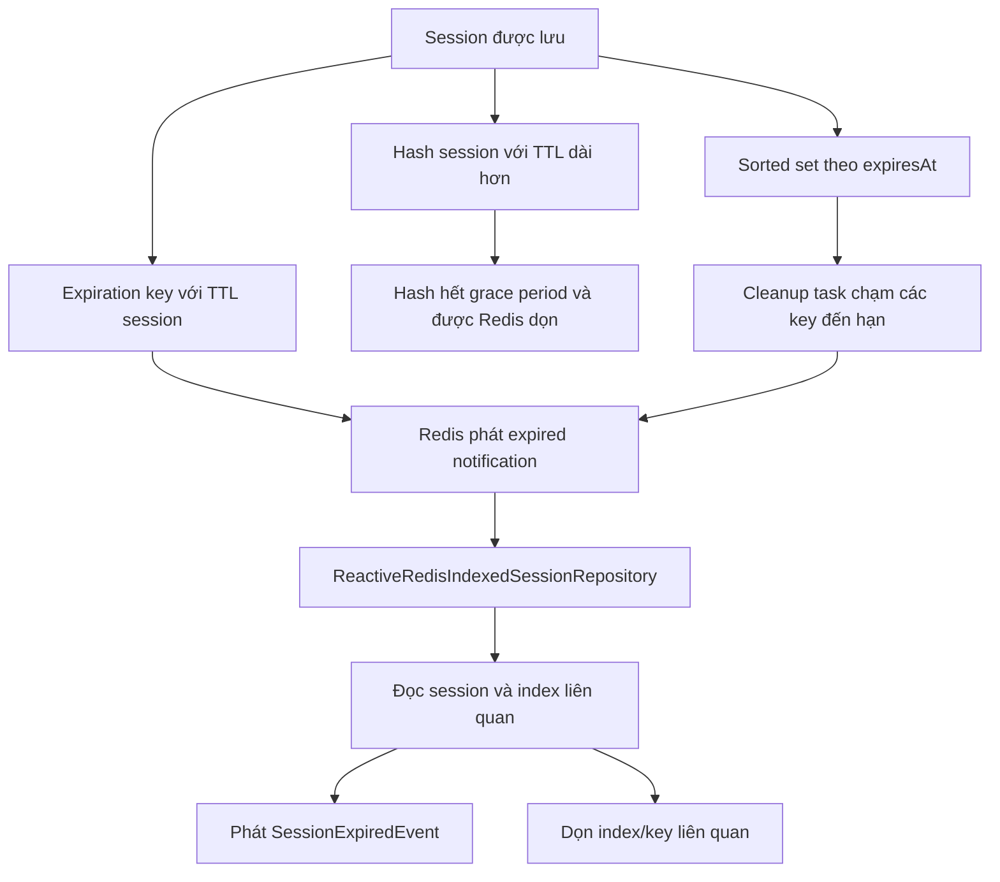

# Thông báo hết hạn, chỉ mục và sự kiện của triển khai phản ứng

Spring Session có thể lưu `WebSession` của ứng dụng WebFlux trong Redis bằng API reactive. Khi chỉ cần tạo, tìm, lưu và xóa phiên theo session ID, ứng dụng có thể dùng `ReactiveRedisSessionRepository`. Khi cần tìm phiên theo principal name, quản lý nhiều phiên đăng nhập của một người dùng hoặc nhận sự kiện tạo, xóa và hết hạn phiên, cần dùng triển khai indexed dành cho WebFlux: `ReactiveRedisIndexedSessionRepository`.

Triển khai indexed kết hợp ba cơ chế Redis: hash lưu session, cấu trúc phụ để lập chỉ mục và các thông báo Redis để phát hiện vòng đời phiên. Vì các thao tác đều reactive, truy vấn index trả về `Mono`, việc xóa nhiều session cần compose bằng Reactor, còn listener có thể xử lý sự kiện bằng publisher. Hiểu rõ cách các cơ chế phối hợp giúp ứng dụng quản lý phiên nhiều thiết bị và dọn tài nguyên mà không chặn luồng xử lý WebFlux.

## 1. Phân biệt repository reactive cơ bản và indexed

Spring Session cung cấp hai mức khả năng cho Redis WebFlux:

| Thành phần | Chức năng chính | Chỉ mục principal | Sự kiện vòng đời |
|---|---|---|---|
| `ReactiveRedisSessionRepository` | Tạo, đọc, lưu và xóa session theo ID | Không có API index tích hợp | Không cung cấp đầy đủ session event support của indexed repository |
| `ReactiveRedisIndexedSessionRepository` | CRUD theo ID, truy vấn theo index và tích hợp expiration/event | Có | Có, khi cấu hình Redis notifications phù hợp |

`ReactiveRedisIndexedSessionRepository` được giới thiệu từ Spring Session 3.3. Với phiên bản hỗ trợ, có thể bật bằng `@EnableRedisIndexedWebSession`. Annotation `@EnableRedisWebSession` thông thường tạo repository reactive cơ bản. Nếu ứng dụng cần index và event, chỉ dùng annotation cơ bản sẽ không tự thêm các khả năng đó.

Dependency Spring Session Redis vẫn là `spring-session-data-redis` trong các dòng Spring Session sử dụng module này. Ví dụ cấu hình WebFlux indexed:

```java
import org.springframework.context.annotation.Configuration;
import org.springframework.session.data.redis.config.annotation.web.server.EnableRedisIndexedWebSession;

@Configuration
@EnableRedisIndexedWebSession(
        maxInactiveIntervalInSeconds = 1800,
        redisNamespace = "shop:session")
class ReactiveSessionConfiguration {
}
```

Ứng dụng cũng cần reactive Redis connection factory và các bean Spring Data Redis phù hợp. Nếu dùng Spring Boot auto-configuration hoặc một phiên bản Spring Session khác, kiểm tra đúng cách bật indexed WebSession và điều kiện cấu hình của phiên bản đó. Không trộn cấu hình Servlet `@EnableRedisIndexedHttpSession` với WebFlux; hai annotation phục vụ hai stack khác nhau.

## 2. Vai trò của ReactiveRedisIndexedSessionRepository

`ReactiveRedisIndexedSessionRepository` triển khai `ReactiveSessionRepository` và `ReactiveFindByIndexNameSessionRepository`. Vì vậy, nó cung cấp các thao tác session cơ bản cùng truy vấn index dưới dạng publisher:

```java
Mono<RedisSession> createSession();
Mono<Void> save(RedisSession session);
Mono<RedisSession> findById(String id);
Mono<Void> deleteById(String id);

Mono<Map<String, RedisSession>> findByIndexNameAndIndexValue(
        String indexName, String indexValue);
```

Các kiểu cụ thể và generic signature có thể khác theo phiên bản API, nhưng đặc điểm quan trọng là thao tác đọc/truy vấn trả về `Mono`, còn thao tác ghi/xóa trả về publisher hoàn tất. Không gọi `.block()` trong request handler để lấy kết quả đồng bộ; hãy compose các publisher với `flatMap`, `map`, `then` hoặc `flatMapMany`.

Trong ứng dụng WebFlux thông thường, handler thao tác với `WebSession`. `WebSessionManager` và `WebSessionStore` phối hợp với repository, do đó controller không cần tự gọi repository cho mỗi lần đặt attribute. Repository indexed có vai trò phía dưới lớp tích hợp, cung cấp thêm khả năng tìm theo principal và phát event.

## 3. Các cấu trúc Redis được dùng

Repository indexed lưu session trong Redis hash và duy trì thêm các key phục vụ hết hạn, chỉ mục và sự kiện. Với namespace mặc định `spring:session`, các key minh họa có dạng:

| Key | Kiểu dữ liệu thường dùng | Mục đích |
|---|---|---|
| `spring:session:sessions:<id>` | Hash | Metadata và attributes của session |
| `spring:session:sessions:expires:<id>` | Key có TTL | Đánh dấu thời điểm session hết hạn để Redis phát expiration event |
| `spring:session:sessions:expirations` | Sorted set | Theo dõi session ID theo thời điểm hết hạn để cleanup task có thể chạm vào key đúng lúc |
| `spring:session:sessions:index:PRINCIPAL_NAME_INDEX_NAME:<principal>` | Set | Danh sách session ID thuộc principal |
| `spring:session:sessions:<id>:idx` | Set | Các index key đang liên kết với session cụ thể |

Tên key là chi tiết triển khai và có thể thay đổi theo namespace hoặc phiên bản. Không để ứng dụng nghiệp vụ phụ thuộc trực tiếp vào cấu trúc nội bộ này nếu không thật sự cần. API repository là lớp trừu tượng ổn định hơn.

Ví dụ một session có ID `abc123` và principal `alice` có thể tạo các quan hệ index như sau:

```text
SADD spring:session:sessions:index:PRINCIPAL_NAME_INDEX_NAME:alice abc123
SADD spring:session:sessions:abc123:idx \
  spring:session:sessions:index:PRINCIPAL_NAME_INDEX_NAME:alice
```

Set index theo principal giúp tìm các ID thuộc người dùng. Set `:idx` theo session giúp repository biết những index nào cần được cập nhật hoặc loại bỏ khi principal/attributes thay đổi hay session bị xóa.

## 4. Index principal name

Index được cung cấp sẵn quan trọng nhất là `PRINCIPAL_NAME_INDEX_NAME`. Repository dùng `PrincipalNameIndexResolver` để xác định principal name từ dữ liệu session, thường thông qua `SecurityContext` của Spring Security. Nếu ứng dụng có cơ chế xác thực tùy chỉnh, cần bảo đảm principal name được đưa vào session theo cách resolver có thể nhận diện.

Trong trường hợp tự quản lý principal attribute, có thể đặt giá trị index bằng hằng số của reactive interface:

```java
session.getAttributes().put(
        ReactiveFindByIndexNameSessionRepository.PRINCIPAL_NAME_INDEX_NAME,
        principalName);
```

Chỉ dùng principal đã được xác thực ở phía server. Không lấy username tùy ý từ request rồi ghi thành principal index, vì như vậy có thể khiến một session bị gắn với danh tính do client tự khai báo.

Index principal không phải cơ chế phân quyền. Nó chỉ giúp tìm các phiên được gắn với một principal. API liệt kê hoặc thu hồi phiên vẫn phải xác minh người gọi có quyền thao tác trên principal đó. Với người dùng thông thường, principal nên lấy từ `ReactiveSecurityContextHolder` hoặc cơ chế xác thực đã được Spring Security xác minh, thay vì nhận một username do client gửi lên.

## 5. Truy vấn các phiên của một người dùng

`ReactiveFindByIndexNameSessionRepository` bổ sung phương thức `findByIndexNameAndIndexValue` và shortcut `findByPrincipalName`. Kết quả là `Mono<Map<String, S>>`, trong đó key là session ID và value là session tương ứng.

Ví dụ một service truy vấn phiên của principal:

```java
@Service
class UserSessionService {

    private final ReactiveFindByIndexNameSessionRepository<? extends Session>
            sessions;

    UserSessionService(
            ReactiveFindByIndexNameSessionRepository<? extends Session> sessions) {
        this.sessions = sessions;
    }

    Mono<Map<String, ? extends Session>> findSessions(String principalName) {
        return this.sessions.findByPrincipalName(principalName);
    }
}
```

Tên API và generic type cần đối chiếu với phiên bản Spring Session cụ thể. Nếu muốn inject trực tiếp implementation, có thể dùng `ReactiveRedisIndexedSessionRepository`; khi thiết kế service, ưu tiên interface reactive để giảm phụ thuộc implementation.

Một người dùng có thể có nhiều session: trình duyệt công việc, điện thoại và máy tính bảng. Truy vấn index giúp hiển thị danh sách phiên hoặc cung cấp chức năng đăng xuất khỏi thiết bị khác mà không cần quét toàn bộ Redis keyspace.

## 6. Thu hồi nhiều session theo principal

Khi người dùng chọn “đăng xuất khỏi mọi thiết bị”, ứng dụng có thể tìm session theo principal rồi xóa từng ID bằng reactive repository:

```java
Mono<Void> logoutAll(String principalName,
        ReactiveFindByIndexNameSessionRepository<? extends Session> sessions) {

    return sessions.findByPrincipalName(principalName)
            .flatMapMany(found -> Flux.fromIterable(found.keySet()))
            .flatMap(sessions::deleteById)
            .then();
}
```

Đây là thao tác bất đồng bộ từ đầu đến cuối. `flatMap` thực hiện các thao tác xóa và `then()` chuyển kết quả cuối thành `Mono<Void>`. Nếu cần giới hạn số thao tác đồng thời, dùng `flatMap(delete, concurrency)` hoặc xử lý tuần tự bằng `concatMap` tùy tải và yêu cầu thứ tự.

Trong ứng dụng thực tế:

- Lấy principal từ security context đã xác thực.
- Quyết định có thu hồi cả session hiện tại hay chỉ các session còn lại.
- Giới hạn số session có thể trả về và số thao tác xóa đồng thời nếu người dùng có rất nhiều phiên.
- Xử lý lỗi một phần: một số lần xóa có thể thành công trước khi lần khác thất bại.
- Thiết kế thao tác retry an toàn vì xóa một ID không còn tồn tại thường có thể được coi là đã đạt trạng thái mong muốn.

Không dùng `block()` để đợi tất cả session bị xóa trong WebFlux. Trả `Mono<Void>` về handler hoặc service caller để nó quyết định response sau khi thao tác hoàn tất.

## 7. Cơ chế hết hạn session trong Redis indexed reactive

Repository indexed cần giữ session data đủ lâu để xử lý sự kiện hết hạn. Vì Redis không đảm bảo phát expiration notification chính xác tại thời điểm TTL vừa bằng 0, Spring Session tách thời điểm hết hạn logic khỏi thời điểm xóa hash session.

Với một session có timeout 30 phút, repository có thể:

1. Lưu hash session `spring:session:sessions:<id>`.
2. Đặt TTL cho hash session dài hơn thời hạn logic khoảng 5 phút để dữ liệu còn đọc được khi xử lý event.
3. Tạo key `spring:session:sessions:expires:<id>` có TTL bằng thời gian không hoạt động thực tế.
4. Ghi session ID vào sorted set `spring:session:sessions:expirations`, xếp theo thời điểm hết hạn.
5. Khi expiration key hết hạn, Redis phát keyspace notification; repository lấy ID từ tên key, xử lý các key liên quan và phát event.
6. Hash session được dọn sau grace period, khi không còn cần giữ dữ liệu để xử lý sự kiện.



Khoảng grace period là chi tiết triển khai, không phải một thuộc tính chung của mọi repository reactive. Không coi hash còn tồn tại trong khoảng đó là bằng chứng session vẫn hợp lệ. `findById` phải không trả về session đã hết hạn logic, dù key dữ liệu còn được giữ lại để phục vụ cleanup/event.

## 8. Vì sao cần sorted set và cleanup task?

Redis dùng passive expiration khi key được truy cập và active expiration để định kỳ lấy mẫu key hết hạn. Redis không cam kết một key chưa được truy cập sẽ phát expiration event đúng ngay tại mốc TTL. Nếu chỉ chờ event, việc dọn index hoặc phát sự kiện có thể bị trễ.

Reactive indexed repository theo dõi session ID trong sorted set theo thời điểm hết hạn. Cleanup task định kỳ lấy một số ID có thể đã hết hạn và truy cập expiration key tương ứng. Nếu TTL đã hết, thao tác truy cập khiến Redis xử lý key hết hạn và phát notification. Repository không xóa mù các key chỉ dựa trên timestamp trong sorted set, vì một request đồng thời có thể đã làm mới session; việc truy cập key để Redis tự kiểm tra TTL giảm nguy cơ xóa nhầm session vừa được gia hạn.

Theo tài liệu hiện hành, cleanup mặc định xử lý tối đa 100 session mỗi 60 giây. Giá trị này là mặc định của implementation và có thể thay đổi theo phiên bản hoặc cấu hình. Nếu hệ thống có lượng session hết hạn lớn, cần theo dõi backlog, thời gian cleanup và tải Redis.

## 9. Thay đổi tần suất cleanup

Có thể tùy chỉnh repository bằng `ReactiveSessionRepositoryCustomizer`:

```java
@Bean
ReactiveSessionRepositoryCustomizer<ReactiveRedisIndexedSessionRepository>
reactiveSessionRepositoryCustomizer() {
    return repository -> repository.setCleanupInterval(Duration.ofSeconds(30));
}
```

Ví dụ giảm chu kỳ cleanup xuống 30 giây. Chu kỳ ngắn hơn có thể làm expiration được phát hiện sớm hơn, nhưng tăng số lần truy cập Redis và công việc nền. Chọn giá trị theo số session, độ trễ chấp nhận được và tải của Redis.

Có thể tắt cleanup task mặc định:

```java
@Bean
ReactiveSessionRepositoryCustomizer<ReactiveRedisIndexedSessionRepository>
reactiveSessionRepositoryCustomizer() {
    return ReactiveRedisIndexedSessionRepository::disableCleanupTask;
}
```

Chỉ tắt khi ứng dụng cung cấp một cơ chế cleanup thay thế có trách nhiệm xử lý expiration mapping. Nếu không, sorted set có thể tích lũy ID cũ và việc phát hiện hết hạn/dọn index có thể không diễn ra đúng kỳ vọng.

Không khai báo hai bean customizer cùng kiểu với mục đích cấu hình mâu thuẫn. Nếu cần đặt cả interval và các tùy chọn khác, thực hiện trong cùng một customizer hoặc theo cơ chế được phiên bản hỗ trợ.

## 10. Redis Keyspace Notifications

Reactive indexed repository lắng nghe Redis keyspace events để phát hiện key hết hạn hoặc bị xóa. Những channel liên quan thường có dạng:

```text
__keyevent@0__:expired
__keyevent@0__:del
```

Khi expiration marker của session hết hạn, message chứa tên key đã hết hạn. Repository phân tích tên key để lấy session ID, tìm dữ liệu session còn được giữ lại, cập nhật index và phát sự kiện tương ứng.

Redis dùng cấu hình `notify-keyspace-events` để bật nhóm thông báo. Cấu hình thường được Spring Session sử dụng là `Egx`:

| Ký tự | Ý nghĩa |
|---|---|
| `E` | Phát keyevent notification trên channel `__keyevent@<db>__:<event>` |
| `g` | Nhóm lệnh generic, bao gồm thao tác `DEL` |
| `x` | Sự kiện key hết hạn (`expired`) |

Có thể kiểm tra cấu hình bằng Redis CLI nếu quyền quản trị cho phép:

```text
CONFIG GET notify-keyspace-events
```

Không phải dịch vụ Redis managed nào cũng cho phép ứng dụng chạy `CONFIG SET`. Với Redis được bảo vệ, quản trị viên cần bật keyspace notifications ở control plane hoặc cấu hình dịch vụ. Khi cấu hình đã được quản lý bên ngoài, có thể ngăn Spring Session cố thay đổi cấu hình Redis bằng bean sau:

```java
@Bean
ConfigureReactiveRedisAction configureReactiveRedisAction() {
    return ConfigureReactiveRedisAction.NO_OP;
}
```

`NO_OP` chỉ tắt hành động cấu hình tự động. Nó không tự bật notifications. Nếu quản trị viên chưa cấu hình `Egx`, listener có thể không nhận được các thông báo cần thiết và event hết hạn/xóa sẽ không hoạt động đúng.

## 11. Các sự kiện vòng đời được phát

Reactive indexed repository có thể phát các application event sau:

| Event | Khi nào xảy ra | Ví dụ mục đích |
|---|---|---|
| `SessionCreatedEvent` | Session mới được tạo | Ghi nhận phiên mới, cập nhật metric |
| `SessionDeletedEvent` | Session bị xóa chủ động | Thu hồi tài nguyên phụ trợ sau logout |
| `SessionExpiredEvent` | Session hết hạn | Dọn trạng thái phụ trợ, đóng kết nối liên quan |

`SessionDeletedEvent` và `SessionExpiredEvent` là các dạng `SessionDestroyedEvent`. Một ví dụ quan trọng là tích hợp WebSocket: khi session bị hủy, các kết nối WebSocket gắn với session có thể được đóng để không tiếp tục tồn tại sau logout hoặc hết hạn.

Có thể lắng nghe bằng `@EventListener` với xử lý reactive:

```java
@Component
class ReactiveSessionEventListener {

    private final SessionAuditService auditService;

    ReactiveSessionEventListener(SessionAuditService auditService) {
        this.auditService = auditService;
    }

    @EventListener
    Mono<Void> onCreated(SessionCreatedEvent event) {
        return this.auditService.recordCreated(event.getSessionId());
    }

    @EventListener
    Mono<Void> onDeleted(SessionDeletedEvent event) {
        return this.auditService.recordDeleted(event.getSessionId());
    }

    @EventListener
    Mono<Void> onExpired(SessionExpiredEvent event) {
        return this.auditService.recordExpired(event.getSessionId());
    }
}
```

Ví dụ giả định `SessionAuditService` cung cấp các phương thức reactive và event API của phiên bản đang dùng có `getSessionId()`. Listener nên xử lý bất đồng bộ, không gọi `.block()`. Với hành động nghiệp vụ quan trọng, cần có cơ chế ghi nhận bền vững và xử lý lỗi phù hợp thay vì chỉ dựa vào callback in-memory.

## 12. Event tạo và event xóa/hết hạn đi qua những kênh khác nhau

Session created được phát thông qua Redis Pub/Sub channel của Spring Session. Event xóa và hết hạn được phát hiện từ keyspace notifications của Redis. Vì vậy, cần phân biệt:

- **Redis Pub/Sub của Spring Session:** truyền thông báo về session được tạo.
- **Keyspace notification:** Redis thông báo một key đã hết hạn hoặc bị xóa.
- **Spring application event:** event được repository chuyển thành đối tượng `SessionCreatedEvent`, `SessionDeletedEvent` hoặc `SessionExpiredEvent` trong ứng dụng.

Các event không phải một hàng đợi bền vững. Redis Pub/Sub và keyspace notifications không lưu message để subscriber offline đọc lại sau khi kết nối lại. Nếu một instance mất kết nối đúng lúc event được phát, listener ở instance đó có thể bỏ lỡ event.

Khi có nhiều instance, mỗi instance có thể có listener subscribe cùng các kênh và cùng nhận một sự kiện. Nếu mỗi instance thực hiện side effect giống nhau, có thể xảy ra xử lý lặp. Thiết kế listener nên idempotent, ví dụ dùng event ID hoặc khóa nghiệp vụ để tránh ghi audit trùng, hoặc chuyển tác vụ quan trọng vào một hàng đợi/outbox có cơ chế phân phối và xác nhận rõ ràng.

Không dùng session event làm cơ chế duy nhất cho nghiệp vụ đòi hỏi exactly-once, thanh toán hoặc bảo đảm không mất tác vụ. Event phù hợp cho cleanup best-effort, metric và phản ứng vòng đời; dữ liệu nghiệp vụ quan trọng cần persistence riêng.

## 13. Tác động của Redis Cluster và Redis managed

Keyspace notifications và Pub/Sub phụ thuộc cách Redis triển khai và cách client subscribe. Trong Redis Cluster, notification có thể được phát ở node sở hữu key; subscriber hoặc cấu hình chỉ nghe một node có thể bỏ lỡ sự kiện phát từ node khác. Dịch vụ managed cũng có thể giới hạn keyspace configuration, Pub/Sub hoặc lệnh quản trị.

Trước khi triển khai indexed repository trên Redis Cluster hoặc dịch vụ managed:

- Xác minh cơ chế subscribe nhận được event từ mọi node liên quan.
- Kiểm tra `notify-keyspace-events` được bật đúng trên các node/primary theo hướng dẫn của nhà cung cấp.
- Kiểm tra failover, reconnect và khôi phục subscription.
- Theo dõi số session hết hạn nhưng index hoặc tài nguyên phụ trợ chưa được dọn.
- Có tác vụ đối soát định kỳ nếu yêu cầu vận hành cần phát hiện dữ liệu phụ trợ mồ côi.

Không giả định một kiểm thử với Redis standalone chứng minh đầy đủ hành vi trên cluster. Cần kiểm thử trên topology gần với production.

## 14. Lỗi thường gặp và cách chẩn đoán

| Triệu chứng | Nguyên nhân có thể | Hướng kiểm tra |
|---|---|---|
| Không tìm được session theo principal | Đang dùng repository reactive cơ bản hoặc principal index không được tạo | Xác nhận `@EnableRedisIndexedWebSession`, phiên bản Spring Session và principal resolver |
| `findByPrincipalName` trả map rỗng | SecurityContext không có trong session hoặc custom auth không đặt index attribute | Kiểm tra session attributes và principal name phía server |
| Không nhận `SessionExpiredEvent` | Keyspace notifications chưa bật, listener chưa subscribe hoặc Redis managed chặn cấu hình | Kiểm tra `notify-keyspace-events`, `ConfigureReactiveRedisAction` và log kết nối |
| Event đến trễ | Redis active expiration và cleanup task hoạt động bất đồng bộ | Kiểm tra cleanup interval, sorted set expirations và tải Redis |
| Index còn session ID đã hết hạn | Cleanup/event bị bỏ lỡ hoặc subscriber mất kết nối | Kiểm tra keyspace events, cleanup task và đối soát index |
| Logout nhiều thiết bị bị dở dang | Một số lệnh delete lỗi giữa chừng hoặc concurrency quá cao | Ghi nhận kết quả từng ID, retry an toàn và giới hạn concurrency |
| Listener xử lý cùng event nhiều lần | Nhiều instance cùng subscribe hoặc retry ở tầng ứng dụng | Thiết kế idempotency và quan sát event correlation |
| Ứng dụng hoạt động nhưng không có event | Đang bật `@EnableRedisWebSession` cơ bản thay vì indexed | Kiểm tra repository bean thực tế |

Khi debug, dùng `SCAN` có giới hạn để quan sát key thay vì `KEYS *` trên Redis production. Không ghi session ID dạng rõ vào log. Theo dõi connection/subscription state, số event nhận được, thời gian xử lý listener, lỗi handler, kích thước index và số ID trong sorted set expirations.

## 15. Kiểm thử index, expiration và event

Kiểm thử cần chạy với Redis thật hoặc môi trường Redis tương thích, vì mock repository không xác minh keyspace notifications, TTL và Pub/Sub.

**Kiểm thử index principal:**

1. Tạo hai WebSession cho cùng principal đã xác thực.
2. Xác nhận repository ghi principal index.
3. Gọi `findByPrincipalName` và kiểm tra cả hai session ID xuất hiện.
4. Xóa một session và xác nhận nó không còn trong kết quả index.
5. Đổi principal hoặc cập nhật SecurityContext theo luồng thực tế và xác nhận index cũ được cập nhật.

**Kiểm thử expiration:**

1. Tạo session với timeout ngắn.
2. Xác nhận session còn được tìm thấy trước thời điểm hết hạn.
3. Chờ vượt timeout và xác nhận `findById` không trả session đã hết hạn.
4. Kiểm tra expiration marker, hash session và sorted set nếu cần chẩn đoán.
5. Xác nhận cleanup task kích hoạt xử lý key hết hạn và index được dọn.

**Kiểm thử event:**

1. Tạo session và xác nhận `SessionCreatedEvent`.
2. Gọi invalidate/delete và xác nhận `SessionDeletedEvent`.
3. Để session hết hạn tự nhiên và xác nhận `SessionExpiredEvent`.
4. Tắt notifications trong môi trường thử nghiệm để thấy hệ thống phản ứng ra sao khi event không đến.
5. Ngắt subscriber, khôi phục kết nối và xác nhận tác vụ nghiệp vụ không phụ thuộc vào việc replay event đã mất.
6. Chạy nhiều instance cùng subscribe và xác nhận listener idempotent khi cùng nhận event.

Trong kiểm thử reactive, dùng `StepVerifier`, `WebTestClient` và các assertion bất đồng bộ thay vì `.block()` tùy tiện trong code ứng dụng. Test có thể dùng timeout và polling có giới hạn để đợi event/cleanup vì Redis không phát expiration notification chính xác tại mili giây TTL bằng 0.

## 16. Khi nào nên dùng reactive indexed repository?

Chọn `ReactiveRedisIndexedSessionRepository` khi ứng dụng WebFlux cần một hoặc nhiều khả năng sau:

- Tìm session theo principal để quản lý đăng nhập trên nhiều thiết bị.
- Thu hồi toàn bộ session của một người dùng hoặc một nhóm session theo index được hỗ trợ.
- Nhận event tạo, xóa và hết hạn để dọn tài nguyên liên quan.
- Tích hợp vòng đời session với WebSocket hoặc các tài nguyên phụ trợ khác.
- Dùng API reactive xuyên suốt mà không chặn thread.

Nếu ứng dụng chỉ cần truy xuất theo session ID và không dùng index hoặc event, repository reactive cơ bản có thể đơn giản hơn. Indexed repository duy trì thêm Redis sets, sorted set, Pub/Sub và keyspace subscriptions; các khả năng này đi kèm chi phí bộ nhớ, ghi, cleanup và vận hành.

## 17. Tài liệu chính thức để đối chiếu phiên bản

Các class và cấu hình indexed reactive được bổ sung theo phiên bản Spring Session. Khi triển khai hoặc nâng cấp, hãy đối chiếu tài liệu của đúng dòng đang dùng:

- [Reactive Redis Indexed Configurations](https://docs.spring.io/spring-session/reference/configuration/reactive-redis-indexed.html)
- [ReactiveRedisIndexedSessionRepository API](https://docs.spring.io/spring-session/reference/api/java/org/springframework/session/data/redis/ReactiveRedisIndexedSessionRepository.html)
- [ReactiveFindByIndexNameSessionRepository API](https://docs.spring.io/spring-session/reference/api/java/org/springframework/session/ReactiveFindByIndexNameSessionRepository.html)

`ReactiveRedisIndexedSessionRepository` bổ sung index và event vào kho session reactive bằng cách duy trì cấu trúc Redis phụ, lắng nghe keyspace notifications và chạy cleanup task. Dùng đúng repository và cấu hình Redis giúp WebFlux tìm phiên theo principal, thu hồi phiên nhiều thiết bị và phản ứng với vòng đời session. Vì các event không phải message log bền vững, listener cần xử lý reactive, idempotent và có cơ chế đối soát cho nghiệp vụ quan trọng.
