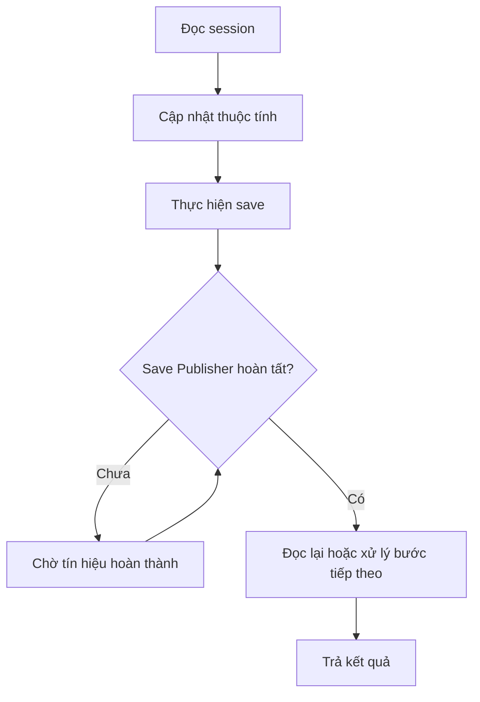

# Kiểm tra kết quả lưu thực tế trước khi một yêu cầu khác đọc phiên

Trong ứng dụng Spring WebFlux dùng Spring Session Redis, thao tác lưu session là bất đồng bộ. Việc gọi một phương thức trả về Reactor Publisher chưa có nghĩa dữ liệu đã được ghi xuống Redis. Ứng dụng cần bảo đảm publisher lưu được đưa vào reactive chain và chain chỉ chuyển sang bước đọc tiếp theo sau khi thao tác ghi hoàn tất.

Điều này đặc biệt quan trọng khi một luồng nghiệp vụ vừa cập nhật WebSession rồi cần đọc lại session, khi hai request liên tiếp dùng chung cookie, hoặc khi nhiều instance Spring cùng truy cập một Redis. Nếu code bỏ qua publisher, tự gọi subscribe rồi trả response, hoặc đọc session trên replica chưa nhận kịp dữ liệu, request tiếp theo có thể nhìn thấy trạng thái cũ.

Bài học này giải thích read-after-write trong reactive Redis, cách phối hợp Mono/Flux để chờ save hoàn tất, vai trò của response lifecycle trong WebFlux, sự khác biệt giữa xác nhận ghi trên primary và replication sang replica, cùng cách kiểm thử kết quả thực tế mà không chặn event loop.

## 1. Vì sao cần xác nhận thao tác save đã hoàn tất?

Reactive API thường trả về Publisher như Mono hoặc Flux. Publisher mô tả một công việc sẽ được thực thi khi có subscription. Nó không nhất thiết chạy ngay tại thời điểm phương thức được gọi.

Ví dụ:

```java
Mono<Void> saveResult = session.save();
```

Dòng code này chỉ lấy Publisher đại diện cho thao tác lưu. Nếu không có thành phần nào subscribe hoặc ghép Publisher vào một chain được subscribe, thao tác có thể không chạy.

Trong ứng dụng WebFlux, framework subscribe vào Publisher được trả về từ controller hoặc handler. Vì vậy, hãy trả về chain đại diện cho toàn bộ công việc cần hoàn thành. Đừng tạo một subscription rời rạc rồi trả response trước khi biết thao tác ghi thành công.

Một yêu cầu đọc sau ghi thường có thứ tự:

1. Tải session.
2. Cập nhật một hoặc nhiều thuộc tính.
3. Lưu session.
4. Chờ Publisher save hoàn tất.
5. Đọc lại session từ repository hoặc thực hiện bước tiếp theo cần dữ liệu mới.



Nếu bước đọc được chạy trước khi bước ghi hoàn tất, ứng dụng có thể đọc phiên bản cũ. Trong reactive flow, thứ tự này cần được thể hiện bằng operator như `flatMap`, `then` hoặc `concatMap`, tùy dữ liệu đầu vào và quan hệ phụ thuộc.

## 2. Reactive Redis session và repository

Trong WebFlux, Spring Session cung cấp abstraction reactive để ứng dụng thao tác với WebSession. Integration Redis lưu session trong Redis và trả về các Publisher cho thao tác đọc, lưu và xóa.

Ở mức repository, contract reactive thường có các thao tác tương tự:

| Thao tác | Ý nghĩa |
| --- | --- |
| `createSession()` | Tạo một session mới, trả về Publisher chứa session |
| `findById(id)` | Tải session theo session ID, trả về Mono có thể rỗng nếu không tìm thấy hoặc đã hết hạn |
| `save(session)` | Lưu trạng thái session và hoàn tất bằng Mono<Void> |
| `deleteById(id)` | Xóa session và hoàn tất bằng Mono<Void> |

Với API WebFlux, controller thường làm việc với `WebSession` thay vì gọi repository trực tiếp. WebSession là abstraction của Spring WebFlux; Spring Session tích hợp repository để lưu trạng thái phía server.

Ví dụ controller:

```java
import org.springframework.http.ResponseEntity;
import org.springframework.web.bind.annotation.PostMapping;
import org.springframework.web.bind.annotation.RestController;
import org.springframework.web.server.WebSession;
import reactor.core.publisher.Mono;

@RestController
public class PreferenceController {

    @PostMapping("/preferences/theme")
    public Mono<ResponseEntity<Void>> updateTheme(WebSession session) {
        session.getAttributes().put("theme", "dark");

        return session.save()
                .thenReturn(ResponseEntity.noContent().build());
    }
}
```

Publisher từ `session.save()` được nối với `thenReturn`. Response chỉ được phát ra sau khi thao tác save hoàn tất thành công. Nếu save phát lỗi, lỗi tiếp tục đi trong reactive chain và framework có thể xử lý theo error handling của ứng dụng.

Trong ứng dụng thông thường, WebFlux/Spring Session đã phối hợp việc lưu WebSession trong response lifecycle. Gọi save tường minh chỉ cần thiết khi luồng code muốn chờ lưu ở một điểm cụ thể trước khi thực hiện bước kế tiếp. Tránh lưu nhiều lần không cần thiết.

## 3. Reactor Publisher là mô tả công việc, không phải kết quả tức thời

Các Publisher của Reactor thường lazy: công việc bắt đầu khi có subscription. Cần phân biệt ba tình huống:

```java
// 1. Tạo Publisher nhưng bỏ đi: không bảo đảm lệnh Redis được thực thi.
session.save();

// 2. Subscribe độc lập: công việc có thể chạy, nhưng không được phối hợp
// với thời điểm trả response hoặc các bước tiếp theo của request.
session.save().subscribe();

// 3. Ghép vào chain: framework quản lý subscription và thứ tự hoàn tất.
return session.save().thenReturn("saved");
```

Tình huống thứ ba là cách phù hợp trong controller hoặc handler reactive. Tránh tự gọi `subscribe()` trong code xử lý request vì:

- Request có thể hoàn tất trước khi thao tác lưu kết thúc.
- Lỗi của thao tác lưu không còn đi theo Publisher mà controller trả về.
- Cancellation và timeout của request không được phối hợp với subscription rời.
- Khó kiểm soát thứ tự khi request tiếp theo cần đọc trạng thái mới.
- Có thể tạo nhiều subscription ngoài ý muốn nếu method được gọi nhiều lần.

Không dùng `block()` để chờ save trong WebFlux. Block có thể chiếm event-loop thread, làm giảm khả năng xử lý request và gây nghẽn khi tải tăng. Hãy biểu diễn quan hệ phụ thuộc bằng reactive operators.

## 4. Dùng then để chờ ghi rồi mới đọc

Khi Publisher save chỉ báo hoàn tất mà không phát giá trị, `then` là operator phù hợp để bắt đầu một thao tác sau khi save complete.

Ví dụ dùng repository reactive:

```java
public Mono<Session> updateAndReload(String sessionId) {
    return sessionRepository.findById(sessionId)
            .switchIfEmpty(Mono.error(
                    new IllegalStateException("Session not found")))
            .flatMap(session -> {
                session.setAttribute("workflowStep", "confirmed");

                return sessionRepository.save(session)
                        .then(sessionRepository.findById(sessionId));
            });
}
```

Luồng trên chỉ gọi `findById` lần thứ hai sau khi `save` hoàn tất. Nếu save lỗi, bước đọc lại không chạy và lỗi được truyền xuống subscriber.

Với WebSession:

```java
public Mono<String> updateThenRead(WebSession session) {
    session.getAttributes().put("workflowStep", "confirmed");

    return session.save()
            .then(Mono.defer(() ->
                    Mono.just((String) session.getAttribute("workflowStep"))));
}
```

Trong ví dụ này, bước đọc thuộc tính trong cùng object WebSession không phải là kiểm tra dữ liệu đã được Redis ghi. Nó chỉ đọc object đang có trong bộ nhớ request. Muốn xác minh trạng thái lưu thực tế, phải tải lại qua repository hoặc thực hiện request mới qua session store sau khi save hoàn tất.

Điểm phân biệt này rất quan trọng: đọc lại object đang giữ trong heap chỉ chứng minh code đã thay đổi object; nó không chứng minh Redis đã nhận dữ liệu.

## 5. Dùng flatMap khi bước sau cần giá trị từ bước trước

`flatMap` phù hợp khi bước tiếp theo cần giá trị được phát ra bởi Publisher trước. Ví dụ sau khi tạo session mới, đặt thuộc tính, save rồi phát session ID:

```java
public Mono<String> createWorkflowSession() {
    return sessionRepository.createSession()
            .flatMap(session -> {
                session.setAttribute("workflow", "checkout");
                String id = session.getId();

                return sessionRepository.save(session)
                        .thenReturn(id);
            });
}
```

Kết quả ID chỉ được phát ra sau khi save hoàn tất. Nếu cần đọc lại dữ liệu, có thể nối thêm một bước:

```java
public Mono<Session> createAndVerify() {
    return sessionRepository.createSession()
            .flatMap(session -> {
                session.setAttribute("workflow", "checkout");
                String id = session.getId();

                return sessionRepository.save(session)
                        .then(sessionRepository.findById(id));
            });
}
```

Không thay bằng `map` nếu lambda bên trong trả về Publisher. `map` sẽ tạo Publisher lồng nhau, ví dụ `Mono<Mono<Session>>`, chứ không tự flatten và tuần tự hóa thao tác. Dùng `flatMap` để nối một thao tác bất đồng bộ phụ thuộc vào giá trị trước đó.

## 6. Nối nhiều thao tác có thứ tự bằng concatMap

Khi cần lưu lần lượt nhiều session hoặc nhiều bước ghi phụ thuộc nhau, `concatMap` giữ thứ tự xử lý tuần tự. Ví dụ một tác vụ quản trị cần cập nhật một tập session theo danh sách ID:

```java
public Mono<Void> updateSessions(Flux<String> sessionIds) {
    return sessionIds.concatMap(id ->
            sessionRepository.findById(id)
                    .flatMap(session -> {
                        session.setAttribute("reviewed", true);
                        return sessionRepository.save(session);
                    })
    ).then();
}
```

`concatMap` chờ Publisher của phần tử hiện tại hoàn tất trước khi xử lý phần tử kế tiếp. Điều này hữu ích khi cần giới hạn concurrency hoặc giữ thứ tự.

Ngược lại, `flatMap` trên Flux có thể chạy nhiều Publisher đồng thời. Nếu các thao tác độc lập, đó có thể là cách tăng throughput; nếu chúng cùng sửa một session hoặc phụ thuộc thứ tự, concurrency có thể tạo race condition. Không dùng `Mono.when` hoặc `flatMap` đồng thời cho một chuỗi read-save-read mà bước sau phải thấy kết quả của bước trước.

## 7. Response lifecycle trong WebFlux

Với Spring Session WebFlux, session được lưu trong reactive response lifecycle. Khi request kết thúc, WebFlux phối hợp việc lưu session và cập nhật cookie session trước khi response được commit theo cơ chế integration.

Điều này có nghĩa controller thông thường chỉ cần thay đổi WebSession rồi trả Publisher response:

```java
@PostMapping("/cart/select")
public Mono<ResponseEntity<Void>> selectCart(WebSession session) {
    session.getAttributes().put("selectedCart", "cart-42");
    return Mono.just(ResponseEntity.noContent().build());
}
```

Framework chịu trách nhiệm lưu session theo lifecycle của request. Tuy nhiên, nếu code tự khởi chạy tác vụ nền hoặc trả response từ một chain tách rời, không thể giả định session đã lưu. Hãy đưa thao tác save vào chain mà response phụ thuộc vào.

Ví dụ handler cần xác nhận save trước khi trả response:

```java
public Mono<ServerResponse> confirm(ServerRequest request) {
    return request.session()
            .flatMap(session -> {
                session.getAttributes().put("confirmed", true);
                return session.save()
                        .then(ServerResponse.ok().bodyValue("confirmed"));
            });
}
```

Không tự gọi save nếu framework đã thực hiện cùng thao tác trong lifecycle và không có nhu cầu kiểm soát điểm hoàn tất riêng. Việc save lặp có thể tạo thêm Redis commands và làm tăng latency.

## 8. Read-after-write khi nhiều request dùng cùng session

Sau khi Publisher save hoàn tất, một lần đọc mới từ cùng Redis primary thường có thể quan sát thay đổi đã được primary xác nhận. Nhưng có một số tình huống cần phân biệt:

### 8.1. Request tiếp theo bắt đầu sau khi response hoàn tất

Nếu request đầu chỉ gửi response sau khi session save hoàn tất, request tiếp theo gửi cookie mới sẽ bắt đầu sau thao tác ghi. Khi đọc từ cùng primary, repository có thể đọc trạng thái vừa lưu.

### 8.2. Hai request chạy đồng thời

Trình duyệt có thể gửi nhiều request song song, chẳng hạn hai tab cùng cập nhật session. Request B có thể tải session trước khi request A save xong. Việc A save complete sau đó không làm thay đổi object B đã tải trước đó.

Ví dụ:

1. A và B cùng đọc session version cũ.
2. A thay đổi thuộc tính `step` thành `paid`.
3. B thay đổi cùng thuộc tính thành `cancelled`.
4. A save hoàn tất.
5. B save sau đó bằng snapshot cũ.

Kết quả cuối có thể là `cancelled`. Việc A chờ save complete không ngăn B ghi một phiên bản cũ sau đó. Read-after-write không đồng nghĩa với serialize mọi request hoặc giải quyết lost update.

Nếu nghiệp vụ yêu cầu cập nhật tuần tự, hãy dùng cơ chế điều phối theo người dùng/session, version check, atomic operation hoặc kho dữ liệu có transaction phù hợp. Không dựa vào việc mọi request mang cùng session ID sẽ tự động được xử lý lần lượt.

### 8.3. Request đọc qua instance khác

Nhiều instance Spring có thể dùng cùng Redis. Khi request B đến instance khác, điều quan trọng là hai instance cùng dùng một Redis deployment, cùng namespace, serializer và session configuration. Nếu instance B đọc từ replica, cần xét replication lag.

## 9. Primary, replica và giới hạn của read-after-write

Redis replication thường bất đồng bộ. Một write được primary xác nhận chưa có nghĩa mọi replica đã nhận dữ liệu đó. Nếu ứng dụng cấu hình đọc từ replica, một request đọc ngay sau save có thể nhìn thấy trạng thái cũ trong một khoảng thời gian.

Phân biệt ba mốc:

| Mốc | Điều đã được xác nhận | Điều chưa được bảo đảm |
| --- | --- | --- |
| Publisher save hoàn tất | Các thao tác mà repository chờ đã hoàn tất theo contract của repository/connection | Replica đã nhận đủ dữ liệu; dữ liệu đã được ghi bền vững xuống đĩa |
| Primary đọc lại sau save | Primary trả trạng thái theo thứ tự lệnh đã xử lý | Replica khác có cùng trạng thái ngay lập tức |
| Replica đọc lại | Replica trả trạng thái hiện có tại thời điểm đọc | Replica đã theo kịp write mới nhất nếu replication đang trễ |

Nếu cần read-your-writes cho session, bảo đảm các lần đọc sau save được định tuyến đến primary hoặc dùng chính sách consistency phù hợp với Redis client/topology. Đừng bật replica reads cho session mà không đánh giá khả năng đọc stale data.

Ngay cả khi đọc primary, xác nhận save complete không phải là cam kết durability tuyệt đối. Persistence RDB/AOF, replication acknowledgement, failover policy và cấu hình Redis quyết định khả năng phục hồi sau sự cố. Nếu primary fail ngay sau khi xác nhận write nhưng trước khi replica nhận dữ liệu, một số cấu hình có thể mất write gần nhất khi failover.

Với session, mức rủi ro này thường được chấp nhận theo chính sách đăng nhập lại. Nếu dữ liệu có giá trị nghiệp vụ không được phép mất, không dùng session làm nguồn lưu duy nhất.

## 10. Không đọc lại từ object trong bộ nhớ để kết luận Redis đã lưu

Ví dụ sau không xác minh persistence:

```java
session.getAttributes().put("status", "ready");
String status = (String) session.getAttribute("status");
```

Giá trị trả về chỉ phản ánh object WebSession hiện tại. Nó chưa chứng minh:

- Redis đã nhận write.
- Write đã được server xác nhận.
- Một application instance khác đọc được giá trị.
- Replica đã nhận thay đổi.
- Session vẫn còn hiệu lực theo TTL.

Để xác minh dữ liệu đã lưu, dùng repository hoặc một request độc lập tải session từ store sau khi save complete. Trong integration test, nên đọc bằng cùng session ID qua một client/repository khác hoặc gọi endpoint GET trên một application instance khác.

Ví dụ kiểm tra bằng repository:

```java
public Mono<String> saveAndReadStatus(String id) {
    return sessionRepository.findById(id)
            .switchIfEmpty(Mono.error(
                    new IllegalStateException("Session not found")))
            .flatMap(session -> {
                session.setAttribute("status", "ready");

                return sessionRepository.save(session)
                        .then(sessionRepository.findById(id));
            })
            .map(session -> (String) session.getAttribute("status"));
}
```

Ví dụ này xác nhận repository trả lại giá trị mới sau save trong cùng read path. Để xác minh read-after-write giữa hai instance hoặc primary/replica, cần cấu hình test topology tương ứng thay vì chỉ dùng một repository mock.

## 11. Xử lý lỗi save và retry

Khi Redis không khả dụng, Publisher save có thể kết thúc bằng lỗi connection, timeout hoặc lỗi serialization. Nếu response phụ thuộc vào trạng thái session vừa cập nhật, không nên bỏ qua lỗi rồi trả về thành công.

Ví dụ:

```java
return session.save()
        .then(ServerResponse.ok().bodyValue("saved"))
        .onErrorResume(error -> {
            log.warn("Could not persist session update, requestId={}", requestId);
            return ServerResponse.status(503).bodyValue("Session store unavailable");
        });
```

Trong ví dụ, response lỗi được phát ra nếu thao tác lưu thất bại. Log chỉ ghi request ID độc lập; không ghi session ID, cookie hoặc session attributes.

Retry chỉ nên áp dụng với lỗi tạm thời có thể phục hồi, có số lần giới hạn và backoff. Ví dụ:

```java
return session.save()
        .retryWhen(Retry.backoff(2, Duration.ofMillis(100))
                .filter(this::isTransientRedisFailure));
```

Tên helper và cách phân loại exception cần được triển khai theo client/driver thực tế. Không retry mọi exception; lỗi serialization, dữ liệu sai hoặc cấu hình không hợp lệ thường không thể giải quyết bằng retry.

Nếu write đã được Redis thực hiện nhưng client mất kết nối trước khi nhận acknowledgement, ứng dụng có thể không biết chắc thao tác đã thành công hay chưa. Khi retry, cần cân nhắc tính idempotent. Ghi lại cùng giá trị thuộc tính thường dễ retry hơn một thao tác cộng dồn hoặc phát sinh side effect. Không dùng retry như một bảo đảm exactly-once.

## 12. TTL và việc đọc lại session

Session có thể được lưu thành công nhưng hết hạn trước khi request đọc lại nếu idle timeout quá ngắn hoặc test chờ quá lâu. Khi kiểm tra read-after-write, cần tách biệt:

- Write không hoàn tất hoặc lỗi.
- Write hoàn tất nhưng session đã hết hạn.
- Session ID sai hoặc cookie không được gửi.
- Request đọc nhầm namespace/Redis deployment.
- Read được route tới replica chưa theo kịp.
- Serialization không tương thích khiến repository không khôi phục được thuộc tính.

Không dùng TTL của key nội bộ làm phép kiểm tra duy nhất. Spring Session có thể quản lý nhiều key và expiration metadata tùy repository/version. Dùng API repository để xác minh session còn tồn tại và có thuộc tính mong đợi.

Trong test, đặt timeout đủ dài để hoàn tất chuỗi ghi/đọc; dùng timeout ngắn chỉ khi mục tiêu test là expiration. Không dùng Redis command quét toàn bộ keyspace trên production để tìm session.

## 13. Kiểm thử bằng StepVerifier

Với reactive repository, StepVerifier giúp xác nhận Publisher phát giá trị hoặc hoàn tất đúng thứ tự.

```java
StepVerifier.create(saveAndReadStatus(sessionId))
        .expectNext("ready")
        .verifyComplete();
```

Test này cần dùng repository được cấu hình với Redis test thực tế nếu mục tiêu là kiểm tra Redis persistence. Nếu dùng mock repository, test chỉ xác nhận cách code compose Publisher chứ không chứng minh lệnh Redis đã chạy.

Một integration test nên:

1. Khởi động Redis riêng cho test, ví dụ bằng Testcontainers.
2. Khởi tạo ứng dụng/repository reactive với đúng Redis connection factory.
3. Tạo session và lưu một marker.
4. Chờ Publisher save complete bằng StepVerifier.
5. Dùng một lần find độc lập để đọc lại session.
6. Xác nhận marker đúng và TTL còn dương theo API/diagnostic phù hợp.
7. Lặp lại qua một instance ứng dụng khác nếu cần xác minh chia sẻ session.
8. Nếu production dùng replica reads, kiểm thử với topology primary/replica và xác định mức trễ có thể chấp nhận.

Tránh dùng Thread.sleep dài trong unit test. Với eventual consistency của replica, dùng polling có giới hạn và timeout tổng thể rõ ràng. Không biến test thành vòng lặp vô hạn chờ replica đồng bộ.

## 14. Kiểm thử hai request liên tiếp và request đồng thời

Một bài test HTTP thực tế có thể có hai endpoint:

- POST cập nhật một thuộc tính session và chỉ trả response sau khi lifecycle save hoàn tất.
- GET đọc thuộc tính đó bằng cùng cookie session.

Quy trình:

1. Gửi POST đến instance A.
2. Chờ response hoàn tất và nhận cookie session nếu đó là session mới.
3. Gửi GET đến instance B với cookie đó.
4. Xác nhận B đọc được giá trị mới từ Redis.
5. Lặp lại khi tắt sticky session để bảo đảm request thực sự đi đến instance khác.

Sau đó tạo test riêng cho hai request đồng thời:

1. A và B cùng tải session trước khi một trong hai save.
2. Mỗi request cập nhật cùng một thuộc tính hoặc hai thuộc tính khác nhau.
3. Điều khiển thứ tự save bằng latch/test hook.
4. Xác nhận chính sách ứng dụng xử lý lost update theo thiết kế.

Không kết luận rằng read-after-write được bảo đảm cho mọi request chỉ vì test tuần tự thành công. Test tuần tự và test concurrent kiểm tra hai đặc tính khác nhau.

## 15. Quan sát hiệu năng và trạng thái ghi

Để chẩn đoán session read-after-write, theo dõi:

- Thời gian hoàn tất Publisher save.
- Thời gian đọc session và tỷ lệ session miss.
- Redis command latency, timeout và connection error.
- Số lần retry và tỷ lệ retry thành công.
- Tỷ lệ request đọc stale value nếu ứng dụng có metric nghiệp vụ xác định được.
- Độ trễ replication nếu đọc từ replica.
- Kích thước session và số thuộc tính được serialize.

Đặt correlation ID cho request và span để ghép sự kiện giữa instance A, instance B và Redis. Không đưa session ID, cookie hoặc session attributes vào log, trace baggage hay metric label.

Nếu save latency tăng, kiểm tra Redis network, connection pool, command queue, serialization và tải server. Đừng thêm subscribe rời hoặc block để “chắc chắn” write hoàn tất; điều đó thường che vấn đề và làm nghẽn reactive runtime.

## 16. Những lỗi thường gặp

- **Tạo Publisher rồi bỏ đi:** thao tác save có thể không được subscribe nên không chạy.
- **Gọi subscribe riêng rồi trả response:** response không chờ save và lỗi không đi theo request chain.
- **Dùng block trong WebFlux:** có thể chặn event loop và làm giảm throughput.
- **Dùng map thay flatMap cho Publisher lồng:** thao tác đọc/ghi không được flatten theo thứ tự mong muốn.
- **Đọc lại cùng object WebSession:** chỉ kiểm tra heap hiện tại, không kiểm tra dữ liệu đã lưu trong Redis.
- **Dùng Mono.when cho read-after-write phụ thuộc:** hai thao tác có thể chạy đồng thời thay vì ghi xong mới đọc.
- **Cho rằng save complete đồng nghĩa replica đã cập nhật:** replication Redis thường bất đồng bộ.
- **Cho rằng save complete ngăn request cũ ghi đè:** concurrent requests vẫn có thể ghi snapshot cũ sau đó.
- **Nuốt lỗi save rồi trả thành công:** client nghĩ thay đổi đã lưu dù repository báo lỗi.
- **Retry vô hạn hoặc retry lỗi không tạm thời:** làm tăng tải và có thể lặp side effect.
- **Chỉ test bằng mock:** không xác minh serialization, Redis commands, TTL hoặc read path thực tế.

## 17. Checklist triển khai

Trước khi phát hành, xác nhận:

- [ ] Các Publisher lưu session được compose vào reactive chain được framework subscribe.
- [ ] Không gọi subscribe rời hoặc block trong controller/service WebFlux.
- [ ] Bước đọc phụ thuộc được nối sau save bằng then/flatMap/concatMap phù hợp.
- [ ] Phân biệt đọc object trong bộ nhớ với đọc lại từ repository.
- [ ] Response lifecycle chỉ hoàn tất sau khi session cần thiết được lưu theo integration.
- [ ] Các instance dùng cùng Redis deployment, namespace và serialization config.
- [ ] Read-after-write được định tuyến đến primary nếu cần quan sát write ngay.
- [ ] Đã hiểu replication lag và giới hạn durability của Redis.
- [ ] Đã kiểm thử request tuần tự và request đồng thời.
- [ ] Retry có giới hạn, chỉ áp dụng lỗi tạm thời và không che lỗi save.
- [ ] Log/trace không chứa session ID, cookie hoặc session attributes.

## 18. Tự kiểm tra kiến thức

Bạn đã nắm được nội dung nếu có thể giải thích:

- Vì sao gọi session.save() chưa chắc thao tác đã chạy?
- Vì sao subscribe rời và block không phù hợp trong WebFlux request flow?
- Khi nào dùng then, flatMap và concatMap để bảo đảm thứ tự?
- Vì sao đọc lại cùng WebSession object không chứng minh Redis đã lưu?
- Response lifecycle của WebFlux phối hợp lưu WebSession như thế nào?
- Vì sao một request đọc từ Redis replica có thể thấy dữ liệu cũ dù save Publisher đã hoàn tất?
- Vì sao save complete không ngăn request đồng thời ghi đè trạng thái mới?
- Cần dùng những test nào để xác minh read-after-write qua nhiều instance?

Read-after-write trong ứng dụng reactive bắt đầu bằng việc biểu diễn đúng quan hệ phụ thuộc trong Publisher chain. Hãy chờ thao tác save hoàn tất trước khi đọc lại, dùng repository hoặc request độc lập để kiểm tra dữ liệu thực tế, và xác định rõ đường đọc primary/replica. Việc đó bảo đảm thứ tự của một luồng reactive; nó không tự tạo transaction, khóa phiên hay giải quyết xung đột giữa nhiều request cùng cập nhật session.
