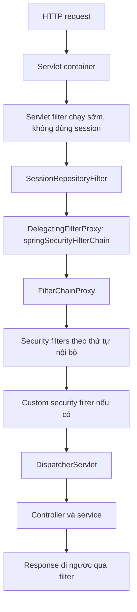
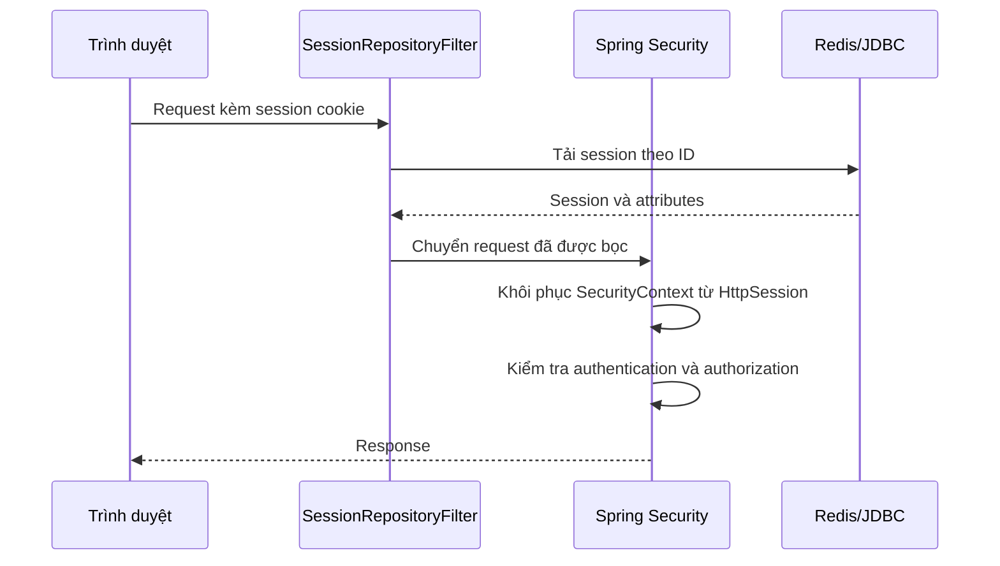

# Thứ tự tích hợp Spring Session với chuỗi filter bảo mật

Trong ứng dụng Spring chạy trên Servlet, Spring Session thay thế nơi lưu trữ `HttpSession` mặc định bằng repository như Redis hoặc JDBC. Spring Security cũng cần truy cập phiên để khôi phục `SecurityContext`, lưu request cần chuyển hướng sau đăng nhập, quản lý CSRF token và vô hiệu hóa phiên khi logout. Để các thành phần này dùng cùng một phiên, `SessionRepositoryFilter` phải chạy trước `springSecurityFilterChain` và trước mọi Servlet filter khác có thể gọi `request.getSession()`.

Điểm dễ nhầm là có hai lớp thứ tự filter. Servlet container sắp xếp các filter bên ngoài ứng dụng; bên trong một filter proxy của Spring Security, `FilterChainProxy` lại sắp xếp các security filter riêng. `SessionRepositoryFilter` nằm ở lớp container. Các API như `HttpSecurity.addFilterBefore(...)` chỉ thay đổi thứ tự trong security chain, không thể sửa vị trí của `SessionRepositoryFilter` ở lớp container.

## 1. Vì sao thứ tự filter ảnh hưởng tới session?

Servlet container gọi các filter theo thứ tự đăng ký trước khi chuyển request tới servlet đích, thường là `DispatcherServlet`. Filter có thể đọc hoặc bọc request/response rồi gọi `chain.doFilter(...)` để chuyển tiếp.

Spring Session tích hợp với Servlet API bằng `SessionRepositoryFilter`. Filter này đọc session ID từ request qua `HttpSessionIdResolver`, tải phiên từ `SessionRepository`, sau đó bọc request/response để những thành phần phía sau vẫn dùng `HttpSession` như bình thường. Khi request hoàn tất, các thay đổi phiên được lưu qua repository theo chính sách đã cấu hình.

Nếu một filter chạy trước `SessionRepositoryFilter` gọi `request.getSession()` hoặc `getSession(true)`, request chưa được Spring Session bọc. Filter đó có thể tạo hoặc truy cập phiên của Servlet container thay vì phiên được lưu trong Redis/JDBC. Hệ quả là dữ liệu có thể chỉ nằm trong bộ nhớ của một instance, session ID không nhất quán hoặc trạng thái đăng nhập không được khôi phục ở node khác.

Vì vậy, nguyên tắc tích hợp là:

- `SessionRepositoryFilter` chạy trước `springSecurityFilterChain`.
- Mọi Servlet filter cần đọc, tạo hoặc cập nhật `HttpSession` chạy sau `SessionRepositoryFilter`.
- Spring Security dùng `HttpSession` thông qua request wrapper của Spring Session.
- Filter chỉ cần `Authentication` đã được thiết lập nên được đặt bên trong security chain tại vị trí phù hợp, thay vì cố điều chỉnh thứ tự container một cách tùy tiện.

## 2. Hai lớp thứ tự filter

Một request thường đi qua hai lớp:



**Lớp container:** chứa `SessionRepositoryFilter`, `DelegatingFilterProxy` và các Servlet filter khác. Thứ tự ở đây được điều khiển bởi Servlet registration, `FilterRegistrationBean` hoặc cấu hình deployment như `web.xml`.

**Lớp Spring Security:** `DelegatingFilterProxy` chuyển request tới bean `springSecurityFilterChain`, thường là `FilterChainProxy`. `FilterChainProxy` chọn `SecurityFilterChain` phù hợp và chạy các security filter theo thứ tự nội bộ. `HttpSecurity.addFilterBefore`, `addFilterAfter` và `addFilterAt` hoạt động trong lớp này.

Hai lớp có thể cùng chứa filter tùy chỉnh, nhưng ý nghĩa của order khác nhau. Một filter được thêm vào `HttpSecurity` không tự động chạy sau `SessionRepositoryFilter` nếu nó đồng thời được đăng ký như một Servlet filter riêng ở container. Cần chọn đúng nơi thực thi.

## 3. Vai trò của SessionRepositoryFilter

`SessionRepositoryFilter` là ranh giới giữa Servlet API và Spring Session. Các thành phần phía sau không cần biết phiên nằm trong Redis hay JDBC. Chúng chỉ sử dụng `HttpServletRequest.getSession()`, `HttpSession.getAttribute()` và các API Servlet quen thuộc.

Quy trình ở mức khái quát:

1. Filter đọc session ID từ cookie hoặc resolver được cấu hình.
2. Nếu có ID, filter gọi repository để tìm phiên.
3. Filter bọc request để lời gọi `getSession()` phía sau trả về phiên do Spring Session quản lý.
4. Spring Security khôi phục `SecurityContext` từ phiên nếu ứng dụng dùng xác thực dựa trên session.
5. Controller và service sử dụng các thuộc tính phiên qua Servlet API.
6. Khi response hoàn tất, Spring Session lưu thay đổi theo repository và flush/save mode.

Spring Boot và Spring Session có thể tự đăng ký filter khi dependency và repository được cấu hình phù hợp. `SessionRepositoryFilter` có hằng số `DEFAULT_ORDER` để biểu thị thứ tự mặc định rất sớm trong Servlet chain. Trong cấu hình thông thường, nó được đặt trước Spring Security.

Không tự tạo thêm `SessionRepositoryFilter` nếu auto-configuration đã tạo filter. Hai filter quản lý cùng request có thể tạo nhiều lớp wrapper, gây khó hiểu về session ID, cookie và thời điểm lưu. Khi cần tùy chỉnh, trước hết xác minh filter registration hiện tại và repository bean thực tế.

## 4. Spring Security cần thấy phiên đã được bọc

Trong ứng dụng form login hoặc xác thực dựa trên session, Spring Security có thể dùng `HttpSessionSecurityContextRepository` để lưu và khôi phục `SecurityContext`. Repository này gọi Servlet session API. Do đó, nó phải chạy sau `SessionRepositoryFilter` để thao tác trên phiên Spring Session.

Luồng request đã đăng nhập:



Nếu `springSecurityFilterChain` chạy trước `SessionRepositoryFilter`, security context repository có thể tạo hoặc đọc một `HttpSession` không do Spring Session quản lý. Một request có thể trông như đã xác thực trên node A nhưng request tiếp theo tới node B lại trở thành anonymous vì session không được lưu trong kho chia sẻ.

Các thành phần bảo mật thường có thể cần session gồm:

- `HttpSessionSecurityContextRepository` để lưu `SecurityContext`.
- Request cache để giữ request ban đầu và chuyển hướng sau đăng nhập.
- CSRF token repository nếu token được lưu trong session.
- Cơ chế remember-me hoặc các tính năng bảo mật khác có cấu hình lưu trạng thái vào session.
- Logout handler cần invalidate phiên và xóa cookie session.

`permitAll()` chỉ cho phép request truy cập endpoint. Nó không bảo đảm request không tạo session: CSRF, request cache hoặc mã ứng dụng vẫn có thể cần phiên.

## 5. Cấu hình session và security chain

Với Spring Boot, Spring Session có thể tự cấu hình repository và filter. Ví dụ cấu hình một ứng dụng Servlet dùng Redis:

```yaml
spring:
  data:
    redis:
      host: redis.internal
      port: 6379
  session:
    timeout: 30m
    redis:
      namespace: portal:sessions
```

Các property kết nối Redis và Spring Session có thể thay đổi theo phiên bản Spring Boot. Hãy dùng đúng prefix của phiên bản dự án và xác nhận repository được tạo thực tế. Điều quan trọng đối với thứ tự filter là ứng dụng phải có đúng một `SessionRepositoryFilter` gắn với repository mong muốn.

Ví dụ Spring Security cho ứng dụng session-based:

```java
@Bean
SecurityFilterChain securityFilterChain(HttpSecurity http) throws Exception {
    http
        .authorizeHttpRequests(authorize -> authorize
            .requestMatchers("/login", "/public/**", "/assets/**").permitAll()
            .anyRequest().authenticated()
        )
        .formLogin(Customizer.withDefaults())
        .sessionManagement(session -> session
            .sessionCreationPolicy(SessionCreationPolicy.IF_REQUIRED)
            .sessionFixation(fixation -> fixation.changeSessionId())
        )
        .logout(logout -> logout
            .invalidateHttpSession(true)
            .clearAuthentication(true)
            .deleteCookies("SESSION")
        );

    return http.build();
}
```

Ví dụ giả định cookie Spring Session có tên `SESSION`. Nếu ứng dụng dùng tên khác hoặc resolver tùy chỉnh, hãy điều chỉnh cấu hình xóa cookie tương ứng. `IF_REQUIRED` cho phép Spring Security tạo session khi cần; `changeSessionId()` đổi định danh sau xác thực để chống session fixation. Những hành vi này đều cần request đã đi qua `SessionRepositoryFilter`.

## 6. Thứ tự container trong Spring Boot

Trong Spring Boot, `FilterRegistrationBean` cho phép đăng ký Servlet filter, URL pattern và thứ tự container. Giá trị order nhỏ hơn chạy sớm hơn. `SessionRepositoryFilter.DEFAULT_ORDER` có thể dùng làm mốc để đặt filter tùy chỉnh cần truy cập session ở phía sau.

Ví dụ filter tùy chỉnh chỉ cần kiểm tra xem request đã có session hay chưa:

```java
import java.io.IOException;

import jakarta.servlet.FilterChain;
import jakarta.servlet.ServletException;
import jakarta.servlet.http.HttpServletRequest;
import jakarta.servlet.http.HttpServletResponse;
import jakarta.servlet.http.HttpSession;

import org.springframework.boot.web.servlet.FilterRegistrationBean;
import org.springframework.context.annotation.Bean;
import org.springframework.context.annotation.Configuration;
import org.springframework.session.web.http.SessionRepositoryFilter;
import org.springframework.web.filter.OncePerRequestFilter;

class SessionInspectionFilter extends OncePerRequestFilter {

    @Override
    protected void doFilterInternal(
            HttpServletRequest request,
            HttpServletResponse response,
            FilterChain chain) throws ServletException, IOException {

        HttpSession session = request.getSession(false);
        request.setAttribute("hasManagedSession", session != null);
        chain.doFilter(request, response);
    }
}

@Configuration
class ServletFilterConfiguration {

    @Bean
    FilterRegistrationBean<SessionInspectionFilter> sessionInspectionFilter() {
        FilterRegistrationBean<SessionInspectionFilter> registration =
                new FilterRegistrationBean<>(new SessionInspectionFilter());
        registration.setName("sessionInspectionFilter");
        registration.addUrlPatterns("/*");
        registration.setOrder(SessionRepositoryFilter.DEFAULT_ORDER + 10);
        return registration;
    }
}
```

`getSession(false)` chỉ đọc phiên hiện có và không tạo phiên mới. Filter được đặt sau thứ tự mặc định của Spring Session nên có thể quan sát phiên đã được bọc. Order `DEFAULT_ORDER + 10` chỉ là ví dụ; cần kiểm tra toàn bộ filter registrations của ứng dụng để bảo đảm vị trí thực tế phù hợp. Trong cấu hình Boot thông thường, Spring Security proxy nằm sau Spring Session, nhưng filter tùy chỉnh và cấu hình container khác có thể làm thay đổi quan hệ này.

Nếu filter không cần session, có thể đặt nó trước `SessionRepositoryFilter` để xử lý sớm. Nhưng phải xác minh cả các helper mà filter gọi không âm thầm gọi `getSession()`.

## 7. Đặt filter cần Authentication bên trong Spring Security

Một filter cần principal hoặc authorities đã xác thực thường nên nằm bên trong `SecurityFilterChain`. Ví dụ, filter audit cần chạy sau bước xác thực username/password có thể được thêm bằng `addFilterAfter`:

```java
@Bean
SecurityFilterChain securityFilterChain(
        HttpSecurity http,
        AuthenticatedRequestAuditFilter auditFilter) throws Exception {

    http
        .authorizeHttpRequests(authorize -> authorize
            .anyRequest().authenticated()
        )
        .addFilterAfter(auditFilter, UsernamePasswordAuthenticationFilter.class);

    return http.build();
}
```

Vị trí `UsernamePasswordAuthenticationFilter` chỉ phù hợp với luồng form login truyền thống. Nếu ứng dụng dùng bearer token, custom authentication filter hoặc cơ chế khác, hãy đặt filter sau filter thực sự thiết lập `Authentication`. Không sao chép vị trí này nếu security chain không có filter đó.

Nếu filter chỉ cần biết request đã có `Authentication` hay chưa, cần phân biệt anonymous authentication với người dùng đã đăng nhập. Không chỉ kiểm tra `authentication.isAuthenticated()` vì `AnonymousAuthenticationToken` cũng có thể trả về `true`. Có thể dùng `AuthenticationTrustResolver` hoặc quy tắc authorization thích hợp.

`addFilterBefore` và `addFilterAfter` không thay đổi thứ tự container. Chúng chỉ sắp xếp filter bên trong Spring Security. `SessionRepositoryFilter` vẫn phải được đăng ký trước `DelegatingFilterProxy` ở lớp container.

## 8. Tránh đăng ký custom filter hai lần

Spring Boot có thể tự đăng ký một bean kiểu `Filter` vào Servlet container. Nếu cùng filter đó được thêm vào `HttpSecurity`, filter có thể chạy hai lần: một lần ở container và một lần bên trong `FilterChainProxy`.

Điều này thường xảy ra khi filter được khai báo `@Component` hoặc `@Bean`, rồi lại truyền vào `http.addFilterBefore(...)`/`addFilterAfter(...)`. Nếu filter chỉ nên chạy trong security chain, tắt đăng ký container:

```java
@Bean
FilterRegistrationBean<AuthenticatedRequestAuditFilter>
disableContainerRegistration(AuthenticatedRequestAuditFilter filter) {
    FilterRegistrationBean<AuthenticatedRequestAuditFilter> registration =
            new FilterRegistrationBean<>(filter);
    registration.setEnabled(false);
    return registration;
}
```

Khi đó filter chỉ chạy ở vị trí đã chỉ định trong `HttpSecurity`. Kiểm tra không có thêm registration qua `web.xml`, `FilterRegistrationBean` khác hoặc component scan.

Với `SessionRepositoryFilter`, cũng tránh đăng ký trùng giữa auto-configuration và cấu hình thủ công. Nếu cần tự cấu hình Spring Session, hãy làm theo một đường cấu hình nhất quán và xác minh bean/filter thực tế sau khi context khởi động.

## 9. Session fixation, lưu SecurityContext và logout

Thứ tự đúng bảo đảm các thao tác bảo mật tác động lên phiên được quản lý bởi Spring Session.

**Sau đăng nhập:** Spring Security xác thực credentials, áp dụng session fixation protection và lưu `SecurityContext` theo `SecurityContextRepository`. Trên Servlet 3.1 trở lên, chiến lược mặc định thường dùng `changeSessionId()`. ID mới được gửi qua resolver/cookie; dữ liệu session được lưu trong repository chung.

**Request tiếp theo:** `SessionRepositoryFilter` tải phiên bằng ID mới trước khi Spring Security khôi phục `SecurityContext`. Nếu request tới instance khác, node đó cũng đọc cùng session từ Redis/JDBC.

**Logout:** Spring Security xóa `SecurityContext`, vô hiệu hóa `HttpSession` theo cấu hình logout và xử lý cookie. Vì `SessionRepositoryFilter` bọc request/response, thao tác invalidate được chuyển tới repository và các instance khác không còn khôi phục phiên cũ.

Nếu custom authentication filter tự xác thực mà không dùng cơ chế dựng sẵn, cần kiểm tra cách lưu `SecurityContext` theo phiên bản Spring Security. Ở các cấu hình hiện đại, việc đặt context vào `SecurityContextHolder` trong request không nhất thiết tự động lưu nó cho request tiếp theo; custom flow cần lưu qua `SecurityContextRepository` theo cách được hỗ trợ.

## 10. Chính sách tạo session ảnh hưởng đến filter

Spring Security cung cấp `SessionCreationPolicy` để điều khiển cách security chain sử dụng phiên:

| Chính sách | Ý nghĩa |
| --- | --- |
| `ALWAYS` | Luôn tạo `HttpSession` |
| `IF_REQUIRED` | Tạo session khi cần; thường dùng với form login |
| `NEVER` | Không chủ động tạo session nhưng vẫn sử dụng session đã tồn tại |
| `STATELESS` | Spring Security không dùng `HttpSession` để lưu `SecurityContext` cho xác thực |

`STATELESS` không cấm mọi mã ứng dụng gọi `request.getSession()` cho mục đích riêng. Nếu endpoint API được thiết kế stateless, hãy kiểm tra CSRF, request cache, custom filter và controller không vô tình tạo session. `SessionRepositoryFilter` có thể vẫn được cài vì ứng dụng còn dùng `HttpSession` cho chức năng khác.

Không chọn `STATELESS` chỉ để giảm số session mà không đánh giá luồng xác thực. Ngược lại, nếu dùng session-based authentication mà cấu hình `STATELESS`, Spring Security sẽ không khôi phục `SecurityContext` từ phiên như mong đợi.

## 11. Async dispatch và thứ tự filter

Servlet request có thể đi qua `REQUEST`, `ASYNC`, `ERROR`, `FORWARD` hoặc `INCLUDE` dispatch. Filter registration và `OncePerRequestFilter` có quy tắc riêng cho từng loại dispatch. Nếu một custom filter cần session trong async/error dispatch, phải kiểm tra filter có được map cho dispatcher type đó và request wrapper được duy trì đúng cách hay không.

Không giữ tham chiếu `HttpServletRequest`, `HttpSession` mutable hoặc tài nguyên request trong một tác vụ nền vượt quá vòng đời request. Nếu cần chuyển thông tin sang async worker, trích xuất dữ liệu cần thiết thành DTO nhỏ. Không dùng thứ tự filter để thay thế cơ chế truyền security context hoặc context propagation dành cho async processing.

Với async request, kiểm tra response commit và thời điểm Spring Session lưu phiên. Không giả định controller trả về hoặc thread ban đầu kết thúc là mọi thao tác lưu đã hoàn tất nếu async lifecycle vẫn đang chạy.

## 12. Lỗi thường gặp và cách chẩn đoán

**Spring Security không khôi phục đăng nhập ở request sau.** Kiểm tra `SessionRepositoryFilter` có chạy trước `springSecurityFilterChain`, cookie có được gửi lại, repository có lưu session và `SecurityContextRepository` có lưu context không. Với custom login flow, xác minh context được lưu tường minh.

**Phiên chỉ tồn tại ở một instance.** Tìm filter chạy trước Spring Session gọi `getSession()`. So sánh repository, Redis/JDBC endpoint, namespace và serializer giữa các node. Xác minh request tới node khác có cùng cookie ID.

**Custom filter không thấy session.** Kiểm tra filter đang ở lớp container hay security chain, order thực tế và có chạy trước `SessionRepositoryFilter` không. Nếu chỉ cần session, đăng ký sau Spring Session. Nếu cần authentication, đặt bên trong security chain sau filter xác thực phù hợp.

**Custom filter chạy hai lần.** Kiểm tra filter vừa được Boot đăng ký ở container vừa được thêm vào `HttpSecurity`, hoặc được đăng ký qua nhiều cơ chế. Tắt registration container nếu filter chỉ thuộc security chain.

**Logout xong cookie cũ vẫn truy cập được ở node khác.** Kiểm tra logout có invalidate session phía server hay chỉ xóa cookie. Gửi cookie cũ trực tiếp tới instance khác và xác minh repository không còn trả phiên hợp lệ.

**Session được tạo trên endpoint công khai ngoài dự kiến.** Kiểm tra filter gọi `getSession()`, CSRF token repository, request cache và controller. Dùng `getSession(false)` khi chỉ cần kiểm tra phiên hiện có.

**Thay đổi `addFilterBefore` không sửa được thứ tự SessionRepositoryFilter.** Đây là hai lớp thứ tự khác nhau. Dùng Servlet registration/`FilterRegistrationBean` cho container order; dùng `HttpSecurity` cho security chain order.

## 13. Kiểm thử thứ tự tích hợp

Kiểm thử nên chứng minh filter phía sau Spring Session thấy đúng session được repository quản lý, Spring Security khôi phục được context và node khác có thể đọc cùng phiên.

| Kịch bản | Điều cần xác minh |
| --- | --- |
| Request chưa có cookie | `getSession(false)` không tạo phiên mới |
| Request tạo session | Cookie và dữ liệu phiên được lưu qua repository |
| Filter tùy chỉnh cần session | Filter chạy sau `SessionRepositoryFilter` và đọc đúng thuộc tính |
| Đăng nhập thành công | Session fixation protection đổi ID theo cấu hình |
| Request tiếp theo | Spring Security khôi phục `SecurityContext` từ session |
| Logout | Session bị invalidate trong repository và cookie được xóa |
| Filter nằm trong `HttpSecurity` | Chạy một lần tại vị trí nội bộ dự kiến |
| Request tới node khác | Node thứ hai khôi phục cùng session từ kho chia sẻ |
| Async/error dispatch | Filter được gọi theo dispatcher mapping và lifecycle mong muốn |

`MockMvc` hữu ích để kiểm tra security behavior và controller. Tuy nhiên, khi cần xác minh thứ tự registration thực tế của Servlet container, nên có integration test với embedded container hoặc môi trường triển khai tương đương. Dùng Redis/JDBC thật hoặc Testcontainers để xác minh session persistence, logout và chia sẻ giữa hai application context.

Có thể thêm log tạm ở đầu các filter để ghi tên filter và dispatcher type nhằm kiểm tra thứ tự. Không ghi session ID, cookie, token hoặc nội dung `SecurityContext` vào log. Sau khi xác minh, bỏ log chẩn đoán chi tiết hoặc thay bằng metrics an toàn.

## 14. Checklist triển khai

- Xác nhận ứng dụng đang chạy Servlet stack và có đúng một `SessionRepositoryFilter`.
- Đặt `SessionRepositoryFilter` trước `springSecurityFilterChain` và mọi filter dùng `HttpSession`.
- Dùng `FilterRegistrationBean` hoặc cơ chế container phù hợp để đặt custom Servlet filter.
- Dùng `HttpSecurity.addFilterBefore/After` chỉ cho thứ tự bên trong Spring Security chain.
- Nếu filter cần `Authentication`, đặt sau filter xác thực thực tế và phân biệt anonymous với authenticated.
- Tránh đăng ký filter trùng giữa container và security chain.
- Cấu hình `SecurityContextRepository`, session fixation, creation policy và logout phù hợp.
- Kiểm tra request công khai không tạo session ngoài ý muốn.
- Kiểm thử login, request tiếp theo, logout, ID cũ, nhiều instance và async dispatch.

Khi `SessionRepositoryFilter` chạy trước chuỗi Spring Security, các filter bảo mật và controller cùng nhìn thấy một `HttpSession` do Spring Session quản lý. Việc đặt custom filter đúng lớp—container hoặc security chain—giúp trạng thái xác thực được khôi phục, session fixation và logout được xử lý đúng, đồng thời dữ liệu phiên được chia sẻ nhất quán giữa các instance dùng Redis hoặc JDBC.
