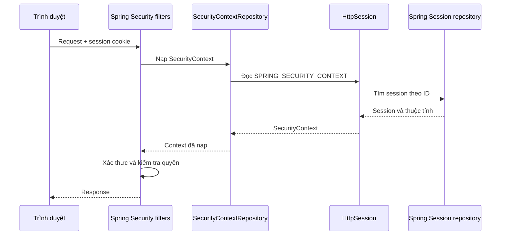

# SecurityContext và lưu danh tính xác thực trong HttpSession

Spring Security xác định người dùng hiện tại thông qua `SecurityContext` và `Authentication`. Trong ứng dụng Servlet, ngữ cảnh này thường được lưu trong `HttpSession` để request tiếp theo có thể tiếp tục sử dụng danh tính đã xác thực. Khi ứng dụng dùng Spring Session, `HttpSession` được quản lý bởi repository như Redis hoặc JDBC, vì vậy `SecurityContext` có thể được chia sẻ giữa nhiều instance ứng dụng.

Để cơ chế này hoạt động đúng, cần hiểu ba phần: Spring Security nạp và lưu `SecurityContext` qua `SecurityContextRepository`; Spring Session cung cấp implementation `HttpSession` được lưu ở kho dùng chung; và cấu hình xác thực phải lưu context vào repository đúng thời điểm. Chỉ đặt `Authentication` vào `SecurityContextHolder` trong một request không tự bảo đảm danh tính sẽ tồn tại ở request kế tiếp.

## 1. SecurityContext, Authentication và SecurityContextHolder

Spring Security tách thông tin xác thực thành các đối tượng có trách nhiệm riêng:

| Thành phần | Vai trò |
|---|---|
| `Authentication` | Đại diện cho thông tin xác thực, principal, credentials và authorities |
| `SecurityContext` | Chứa `Authentication` hiện tại |
| `SecurityContextHolder` | Cung cấp context cho mã đang xử lý request |
| `SecurityContextRepository` | Nạp và lưu context qua ranh giới request |
| `HttpSessionSecurityContextRepository` | Lưu context vào `HttpSession` |

Sau khi đăng nhập thành công, `Authentication` thường chứa:
- `principal`: danh tính đã xác thực, ví dụ `UserDetails` hoặc principal tùy chỉnh.
- `authorities`: các quyền hoặc vai trò đã được xác minh.
- `details`: thông tin bổ sung của request, chẳng hạn địa chỉ IP hoặc session ID, tùy cơ chế xác thực.
- `credentials`: thông tin bí mật dùng trong xác thực; thông thường cần được xóa sau khi xác thực thành công nếu implementation hỗ trợ.

`SecurityContextHolder` là điểm truy cập trong quá trình xử lý hiện tại. Với ứng dụng Servlet, chiến lược mặc định thường gắn context với thread thông qua `ThreadLocal`. Nó giúp controller và service đọc principal mà không phải truyền đối tượng `Authentication` qua mọi tham số.

Ví dụ lấy người dùng hiện tại:

```java
Authentication authentication =
        SecurityContextHolder.getContext().getAuthentication();

if (authentication != null && authentication.isAuthenticated()) {
    Object principal = authentication.getPrincipal();
}
```

Không nên coi một `Authentication` có `isAuthenticated()` là đủ để cấp quyền cho mọi thao tác. Cần để Spring Security và quy tắc authorization xác định quyền cụ thể; một số authentication chưa xác thực cũng có thể tồn tại trong quá trình xử lý.

## 2. Vì sao cần lưu SecurityContext vào HttpSession?

HTTP không giữ trạng thái giữa các request. Sau khi request đăng nhập kết thúc, thread xử lý request cũng kết thúc và context gắn với thread được dọn dẹp. Nếu không lưu context vào một kho có thể đọc ở request tiếp theo, ứng dụng sẽ không biết người dùng đã đăng nhập.

`HttpSessionSecurityContextRepository` giải quyết việc này bằng cách lưu `SecurityContext` vào thuộc tính của `HttpSession`. Khi request mới đến, repository đọc context từ session và cung cấp cho Spring Security.

Trong Spring Session, `HttpSession` được thay thế bằng lớp session do Spring Session quản lý thông qua `SessionRepositoryFilter`. Vì vậy, cùng một cơ chế `HttpSessionSecurityContextRepository` có thể lưu context vào Redis, JDBC hoặc kho Spring Session tương ứng mà không cần controller tự gọi Redis hay SQL.

Luồng khái quát:



Nếu session không tồn tại hoặc đã hết hạn, repository không khôi phục được context đã xác thực. Request sẽ được xử lý theo quy tắc bảo mật như một request chưa đăng nhập.

## 3. SecurityContextRepository và HttpSessionSecurityContextRepository

`SecurityContextRepository` là abstraction mà Spring Security dùng để nạp và lưu `SecurityContext`. Repository có thể lưu context trong request hiện tại, session HTTP hoặc một nơi lưu khác.

`HttpSessionSecurityContextRepository` lưu context vào `HttpSession`. Tên thuộc tính mặc định được dùng là:

```text
SPRING_SECURITY_CONTEXT
```

Đây là tên thuộc tính trong session, không phải tên cookie hay session ID. Trình duyệt chỉ gửi session identifier; server dùng identifier đó để lấy session và tìm thuộc tính context.

Spring Security hiện đại thường dùng `DelegatingSecurityContextRepository` để kết hợp:
- `RequestAttributeSecurityContextRepository`: giữ context trong phạm vi request, hữu ích khi một request được dispatch qua nhiều loại dispatcher.
- `HttpSessionSecurityContextRepository`: giữ context giữa các request thông qua session.

Cấu hình mặc định của framework có thể đã cung cấp sự kết hợp này. Chỉ khai báo repository thủ công khi ứng dụng cần thay đổi hành vi hoặc muốn kiểm soát rõ ràng cấu hình; không thêm repository thứ hai chỉ để lặp lại mặc định.

Ví dụ cấu hình tường minh:

```java
@Bean
SecurityContextRepository securityContextRepository() {
    return new DelegatingSecurityContextRepository(
            new RequestAttributeSecurityContextRepository(),
            new HttpSessionSecurityContextRepository()
    );
}
```

Khi tự cấu hình repository, cần dùng cùng repository cho chuỗi filter liên quan đến xác thực và lưu context. Nếu filter xác thực lưu vào một repository nhưng filter nạp context đọc từ repository khác, đăng nhập có thể thành công ở request hiện tại nhưng không được khôi phục ở request sau.

## 4. Spring Session thay đổi nơi lưu HttpSession

Spring Session tích hợp vào Servlet bằng `SessionRepositoryFilter`. Filter này bọc request và cung cấp `HttpSession` tương thích với API Servlet. Các thành phần phía trên, bao gồm Spring Security, tiếp tục gọi `request.getSession()` và `session.setAttribute()` như thông thường.

Khi session được lưu trong Redis hoặc JDBC:
1. Trình duyệt gửi cookie có session ID.
2. Spring Session filter tìm session trong repository.
3. Spring Security đọc thuộc tính `SPRING_SECURITY_CONTEXT` từ session.
4. Controller và service sử dụng principal, authorities trong context.
5. Khi context thay đổi và được lưu, thuộc tính được ghi vào session repository.
6. Instance khác có thể khôi phục cùng context nếu dùng chung kho session và cấu hình tương thích.

Spring Session không tự đăng nhập người dùng. Nó cung cấp nơi lưu session; Spring Security vẫn chịu trách nhiệm xác thực, xây dựng `Authentication` và kiểm tra quyền.

Với Spring Boot Servlet, khi dependency Spring Session phù hợp được cấu hình, Boot thường đăng ký filter tích hợp. Nếu tự đăng ký filter hoặc dùng cấu hình Servlet thủ công, cần bảo đảm `SessionRepositoryFilter` chạy trước các filter Spring Security cần đọc `HttpSession`. Không đăng ký hai cơ chế thay thế session cùng lúc.

## 5. Cấu hình Spring Security dùng HttpSession

Trong ứng dụng Servlet, `SecurityFilterChain` có thể cấu hình `SecurityContextRepository` và chính sách tạo session.

Ví dụ:

```java
@Configuration
@EnableWebSecurity
public class SecurityConfiguration {

    @Bean
    SecurityContextRepository securityContextRepository() {
        return new DelegatingSecurityContextRepository(
                new RequestAttributeSecurityContextRepository(),
                new HttpSessionSecurityContextRepository()
        );
    }

    @Bean
    SecurityFilterChain securityFilterChain(
            HttpSecurity http,
            SecurityContextRepository repository) throws Exception {

        http
            .securityContext(context -> context
                    .securityContextRepository(repository))
            .sessionManagement(session -> session
                    .sessionCreationPolicy(SessionCreationPolicy.IF_REQUIRED))
            .authorizeHttpRequests(authorize -> authorize
                    .requestMatchers("/login", "/assets/**").permitAll()
                    .anyRequest().authenticated())
            .formLogin(Customizer.withDefaults());

        return http.build();
    }
}
```

Đây là cấu hình minh họa cho ứng dụng Servlet dùng session. Import và các thành phần xác thực thực tế tùy cấu hình dự án. Nếu dùng Spring Boot auto-configuration, hãy kiểm tra repository mặc định trước khi khai báo bean thủ công.

`SessionCreationPolicy.IF_REQUIRED` cho phép tạo session khi cần. Đây thường là lựa chọn phù hợp cho ứng dụng web có đăng nhập bằng form và lưu context trong `HttpSession`. Chính sách session cần thống nhất với kiến trúc xác thực và các endpoint của ứng dụng.

## 6. SessionCreationPolicy ảnh hưởng đến việc lưu context

Spring Security cung cấp các chính sách tạo session:

| Chính sách | Hành vi khái quát | Ảnh hưởng đến SecurityContext trong session |
|---|---|---|
| `ALWAYS` | Luôn tạo session HTTP | Có session để lưu context, kể cả khi request chưa cần |
| `IF_REQUIRED` | Tạo session khi cần | Phù hợp với form login và session-based authentication |
| `NEVER` | Không chủ động tạo session mới, nhưng có thể dùng session hiện có | Có thể lưu/đọc context nếu session đã tồn tại |
| `STATELESS` | Không dùng session để lưu SecurityContext cho request | Không dựa vào HttpSession để duy trì đăng nhập |

`STATELESS` thường phù hợp với API xác thực bằng bearer token không lưu trạng thái đăng nhập trong session. Nếu cấu hình stateless nhưng lại kỳ vọng `HttpSessionSecurityContextRepository` duy trì đăng nhập, request tiếp theo sẽ không có hành vi như mong đợi.

`NEVER` không đồng nghĩa cấm mọi thành phần khác tạo session. Nó chỉ điều khiển chính sách của Spring Security; ứng dụng hoặc thành phần khác vẫn có thể tạo `HttpSession`.

Chọn chính sách dựa trên cách client xác thực. Ứng dụng trình duyệt có cookie session thường dùng `IF_REQUIRED`; API stateless thường dùng `STATELESS` và một cơ chế xác thực khác. Không trộn hai mô hình mà không định nghĩa rõ endpoint nào dùng session.

## 7. Lưu SecurityContext sau khi xác thực thành công

Trong Spring Security 6, `SecurityContextHolderFilter` mặc định sử dụng cơ chế yêu cầu lưu context tường minh. Filter nạp context từ repository và thiết lập nó vào `SecurityContextHolder`, sau đó dọn context khi request kết thúc. Nó không tự động lưu mọi thay đổi vào repository chỉ vì ứng dụng đã gọi `SecurityContextHolder.setContext()`.

Các filter xác thực chuẩn như form login xử lý việc lưu context theo cấu hình của `SecurityContextRepository`. Nhưng nếu ứng dụng tự viết filter đăng nhập hoặc tự xác thực trong controller, cần lưu context rõ ràng.

Ví dụ quy trình tạo context:

```java
SecurityContext context = SecurityContextHolder.createEmptyContext();
context.setAuthentication(authentication);
SecurityContextHolder.setContext(context);

securityContextRepository.saveContext(context, request, response);
```

Lệnh `saveContext` là bước quan trọng để lưu context qua request tiếp theo khi dùng cơ chế explicit save. Chỉ đặt context vào holder có thể khiến người dùng được xem là đã xác thực trong request hiện tại nhưng trở thành anonymous ở request sau.

Không dùng cùng một instance `SecurityContext` mutable cho nhiều luồng hoặc nhiều người dùng. Tạo context mới bằng `createEmptyContext()` giúp tránh sửa đổi context đang được chia sẻ ngoài ý muốn.

## 8. Ví dụ filter xác thực tùy chỉnh

Một filter xác thực tùy chỉnh cần thực hiện đầy đủ các bước: xác thực credential, tạo context, đặt context vào holder và lưu vào repository. Trong ứng dụng thực tế, nên kế thừa hoặc cấu hình các filter chuẩn của Spring Security nếu có thể; ví dụ sau chỉ minh họa điểm lưu context.

```java
public class ApiLoginFilter extends OncePerRequestFilter {

    private final AuthenticationManager authenticationManager;
    private final SecurityContextRepository securityContextRepository;

    public ApiLoginFilter(
            AuthenticationManager authenticationManager,
            SecurityContextRepository securityContextRepository) {
        this.authenticationManager = authenticationManager;
        this.securityContextRepository = securityContextRepository;
    }

    @Override
    protected void doFilterInternal(
            HttpServletRequest request,
            HttpServletResponse response,
            FilterChain filterChain)
            throws ServletException, IOException {

        if (!"/api/login".equals(request.getRequestURI())) {
            filterChain.doFilter(request, response);
            return;
        }

        Authentication requestToken =
                createAuthenticationRequest(request);

        Authentication authenticated =
                authenticationManager.authenticate(requestToken);

        SecurityContext context =
                SecurityContextHolder.createEmptyContext();
        context.setAuthentication(authenticated);
        SecurityContextHolder.setContext(context);

        securityContextRepository.saveContext(
                context, request, response);

        filterChain.doFilter(request, response);
    }
}
```

Các phương thức tạo token và xử lý lỗi được lược bỏ để tập trung vào persistence. Filter thực tế phải xử lý credential sai, giới hạn endpoint, CSRF phù hợp, session fixation và response lỗi. Không đặt credential thô vào session hoặc log.

Nếu filter được thêm thủ công vào `SecurityFilterChain`, cần bảo đảm thứ tự phù hợp với filter nạp context. Một filter xác thực chạy trước khi context được nạp có thể bị ghi đè hoặc không phối hợp đúng với repository. Hãy ưu tiên extension point xác thực chuẩn và kiểm thử cả request đăng nhập lẫn request tiếp theo.

## 9. Session fixation và thay đổi session ID sau đăng nhập

Trước khi xác thực, trình duyệt có thể đã có một session ID. Nếu ứng dụng giữ nguyên ID đó sau khi người dùng đăng nhập, kẻ tấn công có thể cố định một ID đã biết rồi chờ nạn nhân đăng nhập. Đây là session fixation.

Spring Security cung cấp session fixation protection. Trên Servlet API hỗ trợ `changeSessionId()`, chiến lược mặc định thường đổi ID sau khi xác thực thành công. Với container cũ, có thể dùng chiến lược migrate session hoặc tạo session mới tùy cấu hình.

Spring Session triển khai `HttpSession` trên repository; thao tác đổi session ID được chuyển tiếp đến repository. Khi tích hợp đúng, dữ liệu session cần thiết có thể được giữ theo chiến lược bảo vệ trong khi ID cũ không còn là định danh phiên mới.

Không tự giữ nguyên session ID qua ranh giới đăng nhập. Nếu viết custom authentication flow, hãy gọi session authentication strategy tương ứng hoặc dùng filter chuẩn để session fixation protection được áp dụng. Sau khi ID thay đổi, response phải phát định danh mới để client sử dụng.

## 10. SecurityContext tồn tại bao lâu?

`SecurityContext` được lưu trong session và tồn tại theo vòng đời session. Nếu session timeout sau 30 phút không hoạt động, request sau thời hạn đó không thể khôi phục context từ session đã hết hạn.

Một số sự kiện có thể kết thúc hoặc làm thay đổi context:
- Người dùng logout và session bị invalidate.
- Quản trị viên thu hồi session.
- Session hết hạn theo timeout.
- Session bị xóa khỏi Redis/JDBC.
- Session ID bị thay đổi trong quá trình bảo vệ fixation.
- Ứng dụng thay đổi chính sách xác thực hoặc principal.

Thời hạn cookie và session timeout là hai khái niệm riêng. Cookie còn ở trình duyệt không chứng minh context phía server còn tồn tại. Nếu repository đã xóa session hoặc xác định session hết hạn, context không còn được khôi phục.

Khi cần thu hồi quyền ngay lập tức, không nên chỉ chờ timeout. Có thể xóa các session của principal hoặc buộc xác thực lại theo chính sách bảo mật. Repository và cách lập chỉ mục principal cần hỗ trợ nghiệp vụ thu hồi tương ứng.

## 11. SecurityContext và dữ liệu tuần tự hóa của Spring Session

Khi Spring Session lưu session vào Redis hoặc JDBC, các thuộc tính session được tuần tự hóa theo cấu hình repository. `SecurityContext` có thể chứa `Authentication`, principal, authorities và các object liên quan.

Với Java Serialization, các đối tượng trong object graph cần đáp ứng yêu cầu tuần tự hóa của serializer. Một principal tùy chỉnh không serializable có thể khiến việc lưu session thất bại. Với JSON, cần ánh xạ kiểu và metadata đủ để khôi phục các kiểu xác thực được dùng.

Các điểm cần kiểm tra:
- Principal tùy chỉnh có được serializer hỗ trợ không.
- `Authentication` implementation có thể được khôi phục sau khi đọc không.
- Authorities và các thuộc tính principal có kiểu ổn định giữa các phiên bản không.
- Serializer/allowlist có cho phép đúng các lớp cần thiết không.
- Mọi instance trong cụm dùng cùng serializer, type mapping và phiên bản tương thích.

Không lưu toàn bộ entity người dùng hoặc dữ liệu hồ sơ lớn trong principal nếu không cần thiết. Nên dùng principal gọn, chứa định danh ổn định và thông tin xác thực cần thiết cho authorization. Không giữ mật khẩu thô, access token dài hạn hoặc secret không cần thiết trong session.

Khi rolling deployment, phiên bản mới phải đọc được context do phiên bản cũ ghi ra trong thời gian session còn hiệu lực. Thay đổi package principal, authentication token hoặc serializer mà không có kế hoạch tương thích có thể khiến người dùng gặp lỗi giải tuần tự hóa hoặc bị yêu cầu đăng nhập lại.

## 12. Quyền truy cập được kiểm tra sau khi context được khôi phục

Khôi phục `SecurityContext` chỉ xác định request đang đại diện cho principal nào và các authorities đã gắn với phiên. Spring Security vẫn phải áp dụng quy tắc authorization trên request hoặc method.

Ví dụ:

```java
@Bean
SecurityFilterChain apiSecurity(HttpSecurity http) throws Exception {
    http.authorizeHttpRequests(authorize -> authorize
            .requestMatchers("/admin/**").hasRole("ADMIN")
            .requestMatchers("/orders/**").hasAuthority("orders:read")
            .anyRequest().authenticated());

    return http.build();
}
```

Trong ví dụ, session hợp lệ có thể khôi phục người dùng đã đăng nhập, nhưng endpoint /admin/** vẫn yêu cầu role `ADMIN` và /orders/** yêu cầu authority `orders:read`. Không dùng session ID hoặc một thuộc tính do client tự gửi để tự quyết định quyền.

Nếu quyền của người dùng thay đổi trong database, authorities đã lưu trong context có thể chưa cập nhật cho đến khi context được tạo lại hoặc session bị thu hồi. Hệ thống có yêu cầu thu hồi quyền tức thời cần có chiến lược refresh principal/authorities, invalidate session hoặc kiểm tra quyền từ nguồn hiện hành đối với thao tác nhạy cảm.

## 13. Logout phải xóa context và vô hiệu hóa session

Logout cần thực hiện cả hai việc:
1. Xóa `SecurityContext` khỏi `SecurityContextHolder` và repository.
2. Vô hiệu hóa session HTTP theo chính sách logout và xóa cookie định danh tương ứng.

Spring Security cung cấp logout filter và các handler như `SecurityContextLogoutHandler` để dọn context, invalidate session và xử lý authentication. Spring Session tiếp nhận việc invalidate thông qua `HttpSession` implementation và xóa dữ liệu khỏi repository.

Cấu hình ví dụ:

```java
http.logout(logout -> logout
        .logoutUrl("/logout")
        .invalidateHttpSession(true)
        .clearAuthentication(true)
        .deleteCookies("SESSION")
);
```

Tên cookie phải khớp với `CookieSerializer` đang dùng. Với một số cấu hình Spring Session, logout handler có thể xóa cookie thông qua `HttpSessionIdResolver`; hãy kiểm tra cấu hình resolver và tránh tạo nhiều cơ chế xóa cookie mâu thuẫn.

Nếu chỉ xóa cookie ở trình duyệt mà không invalidate session phía server, session ID bị lộ vẫn có thể được dùng. Ngược lại, nếu session bị invalidate nhưng client giữ ID cũ, request tiếp theo phải bị xem như chưa có session hợp lệ.

Logout endpoint dùng cookie authentication cần được bảo vệ CSRF theo chính sách của ứng dụng. Không biến logout thành GET request có thể bị kích hoạt ngoài ý muốn nếu điều đó không phù hợp với thiết kế bảo mật.

## 14. SecurityContext trong nhiều instance

Khi Spring Session dùng Redis hoặc JDBC dùng chung, nhiều instance có thể đọc cùng `HttpSession` và thuộc tính `SPRING_SECURITY_CONTEXT`. Điều này cho phép người dùng gửi request đến instance khác mà vẫn duy trì phiên đã xác thực.

Tất cả instance cần thống nhất:
- Cookie name, domain, path và cách resolve session ID.
- Session repository, namespace hoặc database/schema.
- Serializer và type mapping của session attributes.
- Phiên bản Spring Security/Spring Session tương thích.
- Cấu hình `SecurityContextRepository` và session policy.
- Cách xử lý logout, session fixation và timeout.

Nếu một instance không đọc được principal do serializer khác hoặc session repository khác namespace, người dùng có thể bị xem như anonymous khi request được chuyển sang node đó.

Sự chia sẻ context không đồng nghĩa request đồng thời trên nhiều instance được tuần tự hóa. Hai request có thể cùng đọc một `SecurityContext` và cùng ghi session. Không lưu mutable state nghiệp vụ dùng chung trong context; hãy giữ principal/authorities gọn và dùng kho nghiệp vụ có transaction cho dữ liệu thay đổi đồng thời.

## 15. Async processing và SecurityContextHolder

Trong Servlet, `SecurityContextHolder` mặc định thường dựa trên `ThreadLocal`. Khi công việc được chuyển sang thread khác, context không tự động luôn có mặt trong thread mới.

Nếu controller hoặc service gửi công việc sang executor, hãy dùng các cơ chế Spring Security hỗ trợ như `DelegatingSecurityContextExecutor` hoặc wrapper tương ứng để truyền context có chủ đích. Với Servlet async hoặc các cơ chế dispatch khác, kiểm tra cách filter chain và `RequestAttributeSecurityContextRepository` duy trì context trong cùng request.

Không tự thay `SecurityContextHolder.setStrategyName` thành `MODE_INHERITABLETHREADLOCAL` như một cách tổng quát để truyền context qua thread pool. Thread pool tái sử dụng thread; context có thể bị rò rỉ giữa tác vụ nếu vòng đời không được quản lý đúng. Luôn kiểm tra context được dọn sau tác vụ.

Session repository duy trì context giữa các HTTP request. Nó không tự truyền context sang mọi background job, scheduler hoặc message consumer.

## 16. Kiểm thử SecurityContext được lưu và khôi phục

Một bài test chỉ xác nhận login trả HTTP 200 chưa đủ. Cần chứng minh context được lưu trong session và request tiếp theo khôi phục được principal.

Với MockMvc và Spring Security Test, có thể kiểm tra:
1. Gửi request đăng nhập bằng cơ chế thực tế.
2. Nhận session/cookie từ response.
3. Gửi request bảo vệ kèm cùng session.
4. Xác nhận endpoint nhìn thấy đúng principal và authorities.
5. Logout.
6. Gửi lại session ID cũ và xác nhận request không còn được xác thực.

Ví dụ minh họa đọc principal:

```java
mockMvc.perform(get("/me").session(session))
        .andExpect(status().isOk())
        .andExpect(jsonPath("$.username").value("user-42"));
```

Đây chỉ là minh họa cho request dùng cùng `MockHttpSession`. Cần tạo session qua luồng xác thực hoặc thiết lập context bằng test support phù hợp; không hardcode một session ID tùy ý rồi kết luận persistence hoạt động.

Với Spring Session Redis/JDBC, nên có integration test dùng kho thật:
- Đăng nhập qua instance A và xác nhận context được lưu.
- Gửi request mang cùng cookie đến instance B.
- Xác nhận B khôi phục principal và authorities.
- Logout ở A rồi xác nhận B không còn chấp nhận session cũ.
- Hết hạn session và xác nhận context không được khôi phục.
- Kiểm tra serializer có thể đọc context sau rolling upgrade hoặc thay đổi DTO principal.

Cũng cần test chính sách session `STATELESS` để bảo đảm ứng dụng stateless không vô tình dựa vào session, và test custom authentication filter để bảo đảm nó gọi `saveContext`.

## 17. Lỗi thường gặp và cách chẩn đoán

| Triệu chứng | Nguyên nhân có thể | Hướng kiểm tra |
|---|---|---|
| Đăng nhập thành công nhưng request sau thành anonymous | Context chưa được lưu vào repository hoặc dùng explicit save mà quên `saveContext` | Kiểm tra filter xác thực và `SecurityContextRepository` |
| Session có nhưng không có `SPRING_SECURITY_CONTEXT` | Session policy không tạo session hoặc repository không lưu context | Kiểm tra `SessionCreationPolicy` và save behavior |
| Một node nhận người dùng, node khác nhận anonymous | Repository/namespace/cookie/serializer không đồng nhất | So sánh cấu hình mọi instance |
| Lỗi serialize khi đăng nhập | Principal hoặc Authentication object graph không tương thích serializer | Kiểm tra class serializable, type mapping và allowlist |
| Logout xong vẫn dùng được phiên | Chỉ xóa cookie, chưa invalidate session phía server hoặc logout handler chưa chạy | Kiểm tra session repository và logout chain |
| Request async không thấy principal | Context không được truyền sang executor thread | Dùng DelegatingSecurityContext executor |
| User vẫn giữ quyền cũ sau khi đổi role | Authorities cũ còn trong SecurityContext đã lưu | Refresh hoặc thu hồi session theo chính sách |

Khi chẩn đoán, không log toàn bộ `SecurityContext`, credentials hoặc session ID. Chỉ ghi mã tham chiếu đã che, principal identifier an toàn, tên repository và loại lỗi ở mức đủ để truy vết.

## 18. Quy trình cấu hình an toàn

Khi tích hợp Spring Security với Spring Session:

1. Xác định ứng dụng dùng Servlet `HttpSession`; không áp dụng cấu hình này cho WebFlux `WebSession`.
2. Chọn repository Spring Session phù hợp và cấu hình mọi instance dùng chung kho.
3. Xác nhận `SessionRepositoryFilter` chạy trước Spring Security filters.
4. Dùng `SecurityContextRepository` phù hợp, thường là cấu hình kết hợp request attribute và HTTP session.
5. Chọn `SessionCreationPolicy` theo mô hình xác thực.
6. Với custom authentication, lưu context tường minh khi dùng explicit save.
7. Bảo vệ session fixation bằng cách đổi ID sau xác thực.
8. Bảo đảm principal và Authentication tương thích với serializer của Redis/JDBC.
9. Logout phải clear context, invalidate session và xóa định danh ở client.
10. Kiểm thử cùng session qua nhiều instance, hết hạn, logout, async processing và rolling deployment.

`SecurityContext` là nơi Spring Security giữ danh tính và authorities đã xác thực; `HttpSessionSecurityContextRepository` giúp duy trì context giữa các request. Khi Spring Session thay thế `HttpSession` bằng session được lưu trong Redis hoặc JDBC, context có thể được chia sẻ giữa nhiều instance mà mã nghiệp vụ vẫn dùng API Servlet quen thuộc. Tính đúng đắn phụ thuộc vào việc lưu context đúng thời điểm, chọn session policy phù hợp, bảo vệ session ID, tuần tự hóa principal an toàn và thu hồi session đầy đủ khi logout hoặc hết hạn.

