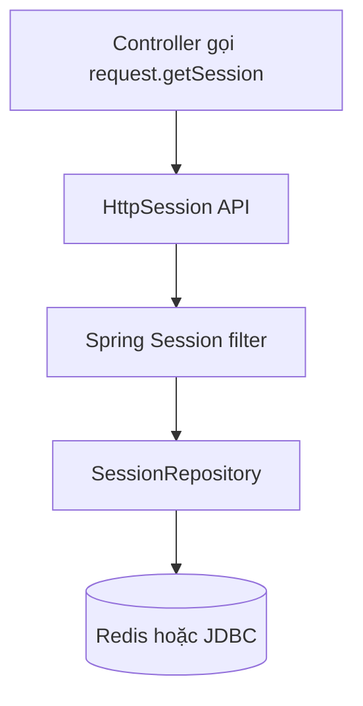

# `SessionCreationPolicy` và các đường đi có thể tạo phiên

Spring Security cung cấp `SessionCreationPolicy` để quyết định cách các thành phần bảo mật sử dụng `HttpSession`. Bốn lựa chọn `ALWAYS`, `IF_REQUIRED`, `NEVER` và `STATELESS` có ý nghĩa khác nhau, đặc biệt ở việc tạo session mới và sử dụng session đã tồn tại. Khi ứng dụng dùng Spring Session, các quy tắc này vẫn áp dụng cho API `HttpSession`; Spring Session thay đổi nơi lưu phiên, còn Spring Security quyết định khi nào cần dựa vào phiên.

Một điểm dễ gây nhầm lẫn là đặt `SessionCreationPolicy.STATELESS` không phải lệnh cấm tuyệt đối đối với mọi đoạn code trong ứng dụng tạo `HttpSession`. Nó điều khiển hành vi của hạ tầng Spring Security. Controller, filter tùy chỉnh, Spring MVC hoặc một thành phần lưu request/CSRF/OAuth2 vẫn có thể tạo session nếu được cấu hình theo cách đó. Muốn kiểm soát session chính xác, cần hiểu cả policy lẫn các đường đi thực tế gọi `getSession()` hoặc lưu dữ liệu vào session.

## 1. `SessionCreationPolicy` là gì?

`SessionCreationPolicy` là enum của Spring Security trong gói `org.springframework.security.config.http`. Nó được cấu hình qua `HttpSecurity.sessionManagement(...)` để xác định cách security infrastructure tương tác với `HttpSession`.

| Policy | Tạo `HttpSession` mới? | Dùng session đã tồn tại? | Mục đích thường gặp |
|---|---|---|---|
| `ALWAYS` | Có, luôn tạo | Có | Ứng dụng chủ động duy trì session cho mọi request phù hợp |
| `IF_REQUIRED` | Khi cần | Có | Hành vi mặc định phổ biến của ứng dụng web stateful |
| `NEVER` | Spring Security không chủ động tạo | Có | Không muốn Security tự tạo session nhưng vẫn chấp nhận session có sẵn |
| `STATELESS` | Spring Security không tạo | Không dùng session để lấy/lưu `SecurityContext` | API xác thực stateless, ví dụ bearer token |

Điểm phân biệt quan trọng nhất là `NEVER` vẫn có thể dùng session đã tồn tại, còn `STATELESS` không dùng `HttpSession` để duy trì `SecurityContext` giữa các request. Cả hai đều không có nghĩa là code ứng dụng bị cấm gọi `request.getSession()`.

## 2. Cấu hình policy trong Spring Security

Với cấu hình Spring Security hiện đại, policy thường được đặt trong `SecurityFilterChain`:

```java
import org.springframework.context.annotation.Bean;
import org.springframework.context.annotation.Configuration;
import org.springframework.security.config.http.SessionCreationPolicy;
import org.springframework.security.config.annotation.web.builders.HttpSecurity;
import org.springframework.security.web.SecurityFilterChain;

@Configuration
class SecurityConfiguration {

    @Bean
    SecurityFilterChain securityFilterChain(HttpSecurity http) throws Exception {
        http
            .authorizeHttpRequests(authorize -> authorize
                .requestMatchers("/public/**").permitAll()
                .anyRequest().authenticated())
            .sessionManagement(session -> session
                .sessionCreationPolicy(SessionCreationPolicy.IF_REQUIRED))
            .formLogin(form -> {});

        return http.build();
    }
}
```

Ví dụ chọn `IF_REQUIRED`, phù hợp với ứng dụng đăng nhập bằng form và duy trì `SecurityContext` trong session. Khi cần API stateless, thay bằng `STATELESS` và thiết kế cơ chế xác thực phù hợp, chẳng hạn bearer token.

Policy được áp dụng cho một `SecurityFilterChain`. Nếu ứng dụng có nhiều filter chain với `securityMatcher` khác nhau, mỗi chain có thể có cấu hình session riêng. Cần kiểm tra request thực tế khớp chain nào; thay đổi policy ở chain API không tự động thay đổi chain cho trang web.

## 3. `ALWAYS`: luôn tạo session

`ALWAYS` yêu cầu Spring Security tạo `HttpSession` cho request được xử lý bởi chain tương ứng, kể cả khi request không có nhu cầu nghiệp vụ rõ ràng về session. Điều này có thể hữu ích trong ứng dụng cũ phụ thuộc vào session ngay từ đầu, nhưng làm tăng số session, dung lượng lưu trữ và công việc cleanup.

```java
http.sessionManagement(session -> session
        .sessionCreationPolicy(SessionCreationPolicy.ALWAYS));
```

Khi dùng Spring Session Redis hoặc JDBC, các session được tạo sẽ được lưu theo repository đã cấu hình. Một trang công khai không cần đăng nhập vẫn có thể tạo session, khiến Redis/database tăng số bản ghi và trình duyệt nhận cookie session.

Chỉ chọn `ALWAYS` khi ứng dụng thực sự cần session cho phần lớn request và đã có kế hoạch timeout, cookie, cleanup và dung lượng. Nếu chỉ một số luồng cần session, `IF_REQUIRED` thường tránh tạo phiên không cần thiết.

## 4. `IF_REQUIRED`: tạo session khi có nhu cầu

`IF_REQUIRED` cho phép Spring Security tạo session khi một chức năng cần lưu trạng thái qua request. Đây là lựa chọn phổ biến cho ứng dụng web stateful.

Các ví dụ có thể cần session:

- Lưu `SecurityContext` sau khi người dùng đăng nhập.
- Lưu request ban đầu để chuyển hướng người dùng trở lại sau đăng nhập.
- Lưu token CSRF nếu dùng repository lưu token trong `HttpSession`.
- Lưu authorization request trong luồng OAuth2 Login mặc định.
- Lưu trạng thái hội thoại của một tính năng ứng dụng.

```java
http.sessionManagement(session -> session
        .sessionCreationPolicy(SessionCreationPolicy.IF_REQUIRED));
```

`IF_REQUIRED` không có nghĩa mọi request được xác thực đều nhất thiết tạo session. Nếu cấu hình SecurityContext theo cách stateless hoặc request không cần lưu trạng thái, session có thể không được tạo. Ngược lại, một thành phần khác trong ứng dụng có thể tạo session dù security policy là `IF_REQUIRED`.

## 5. `NEVER`: không tạo mới nhưng có thể dùng session sẵn có

`NEVER` yêu cầu Spring Security không chủ động tạo `HttpSession`. Nếu request đã mang một session hợp lệ, các thành phần bảo mật vẫn có thể sử dụng session đó, chẳng hạn để đọc `SecurityContext` đã được lưu từ trước.

```java
http.sessionManagement(session -> session
        .sessionCreationPolicy(SessionCreationPolicy.NEVER));
```

Policy này phù hợp khi session được tạo bởi một phần khác của ứng dụng hoặc một hệ thống đứng trước, và Security chỉ nên sử dụng session đã có. Nó không phù hợp nếu yêu cầu là Security không được đọc session trong mọi trường hợp.

Ví dụ, một controller gọi `request.getSession()` trước khi đi vào một đoạn xử lý bảo mật. Dù policy là `NEVER`, session đã tồn tại và Spring Security có thể sử dụng nó theo cấu hình repository hiện tại.

Ngoài ra, nếu một thành phần như request cache hoặc CSRF repository được cấu hình để lưu dữ liệu vào `HttpSession`, cần kiểm tra hành vi thực tế của thành phần đó. `NEVER` không phải cơ chế thay thế cho việc rà soát toàn bộ các nơi tạo session trong ứng dụng.

## 6. `STATELESS`: không dùng `HttpSession` cho SecurityContext

`STATELESS` là lựa chọn dành cho kiến trúc stateless. Spring Security không tạo `HttpSession` và không dùng `HttpSession` để lấy `SecurityContext` cho request tiếp theo. Mỗi request phải mang thông tin xác thực cần thiết, thường là bearer token hoặc thông tin xác thực khác được kiểm tra độc lập.

```java
http.sessionManagement(session -> session
        .sessionCreationPolicy(SessionCreationPolicy.STATELESS));
```

Với cấu hình stateless, Spring Security thường sử dụng `NullSecurityContextRepository` và `NullRequestCache` theo cấu hình liên quan đến policy. Điều này ngăn SecurityContext và saved request được lưu trong session như mô hình stateful thông thường.

Tuy nhiên, `STATELESS` không cấm code ứng dụng hoặc một filter độc lập tạo session. Ví dụ:

```java
import jakarta.servlet.http.HttpServletRequest;
import org.springframework.web.bind.annotation.GetMapping;
import org.springframework.web.bind.annotation.RestController;

@RestController
class ExampleController {

    @GetMapping("/debug/create-session")
    String createSession(HttpServletRequest request) {
        request.getSession(true); // Vẫn có thể tạo HttpSession.
        return "session requested";
    }
}
```

Đoạn code trên có thể tạo session ngay cả khi Security chain được đặt `STATELESS`, vì nó gọi Servlet API trực tiếp. Nếu ứng dụng cần cam kết không tạo session, phải loại bỏ hoặc thay thế đường code này và các thành phần khác có cùng hành vi.

## 7. Các đường đi phổ biến có thể tạo session

Để tìm nguyên nhân session xuất hiện ngoài dự kiến, hãy kiểm tra các đường đi dưới đây. Không phải thành phần nào cũng tạo session trong mọi cấu hình; hành vi phụ thuộc cách thành phần được khai báo và thời điểm nó thực sự cần lưu trạng thái.

### 7.1. Servlet API trong code ứng dụng

Đây là nguồn trực tiếp và dễ nhận diện nhất:

```java
HttpSession session = request.getSession();
```

`getSession()` tương đương yêu cầu lấy session và tạo mới nếu chưa có. Dạng tường minh:

```java
HttpSession session = request.getSession(true);
```

Nếu chỉ muốn đọc session hiện có mà không tạo mới, dùng:

```java
HttpSession session = request.getSession(false);
if (session != null) {
    Object value = session.getAttribute("preference");
}
```

Khi tìm session ngoài dự kiến, tìm toàn bộ lời gọi `getSession()` và `getSession(true)` trong controller, filter, interceptor, listener và thư viện nội bộ. Một helper tưởng như chỉ đọc trạng thái có thể vô tình gọi `getSession()`.

### 7.2. `HttpSessionRequestCache`

Trong ứng dụng form login, Spring Security có thể lưu request bị chặn để sau khi xác thực thành công, người dùng được chuyển về URL ban đầu. `HttpSessionRequestCache` lưu `SavedRequest` trong session. Khi tính năng này được dùng và không có session phù hợp, nó có thể tạo session để lưu request.

Đây là một nguyên nhân thường gặp khi người dùng chưa đăng nhập truy cập URL cần xác thực nhưng response đã có cookie session. Nếu API không cần lưu request để redirect, có thể cấu hình `NullRequestCache`:

```java
import org.springframework.security.web.savedrequest.NullRequestCache;

http.requestCache(cache -> cache
        .requestCache(new NullRequestCache()));
```

Không tắt request cache một cách máy móc cho trang web cần redirect sau đăng nhập. Hãy xác định trải nghiệm cần có trước khi thay đổi.

### 7.3. `SecurityContextRepository`

Trong mô hình stateful, `HttpSessionSecurityContextRepository` lưu `SecurityContext` vào `HttpSession` để request sau khôi phục danh tính người dùng. Khi xác thực thành công và cần duy trì trạng thái, session có thể được tạo hoặc sử dụng.

Trong mô hình stateless, `NullSecurityContextRepository` không lưu SecurityContext vào session. Spring Security có thể chọn repository phù hợp theo `SessionCreationPolicy`, nhưng ứng dụng cũng có thể cấu hình repository tùy chỉnh. Nếu tự cấu hình `SecurityContextRepository`, cần xem rõ implementation đang dùng và có ghi dữ liệu vào session hay không.

### 7.4. CSRF token lưu trong session

`HttpSessionCsrfTokenRepository` lưu CSRF token trong `HttpSession`. Khi token cần được tạo hoặc đọc để đưa vào response, session có thể được tạo. Spring Security có cơ chế deferred token loading, vì vậy chỉ bật CSRF chưa chắc tạo session ngay ở mọi request; việc truy cập token và cách render form ảnh hưởng đến thời điểm.

Nếu ứng dụng cần CSRF nhưng không muốn dùng session cho token, có thể cân nhắc `CookieCsrfTokenRepository` với hiểu biết đầy đủ về mô hình cookie và double-submit token. Không tắt CSRF chỉ để loại bỏ session nếu trình duyệt gửi credential tự động qua cookie; điều đó có thể mở lại lỗ hổng CSRF.

### 7.5. OAuth2 Login và authorization request

Luồng OAuth2 Login thường cần giữ authorization request, state và các dữ liệu tương quan giữa redirect đi tới nhà cung cấp danh tính và callback quay về. Repository mặc định `HttpSessionOAuth2AuthorizationRequestRepository` lưu authorization request trong session.

Vì vậy, một ứng dụng có policy `STATELESS` ở một filter chain không nên mặc định rằng toàn bộ OAuth2 Login flow cũng không dùng session. Nếu cần OAuth2 Login, phải thiết kế repository lưu authorization request phù hợp, hoặc chấp nhận session ở chain dành cho login. Một giải pháp thường dùng là tách chain API stateless và chain web login stateful.

### 7.6. Spring MVC `@SessionAttributes`

`@SessionAttributes` yêu cầu Spring MVC giữ một số model attribute qua nhiều request trong session. Khi controller đưa attribute được chỉ định vào model, Spring MVC có thể sử dụng `HttpSession` để lưu trạng thái.

```java
@Controller
@SessionAttributes("checkoutForm")
class CheckoutController {
    // Model attribute checkoutForm được duy trì qua nhiều request.
}
```

Đừng nhầm `@SessionAttributes` với `@SessionAttribute`. `@SessionAttribute` chủ yếu đọc một attribute đã tồn tại trong session; nó không có cùng ý nghĩa tạo và quản lý model attribute như `@SessionAttributes`.

### 7.7. Flash attributes và các thành phần web khác

Spring MVC có thể dùng `FlashMap` để chuyển dữ liệu tạm thời qua redirect. `SessionFlashMapManager` lưu flash attributes trong session, nên một luồng redirect có flash data có thể làm xuất hiện session.

Các thư viện hoặc filter tùy chỉnh cũng có thể lưu state vào `HttpSession`. Khi điều tra, không chỉ kiểm tra code trực tiếp của controller; hãy kiểm tra cấu hình framework, interceptor, authentication entry point, OAuth2 client, CSRF, flash map và các thư viện được tích hợp.

## 8. Spring Session thay đổi nơi lưu, không xóa các đường tạo session

Khi dùng Spring Session, lời gọi Servlet `request.getSession()` vẫn hoạt động theo API `HttpSession`, nhưng session được quản lý bởi Spring Session repository thay vì chỉ nằm trong bộ nhớ của Servlet container.

Ví dụ:



Vì vậy, một session được tạo bởi controller, request cache hoặc CSRF repository vẫn có thể xuất hiện trong Redis/JDBC. Chuyển từ container session sang Spring Session không tự thay đổi `SessionCreationPolicy` và không ngăn thành phần khác tạo session.

Ngược lại, khi một session đã được tạo, các request sau có thể tiếp tục dùng cùng session ID qua cookie. Nếu muốn session không còn được sử dụng, cần invalidate hoặc hết hạn phiên theo đúng vòng đời; chỉ đổi policy không tự xóa các session cũ đang tồn tại.

## 9. Tách filter chain stateful và stateless

Một ứng dụng có thể phục vụ cả trang web dùng form login và API dùng bearer token. Hai nhóm endpoint có nhu cầu session khác nhau. Thay vì dùng một policy chung cho toàn bộ ứng dụng, có thể tách thành các `SecurityFilterChain` với matcher rõ ràng.

Ví dụ cấu trúc:

```java
@Bean
@Order(1)
SecurityFilterChain apiSecurity(HttpSecurity http) throws Exception {
    http
        .securityMatcher("/api/**")
        .authorizeHttpRequests(auth -> auth.anyRequest().authenticated())
        .sessionManagement(session -> session
            .sessionCreationPolicy(SessionCreationPolicy.STATELESS))
        .requestCache(cache -> cache
            .requestCache(new NullRequestCache()))
        .oauth2ResourceServer(oauth2 -> oauth2.jwt());
    return http.build();
}

@Bean
@Order(2)
SecurityFilterChain webSecurity(HttpSecurity http) throws Exception {
    http
        .authorizeHttpRequests(auth -> auth
            .requestMatchers("/login", "/assets/**").permitAll()
            .anyRequest().authenticated())
        .sessionManagement(session -> session
            .sessionCreationPolicy(SessionCreationPolicy.IF_REQUIRED))
        .formLogin(form -> {});
    return http.build();
}
```

Ví dụ minh họa hai chain: API `/api/**` dùng JWT và stateless; phần web dùng form login và session. Cần bảo đảm matcher không chồng lấn ngoài ý muốn, thứ tự `@Order` đúng và có chain cuối cùng xử lý các request còn lại. API sử dụng bearer token không nên nhận xác thực từ cookie session nếu mục tiêu là stateless.

CSRF cũng cần cấu hình theo cách client gửi credential. Với API chỉ dùng Authorization header bearer token do client chủ động gắn, rủi ro CSRF khác với ứng dụng xác thực bằng cookie. Không tắt CSRF cho toàn ứng dụng chỉ vì một chain API stateless.

## 10. Session fixation và đổi session ID

Spring Security có cơ chế bảo vệ session fixation khi xác thực thành công. Tùy Servlet container và cấu hình, nó có thể đổi session ID hiện tại hoặc tạo session mới và chuyển các attribute phù hợp. Đây là thao tác quản lý định danh phiên, không phải bằng chứng rằng policy `STATELESS` đã bị bỏ qua.

Trong ứng dụng stateful, cần kiểm thử:

- ID trước và sau đăng nhập có được thay đổi theo chiến lược bảo vệ không.
- Attribute nghiệp vụ cần giữ có còn sau authentication không.
- Spring Session repository cập nhật ID và liên kết dữ liệu đúng không.
- Cookie response mang ID mới và cookie cũ không còn được chấp nhận.

Với API stateless, không nên dựa vào session fixation protection như cơ chế bảo vệ token. Token phải được xác minh theo chữ ký, issuer, audience, thời hạn và chính sách thu hồi phù hợp.

## 11. Cách điều tra session được tạo ngoài dự kiến

Khi response bất ngờ có cookie session hoặc Redis/JDBC tăng số session, hãy điều tra theo trình tự:

1. Xác định request nào tạo session và filter chain nào xử lý request đó.
2. Kiểm tra policy của chain và `SecurityContextRepository` thực tế.
3. Tìm các lời gọi `getSession()` và `getSession(true)` trong ứng dụng.
4. Kiểm tra `HttpSessionRequestCache`, CSRF repository và OAuth2 authorization request repository.
5. Kiểm tra `@SessionAttributes`, flash attributes, interceptor và filter tùy chỉnh.
6. Xác nhận request có gửi cookie session cũ hay không; session cũ có thể được sử dụng lại mà không tạo mới.
7. Kiểm tra response `Set-Cookie` và repository để phân biệt session mới với session cũ được cập nhật.
8. Dùng log/metric có che dữ liệu nhạy cảm; không log cookie hoặc session ID đầy đủ.

Không kết luận session được tạo chỉ từ việc response có `Set-Cookie`. Cookie có thể được phát lại sau khi session ID thay đổi hoặc thuộc một resolver khác. Cần quan sát `request.getSession(false)`, session ID đã che và số bản ghi repository trong môi trường kiểm thử.

## 12. Kiểm thử policy và các đường tạo session

MockMvc có thể kiểm tra request sau khi đi qua filter chain. Ví dụ endpoint stateless không truy cập session:

```java
import static org.assertj.core.api.Assertions.assertThat;
import static org.springframework.test.web.servlet.request.MockMvcRequestBuilders.get;
import static org.springframework.test.web.servlet.result.MockMvcResultMatchers.status;

mockMvc.perform(get("/api/profile")
        .header("Authorization", "Bearer test-token"))
    .andExpect(status().isOk())
    .andExpect(result -> assertThat(
            result.getRequest().getSession(false)).isNull());
```

Test cần cấu hình bộ xác thực token phù hợp; `test-token` ở đây là dữ liệu minh họa. Kiểm tra `getSession(false)` sau khi request chạy giúp xác nhận request không có session trong test. Có thể kiểm tra thêm response không phát cookie session theo resolver đang cấu hình.

Một test khác có thể chứng minh policy stateless không cấm code ứng dụng tạo session:

```java
mockMvc.perform(get("/debug/create-session"))
    .andExpect(status().isOk())
    .andExpect(result -> assertThat(
            result.getRequest().getSession(false)).isNotNull());
```

Để test các đường đi của Spring Security, nên tạo các test riêng:

- Request chưa xác thực vào URL bảo vệ với request cache session-backed.
- CSRF token được render và lưu qua `HttpSessionCsrfTokenRepository`.
- OAuth2 authorization redirect lưu authorization request.
- Form login lưu SecurityContext vào session.
- API chain stateless không lưu SecurityContext vào session.
- MVC controller dùng `@SessionAttributes`.
- Logout invalidate session và hết hạn cookie.

Khi dùng Spring Session, chạy integration test với repository thật hoặc Testcontainers để xác nhận session được lưu ở Redis/JDBC đúng như dự kiến. MockMvc session trong bộ nhớ không tự chứng minh repository production hoạt động đúng.

## 13. Chọn policy theo yêu cầu

| Yêu cầu | Policy thường phù hợp | Điều cần kiểm tra thêm |
|---|---|---|
| Ứng dụng web form login, lưu SecurityContext qua request | `IF_REQUIRED` | Request cache, CSRF, timeout và logout |
| Mọi request cần session ngay cả trước khi có state | `ALWAYS` | Chi phí tạo session, cookie và cleanup |
| Thành phần khác tạo session, Security chỉ dùng session đã có | `NEVER` | Các component độc lập có thể vẫn tạo session |
| API bearer token không duy trì SecurityContext trong session | `STATELESS` | Request cache, CSRF, custom filters và code gọi Servlet API |
| Ứng dụng web và API trong cùng deployment | Nhiều filter chain | Matcher, thứ tự chain và resolver/cookie |

Không có policy nào tự giải quyết toàn bộ kiến trúc. Cần xác định session được dùng cho xác thực, CSRF, request cache hay trạng thái nghiệp vụ; sau đó chọn policy và cấu hình các component phù hợp.

## 14. Những hiểu nhầm thường gặp

| Hiểu nhầm | Thực tế |
|---|---|
| `STATELESS` cấm toàn ứng dụng gọi `getSession()` | Policy điều khiển hành vi Spring Security; code ứng dụng vẫn có thể tạo session |
| `NEVER` và `STATELESS` giống nhau | `NEVER` có thể dùng session đã tồn tại; `STATELESS` không dùng session để lấy/lưu SecurityContext |
| `IF_REQUIRED` chỉ tạo session khi người dùng đăng nhập | Request cache, CSRF, OAuth2 và code MVC cũng có thể cần session |
| Không thấy `JSESSIONID` nghĩa là không có session | Spring Session có thể dùng cookie tên khác; cần kiểm tra request/session/repository |
| Dùng Spring Session sẽ ngăn session được tạo | Spring Session thay nơi lưu; không xóa các đường gọi API session |
| Tắt CSRF là cách tốt để tránh session | Có thể mở rủi ro CSRF nếu credential được gửi tự động bằng cookie |
| Đổi policy sẽ xóa session cũ | Session cũ tồn tại đến khi invalidate hoặc hết hạn theo repository |

## 15. Checklist triển khai

- Chọn `ALWAYS`, `IF_REQUIRED`, `NEVER` hoặc `STATELESS` theo cách ứng dụng xác thực và lưu trạng thái.
- Kiểm tra từng `SecurityFilterChain`, matcher và thứ tự áp dụng.
- Xác định `SecurityContextRepository` và `RequestCache` đang dùng.
- Rà soát CSRF token repository, OAuth2 authorization request repository và Spring MVC session attributes.
- Tìm các lời gọi `getSession()`/`getSession(true)` trong code và thư viện nội bộ.
- Nếu cần API stateless, dùng cơ chế xác thực theo từng request và bảo đảm SecurityContext không được lưu trong session.
- Giữ CSRF protection phù hợp với cách trình duyệt gửi credential; không tắt toàn cục theo thói quen.
- Kiểm thử request không tạo session, request có chủ đích tạo session, login, redirect, CSRF, OAuth2 và logout.
- Với Spring Session, kiểm tra cookie, repository, TTL và hành vi trên nhiều instance.
- Không ghi cookie/session ID hoặc dữ liệu xác thực vào log.

`SessionCreationPolicy` là một phần của thiết kế bảo mật session, không phải công tắc quản lý mọi lời gọi `HttpSession` trong toàn bộ ứng dụng. `ALWAYS` luôn tạo, `IF_REQUIRED` tạo khi cần, `NEVER` không chủ động tạo nhưng vẫn dùng phiên có sẵn, còn `STATELESS` không dùng session để duy trì SecurityContext. Khi kết hợp với Spring Session, cần rà soát request cache, CSRF, OAuth2, Spring MVC và code ứng dụng để hiểu đầy đủ các đường đi có thể tạo phiên.
