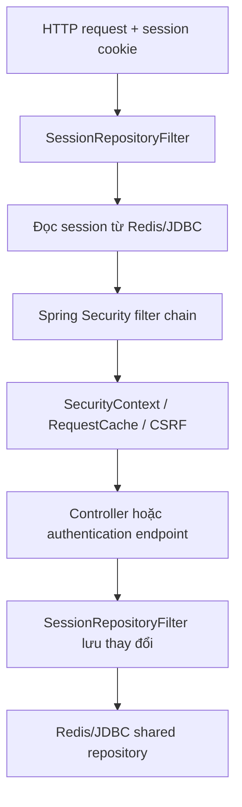
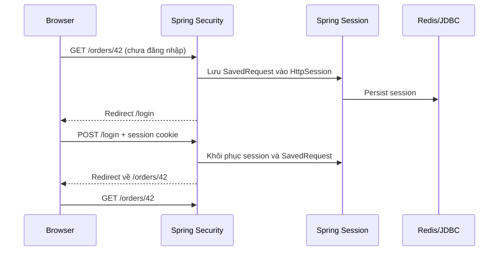

# Request cache, CSRF token và các thuộc tính phiên do bảo mật tạo ra

Khi Spring Security bảo vệ một ứng dụng dùng Spring Session, session có thể chứa nhiều dữ liệu do chính lớp bảo mật tạo ra. `SecurityContext` giữ thông tin xác thực đã được xác minh; request cache giữ yêu cầu ban đầu để chuyển người dùng trở lại trang họ muốn mở sau khi đăng nhập; CSRF token repository có thể lưu token chống giả mạo request. Những dữ liệu này được lưu qua `HttpSession` hoặc `WebSession`, vì vậy Spring Session có thể đưa chúng vào Redis/JDBC và chia sẻ giữa các instance.

Các thuộc tính bảo mật có vòng đời và mục đích khác nhau. Saved request không phải thông tin xác thực; CSRF token không chứng minh người dùng đã đăng nhập; `SecurityContext` không nên được tự tạo từ dữ liệu request. Nếu xóa nhầm thuộc tính, ứng dụng có thể mất khả năng tiếp tục luồng đăng nhập hoặc kiểm tra CSRF. Nếu giữ dữ liệu quá lâu, session có thể phình to và các thông tin cũ tiếp tục tồn tại sau khi nghiệp vụ đã kết thúc.

Trong `SPRING_SESSION`, chủ đề này tập trung vào cách Spring Security dùng session, cách các thuộc tính được Spring Session lưu xuống kho chia sẻ, và cách cấu hình, kiểm thử request cache, CSRF token cùng các thay đổi vòng đời xác thực trong hệ thống nhiều instance.

## 1. Những dữ liệu bảo mật thường được lưu trong session

Trong ứng dụng Servlet có xác thực dựa trên session, có thể gặp các nhóm dữ liệu sau:

| Dữ liệu | Thành phần quản lý | Mục đích |
|---|---|---|
| `SecurityContext` | `SecurityContextRepository`, thường có `HttpSessionSecurityContextRepository` | Giữ `Authentication` đã xác thực giữa các request |
| Saved request | `RequestCache`, thường là `HttpSessionRequestCache` | Ghi nhớ request cần quay lại sau khi đăng nhập |
| CSRF token | `CsrfTokenRepository`, mặc định thường là `HttpSessionCsrfTokenRepository` trong ứng dụng session-based | So khớp token của request ghi dữ liệu với token đã phát hành |
| Session metadata | Spring Session repository | ID, thời gian truy cập, timeout và các metadata cần cho vòng đời phiên |
| Dữ liệu xác thực phụ | Spring Security hoặc ứng dụng | Thông tin cần cho quy trình xác thực, MFA hoặc chuyển trạng thái đăng nhập |

Tên attribute nội bộ có thể phụ thuộc implementation và phiên bản. Ví dụ, `SPRING_SECURITY_CONTEXT` và `SPRING_SECURITY_SAVED_REQUEST` là những tên thường gặp trong Servlet stack, nhưng ứng dụng nên dùng API `SecurityContextRepository`, `RequestCache` và `CsrfTokenRepository`, không đọc hoặc sửa các key nội bộ bằng chuỗi tự viết.

Spring Session không tự quyết định ý nghĩa bảo mật của các thuộc tính. Nó cung cấp session abstraction và lưu các thay đổi qua repository. Spring Security chịu trách nhiệm tạo, đọc, cập nhật và xóa những dữ liệu bảo mật đó theo filter chain và authentication flow.

## 2. Spring Session phải nằm trước Spring Security trong Servlet filter chain

Trong ứng dụng Servlet, Spring Session dùng `SessionRepositoryFilter` để thay thế cách container quản lý `HttpSession` bằng session được lưu trong repository. Spring Security sau đó gọi `request.getSession()` hoặc đọc session qua các abstraction của Servlet.

Vì vậy, `SessionRepositoryFilter` phải được thực thi trước `springSecurityFilterChain`. Khi thứ tự đúng, Spring Security làm việc với `HttpSession` đã được Spring Session bọc; các thuộc tính `SecurityContext`, saved request và CSRF token được ghi vào kho session chia sẻ.



Spring Boot thường tự đăng ký filter theo thứ tự tích hợp. Nếu tự đăng ký filter hoặc dùng nhiều `FilterRegistrationBean`, phải kiểm tra order thực tế. Nếu Spring Security chạy trước khi Spring Session bọc request, Security có thể nhìn thấy session do Servlet container quản lý, dẫn tới dữ liệu không được lưu ở Redis/JDBC như mong muốn.

Với Redis Servlet session, cấu hình Spring Session có thể dùng `@EnableRedisHttpSession` hoặc auto-configuration tương ứng. Với JDBC, dùng cấu hình JDBC session và `DataSource` cùng schema phù hợp. Spring Security tiếp tục làm việc qua `HttpSession`; không cần tự gọi Redis/JDBC trong authentication filter để lưu `SecurityContext`.

## 3. SecurityContext được lưu và khôi phục thế nào?

`SecurityContext` chứa `Authentication`, trong đó có principal, authorities và thông tin xác thực liên quan. Với ứng dụng session-based, Spring Security dùng `SecurityContextRepository` để nạp context ở đầu request và lưu context khi authentication flow yêu cầu.

`HttpSessionSecurityContextRepository` là implementation lưu context trong `HttpSession`. Khi request sau gửi session cookie hợp lệ, Spring Session tải session từ Redis/JDBC; Spring Security có thể khôi phục `SecurityContext` từ session đó và thiết lập context cho request hiện tại.

Luồng khái quát:

1. Người dùng gửi thông tin đăng nhập.
2. Authentication filter hoặc authentication manager xác minh credentials.
3. Spring Security tạo `Authentication` đã xác thực và đặt nó vào `SecurityContext`.
4. Cơ chế session fixation protection có thể đổi session ID sau xác thực.
5. `SecurityContextRepository` lưu context vào session theo cấu hình.
6. Spring Session ghi session xuống Redis/JDBC ở ranh giới lưu của request.
7. Request sau mang cookie session ID; Spring Session khôi phục session và Spring Security nạp context.

Trong các phiên bản Spring Security hiện đại, việc lưu `SecurityContext` được quản lý tường minh bởi các authentication mechanism và `SecurityContextRepository`; không nên giả định chỉ cần gọi `SecurityContextHolder.setContext()` là mọi cấu hình đều tự lưu context. Nếu tự viết authentication filter, cần tích hợp đúng repository và gọi `saveContext` theo contract.

Ví dụ minh họa khi custom authentication flow:

```java
Authentication authentication = authenticationManager.authenticate(token);
SecurityContext context = SecurityContextHolder.createEmptyContext();
context.setAuthentication(authentication);
SecurityContextHolder.setContext(context);

securityContextRepository.saveContext(context, request, response);
```

Đoạn code chỉ minh họa trách nhiệm lưu trong custom flow Servlet. Trong ứng dụng thông thường, nên dùng form login, OAuth2 login hoặc authentication filter có sẵn để Spring Security quản lý các bước này. Không tự lưu principal hoặc authorities do client gửi lên.

## 4. RequestCache và saved request

`RequestCache` ghi nhớ một request bị chặn vì người dùng chưa đăng nhập. Ví dụ, người dùng mở `/orders/42`, nhưng endpoint yêu cầu xác thực. Spring Security có thể lưu thông tin request, chuyển người dùng tới trang đăng nhập, rồi sau khi đăng nhập thành công chuyển hướng về `/orders/42`.

Trong Servlet stack, `HttpSessionRequestCache` thường lưu `SavedRequest` trong `HttpSession`. Vì session được Spring Session quản lý, saved request có thể tồn tại khi request đăng nhập và request sau được xử lý bởi các instance khác nhau.



Saved request thường giữ URL, method, headers và các thông tin request cần thiết cho redirect. Không nên đưa bí mật vào query string hoặc URL, vì URL có thể xuất hiện trong browser history, proxy log, analytics và referrer. Request cache không phải nơi lưu body của một biểu mẫu dài hoặc payload nghiệp vụ cần khôi phục.

### 4.1. Cấu hình RequestCache mặc định

Với Servlet, có thể cấu hình rõ `HttpSessionRequestCache`:

```java
@Bean
SecurityFilterChain securityFilterChain(HttpSecurity http) throws Exception {
    http
        .authorizeHttpRequests(auth -> auth
            .requestMatchers("/login", "/assets/**").permitAll()
            .anyRequest().authenticated())
        .formLogin(Customizer.withDefaults())
        .requestCache(cache -> cache
            .requestCache(new HttpSessionRequestCache()));

    return http.build();
}
```

Đây là cấu hình minh họa cho ứng dụng cần redirect trở lại request ban đầu. Nếu dùng cấu hình mặc định tương ứng, không cần tạo lại bean chỉ để giữ nguyên hành vi.

### 4.2. Khi nào nên tắt hoặc giới hạn RequestCache?

API stateless thường trả `401 Unauthorized` thay vì redirect tới form login. Trong trường hợp này, lưu saved request vào session có thể tạo session không cần thiết và làm tăng dữ liệu phải lưu.

Có thể dùng `NullRequestCache`:

```java
http.requestCache(cache -> cache
        .requestCache(new NullRequestCache()));
```

Một số ứng dụng cần cache chỉ một số request an toàn, chẳng hạn GET tới trang HTML, và bỏ qua request API hoặc request chứa dữ liệu không phù hợp để redirect. Khi đó, cấu hình `RequestMatcher` cho `HttpSessionRequestCache` theo nhu cầu. Không lưu mọi request một cách vô điều kiện nếu ứng dụng có nhiều endpoint upload, API hoặc URL chứa dữ liệu nhạy cảm.

Sau khi đăng nhập thành công, saved request được dùng để điều hướng và được loại bỏ theo logic của request cache. Nếu luồng xác thực tùy chỉnh không tiêu thụ hoặc xóa saved request đúng cách, session có thể giữ dữ liệu cũ và lần đăng nhập sau bị redirect sai.

## 5. CSRF token và session

Cross-Site Request Forgery (CSRF) xảy ra khi trình duyệt tự động gửi credentials của người dùng tới ứng dụng trong khi một trang khác kích hoạt request ngoài ý muốn. Cookie session được trình duyệt gửi tự động theo domain/path/SameSite, vì vậy ứng dụng session-based thường cần CSRF protection cho các thao tác thay đổi trạng thái.

CSRF token là một giá trị ngẫu nhiên được server phát hành và yêu cầu client gửi lại trong request. Server so sánh token nhận được với token đã lưu hoặc xác minh theo repository. Token không thay thế xác thực, không thay thế authorization và không phải session ID.

Trong Servlet stack, `CsrfFilter` dùng `CsrfTokenRepository`. `HttpSessionCsrfTokenRepository` lưu token trong `HttpSession`, do đó Spring Session có thể lưu token trong Redis/JDBC cùng session. Spring Security có thể trì hoãn việc tạo token cho tới khi token thực sự được truy cập; vì vậy không phải mọi request anonymous đều chắc chắn tạo session chỉ vì CSRF được bật.

### 5.1. Cấu hình HttpSessionCsrfTokenRepository

Có thể khai báo rõ repository session-based:

```java
@Bean
SecurityFilterChain securityFilterChain(HttpSecurity http) throws Exception {
    HttpSessionCsrfTokenRepository csrfRepository =
            new HttpSessionCsrfTokenRepository();

    http
        .authorizeHttpRequests(auth -> auth
            .requestMatchers("/login", "/assets/**").permitAll()
            .anyRequest().authenticated())
        .csrf(csrf -> csrf
            .csrfTokenRepository(csrfRepository));

    return http.build();
}
```

Trong cấu hình session-based Servlet thông thường, Spring Security đã dùng cơ chế CSRF phù hợp mặc định. Đoạn code minh họa việc chọn repository rõ ràng khi muốn kiểm soát hoặc thay thế cấu hình.

CSRF token thường được đưa vào request attribute để view/template hoặc handler lấy ra. Dùng token theo API của Spring Security; không tự đọc một session attribute nội bộ bằng tên chuỗi để render token.

### 5.2. Token trong session và token trong cookie khác nhau

`HttpSessionCsrfTokenRepository` lưu token phía server trong `HttpSession`. Một lựa chọn khác là `CookieCsrfTokenRepository`, lưu token trong cookie và thường dùng tên cookie `XSRF-TOKEN`, header `X-XSRF-TOKEN` cùng tham số `_csrf` theo cấu hình phổ biến.

| Repository | Nơi lưu token | Trường hợp thường gặp |
|---|---|---|
| `HttpSessionCsrfTokenRepository` | Thuộc tính session phía server | Ứng dụng MVC/form login session-based |
| `CookieCsrfTokenRepository` | Cookie phía trình duyệt | SPA cần đọc token cookie rồi gửi lại qua header |

Khi dùng `CookieCsrfTokenRepository.withHttpOnlyFalse()`, JavaScript có thể đọc cookie để thêm token vào header. Điều này phục vụ một số SPA, nhưng cookie token có thể bị đọc bởi script chạy cùng origin; XSS vẫn là rủi ro nghiêm trọng. `HttpOnly=false` không phải lựa chọn mặc định cho mọi ứng dụng.

Nếu token nằm trong cookie, token đó không được lưu trong Spring Session chỉ vì ứng dụng có Spring Session. Cần phân biệt session cookie chứa session ID với CSRF cookie chứa token chống CSRF. Cả hai có thể cùng tồn tại nhưng có mục đích và vòng đời khác nhau.

### 5.3. Token masking và BREACH

Các phiên bản Spring Security hiện đại có thể dùng `XorCsrfTokenRequestAttributeHandler` để che token khi đưa ra request attribute nhằm giảm rủi ro BREACH trong một số cách phản hồi nén. Giá trị token được render ra view có thể là giá trị đã được mask, trong khi repository lưu token gốc. Vì vậy, không so sánh chuỗi render trong HTML với raw session attribute bằng tay và không tự giải mã token.

Khi nâng cấp Spring Security, kiểm tra tài liệu về `CsrfTokenRequestHandler`, deferred token loading và cách SPA gửi token. Một thay đổi handler có thể làm hỏng JavaScript nếu client giả định định dạng token cũ.

## 6. SessionCreationPolicy và việc tạo session ngoài ý muốn

Spring Security cung cấp `SessionCreationPolicy` để điều khiển cách security sử dụng `HttpSession`:

| Policy | Hành vi khái quát |
|---|---|
| `ALWAYS` | Luôn tạo session nếu chưa có |
| `IF_REQUIRED` | Tạo session khi security cần; đây là lựa chọn phổ biến cho ứng dụng web session-based |
| `NEVER` | Không tự tạo session nhưng vẫn có thể dùng session đã tồn tại |
| `STATELESS` | Không tạo hoặc dùng `HttpSession` để lưu/khôi phục SecurityContext trong security flow |

Ví dụ:

```java
http.sessionManagement(session -> session
        .sessionCreationPolicy(SessionCreationPolicy.IF_REQUIRED));
```

`IF_REQUIRED` phù hợp khi ứng dụng cần form login, request cache hoặc CSRF token session-based. Nếu dùng `NEVER`, một thành phần khác như request cache hoặc ứng dụng vẫn có thể tạo session; policy này không có nghĩa session tuyệt đối không xuất hiện. `STATELESS` ngăn Spring Security dựa vào `HttpSession` cho security context, nhưng code ứng dụng vẫn có thể tạo session thủ công nếu không bị chặn ở lớp khác.

Với API dùng bearer token trong `Authorization` header và không dựa vào cookie credentials, có thể chọn `STATELESS` và `NullRequestCache`. Tuy nhiên, nếu API dùng cookie để tự động gửi access token hoặc session ID, CSRF vẫn cần được đánh giá. Không tắt CSRF chỉ vì endpoint trả JSON hoặc được gọi bởi JavaScript.

## 7. Session fixation protection sau đăng nhập

Session fixation là tình huống kẻ tấn công biết hoặc áp đặt session ID trước khi nạn nhân xác thực, rồi dùng cùng ID sau khi nạn nhân đăng nhập. Spring Security có session fixation protection để thay đổi session ID hoặc tạo session mới khi authentication thành công.

Trong Servlet container hỗ trợ Servlet 3.1+, chiến lược thường dùng là `changeSessionId()`. Spring Session tích hợp với Servlet session API để cập nhật ID và lưu session theo repository. Cấu hình có thể thể hiện rõ:

```java
http.sessionManagement(session -> session
        .sessionFixation(fixation -> fixation.changeSessionId()));
```

Các chiến lược khác có thể gồm migrate attributes sang session mới hoặc tạo session mới tùy yêu cầu. Hành vi mặc định phụ thuộc môi trường Servlet và phiên bản Spring Security. Không tắt session fixation protection chỉ để giữ nguyên session ID.

Sau khi đổi ID:

- Cookie phía client phải nhận session ID mới.
- Session cũ không được tiếp tục là credential hợp lệ theo chiến lược đã chọn.
- Các thuộc tính hợp lệ cần giữ lại như saved request hoặc CSRF state được xử lý theo cơ chế migration.
- Mọi instance phải đọc cùng repository và serializer để request kế tiếp không mất session.

Kiểm thử cả trường hợp login thành công, login thất bại, session ID trước/sau login và request tiếp theo đi tới instance khác.

## 8. Logout và xóa các thuộc tính bảo mật

Logout trong Spring Security thường phối hợp nhiều thao tác:

1. Xóa `SecurityContext` khỏi `SecurityContextHolder` và repository.
2. Invalidate `HttpSession` nếu cấu hình logout yêu cầu kết thúc session.
3. Xóa CSRF token bằng cách gọi `saveToken(null, ...)` trên `CsrfTokenRepository` phù hợp.
4. Xóa cookie session phía client theo tên, path và domain đúng.
5. Có thể xóa cookie bổ sung hoặc gửi `Clear-Site-Data` nếu chính sách ứng dụng yêu cầu.

Spring Security cung cấp `LogoutFilter` và các `LogoutHandler` để phối hợp các bước này. Nên dùng logout DSL/handler chuẩn thay vì chỉ xóa một session attribute thủ công.

```java
http.logout(logout -> logout
        .logoutUrl("/logout")
        .invalidateHttpSession(true)
        .clearAuthentication(true)
        .deleteCookies("JSESSIONID"));
```

Khi dùng Spring Session, cookie session mặc định có thể không còn tên `JSESSIONID` nếu đã cấu hình tên riêng bằng cookie serializer. Phải xóa đúng cookie name, path và domain thực tế. Spring Session cookie resolver cũng cần phát header xóa cookie phù hợp; không dựa vào tên mặc định của Servlet container.

CSRF token repository session-based được dọn khi session bị invalidate; logout handler cũng có thể xóa token riêng. Nếu dùng `CookieCsrfTokenRepository`, cần bảo đảm logout xóa CSRF cookie tương ứng. Không giữ saved request cũ sau logout nếu request đó có thể gây redirect không mong muốn ở lần đăng nhập tiếp theo.

## 9. Request cache, CSRF và việc tạo session anonymous

Một session có thể được tạo trước khi người dùng đăng nhập vì request cache hoặc CSRF token cần lưu dữ liệu. Ví dụ:

- Người dùng anonymous mở một trang được bảo vệ; `HttpSessionRequestCache` lưu request ban đầu.
- View truy cập CSRF token để render form; `HttpSessionCsrfTokenRepository` tạo/lưu token.
- Sau đó người dùng đăng nhập; session fixation protection đổi session ID và bảo toàn các thuộc tính cần thiết theo chiến lược.

Điều này giải thích vì sao quan sát thấy Redis session key chưa chắc đồng nghĩa người dùng đã đăng nhập. Session có thể chỉ chứa saved request hoặc CSRF token. Không dùng sự tồn tại của session làm bằng chứng xác thực.

Để giảm session không cần thiết cho API:

- Dùng `NullRequestCache` nếu không cần redirect trở lại request ban đầu.
- Chọn `SessionCreationPolicy.STATELESS` khi security flow thực sự không cần session.
- Dùng CSRF repository phù hợp với kiến trúc; không tự tạo token cho mọi request nếu chưa cần.
- Không lưu dữ liệu request lớn hoặc nhạy cảm trong session.
- Theo dõi tỷ lệ session anonymous và kích thước session để phát hiện tạo session ngoài ý muốn.

Nếu ứng dụng là web form session-based, việc có anonymous session do request cache/CSRF có thể là hành vi hợp lệ. Đánh giá theo use case thay vì cố loại bỏ mọi session trước đăng nhập.

## 10. Spring Session và concurrent session control

Spring Security có thể giới hạn số phiên đăng nhập đồng thời của một principal. Với session store phân tán, registry cần nhìn thấy các session ở mọi instance. `SpringSessionBackedSessionRegistry` tích hợp với `FindByIndexNameSessionRepository` để tra cứu session theo principal trong Spring Session.

Ví dụ cấu hình khái quát cho Servlet:

```java
@Bean
SpringSessionBackedSessionRegistry<? extends Session> sessionRegistry(
        FindByIndexNameSessionRepository<? extends Session> repository) {
    return new SpringSessionBackedSessionRegistry<>(repository);
}
```

Kiểu generic và cách inject repository cần khớp implementation/version trong dự án. Để giới hạn phiên, cấu hình session management với `maximumSessions(...)` và registry tương ứng. Cần bảo đảm principal index được thiết lập nhất quán; nếu index không có tên principal, registry không thể tìm đầy đủ các phiên.

Trong hệ thống nhiều instance, kiểm thử login ở A, login tiếp ở B, sau đó xác minh chính sách maximum sessions có hiệu lực trên cả hai. Cũng cần kiểm tra session hết hạn hoặc bị logout được loại khỏi registry theo lifecycle của repository.

## 11. Các thuộc tính bảo mật có thể còn tồn tại sau khi nghiệp vụ kết thúc

Session có thể sống lâu hơn một luồng nghiệp vụ. Nếu request cache hoặc CSRF state không được dọn đúng lúc, dữ liệu cũ có thể được lưu đến khi session hết hạn. Một số ví dụ:

- Saved request từ một URL cũ còn tồn tại sau khi người dùng đã điều hướng sang quy trình khác.
- CSRF token đã được tạo cho một session anonymous được migrate sau login; cần giữ theo cơ chế bảo mật, không tự sao chép raw token.
- `SecurityContext` vẫn còn sau khi ứng dụng chỉ xóa một thuộc tính tùy chỉnh.
- Thông tin MFA tạm thời không được xóa sau khi xác thực hoàn tất hoặc bị hủy.
- Principal index bị stale nếu session bị xóa ngoài repository hoặc resolver không nhất quán.

Hãy dùng API tương ứng để quản lý từng loại dữ liệu. `RequestCache.removeRequest(request, response)` dành cho saved request; `CsrfTokenRepository.saveToken(null, request, response)` xóa token theo repository; `SecurityContextRepository` và logout handler quản lý context; `HttpSession.invalidate()` kết thúc toàn bộ session.

Không xóa toàn bộ session chỉ để loại bỏ saved request nếu người dùng vẫn cần các thuộc tính hợp lệ khác. Ngược lại, khi logout hoặc tài khoản bị thu hồi, xóa riêng một thuộc tính tùy chỉnh là không đủ để kết thúc xác thực.

## 12. Tích hợp WebFlux: WebSession và các repository reactive

Trong WebFlux, các thành phần bảo mật tương ứng dùng `WebSession` thay cho `HttpSession`:

| Chức năng | Servlet | WebFlux |
|---|---|---|
| Session abstraction | `HttpSession` | `WebSession` |
| Lưu security context | `HttpSessionSecurityContextRepository` hoặc repository tương ứng | `WebSessionServerSecurityContextRepository` |
| Request cache | `HttpSessionRequestCache` | `WebSessionServerRequestCache` |
| CSRF token session-based | `HttpSessionCsrfTokenRepository` | `WebSessionServerCsrfTokenRepository` |
| Session integration | `SessionRepositoryFilter` | `WebSessionManager` và `ReactiveSessionRepository` |

WebFlux có thể cấu hình request cache và CSRF repository tường minh:

```java
@Bean
SecurityWebFilterChain springSecurityFilterChain(ServerHttpSecurity http) {
    http
        .authorizeExchange(exchanges -> exchanges
            .pathMatchers("/login", "/assets/**").permitAll()
            .anyExchange().authenticated())
        .requestCache(cache -> cache
            .requestCache(new WebSessionServerRequestCache()))
        .csrf(csrf -> csrf
            .csrfTokenRepository(new WebSessionServerCsrfTokenRepository()));

    return http.build();
}
```

Đây là ví dụ cho ứng dụng WebFlux dùng session. Các publisher và thao tác lưu WebSession được framework phối hợp trong reactive lifecycle. Không gọi `block()` hoặc `subscribe()` để lưu security state. Nếu dùng API stateless, chọn repository và request cache không phụ thuộc WebSession theo kiến trúc phù hợp.

Không trộn Servlet filter, `HttpSession` và `SessionRepositoryFilter` vào WebFlux security chain. Hai ngăn xếp có abstraction và filter chain riêng dù cùng dùng Spring Session làm kho chia sẻ.

## 13. Bảo mật cookie và token

Session cookie và CSRF token cookie có thể cùng tồn tại nhưng phải có cấu hình riêng:

| Cookie | Chứa gì | Các thuộc tính cần xem xét |
|---|---|---|
| Session cookie | Session ID opaque | `Secure`, `HttpOnly`, `SameSite`, `Path`, `Domain`, thời hạn |
| CSRF cookie | CSRF token nếu dùng `CookieCsrfTokenRepository` | `Secure`, `SameSite`, path/domain và `HttpOnly` theo nhu cầu SPA |

Session cookie thường nên `HttpOnly` để JavaScript không đọc session ID. CSRF cookie trong SPA có thể cần `HttpOnly=false` để client đọc token và gửi lại trong header; nếu chọn cách này, phải đánh giá XSS, CSP và cách token được truyền. `SameSite` là lớp giảm CSRF bổ sung, không phải lý do tự động tắt CSRF token cho mọi ứng dụng.

Luôn dùng HTTPS trong môi trường production và đặt `Secure` phù hợp. Nếu TLS kết thúc ở reverse proxy, cấu hình forwarded headers và secure-cookie detection đúng cách; không để ứng dụng suy ra request HTTP nội bộ rồi phát cookie không Secure.

## 14. Kiểm thử request cache

Kiểm thử request cache cần đi qua filter chain và kiểm tra cả redirect lẫn session:

1. Gửi request anonymous tới endpoint được bảo vệ.
2. Xác minh ứng dụng lưu saved request theo cấu hình và chuyển tới login entry point.
3. Xác thực thành công bằng cùng session cookie.
4. Xác minh response điều hướng về URL đã lưu nếu đó là chính sách mong muốn.
5. Gửi request tiếp theo và xác minh saved request cũ đã được tiêu thụ/xóa.
6. Kiểm tra API dùng `NullRequestCache` không tạo session chỉ để lưu redirect.
7. Thử URL có query nhạy cảm và xác minh ứng dụng không đưa secret vào saved request/log.

Với Spring Session Redis/JDBC, integration test nên xác minh saved request có thể được đọc ở instance khác sau khi request đầu và login request đi qua hai node. Không chỉ kiểm tra `HttpSession` mock trong unit test.

## 15. Kiểm thử CSRF token

Các trường hợp nên kiểm tra:

| Trường hợp | Kết quả mong đợi |
|---|---|
| GET form có token | Token được render theo handler/view phù hợp |
| POST thiếu token | Request bị từ chối theo CSRF policy |
| POST token hợp lệ | Request qua được CSRF filter nếu các điều kiện khác hợp lệ |
| POST token sai | Request bị từ chối |
| Token session-based | Token được lưu trong session và có thể đọc lại qua instance khác |
| Cookie token repository | Token cookie được phát và client gửi đúng header |
| Logout | Token được xóa theo repository và cookie nếu có |
| Session fixation sau login | Token/context được xử lý đúng theo chiến lược đổi/migrate session |
| Deferred token | Request không truy cập token không nhất thiết tạo session chỉ vì CSRF bật |
| Token masking | Client dùng đúng token được render theo handler hiện tại, không tự so sánh raw value |

Khi dùng MockMvc, Spring Security cung cấp test support như `csrf()` để mô phỏng request có token hợp lệ hoặc token bị thiếu/sai. Với WebFlux, dùng WebTestClient và test support tương ứng. Integration test với Redis/JDBC cần xác minh token/session thực sự được lưu và chia sẻ.

## 16. Kiểm thử SecurityContext và session fixation

Kiểm thử authentication cần xác minh:

- Request chưa đăng nhập không có `SecurityContext` đã xác thực.
- Login thành công lưu context qua repository theo cấu hình.
- Session ID được đổi hoặc session mới được tạo theo session fixation strategy.
- Cookie mới được gửi tới browser và request kế tiếp sử dụng ID mới.
- Request tiếp theo trên instance khác khôi phục đúng principal và authorities.
- Logout xóa context và kết thúc session theo chính sách.
- Session bị hết hạn hoặc thu hồi không thể khôi phục context cũ.

Không chỉ kiểm tra `SecurityContextHolder` trong cùng request; context có thể tồn tại tạm thời trong thread/request mà chưa được persist. Hãy gửi request tiếp theo với cookie và kiểm tra kết quả sau khi repository đã lưu.

## 17. Lỗi thường gặp và cách khắc phục

| Triệu chứng | Nguyên nhân có thể | Hướng xử lý |
|---|---|---|
| Login thành công nhưng request sau bị anonymous | `SecurityContext` không được lưu hoặc filter order sai | Kiểm tra `SecurityContextRepository`, `saveContext` trong custom flow và thứ tự Spring Session filter |
| Redirect sau login không quay lại URL ban đầu | Request cache bị tắt, saved request mất hoặc authentication success handler bỏ qua cache | Kiểm tra `RequestCache` và success handler |
| API tạo session dù không cần | `HttpSessionRequestCache` hoặc CSRF session repository tạo state | Dùng `NullRequestCache`, xem lại `SessionCreationPolicy` và CSRF architecture |
| CSRF token không hợp lệ sau deploy | Cookie/session token cũ, handler hoặc repository thay đổi | Kiểm tra token repository, masking, cookie và compatibility khi rolling update |
| Logout nhưng request vẫn xác thực | Chỉ xóa cookie phía client hoặc chỉ xóa attribute tùy chỉnh | Invalidate server-side session và clear SecurityContext bằng logout flow |
| Saved request cũ gây redirect sai | Request cache không được tiêu thụ/xóa trong custom login flow | Dùng success handler/request cache chuẩn và remove request khi cần |
| Hai instance không thấy SecurityContext | Namespace, serializer hoặc repository khác nhau | Đồng bộ Redis/JDBC target, namespace, serializer và filter order |
| Session tồn tại nhưng chưa đăng nhập | Session được tạo bởi CSRF hoặc request cache | Không dùng sự tồn tại session làm bằng chứng xác thực |
| Concurrent session control không hoạt động | Thiếu principal index hoặc registry không dùng Spring Session | Dùng `SpringSessionBackedSessionRegistry` và xác minh principal resolver |
| CSRF cookie không bị xóa khi logout | Cookie repository không được dọn hoặc cookie path/domain khác | Cấu hình logout handler và xóa đúng cookie attributes |

## 18. Quy trình cấu hình an toàn

Khi tích hợp Spring Security với Spring Session, thực hiện theo trình tự:

1. Xác định ứng dụng dùng Servlet hay WebFlux và chọn đúng session/security abstractions.
2. Cấu hình Spring Session repository dùng chung; bảo đảm filter hoặc WebSession integration chạy đúng vị trí.
3. Chọn `SessionCreationPolicy` theo nhu cầu; tránh tạo session cho API không cần state.
4. Chọn `RequestCache` phù hợp: session-backed cho redirect flow, `NullRequestCache` cho API stateless.
5. Chọn `CsrfTokenRepository`: session-backed cho form/session app hoặc cookie-backed cho SPA khi kiến trúc yêu cầu.
6. Để `SecurityContextRepository` quản lý context; custom authentication phải lưu context theo contract.
7. Giữ session fixation protection và kiểm tra cookie ID mới sau login.
8. Dùng logout handler chuẩn để clear context, invalidate session và xóa CSRF/session cookie.
9. Nếu giới hạn phiên đồng thời, cấu hình principal index và `SpringSessionBackedSessionRegistry`.
10. Kiểm thử saved request, CSRF, login, session rotation, logout và truy cập chéo instance với Redis/JDBC thật.

Request cache, CSRF token và `SecurityContext` có thể cùng nằm trong một session nhưng phục vụ ba mục đích khác nhau. Spring Security quản lý ngữ nghĩa và vòng đời của chúng; Spring Session lưu trạng thái qua repository để các instance chia sẻ. Khi chọn đúng repository, filter order, session creation policy và logout flow, ứng dụng có thể giữ luồng xác thực nhất quán mà không tạo session không cần thiết hoặc vô tình bỏ sót dữ liệu bảo mật.
