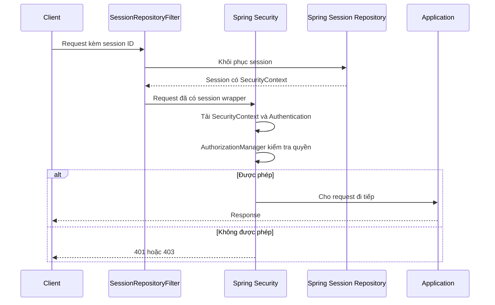

# Kiểm tra quyền dựa trên Authentication thay vì thuộc tính do client cung cấp

Spring Session lưu và khôi phục trạng thái `HttpSession` hoặc `WebSession` từ kho dùng chung như Redis hay JDBC. Khi tích hợp Spring Security, session có thể giữ `SecurityContext` chứa `Authentication` đã được xác thực. Ở mỗi request, Spring Security khôi phục ngữ cảnh bảo mật rồi dùng danh tính và authorities đó để quyết định người gọi được phép làm gì.

Quyền truy cập phải được xác định từ `Authentication` đã được Spring Security thiết lập sau quá trình xác thực, kết hợp với chính sách phân quyền phía máy chủ. Không lấy vai trò, user ID, cờ `isAdmin`, danh sách quyền hoặc trạng thái đăng nhập từ request body, query parameter, cookie tùy ý hay header do client tự đặt. Client có thể sửa những giá trị đó. Session ID là định danh client gửi lại để server tìm session; nó không cho phép client tự chọn nội dung `Authentication` được tin cậy.

## 1. Authentication và SecurityContext

Spring Security biểu diễn danh tính của request bằng `Authentication`. Đối tượng này thường chứa:

- `principal`: danh tính đã được xác thực, thường là `UserDetails`, một đối tượng principal của ứng dụng hoặc thông tin người dùng từ identity provider.
- `credentials`: thông tin dùng để xác thực, ví dụ mật khẩu trước khi xác thực hoàn tất. Provider thường xóa credentials nhạy cảm sau xác thực khi có thể.
- `authorities`: các quyền mà principal được cấp, ví dụ `ROLE_ADMIN`, `ORDER_READ` hoặc `ORDER_APPROVE`.
- trạng thái xác thực và các thông tin phụ trợ khác.

`SecurityContext` giữ `Authentication` hiện tại. Trong ứng dụng Servlet, Spring Security thường cung cấp context qua `SecurityContextHolder` trong thời gian xử lý request. `SecurityContextRepository` chịu trách nhiệm tải và lưu context theo cơ chế cấu hình.

Khi dùng Spring Session với Servlet, `HttpSessionSecurityContextRepository` có thể lưu `SecurityContext` vào `HttpSession`. Spring Session thay thế nơi lưu session mặc định bằng repository Redis/JDBC, vì vậy context bảo mật có thể được chia sẻ giữa các instance. Trong WebFlux, Spring Security dùng reactive security context và `WebSessionServerSecurityContextRepository` để tích hợp context với WebSession.

Luồng tổng quát:



Session repository lưu dữ liệu session phía server. Client chỉ gửi session ID thông qua cookie hoặc header đã cấu hình; server dùng ID để tìm context đã lưu. Nếu ID không hợp lệ, hết hạn hoặc bị thu hồi, request không có `Authentication` đã xác thực từ phiên đó.

## 2. Vì sao thuộc tính do client cung cấp không đáng tin?

Client kiểm soát dữ liệu request. Nếu API nhận `role`, `isAdmin`, `userId` hoặc `permissions` từ JSON rồi dùng trực tiếp để phân quyền, người gọi có thể sửa payload để tự cấp quyền.

Ví dụ nguy hiểm:

```java
public record UpdateProfileRequest(
        String displayName,
        String role,
        boolean admin) {
}

@PostMapping("/profile")
public void update(UpdateProfileRequest request) {
    if (request.admin() || "ADMIN".equals(request.role())) {
        adminService.performPrivilegedAction();
    }
}
```

Request có thể được gửi với `admin: true` hoặc `role: "ADMIN"`. Việc dữ liệu nằm trong JSON, hidden form field, local storage, cookie tùy chỉnh hoặc header không làm nó đáng tin hơn.

Thuộc tính do client gửi vẫn có thể dùng cho mục đích hiển thị hoặc yêu cầu nghiệp vụ không nhạy cảm, nhưng phải được xác thực và kiểm tra. Ví dụ, `displayName` là dữ liệu người dùng muốn cập nhật; server vẫn phải kiểm tra độ dài, ký tự và quyền sửa hồ sơ. `role` hoặc `ownerId` không được dùng làm nguồn xác định danh tính hay quyền của người gọi.

## 3. Xác thực trước, phân quyền sau

Xác thực (authentication) trả lời câu hỏi “request thuộc về ai?”. Phân quyền (authorization) trả lời “danh tính đó được phép thực hiện hành động nào trên tài nguyên nào?”.

Luồng thông thường:

1. Người dùng gửi credential hoặc một credential được cấp bởi hệ thống tin cậy.
2. `AuthenticationManager` chuyển yêu cầu đến `AuthenticationProvider` phù hợp.
3. Provider kiểm tra credential với nguồn danh tính tin cậy và trả về `Authentication` đã xác thực.
4. Spring Security đặt context hiện tại và lưu context theo `SecurityContextRepository` khi cơ chế xác thực yêu cầu.
5. Request tiếp theo mang session ID; server khôi phục context từ session.
6. `AuthorizationManager` hoặc method security so sánh authorities của `Authentication` với chính sách endpoint/phương thức.

Không tự tạo `Authentication` đã xác thực từ username hoặc role do request gửi. Chỉ authentication provider hoặc một cơ chế xác thực đáng tin cậy đã kiểm tra credential mới được phép tạo kết quả xác thực.

## 4. Cấu hình quyền ở HTTP request

Với ứng dụng Servlet dùng Spring Security, có thể khai báo quy tắc trong `SecurityFilterChain`:

```java
@Bean
SecurityFilterChain securityFilterChain(HttpSecurity http) throws Exception {
    return http
            .authorizeHttpRequests(authorize -> authorize
                    .requestMatchers("/assets/**", "/login").permitAll()
                    .requestMatchers("/admin/**").hasRole("ADMIN")
                    .requestMatchers(HttpMethod.POST, "/orders/**")
                            .hasAuthority("ORDER_WRITE")
                    .anyRequest().authenticated())
            .formLogin(Customizer.withDefaults())
            .build();
}
```

Trong ví dụ:

- `/assets/**` và `/login` được phép truy cập không cần đăng nhập.
- `/admin/**` yêu cầu authority `ROLE_ADMIN` vì `hasRole("ADMIN")` tự thêm tiền tố `ROLE_` theo mặc định.
- POST `/orders/**` yêu cầu chính xác authority `ORDER_WRITE`.
- Các request còn lại cần được xác thực.

`hasRole("ADMIN")` và `hasAuthority("ROLE_ADMIN")` thường kiểm tra cùng authority khi dùng tiền tố mặc định. `hasAuthority("ADMIN")` lại tìm chính xác chuỗi `ADMIN`, không tự thêm `ROLE_`. Hãy thống nhất cách đặt authority giữa authentication provider, database/identity provider và cấu hình phân quyền.

Quy tắc cụ thể hơn nên được đặt trước quy tắc tổng quát như `.anyRequest()`. Không thêm endpoint quản trị vào danh sách `permitAll` chỉ để tránh lỗi giao diện; hãy sửa chính sách phù hợp với yêu cầu truy cập.

## 5. Lấy Authentication trong controller

Spring MVC có thể inject `Authentication` trực tiếp vào controller method:

```java
@GetMapping("/api/me")
public Map<String, String> currentUser(Authentication authentication) {
    return Map.of("username", authentication.getName());
}
```

Nếu cần principal có kiểu cụ thể, có thể dùng `@AuthenticationPrincipal`:

```java
@GetMapping("/api/me/profile")
public ProfileView profile(@AuthenticationPrincipal AppPrincipal principal) {
    return profileService.findView(principal.userId());
}
```

`AppPrincipal` ở đây là kiểu principal do ứng dụng định nghĩa và được authentication provider đặt vào `Authentication`. Không ép kiểu từ một giá trị request body hoặc session attribute do controller tự đọc. Nếu endpoint cho phép anonymous, cần xử lý trường hợp không có principal đã xác thực thay vì giả định mọi request đều có người dùng.

Không trả credentials hoặc toàn bộ đối tượng `Authentication` ra response. Chỉ trả các trường cần thiết cho giao diện, ví dụ tên hiển thị hoặc thông tin hồ sơ đã được phép công khai.

## 6. Bảo vệ thao tác nghiệp vụ bằng method security

Quy tắc ở HTTP layer bảo vệ endpoint, nhưng service có thể được gọi từ nhiều nơi: controller khác, message listener, scheduler hoặc một luồng nội bộ. Method security giúp đặt chính sách gần thao tác nghiệp vụ.

Bật method security:

```java
@Configuration
@EnableMethodSecurity
public class MethodSecurityConfiguration {
}
```

Sau đó dùng `@PreAuthorize`:

```java
@Service
public class OrderApprovalService {

    @PreAuthorize("hasAuthority('ORDER_APPROVE')")
    public void approve(UUID orderId) {
        // Kiểm tra trạng thái và cập nhật đơn hàng.
    }
}
```

Method security lấy `Authentication` hiện tại từ SecurityContext do Spring Security quản lý. Người gọi không thể cấp `ORDER_APPROVE` bằng cách thêm field cùng tên vào JSON request.

Đảm bảo lời gọi đi qua Spring proxy để method security được áp dụng. Self-invocation trong cùng object có thể không đi qua proxy và do đó không kích hoạt interceptor như mong muốn. Với thao tác quan trọng, kiểm thử từ entry point thực tế và giữ kiểm tra quyền ở service boundary phù hợp.

## 7. Phân quyền theo tài nguyên, không chỉ theo role

Có authority `ORDER_READ` không nhất thiết cho phép người dùng đọc mọi đơn hàng. Ứng dụng thường cần kiểm tra cả quyền tổng quát lẫn quan hệ sở hữu tài nguyên.

Ví dụ, dùng bean authorization để kiểm tra chủ sở hữu dựa trên principal đã xác thực:

```java
@Component("orderAuthorization")
public class OrderAuthorization {

    private final OrderRepository orders;

    public OrderAuthorization(OrderRepository orders) {
        this.orders = orders;
    }

    public boolean canRead(Authentication authentication, UUID orderId) {
        if (authentication == null
                || authentication instanceof AnonymousAuthenticationToken) {
            return false;
        }

        if (authentication.getAuthorities().stream()
                .anyMatch(a -> a.getAuthority().equals("ORDER_READ_ALL"))) {
            return true;
        }

        if (!(authentication.getPrincipal() instanceof AppPrincipal principal)) {
            return false;
        }

        return orders.findById(orderId)
                .map(order -> order.ownerId().equals(principal.userId()))
                .orElse(false);
    }
}
```

Sử dụng trong service:

```java
@PreAuthorize("@orderAuthorization.canRead(authentication, #orderId)")
public OrderView readOrder(UUID orderId) {
    return orderQuery.loadView(orderId);
}
```

`orderId` có thể do client gửi vì đó là tài nguyên mà client muốn truy cập; server phải kiểm tra quyền trên tài nguyên đó. `principal.userId()` lấy từ `Authentication`, không lấy từ tham số `ownerId` do client tự khai báo. Nếu có quyền đọc toàn bộ đơn hàng, authority `ORDER_READ_ALL` phải được cấp từ nguồn phân quyền tin cậy.

Trong hệ thống lớn, có thể đưa kiểm tra ownership vào query để tránh tải tài nguyên trước khi kiểm tra. Ví dụ, truy vấn theo cả `orderId` và `ownerId` lấy từ principal sẽ giảm nguy cơ truy cập nhầm và có thể hiệu quả hơn.

## 8. Không đọc quyền từ HttpSession attribute tùy ý

Spring Security có thể lưu `SecurityContext` trong session. Điều đó không có nghĩa ứng dụng nên tự lưu thêm `isAdmin`, `roleName` hoặc `permissions` rồi dùng chúng để quyết định truy cập.

Ví dụ không an toàn:

```java
Boolean admin = (Boolean) request.getSession()
        .getAttribute("isAdmin");

if (Boolean.TRUE.equals(admin)) {
    adminService.deleteUser(userId);
}
```

Giá trị đó có thể bị đặt nhầm ở một luồng khác, cũ hơn so với quyền hiện tại hoặc được ghi bởi code không kiểm soát. Nếu client có endpoint cho phép ghi thuộc tính session tùy ý, rủi ro càng lớn. Hãy dùng `Authentication.getAuthorities()` hoặc `@PreAuthorize` để kiểm tra quyền.

Thuộc tính session có thể giữ dữ liệu giao diện như tab đang chọn, mã giỏ hàng hoặc trạng thái wizard. Nếu cần cache dữ liệu không nhạy cảm trong session, vẫn phải coi nó là cache có thể cũ và xác thực lại quyền tại thao tác quan trọng.

## 9. Session ID là thông tin bearer, nhưng không phải nguồn role

Session ID thường được gửi từ client trong cookie hoặc header. Ai có ID hợp lệ có thể thử dùng phiên đó, vì vậy ID phải được bảo vệ như credential:

- Chỉ truyền qua HTTPS.
- Với cookie trình duyệt, cấu hình `Secure`, `HttpOnly` và `SameSite` phù hợp.
- Không ghi session ID vào log, URL, analytics hoặc error report.
- Đổi session ID sau xác thực để phòng session fixation.
- Invalidate phiên ở server khi logout hoặc thu hồi.
- Đặt TTL phù hợp và kiểm thử cookie/session expiry.

Server không tin role do client gửi cùng session ID. Server dùng ID để tìm session đã lưu, sau đó lấy `SecurityContext` đã được authentication mechanism tạo. Nếu session bị sửa trực tiếp trong Redis/JDBC bởi một tác nhân có quyền ghi trái phép, đó là sự cố bảo mật của kho session; phải bảo vệ backend bằng network isolation, ACL/role, secret management và audit.

## 10. Lưu SecurityContext đúng cách

Với cơ chế đăng nhập được Spring Security cung cấp, framework thường thiết lập và lưu `SecurityContext` thông qua `SecurityContextRepository` phù hợp. Khi viết custom authentication filter, chỉ đặt context vào `SecurityContextHolder` có thể chỉ làm request hiện tại được nhận diện; nếu không lưu context theo cơ chế cấu hình, request kế tiếp có thể không còn đăng nhập.

Ví dụ khái niệm cho custom Servlet authentication flow:

```java
Authentication authenticated = authenticationManager.authenticate(
        new UsernamePasswordAuthenticationToken(username, password));

SecurityContext context = SecurityContextHolder.createEmptyContext();
context.setAuthentication(authenticated);
SecurityContextHolder.setContext(context);

securityContextRepository.saveContext(context, request, response);
```

`securityContextRepository` phải là repository phù hợp với ứng dụng, thường được cấu hình để tích hợp với HttpSession/Spring Session nếu muốn duy trì đăng nhập qua session. Custom filter cũng cần phối hợp session authentication strategy, session fixation protection và xử lý lỗi. Không tự lưu mật khẩu hoặc raw credential vào session.

Spring Security 6 dùng cơ chế tải context trì hoãn và yêu cầu các luồng xác thực lưu context theo chính sách explicit-save. Khi thay đổi cấu hình `requireExplicitSave`, custom authentication mechanism phải tuân theo hợp đồng save tương ứng. Ưu tiên dùng form login, OAuth2 login hoặc authentication filter có sẵn khi đáp ứng yêu cầu để tránh tự triển khai thiếu bước.

## 11. Thứ tự SessionRepositoryFilter và Spring Security

Trong ứng dụng Servlet, `SessionRepositoryFilter` phải chạy trước `springSecurityFilterChain` để Spring Security nhìn thấy `HttpSession` đã được Spring Session bọc. Nhờ vậy, `HttpSessionSecurityContextRepository` đọc/ghi `SecurityContext` thông qua Redis/JDBC repository.

Spring Boot và Spring Session thường đăng ký filter theo thứ tự phù hợp khi dùng auto-configuration. Nếu tự đăng ký filter hoặc cấu hình nhiều filter chain, hãy kiểm tra thứ tự thực tế. Một filter chạy trước Spring Session và tạo session container gốc có thể khiến dữ liệu nằm ngoài kho dùng chung, dẫn đến node khác không khôi phục được context.

Trong môi trường nhiều instance, tất cả node phải dùng chung session repository, namespace, serializer và cấu hình cookie. Nếu node A lưu `SecurityContext` trong Redis nhưng node B dùng một repository khác hoặc classpath không tương thích, người dùng có thể bị đăng xuất ngẫu nhiên hoặc gặp lỗi khôi phục context.

## 12. Vai trò có thể cũ sau khi được lưu trong session

`Authentication` thường chứa authorities tại thời điểm xác thực. Khi `SecurityContext` được lưu trong session, danh sách quyền đó có thể tồn tại đến khi session hết hạn hoặc bị thu hồi. Nếu quản trị viên gỡ quyền `ADMIN` của người dùng trong database, session đang hoạt động có thể vẫn chứa authority cũ.

Đối với quyền có rủi ro cao, cần có chính sách làm mới hoặc thu hồi:

- Invalidate các session của người dùng khi thay đổi role hoặc khóa tài khoản.
- Dùng session version/credential version để phát hiện context cũ.
- Kiểm tra quyền hiện tại từ nguồn dữ liệu tin cậy ở thao tác đặc biệt nhạy cảm.
- Dùng TTL/absolute session lifetime phù hợp và yêu cầu xác thực lại cho thao tác quan trọng.
- Theo dõi sự kiện thay đổi quyền và bảo đảm các instance cùng nhận trạng thái mới.

Không giải quyết stale authority bằng cách tin role mới do client gửi. Client không phải nguồn cấp quyền. Nếu dùng `FindByIndexNameSessionRepository` hoặc repository indexed tương ứng, có thể tìm các session của principal để thu hồi, nhưng cần kiểm tra tính đầy đủ của index và xử lý request đang chạy.

## 13. Logout và thu hồi session

Logout phải kết thúc cả trạng thái bảo mật lẫn session ở server. Spring Security logout flow có thể xóa `SecurityContext`, invalidate `HttpSession` và xóa cookie theo cấu hình. Với Spring Session, thao tác invalidate được phản ánh vào repository dùng chung để instance khác không khôi phục lại phiên.

Không chỉ xóa cookie ở trình duyệt. Nếu session phía server vẫn tồn tại, một bản sao session ID bị đánh cắp vẫn có thể sử dụng. Ngược lại, nếu server đã invalidate nhưng client vẫn giữ cookie cũ, request sau phải bị từ chối và client nên xóa định danh theo response logout/expiry.

Với quản trị thu hồi nhiều phiên, xác thực quyền quản trị bằng `Authentication`, xác định principal mục tiêu theo dữ liệu tin cậy và dùng repository index để tìm các session. Ghi audit lý do, người thực hiện và kết quả mà không ghi session ID hoặc token dạng rõ.

## 14. WebFlux sử dụng reactive security context

Trong ứng dụng WebFlux, không dùng `SecurityContextHolder` theo cách ThreadLocal của Servlet để lấy danh tính trong reactive pipeline. Dùng `ReactiveSecurityContextHolder` hoặc method argument được WebFlux/Spring Security hỗ trợ.

Ví dụ:

```java
public Mono<String> currentUsername() {
    return ReactiveSecurityContextHolder.getContext()
            .map(SecurityContext::getAuthentication)
            .map(Authentication::getName);
}
```

Reactive security context đi theo Reactor Context, không gắn cố định với một thread. Giữ thao tác trong chuỗi `Mono`/`Flux`; không gọi `block()` hoặc tự `subscribe()` để đọc quyền rồi tiếp tục ngoài pipeline.

Spring Session WebFlux dùng `WebSession` và `WebSessionServerSecurityContextRepository` để lưu context trong session reactive. Quy tắc phân quyền vẫn phải dựa trên `Authentication` được framework xác thực; chỉ khác cách truy cập context và cách kết hợp bất đồng bộ.

## 15. CSRF và phân quyền là hai lớp khác nhau

Kiểm tra authority không tự ngăn CSRF. Nếu trình duyệt tự gửi cookie session đến một website khác, kẻ tấn công có thể cố kích hoạt request thay mặt người dùng. Spring Security CSRF protection kiểm tra token/chính sách tương ứng; authorization kiểm tra người dùng có quyền thực hiện hành động hay không.

Không tắt CSRF chỉ vì endpoint dùng session hoặc đã kiểm tra `Authentication`. Với ứng dụng browser dùng cookie, giữ CSRF protection cho các request thay đổi trạng thái trừ khi có một thiết kế bảo vệ phù hợp khác. Với API stateless dùng bearer token trong Authorization header, đánh giá CSRF theo cách credential được trình duyệt gửi tự động và kiến trúc client thực tế.

## 16. Phân biệt 401 và 403

| Trạng thái | Ý nghĩa thường gặp | Hành vi phía client |
|---|---|---|
| `401 Unauthorized` | Request chưa có danh tính được xác thực hợp lệ hoặc credential/session không còn hợp lệ | Đăng nhập hoặc xác thực lại |
| `403 Forbidden` | Đã xác định được danh tính nhưng không có quyền thực hiện hành động | Hiển thị thông báo không đủ quyền; không yêu cầu đăng nhập lại một cách máy móc |

Một session hết hạn thường dẫn đến trạng thái chưa xác thực; một người dùng đã đăng nhập nhưng thiếu `ORDER_APPROVE` thường nhận 403. Chi tiết response phụ thuộc entry point, access denied handler và loại ứng dụng (browser/API). Không trả thông tin nội bộ về role của người dùng khác trong lỗi phân quyền.

## 17. Kiểm thử quyền dựa trên Authentication

Kiểm thử nên xác nhận cả quy tắc phân quyền và việc session context được lưu/khôi phục:

| Ca kiểm thử | Cách thực hiện | Kết quả cần xác nhận |
|---|---|---|
| Chưa đăng nhập | Gọi endpoint cần xác thực không có session | Bị yêu cầu xác thực, thường là 401 hoặc redirect login |
| Authority đúng | Đăng nhập user có `ORDER_WRITE`, gọi POST order | Request được phép |
| Authority thiếu | Đăng nhập user không có `ORDER_WRITE` | Nhận 403 |
| Client gửi `role=ADMIN` | Thêm role giả vào body/query/header | Không được nâng quyền |
| Client gửi `ownerId` khác | Thử truy cập order của người khác | Ownership check từ principal từ chối |
| Session được chia sẻ | Đăng nhập ở instance A, gửi cookie đến B | B khôi phục đúng Authentication và authorities |
| Logout | Logout rồi gửi lại cookie cũ | Session không còn được chấp nhận |
| Quyền bị thu hồi | Gỡ role và thu hồi/làm mới session theo chính sách | Request tiếp theo không dùng authority cũ |
| CSRF | Gửi request thay đổi trạng thái thiếu CSRF token khi protection bật | Request bị từ chối |
| Nhiều instance | Gọi endpoint có quyền luân phiên qua các node | Cùng chính sách và context được áp dụng |

Với MockMvc, có thể kiểm tra authorization rule bằng `@WithMockUser` hoặc `user()` request post processor. Ví dụ:

```java
mockMvc.perform(post("/orders")
        .with(user("alice").authorities(
                new SimpleGrantedAuthority("ORDER_WRITE")))
        .with(csrf()))
    .andExpect(status().isOk());
```

Test này kiểm tra quy tắc authority và CSRF của endpoint; nó không chứng minh đăng nhập thật đã lưu `SecurityContext` trong Spring Session. Cần thêm integration test thực hiện login, giữ cookie từ response và gọi endpoint ở request tiếp theo, tốt hơn nữa là chuyển request sang instance khác cùng repository.

Không chỉ test user có quyền. Test user thiếu quyền, anonymous, client giả mạo role/owner ID, session hết hạn, logout và role bị thu hồi. Với resource ownership, tạo hai người dùng và hai tài nguyên để chứng minh người dùng không đọc được tài nguyên của người còn lại.

## 18. Lỗi thường gặp

| Triệu chứng | Nguyên nhân có thể | Hướng xử lý |
|---|---|---|
| Client đổi `role` rồi truy cập được admin endpoint | Controller dùng role từ request thay vì `Authentication` | Chuyển kiểm tra sang `hasRole`, `hasAuthority` hoặc method security |
| Đăng nhập thành công nhưng request sau mất Authentication | Custom filter chỉ đặt `SecurityContextHolder` mà không lưu context | Dùng `SecurityContextRepository.saveContext` theo cấu hình |
| Một instance nhận đăng nhập, instance khác coi là anonymous | Session store/namespace/serializer không dùng chung hoặc filter order sai | Kiểm tra SessionRepositoryFilter, SecurityContextRepository và cấu hình node |
| User bị giữ quyền cũ sau khi role bị gỡ | Authorities được lưu trong SecurityContext của session | Thu hồi/làm mới session hoặc kiểm tra quyền hiện tại cho thao tác nhạy cảm |
| `hasRole("ADMIN")` luôn từ chối | Authority được cấp là `ADMIN` thay vì `ROLE_ADMIN` theo prefix mặc định | Thống nhất role prefix hoặc dùng `hasAuthority` chính xác |
| Người dùng xem được tài nguyên của người khác | Chỉ kiểm tra role tổng quát, không kiểm tra ownership | Kiểm tra resource owner từ principal đã xác thực |
| Logout chỉ xóa cookie nhưng session còn hoạt động | Chưa invalidate session phía server | Dùng Spring Security logout handler và kiểm tra repository |
| Request thay đổi trạng thái bị từ chối dù Authentication đúng | Thiếu CSRF token khi CSRF protection bật | Gửi token hợp lệ và giữ CSRF policy phù hợp |
| WebFlux không đọc được Authentication | Dùng ThreadLocal `SecurityContextHolder` trong reactive flow | Dùng `ReactiveSecurityContextHolder` và giữ reactive chain |

## 19. Nguyên tắc triển khai

- Dùng `Authentication` và `SecurityContext` do Spring Security thiết lập làm nguồn danh tính cho request.
- Lấy authorities từ `Authentication.getAuthorities()` hoặc dùng `hasRole`, `hasAuthority`, `@PreAuthorize`.
- Không tin role, user ID, owner ID, cờ admin hoặc danh sách quyền do client gửi.
- Kiểm tra quyền trên tài nguyên bằng principal đã xác thực và dữ liệu sở hữu lấy từ server.
- Để `SecurityContextRepository` lưu context vào session; custom authentication flow phải lưu context đúng hợp đồng.
- Bảo đảm `SessionRepositoryFilter` chạy trước Spring Security filter chain trong ứng dụng Servlet.
- Dùng chung session repository và serializer tương thích giữa các instance.
- Có chính sách thu hồi hoặc làm mới session khi quyền người dùng thay đổi.
- Logout phải invalidate session ở server, không chỉ xóa cookie phía client.
- Giữ CSRF protection phù hợp với ứng dụng dùng cookie.
- Với WebFlux, dùng reactive security context thay vì ThreadLocal và không block event loop.
- Kiểm thử cả trường hợp được phép, bị từ chối, giả mạo thuộc tính client, logout và chuyển node.

Spring Session giúp chia sẻ session giữa các instance; Spring Security xác định danh tính và quyền của người dùng trong `Authentication`. Khi hai thành phần được tích hợp đúng, client chỉ cung cấp định danh phiên để server khôi phục context đã được xác thực. Mọi quyết định truy cập được đưa ra từ authorities và quan hệ tài nguyên mà server kiểm soát, nên việc sửa một thuộc tính trong request không thể tự nâng quyền.
