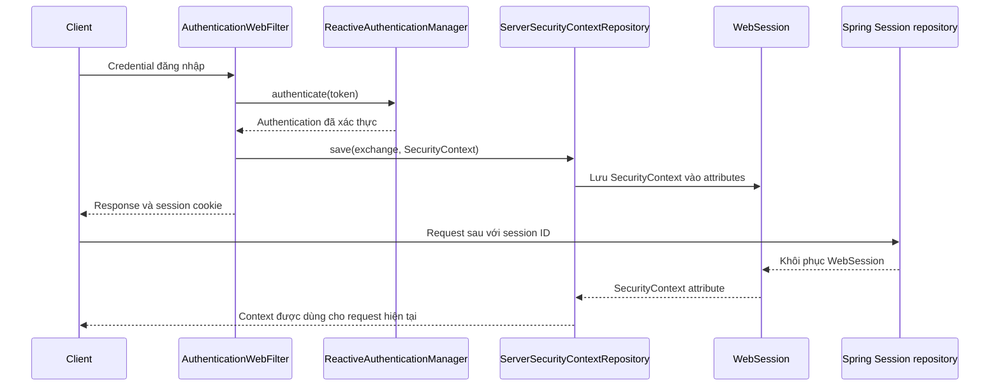
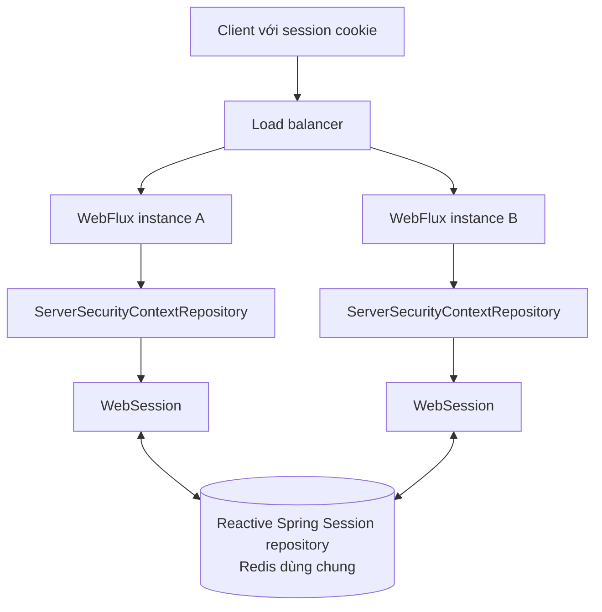

# WebFlux, SecurityContextRepository và trạng thái xác thực trong WebSession

Trong ứng dụng Spring WebFlux, Spring Security cần một nơi lưu `SecurityContext` để request tiếp theo có thể khôi phục trạng thái xác thực. Với mô hình đăng nhập dựa trên session, nơi lưu đó thường là `WebSession`. `ServerSecurityContextRepository` là hợp đồng reactive chịu trách nhiệm đọc và lưu `SecurityContext`; implementation `WebSessionServerSecurityContextRepository` đặt context vào WebSession, còn `NoOpServerSecurityContextRepository` không lưu context giữa các request.

Spring Session có thể quản lý WebSession bằng một kho dùng chung như Redis, nhờ đó nhiều instance WebFlux cùng khôi phục được trạng thái đăng nhập. Tuy nhiên, cần phân biệt ba lớp: Spring Security xác thực và tạo `SecurityContext`; `ServerSecurityContextRepository` quyết định context được lưu ở đâu; Spring Session và `ReactiveSessionRepository` lưu dữ liệu WebSession. Nắm rõ ranh giới này giúp chọn đúng mô hình stateful hoặc stateless, xử lý đăng xuất và tránh mất trạng thái khi request chuyển instance.

## 1. SecurityContext chứa thông tin gì?

`SecurityContext` là đối tượng Spring Security dùng để giữ `Authentication` của request hiện tại. `Authentication` thường chứa principal, credentials ở giai đoạn phù hợp của quá trình xác thực, authorities và trạng thái đã xác thực.

Ví dụ lấy danh tính hiện tại trong WebFlux:

```java
Mono<String> currentUsername() {
    return ReactiveSecurityContextHolder.getContext()
            .map(SecurityContext::getAuthentication)
            .map(Authentication::getName);
}
```

Trong WebFlux, `ReactiveSecurityContextHolder` đọc context từ Reactor Context. Không nên dùng `SecurityContextHolder.getContext()` theo kiểu ThreadLocal trong reactive handler vì request có thể đi qua nhiều thread và scheduler khác nhau. Spring Security tích hợp với Reactor để context được truyền theo chuỗi publisher.

`SecurityContext` đại diện trạng thái xác thực đang được sử dụng trong một luồng xử lý. Để trạng thái đó còn tồn tại sau khi request hiện tại kết thúc, ứng dụng cần một cơ chế persistence như `ServerSecurityContextRepository`.

## 2. ServerSecurityContextRepository là hợp đồng reactive

Trong stack Servlet, Spring Security có `SecurityContextRepository`. Với WebFlux, interface tương ứng là `ServerSecurityContextRepository` trong package `org.springframework.security.web.server.context`.

Hợp đồng này cung cấp hai thao tác chính:

```java
public interface ServerSecurityContextRepository {
    Mono<SecurityContext> load(ServerWebExchange exchange);
    Mono<Void> save(ServerWebExchange exchange, SecurityContext context);
}
```

- `load` khôi phục `SecurityContext` cho request hiện tại. Nếu không có context, publisher có thể hoàn tất rỗng.
- `save` lưu context sau khi xác thực thành công. Publisher cần được compose vào luồng reactive để thao tác lưu được thực thi và lỗi có thể được xử lý.

Repository không tự xác thực mật khẩu, kiểm tra chữ ký JWT hoặc quyết định người dùng có quyền gọi endpoint hay không. Những việc đó thuộc `ReactiveAuthenticationManager`, authentication filter và authorization rules. Repository chỉ quản lý persistence của context.

## 3. WebSessionServerSecurityContextRepository

`WebSessionServerSecurityContextRepository` là implementation lưu `SecurityContext` trong `WebSession`. Khi authentication thành công, repository đặt context vào session; ở request sau, nó tìm context từ WebSession và cung cấp cho Spring Security.

```java
@Bean
ServerSecurityContextRepository securityContextRepository() {
    return new WebSessionServerSecurityContextRepository();
}
```

Implementation này phù hợp với ứng dụng WebFlux dùng session-based authentication, ví dụ đăng nhập bằng form hoặc một cơ chế xác thực tương tác cần duy trì trạng thái giữa nhiều request.

Luồng cơ bản:

1. Client gửi thông tin đăng nhập.
2. Authentication filter chuyển credential cho `ReactiveAuthenticationManager`.
3. Authentication manager xác minh credential và trả về `Authentication` đã xác thực.
4. Spring Security tạo hoặc cập nhật `SecurityContext`.
5. `WebSessionServerSecurityContextRepository.save(...)` lưu context vào WebSession.
6. WebSession được Spring Session lưu vào repository khi response lifecycle hoàn tất.
7. Client nhận session ID, thường qua cookie.
8. Request tiếp theo gửi lại ID; Spring Session khôi phục WebSession và SecurityContext repository khôi phục context.



Sơ đồ mô tả trình tự logic. Các filter nội bộ chịu trách nhiệm khôi phục context trước khi authorization được thực hiện; controller không cần tự đọc một attribute session có tên nội bộ của Spring Security.

## 4. Cấu hình SecurityWebFilterChain dùng WebSession

Một cấu hình WebFlux session-based có thể khai báo repository tường minh:

```java
@Configuration
@EnableWebFluxSecurity
class SecurityConfiguration {

    @Bean
    ServerSecurityContextRepository serverSecurityContextRepository() {
        return new WebSessionServerSecurityContextRepository();
    }

    @Bean
    SecurityWebFilterChain springSecurityFilterChain(
            ServerHttpSecurity http,
            ServerSecurityContextRepository contextRepository) {

        return http
                .securityContextRepository(contextRepository)
                .authorizeExchange(exchanges -> exchanges
                        .pathMatchers("/public/**", "/login").permitAll()
                        .anyExchange().authenticated())
                .formLogin(Customizer.withDefaults())
                .build();
    }
}
```

Ví dụ sử dụng form login mặc định để minh họa. Trong cấu hình WebFlux session-based phổ biến, Spring Security cũng có thể dùng WebSession repository theo mặc định; khai báo rõ bean giúp nhìn thấy chính sách persistence và dễ thay đổi khi cần. API builder và package import cần đối chiếu với phiên bản Spring Security của dự án.

Khi dùng Spring Session WebFlux, WebSession được lưu qua reactive repository tương ứng, ví dụ Redis. Spring Session không thay thế `ServerSecurityContextRepository`; nó cung cấp kho lưu WebSession mà repository bảo mật sử dụng.

## 5. Trạng thái xác thực được lưu trong WebSession như thế nào?

`WebSessionServerSecurityContextRepository` quản lý một attribute dành cho SecurityContext. Tên attribute là chi tiết của Spring Security; ứng dụng nên dùng repository thay vì tự đặt, đọc hoặc ghi key nội bộ.

WebSession có thể chứa thêm các attributes khác như giỏ hàng, tùy chọn giao diện hoặc trạng thái quy trình. Spring Session lưu toàn bộ session theo serializer/repository được cấu hình. Vì vậy, SecurityContext và các object liên quan cũng phải tương thích với cơ chế serialization đang sử dụng.

Không nên lưu thêm bản sao của username, roles hoặc authentication state ở nhiều attribute tự quản lý nếu Spring Security đã quản lý SecurityContext. Nhiều nguồn trạng thái có thể lệch nhau: context nói người dùng đã đăng xuất nhưng attribute tùy chỉnh vẫn nói đã xác thực. Nếu cần metadata hiển thị như tên thiết bị hoặc thời điểm đăng nhập, lưu dưới dạng attribute riêng, không dùng metadata đó thay cho `Authentication` để cấp quyền.

## 6. Spring Session giúp chia sẻ trạng thái xác thực giữa nhiều instance

Nếu WebSession chỉ nằm trong bộ nhớ cục bộ của một instance, request tiếp theo được định tuyến đến instance khác có thể không khôi phục được session. Khi tích hợp Spring Session với Redis reactive, các instance có thể đọc cùng session từ kho dùng chung.

Ví dụ bật WebSession Redis cho WebFlux:

```java
@Configuration
@EnableRedisWebSession
class ReactiveSessionConfiguration {
}
```

Với phiên bản Spring Session hỗ trợ indexed reactive repository, có thể chọn `@EnableRedisIndexedWebSession` nếu ứng dụng còn cần index principal và session lifecycle events. Chỉ dùng một annotation cấu hình repository cho cùng ứng dụng. Cả hai trường hợp đều cần reactive Redis connection factory phù hợp.

Lưu ý về JDBC: `JdbcIndexedSessionRepository` tiêu chuẩn là repository JDBC đồng bộ dành cho ứng dụng Servlet. Nó không phải `ReactiveSessionRepository` và không nên được gọi bằng `.block()` từ WebFlux để giả lập tích hợp reactive. Nếu ứng dụng cần WebFlux và kho chia sẻ reactive, Redis là lựa chọn Spring Session reactive phổ biến; dùng JDBC đòi hỏi một implementation reactive riêng hoặc một kiến trúc khác được thiết kế rõ ràng.



Để chia sẻ trạng thái xác thực đúng cách, các instance cần thống nhất:

- Cùng Redis cluster/database và session namespace.
- Cùng cookie name, domain, path và cách phân giải session ID.
- Cùng cấu hình serializer và khả năng đọc SecurityContext/Authentication attributes.
- Các class principal và authorities tương thích giữa phiên bản đang chạy.
- Cùng chính sách timeout và cấu hình Spring Security.

Chỉ dùng chung Redis chưa đủ nếu namespace khác nhau hoặc một instance không thể deserialize principal do instance khác ghi. Khi triển khai rolling update, hãy kiểm thử request đăng nhập ở instance A rồi request tiếp theo được xử lý tại instance B.

## 7. Phân biệt Reactor Context với WebSession persistence

Đây là hai lớp trạng thái khác nhau:

| Lớp | Phạm vi tồn tại | Mục đích |
|---|---|---|
| Reactor Context | Chuỗi reactive hiện tại | Cung cấp SecurityContext cho các operator và handler trong request đang xử lý |
| WebSession | Qua nhiều request | Giữ trạng thái phiên phía server |
| ReactiveSessionRepository | Kho dữ liệu dùng chung | Lưu và khôi phục WebSession giữa các request/instance |

Spring Security đưa context đã tải vào Reactor Context để code reactive có thể lấy qua `ReactiveSecurityContextHolder`. `ServerSecurityContextRepository` chịu trách nhiệm tải và lưu context qua request. Nếu một custom filter chỉ đặt context vào Reactor Context nhưng không lưu repository, request hiện tại có thể thấy người dùng đã xác thực nhưng request sau sẽ không còn trạng thái đó.

Ngược lại, nếu chỉ ghi một object vào WebSession nhưng không để Spring Security khôi phục và đưa context vào Reactor Context, authorization filter có thể không thấy `Authentication` tương ứng. Hãy để filter và repository tích hợp thực hiện hai bước theo đúng thứ tự.

## 8. Dùng NoOpServerSecurityContextRepository cho xác thực stateless

Không phải ứng dụng nào cũng muốn lưu trạng thái xác thực trong WebSession. Với API stateless dùng bearer token, mỗi request mang credential và được xác minh độc lập. `NoOpServerSecurityContextRepository` không lưu hoặc khôi phục `SecurityContext` giữa các request.

```java
@Bean
SecurityWebFilterChain apiSecurity(ServerHttpSecurity http) {
    return http
            .securityContextRepository(
                    NoOpServerSecurityContextRepository.getInstance())
            .authorizeExchange(exchanges -> exchanges
                    .pathMatchers("/health", "/public/**").permitAll()
                    .anyExchange().authenticated())
            .oauth2ResourceServer(oauth2 ->
                    oauth2.jwt(Customizer.withDefaults()))
            .build();
}
```

Trong cấu hình này, bearer token được xác minh theo cấu hình OAuth2 Resource Server; context của request hiện tại vẫn được dùng trong Reactor Context, nhưng không được lưu lại vào WebSession qua repository này.

`NoOpServerSecurityContextRepository` không tự bảo đảm toàn bộ ứng dụng không tạo WebSession. Những thành phần khác như CSRF token repository, request cache hoặc cơ chế lưu OAuth authorization request có thể vẫn dùng WebSession. Nếu mục tiêu là API stateless, hãy rà soát tất cả thành phần bảo mật và ứng dụng có thể tạo session, không chỉ `ServerSecurityContextRepository`.

## 9. Không nhầm session-based authentication với JWT authentication

Hai mô hình có cách duy trì trạng thái khác nhau:

| Tiêu chí | Session-based | Bearer token stateless |
|---|---|---|
| Credential client gửi | Session ID, thường qua cookie | Access token, thường qua `Authorization: Bearer` |
| Trạng thái xác thực | SecurityContext được lưu trong WebSession | Token được xác minh cho từng request |
| Persistence | WebSession và session repository | Thường không cần SecurityContext repository lưu giữa request |
| Thu hồi | Invalidate session ở kho dùng chung | Phụ thuộc token type và cơ chế revocation/expiry |
| CSRF | Cần đánh giá vì cookie được trình duyệt tự gửi | Phụ thuộc cách credential được gửi và các cơ chế khác của ứng dụng |

Session ID không phải JWT. JWT không tự động trở thành session. Một access token có thể mang định dạng JWT, nhưng vai trò của nó vẫn là credential OAuth được resource server xác minh. Không đặt JWT vào attribute SecurityContext hoặc session ID header rồi kỳ vọng Spring Security tự diễn giải sai cơ chế.

## 10. Custom authentication filter phải lưu context

Khi dùng authentication filter có sẵn như `AuthenticationWebFilter`, hãy cấu hình `ServerSecurityContextRepository` để filter lưu context sau khi xác thực thành công. Ví dụ khung cấu hình:

```java
AuthenticationWebFilter authenticationWebFilter =
        new AuthenticationWebFilter(authenticationManager);

authenticationWebFilter.setServerAuthenticationConverter(
        authenticationConverter);
authenticationWebFilter.setSecurityContextRepository(
        securityContextRepository);
```

Filter được đăng ký ở đúng vị trí trong `SecurityWebFilterChain` theo thứ tự filter của Spring Security. Converter chịu trách nhiệm chuyển request thành authentication token; authentication manager xác minh token; repository lưu SecurityContext sau khi thành công.

Nếu tự viết `WebFilter` thay cho filter có sẵn, cần thực hiện cả hai trách nhiệm:

1. Đưa SecurityContext vào Reactor Context của request hiện tại.
2. Gọi `ServerSecurityContextRepository.save(exchange, context)` và compose `Mono<Void>` vào chuỗi reactive để context còn tồn tại ở request tiếp theo.

Ví dụ ý tưởng về thao tác lưu:

```java
SecurityContext context = new SecurityContextImpl(authentication);

return securityContextRepository.save(exchange, context)
        .then(chain.filter(exchange)
                .contextWrite(ReactiveSecurityContextHolder
                        .withSecurityContext(Mono.just(context))));
```

Đây là đoạn minh họa sequencing, không phải một custom authentication filter hoàn chỉnh. Trong code thực tế, phải đặt filter đúng thứ tự, xử lý lỗi xác thực, tránh lưu context khi authentication chưa hợp lệ và bảo đảm publisher save được subscribe bởi chuỗi request. Ưu tiên cơ chế filter tích hợp của Spring Security nếu không có yêu cầu đặc biệt.

Không gọi `subscribe()` riêng cho thao tác save và không gọi `block()` trong WebFlux. Nếu save bị tách khỏi request publisher, response có thể hoàn tất trước khi trạng thái xác thực được lưu.

## 11. Đăng xuất phải xóa trạng thái xác thực phía server

Trong session-based authentication, logout cần xóa SecurityContext khỏi repository và thường vô hiệu hóa WebSession để thu hồi session ID. Spring Security WebFlux cung cấp các logout handler để thực hiện các thao tác này.

Ví dụ cấu hình endpoint logout:

```java
@Bean
SecurityWebFilterChain securityWebFilterChain(ServerHttpSecurity http) {
    return http
            .authorizeExchange(exchanges -> exchanges
                    .anyExchange().authenticated())
            .formLogin(Customizer.withDefaults())
            .logout(logout -> logout.logoutUrl("/logout"))
            .build();
}
```

Logout mặc định của Spring Security WebFlux phối hợp xóa context bảo mật và WebSession theo các logout handler mặc định. Nếu thay thế logout handlers bằng handler tùy chỉnh, hãy bảo đảm cả context trong `ServerSecurityContextRepository` và session phía server được thu hồi theo yêu cầu.

Không chỉ xóa cookie ở client. Nếu session trong Redis vẫn chứa SecurityContext và còn hiệu lực, một client giữ session ID cũ có thể tiếp tục dùng phiên. Ngược lại, nếu session đã bị invalidate nhưng cookie chưa được expire, trình duyệt có thể gửi lại ID cũ; repository không được khôi phục phiên đã bị xóa.

## 12. Timeout và vòng đời WebSession

SecurityContext được lưu trong WebSession chịu ảnh hưởng của thời hạn session. Khi session hết hạn logic, request sau không được khôi phục context từ phiên cũ. Với Spring Session Redis, timeout được chuyển thành chính sách TTL và expiration của repository; thời điểm key bị xóa vật lý có thể muộn hơn thời điểm session không còn hợp lệ.

Cookie session ID và timeout server-side là hai cơ chế khác nhau. Cookie có thể còn trong trình duyệt sau khi WebSession đã hết hạn; khi đó ID cũ không khôi phục được SecurityContext. Ngược lại, cookie có thể hết hạn trước session trong Redis.

Đặt timeout theo mức nhạy cảm của ứng dụng. Phiên quản trị hoặc giao dịch nhạy cảm có thể cần thời hạn ngắn hơn và xác thực lại cho thao tác quan trọng. Không coi việc SecurityContext còn được lưu trong session là bằng chứng đủ cho mọi hành động; authorization vẫn phải kiểm tra authorities và quyền trên tài nguyên cụ thể.

## 13. Serialization của SecurityContext và principal

Khi WebSession được lưu trong Redis, attributes của session cần được serialize. SecurityContext thường tham chiếu tới `Authentication`, principal và authorities. Vì vậy, custom principal hoặc object authority phải tương thích với serializer và có thể được đọc bởi tất cả instance.

Các nguyên tắc thực tế:

- Dùng principal object nhỏ, ổn định và không chứa dependency runtime như request, service hoặc ORM session.
- Chỉ lưu các thông tin cần cho xác thực và authorization; tránh lưu credentials thô hoặc bí mật không cần thiết.
- Bảo đảm custom `UserDetails`/principal và authorities có thể serialize theo cấu hình thực tế.
- Giữ package, schema và serializer tương thích trong giai đoạn rolling deployment.
- Không bật polymorphic deserialization rộng chỉ để khôi phục mọi loại principal tùy ý.
- Kiểm thử đọc SecurityContext được ghi bởi instance khác và bởi phiên bản ứng dụng trước đó.

Nếu deserialization SecurityContext thất bại, ứng dụng phải xử lý như trạng thái không thể xác thực an toàn và yêu cầu đăng nhập lại theo chính sách. Không fallback sang một principal mặc định hoặc quyền mặc định.

## 14. CSRF và cookie trong mô hình WebSession

Session-based authentication thường dùng cookie. Trình duyệt tự động gửi cookie phù hợp theo domain/path và chính sách SameSite. Vì vậy, ứng dụng cần đánh giá CSRF cho các request thay đổi trạng thái. Spring Security WebFlux có CSRF protection và repository token phù hợp; không tắt CSRF chỉ vì session được lưu trong Redis.

Các thuộc tính cookie như `Secure`, `HttpOnly`, `SameSite`, domain và path cần được cấu hình theo môi trường. `HttpOnly` hạn chế JavaScript đọc cookie nhưng không ngăn trình duyệt gửi request; `SameSite` giảm một số tình huống cross-site nhưng không thay thế mọi biện pháp CSRF. Khi ứng dụng chạy sau proxy kết thúc TLS, cấu hình forwarded headers đáng tin cậy để cookie Secure được phát đúng.

Nếu dùng bearer token trong `Authorization` header và không dùng cookie để xác thực, bề mặt CSRF khác với session cookie. Tuy nhiên, hãy kiểm tra mọi credential tự động được trình duyệt gửi và các endpoint còn dựa vào WebSession.

## 15. Nhiều instance và thay đổi phiên bản

Trong triển khai phân tán, một request có thể đăng nhập ở instance A và request tiếp theo đi tới instance B. Để B khôi phục được trạng thái xác thực:

1. A phải lưu SecurityContext vào WebSession qua repository.
2. Spring Session phải ghi WebSession vào kho dùng chung trước khi response hoàn tất.
3. Response phải gửi session ID hợp lệ cho client.
4. B phải nhận đúng cookie/header và dùng cùng namespace/repository.
5. B phải deserialize được SecurityContext, principal và authorities.
6. Spring Security phải khôi phục context trước khi thực hiện authorization.

Nếu một trong các bước không đúng, người dùng có thể bị yêu cầu đăng nhập lại ngẫu nhiên hoặc request bị coi là anonymous. Sticky session có thể che giấu lỗi chia sẻ session nhưng không thay thế kho dùng chung nếu mục tiêu là failover và mở rộng ngang.

Khi nâng cấp Spring Security hoặc thay đổi principal class, cần kiểm thử session được ghi bởi phiên bản cũ. Có thể cho session cũ hết TTL trước khi loại bỏ khả năng đọc định dạng cũ, hoặc triển khai chiến lược tương thích có version. Nếu không thể đảm bảo tương thích, cần có kế hoạch buộc đăng nhập lại khi cutover.

## 16. Những lỗi cấu hình thường gặp

| Triệu chứng | Nguyên nhân có thể | Hướng kiểm tra |
|---|---|---|
| Đăng nhập thành công nhưng request sau thành anonymous | Context chỉ được đặt trong Reactor Context, chưa lưu repository | Kiểm tra `ServerSecurityContextRepository.save` trong authentication flow |
| Mỗi request đều yêu cầu đăng nhập lại | Cookie ID không được gửi, WebSession không được lưu hoặc repository khác namespace | Kiểm tra `Set-Cookie`, request cookie và Spring Session repository |
| Instance A thấy đã đăng nhập, instance B không thấy | Không dùng chung kho, serializer hoặc namespace không tương thích | So sánh cấu hình giữa các instance và kiểm tra session trong kho |
| API stateless vẫn tạo WebSession | CSRF, request cache hoặc thành phần khác còn dùng session | Kiểm tra các session-backed components ngoài context repository |
| Logout xong vẫn dùng được session ID cũ | Chỉ xóa cookie hoặc custom logout handler không invalidate session | Kiểm tra context repository và WebSession invalidation |
| Lỗi deserialize principal | Class principal/authority không tương thích hoặc serializer không hỗ trợ | Kiểm tra serializer, classpath và schema version |
| Controller không thấy Authentication | Đọc ThreadLocal `SecurityContextHolder` thay vì Reactor Context hoặc filter order sai | Dùng `ReactiveSecurityContextHolder` và kiểm tra filter chain |
| CSRF bị lỗi sau khi chuyển sang session | Cookie/CSRF token repository không đồng bộ hoặc token bị thiếu | Kiểm tra CSRF configuration, cookie và request token |

## 17. Kiểm thử SecurityContextRepository và WebSession

Một bộ kiểm thử tích hợp nên chứng minh trạng thái xác thực được lưu qua request, không chỉ trong cùng một chuỗi reactive:

1. Gửi request chưa xác thực tới endpoint được bảo vệ và xác nhận bị chuyển tới login hoặc nhận status phù hợp.
2. Thực hiện login bằng credential hợp lệ.
3. Xác nhận response phát session cookie theo resolver đang cấu hình.
4. Gửi request mới với cookie đó và xác nhận `ReactiveSecurityContextHolder` cung cấp principal đã xác thực.
5. Xác nhận WebSession trong Redis có trạng thái bảo mật được serialize theo định dạng dự kiến, không ghi payload nhạy cảm vào log.
6. Định tuyến request tiếp theo tới instance khác và xác nhận context vẫn được khôi phục.
7. Logout và xác nhận WebSession/context đã bị thu hồi.
8. Gửi lại cookie cũ và xác nhận request không còn được xác thực bằng phiên đã logout.
9. Để session hết hạn và xác nhận request sau không khôi phục context cũ.
10. Với cấu hình stateless, xác nhận context chỉ tồn tại trong request có token hợp lệ và không được lưu vào WebSession.

Có thể dùng `WebTestClient` và test security support của Spring Security để mô phỏng request. Với repository reactive, dùng `StepVerifier` hoặc assertion bất đồng bộ để chờ thao tác hoàn tất; không gọi `.block()` trong code ứng dụng. Nên có test với Redis thật hoặc container Redis để kiểm tra serialization và chia sẻ session giữa instance.

## 18. Chọn repository theo kiến trúc xác thực

| Yêu cầu | Repository phù hợp |
|---|---|
| Đăng nhập tương tác, duy trì trạng thái qua cookie | `WebSessionServerSecurityContextRepository` |
| WebFlux dùng Spring Session Redis để chia sẻ trạng thái đăng nhập giữa instance | `WebSessionServerSecurityContextRepository` kết hợp reactive Spring Session Redis repository |
| API xác thực mỗi request bằng bearer token, không lưu context giữa request | `NoOpServerSecurityContextRepository` |
| Authentication filter tùy chỉnh cần persistence | `ServerSecurityContextRepository` được cấu hình cho filter và compose vào reactive chain |

Đừng chọn stateless chỉ vì ứng dụng có REST endpoint; hãy dựa vào cách client gửi credential và yêu cầu thu hồi trạng thái. Cũng đừng chọn session-based chỉ vì đã có Redis; việc lưu SecurityContext có ý nghĩa khi ứng dụng thực sự cần duy trì phiên xác thực giữa các request.

## 19. Quy trình triển khai

1. Xác định mô hình xác thực: session-based hay stateless bearer token.
2. Với session-based, cấu hình `WebSessionServerSecurityContextRepository` và Spring Session reactive repository phù hợp.
3. Với stateless, dùng `NoOpServerSecurityContextRepository` và kiểm tra các thành phần khác có còn tạo session hay không.
4. Bảo đảm authentication filter lưu context sau khi xác thực thành công và context được đưa vào Reactor Context cho request hiện tại.
5. Cấu hình cookie, CSRF, timeout và logout theo threat model.
6. Kiểm tra serialization của principal/authorities và tương thích giữa các instance.
7. Kiểm thử login, request kế tiếp, chuyển instance, logout, expiry và lỗi repository.
8. Theo dõi tỷ lệ anonymous bất thường, lỗi deserialize, lỗi Redis, session count và logout failure.

## 20. Tài liệu chính thức để đối chiếu phiên bản

API và cấu hình có thể thay đổi theo Spring Security và Spring Session. Khi triển khai, đối chiếu tài liệu đúng phiên bản:

- [Spring Security — Reactive Security Context](https://docs.spring.io/spring-security/reference/reactive/authorization/method.html)
- [Spring Security — WebFlux Security](https://docs.spring.io/spring-security/reference/reactive/configuration/webflux.html)
- [Spring Security API — ServerSecurityContextRepository](https://docs.spring.io/spring-security/site/docs/current/api/org/springframework/security/web/server/context/ServerSecurityContextRepository.html)
- [Spring Session — WebFlux integration](https://docs.spring.io/spring-session/reference/web-session.html)

Trong WebFlux session-based authentication, `ServerSecurityContextRepository` là cầu nối giữa trạng thái xác thực và WebSession. `WebSessionServerSecurityContextRepository` lưu context để request sau khôi phục; Spring Session cung cấp persistence cho WebSession qua kho dùng chung. Với API stateless, `NoOpServerSecurityContextRepository` giữ context trong request hiện tại mà không lưu giữa request. Chọn đúng cơ chế, compose thao tác lưu reactive và kiểm thử qua nhiều request/instance giúp trạng thái xác thực nhất quán, logout có hiệu lực và hệ thống không vô tình dựa vào session khi được thiết kế stateless.
