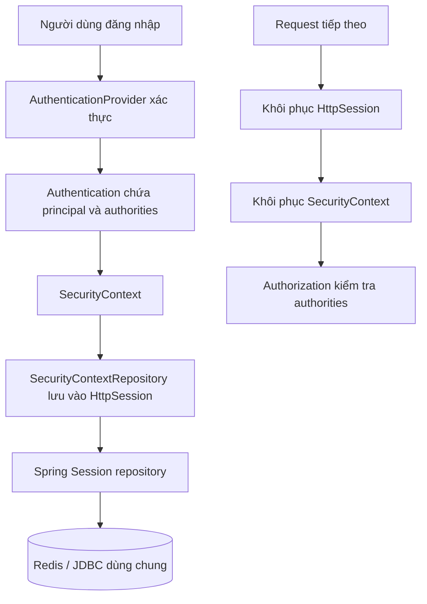

# Thay đổi quyền, khóa tài khoản và nhu cầu thu hồi phiên đã tồn tại

Spring Security xác thực người dùng và đưa thông tin xác thực vào SecurityContext. Với ứng dụng Servlet dùng session, context này thường được lưu trong HttpSession; Spring Session có thể lưu session đó ở Redis, JDBC hoặc kho dùng chung khác. Vì vậy, khi quản trị viên thay đổi role, thu hồi quyền, khóa tài khoản hoặc đặt lại mật khẩu, cần xem xét các phiên đã được xác thực trước đó.

Một thao tác khóa tài khoản thường ngăn lần đăng nhập tiếp theo, nhưng không tự động làm mất các session đang tồn tại. Tương tự, cập nhật role trong bảng người dùng không tự sửa Authentication đã được lưu trong session. Nếu chính sách yêu cầu thay đổi có hiệu lực ngay, ứng dụng phải chủ động tìm và thu hồi các phiên cũ, hoặc kiểm tra trạng thái/quyền hiện tại ở mỗi request. Bài học này trình bày cách phân biệt hai nhu cầu, cách dùng principal index và Spring Security session registry, cùng các race condition và kiểm thử cần có khi chạy nhiều instance.

## 1. SecurityContext và session tồn tại qua nhiều request

Sau khi xác thực thành công, Spring Security tạo một đối tượng Authentication chứa principal và các GrantedAuthority. SecurityContext giữ Authentication đó. Trong ứng dụng Servlet dùng xác thực dựa trên session, SecurityContext được lưu vào HTTP session để request tiếp theo có thể khôi phục danh tính người dùng mà không cần nhập lại thông tin xác thực.

Spring Session thay nơi lưu session của Servlet container bằng một repository dùng chung. Nếu Spring Security lưu SecurityContext trong HttpSession, context đó cũng được lưu cùng session trong repository Spring Session.



Session có thể tồn tại lâu hơn bản ghi Authentication ban đầu trong bộ nhớ của tiến trình. Khi request mới đến một instance khác, Spring Security khôi phục context từ kho session. Những authority trong context thường phản ánh quyền tại thời điểm xác thực hoặc thời điểm context được lưu gần nhất.

Điều này dẫn đến hai hệ quả:

- Thay đổi dữ liệu user trong database không tự động cập nhật object Authentication đang nằm trong các session.
- Xóa hoặc invalidate session trong repository dùng chung khiến request tiếp theo không thể khôi phục context từ session đó.

Spring Session cung cấp cơ chế lưu trữ và vòng đời session. Nó không tự quyết định chính sách nghiệp vụ rằng khi nào role change hoặc account lock phải thu hồi mọi phiên.

## 2. Khóa tài khoản và thu hồi session là hai hành động khác nhau

Spring Security có thể kiểm tra trạng thái tài khoản trong lúc xác thực. Với UserDetails, các trạng thái thường gặp gồm:

| Trạng thái | Ý nghĩa |
| --- | --- |
| isAccountNonLocked() | Tài khoản không bị khóa |
| isEnabled() | Tài khoản đang được bật |
| isAccountNonExpired() | Tài khoản chưa hết hạn |
| isCredentialsNonExpired() | Thông tin xác thực chưa hết hạn |

Các AuthenticationProvider như DaoAuthenticationProvider kiểm tra trạng thái tài khoản trong quá trình xác thực theo cấu hình và implementation. Nếu tài khoản bị khóa, lần đăng nhập tiếp theo có thể bị từ chối bằng lỗi trạng thái tài khoản.

Tuy nhiên, khi một người dùng đã đăng nhập và có SecurityContext được lưu trong session, việc cập nhật locked = true trong database không tự động tìm và xóa các session đó. Request tiếp theo có thể tiếp tục khôi phục Authentication cũ nếu ứng dụng không có bước kiểm tra bổ sung.

| Hành động quản trị | Ảnh hưởng mặc định cần hiểu | Khi nào cần thu hồi session? |
| --- | --- | --- |
| Khóa tài khoản | Ngăn xác thực mới nếu AuthenticationProvider kiểm tra trạng thái khóa | Khi tài khoản bị khóa do rủi ro hoặc chính sách yêu cầu phiên đang mở phải dừng |
| Vô hiệu hóa tài khoản | Ngăn xác thực mới nếu provider kiểm tra isEnabled() | Thường nên thu hồi tất cả session đang tồn tại |
| Đổi role hoặc authority | Các Authentication đã lưu có thể vẫn chứa role cũ | Khi quyền giảm hoặc thay đổi cần có hiệu lực ngay |
| Đặt lại mật khẩu | Không nhất thiết làm session hiện tại tự mất | Khi chính sách yêu cầu đăng xuất mọi thiết bị sau đổi mật khẩu |
| Thu hồi quyền truy cập một tài nguyên | Session vẫn có thể còn hợp lệ cho tài nguyên khác | Có thể chỉ cần kiểm tra quyền hiện tại ở điểm truy cập tài nguyên |
| Đăng xuất một thiết bị | Xóa hoặc invalidate session được chọn | Thu hồi đúng phiên tương ứng |

Đừng đồng nhất “không thể đăng nhập mới” với “mọi phiên đã đăng nhập đều bị chặn”. Hai mục tiêu cần các thao tác và kiểm thử riêng.

## 3. Vì sao thay đổi role không tự cập nhật Authentication đã lưu?

Giả sử người dùng alice đăng nhập lúc 09:00 với các authority:

```text
ROLE_USER
ROLE_REPORT_VIEWER
```

Spring Security lưu Authentication chứa các authority này vào SecurityContext trong session. Đến 10:00, quản trị viên gỡ ROLE_REPORT_VIEWER khỏi bảng phân quyền. Request tiếp theo của Alice có thể khôi phục Authentication cũ từ session và vẫn mang authority cũ nếu ứng dụng chỉ dùng context đã lưu.

Tương tự, nếu Alice được nâng quyền lên ROLE_ADMIN, các session cũ có thể chưa có authority mới cho đến khi xác thực lại hoặc context được cập nhật.

Các cách xử lý thường có:

1. **Thu hồi session:** xóa các session của principal để người dùng phải xác thực lại và nhận authority mới.
2. **Kiểm tra quyền động:** lấy quyền hiện tại từ nguồn dữ liệu tin cậy khi cần quyết định truy cập, hoặc dùng authorization component kiểm tra version/quyền hiện tại.
3. **Làm mới SecurityContext có kiểm soát:** cập nhật context trong phiên theo một cơ chế rõ ràng, đồng thời xử lý cache và nhiều instance.

Với thay đổi quyền nhạy cảm, thu hồi session là cách dễ hiểu để buộc xác thực lại. Với hệ thống có rất nhiều session hoặc yêu cầu thay đổi quyền gần như tức thời, kiểm tra version/quyền hiện tại trên các request nhạy cảm có thể phù hợp hơn. Không có cách nào nên được chọn mà không tính đến độ trễ, cache và tính sẵn sàng của nguồn dữ liệu quyền.

## 4. Tìm session theo principal

Để thu hồi tất cả phiên của một người dùng, ứng dụng cần tìm session theo danh tính principal. Spring Session cung cấp FindByIndexNameSessionRepository với phương thức findByPrincipalName.

```java
Map<String, ? extends Session> sessions =
        sessionRepository.findByPrincipalName(principalName);
```

Tên index chuẩn là FindByIndexNameSessionRepository.PRINCIPAL_NAME_INDEX_NAME. Với repository có hỗ trợ index principal, Spring Session có thể lập chỉ mục session theo tên principal từ SecurityContext được lưu trong session. Ví dụ, Redis indexed repository và JDBC indexed repository có thể cung cấp khả năng này theo phiên bản và cấu hình tương ứng.

Điều kiện quan trọng:

- Repository runtime phải triển khai FindByIndexNameSessionRepository.
- SecurityContext hoặc thuộc tính principal phải được lưu theo cách index resolver hiểu được.
- Giá trị dùng để truy vấn phải trùng với tên principal được lưu/index.
- Ứng dụng cần dùng một principal name ổn định, duy nhất trong phạm vi hệ thống hoặc tenant.

Không phải mọi SessionRepository đều hỗ trợ truy vấn theo principal. Nếu implementation không có index, findByPrincipalName không thể tự tìm session bằng cách quét tất cả dữ liệu. Kiểm tra repository thực tế trước khi xây dựng tính năng thu hồi theo người dùng.

Trong ứng dụng Spring Security, nên lấy principal name từ Authentication#getName() hoặc một danh tính đã xác thực ở server. Không nhận username tùy ý từ query parameter rồi dùng trực tiếp để xóa session.

## 5. Thu hồi tất cả session theo principal

Với repository hỗ trợ principal index, service có thể lấy map session rồi xóa từng session theo ID:

```java
import java.util.Map;

import org.springframework.session.FindByIndexNameSessionRepository;
import org.springframework.session.Session;
import org.springframework.stereotype.Service;

@Service
public class UserSessionRevocationService {

    private final FindByIndexNameSessionRepository<? extends Session> sessions;

    public UserSessionRevocationService(
            FindByIndexNameSessionRepository<? extends Session> sessions) {
        this.sessions = sessions;
    }

    public int revokeAll(String principalName) {
        Map<String, ? extends Session> found =
                sessions.findByPrincipalName(principalName);

        for (String sessionId : found.keySet()) {
            sessions.deleteById(sessionId);
        }

        return found.size();
    }
}
```

Đây là service minh họa cho thao tác repository. Endpoint gọi service phải được bảo vệ bằng quyền quản trị hoặc chỉ cho phép người dùng thu hồi phiên của chính họ. Không trả session ID ra API, không ghi map kết quả vào log và không cho caller xóa session của người khác chỉ bằng cách thay principal name trong request.

Khi gọi deleteById, repository xóa session khỏi kho dùng chung. Request tiếp theo mang cookie cũ sẽ không khôi phục được SecurityContext từ session đó và thường phải đi qua luồng xác thực lại. Cookie ở trình duyệt có thể vẫn còn cho đến khi hết hạn hoặc bị xóa; cookie cũ không có nghĩa session phía server vẫn tồn tại.

### 5.1. Thu hồi mọi phiên trừ phiên hiện tại

Một số giao diện bảo mật cho phép người dùng chọn “đăng xuất khỏi các thiết bị khác” nhưng vẫn giữ phiên đang dùng. Khi đó:

1. Lấy session ID hiện tại từ request/session ở server.
2. Tìm các session theo principal đã xác thực.
3. Bỏ qua session ID hiện tại.
4. Xóa các session còn lại.
5. Không đưa ID của bất kỳ session nào vào response hoặc log.

Chỉ dùng session ID hiện tại do server cung cấp trong request context. Không tin ID do client gửi trong body để quyết định phiên nào được giữ lại.

## 6. Dùng SpringSessionBackedSessionRegistry với quản lý phiên đồng thời

Spring Security có SessionRegistry để theo dõi các phiên đăng nhập, phục vụ giới hạn số session đồng thời và quản lý thông tin phiên. Với session được lưu bởi Spring Session, SpringSessionBackedSessionRegistry kết nối SessionRegistry với FindByIndexNameSessionRepository, nhờ đó registry có thể tra cứu session dùng chung thay vì chỉ dựa trên bộ nhớ của một JVM.

Ví dụ cấu hình khái quát:

```java
import org.springframework.context.annotation.Bean;
import org.springframework.context.annotation.Configuration;
import org.springframework.security.core.session.SessionRegistry;
import org.springframework.session.FindByIndexNameSessionRepository;
import org.springframework.session.Session;
import org.springframework.session.security.SpringSessionBackedSessionRegistry;

@Configuration
public class SessionRegistryConfiguration {

    @Bean
    SessionRegistry sessionRegistry(
            FindByIndexNameSessionRepository<? extends Session> repository) {
        return new SpringSessionBackedSessionRegistry<>(repository);
    }
}
```

Sau đó có thể dùng registry trong cấu hình quản lý session của Spring Security:

```java
@Bean
SecurityFilterChain securityFilterChain(
        HttpSecurity http,
        SessionRegistry sessionRegistry) throws Exception {

    http.sessionManagement(session -> session
            .maximumSessions(2)
            .sessionRegistry(sessionRegistry));

    return http.build();
}
```

Ví dụ trên minh họa cấu hình Servlet security hiện đại; API cụ thể có thể khác theo phiên bản Spring Security. SpringSessionBackedSessionRegistry cần repository hỗ trợ principal index. Nếu không có index, registry không thể cung cấp đầy đủ thông tin session theo principal.

maximumSessions(2) giới hạn số phiên đồng thời theo chính sách Spring Security. Đây là kiểm soát lúc đăng nhập và quản lý phiên, không tự thay thế quy trình thu hồi phiên khi quản trị viên khóa tài khoản hoặc thay đổi quyền.

## 7. expireNow() khác với xóa session khỏi repository

Với SessionRegistry truyền thống, SessionInformation có thể được đánh dấu hết hạn bằng expireNow(). Spring Security ConcurrentSessionFilter kiểm tra trạng thái session trong request tiếp theo và có thể đăng xuất phiên đã bị đánh dấu hết hạn.

Cần phân biệt:

| Thao tác | Ý nghĩa |
| --- | --- |
| SessionInformation.expireNow() | Đánh dấu session cần bị coi là hết hạn; filter xử lý khi phiên tiếp tục gửi request |
| SessionRepository.deleteById(sessionId) | Xóa session khỏi repository dùng chung |
| HttpSession.invalidate() / WebSession.invalidate() | Invalidate session hiện tại qua abstraction của web session |
| Xóa cookie phía client | Yêu cầu browser bỏ cookie; không tự xóa dữ liệu session phía server |

Nếu yêu cầu là thu hồi phiên ngay ở cấp kho dữ liệu, xóa session qua repository là thao tác trực tiếp hơn. Nếu dùng SessionRegistry và expireNow(), phải bảo đảm ConcurrentSessionFilter được cấu hình trong security chain và hiểu rằng phiên có thể chỉ bị chặn khi request tiếp theo đến.

Trong một hệ thống nhiều instance, không dựa vào một SessionRegistry chỉ lưu trạng thái trong bộ nhớ của từng JVM. Dùng SpringSessionBackedSessionRegistry với repository dùng chung khi cần theo dõi phiên qua các node.

## 8. Quy trình khóa tài khoản và thu hồi phiên

Một quy trình khóa tài khoản an toàn nên tách cập nhật trạng thái tài khoản và thu hồi các session hiện có thành các bước rõ ràng:

1. Xác thực người thực hiện và kiểm tra quyền quản trị.
2. Cập nhật trạng thái tài khoản trong nguồn dữ liệu chính, ví dụ locked = true hoặc enabled = false.
3. Commit thay đổi tài khoản.
4. Thu hồi các session theo principal trong repository dùng chung.
5. Ghi audit event không chứa session ID hoặc cookie.
6. Theo dõi lỗi thu hồi và có cơ chế retry/đối soát nếu thao tác repository tạm thời thất bại.

Ví dụ pseudocode:

```java
public void lockAccount(String principalName) {
    accountService.lockAndCommit(principalName);
    sessionRevocationService.revokeAll(principalName);
    auditService.recordAccountLocked(principalName);
}
```

Đây là pseudocode thể hiện thứ tự nghiệp vụ; cách quản lý transaction, event và retry phải được triển khai theo kiến trúc thực tế. Nếu account database và session repository dùng hai hệ thống dữ liệu khác nhau, không có một transaction JDBC đơn giản nào tự động commit nguyên tử cả hai.

Ưu tiên commit trạng thái khóa trước khi thu hồi session để lần đăng nhập mới bị chặn ngay khi provider kiểm tra tài khoản. Nếu thao tác xóa session thất bại sau khi khóa đã commit, cần ghi nhận công việc thu hồi còn tồn đọng và retry. Với hệ thống nhạy cảm, kiểm tra account status hoặc security version trên mỗi request quan trọng giúp chặn phiên cũ trong thời gian chờ thu hồi.

## 9. Race condition khi đăng nhập đồng thời với thao tác thu hồi

Một lần findByPrincipalName rồi xóa tất cả kết quả không phải thao tác nguyên tử trên toàn bộ vòng đời tài khoản. Có thể xảy ra tình huống:

1. Quản trị viên khóa tài khoản và truy vấn danh sách session hiện có.
2. Một request đăng nhập đã bắt đầu trước khi trạng thái khóa được commit.
3. Request đó hoàn tất xác thực và tạo session sau khi danh sách đã được truy vấn.
4. Session mới không nằm trong tập ID vừa xóa.

Vì vậy, thu hồi một lần có thể chưa đủ nếu có request đăng nhập đang chạy hoặc có nhiều node cùng xử lý. Cần có lớp bảo vệ bổ sung:

- AuthenticationProvider phải kiểm tra account locked/disabled từ nguồn trạng thái đáng tin cậy.
- Luồng đăng nhập cần kiểm tra trạng thái tài khoản đủ gần thời điểm tạo session.
- Với yêu cầu thu hồi nghiêm ngặt, dùng securityVersion hoặc credentialVersion tăng lên khi khóa tài khoản, đổi mật khẩu hoặc thay đổi quyền nhạy cảm.
- Request nhạy cảm kiểm tra version trong session/context so với version hiện tại của tài khoản; nếu không khớp, xóa context/session và yêu cầu xác thực lại.
- Có thể phát sự kiện thu hồi qua outbox hoặc message bền vững để các node và dịch vụ liên quan xử lý lại khi tạm thời mất kết nối.

Ví dụ về version:

```text
Account:
  principal = alice
  enabled = false
  securityVersion = 18

Session đã xác thực trước đó:
  principal = alice
  securityVersion = 17
```

Khi request mang session version 17 nhưng tài khoản hiện tại là 18, ứng dụng từ chối dùng context cũ. Cơ chế này cần được gắn vào security filter hoặc authorization layer có thứ tự phù hợp, đồng thời cache version phải có chính sách invalidation rõ ràng. Nếu cache giữ version cũ quá lâu, mục tiêu thu hồi tức thời sẽ không đạt được.

Không lưu version chỉ trong một biến static hoặc cache local của một instance nếu yêu cầu áp dụng cho toàn cluster. Các instance phải nhìn thấy cùng nguồn version hoặc nhận sự kiện invalidation đáng tin cậy.

## 10. Thay đổi quyền: thu hồi toàn bộ hay kiểm tra động?

Không phải mọi thay đổi role đều cần đăng xuất tất cả thiết bị. Hãy phân loại mức độ ảnh hưởng:

| Thay đổi | Chiến lược có thể chọn |
| --- | --- |
| Thêm quyền xem một báo cáo ít nhạy cảm | Có thể để quyền mới có hiệu lực ở lần xác thực tiếp theo hoặc làm mới context có kiểm soát |
| Gỡ quyền quản trị hoặc quyền truy cập dữ liệu nhạy cảm | Thu hồi session cũ hoặc kiểm tra authority/version hiện tại trước thao tác nhạy cảm |
| Khóa tài khoản do nghi ngờ bị chiếm quyền | Khóa đăng nhập mới, thu hồi tất cả session và kiểm tra request đang chạy |
| Đổi mật khẩu theo yêu cầu người dùng | Theo chính sách có thể thu hồi các phiên khác, giữ hoặc xóa phiên hiện tại |
| Tài khoản nhân viên nghỉ việc | Vô hiệu hóa tài khoản, thu hồi session và token liên quan, đồng bộ tới các dịch vụ khác |

Kiểm tra quyền động có thể thực hiện bằng AuthorizationManager, method security hoặc service kiểm tra quyền tại điểm nghiệp vụ. Cách này giúp quyền mới được áp dụng mà không cần luôn tạo session mới, nhưng tăng phụ thuộc vào database/cache và có thể tăng latency.

Nếu dùng cache cho authorities, phải xác định thời gian sống và cơ chế invalidation. Một role bị gỡ khỏi database nhưng còn trong cache hoặc Authentication cũ vẫn có thể được chấp nhận. Với thao tác có rủi ro cao, kiểm tra quyền tại service nghiệp vụ trước khi thực hiện tác động không thể đảo ngược.

## 11. Session cookie, token và các loại xác thực khác

Thu hồi Spring Session chỉ tác động đến phiên mà Spring Session quản lý. Nếu hệ thống đồng thời dùng các cơ chế khác, cần xử lý riêng:

- **Session cookie:** xóa session khỏi repository dùng chung để request tiếp theo không thể khôi phục session.
- **JWT bearer token stateless:** xóa Spring Session không tự vô hiệu hóa JWT đã phát hành. Cần token expiration ngắn, introspection, denylist theo jti, hoặc token/security version được kiểm tra ở server.
- **Refresh token:** cần thu hồi refresh token hoặc token family trong authorization server/token store.
- **API key hoặc credential service-to-service:** cần thu hồi key ở hệ thống quản lý credential.
- **Remember-me token:** cần xử lý persistent token repository hoặc cơ chế remember-me tương ứng.

Nếu access token được lưu trong session, xóa session có thể làm ứng dụng không còn truy cập được token đó qua session. Nhưng nếu token đã được copy ra client hoặc phát hành độc lập, nó vẫn có thể được sử dụng cho đến khi hết hạn hoặc bị thu hồi theo cơ chế của token.

Không tuyên bố “đăng xuất tất cả thiết bị” đã hoàn tất nếu chỉ xóa session cookie mà không xử lý refresh token, JWT hoặc credential khác mà ứng dụng phát hành.

## 12. Sự kiện và audit khi thu hồi phiên

Khi session bị xóa hoặc hết hạn, Spring Session có thể phát các sự kiện vòng đời như SessionDeletedEvent hoặc SessionExpiredEvent tùy repository và cấu hình. Ứng dụng có thể dùng listener để dọn dữ liệu phụ trợ, chẳng hạn trạng thái WebSocket hoặc subscription gắn với session.

Ví dụ listener:

```java
@Component
public class SessionRevocationListener {

    @EventListener
    public void onSessionDeleted(SessionDeletedEvent event) {
        // Dọn tài nguyên phụ trợ liên quan đến session.
        // Không ghi session ID hoặc toàn bộ attributes vào log.
    }
}
```

Listener nên idempotent vì sự kiện có thể được xử lý lại hoặc có khoảng trễ tùy hạ tầng. Không đặt hành động nghiệp vụ duy nhất và không thể khôi phục vào một event notification không bền vững nếu yêu cầu đảm bảo thực thi. Với audit bắt buộc, ghi audit record trong quy trình quản trị hoặc dùng outbox bền vững.

Audit nên ghi principal, người thực hiện, thời điểm, lý do, số phiên bị thu hồi và correlation ID. Không ghi cookie, session ID, bearer token hoặc nội dung SecurityContext.

## 13. Bảo vệ endpoint quản trị và thao tác thu hồi

Endpoint thay đổi quyền, khóa tài khoản và thu hồi session có ảnh hưởng lớn. Cần:

- Chỉ cho role quản trị hoặc quyền cụ thể gọi thao tác khóa tài khoản.
- Yêu cầu xác thực lại hoặc MFA cho thao tác nhạy cảm nếu chính sách cần.
- Kiểm tra quyền trên đúng tenant và đúng principal.
- Không tin principal name do client cung cấp nếu thao tác là “thu hồi phiên của tôi”.
- Bảo vệ CSRF cho endpoint dùng cookie/session và thay đổi trạng thái.
- Giới hạn tốc độ hoặc audit thao tác thu hồi hàng loạt để tránh lạm dụng.
- Không trả session ID hoặc token trong response.
- Dùng idempotency hoặc xử lý lặp an toàn khi client retry yêu cầu khóa/thu hồi.

Với người dùng tự quản lý thiết bị, server nên lấy principal từ Authentication của request hiện tại. Nếu người dùng được phép thu hồi phiên của một principal khác (quản trị viên), kiểm tra quyền đó ở server trước khi truy vấn index.

## 14. Vận hành trong nhiều instance

Để việc thu hồi có hiệu lực trên toàn hệ thống:

1. Mọi instance phải dùng cùng Spring Session repository hoặc cùng kho session dùng chung.
2. Cookie name, namespace, serializer và cấu hình session phải tương thích giữa các instance.
3. Principal index phải được cập nhật và truy vấn trên repository dùng chung.
4. Không dùng SessionRegistry chỉ lưu trong memory local nếu cần quản lý session trên nhiều node.
5. Các instance cần dùng cùng nguồn account status/security version hoặc cơ chế cache invalidation có độ trễ được kiểm soát.
6. Nếu có nhiều dịch vụ phát hành token, cần phối hợp thu hồi token ở từng hệ thống.

Xóa session khỏi Redis/JDBC dùng chung làm cho request tiếp theo trên node khác không thể tải session cũ. Nhưng một request đã tải SecurityContext trước thời điểm xóa có thể đang chạy tiếp. Thu hồi session không tự dừng một method đang thực thi. Với thao tác nhạy cảm, kiểm tra account status/version ngay tại điểm thực hiện nghiệp vụ hoặc dùng cơ chế khóa/ủy quyền phù hợp.

Không bật sticky session để thay thế repository dùng chung. Sticky session có thể che lỗi chia sẻ trong test nhưng không giải quyết việc người dùng đổi node, node restart hoặc yêu cầu thu hồi từ một instance khác.

## 15. Kiểm thử thay đổi quyền và thu hồi session

Nên có integration test sử dụng repository thật (ví dụ Redis hoặc JDBC) và ít nhất hai application instance khi triển khai phân tán.

Các kịch bản quan trọng:

1. **Khóa tài khoản:** đăng nhập thành công, khóa tài khoản, thử đăng nhập mới và xác nhận provider từ chối.
2. **Session cũ sau khóa:** giữ cookie đã đăng nhập trước đó, khóa tài khoản, thu hồi session và xác nhận cookie cũ không khôi phục được Authentication.
3. **Đổi role:** đăng nhập với role ban đầu, gỡ role trong nguồn dữ liệu, xác nhận chính sách đã chọn: session bị thu hồi hoặc authorization động từ chối quyền cũ.
4. **Thu hồi nhiều phiên:** cùng principal đăng nhập trên nhiều browser/client, gọi revoke-all và xác nhận tất cả session đều không còn hợp lệ.
5. **Giữ phiên hiện tại:** thu hồi các session khác nhưng phiên hiện tại vẫn hoạt động theo đúng yêu cầu.
6. **Hai instance:** đăng nhập ở A, thu hồi ở B, gửi cookie cũ đến A và xác nhận session không còn hợp lệ.
7. **Concurrent login:** cho đăng nhập xảy ra đồng thời với thao tác khóa/thu hồi, xác nhận security version hoặc kiểm tra account status chặn session mới theo chính sách.
8. **SessionRegistry:** xác nhận registry nhìn thấy các phiên được tạo ở instance khác và giới hạn phiên đồng thời hoạt động như cấu hình.
9. **Token ngoài session:** xác nhận JWT/refresh token/API key được thu hồi bằng cơ chế riêng, không giả định delete session xử lý chúng.
10. **Audit và log:** xác nhận có audit record cần thiết nhưng không có session ID, cookie hoặc token trong log.

Không chỉ mock FindByIndexNameSessionRepository nếu mục tiêu là chứng minh principal index được tạo và cập nhật đúng. Test repository thật để kiểm tra session được index theo principal, delete làm mất kết quả truy vấn và nhiều instance nhìn thấy cùng trạng thái.

## 16. Những lỗi thường gặp

- **Chỉ đặt locked = true:** lần đăng nhập mới bị chặn nhưng session cũ có thể vẫn được khôi phục.
- **Chỉ thay role trong database:** Authentication đã lưu có thể còn authority cũ.
- **Chỉ xóa cookie ở browser:** session phía server có thể vẫn còn tồn tại và cookie bị sao chép vẫn có thể dùng.
- **Chỉ dùng SessionRegistry local:** instance khác không biết phiên được tạo ở node khác.
- **Dùng principal do client gửi:** có thể xóa session của tài khoản khác nếu thiếu kiểm tra quyền.
- **Cho rằng delete session dừng request đang chạy:** request đã tải context có thể tiếp tục thực hiện.
- **Bỏ qua race với đăng nhập mới:** session có thể được tạo sau lần truy vấn danh sách để thu hồi.
- **Dùng session deletion để thu hồi JWT:** bearer token độc lập có thể vẫn còn hiệu lực.
- **Không xử lý cache quyền:** session mới vẫn có thể nhận authorities cũ từ cache.
- **Ghi session ID vào audit:** biến log quản trị thành nơi lưu credential nhạy cảm.

## 17. Checklist triển khai

Trước khi phát hành, xác nhận:

- [ ] Đã phân biệt chặn đăng nhập mới với thu hồi session đang tồn tại.
- [ ] AuthenticationProvider kiểm tra account locked/disabled khi xác thực.
- [ ] Đã xác định thay đổi role nào cần thu hồi ngay và thay đổi nào dùng authorization động.
- [ ] Repository hỗ trợ principal index nếu cần revoke-all theo principal.
- [ ] Principal name lấy từ Authentication hoặc nguồn tin cậy và ổn định.
- [ ] Service thu hồi session có authorization phù hợp và không lộ session ID.
- [ ] SpringSessionBackedSessionRegistry được dùng nếu cần SessionRegistry trên repository dùng chung.
- [ ] Đã hiểu expireNow() khác với xóa session khỏi repository.
- [ ] Quy trình account lock/role change có xử lý lỗi, retry và audit.
- [ ] Có biện pháp xử lý race giữa đăng nhập mới và thao tác thu hồi.
- [ ] JWT, refresh token, remember-me token và API key được thu hồi theo cơ chế riêng.
- [ ] Các instance dùng chung session repository, principal index và trạng thái tài khoản.
- [ ] Đã kiểm thử nhiều session, nhiều instance, concurrent login và cookie cũ sau thu hồi.
- [ ] Log/audit không chứa cookie, session ID, bearer token hoặc SecurityContext.

## 18. Tự kiểm tra kiến thức

Bạn đã nắm được bài học nếu có thể trả lời:

- Vì sao khóa tài khoản không tự động xóa các session đã đăng nhập?
- Vì sao thay đổi role trong database không tự cập nhật GrantedAuthority trong Authentication đã lưu?
- FindByIndexNameSessionRepository hỗ trợ thu hồi session như thế nào?
- Khi nào dùng SpringSessionBackedSessionRegistry và nó cần repository capability nào?
- SessionInformation.expireNow() khác deleteById() ở điểm nào?
- Vì sao cần xử lý race giữa đăng nhập đang diễn ra và truy vấn revoke-all?
- Security version giúp phát hiện session cũ như thế nào?
- Vì sao xóa Spring Session không tự thu hồi JWT hoặc refresh token độc lập?
- Cần kiểm thử gì để chứng minh thu hồi có hiệu lực trên mọi application instance?

Thay đổi quyền và trạng thái tài khoản chỉ có hiệu lực với các phiên cũ khi ứng dụng có cơ chế áp dụng thay đổi đó. Với session-based authentication, hãy quyết định rõ lúc nào cần thu hồi toàn bộ phiên, dùng principal index hoặc registry dùng chung để tìm chúng, và bổ sung kiểm tra trạng thái/version cho các yêu cầu nhạy cảm khi cần hiệu lực tức thời. Khóa đăng nhập mới, thu hồi session cũ và thu hồi token độc lập là các phần việc khác nhau; cần phối hợp chúng trong một quy trình có kiểm thử và audit.
