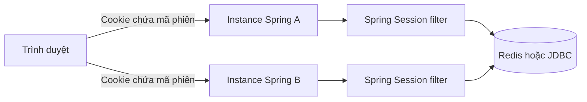

# Thuộc tính phiên và cách mô hình hóa trạng thái của người dùng

Trong ứng dụng web dùng Servlet, **phiên (session)** là vùng trạng thái phía máy chủ được gắn với một trình duyệt hoặc một luồng tương tác. Mỗi phiên có một mã định danh; trình duyệt gửi mã này qua cookie trong các request tiếp theo để máy chủ tìm lại phiên tương ứng. Ứng dụng có thể đặt các thuộc tính vào `HttpSession` để giữ một lượng nhỏ dữ liệu cần dùng qua nhiều request, chẳng hạn ngôn ngữ giao diện, mã giỏ hàng hoặc bản nháp của một quy trình nhiều bước.

Với Spring Session, ứng dụng vẫn thao tác qua API Servlet quen thuộc như `HttpSession`, nhưng dữ liệu phiên được lưu trong một kho có thể dùng chung giữa nhiều instance, ví dụ Redis hoặc JDBC. Vì vậy, cách thiết kế thuộc tính phiên cần tính đến vòng đời, khả năng tuần tự hóa, bảo mật và truy cập đồng thời. Một thuộc tính phiên tốt giúp nối các request; nó không nên trở thành nơi lưu toàn bộ hồ sơ người dùng hay nguồn dữ liệu chính của nghiệp vụ.

## 1. Thuộc tính phiên nằm ở đâu?

`HttpSession` cung cấp một tập thuộc tính dạng cặp tên–giá trị. Tên là chuỗi; giá trị là đối tượng Java. Ứng dụng đọc, thêm, thay thế hoặc xóa giá trị bằng các phương thức như `getAttribute`, `setAttribute` và `removeAttribute`.

Trong triển khai chỉ dùng session nội bộ của một servlet container, trạng thái thường nằm trong bộ nhớ của instance đó. Khi tích hợp Spring Session với Redis hoặc JDBC, `SessionRepositoryFilter` cung cấp một implementation `HttpSession` dựa trên repository. Mã ứng dụng tiếp tục dùng API Servlet, còn Spring Session tải và lưu dữ liệu phiên vào kho dùng chung.



Cookie thường chỉ mang **mã định danh phiên**. Các thuộc tính như `userContext`, `cartId` hay `checkoutDraft` được lưu ở phía máy chủ trong repository. Khi request tiếp theo được định tuyến sang instance khác, instance đó vẫn có thể đọc cùng phiên nếu dùng chung repository và cấu hình tương thích.

Điều này tạo ra hai lớp dữ liệu cần phân biệt:

- **Mã phiên**: thông tin định danh được trình duyệt gửi lại qua cookie. Mã này phải được bảo vệ như một thông tin xác thực vì người sở hữu mã phiên có thể sử dụng phiên tương ứng.
- **Thuộc tính phiên**: dữ liệu phía máy chủ gắn với mã phiên, được ứng dụng truy cập thông qua `HttpSession`.

## 2. Thao tác với thuộc tính `HttpSession`

Ví dụ sau minh họa việc lưu lựa chọn ngôn ngữ. Dùng `getSession(true)` khi chủ động muốn tạo phiên; dùng `getSession(false)` khi chỉ muốn đọc phiên hiện có mà không tạo phiên mới.

```java
import jakarta.servlet.http.HttpServletRequest;
import jakarta.servlet.http.HttpSession;
import org.springframework.web.bind.annotation.GetMapping;
import org.springframework.web.bind.annotation.PostMapping;
import org.springframework.web.bind.annotation.RequestParam;
import org.springframework.web.bind.annotation.RestController;

@RestController
public class LocaleController {

    private static final String LOCALE_ATTRIBUTE = "app.ui.locale";

    @PostMapping("/preferences/locale")
    public void saveLocale(
            @RequestParam String locale,
            HttpServletRequest request) {
        HttpSession session = request.getSession(true);
        session.setAttribute(LOCALE_ATTRIBUTE, locale);
    }

    @GetMapping("/preferences/locale")
    public String readLocale(HttpServletRequest request) {
        HttpSession session = request.getSession(false);
        if (session == null) {
            return "vi-VN";
        }

        Object value = session.getAttribute(LOCALE_ATTRIBUTE);
        return value instanceof String locale ? locale : "vi-VN";
    }
}
```

Trong ứng dụng thực tế, cần kiểm tra `locale` theo danh sách ngôn ngữ được hỗ trợ trước khi lưu. Ví dụ trên chỉ tập trung vào API session.

Một số quy tắc cơ bản:

- `getSession()` tương đương yêu cầu tạo session nếu request chưa có session. Gọi nó trong mọi endpoint đọc dữ liệu có thể vô tình tạo nhiều session và cookie.
- `getSession(false)` trả về `null` nếu chưa có session. Cách này phù hợp với endpoint chỉ đọc trạng thái tùy chọn.
- Dùng tên thuộc tính có namespace, chẳng hạn `app.ui.locale` hoặc `app.checkout.draft`, để tránh xung đột với thư viện hay module khác.
- Dùng `removeAttribute(name)` khi một phần trạng thái không còn cần thiết. Khi hoàn tất toàn bộ phiên, có thể gọi `invalidate()` theo đúng luồng đăng xuất hoặc kết thúc phiên.
- Không giữ một tham chiếu `HttpSession` trong singleton service, static field hoặc tác vụ nền. Hãy lấy session từ request hiện tại và chỉ dùng nó trong phạm vi xử lý request phù hợp.

## 3. Chọn dữ liệu nào nên nằm trong session?

Session hữu ích nhất cho dữ liệu nhỏ, có thời hạn ngắn và cần thiết để nối các request. Trước khi thêm một thuộc tính, hãy trả lời ba câu hỏi: dữ liệu có cần tồn tại qua request tiếp theo không, có thể dựng lại từ nguồn dữ liệu chính không, và điều gì xảy ra khi phiên hết hạn hoặc bị xóa?

| Nhóm trạng thái | Ví dụ phù hợp | Cách lưu nên cân nhắc |
|---|---|---|
| Ngữ cảnh giao diện | Ngôn ngữ, múi giờ, lựa chọn hiển thị | Giá trị đơn giản như chuỗi hoặc mã enum |
| Ngữ cảnh người dùng | User ID, tenant ID, mã hồ sơ đang thao tác | DTO nhỏ chứa định danh; kiểm tra quyền ở mỗi thao tác nghiệp vụ |
| Quy trình nhiều bước | Bản nháp biểu mẫu, bước hiện tại, mã giao dịch tạm | DTO nhỏ hoặc mã tham chiếu đến bản nháp được lưu riêng |
| Giỏ hàng | Cart ID, một số thông tin hiển thị tạm | Lưu giỏ hàng bền vững trong kho nghiệp vụ; session giữ Cart ID |
| Dữ liệu nghiệp vụ chính | Đơn hàng, số dư, quyền truy cập mới nhất | Cơ sở dữ liệu hoặc dịch vụ nghiệp vụ; không dùng session làm nguồn sự thật |

### 3.1. Lưu ngữ cảnh tối thiểu của người dùng

Một mô hình ngữ cảnh phiên có thể chỉ chứa định danh và lựa chọn giao diện. Ví dụ dùng Java record để thể hiện DTO bất biến:

```java
import java.io.Serializable;

public record UserSessionContext(
        String userId,
        String tenantId,
        String localeTag,
        int schemaVersion
) implements Serializable {
}
```

Tên thuộc tính nên được gom vào một nơi để tránh lỗi gõ sai giữa các controller và service:

```java
public final class SessionAttributeNames {
    public static final String USER_CONTEXT = "app.user.context";
    public static final String CART_ID = "app.cart.id";

    private SessionAttributeNames() {
    }
}
```

Sau khi xác thực, ứng dụng có thể tạo ngữ cảnh từ principal đã được máy chủ xác minh:

```java
UserSessionContext context = new UserSessionContext(
        principal.userId(),
        principal.tenantId(),
        "vi-VN",
        1
);

request.getSession(true).setAttribute(
        SessionAttributeNames.USER_CONTEXT,
        context
);
```

`principal` trong ví dụ là đối tượng đại diện người dùng đã xác thực của ứng dụng. Không lấy `userId` hoặc `tenantId` từ dữ liệu client gửi lên rồi coi đó là danh tính đáng tin cậy.

Khi cần đọc thuộc tính đã tồn tại, Spring MVC cung cấp `@SessionAttribute`:

```java
@GetMapping("/account/context")
public UserSessionContext accountContext(
        @SessionAttribute(
                name = SessionAttributeNames.USER_CONTEXT,
                required = false
        ) UserSessionContext context) {
    if (context == null) {
        throw new ResponseStatusException(HttpStatus.UNAUTHORIZED);
    }
    return context;
}
```

Đặt `required = false` cho phép controller tự xử lý trường hợp thuộc tính chưa có. Với endpoint cần đăng nhập, hãy chuyển hướng hoặc trả mã lỗi phù hợp theo chính sách ứng dụng.

Ngữ cảnh phiên chỉ là bản sao tiện dụng của một số thông tin. Khi xử lý yêu cầu nhạy cảm, ứng dụng vẫn phải kiểm tra user còn tồn tại, tenant có hợp lệ và người dùng có quyền thực hiện hành động đó. Quyền có thể đã thay đổi kể từ lúc session được tạo.

### 3.2. Giữ bản nháp của quy trình nhiều bước

Spring MVC có annotation `@SessionAttributes` để giữ một số model attribute trong session trong suốt một quy trình thuộc controller. Ví dụ, một màn hình thanh toán có thể cần giữ bản nháp giữa các bước:

```java
@Controller
@RequestMapping("/checkout")
@SessionAttributes("checkoutDraft")
public class CheckoutController {

    @ModelAttribute("checkoutDraft")
    public CheckoutDraft createDraft() {
        return new CheckoutDraft();
    }

    @PostMapping("/address")
    public String saveAddress(
            @ModelAttribute("checkoutDraft") CheckoutDraft draft,
            @Valid AddressForm form,
            BindingResult errors) {
        if (errors.hasErrors()) {
            return "checkout/address";
        }
        draft.setAddress(form.toAddress());
        return "redirect:/checkout/payment";
    }

    @PostMapping("/complete")
    public String complete(
            @ModelAttribute("checkoutDraft") CheckoutDraft draft,
            SessionStatus sessionStatus) {
        checkoutService.createOrder(draft);
        sessionStatus.setComplete();
        return "redirect:/orders/confirmation";
    }
}
```

Đây là ví dụ rút gọn; ứng dụng cần khai báo các dependency, kiểu form và bước xác thực dữ liệu tương ứng. `SessionStatus.setComplete()` báo cho Spring MVC kết thúc các thuộc tính mà controller quản lý qua `@SessionAttributes`.

`CheckoutDraft` cũng phải phù hợp với serializer của repository session. Nếu dùng Java serialization, kiểu này và các trường bên trong cần đáp ứng yêu cầu tuần tự hóa; nếu dùng JSON serializer, cấu trúc của nó phải đọc được trên tất cả instance.

Phân biệt ba cơ chế thường bị nhầm:

- `@ModelAttribute` đưa dữ liệu vào model của request hiện tại.
- `@SessionAttribute` đọc một thuộc tính đã có trong session.
- `@SessionAttributes` đánh dấu các model attribute của controller để Spring MVC duy trì chúng trong session cho đến khi quy trình được đánh dấu hoàn tất.

Với quy trình dài, dữ liệu lớn hoặc cần khôi phục sau khi người dùng đóng trình duyệt, nên lưu bản nháp trong cơ sở dữ liệu hoặc kho nghiệp vụ có thời hạn. Session chỉ giữ mã tham chiếu và trạng thái điều hướng ngắn hạn.

### 3.3. Lưu mã tham chiếu cho giỏ hàng

Giỏ hàng thường là dữ liệu nghiệp vụ có thể cần tồn tại sau khi session hết hạn, được dùng trên nhiều thiết bị hoặc được phục hồi sau khi đăng nhập. Vì vậy, một thiết kế phù hợp là lưu `cartId` trong session và lưu các dòng hàng trong kho nghiệp vụ:

```java
request.getSession(true).setAttribute(
        SessionAttributeNames.CART_ID,
        cartId
);
```

Khi đọc giỏ hàng, service dùng `cartId` để tải dữ liệu từ repository và kiểm tra chủ sở hữu. Khi người dùng đăng nhập, ứng dụng có thể hợp nhất giỏ hàng ẩn danh với giỏ hàng của tài khoản theo quy tắc nghiệp vụ rõ ràng. Việc chỉ giữ toàn bộ giỏ hàng trong session có thể làm mất dữ liệu khi phiên hết hạn và gây khó khăn khi xử lý đồng thời trên nhiều thiết bị.

## 4. Thiết kế kiểu dữ liệu và khả năng tuần tự hóa

Spring Session có thể ghi thuộc tính phiên vào Redis hoặc JDBC. Khi dữ liệu đi qua repository, đối tượng phải phù hợp với serializer và cấu hình của tất cả instance ứng dụng. Điều kiện cụ thể phụ thuộc serializer đang dùng:

- Với Java serialization, đối tượng và toàn bộ object graph cần đáp ứng yêu cầu tuần tự hóa, thường là triển khai `Serializable`.
- Với JSON serializer, kiểu dữ liệu, constructor, tên trường và thông tin kiểu phải tương thích với cấu hình chuyển đổi ở các instance.
- Với serializer tùy chỉnh, cần có quy tắc ghi và đọc nhất quán, có kiểm thử round-trip.

Ưu tiên các kiểu đơn giản, DTO nhỏ và cấu trúc ổn định. Tránh đặt trực tiếp các đối tượng sau vào session:

- JPA entity hoặc Hibernate proxy có quan hệ lazy; chúng có thể mang theo cả object graph lớn, phụ thuộc persistence context hoặc không tuần tự hóa được.
- `HttpServletRequest`, `HttpServletResponse`, stream, connection, thread, executor hay đối tượng gắn với tài nguyên đang mở.
- Đối tượng service, repository, bean Spring hoặc đối tượng chứa tham chiếu đến các bean đó.
- Toàn bộ hồ sơ người dùng, danh sách quyền lớn, kết quả truy vấn lớn hoặc dữ liệu có thể tải lại từ nguồn chính.
- Mật khẩu, mã OTP, access token dài hạn, khóa bí mật hoặc dữ liệu thanh toán nhạy cảm.

### 4.1. Giữ schema phiên tương thích khi triển khai

Với Redis hoặc JDBC dùng chung, phiên có thể được tạo bởi phiên bản ứng dụng cũ rồi đọc bởi phiên bản mới trong lúc triển khai rolling update. Nếu một instance ghi kiểu dữ liệu mà instance khác không đọc được, request có thể lỗi khi giải tuần tự hóa.

Để giảm rủi ro:

1. Giữ DTO phiên nhỏ và ít thay đổi; ưu tiên lưu mã định danh thay cho đối tượng nghiệp vụ đầy đủ.
2. Khi cần thay đổi cấu trúc, thiết kế cách đọc tương thích với dữ liệu phiên cũ trong khoảng thời gian chúng còn hiệu lực.
3. Có thể thêm `schemaVersion` để ứng dụng nhận biết phiên bản dữ liệu sau khi serializer đã đọc được đối tượng. Trường này không tự khắc phục lỗi giải tuần tự hóa do đổi tên class hoặc thay đổi không tương thích.
4. Nếu không thể duy trì tương thích, lập kế hoạch hết hạn, xóa hoặc chuyển đổi phiên cũ trước khi phát hành phiên bản mới.
5. Kiểm thử đọc dữ liệu được ghi bởi phiên bản trước bằng phiên bản mới, đặc biệt khi thay serializer hoặc đổi kiểu DTO.

Không giả định rằng Redis và JDBC sẽ tự chuyển đổi mọi kiểu Java. Hãy kiểm tra serializer thực tế trong cấu hình Spring Session của ứng dụng và xác minh hành vi bằng integration test.

## 5. Vòng đời thuộc tính và thời hạn phiên

Thuộc tính tồn tại theo vòng đời của session, trừ khi ứng dụng chủ động xóa nó. Khi session hết hạn hoặc bị invalidate, các thuộc tính gắn với session cũng không còn khả dụng.

Trong Spring Boot, có thể cấu hình thời gian không hoạt động tối đa của session, ví dụ:

```properties
server.servlet.session.timeout=30m
```

Giá trị cụ thể cần dựa trên yêu cầu sản phẩm và mức độ nhạy cảm của ứng dụng. Timeout thường được tính theo thời gian không có hoạt động; cách làm mới thời hạn và thời điểm dọn dữ liệu vật lý phụ thuộc repository. Hãy kiểm tra cấu hình Spring Session và kho lưu trữ đang sử dụng.

Timeout áp dụng cho **toàn bộ session**, không tự tạo TTL độc lập cho từng thuộc tính. Nếu một thuộc tính cần hết hạn sớm hơn session, lưu kèm thời điểm hết hạn và kiểm tra khi đọc, hoặc chuyển dữ liệu đó sang một kho hỗ trợ TTL theo khóa/bản ghi:

```java
public record TemporarySelection(
        String value,
        Instant expiresAt
) implements Serializable {
    public boolean isExpired(Instant now) {
        return !now.isBefore(expiresAt);
    }
}
```

Khi đọc, nếu `isExpired(Instant.now())` trả về `true`, xóa thuộc tính bằng `removeAttribute` và yêu cầu người dùng thực hiện lại thao tác cần thiết. Không dùng thời gian phía client làm nguồn quyết định duy nhất cho thời điểm hết hạn.

Các sự kiện vòng đời của Spring Session như tạo, xóa hoặc hết hạn session có thể giúp ghi log, cập nhật số liệu hoặc dọn dữ liệu phụ. Không nên phụ thuộc vào một sự kiện session để hoàn tất giao dịch nghiệp vụ quan trọng; giao dịch đó cần được lưu và quản lý trong kho nghiệp vụ với cơ chế nhất quán riêng.

## 6. Bảo mật khi lưu trạng thái người dùng

Session là một phần của cơ chế xác thực và duy trì ngữ cảnh người dùng. Nếu kẻ khác lấy được session ID, họ có thể giả mạo trình duyệt sở hữu phiên đó. Vì vậy:

- Chỉ truyền cookie session qua HTTPS trong môi trường triển khai thật; bật cờ `Secure` và `HttpOnly` phù hợp.
- Chọn `SameSite` theo luồng điều hướng và tích hợp đăng nhập của ứng dụng; kiểm thử các luồng cần chuyển hướng từ domain khác.
- Không đưa dữ liệu nhạy cảm vào cookie session. Cookie nên mang mã định danh; dữ liệu phiên được lưu ở phía máy chủ.
- Sau khi xác thực hoặc thay đổi mức đặc quyền, cần đổi session ID để giảm nguy cơ session fixation. Spring Security có cơ chế bảo vệ session fixation; ưu tiên cấu hình và luồng chuẩn của framework.
- Khi đăng xuất, dùng luồng logout của Spring Security hoặc invalidate session theo thiết kế ứng dụng để xóa trạng thái xác thực và thuộc tính liên quan.
- Không xem `userId`, `tenantId` hay role lưu trong session là bằng chứng đủ để bỏ qua kiểm tra quyền. Luôn kiểm tra quyền trên tài nguyên và hành động cụ thể.
- Giảm dữ liệu cá nhân lưu trong session, giới hạn thời gian tồn tại và kiểm soát quyền truy cập vào Redis/JDBC cũng như log vận hành.

Spring Security có thể lưu `SecurityContext` trong session thông qua tích hợp Servlet. Vì thế, ứng dụng thường không cần tự tạo thêm thuộc tính kiểu `isLoggedIn=true` để thay thế trạng thái xác thực. Hãy dùng principal và cơ chế phân quyền của Spring Security; thuộc tính tùy chỉnh chỉ nên chứa ngữ cảnh bổ sung thực sự cần thiết.

## 7. Nhiều request có thể cùng cập nhật một session

Một người dùng có thể mở nhiều tab hoặc gửi hai request gần như đồng thời. Các request đó có thể được xử lý trên hai thread hoặc hai instance khác nhau và cùng đọc một session. `HttpSession` không cung cấp giao dịch nghiệp vụ hay bảo đảm khóa độc quyền cho chuỗi thao tác đọc–sửa–ghi.

Ví dụ, hai request cùng đọc số lượng là `1`, mỗi request tăng lên `2`, rồi cùng ghi lại. Kết quả cuối có thể là `2` thay vì `3` vì một cập nhật ghi đè cập nhật còn lại. Với repository dùng chung, việc lưu phiên phân tán không tự biến thao tác read–modify–write thành nguyên tử.

Các hướng xử lý phù hợp:

- Với trạng thái giao diện ít quan trọng, chấp nhận giá trị mới nhất thắng nếu điều đó đúng với yêu cầu sản phẩm.
- Với giỏ hàng, số lượng, hạn mức hoặc dữ liệu nghiệp vụ, cập nhật trong cơ sở dữ liệu bằng transaction, optimistic locking hoặc thao tác nguyên tử phù hợp.
- Nếu thực sự cần tuần tự hóa thao tác theo session, dùng cơ chế đồng bộ phân tán có thời hạn và xử lý được trường hợp lock hết hạn; chỉ áp dụng khi đã xác định rõ yêu cầu và chi phí.
- Tránh thay đổi trực tiếp một object mutable đang được nhiều request cùng tham chiếu. DTO bất biến và thao tác thay thế toàn bộ thuộc tính giúp dễ hiểu hơn, nhưng vẫn cần xử lý xung đột giữa các lần đọc–ghi.

Ngoài ra, tùy `SaveMode` của Spring Session, repository có thể chỉ ghi những thuộc tính đã được đánh dấu thay đổi. Với chế độ theo dõi các lần gọi `setAttribute` như `ON_SET_ATTRIBUTE`, sửa một object mutable sau khi đọc mà không gọi `setAttribute` lại có thể khiến thay đổi không được lưu. Cách an toàn, dễ theo dõi là tạo giá trị mới rồi gọi `setAttribute`, đồng thời kiểm tra `SaveMode` và hành vi flush của repository đang dùng.

Ví dụ, thay vì lưu một entity giỏ hàng rồi tăng số lượng ngay trong object đó, hãy gọi `cartService.addItem(cartId, productId, quantity)` để service thực hiện cập nhật nguyên tử hoặc có kiểm soát phiên bản trong kho dữ liệu nghiệp vụ.

## 8. Kiểm thử thuộc tính phiên

Kiểm thử session nên bao gồm cả hành vi trong một ứng dụng và khả năng chia sẻ trạng thái qua repository.

| Trường hợp | Điều cần xác minh |
|---|---|
| Request đầu tiên tạo thuộc tính | Thuộc tính được ghi với đúng tên và kiểu dữ liệu |
| Request tiếp theo cùng session | Đọc lại được giá trị đã lưu |
| Request không có session | Endpoint không vô tình tạo session nếu chỉ cần đọc tùy chọn |
| Xóa thuộc tính | Lần đọc tiếp theo không còn giá trị cũ |
| Hết hạn hoặc invalidate | Session không còn được sử dụng; luồng ứng dụng xử lý trường hợp thiếu trạng thái |
| Hai instance cùng repository | Instance B đọc được thay đổi do instance A lưu |
| Thay đổi DTO hoặc serializer | Dữ liệu phiên cũ được đọc an toàn hoặc được xử lý theo kế hoạch chuyển đổi |
| Hai request đồng thời | Không mất cập nhật quan trọng; nghiệp vụ có cơ chế xử lý xung đột |
| Đăng xuất | Trạng thái xác thực và session được kết thúc theo cấu hình bảo mật |

`MockHttpSession` hoặc session do MockMvc cung cấp hữu ích cho kiểm thử controller và luồng request cơ bản. Tuy nhiên, chúng không chứng minh Redis/JDBC hoạt động đúng. Với repository thật, nên có integration test dùng kho tương ứng, tạo session ở một application context rồi đọc lại từ context khác hoặc từ instance khác. Có thể dùng Testcontainers nếu dự án đã có hạ tầng kiểm thử phù hợp.

## 9. Lỗi thiết kế thường gặp

| Cách làm | Hệ quả | Cách điều chỉnh |
|---|---|---|
| Lưu cả JPA entity vào session | Object graph lớn, proxy hoặc lỗi tuần tự hóa | Lưu ID và tải entity qua service/repository |
| Dùng session làm nguồn dữ liệu chính của đơn hàng | Mất dữ liệu khi hết hạn, khó kiểm soát đồng thời | Lưu nghiệp vụ trong cơ sở dữ liệu |
| Tạo session trong mọi request đọc | Tăng số session và cookie không cần thiết | Dùng `getSession(false)` hoặc `@SessionAttribute` tùy trường hợp |
| Lưu role rồi tin role đó vô thời hạn | Quyền trong session có thể cũ | Dùng Spring Security và kiểm tra quyền hiện hành |
| Đưa token bí mật hoặc mật khẩu vào thuộc tính | Tăng hậu quả khi kho session hoặc log bị lộ | Chỉ lưu thông tin tối thiểu; dùng cơ chế quản lý bí mật phù hợp |
| Thay đổi DTO mà không kiểm tra dữ liệu cũ | Instance mới có thể không đọc được session đang tồn tại | Giữ tương thích hoặc xử lý phiên cũ trước khi phát hành |
| Coi cập nhật session là thao tác nguyên tử | Request đồng thời có thể ghi đè dữ liệu | Dùng transaction hoặc thao tác nguyên tử trong kho nghiệp vụ |

## 10. Quy trình thiết kế một thuộc tính phiên

Khi cần thêm trạng thái mới, có thể thực hiện theo trình tự sau:

1. Xác định mục đích: thuộc tính giúp nối những request nào và ai cần đọc nó?
2. Chọn nơi lưu: nếu dữ liệu là sự thật nghiệp vụ hoặc cần tồn tại lâu dài, lưu trong kho nghiệp vụ; session chỉ giữ dữ liệu tạm hoặc mã tham chiếu.
3. Định nghĩa DTO nhỏ, có tên thuộc tính rõ ràng và kiểu dữ liệu tương thích với serializer.
4. Đặt tên thuộc tính có namespace; xác định rõ nơi tạo, nơi đọc, nơi cập nhật và nơi xóa.
5. Xác định hành vi khi thiếu thuộc tính, session hết hạn, người dùng đăng xuất hoặc dữ liệu cũ không còn tương thích.
6. Đánh giá dữ liệu nhạy cảm, timeout, quyền truy cập và khả năng request đồng thời.
7. Kiểm thử qua nhiều request và, khi dùng Spring Session, kiểm thử đọc–ghi qua repository dùng chung.

Một thuộc tính phiên được mô hình hóa tốt có phạm vi nhỏ, có vòng đời rõ ràng và có thể mất đi mà không làm hỏng dữ liệu nghiệp vụ chính. Với ứng dụng Spring Session chạy trên nhiều instance, các nguyên tắc này giúp trạng thái người dùng nhất quán hơn giữa các request, đồng thời giảm lỗi khi hết hạn phiên, triển khai phiên bản mới hoặc xử lý truy cập đồng thời.
