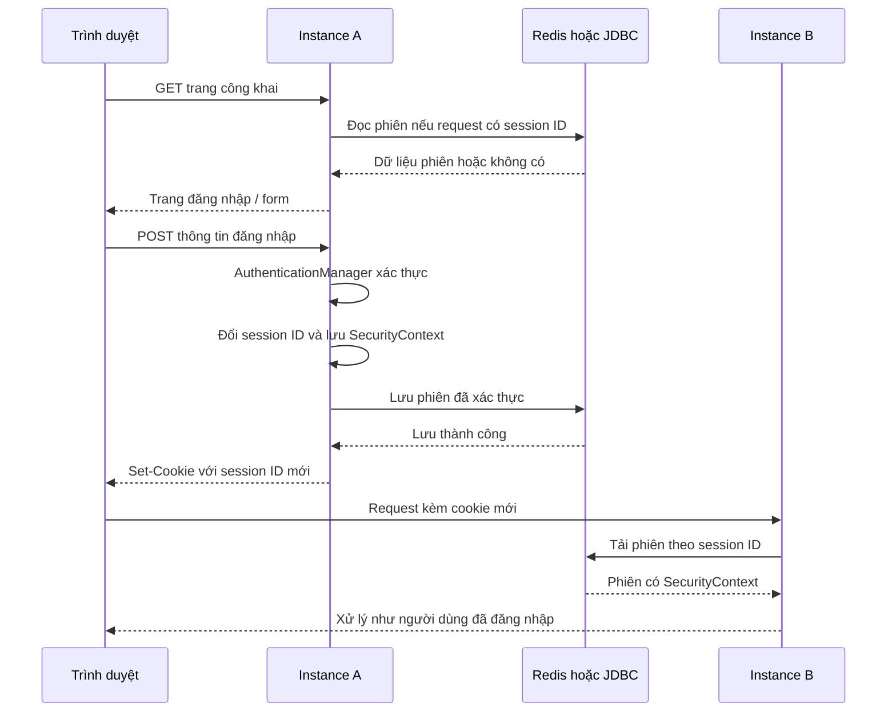

# Phiên ẩn danh, phiên đã xác thực và chuyển đổi trạng thái đăng nhập

Trong ứng dụng Servlet, phiên HTTP (`HttpSession`) là nơi lưu dữ liệu cần tồn tại qua nhiều request của cùng một trình duyệt. Trạng thái đăng nhập là một phần dữ liệu bảo mật có thể được lưu trong phiên, nhưng hai khái niệm này không đồng nhất: một trình duyệt có thể có phiên mà chưa đăng nhập, và một ứng dụng có thể xác thực request bằng token mà không cần phiên HTTP.

Spring Session thay thế cơ chế lưu `HttpSession` mặc định của máy chủ Servlet bằng một kho phiên có thể chia sẻ, chẳng hạn Redis hoặc JDBC. Vì vậy, khi request tiếp theo được xử lý bởi instance khác, ứng dụng vẫn có thể đọc cùng dữ liệu phiên thông qua session ID trong cookie. Spring Security quản lý `SecurityContext` và quá trình xác thực; Spring Session cung cấp lớp lưu trữ phiên dùng chung. Hiểu rõ ranh giới này giúp thiết kế đúng luồng từ khách ẩn danh sang người dùng đã đăng nhập, xử lý đăng xuất và vận hành nhiều instance.

## 1. Phân biệt phiên HTTP và trạng thái xác thực

`HttpSession` là vùng lưu trữ phía máy chủ. Trình duyệt thường giữ một cookie chứa session ID; cookie không nên chứa thông tin đăng nhập hay toàn bộ dữ liệu phiên. Khi request đến, Spring Session dùng ID đó để tìm phiên trong Redis hoặc JDBC rồi cung cấp một đối tượng `HttpSession` tương thích với Servlet API cho phần còn lại của ứng dụng.

`SecurityContext` là ngữ cảnh bảo mật của request. Nó chứa `Authentication`, trong đó có principal, authorities và thông tin xác thực. Với cơ chế đăng nhập dựa trên phiên, Spring Security có thể lưu `SecurityContext` vào `HttpSession` thông qua `SecurityContextRepository`, để các request sau khôi phục trạng thái đăng nhập. Khi dùng xác thực stateless, context có thể chỉ tồn tại trong phạm vi request và không được lưu vào phiên.

| Trạng thái | Ý nghĩa | Có bắt buộc có `HttpSession` không? |
| --- | --- | --- |
| Chưa có phiên | Request chưa tạo hoặc chưa gửi session ID hợp lệ | Không |
| Phiên ẩn danh | Có thể có dữ liệu phiên, nhưng người dùng chưa xác thực | Không bắt buộc |
| Phiên đã xác thực | Phiên có thể lưu `SecurityContext` của người dùng đã đăng nhập | Thường có trong ứng dụng đăng nhập bằng session |
| Phiên hết hạn hoặc bị vô hiệu hóa | Session ID không còn ánh xạ tới phiên hợp lệ | Không còn phiên hợp lệ |

Spring Security thường biểu diễn người chưa đăng nhập bằng `AnonymousAuthenticationToken`. Token này giúp các quy tắc phân quyền xử lý request nhất quán, nhưng không có nghĩa người dùng đã đăng nhập. Đặc biệt, không nên chỉ kiểm tra `authentication.isAuthenticated()` để kết luận người dùng đã đăng nhập: token ẩn danh cũng có thể trả về `true` cho thuộc tính đó.

Khi cần phân biệt người dùng đã xác thực với người ẩn danh trong mã ứng dụng, có thể dùng `AuthenticationTrustResolver`:

```java
Authentication authentication =
        SecurityContextHolder.getContext().getAuthentication();

AuthenticationTrustResolver trustResolver =
        new AuthenticationTrustResolverImpl();

boolean isLoggedIn = trustResolver.isAuthenticated(authentication);
boolean isFullyAuthenticated =
        trustResolver.isFullyAuthenticated(authentication);
```

`isAuthenticated` loại trừ trạng thái ẩn danh. `isFullyAuthenticated` còn loại trừ xác thực kiểu remember-me. Nếu chính sách nghiệp vụ phân biệt người dùng đăng nhập bằng mật khẩu với người dùng được nhớ đăng nhập, hãy chọn phép kiểm tra phù hợp thay vì tự suy luận từ tên principal.

## 2. Phiên ẩn danh được tạo khi nào?

Một request truy cập trang công khai không nhất thiết tạo `HttpSession`. Nếu ứng dụng không cần lưu trạng thái qua request, Spring Session có thể không phải tạo bản ghi phiên. Tuy nhiên, request công khai vẫn có thể tạo phiên khi một thành phần gọi `request.getSession()`, lưu flash attribute, lưu request ban đầu để chuyển hướng sau đăng nhập, hoặc lưu CSRF token bằng cơ chế dựa trên session.

Vì thế, `permitAll()` chỉ cho phép truy cập tài nguyên; nó không cam kết rằng request sẽ không tạo phiên. Ngược lại, một phiên tồn tại cũng không chứng minh người dùng đã đăng nhập. Khi điều tra vì sao Redis hoặc JDBC xuất hiện nhiều phiên ẩn danh, hãy kiểm tra các filter, controller và cơ chế lưu CSRF/request cache trước khi kết luận có lỗi xác thực.

Nếu chỉ muốn kiểm tra phiên hiện có mà không tạo phiên mới, dùng `getSession(false)`:

```java
HttpSession session = request.getSession(false);
if (session == null) {
    // Request chưa gắn với một phiên HTTP hiện có.
} else {
    // Có thể đọc các thuộc tính phiên đã được lưu.
}
```

Spring Security điều khiển chính sách tạo và sử dụng phiên qua `SessionCreationPolicy`:

| Chính sách | Hành vi chính |
| --- | --- |
| `ALWAYS` | Luôn tạo phiên HTTP |
| `IF_REQUIRED` | Chỉ tạo phiên khi cần; thường phù hợp với ứng dụng web dùng form login |
| `NEVER` | Không chủ động tạo phiên, nhưng vẫn sử dụng phiên đã tồn tại |
| `STATELESS` | Không dùng `HttpSession` để lưu `SecurityContext` cho xác thực của Spring Security |

`STATELESS` là lựa chọn thường gặp cho API dùng bearer token. Nó không cấm mã nghiệp vụ tự sử dụng `HttpSession` cho một mục đích khác, nhưng nếu mục tiêu là API stateless thì không nên vô tình lưu trạng thái đăng nhập vào session. Hãy chọn chính sách theo cách xác thực thực tế của từng security filter chain.

## 3. Chuyển từ ẩn danh sang đã xác thực

Một luồng form login điển hình có các bước sau:

1. Trình duyệt gửi request chưa có thông tin đăng nhập. Spring Security thiết lập trạng thái ẩn danh cho request. Tùy ứng dụng, request này có thể chưa có session hoặc đã có session để lưu CSRF token, giỏ hàng hay request cần quay lại.
2. Người dùng gửi thông tin đăng nhập. `AuthenticationManager` chuyển yêu cầu xác thực đến `AuthenticationProvider` phù hợp để kiểm tra thông tin và tạo `Authentication` đã xác thực nếu thành công.
3. Spring Security áp dụng chiến lược bảo vệ chống session fixation. Với Servlet 3.1 trở lên, chiến lược mặc định thường đổi session ID bằng `changeSessionId()`. ID cũ không còn được dùng để tiếp tục phiên đã xác thực.
4. `SecurityContext` chứa `Authentication` mới được lưu qua `SecurityContextRepository` theo cấu hình của security filter chain. Với ứng dụng dùng session, dữ liệu này được lưu trong `HttpSession`, rồi Spring Session ghi vào kho chia sẻ.
5. Response trả cookie mang session ID mới. Ở request tiếp theo, trình duyệt gửi cookie đó; bất kỳ instance nào có cùng cấu hình Spring Session và kết nối tới cùng kho dữ liệu đều có thể khôi phục phiên và trạng thái đăng nhập.

Sơ đồ dưới đây mô tả đường đi phổ biến khi người dùng đăng nhập ở instance A rồi gửi request tiếp theo tới instance B:



Đổi session ID sau đăng nhập là biện pháp quan trọng chống session fixation: kẻ tấn công không thể chuẩn bị trước một ID rồi dựa vào việc nạn nhân đăng nhập để tiếp tục dùng chính ID đó. Chiến lược `changeSessionId` giữ nguyên đối tượng phiên và các thuộc tính của nó trong khi thay ID. Các chiến lược khác như `migrateSession` hoặc `newSession` có quy tắc giữ thuộc tính khác nhau; nếu đổi chiến lược, cần kiểm tra rõ dữ liệu ẩn danh nào được phép mang sang phiên đã xác thực. Không nên mặc định mọi thuộc tính phiên đều được giữ hoặc đều bị xóa.

Trong luồng xác thực tùy biến, hãy bảo đảm mã đăng nhập lưu `SecurityContext` vào đúng `SecurityContextRepository`. Chỉ đặt `Authentication` vào `SecurityContextHolder` trong một request không đủ để bảo đảm request tiếp theo vẫn đăng nhập, nhất là với cấu hình Spring Security yêu cầu lưu context tường minh. Các cơ chế đăng nhập dựng sẵn như form login đã tích hợp quy trình lưu context.

## 4. Cấu hình Spring Session và Spring Security

Ví dụ dưới đây dùng Spring Boot với Spring Session Data Redis. Cần có dependency Spring Session Redis và cấu hình kết nối Redis của ứng dụng. Khi dependency và cấu hình phù hợp đã có, Spring Boot có thể tự cấu hình repository và `SessionRepositoryFilter`.

```properties
# Thời gian không hoạt động tối đa của phiên
spring.session.timeout=30m

# Namespace giúp phân biệt phiên của ứng dụng trong Redis dùng chung
spring.session.redis.namespace=portal:sessions

# Cookie chỉ mang session ID
server.servlet.session.cookie.name=SESSION
server.servlet.session.cookie.http-only=true
server.servlet.session.cookie.secure=true
server.servlet.session.cookie.same-site=lax
```

Trong môi trường production, cookie nên được gửi qua HTTPS (`secure=true`), không cho JavaScript đọc (`http-only=true`) và có chính sách `SameSite` phù hợp. `Lax` thường phù hợp với điều hướng web thông thường. Nếu luồng đăng nhập liên miền cần `SameSite=None`, cookie cũng phải dùng `Secure`; đồng thời cần rà soát CSRF và cấu hình CORS theo kiến trúc thực tế. Không tắt `Secure` trên production chỉ vì ứng dụng chạy sau proxy kết thúc TLS; hãy cấu hình proxy và ứng dụng để nhận biết đúng HTTPS.

Ví dụ cấu hình Spring Security cho ứng dụng web dùng session:

```java
@Bean
SecurityFilterChain securityFilterChain(HttpSecurity http) throws Exception {
    http
        .authorizeHttpRequests(authorize -> authorize
            .requestMatchers("/login", "/public/**", "/assets/**").permitAll()
            .anyRequest().authenticated()
        )
        .formLogin(Customizer.withDefaults())
        .sessionManagement(session -> session
            .sessionCreationPolicy(SessionCreationPolicy.IF_REQUIRED)
            .sessionFixation(fixation -> fixation.changeSessionId())
        )
        .logout(logout -> logout
            .invalidateHttpSession(true)
            .clearAuthentication(true)
            .deleteCookies("SESSION")
        );

    return http.build();
}
```

Tên cookie trong `deleteCookies` phải khớp với tên cookie thực tế. Nếu dùng tên mặc định khác, hãy điều chỉnh theo `CookieSerializer` hoặc cấu hình Servlet. Ví dụ trên giả định cookie được đặt tên `SESSION` như phần properties. Giữ CSRF protection cho form login và các request thay đổi dữ liệu; không loại bỏ CSRF chỉ để làm cho request đăng nhập hoặc đăng xuất dễ kiểm thử.

Với JDBC, dùng dependency Spring Session JDBC và cấu hình datasource/schema tương ứng. Spring Session cung cấp schema bảng phiên cho các hệ quản trị được hỗ trợ; triển khai cần áp dụng schema phù hợp, cấp quyền truy cập và kiểm tra tác vụ dọn phiên hết hạn. Không cấu hình đồng thời nhiều cơ chế repository ngoài ý muốn. Nếu tự cấu hình bằng `@EnableRedisHttpSession` hoặc `@EnableJdbcHttpSession`, hãy làm theo một đường cấu hình nhất quán và kiểm tra bean repository thực tế mà ứng dụng sử dụng.

## 5. Thời hạn, cookie và sự kiện vòng đời

Thời hạn phiên thường được điều khiển bởi `maxInactiveInterval`. Mỗi lần phiên được truy cập theo cơ chế repository, thời gian hết hạn do không hoạt động có thể được gia hạn theo cấu hình. Redis thường biểu diễn thời hạn bằng TTL của key; JDBC lưu thông tin thời điểm hết hạn và cần cơ chế dọn dữ liệu cũ. Cần phân biệt ba mốc:

- **Idle timeout**: thời gian tối đa phiên không được sử dụng. Đây là ý nghĩa chính của `maxInactiveInterval`.
- **Cookie lifetime**: thời gian trình duyệt giữ cookie. Cookie session có thể mất khi đóng trình duyệt; cookie có `Max-Age` có thể được giữ lâu hơn. Cookie còn tồn tại không có nghĩa phiên trên máy chủ còn hợp lệ.
- **Absolute lifetime**: tuổi thọ tối đa tính từ lúc đăng nhập, kể cả khi người dùng hoạt động liên tục. Idle timeout không tự thay thế chính sách này; nếu nghiệp vụ yêu cầu, cần bổ sung mốc tạo/đăng nhập và kiểm tra tuổi thọ tuyệt đối.

Không nên coi cookie `Max-Age` là cơ chế duy nhất để hết hạn đăng nhập. Máy chủ phải từ chối session đã hết hạn hoặc bị xóa, kể cả khi trình duyệt vẫn gửi cookie cũ. Khi cần thu hồi toàn bộ phiên của một tài khoản, ứng dụng phải có cơ chế tìm và vô hiệu hóa các phiên liên quan; xóa cookie ở một trình duyệt chỉ xử lý phía client đó.

Spring Session phát các sự kiện vòng đời như `SessionCreatedEvent`, `SessionDeletedEvent` và `SessionExpiredEvent` khi repository hỗ trợ và nhận được tín hiệu tương ứng. Có thể lắng nghe để cập nhật số liệu, audit hoặc thu hồi tài nguyên phụ:

```java
@Component
class SessionLifecycleListener {

    @EventListener
    void onCreated(SessionCreatedEvent event) {
        // Ghi nhận số phiên mới, không ghi session ID thô vào log.
    }

    @EventListener
    void onExpired(SessionExpiredEvent event) {
        // Cập nhật số liệu hoặc xử lý tài nguyên liên quan.
    }

    @EventListener
    void onDeleted(SessionDeletedEvent event) {
        // Ghi nhận phiên đã bị xóa chủ động.
    }
}
```

Với Redis, sự kiện hết hạn phụ thuộc vào keyspace notifications và cấu hình listener của Spring Session. Hãy xác nhận Redis cho phép các thông báo cần thiết trong môi trường triển khai; nếu thiếu, phiên vẫn có thể hết hạn theo TTL nhưng ứng dụng không nhận được sự kiện hết hạn để cập nhật hệ thống phụ trợ. Sự kiện cũng không nên là cơ chế duy nhất để bảo vệ tài nguyên: mọi thao tác nhạy cảm vẫn phải kiểm tra trạng thái xác thực và quyền truy cập ở thời điểm thực hiện.

## 6. Đăng xuất và thu hồi phiên

Đăng xuất bằng session cần thực hiện đồng bộ các việc sau:

1. Xóa `SecurityContext` hiện tại để request sau không tiếp tục dùng thông tin xác thực cũ.
2. Vô hiệu hóa `HttpSession` hoặc xóa session khỏi repository để session ID cũ không còn khôi phục được trạng thái đăng nhập.
3. Gửi response xóa cookie session ở trình duyệt.
4. Nếu ứng dụng có phiên phụ thuộc như WebSocket, cache quyền hoặc token phụ, xử lý thu hồi các tài nguyên đó theo thiết kế.

Cấu hình `logout` trong ví dụ trước yêu cầu Spring Security vô hiệu hóa session, xóa authentication và xóa cookie `SESSION`. Có thể kiểm tra kết quả bằng cách gửi lại cookie cũ sau logout: request phải được xem như chưa đăng nhập. Nếu ứng dụng chỉ xóa cookie mà không vô hiệu hóa phiên trên server, người giữ bản sao cookie cũ vẫn có thể dùng phiên cho tới khi nó hết hạn.

Trong hệ thống nhiều instance, thao tác xóa phải đi tới kho phiên chia sẻ. Khi instance A đăng xuất, instance B cần thấy session không còn hợp lệ ở request tiếp theo. Không dựa vào bộ nhớ cục bộ của một instance để quyết định phiên đã bị thu hồi hay chưa.

## 7. Kiểm thử luồng ẩn danh, đăng nhập và nhiều instance

Kiểm thử nên xác minh cả trạng thái bảo mật lẫn dữ liệu phiên. Một bộ kiểm thử hữu ích thường bao gồm:

| Tình huống | Điều cần xác minh |
| --- | --- |
| Request công khai lần đầu | Truy cập được; xác định rõ ứng dụng có tạo session hay không |
| Request tới tài nguyên cần đăng nhập | Người ẩn danh bị chuyển tới login hoặc nhận mã từ chối phù hợp |
| Đăng nhập thành công | Authentication được lưu; session ID được đổi theo chiến lược fixation |
| Request sau đăng nhập | Người dùng được nhận diện và có đúng authorities |
| Đăng xuất | Session cũ không còn xác thực; cookie bị xóa |
| Hết idle timeout | Session cũ không còn khôi phục trạng thái đăng nhập |
| Request qua instance khác | Instance thứ hai đọc được cùng phiên từ Redis/JDBC |
| Hai request đồng thời | Không mất dữ liệu quan trọng do cập nhật thuộc tính phiên cạnh tranh |

MockMvc và `MockHttpSession` phù hợp để kiểm tra quy tắc phân quyền, controller và một phần luồng session. Tuy nhiên, chúng không chứng minh Redis/JDBC hoạt động đúng giữa nhiều tiến trình. Đối với kiểm thử tích hợp, chạy ít nhất hai application context hoặc hai instance dùng chung một Redis/JDBC thật (có thể cấp qua Testcontainers), đăng nhập ở instance thứ nhất rồi gửi cookie nhận được tới instance thứ hai. Kiểm tra thêm trường hợp logout ở instance thứ nhất và request bằng cookie cũ tới instance thứ hai.

Các request giả lập bằng `SecurityMockMvcRequestPostProcessors.user(...)` hữu ích để kiểm tra quyền của controller, nhưng thường không chạy toàn bộ quy trình form login, đổi session ID và lưu `SecurityContext` vào repository. Vì vậy, hãy có ít nhất một kiểm thử đăng nhập thực tế qua endpoint `/login` nếu cần xác nhận hành vi chuyển đổi phiên.

Để kiểm tra session fixation, tạo trước một session ẩn danh, ghi nhận ID, thực hiện đăng nhập thành công và xác minh ID sau đăng nhập đã thay đổi khi chiến lược là `changeSessionId`. Đồng thời kiểm tra thuộc tính ẩn danh nào cần được giữ, chẳng hạn giỏ hàng, đã được chuyển đúng theo chính sách. Đối với timeout, cấu hình khoảng thời gian ngắn trong môi trường kiểm thử hoặc kiểm tra metadata TTL của repository; tránh để kiểm thử phụ thuộc vào một khoảng chờ dài và không ổn định.

## 8. Vận hành và lỗi thường gặp

**Người dùng đăng nhập thành công nhưng request kế tiếp thành ẩn danh.** Kiểm tra response đăng nhập có `Set-Cookie` không, trình duyệt có lưu và gửi cookie không, cookie có đúng `Path`, `Domain`, `SameSite` và `Secure` không, và request có tới cùng namespace repository không. Nếu dùng luồng xác thực tùy biến, kiểm tra `SecurityContextRepository` đã lưu context hay chưa.

**Phiên có trên instance A nhưng không có trên instance B.** Kiểm tra cả hai instance dùng cùng Redis/JDBC, cùng namespace, cùng cấu hình serializer và cùng cách giải mã dữ liệu phiên. Xác nhận `SessionRepositoryFilter` được cài trước các filter hoặc thành phần cần truy cập `HttpSession`. Sticky session của load balancer không thay thế được kho phiên chia sẻ; nếu hệ thống phụ thuộc sticky session, lỗi có thể chỉ xuất hiện khi request chuyển sang node khác.

**Số lượng phiên tăng bất thường.** Tìm nơi gọi `getSession()` hoặc ghi thuộc tính session trên các request công khai. Kiểm tra request cache, CSRF token repository, thời hạn không hoạt động và tác vụ dọn phiên. Không xóa dữ liệu Redis/JDBC hàng loạt để xử lý triệu chứng vì có thể đăng xuất toàn bộ người dùng.

**Logout xong vẫn truy cập được.** Kiểm tra server đã vô hiệu hóa session trong repository chưa, cookie có được xóa đúng tên và path không, và request kiểm tra có vô tình đăng nhập lại bằng cơ chế remember-me hoặc token khác không. Thử gửi trực tiếp cookie cũ tới một instance khác để xác nhận thu hồi ở phía server.

**Lỗi giải tuần tự hoặc dữ liệu phiên không tương thích sau triển khai.** Các instance phải tương thích với kiểu dữ liệu được lưu trong session. Tránh lưu object lớn, entity ORM gắn với persistence context, stream, connection hoặc object phụ thuộc phiên bản lớp. Ưu tiên lưu ID và dữ liệu nhỏ, ổn định; khi thay đổi cấu trúc object, cần kế hoạch tương thích hoặc dọn phiên cũ có kiểm soát.

**Cập nhật phiên bị ghi đè khi có request đồng thời.** Một trình duyệt có thể gửi nhiều request cùng session ID. Không dùng session như kho dữ liệu giao dịch cho các cập nhật quan trọng. Thiết kế thao tác nghiệp vụ có tính nguyên tử ở database hoặc dịch vụ chuyên trách; chỉ giữ trạng thái điều hướng và dữ liệu ngắn hạn trong session.

Session ID là thông tin xác thực dạng bearer: ai sở hữu ID hợp lệ có thể được nhận diện như chủ phiên. Không ghi giá trị cookie hoặc session ID đầy đủ vào log, không đưa ID vào URL, chỉ truyền qua TLS và đặt cookie với các thuộc tính bảo mật phù hợp. Giữ session ngắn gọn, giới hạn thời hạn, đổi ID sau xác thực và vô hiệu hóa phiên khi đăng xuất hoặc khi chính sách bảo mật yêu cầu thu hồi.

## 9. Quy trình kiểm tra trước khi đưa lên production

- Xác định rõ ứng dụng dùng session-based login hay stateless token cho từng security filter chain.
- Xác nhận Redis/JDBC là repository thực tế của `HttpSession`, mọi instance dùng chung namespace và serializer tương thích.
- Xác nhận chính sách tạo session, session fixation, idle timeout và absolute lifetime phù hợp với yêu cầu bảo mật.
- Kiểm tra cookie có `HttpOnly`, `Secure`, `SameSite`, `Path` và `Domain` đúng với topology triển khai.
- Kiểm thử đăng nhập, request qua node khác, timeout, logout và sử dụng lại cookie cũ.
- Theo dõi số phiên, lỗi repository, TTL, kết nối kho dữ liệu và sự kiện hết hạn; không ghi session ID thô vào log.

Khi các điểm này được thiết kế cùng nhau, phiên ẩn danh có thể giữ trạng thái cần thiết cho trải nghiệm trước đăng nhập, quá trình xác thực chuyển sang một session ID được bảo vệ, và các instance Spring độc lập có thể tiếp tục xử lý người dùng dựa trên cùng dữ liệu phiên được chia sẻ.
