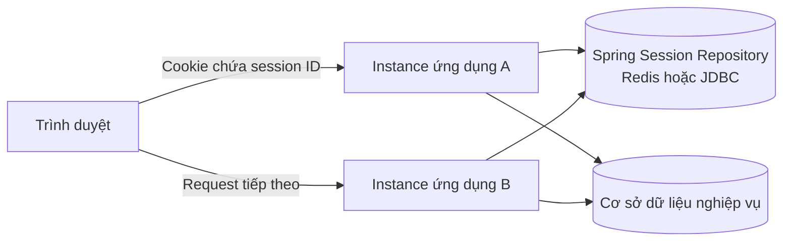

# Giá trị phù hợp để lưu trong phiên và dữ liệu nên thuộc cơ sở dữ liệu nghiệp vụ

Khi dùng Spring Session, ứng dụng có thể lưu `HttpSession` trong Redis, JDBC hoặc một kho dữ liệu dùng chung khác. Điều đó giúp nhiều instance của ứng dụng đọc được cùng một phiên, nhưng không có nghĩa mọi dữ liệu của người dùng đều nên được đưa vào session. Cần phân định rõ **trạng thái tương tác tạm thời** với **dữ liệu nghiệp vụ cần được bảo toàn**. Quyết định này ảnh hưởng trực tiếp đến độ tin cậy, bảo mật, khả năng mở rộng và cách ứng dụng phục hồi sau khi phiên hết hạn.

## 1. Session giữ vai trò gì trong Spring Session?

HTTP vốn không tự ghi nhớ trạng thái giữa hai request. Session cung cấp một vùng trạng thái gắn với một lượt tương tác của người dùng. Với Spring Session, mã ứng dụng vẫn thao tác qua API quen thuộc của `HttpSession`, còn Spring Session thay thế cơ chế lưu session mặc định bằng một repository. Repository có thể dùng Redis hoặc JDBC để các instance cùng truy cập dữ liệu phiên.

Trình duyệt thường chỉ giữ cookie chứa mã định danh phiên. Các thuộc tính như `checkout.step` hoặc `checkout.cartId` được lưu ở repository phía máy chủ. Cookie không phải nơi lưu toàn bộ dữ liệu nghiệp vụ. Khi trình duyệt gửi lại cookie, Spring Session tìm phiên tương ứng và cung cấp các thuộc tính cho request hiện tại.



Repository dùng chung giải quyết việc chia sẻ trạng thái phiên giữa nhiều instance. Nó không biến session thành cơ sở dữ liệu nghiệp vụ. Session thường có thời hạn ngắn, có thể hết hạn do không hoạt động, bị xóa khi đăng xuất hoặc mất đi khi repository được dọn dẹp. Dữ liệu cần tồn tại sau những tình huống đó phải có nơi lưu trữ phù hợp hơn.

## 2. Tiêu chí quyết định nên lưu ở đâu

Một giá trị phù hợp với session thường đáp ứng phần lớn các điều kiện sau:

- Chỉ phục vụ một người dùng hoặc một luồng tương tác đang diễn ra.
- Có vòng đời ngắn, gắn với phiên hoặc một bước của quy trình.
- Dung lượng nhỏ và không cần truy vấn, thống kê hay chia sẻ như một bản ghi nghiệp vụ.
- Có thể tạo lại, yêu cầu người dùng nhập lại hoặc khôi phục từ dữ liệu chuẩn khi session hết hạn.
- Không phải nguồn dữ liệu có thẩm quyền cho quyết định nghiệp vụ quan trọng.

Ngược lại, dữ liệu nên nằm trong cơ sở dữ liệu nghiệp vụ nếu cần tồn tại độc lập với session, cần giao dịch, kiểm toán, truy vấn, quan hệ dữ liệu hoặc được nhiều thiết bị và người dùng có quyền truy cập. Bảng sau giúp so sánh nhanh:

| Tiêu chí | Session | Cơ sở dữ liệu nghiệp vụ |
|---|---|---|
| Vòng đời | Thường ngắn, theo thời gian không hoạt động | Theo chính sách lưu trữ của nghiệp vụ |
| Phạm vi | Một phiên tương tác | Có thể dùng qua nhiều phiên, thiết bị hoặc người dùng được phân quyền |
| Mục đích | Giữ ngữ cảnh để xử lý request tiếp theo | Lưu trạng thái và sự kiện nghiệp vụ có ý nghĩa lâu dài |
| Tính bền vững | Có thể mất khi hết hạn hoặc bị xóa | Được bảo toàn theo chính sách sao lưu và lưu trữ |
| Truy vấn, báo cáo | Không phù hợp | Phù hợp với truy vấn, ràng buộc và báo cáo |
| Giao dịch | Không thay thế giao dịch nghiệp vụ | Hỗ trợ giao dịch và kiểm soát nhất quán |
| Kích thước | Nên nhỏ, giới hạn rõ ràng | Có thể lưu cấu trúc dữ liệu lớn hơn theo thiết kế |

Hãy tự hỏi: “Nếu người dùng đóng trình duyệt, đăng xuất, đổi thiết bị hoặc quay lại vào ngày mai, dữ liệu này có cần còn nguyên không?” Nếu câu trả lời là có, dữ liệu đó thường thuộc cơ sở dữ liệu nghiệp vụ. Nếu câu trả lời là không và dữ liệu chỉ giúp tiếp tục request hoặc quy trình đang diễn ra, session có thể là lựa chọn hợp lý.

## 3. Những loại giá trị phù hợp để lưu trong session

### 3.1. Ngữ cảnh của quy trình đang thực hiện

Session có thể giữ thông tin nhỏ giúp ứng dụng biết người dùng đang ở bước nào của một quy trình ngắn:

- Bước hiện tại của biểu mẫu nhiều bước, chẳng hạn `checkout.step = DELIVERY`.
- Mã giỏ hàng hoặc mã bản nháp đang được thao tác, chẳng hạn `checkout.cartId`.
- Mã phương thức giao hàng hoặc phương án đang được chọn trong lần checkout hiện tại.
- Một lựa chọn tạm thời chưa được xác nhận, miễn là máy chủ vẫn kiểm tra lại tính hợp lệ khi thực hiện nghiệp vụ.

Nên lưu mã định danh hoặc một vài giá trị gọn thay vì lưu toàn bộ đối tượng nghiệp vụ. Khi cần hiển thị giỏ hàng, ứng dụng dùng `cartId` để đọc dữ liệu mới nhất từ cơ sở dữ liệu, rồi kiểm tra giỏ hàng có thuộc người dùng hiện tại hay không.

### 3.2. Ngữ cảnh giao diện có thời hạn ngắn

Các lựa chọn chỉ giúp điều hướng trong phiên có thể được lưu ở session, ví dụ tab đang mở, bộ lọc tạm thời hoặc trang đang xem trong một luồng thao tác. Tuy nhiên, nếu người dùng mong muốn lựa chọn đó được ghi nhớ lâu dài hoặc đồng bộ trên nhiều thiết bị, hãy lưu tùy chọn vào hồ sơ người dùng trong cơ sở dữ liệu. Với bộ lọc có thể chia sẻ hoặc đánh dấu trang, tham số URL đôi khi còn phù hợp hơn session.

### 3.3. Danh tính xác thực và ngữ cảnh bảo mật

Khi tích hợp Spring Security, `SecurityContext` thường được lưu trong session theo cơ chế tích hợp của Spring Security. Ứng dụng nên dùng cơ chế đó thay vì tự sao chép mật khẩu, thông tin xác thực hoặc toàn bộ đối tượng người dùng vào các thuộc tính session tùy ý. Khi cần mã người dùng, có thể lấy từ principal đã được xác thực.

Không xem vai trò hoặc quyền lưu trong session là nguồn sự thật bất biến. Nếu quyền có thể bị thu hồi trong lúc session còn hiệu lực, ứng dụng cần có chiến lược làm mới hoặc kiểm tra lại quyền phù hợp với yêu cầu bảo mật. Các thao tác nhạy cảm vẫn phải được máy chủ phân quyền ở thời điểm thực hiện.

## 4. Dữ liệu nên thuộc cơ sở dữ liệu nghiệp vụ

Các nhóm dữ liệu sau thường cần được lưu bằng mô hình dữ liệu nghiệp vụ:

- **Hồ sơ người dùng:** tên, địa chỉ, thông tin liên hệ, tùy chọn lâu dài và các thông tin người dùng mong muốn dùng lại ở những lần đăng nhập sau.
- **Giỏ hàng có giá trị lâu dài:** các dòng hàng, số lượng, chủ sở hữu, thời điểm cập nhật và trạng thái giỏ hàng nếu cần khôi phục sau khi đăng xuất hoặc đổi thiết bị.
- **Đơn hàng và thanh toán:** mã đơn, mặt hàng, giá tại thời điểm mua, trạng thái thanh toán, hóa đơn và lịch sử xử lý. Session không thể thay thế bản ghi đơn hàng.
- **Tồn kho và giá:** số lượng có thể bán, bảng giá và khuyến mại có hiệu lực. Đây là dữ liệu phải được đọc và kiểm tra lại từ nguồn có thẩm quyền khi xác nhận giao dịch.
- **Dữ liệu cần kiểm toán:** chấp thuận điều khoản, lịch sử thay đổi, trạng thái phê duyệt và các sự kiện phải truy vết.
- **Bản nháp hoặc quy trình cần tiếp tục về sau:** hồ sơ đăng ký nhiều ngày, đơn xin phê duyệt hoặc biểu mẫu cần khôi phục sau khi phiên hết hạn.
- **Quyền và cấu hình dùng chung:** vai trò, chính sách truy cập, cấu hình tổ chức và dữ liệu được nhiều request hoặc người dùng có quyền truy cập.

Nếu dữ liệu cần được giữ lại theo yêu cầu nghiệp vụ hoặc pháp lý, phải thiết kế thời hạn lưu trữ và cơ chế xóa trong tầng dữ liệu nghiệp vụ. TTL của session chỉ điều khiển vòng đời phiên, không phải chính sách lưu trữ hồ sơ, đơn hàng hay sự đồng ý của người dùng.

## 5. Xử lý các trường hợp dễ nhầm lẫn

### Giỏ hàng

Giỏ hàng là ví dụ thường gây nhầm lẫn. Nếu giỏ hàng chỉ là lựa chọn tạm thời trong một phiên khách vãng lai và được phép mất khi session hết hạn, có thể giữ một bản trạng thái nhỏ trong session. Tuy nhiên, với cửa hàng mà người dùng mong muốn giỏ hàng tồn tại qua nhiều lần đăng nhập, nhiều thiết bị hoặc cần khôi phục sau sự cố, các dòng hàng phải được lưu trong cơ sở dữ liệu. Session khi đó chỉ cần giữ `cartId` hoặc mã ngữ cảnh hiện tại.

Ngay cả khi session giữ `cartId`, ứng dụng phải kiểm tra quyền sở hữu giỏ hàng và đọc lại giá, khuyến mại, tồn kho trước khi tạo đơn. Không tin vào tổng tiền hoặc giá sản phẩm do trình duyệt gửi lên hay vào một bản sao cũ được lưu trong session.

### Quy trình checkout

Session có thể giữ bước hiện tại, phương thức giao hàng được chọn và mã địa chỉ đã chọn. Khi người dùng xác nhận, ứng dụng đọc giỏ hàng và địa chỉ từ cơ sở dữ liệu, kiểm tra quyền truy cập, kiểm tra lại giá và tồn kho, sau đó tạo đơn hàng trong giao dịch nghiệp vụ. Sau khi hoàn tất, có thể xóa các thuộc tính checkout khỏi session.

Nếu người dùng cần rời trang rồi tiếp tục checkout sau nhiều giờ hoặc từ thiết bị khác, hãy lưu bản nháp checkout trong cơ sở dữ liệu với trạng thái và thời hạn riêng. Không kéo dài session vô hạn để mô phỏng một bản nháp nghiệp vụ.

### Biểu mẫu nhiều bước

Một biểu mẫu ngắn, chỉ cần hoàn tất trong một phiên, có thể giữ bước hiện tại và một số lựa chọn tạm thời trong session. Nếu biểu mẫu có dữ liệu quan trọng, cần lưu từng bước, có thể chỉnh sửa, cần kiểm toán hoặc phải khôi phục sau khi mất kết nối, hãy lưu bản nháp trong cơ sở dữ liệu. Có thể kết hợp hai nơi: cơ sở dữ liệu giữ nội dung bản nháp, session giữ mã bản nháp và vị trí người dùng đang xem.

### Thông báo sau redirect

Thông báo chỉ hiển thị một lần sau redirect thường phù hợp với flash attribute hoặc cơ chế lưu tạm theo request của framework. Không nên giữ một thông báo dùng một lần trong session lâu hơn cần thiết. Hãy chọn phạm vi lưu trữ nhỏ nhất đáp ứng đúng vòng đời của dữ liệu.

## 6. Ví dụ: lưu ngữ cảnh checkout, còn dữ liệu giỏ hàng ở cơ sở dữ liệu

Ví dụ sau minh họa việc session giữ mã giỏ hàng, mã phương thức giao hàng và bước hiện tại. `CartService` và `CheckoutService` đại diện cho các dịch vụ nghiệp vụ của ứng dụng; chúng phải kiểm tra quyền sở hữu và đọc dữ liệu chuẩn từ cơ sở dữ liệu.

```java
import java.security.Principal;

import jakarta.servlet.http.HttpSession;
import org.springframework.web.bind.annotation.DeleteMapping;
import org.springframework.web.bind.annotation.PostMapping;
import org.springframework.web.bind.annotation.RequestBody;
import org.springframework.web.bind.annotation.RequestMapping;
import org.springframework.web.bind.annotation.RestController;

@RestController
@RequestMapping("/checkout")
class CheckoutSessionController {
    private static final String CART_ID = "checkout.cartId";
    private static final String DELIVERY_OPTION_ID = "checkout.deliveryOptionId";
    private static final String STEP = "checkout.step";

    private final CartService cartService;
    private final CheckoutService checkoutService;

    CheckoutSessionController(
            CartService cartService,
            CheckoutService checkoutService) {
        this.cartService = cartService;
        this.checkoutService = checkoutService;
    }

    @PostMapping("/context")
    void saveContext(
            @RequestBody CheckoutContextRequest request,
            Principal principal,
            HttpSession session) {
        // Kiểm tra giỏ hàng thuộc về người dùng đã xác thực.
        cartService.assertOwnedBy(request.cartId(), principal.getName());

        session.setAttribute(CART_ID, request.cartId());
        session.setAttribute(DELIVERY_OPTION_ID, request.deliveryOptionId());
        session.setAttribute(STEP, "DELIVERY");
    }

    @PostMapping("/confirm")
    OrderResponse confirm(Principal principal, HttpSession session) {
        String cartId = (String) session.getAttribute(CART_ID);
        String deliveryOptionId =
                (String) session.getAttribute(DELIVERY_OPTION_ID);

        if (cartId == null || deliveryOptionId == null) {
            throw new IllegalStateException("Checkout context has expired");
        }

        // Dịch vụ đọc lại giỏ hàng, kiểm tra giá/tồn kho và tạo đơn trong DB.
        OrderResponse order = checkoutService.createOrder(
                cartId, deliveryOptionId, principal.getName());

        session.removeAttribute(CART_ID);
        session.removeAttribute(DELIVERY_OPTION_ID);
        session.removeAttribute(STEP);
        return order;
    }

    @DeleteMapping("/context")
    void clearContext(HttpSession session) {
        session.removeAttribute(CART_ID);
        session.removeAttribute(DELIVERY_OPTION_ID);
        session.removeAttribute(STEP);
    }
}

record CheckoutContextRequest(String cartId, String deliveryOptionId) {}
```

Trong ví dụ này, session chỉ giữ một vài chuỗi nhỏ. Các giá trị nhận từ request vẫn phải được xác thực: mã giỏ hàng phải thuộc người dùng hiện tại, phương thức giao hàng phải còn hiệu lực và có thể áp dụng cho địa chỉ/đơn hàng. Khi tạo đơn, `CheckoutService` cần tính toán từ dữ liệu nghiệp vụ hiện tại và ghi đơn trong một giao dịch. Việc xóa ngữ cảnh checkout sau khi hoàn tất giúp tránh dùng lại trạng thái cũ ở lần thao tác tiếp theo.

Đây là ví dụ về ranh giới dữ liệu, không phải một triển khai đầy đủ cho mọi ứng dụng. Tên dịch vụ, kiểu trả về và chính sách lỗi cần được điều chỉnh theo mô hình nghiệp vụ thực tế. Nếu dùng Spring Security, `Principal` phải đến từ ngữ cảnh xác thực đã được cấu hình và endpoint phải được bảo vệ phù hợp.

## 7. Những dữ liệu không nên đưa vào session

Tránh lưu các loại dữ liệu sau, trừ khi có thiết kế bảo mật và lý do kỹ thuật được đánh giá rõ ràng:

- Mật khẩu, bí mật xác thực, khóa riêng, mã khôi phục hoặc token có quyền truy cập rộng. Không nhân bản thông tin xác thực vào thuộc tính tùy ý; để cơ chế bảo mật chuyên dụng quản lý chúng.
- Số thẻ thanh toán, mã bảo mật thẻ hoặc dữ liệu thanh toán nhạy cảm. Dùng nhà cung cấp thanh toán và token tham chiếu phù hợp.
- Toàn bộ entity JPA, đồ thị đối tượng lớn, proxy lazy hoặc collection chứa nhiều bản ghi. Chúng làm session phình to, khó tuần tự hóa và có thể mang dữ liệu cũ.
- Tệp tải lên, nội dung lớn, kết quả tìm kiếm lớn hoặc dữ liệu có thể truy vấn lại. Lưu tệp ở kho phù hợp và chỉ giữ mã tham chiếu nếu thật sự cần.
- Giá, tồn kho, hạn mức, quyền hoặc trạng thái mà quyết định nghiệp vụ cần được xác nhận tại thời điểm thao tác. Session có thể chứa bản sao cũ và không đảm bảo đồng bộ với nguồn dữ liệu chuẩn.
- Bản ghi cần kiểm toán hoặc phải được bảo toàn sau khi người dùng đăng xuất.

Không nên coi session là cache tổng quát. Cache có chính sách nhất quán, làm mới và loại bỏ riêng; session có vòng đời gắn với người dùng và cookie. Dùng session cho dữ liệu có thể tái tạo nhưng lớn hoặc được nhiều luồng dùng chung sẽ làm tăng chi phí lưu trữ và khiến hành vi ứng dụng khó dự đoán.

## 8. Lưu ý khi vận hành với Redis hoặc JDBC

**TTL và hết hạn.** Thời gian timeout của session thường dựa trên khoảng không hoạt động. Khi phiên hết hạn, các thuộc tính trong phiên có thể không còn. Hãy xử lý trường hợp thiếu thuộc tính như một trạng thái bình thường: yêu cầu người dùng bắt đầu lại hoặc khôi phục từ bản nháp trong cơ sở dữ liệu. Không dùng TTL session làm TTL cho đơn hàng, giỏ hàng hoặc hồ sơ.

**Tuần tự hóa và tương thích phiên bản.** Repository phải tuần tự hóa các thuộc tính để lưu trữ. Ưu tiên kiểu dữ liệu đơn giản, nhỏ và ổn định như chuỗi, số, enum hoặc DTO có cấu trúc rõ ràng. Tránh entity JPA và đối tượng phụ thuộc vào trạng thái runtime. Khi triển khai phiên bản ứng dụng mới, cần cân nhắc session cũ được tạo bởi phiên bản trước có còn đọc được hay không; thay đổi tên lớp hoặc cấu trúc đối tượng có thể gây lỗi giải tuần tự hóa.

**Kích thước và tần suất ghi.** Mỗi thuộc tính bổ sung làm tăng dung lượng lưu trữ và có thể tăng chi phí đọc/ghi Redis hoặc JDBC. Đặt giới hạn hợp lý cho dữ liệu session, không lưu các danh sách lớn và chỉ cập nhật khi trạng thái thực sự thay đổi. Với JDBC, session còn tạo tải đọc/ghi lên cơ sở dữ liệu; với Redis, cần tính dung lượng bộ nhớ và chính sách eviction.

**Nhiều request đồng thời.** Một người dùng có thể mở nhiều tab và gửi nhiều request cùng lúc. Hai request cùng đọc rồi ghi lại một đối tượng mutable trong session có thể ghi đè thay đổi của nhau. Giữ các thuộc tính độc lập, tránh read-modify-write phức tạp trong session. Nếu cần bảo đảm một thay đổi nghiệp vụ chỉ diễn ra một lần hoặc phải cập nhật nguyên tử, dùng ràng buộc, transaction, optimistic locking hoặc cơ chế đồng bộ thích hợp ở tầng nghiệp vụ.

**Đăng xuất và cookie.** Khi đăng xuất, cần để Spring Security hoặc cơ chế đăng xuất của ứng dụng xóa session và cookie theo cấu hình. Cookie session nên được thiết lập phù hợp với HTTPS, `Secure`, `HttpOnly` và `SameSite`; không đưa session ID vào URL. Các thuộc tính session có thể chứa ngữ cảnh riêng tư nên cần giới hạn quyền truy cập vào repository và bảo vệ dữ liệu lưu trữ.

**Không giả định session tồn tại mãi.** Redis có thể khởi động lại, dữ liệu có thể bị loại bỏ hoặc session có thể hết hạn; JDBC cũng có thể gặp lỗi kết nối hay dọn dẹp dữ liệu. Request cần phản hồi rõ ràng khi session không còn. Những thay đổi nghiệp vụ đã xác nhận phải được ghi trong cơ sở dữ liệu nghiệp vụ với transaction và cơ chế xử lý lỗi phù hợp, để mất session không làm mất đơn hàng hoặc trạng thái đã cam kết.

## 9. Quy trình phân loại một thuộc tính mới

Khi thiết kế một thuộc tính, hãy đi qua các câu hỏi theo thứ tự:

1. Giá trị có cần tồn tại sau khi đăng xuất, hết hạn session hoặc đổi thiết bị không? Nếu có, lưu trong cơ sở dữ liệu nghiệp vụ.
2. Giá trị có phải nguồn sự thật cho giá, quyền, tồn kho, thanh toán hoặc một quyết định nghiệp vụ không? Nếu có, lưu và kiểm tra ở tầng nghiệp vụ; session chỉ có thể giữ mã tham chiếu hoặc lựa chọn tạm thời.
3. Giá trị có nhỏ, ngắn hạn và chỉ phục vụ một phiên tương tác không? Nếu có, session là ứng viên phù hợp.
4. Giá trị có thể được tạo lại từ URL, request, cache hoặc cơ sở dữ liệu không? Chọn nơi lưu có vòng đời ngắn nhất và đơn giản nhất đáp ứng trải nghiệm cần thiết.
5. Nếu session mất hoặc hai request cập nhật đồng thời, hậu quả là gì? Nếu gây mất dữ liệu nghiệp vụ hoặc sai lệch giao dịch, thiết kế cần dựa vào cơ sở dữ liệu và cơ chế nhất quán phù hợp.

Ví dụ phân loại nhanh:

| Thuộc tính | Nơi lưu phù hợp | Lý do |
|---|---|---|
| Bước hiện tại của wizard ngắn | Session | Ngữ cảnh tạm thời của một lượt tương tác |
| `cartId` đang checkout | Session có thể giữ mã; giỏ hàng ở DB | Session giữ tham chiếu, DB giữ dữ liệu chuẩn |
| Các dòng hàng cần khôi phục ngày mai | DB | Cần tồn tại qua nhiều session |
| Tổng tiền đơn hàng đã xác nhận | DB | Dữ liệu nghiệp vụ cần giao dịch và kiểm toán |
| Tab giao diện đang mở | Session hoặc URL | Tùy có cần chia sẻ/đánh dấu trang hay không |
| Địa chỉ giao hàng trong hồ sơ | DB | Dữ liệu hồ sơ dùng lại lâu dài |
| Mã địa chỉ được chọn trong checkout | Session có thể giữ mã | Chỉ là lựa chọn tạm thời; phải kiểm tra quyền và dữ liệu ở DB |
| Thông báo hiển thị một lần | Flash attribute/request | Vòng đời ngắn hơn session thông thường |

## 10. Kiểm tra thiết kế trước khi đưa vào vận hành

Với mỗi loại dữ liệu session, hãy xác định rõ tên thuộc tính, kiểu dữ liệu, kích thước dự kiến, lý do cần lưu, thời điểm tạo, thời điểm xóa và hành vi khi session hết hạn. Kiểm tra các tình huống sau trong ứng dụng:

- Request kế tiếp được xử lý ở instance khác nhưng vẫn nhận đúng session khi dùng cùng cookie và repository dùng chung.
- Session hết hạn giữa quy trình; ứng dụng thông báo phù hợp hoặc khôi phục dữ liệu từ bản nháp nghiệp vụ.
- Người dùng đăng xuất rồi đăng nhập lại; không còn ngữ cảnh nhạy cảm từ session cũ.
- Người dùng sửa giỏ hàng ở tab khác; thao tác xác nhận đọc lại dữ liệu chuẩn và phát hiện thay đổi cần thiết.
- Hai request đồng thời cập nhật cùng một quy trình; dữ liệu nghiệp vụ không bị ghi đè hoặc tạo giao dịch trùng.
- Nâng cấp ứng dụng khi vẫn còn session được tạo bởi phiên bản trước; dữ liệu có thể đọc được hoặc được xử lý an toàn khi không tương thích.

Một thiết kế tốt dùng session để giữ ngữ cảnh ngắn hạn và dùng cơ sở dữ liệu nghiệp vụ làm nguồn sự thật cho dữ liệu cần bảo toàn. Với Spring Session, Redis hoặc JDBC giúp chia sẻ session giữa nhiều instance; chúng không thay đổi nguyên tắc phân định này. Khi không chắc chắn, hãy lưu mã tham chiếu nhỏ trong session và để dịch vụ nghiệp vụ đọc, xác thực, cập nhật dữ liệu chuẩn trong cơ sở dữ liệu.
