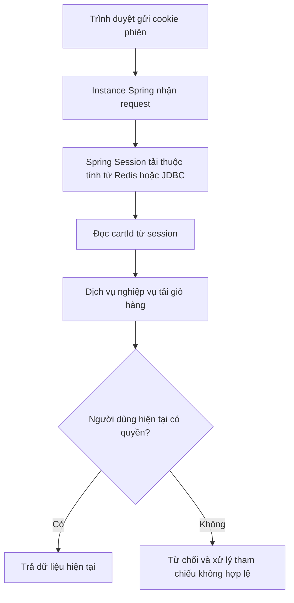

# Định danh tham chiếu, dữ liệu dẫn xuất và tránh sao chép quá nhiều dữ liệu

Khi dùng Spring Session, dữ liệu phiên có thể được lưu trong Redis hoặc JDBC để nhiều instance của ứng dụng cùng đọc và cập nhật. Mỗi thuộc tính đặt vào `HttpSession` vì thế trở thành dữ liệu cần được tuần tự hóa, truyền qua mạng hoặc ghi xuống kho lưu trữ, rồi đọc lại trong những request tiếp theo. Thiết kế tốt thường giữ session nhỏ: lưu các định danh cần thiết và một ít trạng thái giao diện; truy vấn dữ liệu nghiệp vụ từ nơi đang quản lý dữ liệu đó.

Bài này tập trung vào cách chọn dữ liệu đưa vào session, cách dùng định danh tham chiếu an toàn, cách cân nhắc dữ liệu dẫn xuất và cách tránh sao chép nguyên đối tượng nghiệp vụ. Các nguyên tắc áp dụng cho Spring Session khi dùng kho chia sẻ như Redis hoặc JDBC, dù cấu hình Servlet, cookie và repository cụ thể của ứng dụng có thể khác nhau.

## 1. Phân biệt session ID, định danh tham chiếu và dữ liệu phiên

Ba khái niệm này có liên quan nhưng không thể thay thế cho nhau.

| Thành phần | Ví dụ | Mục đích | Nơi nên quản lý |
|---|---|---|---|
| Session ID | Giá trị opaque trong cookie phiên | Giúp máy chủ tìm đúng phiên của trình duyệt | Cookie và Spring Session repository |
| Định danh tham chiếu | `userId`, `cartId`, `workflowId`, `tenantId` | Trỏ đến một bản ghi hoặc ngữ cảnh nghiệp vụ | Session có thể giữ ID; kho dữ liệu nghiệp vụ giữ bản ghi |
| Dữ liệu dẫn xuất | Tên hiển thị, locale, bước hiện tại, bản tóm tắt quyền | Giúp tránh tính toán hoặc truy vấn lặp lại | Có thể lưu tạm trong session nếu chấp nhận được độ cũ |

**Session ID không phải là định danh người dùng hoặc dữ liệu nghiệp vụ.** Trình duyệt gửi cookie phiên; Spring Session dùng giá trị đó để tìm phiên trong repository. Khi chạy nhiều instance, instance nhận request có thể tải cùng phiên từ kho chia sẻ. Không nên tự phân tích, sửa, dùng lại hoặc coi session ID là một mã định danh nghiệp vụ.

**Định danh tham chiếu là giá trị ứng dụng lưu bên trong session.** Ví dụ, session có thể giữ ID của giỏ hàng đang được chọn. Bản thân giỏ hàng vẫn nằm trong cơ sở dữ liệu nghiệp vụ. Khi cần hiển thị giỏ hàng, ứng dụng dùng ID để tải dữ liệu và kiểm tra người dùng hiện tại có quyền truy cập hay không.

**Dữ liệu dẫn xuất là bản sao hoặc kết quả tính từ dữ liệu khác.** Ví dụ, tên hiển thị được suy ra từ hồ sơ người dùng; quyền hiệu lực được suy ra từ vai trò và chính sách; tổng tiền được tính từ các dòng hàng. Những giá trị này có thể hữu ích để tối ưu một số luồng, nhưng cần có chiến lược làm mới và kiểm tra tính hợp lệ.

Một quy tắc dễ áp dụng là: session giữ ngữ cảnh của một phiên tương tác; cơ sở dữ liệu hoặc dịch vụ miền giữ trạng thái nghiệp vụ có thẩm quyền.

## 2. Ưu tiên lưu định danh tham chiếu

Thay vì lưu cả đối tượng `Cart`, session chỉ cần giữ `cartId`. Cách này giảm kích thước phiên, tránh tuần tự hóa cả đồ thị đối tượng và giúp dữ liệu mới nhất luôn được lấy từ nguồn có thẩm quyền.

Ví dụ, khi người dùng chọn giỏ hàng, ứng dụng kiểm tra quyền truy cập trước rồi mới lưu tham chiếu:

```java
public final class SessionAttributeNames {
    private SessionAttributeNames() {
    }

    public static final String ACTIVE_CART_ID = "app.activeCartId";
}
```

```java
@PostMapping("/cart/select")
public void selectCart(
        @RequestParam UUID cartId,
        HttpSession session,
        @AuthenticationPrincipal AppPrincipal principal) {

    // Phải xác nhận giỏ hàng thuộc quyền truy cập của người dùng hiện tại.
    Cart cart = cartService.requireAccessible(cartId, principal.userId());

    session.setAttribute(
            SessionAttributeNames.ACTIVE_CART_ID,
            cart.id().toString());
}
```

Khi xử lý request sau, ứng dụng đọc ID, kiểm tra định dạng và yêu cầu dịch vụ nghiệp vụ tải giỏ hàng theo người dùng hiện tại:

```java
@GetMapping("/cart")
public CartView currentCart(
        HttpSession session,
        @AuthenticationPrincipal AppPrincipal principal) {

    Object value = session.getAttribute(
            SessionAttributeNames.ACTIVE_CART_ID);

    if (!(value instanceof String cartIdText)) {
        throw new IllegalStateException("Chưa có giỏ hàng đang hoạt động");
    }

    final UUID cartId;
    try {
        cartId = UUID.fromString(cartIdText);
    } catch (IllegalArgumentException ex) {
        session.removeAttribute(SessionAttributeNames.ACTIVE_CART_ID);
        throw new IllegalStateException("Định danh giỏ hàng trong phiên không hợp lệ", ex);
    }

    // Dịch vụ phải kiểm tra quyền sở hữu hoặc quyền truy cập ở mỗi lần tải.
    return cartService.getViewForUser(cartId, principal.userId());
}
```

`AppPrincipal`, `CartService` và các kiểu trả về trong ví dụ là kiểu của ứng dụng minh họa. Điểm quan trọng là `getViewForUser` phải thực hiện kiểm tra quyền trên dữ liệu hiện tại. Việc một ID xuất hiện trong session không chứng minh người dùng được phép đọc bản ghi đó.

### Những nguyên tắc khi dùng tham chiếu

- **Kiểm tra quyền ở nơi tải dữ liệu.** Kiểm tra lúc lưu ID là cần thiết, nhưng quyền có thể thay đổi sau đó. Mỗi thao tác đọc hoặc ghi vẫn phải kiểm tra người dùng, tenant và trạng thái bản ghi.
- **Không xem ID khó đoán là cơ chế phân quyền.** UUID hoặc ID opaque có thể giảm khả năng dò đoán, nhưng không thay thế kiểm tra quyền truy cập.
- **Xử lý tham chiếu hết hiệu lực.** Bản ghi có thể bị xóa, đóng, chuyển chủ sở hữu hoặc hết hạn trong khi session vẫn còn. Ứng dụng cần xóa thuộc tính không còn hợp lệ và phản hồi theo quy tắc nghiệp vụ.
- **Dùng định dạng ổn định.** Chuỗi UUID, mã trạng thái ngắn hoặc kiểu vô hướng đơn giản thường dễ tuần tự hóa và tương thích giữa các phiên bản ứng dụng hơn đối tượng phức tạp.
- **Đặt tên thuộc tính có namespace.** Các tên như `app.activeCartId` hoặc `app.checkout.step` giảm nguy cơ va chạm với thuộc tính do thư viện hoặc phần khác của ứng dụng đặt.

Với người dùng đã đăng nhập bằng Spring Security, danh tính thường đã có trong `SecurityContext` được tích hợp với session. Trước khi thêm `userId` riêng vào session, hãy xác định rõ lý do. Nếu chỉ cần biết người dùng hiện tại, hãy lấy danh tính từ principal hoặc dịch vụ bảo mật đang dùng. Lưu trùng một giá trị có thẩm quyền ở hai nơi tạo thêm nguy cơ không đồng nhất.

## 3. Dùng dữ liệu dẫn xuất có chủ đích

Không phải dữ liệu nào không phải nguồn gốc cũng cần loại bỏ khỏi session. Một số giá trị nhỏ, ít thay đổi và có chi phí tính toán hoặc truy vấn đáng kể có thể được lưu như snapshot. Quyết định này cần dựa trên ba câu hỏi:

1. Giá trị có thay đổi thường xuyên không?
2. Nếu giá trị cũ được dùng thêm một khoảng thời gian, hậu quả là gì?
3. Có cách đơn giản và đáng tin cậy để làm mới hoặc vô hiệu hóa giá trị không?

Ví dụ:

| Dữ liệu | Có thể lưu trong session? | Cách xử lý |
|---|---|---|
| Locale hoặc chủ đề giao diện | Thường phù hợp | Cập nhật khi người dùng đổi tùy chọn |
| Bước hiện tại của một wizard ngắn | Phù hợp nếu trạng thái nhỏ | Kiểm tra bước hợp lệ; lưu dữ liệu quan trọng lâu dài ở nơi bền vững |
| Tên hiển thị | Có thể, nếu chấp nhận trễ | Làm mới khi hồ sơ đổi hoặc khi tải hồ sơ |
| Danh sách quyền | Chỉ khi có chính sách snapshot rõ ràng | Có phiên bản hoặc thời hạn ngắn; kiểm tra lại khi quyền thay đổi |
| Số dư, giá, tồn kho, trạng thái thanh toán | Không nên dùng snapshot làm căn cứ quyết định | Đọc từ nguồn nghiệp vụ có thẩm quyền khi xử lý |
| Kết quả tìm kiếm lớn | Không phù hợp | Lưu tiêu chí tìm kiếm hoặc mã truy vấn; tải kết quả theo nhu cầu |

Ví dụ lưu locale:

```java
session.setAttribute("app.uiLocale", locale.toLanguageTag());
```

Giá trị này nhỏ, không nhạy cảm và thường chỉ thay đổi khi người dùng chủ động chọn ngôn ngữ. Trái lại, nếu lưu danh sách quyền vào session, ứng dụng phải tính đến trường hợp quản trị viên thu hồi quyền trong khi session cũ vẫn tồn tại.

### Làm mới snapshot và xử lý dữ liệu cũ

Nếu một snapshot thực sự cần thiết, hãy ghi rõ điều kiện còn hiệu lực. Có thể dùng thời điểm tạo, phiên bản dữ liệu hoặc cả hai:

```java
session.setAttribute("app.permissionSnapshot.version", permissionVersion);
session.setAttribute("app.permissionSnapshot.createdAt", Instant.now().toString());
```

Trước khi dùng snapshot cho thao tác nhạy cảm, ứng dụng có thể so sánh phiên bản với nguồn dữ liệu hiện tại hoặc truy vấn lại quyền. Nếu không thể xác định snapshot còn hợp lệ, hãy bỏ snapshot và tính lại.

Thời hạn của snapshot nên ngắn hơn hoặc phù hợp với mức chấp nhận dữ liệu cũ của nghiệp vụ. TTL của session chỉ quyết định thời gian phiên có thể tồn tại; nó không tự động đảm bảo mọi thuộc tính bên trong đều mới. Một session còn hiệu lực vẫn có thể chứa tên hiển thị, cấu hình hoặc quyền đã lỗi thời.

Khi dữ liệu gốc thay đổi, cần chọn cơ chế vô hiệu hóa thích hợp: xóa thuộc tính ở luồng cập nhật, tăng phiên bản dữ liệu để snapshot cũ bị phát hiện, hoặc không cache giá trị đó trong session. Nếu người dùng có thể đăng nhập trên nhiều thiết bị, chỉ xóa thuộc tính trong một session không nhất thiết làm mới các session khác. Với dữ liệu bảo mật, phải xác định phạm vi vô hiệu hóa trên tất cả phiên liên quan.

## 4. Tránh sao chép đối tượng nghiệp vụ vào session

Lưu nguyên đối tượng thường có vẻ tiện vì controller có thể lấy lại ngay mà không cần gọi repository. Tuy nhiên, đối tượng nghiệp vụ thường chứa nhiều dữ liệu hơn màn hình hiện tại cần, có quan hệ lồng nhau và thay đổi theo thời gian.

Những trường hợp nên tránh:

- **Entity JPA hoặc Hibernate.** Entity có thể mang proxy, quan hệ lazy, tham chiếu vòng hoặc trạng thái persistence. Tuần tự hóa chúng có thể gây lỗi, kéo theo truy vấn ngoài dự kiến hoặc lưu một ảnh chụp đã lỗi thời.
- **Danh sách lớn hoặc kết quả tìm kiếm.** Chúng làm tăng kích thước phiên, chi phí đọc/ghi và thời gian tuần tự hóa. Kết quả cũng có thể không còn đúng sau khi dữ liệu nguồn thay đổi.
- **Đối tượng chứa tài nguyên đang mở.** Không lưu `HttpServletRequest`, `EntityManager`, kết nối cơ sở dữ liệu, stream, service hoặc đối tượng phụ thuộc vòng đời request vào session.
- **Tệp và dữ liệu nhị phân lớn.** Lưu khóa đối tượng trong object storage hoặc mã bản ghi trong cơ sở dữ liệu; không nhét nội dung tệp vào session.
- **Thông tin xác thực hoặc bí mật.** Không lưu mật khẩu. Tránh sao chép access token, refresh token hoặc bí mật vào thuộc tính tùy tiện; nếu kiến trúc xác thực yêu cầu giữ token, phải dùng cơ chế chuyên biệt với chính sách bảo vệ, thời hạn và thu hồi phù hợp.

Một DTO nhỏ, ổn định có thể hợp lý nếu nó biểu diễn đúng ngữ cảnh riêng của phiên và không chứa dữ liệu lớn hoặc nhạy cảm. Tuy vậy, DTO vẫn phải có cấu trúc tương thích với cơ chế tuần tự hóa và các phiên bản ứng dụng đang chạy. Đổi kiểu thuộc tính từ `String` sang một lớp mới trong khi session cũ còn tồn tại có thể khiến việc đọc phiên thất bại.

### Ví dụ so sánh

Không nên lưu cả giỏ hàng:

```java
// Tránh: toàn bộ đồ thị dữ liệu được gắn với vòng đời session.
session.setAttribute("app.cart", cart);
```

Nên lưu tham chiếu nhỏ:

```java
// Ưu tiên: lưu ID dạng chuỗi; tải dữ liệu mới khi cần.
session.setAttribute("app.cartId", cart.id().toString());
```

Nếu cần lưu trạng thái wizard, hãy lưu các trường nhỏ thực sự cần để tiếp tục luồng, chẳng hạn `app.checkout.step` và `app.checkout.draftId`. Nếu bản nháp chứa địa chỉ, giá, lựa chọn thanh toán hoặc dữ liệu cần tồn tại qua nhiều thiết bị, hãy lưu bản nháp trong kho nghiệp vụ và chỉ giữ `draftId` trong session.

## 5. Tính đến tuần tự hóa và triển khai nhiều instance

Spring Session lưu các thuộc tính phiên thông qua repository. Với Redis hoặc JDBC, dữ liệu cần đi qua cơ chế tuần tự hóa và lưu trữ tương ứng. Kiểu dữ liệu càng đơn giản, việc triển khai nhiều instance và nâng cấp ứng dụng càng dễ kiểm soát.

Nên ưu tiên:

- Chuỗi, số, boolean, enum được biểu diễn bằng mã ổn định và các giá trị nhỏ.
- ID được chuẩn hóa thành chuỗi nếu cần định dạng trao đổi rõ ràng.
- DTO nhỏ có cấu trúc được quản lý và có chiến lược tương thích khi thay đổi.
- Hạn chế collection; nếu cần, đặt giới hạn số phần tử và kích thước.

Không nên mặc định rằng mọi lớp Java đều có thể được tuần tự hóa an toàn chỉ vì chúng có thể được đặt vào `HttpSession`. Khả năng đọc lại còn phụ thuộc serializer và cấu hình repository. Nếu dùng Java serialization hoặc serializer phụ thuộc tên lớp, thay đổi package, kiểu trường hoặc phiên bản lớp có thể ảnh hưởng đến session còn tồn tại sau khi triển khai.

Khi thay đổi cấu trúc thuộc tính:

1. Xác định session cũ có thể tồn tại bao lâu theo timeout và TTL đang cấu hình.
2. Ưu tiên thay đổi tương thích, ví dụ đọc cả định dạng cũ trong giai đoạn chuyển tiếp.
3. Nếu định dạng cũ không thể dùng nữa, đặt tên khóa mới có phiên bản như `app.v2.activeCartId`, hoặc chủ động loại bỏ khóa cũ.
4. Kiểm thử việc đọc session được tạo bởi phiên bản ứng dụng trước.
5. Theo dõi lỗi deserialize và lỗi tải session sau khi triển khai.

Trong môi trường nhiều instance, các node cần hiểu cùng một định dạng thuộc tính. Triển khai rolling update có thể khiến phiên được ghi bởi node phiên bản mới rồi đọc bởi node phiên bản cũ. Hãy thiết kế thay đổi theo hướng tương thích trong khoảng thời gian hai phiên bản cùng hoạt động.

## 6. TTL, đăng xuất và vòng đời của tham chiếu

Session và bản ghi được tham chiếu có vòng đời riêng. Session có thể hết hạn trong khi giỏ hàng vẫn còn; giỏ hàng có thể bị xóa trong khi session vẫn đang hoạt động. Vì vậy, mỗi lần dùng tham chiếu đều cần xử lý trường hợp không còn bản ghi hoặc người dùng mất quyền truy cập.

Khi người dùng đổi ngữ cảnh, hãy xóa thuộc tính cũ nếu nó không còn phù hợp:

```java
session.removeAttribute(SessionAttributeNames.ACTIVE_CART_ID);
```

Khi đăng xuất, luồng đăng xuất của Spring Security thường quản lý việc kết thúc session theo cấu hình bảo mật. Nếu ứng dụng có thao tác dọn dẹp riêng, hãy bảo đảm thao tác đó an toàn khi chạy lặp lại. Không dựa vào việc trình duyệt đã xóa cookie để kết luận dữ liệu trong kho session đã được xóa.

Các sự kiện tạo, xóa hoặc hết hạn session của Spring Session có thể hữu ích để giải phóng tài nguyên phụ hoặc ghi nhận hoạt động. Listener nên xử lý nhanh và idempotent, nghĩa là nhận cùng một sự kiện nhiều lần cũng không gây sai lệch. Không dùng một listener hết hạn session làm cơ chế duy nhất để thực hiện giao dịch nghiệp vụ quan trọng; các thay đổi quan trọng cần được lưu bằng cơ chế bền vững của chính nghiệp vụ.

Nếu tài khoản bị khóa, quyền bị thu hồi hoặc tenant bị thay đổi, hãy có chiến lược vô hiệu hóa các phiên liên quan hoặc kiểm tra lại trạng thái tại các điểm truy cập nhạy cảm. Việc chỉ đặt TTL ngắn hơn không thay thế được kiểm tra trạng thái và quyền hiện tại.

## 7. Cẩn thận với request đồng thời

Một người dùng có thể gửi nhiều request gần như cùng lúc từ nhiều tab hoặc từ trình duyệt và thiết bị khác nhau. Các request đó có thể đọc cùng một trạng thái session rồi ghi các thay đổi khác nhau. Kho session dùng chung giúp các instance nhìn thấy cùng dữ liệu, nhưng không tự biến mọi chuỗi đọc-sửa-ghi thành một giao dịch nghiệp vụ nguyên tử.

Ví dụ, hai request cùng đọc một collection trong session, mỗi request thêm một phần tử rồi ghi lại. Tùy cách thay đổi object và cấu hình lưu session, một cập nhật có thể ghi đè kết quả của cập nhật còn lại. Các bộ đếm, số dư, tồn kho, trạng thái đơn hàng hoặc thao tác thanh toán không nên dựa vào việc cập nhật object trong session.

Với dữ liệu cần nhất quán:

- Lưu trạng thái trong cơ sở dữ liệu nghiệp vụ.
- Dùng transaction, optimistic locking hoặc cơ chế đồng bộ phù hợp với nghiệp vụ.
- Dùng thao tác atomic của kho dữ liệu khi thật sự cần một phép cập nhật nguyên tử.
- Giữ session cho tham chiếu hoặc lựa chọn giao diện; tải lại trạng thái nghiệp vụ trước khi xác nhận thao tác.

Nếu session chỉ lưu một ID và mỗi request tải trạng thái hiện tại từ dịch vụ nghiệp vụ, nguy cơ ghi đè một bản sao lớn trong session sẽ giảm đáng kể. Tuy nhiên, dịch vụ nghiệp vụ vẫn phải xử lý đồng thời đúng cách.

## 8. Kiểm thử và quan sát

Kiểm thử không nên chỉ xác nhận rằng `setAttribute` và `getAttribute` hoạt động trong một request. Hãy kiểm tra cách ứng dụng xử lý vòng đời và thay đổi dữ liệu.

Các tình huống nên có trong kiểm thử:

- Request tiếp theo đọc được tham chiếu đã lưu trong session.
- Một session khác không thể dùng ID để đọc dữ liệu của người dùng hoặc tenant khác.
- Bản ghi được tham chiếu đã bị xóa hoặc hết hiệu lực được xử lý có kiểm soát.
- Thuộc tính có kiểu hoặc định dạng sai được loại bỏ và không làm request sau tiếp tục dùng dữ liệu lỗi.
- Snapshot đã cũ được làm mới hoặc bị từ chối theo chính sách.
- Session hết hạn hoặc đăng xuất thì luồng ứng dụng yêu cầu xác thực lại và không tiếp tục dùng tham chiếu cũ.
- Session được tạo bởi phiên bản ứng dụng trước vẫn đọc được trong giai đoạn nâng cấp tương thích.
- Hai request đồng thời không làm mất cập nhật nghiệp vụ quan trọng.

Ở mức tích hợp, có thể dùng repository Spring Session và kho Redis/JDBC thử nghiệm để xác nhận session tồn tại qua các request được xử lý bởi những instance khác nhau. `MockHttpSession` hữu ích cho kiểm thử controller, nhưng bản thân nó không chứng minh cấu hình Redis/JDBC, serializer hoặc hành vi giữa nhiều node hoạt động đúng.

Nên theo dõi kích thước thuộc tính hoặc session, thời gian đọc/ghi repository, lỗi tuần tự hóa, lỗi tải session, số tham chiếu không còn hợp lệ và số lần snapshot phải làm mới. Khi ghi log, không ghi nguyên cookie hoặc session ID; chỉ ghi mã tương quan đã được kiểm soát và thông tin chẩn đoán cần thiết.

## 9. Quy trình chọn dữ liệu trước khi thêm vào session

Trước khi gọi `session.setAttribute`, hãy đi qua các bước sau:

1. **Xác định mục đích.** Giá trị này có mô tả trạng thái riêng của phiên tương tác không? Nếu chỉ là dữ liệu nghiệp vụ, hãy để dịch vụ nghiệp vụ quản lý.
2. **Tìm nguồn có thẩm quyền.** Nếu giá trị là ID, xác định repository hoặc service nào sẽ tải bản ghi và kiểm tra quyền.
3. **Đánh giá kích thước và độ nhạy cảm.** Ưu tiên giá trị nhỏ; loại bỏ bí mật và dữ liệu không cần thiết.
4. **Đánh giá độ cũ.** Nếu là snapshot, xác định thời hạn, phiên bản hoặc sự kiện làm mới.
5. **Đánh giá tương thích.** Kiểm tra serializer và khả năng đọc session cũ khi nâng cấp nhiều instance.
6. **Đánh giá đồng thời.** Nếu giá trị cần cập nhật nguyên tử, đặt nó trong kho nghiệp vụ có cơ chế nhất quán phù hợp.
7. **Kiểm thử vòng đời.** Bao gồm hết hạn, đăng xuất, bản ghi bị xóa, quyền bị thu hồi và request đồng thời.

Luồng điển hình khi dùng tham chiếu có thể hình dung như sau:



Trong mô hình này, session giúp ứng dụng nhớ người dùng đang làm việc với giỏ hàng nào. Kho nghiệp vụ vẫn quyết định giỏ hàng hiện có dữ liệu gì và người dùng có được phép truy cập hay không. Đây là ranh giới quan trọng khi triển khai Spring Session trên nhiều instance: chia sẻ session giúp các node cùng tiếp tục một tương tác, còn tính đúng đắn và quyền truy cập của dữ liệu vẫn phải được bảo đảm ở tầng nghiệp vụ.

