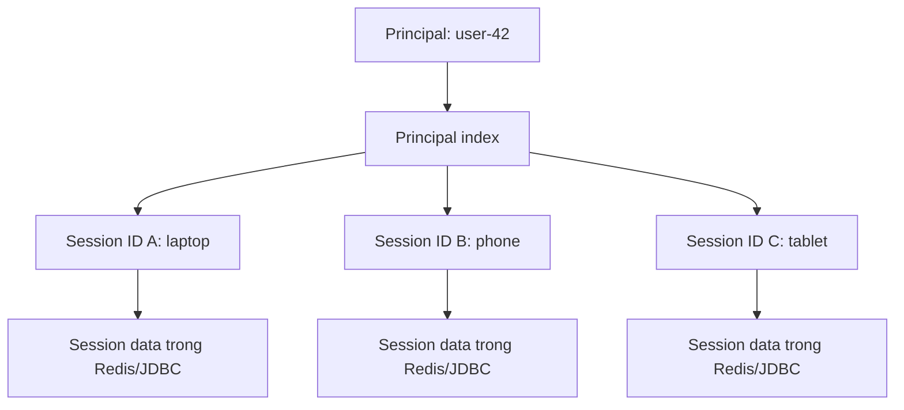

# FindByIndexNameSessionRepository và điều kiện có chỉ mục principal

Spring Session lưu phiên bằng session ID, nhưng nhiều chức năng quản lý đăng nhập cần tìm phiên theo người dùng. Ví dụ, hệ thống muốn liệt kê các thiết bị đang đăng nhập, giới hạn một tài khoản chỉ có một phiên, hoặc đăng xuất các phiên khác khi người dùng đổi mật khẩu. Để làm được điều đó, repository phải hỗ trợ tra cứu theo một chỉ mục như principal name.

`FindByIndexNameSessionRepository` là contract mở rộng từ `SessionRepository`, cung cấp API tìm các phiên theo tên chỉ mục và giá trị chỉ mục. Với principal index, ứng dụng có thể tìm các session gắn với một principal name mà không cần biết trước session ID. Tuy nhiên, không phải mọi `SessionRepository` đều hỗ trợ chức năng này. Chỉ thêm Redis/JDBC dependency hoặc lưu username ở một thuộc tính bất kỳ không bảo đảm truy vấn principal hoạt động; cần đúng implementation indexed và dữ liệu principal phải được repository nhận diện, lưu và duy trì trong suốt vòng đời phiên.

## 1. Từ session ID tới principal index

Session ID là định danh của một phiên cụ thể, thường được gửi trong cookie. Principal name là định danh của người dùng đã xác thực, ví dụ username hoặc một mã người dùng ổn định. Một người dùng có thể có nhiều session ID do đăng nhập trên nhiều trình duyệt hoặc thiết bị.

Quan hệ có thể hình dung như sau:



Khi chỉ có session ID, repository có thể tải một phiên bằng `findById(id)`. Khi chỉ có principal name, ứng dụng cần một index ánh xạ principal tới tập session ID tương ứng. `FindByIndexNameSessionRepository` cung cấp abstraction để truy vấn index này.

Ví dụ: `user-42` đăng nhập trên laptop và điện thoại. Repository lưu hai phiên riêng biệt, nhưng cả hai đều được gắn với cùng principal. Một thao tác “đăng xuất các thiết bị khác” có thể truy vấn các phiên của `user-42`, giữ lại ID của phiên hiện tại rồi xóa những phiên còn lại.

Principal index không biến session thành một bản ghi người dùng. Nó là chỉ mục phụ phục vụ tìm kiếm phiên. Nguồn chân lý về tài khoản, trạng thái khóa, quyền và danh tính vẫn thuộc hệ thống quản lý người dùng hoặc authentication provider.

## 2. Contract FindByIndexNameSessionRepository

`FindByIndexNameSessionRepository<S extends Session>` mở rộng `SessionRepository<S>`. Ngoài các thao tác tạo, lưu, tìm theo ID và xóa phiên, contract này có phương thức:

```java
Map<String, S> findByIndexNameAndIndexValue(
        String indexName,
        String indexValue);
```

Phương thức nhận tên index và giá trị cần tìm, sau đó trả về map các phiên phù hợp. Key của map là session ID; value là session object. Với principal index, Spring Session cung cấp hằng số `FindByIndexNameSessionRepository.PRINCIPAL_NAME_INDEX_NAME` và phương thức tiện ích `findByPrincipalName(principalName)` trong các phiên bản có API này.

Ví dụ truy vấn:

```java
Map<String, Session> sessions =
        sessionRepository.findByPrincipalName(principalName);

for (Map.Entry<String, Session> entry : sessions.entrySet()) {
    String sessionId = entry.getKey();
    Session session = entry.getValue();
    // Chỉ lấy metadata cần thiết cho chức năng quản trị.
}
```

Kiểu generic cụ thể phụ thuộc implementation được inject. Ví dụ trên minh họa cách dùng với repository có kiểu session tương thích. Trong service thực tế, nên phụ thuộc vào interface indexed thay vì ép kiểu sang `RedisIndexedSessionRepository` hoặc `JdbcIndexedSessionRepository`, để có thể thay backend mà không đổi logic nghiệp vụ.

Ví dụ service dùng abstraction:

```java
@Service
class AccountSessionQueryService {

    private final FindByIndexNameSessionRepository<? extends Session> repository;

    AccountSessionQueryService(
            FindByIndexNameSessionRepository<? extends Session> repository) {
        this.repository = repository;
    }

    Map<String, ? extends Session> findSessions(String principalName) {
        return repository.findByPrincipalName(principalName);
    }
}
```

`findByIndexNameAndIndexValue` là API tra cứu theo một index cụ thể. Không nên tự đoán tên index hoặc key Redis nội bộ. Với principal, dùng hằng số API để tránh phụ thuộc chuỗi hard-code. Nếu cần index tùy chỉnh, xác nhận implementation và resolver có hỗ trợ index đó.

## 3. Không phải SessionRepository nào cũng có principal index

`SessionRepository` chỉ cam kết các thao tác vòng đời phiên cơ bản. Nó không cam kết có khả năng tìm phiên theo principal. Muốn gọi API index, bean repository thực tế phải triển khai `FindByIndexNameSessionRepository`.

Một số implementation Spring Session thường gặp:

| Repository | Khả năng tra cứu theo principal |
| --- | --- |
| `RedisIndexedSessionRepository` | Có principal index và API `FindByIndexNameSessionRepository` |
| `JdbcIndexedSessionRepository` | Có hỗ trợ index, thường lưu principal name trong cột `PRINCIPAL_NAME` |
| `RedisSessionRepository` dạng đơn giản | Không cung cấp principal index như implementation indexed |
| `MapSessionRepository` cơ bản | Chỉ phục vụ lưu phiên theo ID, không mặc nhiên cung cấp principal index |

Tên implementation và cách Spring Boot auto-configure có thể thay đổi theo phiên bản. Không kết luận loại repository chỉ từ dependency trong build file. Hãy kiểm tra bean `SessionRepository` đang được tạo và xem nó có triển khai `FindByIndexNameSessionRepository` hay không.

Nếu service inject `FindByIndexNameSessionRepository` nhưng context chỉ có repository không indexed, ứng dụng có thể không khởi động vì thiếu bean phù hợp. Nếu inject `SessionRepository` rồi ép kiểu runtime, lỗi có thể xuất hiện muộn khi code chạy. Dùng đúng interface trong constructor để yêu cầu rõ capability cần thiết.

Với Spring Boot, kiểm tra cấu hình auto-configuration và annotation bật Spring Session. Nếu tự khai báo repository hoặc `@Enable...` thủ công, tránh tạo nhiều repository cùng quản lý một loại session. Một repository indexed và một repository không indexed cùng tồn tại không tự chia sẻ dữ liệu hoặc index.

## 4. Điều kiện để repository nhận diện principal

Có repository indexed chưa đủ. Repository còn phải biết principal name của mỗi phiên để ghi vào index. Spring Session sử dụng cơ chế `IndexResolver` để xác định các giá trị index từ session.

Với tích hợp Spring Security theo session, principal thường có thể được xác định từ `SecurityContext` lưu trong session. `PrincipalNameIndexResolver` là resolver mặc định được dùng trong các cấu hình indexed phổ biến; nó có thể tìm principal từ security context và các thuộc tính session theo quy ước của Spring Session.

Một luồng chuẩn:

1. Người dùng gửi credentials.
2. Spring Security xác thực và tạo `Authentication`.
3. `SecurityContext` được lưu vào `HttpSession` thông qua `SecurityContextRepository`.
4. Spring Session lưu session và resolver xác định principal name.
5. Repository cập nhật principal index để ánh xạ principal tới session ID.
6. Request quản trị sau đó gọi `findByPrincipalName(...)` để tìm các phiên của người dùng.

Nếu `SecurityContext` không được lưu vào session, resolver không có dữ liệu để xác định principal theo cơ chế mặc định. Đây có thể là trường hợp ứng dụng stateless, custom authentication flow không lưu context, hoặc cấu hình security repository không dùng session.

Không chỉ cần `SecurityContextHolder` có authentication trong thread hiện tại. Với Spring Security hiện đại, việc đặt context vào `SecurityContextHolder` trong request không nhất thiết tự động lưu nó vào session cho request tiếp theo. Custom authentication filter hoặc login flow cần lưu context qua `SecurityContextRepository` theo cách phù hợp với phiên bản đang dùng.

## 5. Đặt principal name tường minh cho custom authentication

Nếu ứng dụng không dùng `SecurityContext` chuẩn hoặc resolver mặc định không thể suy ra principal, có thể lưu giá trị principal index theo contract Spring Session. Hằng số `PRINCIPAL_NAME_INDEX_NAME` được dùng làm tên thuộc tính dành cho principal index.

Ví dụ:

```java
import org.springframework.session.FindByIndexNameSessionRepository;

void associatePrincipal(HttpSession session, String principalName) {
    session.setAttribute(
            FindByIndexNameSessionRepository.PRINCIPAL_NAME_INDEX_NAME,
            principalName);
}
```

Đoạn mã này minh họa Servlet `HttpSession`. Chỉ dùng khi ứng dụng có custom authentication và cần cung cấp principal name cho resolver. Với Spring Security tích hợp chuẩn, ưu tiên để resolver đọc `SecurityContext` đã được lưu đúng cách, tránh duy trì hai nguồn principal có thể lệch nhau.

Giá trị phải là định danh ổn định, không phải display name có thể đổi tùy ý. Nếu người dùng đổi username, thay đổi cách chuẩn hóa hoặc chuyển tenant, index có thể còn giá trị cũ nếu ứng dụng không cập nhật phiên đang tồn tại. Hãy xác định rõ quy tắc chuẩn hóa principal name và áp dụng thống nhất khi đăng nhập, ghi index và truy vấn.

Không lưu `Authentication` tùy tiện dưới key index; giá trị index cần là tên principal mà resolver/repository mong đợi. Nếu cần một index tùy chỉnh, triển khai `IndexResolver` phù hợp và kiểm tra API của implementation thay vì tái sử dụng principal index cho dữ liệu khác.

## 6. Principal name phải nhất quán và không mơ hồ

Principal name là khóa truy vấn, do đó cần có quy tắc ổn định giữa các request và instance. Những giá trị như tên hiển thị, email có thể đổi hoặc username không duy nhất giữa các tenant có thể gây lỗi tìm kiếm nếu được dùng mà không chuẩn hóa.

Các nguyên tắc nên áp dụng:

- Dùng cùng một định dạng principal khi ghi index và khi truy vấn.
- Ưu tiên định danh duy nhất, ổn định trong phạm vi hệ thống, ví dụ user ID bất biến hoặc username đã chuẩn hóa.
- Nếu nhiều tenant có thể dùng cùng username, đưa tenant vào định danh hoặc dùng principal name duy nhất theo thiết kế identity provider.
- Không đổi chữ hoa/thường ở một phía nhưng giữ nguyên ở phía còn lại.
- Không dùng display name hoặc dữ liệu người dùng có thể tùy ý chỉnh sửa làm khóa index.
- Tránh đưa thông tin nhạy cảm vào log hoặc API response chỉ vì nó là principal name.

Ví dụ, nếu `Authentication.getName()` trả `mai.tran`, mọi instance phải dùng đúng `mai.tran` để tìm principal index. Nếu custom resolver lưu `tenant-7:user-42`, service truy vấn cũng phải dùng cùng giá trị đó. Tránh một nơi truy vấn email, nơi khác lưu username và nơi thứ ba lưu user ID.

Với hệ thống có nhiều identity provider, cần xác định hai tài khoản trùng tên từ hai issuer khác nhau có được xem là cùng principal hay không. Nếu không, principal key cần chứa namespace/issuer hoặc một định danh nội bộ duy nhất. Việc này ảnh hưởng trực tiếp tới concurrent session control: hai người dùng khác nhau không được gom vào cùng một index do va chạm tên.

## 7. Các trường hợp principal index không được tạo hoặc không cập nhật

Một số tình huống khiến truy vấn principal trả về map rỗng dù session ID vẫn tồn tại:

**Repository không indexed.** Bean thực tế chỉ triển khai `SessionRepository`; không có API index. Chọn implementation indexed phù hợp hoặc thay đổi yêu cầu nghiệp vụ.

**SecurityContext không được lưu vào session.** Ứng dụng dùng stateless security hoặc custom login flow chỉ đặt authentication vào context hiện tại. Cấu hình `SecurityContextRepository` và lưu context đúng cách nếu muốn dùng principal index dựa trên security context.

**Custom principal không được resolver hiểu.** Principal object có kiểu riêng hoặc cách đặt tên khác với resolver mặc định. Cấu hình `IndexResolver` hoặc lưu principal index attribute tường minh.

**Session chưa được lưu.** Request đã xác thực nhưng session chưa được commit/save hoặc response bị lỗi trước khi hoàn tất. Kiểm tra lifecycle, repository exception và filter order.

**Session được tạo trước khi principal có mặt.** Phiên ẩn danh chưa có principal index. Sau đăng nhập, phải bảo đảm SecurityContext hoặc principal attribute được ghi và repository cập nhật index theo lifecycle.

**Tên principal không đồng nhất.** Giá trị được ghi khác với giá trị truy vấn do khác case, tenant, prefix hoặc cách chuẩn hóa.

**Index bị stale hoặc event cleanup không hoạt động.** Phiên đã bị xóa/hết hạn nhưng index còn tham chiếu cũ; ngược lại, một lỗi cập nhật index có thể làm thiếu phiên. Kiểm tra event/listener, repository và trạng thái dữ liệu theo cơ chế được hỗ trợ.

**Dùng sai key hoặc index name.** Không dùng tên thuộc tính tùy ý thay cho `PRINCIPAL_NAME_INDEX_NAME` nếu resolver không được cấu hình để đọc nó.

## 8. RedisIndexedSessionRepository và principal index

`RedisIndexedSessionRepository` lưu session trong Redis và duy trì các cấu trúc index để tìm phiên theo principal. Repository cần một `IndexResolver` để trích xuất giá trị principal từ session. Cấu hình phổ biến dùng `PrincipalNameIndexResolver` để tìm thông tin từ `SecurityContext` hoặc principal index attribute.

Khi principal được nhận diện, repository cập nhật index tương ứng khi lưu phiên. Khi session ID thay đổi hoặc session bị xóa/hết hạn, repository cần điều chỉnh index để không còn tham chiếu sai. Một số bước dọn phụ thuộc Redis keyspace notifications; nếu notification không được bật hoặc listener không nhận được event trên node liên quan, stale index có thể tồn tại.

Với Redis Cluster, cần xác minh listener nhận event từ mọi primary theo topology và phiên bản Spring Session/Redis client. Không giả định một subscription tới một node đã nhận toàn bộ keyspace notifications của cluster. Nếu index cleanup bị bỏ lỡ, kết quả truy vấn có thể chứa ID cũ hoặc số lượng index tăng dần.

Không tự đọc/ghi cấu trúc key index nội bộ bằng Redis command trong code nghiệp vụ. Dùng `findByPrincipalName`, repository API và cơ chế dọn được hỗ trợ. Tên key, serialization và cấu trúc index có thể thay đổi theo phiên bản.

## 9. JdbcIndexedSessionRepository và principal index

`JdbcIndexedSessionRepository` lưu session metadata và attributes trong các bảng JDBC. Schema chuẩn có cột `PRINCIPAL_NAME` trong bảng session để phục vụ truy vấn theo principal. Repository có thể sử dụng index database trên cột này để tìm các phiên liên quan.

Điều kiện vẫn giống về mặt logic: repository phải nhận được principal name khi lưu session. Nếu `SecurityContext` không được lưu hoặc resolver không xác định được principal, cột `PRINCIPAL_NAME` có thể rỗng và truy vấn principal không tìm thấy phiên.

Khi tùy chỉnh bảng hoặc schema JDBC, giữ cột principal và index cần thiết theo schema script của đúng phiên bản. Không bỏ cột `PRINCIPAL_NAME` chỉ vì ứng dụng hiện không thấy nó trong controller; đây là dữ liệu repository dùng cho indexed lookup. Nếu đổi tên bảng, bảo đảm migration và repository cùng trỏ tới cấu trúc đã đổi.

## 10. Tích hợp Spring Security để quản lý nhiều phiên

Spring Security có thể dùng `SessionRegistry` để quản lý các phiên đăng nhập. Với ứng dụng một instance, registry trong bộ nhớ có thể đủ cho một số trường hợp. Trong hệ thống nhiều instance dùng Spring Session, registry phải dựa trên repository chia sẻ để mọi node thấy cùng các phiên.

`SpringSessionBackedSessionRegistry` là adapter nối Spring Security `SessionRegistry` với `FindByIndexNameSessionRepository`. Ví dụ cấu hình:

```java
@Bean
SpringSessionBackedSessionRegistry<? extends Session> sessionRegistry(
        FindByIndexNameSessionRepository<? extends Session> repository) {
    return new SpringSessionBackedSessionRegistry<>(repository);
}
```

Sau đó, cấu hình concurrent session control trong Servlet Spring Security:

```java
@Bean
SecurityFilterChain securityFilterChain(
        HttpSecurity http,
        SpringSessionBackedSessionRegistry<? extends Session> sessionRegistry)
        throws Exception {

    http
        .authorizeHttpRequests(authorize -> authorize
            .anyRequest().authenticated()
        )
        .formLogin(Customizer.withDefaults())
        .sessionManagement(session -> session
            .maximumSessions(2)
            .sessionRegistry(sessionRegistry)
        );

    return http.build();
}
```

Ví dụ giới hạn tối đa hai phiên cho mỗi principal. API cấu hình cụ thể có thể khác theo phiên bản Spring Security. Cần bảo đảm repository bean thực tế triển khai `FindByIndexNameSessionRepository`, principal index được tạo và `SessionRepositoryFilter` chạy trước security filter chain.

`SpringSessionBackedSessionRegistry` cho phép các instance truy vấn session qua repository dùng chung, thay vì mỗi JVM chỉ biết các session mà nó tạo. Tuy nhiên, không nên giả định mọi thao tác registry đều có khả năng liệt kê toàn bộ principal trong hệ thống; contract index chủ yếu tìm theo index value đã biết. Kiểm tra các phương thức được hỗ trợ bởi phiên bản Spring Security/Spring Session đang dùng.

## 11. Giới hạn và tính nhất quán của concurrent login control

Principal index là cơ sở để tìm các session đã tồn tại, nhưng thao tác kiểm tra số lượng phiên và tạo session mới có thể gồm nhiều bước. Hai request đăng nhập đồng thời trên hai instance có thể cùng đọc thấy một số lượng phiên dưới giới hạn rồi cùng tạo phiên. Nếu repository hoặc cơ chế concurrency control không có thao tác nguyên tử bao trùm toàn bộ quy trình, giới hạn có thể bị vượt trong một race condition.

Vì vậy:

- Kiểm thử hai lần đăng nhập đồng thời cùng principal ở hai instance.
- Xác định hành vi khi đạt giới hạn: từ chối lần đăng nhập mới hay cho phép đăng nhập mới và làm phiên cũ hết hiệu lực.
- Kiểm tra session fixation và thời điểm session ID được đăng ký vào principal index.
- Không dùng principal index như một distributed lock hoặc transaction manager.
- Nếu yêu cầu giới hạn tuyệt đối trong điều kiện cạnh tranh, bổ sung cơ chế điều phối/atomic control phù hợp ở tầng nghiệp vụ hoặc datastore.

`maximumSessions(2)` mô tả chính sách Spring Security, nhưng semantics thực tế còn phụ thuộc phiên bản, strategy, event lifecycle và repository. Không thay thế kiểm thử race bằng một bài test đăng nhập tuần tự.

## 12. Stateless authentication không tự có principal session index

Ứng dụng dùng JWT hoặc bearer token theo chính sách stateless có thể không tạo `HttpSession` và không lưu `SecurityContext` trong session. Trong trường hợp đó, `FindByIndexNameSessionRepository` không có phiên để tìm theo principal. Việc token chứa username hoặc subject không tự tạo principal index trong Spring Session.

Nếu nghiệp vụ cần liệt kê và thu hồi các phiên/thiết bị dùng token, cần một kho token/session riêng hoặc chủ động dùng session-based authentication. Có thể lưu token identifier hoặc device session record trong một repository chuyên trách, nhưng không nên nhầm nó với principal index của Spring Session.

Một hệ thống hỗn hợp có thể dùng session cho giao diện web và JWT cho API. Khi đó, phải xác định rõ chức năng quản lý nhiều đăng nhập áp dụng cho loại xác thực nào. Không giả định đăng xuất một `HttpSession` sẽ tự thu hồi mọi access token độc lập.

## 13. Bảo mật khi truy vấn các phiên theo principal

Danh sách session của một principal là dữ liệu bảo mật. Endpoint “xem thiết bị đang đăng nhập” chỉ nên cho người dùng xem các phiên thuộc chính họ. Endpoint “đăng xuất phiên khác” cần xác minh quyền sở hữu, không nhận principal name tùy ý từ request rồi trả dữ liệu phiên tương ứng.

Các nguyên tắc:

- Lấy principal hiện tại từ `SecurityContext`, không tin username do client gửi.
- Kiểm tra quyền quản trị trước khi truy vấn session của người khác.
- Chỉ trả metadata cần thiết như thời điểm tạo, lần truy cập gần nhất và nhãn thiết bị do ứng dụng quản lý.
- Không trả session ID đầy đủ, cookie, `SecurityContext` hoặc attributes nội bộ ra client.
- Khi thu hồi phiên, dùng repository API hoặc cơ chế logout phù hợp; không sửa key index Redis trực tiếp.
- Audit ai đã thu hồi phiên nào bằng correlation/record an toàn, tránh log bearer session ID.

Session ID là bearer credential. Nếu endpoint trả ID cho người dùng, kẻ có được ID có thể có khả năng chiếm phiên. Để hiển thị danh sách thiết bị, tạo một identifier hiển thị riêng không thể dùng thay thế session ID.

## 14. Kiểm thử điều kiện có principal index

Kiểm thử cần xác minh cả việc ghi index và việc truy vấn. Một session có thể được lưu thành công nhưng không có principal index; chỉ kiểm tra `findById` sẽ không phát hiện lỗi này.

| Kịch bản | Điều cần xác minh |
| --- | --- |
| Đăng nhập bằng Spring Security session-based | SecurityContext được lưu và principal index xuất hiện |
| Custom authentication | Principal index attribute hoặc custom resolver cung cấp đúng principal name |
| Truy vấn bằng `findByPrincipalName` | Trả về các session ID của principal đã đăng nhập |
| Truy vấn sai principal | Không trả về phiên của người dùng khác |
| Session ID đổi sau login | Index vẫn trỏ tới ID hiện tại theo repository lifecycle |
| Logout một phiên | Phiên bị xóa và index được cập nhật |
| Session hết hạn | Index không giữ tham chiếu stale vô thời hạn |
| Hai instance dùng chung repository | Cả hai node nhìn thấy cùng các phiên của principal |
| Hai login đồng thời | Chính sách giới hạn phiên có hành vi đã xác định |
| Stateless JWT request | Không kỳ vọng có session index nếu không tạo/lưu session |

Ví dụ integration test theo trình tự:

1. Gửi login request qua ứng dụng và lấy cookie session.
2. Xác định principal name theo authentication đã xác thực.
3. Gọi `findByPrincipalName(principalName)` từ repository.
4. Xác minh session ID vừa tạo xuất hiện trong kết quả.
5. Gửi request tới instance khác với cùng cookie và xác minh session được khôi phục.
6. Logout hoặc invalidate phiên rồi xác minh truy vấn index không còn trả phiên hợp lệ.

Dùng Redis/JDBC thật hoặc Testcontainers để kiểm tra index. Mock repository chỉ chứng minh service gọi đúng method; nó không chứng minh resolver, schema, Redis notification hoặc index implementation đang hoạt động.

## 15. Lỗi thường gặp và cách chẩn đoán

**Không inject được `FindByIndexNameSessionRepository`.** Repository bean hiện tại có thể không hỗ trợ index, hoặc cấu hình Spring Session chưa tạo implementation indexed. Kiểm tra bean type thực tế và chọn repository phù hợp với backend.

**Session tồn tại theo ID nhưng tìm theo principal không ra.** Kiểm tra `SecurityContext` có được lưu trong session không, resolver có trích xuất được principal không, custom login flow có lưu context không và session đã được save chưa.

**Principal index chứa giá trị khác với username đang đăng nhập.** So sánh `Authentication.getName()`, custom resolver và cách chuẩn hóa. Kiểm tra tenant/issuer, case và prefix.

**Concurrent session control chỉ hoạt động trên một node.** Có thể đang dùng `SessionRegistry` trong bộ nhớ thay vì `SpringSessionBackedSessionRegistry`, hoặc repository/index không được chia sẻ. Kiểm tra cấu hình registry và repository.

**Session bị xóa nhưng index vẫn còn ID.** Với Redis, kiểm tra keyspace notifications và listener trên topology thực tế; với JDBC, kiểm tra repository cleanup, schema và transaction. Xác minh `findById` trước khi kết luận index stale.

**Custom authentication chỉ lưu context trong thread.** Kiểm tra `SecurityContextRepository.saveContext(...)` hoặc cơ chế lưu tương ứng. Context hiện diện trong request không tự bảo đảm được lưu qua request tiếp theo.

**Đăng nhập JWT nhưng principal index rỗng.** Đây là kết quả bình thường nếu authentication stateless không tạo Web/HttpSession. Cần một kho quản lý token/device riêng nếu muốn truy vấn phiên token.

## 16. Quy trình triển khai

1. Xác định nghiệp vụ có thật sự cần tìm session theo principal hay chỉ cần tra cứu theo ID.
2. Chọn repository triển khai `FindByIndexNameSessionRepository`, ví dụ implementation indexed của Redis hoặc JDBC.
3. Xác nhận bean repository thực tế và resolver principal được cấu hình.
4. Với Spring Security session-based, bảo đảm `SecurityContext` được lưu vào session; với custom auth, lưu principal index attribute hoặc cấu hình resolver phù hợp.
5. Chuẩn hóa principal name và bảo đảm duy nhất trong phạm vi tenant/issuer.
6. Nếu quản lý concurrent login, dùng `SpringSessionBackedSessionRegistry` và cấu hình session policy phù hợp.
7. Kiểm thử login, đổi ID, logout, timeout, nhiều instance và hai login đồng thời.
8. Theo dõi index lifecycle và event cleanup; không sửa cấu trúc index nội bộ bằng mã nghiệp vụ.
9. Bảo vệ endpoint quản trị session và không để lộ session ID.

`FindByIndexNameSessionRepository` chỉ cung cấp principal lookup khi repository thực sự hỗ trợ index và có thể xác định principal name từ session. Với Spring Security, điều đó thường đòi hỏi `SecurityContext` được lưu đúng cách; với custom authentication, cần resolver hoặc principal index attribute rõ ràng. Khi repository, principal identity và lifecycle index được cấu hình nhất quán, ứng dụng có thể quản lý nhiều phiên đăng nhập trên nhiều instance mà không phải quét toàn bộ kho session hoặc phụ thuộc vào bộ nhớ cục bộ của một node.
