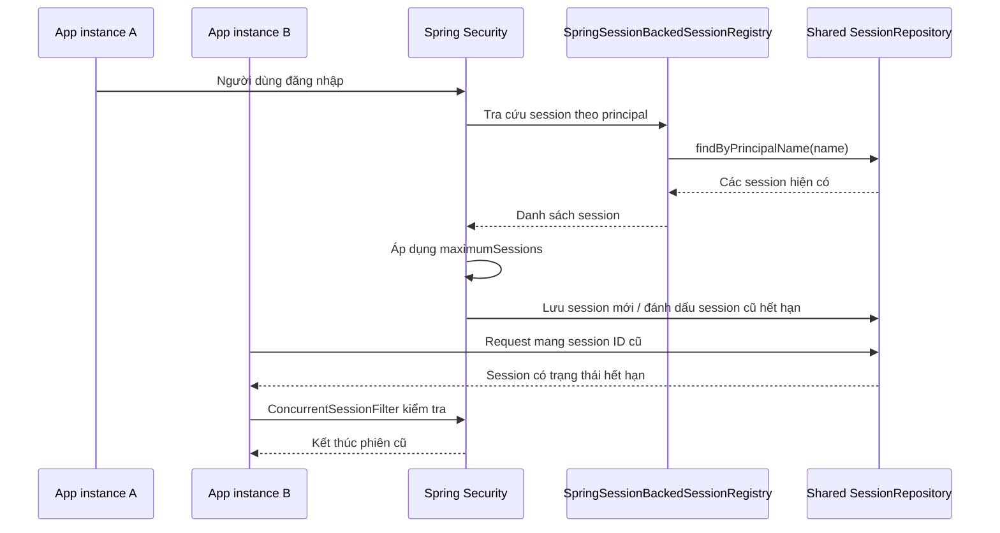
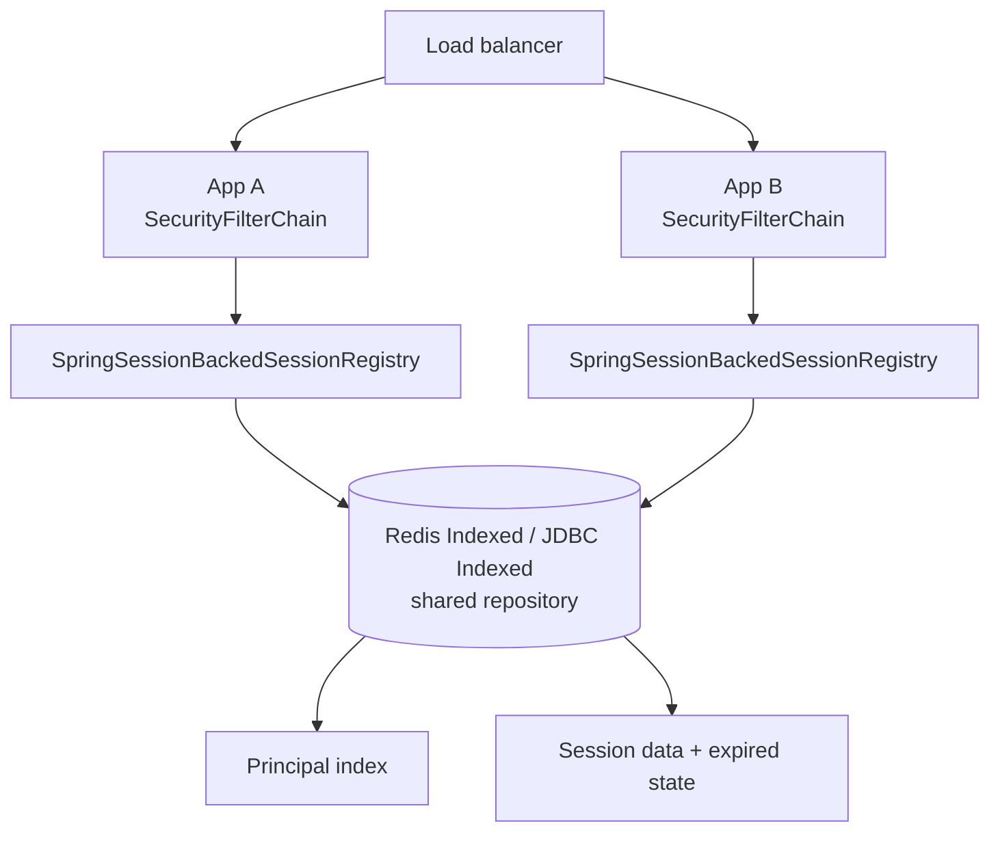

# SpringSessionBackedSessionRegistry và kiểm soát phiên trong cụm

Khi một tài khoản đăng nhập trên nhiều thiết bị hoặc nhiều trình duyệt, ứng dụng có thể cần giới hạn số phiên đang hoạt động, từ chối lần đăng nhập mới hoặc kết thúc phiên cũ. Spring Security cung cấp cơ chế kiểm soát phiên đồng thời thông qua `SessionRegistry` và cấu hình `maximumSessions`. Khi ứng dụng dùng Spring Session với Redis hoặc JDBC, registry cần đọc được các phiên từ kho dùng chung để mọi instance đưa ra quyết định dựa trên cùng dữ liệu.

`SpringSessionBackedSessionRegistry` là implementation `SessionRegistry` kết nối Spring Security với `FindByIndexNameSessionRepository` của Spring Session. Nó tra cứu session theo principal từ repository, vì vậy phù hợp với môi trường nhiều instance. Điều kiện quan trọng là repository phải hỗ trợ chỉ mục principal và dữ liệu principal trong session phải được xác định nhất quán.

## 1. Bài toán nhiều phiên đăng nhập

Một người dùng có thể đăng nhập trên laptop, điện thoại và trình duyệt khác nhau. Mỗi lần đăng nhập thường tạo một HTTP session riêng với session ID riêng. Nếu không có chính sách giới hạn, cùng một tài khoản có thể duy trì nhiều phiên cùng lúc.

Các yêu cầu thường gặp:

- Cho phép đăng nhập trên nhiều thiết bị không giới hạn.
- Chỉ cho phép một phiên đang hoạt động cho mỗi tài khoản.
- Giới hạn tối đa hai hoặc ba phiên.
- Khi đạt giới hạn, từ chối lần đăng nhập mới.
- Hoặc cho phép lần đăng nhập mới và kết thúc phiên cũ nhất.
- Cho phép quản trị viên thu hồi phiên theo tài khoản.
- Bảo đảm chính sách vẫn đúng khi request chuyển qua nhiều instance.

Giới hạn phiên là chính sách gắn với principal đã xác thực, không phải giới hạn số cookie trong một trình duyệt. Một người dùng có thể có nhiều session ID và các session đó có thể nằm trên những node khác nhau.

## 2. SessionRegistry của Spring Security

`SessionRegistry` là abstraction để Spring Security theo dõi các session đã xác thực. Một số thao tác chính:

| Phương thức | Mục đích |
|---|---|
| `getAllSessions(principal, includeExpiredSessions)` | Lấy các session đã đăng ký của một principal |
| `getSessionInformation(sessionId)` | Tra cứu thông tin của một session |
| `registerNewSession(sessionId, principal)` | Đăng ký session mới sau xác thực |
| `removeSessionInformation(sessionId)` | Xóa thông tin session khỏi registry |
| `getAllPrincipals()` | Liệt kê principal mà registry đang theo dõi |

Trong cấu hình mặc định không dùng Spring Session, Spring Security thường dùng `SessionRegistryImpl`. Implementation này giữ thông tin trong bộ nhớ của một JVM. Nó cần nhận sự kiện hủy session để loại bỏ thông tin cũ; ứng dụng Servlet thường đăng ký `HttpSessionEventPublisher` để chuyển sự kiện vòng đời Servlet sang Spring ApplicationContext.

Trong môi trường nhiều instance, registry trong bộ nhớ của từng node không chia sẻ dữ liệu. Node A có thể biết một người dùng đã đăng nhập nhưng node B không biết. Vì vậy, hai node có thể cùng cho phép đăng nhập vượt quá giới hạn.

## 3. SpringSessionBackedSessionRegistry giải quyết điều gì?

`SpringSessionBackedSessionRegistry` triển khai `SessionRegistry` bằng cách truy vấn `FindByIndexNameSessionRepository`. Dữ liệu session và chỉ mục principal được lưu trong kho Spring Session dùng chung, thay vì chỉ nằm trong bộ nhớ của một instance.

Luồng hoạt động khái quát:



Vì các instance cùng truy cập repository, node xử lý lần đăng nhập có thể nhìn thấy các phiên được tạo ở node khác. Đây là điểm khác biệt cốt lõi so với registry chỉ giữ dữ liệu cục bộ.

Registry này không tạo ra một kho session mới. Nó dùng chính repository mà Spring Session đang sử dụng, do đó namespace Redis, database/schema JDBC và cấu hình principal index phải nhất quán giữa các instance.

## 4. Điều kiện: repository phải hỗ trợ principal index

`SpringSessionBackedSessionRegistry` cần một `FindByIndexNameSessionRepository`. Interface này mở rộng khả năng lưu session bằng cách cho phép tìm session theo tên chỉ mục và giá trị chỉ mục.

Phương thức quan trọng là:

```java
Map<String, ? extends Session> sessions =
        sessionRepository.findByPrincipalName("user-42");
```

Tên index principal chuẩn được cung cấp bởi:

```java
FindByIndexNameSessionRepository.PRINCIPAL_NAME_INDEX_NAME
```

Các repository indexed phổ biến gồm:

| Repository | Principal index |
|---|---|
| `RedisIndexedSessionRepository` | Có |
| `JdbcIndexedSessionRepository` | Có |
| `MongoIndexedSessionRepository` | Có, tùy module và phiên bản |
| `MapSessionRepository` | Không tự cung cấp principal index |
| `RedisSessionRepository` không indexed | Không |

Không phải repository nào cũng đáp ứng contract cần thiết. Một ứng dụng vẫn có thể lưu và đọc session theo ID bằng repository cơ bản, nhưng không thể dùng nó trực tiếp cho `SpringSessionBackedSessionRegistry` nếu nó không triển khai `FindByIndexNameSessionRepository`.

Với Redis, cần chọn indexed repository. Từ Spring Session 3.5, cấu hình tường minh dùng `@EnableRedisIndexedHttpSession` để chọn indexed implementation; `@EnableRedisHttpSession` chọn repository Redis cơ bản. Ở các phiên bản cũ hơn, semantics annotation có thể khác, vì vậy phải kiểm tra phiên bản dependency trước khi nâng cấp. Với JDBC, dùng `JdbcIndexedSessionRepository` được cấu hình qua Spring Session JDBC.

## 5. Cấu hình SpringSessionBackedSessionRegistry

Trong cấu hình Java, tạo bean registry từ repository indexed:

```java
import org.springframework.context.annotation.Bean;
import org.springframework.context.annotation.Configuration;
import org.springframework.security.core.session.SessionRegistry;
import org.springframework.session.FindByIndexNameSessionRepository;
import org.springframework.session.Session;
import org.springframework.session.security.SpringSessionBackedSessionRegistry;

@Configuration(proxyBeanMethods = false)
public class SessionRegistryConfiguration {

    @Bean
    SessionRegistry sessionRegistry(
            FindByIndexNameSessionRepository<? extends Session> sessionRepository) {
        return new SpringSessionBackedSessionRegistry<>(sessionRepository);
    }
}
```

Bean này không tự bật session storage hoặc tạo principal index. Ứng dụng cần cấu hình Spring Session indexed repository trước đó. Nếu context chỉ có một repository không indexed, injection sẽ không thành công hoặc không có bean phù hợp.

Có thể khai báo kiểu trả về cụ thể hơn nếu ứng dụng cần truy cập API riêng của implementation. Trong phần lớn cấu hình Spring Security, kiểu `SessionRegistry` là đủ vì `SessionManagementConfigurer` chỉ cần abstraction.

Không tạo thêm `SessionRegistryImpl` song song rồi truyền implementation đó vào `maximumSessions`. Nếu Spring Security sử dụng registry cục bộ trong khi session nằm trong Redis/JDBC, kiểm soát phiên vẫn bị giới hạn theo từng JVM.

## 6. Kết hợp với maximumSessions trong SecurityFilterChain

Sau khi có registry bean, truyền nó vào cấu hình session management:

```java
@Bean
SecurityFilterChain securityFilterChain(
        HttpSecurity http,
        SessionRegistry sessionRegistry) throws Exception {

    http
        .authorizeHttpRequests(authorize -> authorize
                .requestMatchers("/login").permitAll()
                .anyRequest().authenticated())
        .formLogin(Customizer.withDefaults())
        .sessionManagement(session -> session
                .maximumSessions(1)
                .maxSessionsPreventsLogin(false)
                .sessionRegistry(sessionRegistry));

    return http.build();
}
```

`maximumSessions(1)` giới hạn mỗi principal có tối đa một session đang hoạt động theo registry. Có thể đổi thành `maximumSessions(2)` hoặc giá trị phù hợp với chính sách sản phẩm.

Cấu hình này áp dụng cho luồng xác thực mà Spring Security quản lý trong `SecurityFilterChain`. Nếu ứng dụng có nhiều chain hoặc nhiều cơ chế đăng nhập, cần bảo đảm chain liên quan đều dùng đúng registry và chính sách mong muốn.

Không chỉ cấu hình `maximumSessions` mà bỏ qua repository. Nếu registry không tìm thấy session của principal, Spring Security có thể kết luận người dùng chưa đạt giới hạn dù các phiên khác vẫn đang hoạt động trên node khác.

## 7. Hai chính sách khi đạt giới hạn

`maxSessionsPreventsLogin` quyết định hành vi khi người dùng đã đạt số phiên tối đa:

| Cấu hình | Hành vi | Trải nghiệm |
|---|---|---|
| `maxSessionsPreventsLogin(true)` | Từ chối lần đăng nhập mới | Phiên hiện tại tiếp tục hoạt động |
| `maxSessionsPreventsLogin(false)` | Cho phép đăng nhập mới và đánh dấu phiên cũ cần kết thúc | Phiên cũ bị kết thúc khi request tiếp theo được kiểm tra |

Ví dụ từ chối đăng nhập mới:

```java
.sessionManagement(session -> session
        .maximumSessions(1)
        .maxSessionsPreventsLogin(true)
        .sessionRegistry(sessionRegistry))
```

Ví dụ cho phép phiên mới thay thế phiên cũ:

```java
.sessionManagement(session -> session
        .maximumSessions(1)
        .maxSessionsPreventsLogin(false)
        .sessionRegistry(sessionRegistry))
```

Khi cho phép đăng nhập mới, Spring Security thường chọn các session cũ theo thời điểm request gần nhất để đánh dấu hết hạn cho đến khi đạt giới hạn. `ConcurrentSessionFilter` kiểm tra thông tin session trên các request tiếp theo; khi thấy session đã hết hạn, filter gọi logout handler để kết thúc phiên.

Vì việc kết thúc phiên cũ thường được thực hiện khi request tiếp theo đi qua filter, không nên diễn giải hành vi này là server lập tức đóng mọi kết nối hoặc xóa mọi dữ liệu trên thiết bị cũ ngay tại thời điểm đăng nhập mới.

## 8. Cách principal được lập chỉ mục

Registry tìm session bằng principal name. Khi Spring Security lưu `SecurityContext` trong `HttpSession`, Spring Session cần xác định tên principal để ghi vào index.

Spring Session cung cấp `PrincipalNameIndexResolver` để phân tích session và lấy tên người dùng từ security context. Với cấu hình tiêu chuẩn, resolver có thể nhận diện `Authentication` đã được lưu trong thuộc tính `SPRING_SECURITY_CONTEXT`.

Để tra cứu hoạt động chính xác:
- Người dùng cần đăng nhập qua cơ chế xác thực lưu context vào session.
- Principal cần có tên ổn định qua các request.
- Session repository phải lập chỉ mục principal.
- Các instance phải dùng cùng cách ánh xạ principal name.
- Custom principal hoặc custom authentication cần được kiểm thử với resolver đang dùng.

Nếu ứng dụng lưu principal bằng một cơ chế riêng hoặc không lưu `SecurityContext` vào session, index có thể không được tạo. Registry khi đó không tìm thấy phiên dù session ID vẫn tồn tại trong Redis hoặc JDBC.

Không dùng email lúc thì viết thường, lúc giữ nguyên chữ hoa làm principal key nếu resolver và ứng dụng không chuẩn hóa giống nhau. Hãy chọn một định danh ổn định, duy nhất, chẳng hạn username nội bộ hoặc user ID dạng chuỗi, và dùng nhất quán.

## 9. Principal tùy chỉnh và index resolver

Ứng dụng có thể dùng principal tùy chỉnh thay vì `UserDetails`. Trong trường hợp đó, cần xác nhận Spring Session có thể lấy đúng tên principal từ `Authentication` hoặc cấu hình resolver phù hợp.

Ví dụ principal:

```java
public record ApplicationPrincipal(
        String userId,
        String username
) implements UserDetails {
    // Các phương thức UserDetails được triển khai theo ứng dụng.
}
```

`Authentication.getName()` nên trả về định danh mà ứng dụng muốn dùng làm principal index. Nếu `getName()` trả về một giá trị khác với giá trị truyền vào `SessionRegistry.getAllSessions(principal, ...)`, truy vấn có thể không khớp.

Với mô hình custom, hãy kiểm tra dữ liệu index bằng API repository hoặc integration test. Nếu cần `IndexResolver` tùy chỉnh, cấu hình resolver theo extension point của repository và bảo đảm tất cả instance dùng cùng implementation. Không sửa trực tiếp key nội bộ trong Redis/JDBC để ép index khớp; cấu trúc lưu trữ là chi tiết triển khai.

## 10. SpringSessionBackedSessionRegistry hoạt động với SessionInformation ra sao?

`SessionRegistry` trả về `SessionInformation` để Spring Security biết session ID, principal, thời điểm truy cập cuối và trạng thái hết hạn.

Với registry dựa trên Spring Session:
- Thông tin session được lấy từ repository dùng chung.
- Trạng thái hết hạn của session có thể được lưu như thuộc tính session để các instance khác nhìn thấy.
- Khi `expireNow()` được gọi, registry-backed session information ghi trạng thái hết hạn vào session repository.
- `ConcurrentSessionFilter` đọc trạng thái khi request mang session đó được xử lý.

Điểm quan trọng là thông tin hết hạn phải được chia sẻ qua repository, không chỉ đặt một cờ trong bộ nhớ của node A. Nếu session cũ bị đánh dấu hết hạn ở A, node B cũng cần nhìn thấy trạng thái đó khi request tiếp theo đến B.

Session repository vẫn áp dụng timeout và expiration riêng. Trạng thái bị đánh dấu bởi concurrency control không thay thế TTL của session; nó là một tín hiệu kết thúc phiên sớm theo chính sách số phiên.

## 11. Giới hạn của SessionRegistry backed by repository

`SpringSessionBackedSessionRegistry` được tối ưu cho tra cứu session theo principal, không phải một directory toàn cục của mọi tài khoản.

Một số giới hạn cần biết:

- `getAllPrincipals()` không thể cung cấp danh sách toàn bộ principal nếu repository không có API liệt kê tất cả principal. Không dùng registry này làm nguồn dữ liệu báo cáo toàn bộ người dùng đang đăng nhập.
- `registerNewSession` và `removeSessionInformation` không có cùng vai trò quản lý map cục bộ như `SessionRegistryImpl`; repository là nguồn dữ liệu session chính.
- Truy vấn theo principal phụ thuộc index được ghi đúng.
- Session đã hết hạn hoặc bị xóa có thể không còn xuất hiện trong truy vấn.
- Độ trễ cleanup vật lý không có nghĩa session hết hạn vẫn hợp lệ.
- Không nên dùng `SessionRegistry` làm hệ thống kiểm toán lịch sử đăng nhập lâu dài.

Nếu cần màn hình quản trị liệt kê mọi tài khoản đang đăng nhập, hãy xây dựng dữ liệu báo cáo hoặc audit riêng với mô hình truy vấn phù hợp. Không cố quét toàn bộ kho session theo cấu trúc key nội bộ để thay thế API principal index.

## 12. HttpSessionEventPublisher có còn cần không?

Với `SessionRegistryImpl` cục bộ, `HttpSessionEventPublisher` thường được dùng để thông báo session bị hủy nhằm xóa thông tin khỏi registry trong bộ nhớ.

Với `SpringSessionBackedSessionRegistry`, repository Spring Session là nguồn dữ liệu session và registry truy vấn trực tiếp từ đó. Nó không cần dựa vào `SessionRegistryImpl` cùng cơ chế publisher để đồng bộ map cục bộ.

Điều này không có nghĩa ứng dụng không còn cần session events. Listener khác có thể vẫn cần nhận `SessionDestroyedEvent` hoặc sự kiện tương ứng để đóng WebSocket, ghi audit hoặc giải phóng tài nguyên. Hãy phân biệt nhu cầu lifecycle event của ứng dụng với nhu cầu đồng bộ trạng thái `SessionRegistry`.

Không đăng ký nhiều cơ chế quản lý cùng session chỉ vì thấy ví dụ cũ dùng `HttpSessionEventPublisher`. Chọn registry phù hợp với repository và phiên bản Spring Security/Spring Session đang chạy.

## 13. Kiểm soát phiên trong nhiều instance

Để kiểm soát phiên trong cụm, tất cả node phải chia sẻ cùng dữ liệu session và cùng chính sách:



Các yêu cầu vận hành:

1. Mọi instance dùng cùng Redis namespace hoặc JDBC schema/table.
2. Mọi instance dùng cùng repository type có principal index.
3. Cùng cookie name, path, domain và cách resolve session ID.
4. Cùng cấu hình `maximumSessions` và `maxSessionsPreventsLogin`.
5. Cùng cách xác định principal name.
6. Cùng phiên bản tương thích của Spring Session và Spring Security.
7. Cùng serializer hoặc conversion configuration để đọc session.
8. Không để một node dùng `SessionRegistryImpl` cục bộ trong khi node khác dùng registry backed by repository.

Nếu node A và B cùng dùng một kho session nhưng một node dùng repository indexed còn node kia dùng repository cơ bản hoặc namespace khác, quyết định concurrency có thể không nhất quán.

## 14. Giới hạn khi nhiều lần đăng nhập xảy ra đồng thời

`SpringSessionBackedSessionRegistry` giúp các node nhìn thấy session chung, nhưng bản thân thao tác kiểm tra giới hạn và tạo session không nhất thiết là một giao dịch admission-control nguyên tử xuyên cụm.

Ví dụ với giới hạn một phiên:
1. Request đăng nhập A trên node A truy vấn và thấy chưa có session.
2. Cùng lúc, request đăng nhập B trên node B cũng truy vấn và thấy chưa có session.
3. Cả hai request có thể vượt qua bước kiểm tra trước khi session còn lại được ghi và index cập nhật.
4. Hai session có thể cùng tồn tại trong một khoảng thời gian hoặc vượt giới hạn trong tình huống tranh chấp.

Đây là race condition giữa bước đọc số session và bước tạo/đánh dấu session. Không nên coi `maximumSessions(1)` là một khóa phân tán hoặc bảo đảm tuyến tính tuyệt đối dưới mọi tải đồng thời.

Nếu yêu cầu nghiệp vụ cần giới hạn nghiêm ngặt, cần thêm cơ chế đồng bộ theo principal, ví dụ:
- Distributed lock có TTL và xử lý giải phóng an toàn.
- Bảng admission-control có unique constraint hoặc transaction phù hợp.
- Một dịch vụ đăng nhập tập trung tuần tự hóa quyết định cho từng principal.
- Một cơ chế atomic update phù hợp với kho lưu trữ.

Cơ chế bổ sung phải xử lý crash, lock expiry, retry và request đăng nhập trùng lặp. Không giữ distributed lock trong thời gian dài của toàn bộ request nếu chỉ cần bảo vệ đoạn quyết định tạo session.

## 15. Kết hợp với giới hạn phiên và đăng xuất thiết bị

Một số ứng dụng cần cung cấp tính năng “đăng xuất khỏi thiết bị khác”. Khi có principal index, ứng dụng có thể lấy các session của người dùng rồi invalidate những session không phải session hiện tại.

Ví dụ khái quát:

```java
Map<String, ? extends Session> sessions =
        sessionRepository.findByPrincipalName(principalName);

sessions.values().stream()
        .filter(session -> !session.getId().equals(currentSessionId))
        .forEach(session -> sessionRepository.deleteById(session.getId()));
```

Đoạn code chỉ minh họa ý tưởng và cần điều chỉnh kiểu generic theo repository cụ thể. Trong ứng dụng thực tế, cần kiểm tra quyền của người gọi, tránh xóa nhầm phiên hiện tại và xử lý session thay đổi đồng thời trong lúc truy vấn.

Nếu muốn dùng chính sách đánh dấu session cũ hết hạn theo Spring Security, hãy để concurrency strategy và registry xử lý thay vì tự xóa key nội bộ. Với thao tác “đăng xuất tất cả thiết bị”, có thể xóa các session tìm được qua principal index; client ở các thiết bị đó sẽ không còn khôi phục được session trong request tiếp theo.

Không trả session ID đầy đủ cho giao diện quản trị nếu không cần. Có thể hiển thị nhãn thiết bị, thời điểm truy cập và thông tin an toàn khác, còn ID phải được che hoặc giữ nội bộ.

## 16. Cấu hình theo repository Redis hoặc JDBC

### Redis indexed

Redis phải dùng `RedisIndexedSessionRepository` và bật cấu trúc index principal. Với Spring Session 3.5 trở lên, cấu hình tường minh thường dùng:

```java
@EnableRedisIndexedHttpSession
```

Các dòng cũ có thể dùng annotation khác với semantics indexed; hãy xác nhận version. Nếu dùng Boot auto-configuration, chọn repository type indexed theo thuộc tính được phiên bản Boot hỗ trợ.

Redis keyspace notifications cần được cấu hình nếu ứng dụng còn dựa vào sự kiện hết hạn/xóa. Principal index và session data phải dùng chung namespace giữa các instance.

### JDBC indexed

`JdbcIndexedSessionRepository` hỗ trợ tra cứu theo principal và lưu session trong các bảng Spring Session JDBC. Cần triển khai schema đúng phiên bản, index phù hợp và cleanup task. Tất cả instance phải dùng cùng database/schema/table name.

### Những lựa chọn không phù hợp

Repository chỉ tìm session theo ID, chẳng hạn Redis repository không indexed hoặc Map repository cơ bản, không đáp ứng trực tiếp yêu cầu principal lookup. Không thể sửa bằng cách chỉ tạo bean `SpringSessionBackedSessionRegistry` nếu repository không triển khai interface cần thiết.

## 17. Kiểm thử giới hạn phiên trong một instance

Một bài kiểm thử nên xác nhận cả hai chính sách.

**Trường hợp từ chối đăng nhập mới:**
1. Đăng nhập user A lần thứ nhất.
2. Giữ cookie/session đầu tiên.
3. Đăng nhập cùng user ở client thứ hai.
4. Xác nhận lần đăng nhập mới bị từ chối theo cấu hình `maxSessionsPreventsLogin(true)`.
5. Gửi request bằng session đầu tiên và xác nhận nó vẫn được xác thực.

**Trường hợp phiên mới thay thế phiên cũ:**
1. Đăng nhập user A lần thứ nhất.
2. Đăng nhập user A ở client thứ hai.
3. Xác nhận lần đăng nhập thứ hai thành công.
4. Gửi request tiếp theo bằng cookie của phiên cũ.
5. Xác nhận `ConcurrentSessionFilter` phát hiện phiên đã hết hạn và thực hiện logout.
6. Xác nhận phiên mới vẫn hoạt động.

Không chỉ kiểm tra HTTP status ở endpoint login. Cần xác nhận trạng thái phiên cũ ở request tiếp theo và kiểm tra repository có đánh dấu hoặc xóa session theo đúng chính sách.

## 18. Kiểm thử nhiều instance và principal index

Để chứng minh registry hoạt động trong cụm:
- Khởi chạy hai application context hoặc hai instance độc lập.
- Cấu hình cùng một Redis indexed repository hoặc JDBC database.
- Đăng nhập user A qua instance A.
- Đăng nhập user A qua instance B.
- Xác nhận instance B nhìn thấy session do A tạo qua principal index.
- Áp dụng `maximumSessions` và kiểm tra kết quả theo chính sách.
- Gửi request với session cũ đến cả A và B để xác nhận trạng thái hết hạn được chia sẻ.
- Kiểm tra session của user B không bị ảnh hưởng.
- Thử custom principal và xác nhận tên index trùng với tên principal registry truy vấn.

Có thể dùng Testcontainers cho Redis hoặc database để integration test. Mock `SessionRegistry` không chứng minh principal index hoặc dữ liệu session thực sự được chia sẻ.

Nên bổ sung test đồng thời với hai lần đăng nhập gần như cùng thời điểm nếu sản phẩm yêu cầu giới hạn nghiêm ngặt. Nếu test cho thấy race condition có thể vượt giới hạn, bổ sung admission-control đồng bộ theo principal.

## 19. Các lỗi thường gặp

| Triệu chứng | Nguyên nhân có thể | Cách kiểm tra |
|---|---|---|
| Mỗi node cho phép một phiên riêng | Dùng `SessionRegistryImpl` cục bộ | Xác nhận registry bean là `SpringSessionBackedSessionRegistry` |
| Registry không tìm thấy session cũ | Repository không indexed hoặc principal index không được ghi | Kiểm tra interface và `findByPrincipalName` |
| Đăng nhập luôn bị từ chối | Principal key không khớp hoặc session cũ chưa được dọn theo chính sách | Kiểm tra principal name, session state và maxSessions |
| Phiên cũ vẫn truy cập được | Filter concurrency không có trong chain hoặc request chưa đi qua filter | Kiểm tra session management config và request chain |
| Chỉ một số node nhận biết session hết hạn | Namespace/repository/version không đồng nhất | So sánh cấu hình cụm |
| Không thể liệt kê tất cả principal | Kỳ vọng `getAllPrincipals` trả danh sách toàn cục | Dùng nguồn audit/reporting riêng |
| Giới hạn bị vượt khi login đồng thời | Kiểm tra và tạo session không nguyên tử | Kiểm thử race và bổ sung admission control nếu cần |

Khi chẩn đoán, không ghi session ID hoặc cookie nguyên vẹn vào log. Ghi principal identifier đã được kiểm soát, instance ID, loại repository, số session tìm thấy và quyết định concurrency là đủ cho phần lớn tình huống.

## 20. Quy trình triển khai an toàn

Trước khi đưa kiểm soát nhiều phiên vào production:

1. Xác định chính sách sản phẩm: giới hạn bao nhiêu phiên và phiên nào bị kết thúc.
2. Dùng repository triển khai `FindByIndexNameSessionRepository`.
3. Xác nhận principal index được tạo từ security context và principal name ổn định.
4. Tạo `SpringSessionBackedSessionRegistry` từ repository đó.
5. Cấu hình `maximumSessions` cùng `maxSessionsPreventsLogin` trong đúng `SecurityFilterChain`.
6. Bảo đảm mọi instance cùng repository, namespace/schema, cookie và chính sách.
7. Kiểm thử login mới, phiên cũ, logout, timeout và request chuyển node.
8. Kiểm thử login đồng thời nếu cần giới hạn nghiêm ngặt.
9. Theo dõi số session theo principal, quyết định từ chối login, session bị đánh dấu hết hạn và lỗi index.
10. Có phương án thu hồi session và xử lý khi repository tạm thời không truy cập được.

`SpringSessionBackedSessionRegistry` giúp Spring Security kiểm soát số phiên đăng nhập dựa trên session repository dùng chung. Điều kiện cốt lõi là repository phải hỗ trợ principal index, mọi instance phải dùng cùng dữ liệu và `ConcurrentSessionFilter` phải kiểm tra trạng thái phiên trong request. Cơ chế này giải quyết giới hạn của registry trong bộ nhớ từng JVM, nhưng không tự biến quy trình kiểm tra rồi tạo session thành thao tác nguyên tử. Với yêu cầu giới hạn tuyệt đối dưới login đồng thời, cần bổ sung một cơ chế admission-control có đồng bộ theo principal.

