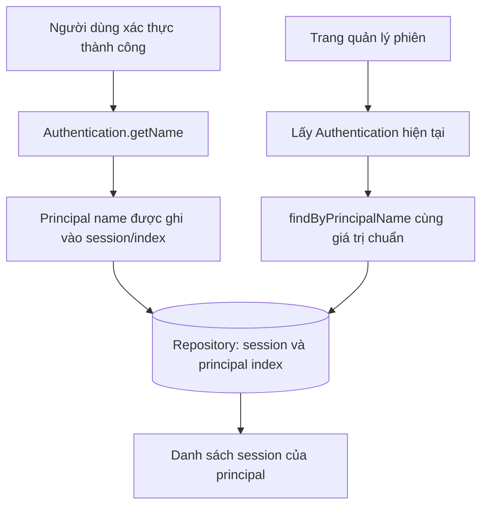

# Tên principal trong chỉ mục phải khớp với danh tính dùng để tra cứu

Spring Session có thể lập chỉ mục session theo principal name để ứng dụng tìm tất cả phiên đang gắn với một người dùng. API `FindByIndexNameSessionRepository.findByPrincipalName(...)` tra cứu theo một giá trị chuỗi cụ thể. Vì vậy, giá trị được ghi vào chỉ mục lúc lưu session phải khớp với giá trị ứng dụng dùng khi truy vấn.

Trong ứng dụng Spring Security, tên này thường được lấy từ `Authentication.getName()`. Tuy nhiên, `getName()` có thể đại diện cho username, subject của nhà cung cấp danh tính hoặc một định danh do ứng dụng tự quy định. Nếu lúc đăng nhập ghi `user-42` nhưng màn hình quản lý phiên lại tìm bằng `alice@example.com`, kết quả có thể rỗng dù người dùng vẫn đang đăng nhập. Muốn tra cứu đáng tin cậy, cần chọn một định danh chuẩn, duy trì cùng quy tắc chuẩn hóa ở cả hai phía và kiểm thử qua toàn bộ luồng xác thực.

## 1. Principal name được dùng để làm gì?

Một người dùng có thể có nhiều session: trình duyệt máy tính, trình duyệt điện thoại, ứng dụng di động hoặc nhiều phiên đăng nhập đồng thời. Session ID nhận từ cookie chỉ xác định một phiên cụ thể. Để tìm tất cả phiên thuộc một người dùng, repository cần một chỉ mục nối principal name với các session ID.

Spring Session định nghĩa hằng số `FindByIndexNameSessionRepository.PRINCIPAL_NAME_INDEX_NAME` cho chỉ mục principal chuẩn và phương thức tiện ích `findByPrincipalName(principalName)` để truy vấn chỉ mục đó.



Chỉ mục không thay thế xác thực. Nó giúp tìm các session được gắn với một tên principal; ứng dụng vẫn phải xác định ai được phép xem hoặc thu hồi các phiên đó.

## 2. API tra cứu theo principal

`FindByIndexNameSessionRepository<S extends Session>` mở rộng `SessionRepository` bằng khả năng tìm session theo tên và giá trị chỉ mục. API thường dùng:

| Thành phần | Ý nghĩa |
|---|---|
| `PRINCIPAL_NAME_INDEX_NAME` | Tên chỉ mục principal chuẩn |
| `findByIndexNameAndIndexValue(indexName, value)` | Tra cứu theo một chỉ mục và giá trị cụ thể |
| `findByPrincipalName(principalName)` | Phương thức tiện ích tra cứu theo principal name |

Kết quả `findByPrincipalName` là map có key là session ID và value là session tương ứng. Một principal có thể có nhiều session nên kết quả không phải một session đơn lẻ.

Ví dụ service nhận repository qua constructor injection:

```java
import java.util.Map;

import org.springframework.session.FindByIndexNameSessionRepository;
import org.springframework.session.Session;
import org.springframework.stereotype.Service;

@Service
class PrincipalSessionService<S extends Session> {
    private final FindByIndexNameSessionRepository<S> repository;

    PrincipalSessionService(FindByIndexNameSessionRepository<S> repository) {
        this.repository = repository;
    }

    Map<String, S> findSessions(String principalName) {
        return repository.findByPrincipalName(principalName);
    }
}
```

Repository thực tế phải hỗ trợ principal index. Với Spring Session Redis, implementation được dùng phổ biến là `RedisIndexedSessionRepository`; với JDBC, cần repository và schema có hỗ trợ cột/chỉ mục principal. Không phải mọi implementation của `SessionRepository` đều hỗ trợ API này.

## 3. Nguồn principal name trong Spring Security

Trong luồng Spring Security, `Authentication` đại diện cho kết quả xác thực hiện tại. Phương thức `getName()` cung cấp tên principal mà Spring Security dùng cho đối tượng xác thực đó.

```java
Authentication authentication =
        SecurityContextHolder.getContext().getAuthentication();

if (authentication != null && authentication.isAuthenticated()) {
    String principalName = authentication.getName();
}
```

Giá trị trả về phụ thuộc loại `Authentication` và principal được cấu hình:

| Cơ chế xác thực | Principal name thường gặp |
|---|---|
| Username/password với `UserDetails` | Giá trị username của `UserDetails` |
| Principal triển khai `java.security.Principal` | Giá trị `getName()` của principal |
| OAuth2 Login | Tên lấy từ thuộc tính định danh mà `OAuth2User` sử dụng |
| OpenID Connect Login | Thường là thuộc tính name được cấu hình, thường dựa trên `sub` |
| Custom `Authentication` | Giá trị do implementation trả về từ `getName()` |

Không giả định `Authentication.getName()` luôn là email hoặc luôn là username người dùng nhập vào form. Ví dụ, một OIDC provider có thể trả `sub=00u8...` trong khi email là `alice@example.com`. Nếu session được index bằng `sub` mà trang quản lý truy vấn bằng email, hai giá trị không khớp.

Nên chọn định danh ổn định trong hệ thống, chẳng hạn user ID nội bộ bất biến hoặc subject đã được ánh xạ thống nhất. Email và username có thể thay đổi, có thể khác chữ hoa/chữ thường hoặc có thể trùng giữa các tenant.

## 4. Spring Session đưa principal vào chỉ mục như thế nào?

Khi tích hợp với Spring Security, Spring Session có thể lấy principal name từ `SecurityContext` được lưu trong session và dùng nó để lập chỉ mục. Repository Redis có cơ chế index resolver để nhận diện principal; các implementation khác có thể có cách lưu tương ứng.

Hằng số `PRINCIPAL_NAME_INDEX_NAME` biểu diễn attribute index chuẩn. Với cơ chế xác thực tùy chỉnh mà resolver mặc định không nhận diện được, ứng dụng có thể gắn principal name rõ ràng vào session:

```java
import jakarta.servlet.http.HttpSession;
import org.springframework.session.FindByIndexNameSessionRepository;

void associatePrincipal(HttpSession session, String canonicalPrincipalName) {
    session.setAttribute(
            FindByIndexNameSessionRepository.PRINCIPAL_NAME_INDEX_NAME,
            canonicalPrincipalName);
}
```

Giá trị `canonicalPrincipalName` phải được tạo từ danh tính đã xác thực ở phía server. Không lấy trực tiếp username tùy ý từ query parameter hoặc request body rồi ghi vào principal index. Nếu client có thể tự chọn giá trị này, họ có thể gắn session của mình với định danh người khác hoặc làm sai lệch kết quả tra cứu.

Khi dùng cơ chế tự động trích principal từ `SecurityContext`, không cần đặt lại attribute thủ công nếu resolver đã nhận diện đúng. Chỉ thêm attribute tường minh khi có lý do rõ ràng, ví dụ custom authentication hoặc cần ánh xạ principal bên ngoài sang user ID nội bộ. Tránh để hai nguồn định danh mâu thuẫn.

### Thời điểm ghi chỉ mục

Principal index được duy trì cùng vòng đời session bởi repository. Session phải được lưu với principal information phù hợp thì truy vấn mới có thể tìm thấy nó. Nếu code xác thực đặt principal sau khi session đã được lưu và không có lần lưu tiếp theo, index có thể chưa phản ánh giá trị mới cho đến khi session được cập nhật.

Trong ứng dụng Servlet, thay đổi `SecurityContext` hoặc session attribute phải đi qua cơ chế lưu session của Spring Security/Spring Session. Trong ứng dụng WebFlux, dùng đúng `WebSession` và repository reactive; không áp dụng trực tiếp ví dụ `HttpSession` ở trên.

## 5. Định danh dùng để ghi và truy vấn phải giống nhau

Giả sử lúc đăng nhập ứng dụng ghi principal name là:

```text
alice@example.com
```

Nếu endpoint quản lý session truy vấn bằng:

```text
Alice@example.com
```

thì kết quả có thể khác, tùy cách repository và database so sánh chuỗi. Redis index thường đối chiếu giá trị theo chuỗi được lưu; JDBC chịu ảnh hưởng kiểu cột và collation của database. Không nên dựa vào việc một database cụ thể tình cờ so sánh không phân biệt hoa thường.

Quy tắc an toàn là tạo một canonical principal name ở ranh giới xác thực và dùng cùng giá trị đó cho:

1. Ghi principal vào session/index.
2. Truy vấn bằng `findByPrincipalName`.
3. So sánh chủ sở hữu khi hiển thị hoặc thu hồi session.
4. Ghi log/audit dưới dạng định danh đã được bảo vệ phù hợp.

Không tự ý lowercase tất cả username. Một hệ thống định danh có thể phân biệt hoa thường, trong khi hệ thống khác chuẩn hóa email theo quy tắc riêng. Canonicalization phải theo hợp đồng của identity provider hoặc user service, không phải một phép biến đổi tùy tiện đặt ở từng controller.

## 6. Chuẩn hóa tên principal có chủ đích

Nếu hệ thống xác định username không phân biệt hoa thường, hãy chuẩn hóa tại một nơi dùng chung trước khi phát hành `Authentication` hoặc ánh xạ sang user ID nội bộ. Ví dụ, service danh tính có thể cung cấp:

```java
String canonicalUserKey(UserAccount account) {
    return account.getId().toString();
}
```

Trong ví dụ này, user ID nội bộ là định danh chính, không phụ thuộc cách người dùng viết email hoặc username. Khi truy vấn, lấy cùng ID từ `Authentication`/principal đã được xác thực, không tự tìm theo email ở một nơi và theo ID ở nơi khác.

Nếu cần chuẩn hóa chuỗi, cần xác định rõ:

- Có phân biệt chữ hoa/chữ thường không?
- Có loại bỏ khoảng trắng đầu/cuối không, hay khoảng trắng là một phần định danh hợp lệ?
- Unicode có được chuẩn hóa về một dạng như NFC không?
- Email có được canonicalize theo chính sách của hệ thống danh tính không?
- Định danh có thể thay đổi trong vòng đời tài khoản không?

Áp dụng cùng một hàm chuẩn hóa ở thời điểm index và thời điểm query. Không chuẩn hóa lại bằng các quy tắc khác nhau ở các service hoặc instance.

### Không dùng giá trị hiển thị làm khóa nếu có định danh ổn định

Tên hiển thị, email hoặc số điện thoại thường có thể thay đổi. Nếu dùng chúng làm principal index, sau khi người dùng đổi email, các session cũ có thể vẫn được index dưới giá trị trước đó. Một định danh bất biến từ user database hoặc identity provider thường phù hợp hơn.

Với OIDC, `sub` thường ổn định trong phạm vi issuer. Nếu nhiều issuer cùng tồn tại, chỉ dùng `sub` có thể gây trùng; cần kết hợp issuer hoặc ánh xạ về user ID nội bộ duy nhất.

## 7. Phân tách tenant để tránh trùng principal

Trong hệ thống multi-tenant, cùng username có thể tồn tại ở nhiều tenant. Ví dụ `sam` trong tenant `north` không nhất thiết là cùng người với `sam` trong tenant `south`.

Nếu index chỉ dùng `sam`, truy vấn có thể gộp session của hai tài khoản. Có thể tạo principal key có phạm vi tenant:

```java
String principalKey(String tenantId, String immutableUserId) {
    return tenantId + ":" + immutableUserId;
}
```

Ví dụ:

```text
north:user-104
south:user-104
```

Khi tạo key tổng hợp, dùng delimiter hoặc encoding không gây nhập nhằng. Nếu các thành phần có thể chứa delimiter, dùng định dạng có độ dài, escaping hoặc một ID nội bộ đã được cấp phát. Không đưa dữ liệu tenant tùy ý từ client vào key mà không xác thực membership.

Tại thời điểm tra cứu, tenant phải lấy từ security context hoặc thông tin tenancy đã được xác thực. Không cho phép client chọn tenant bất kỳ rồi dùng principal name để truy vấn phiên ngoài phạm vi được cấp quyền.

## 8. Ví dụ truy vấn từ danh tính hiện tại

Endpoint người dùng thông thường nên lấy principal name từ `Authentication` thay vì nhận username tùy ý từ request:

```java
import java.util.Map;

import org.springframework.security.core.Authentication;
import org.springframework.session.FindByIndexNameSessionRepository;
import org.springframework.session.Session;
import org.springframework.web.bind.annotation.GetMapping;
import org.springframework.web.bind.annotation.RestController;

@RestController
class MySessionController<S extends Session> {
    private final FindByIndexNameSessionRepository<S> repository;

    MySessionController(FindByIndexNameSessionRepository<S> repository) {
        this.repository = repository;
    }

    @GetMapping("/api/me/session-count")
    int countMySessions(Authentication authentication) {
        String principalName = authentication.getName();
        Map<String, S> sessions = repository.findByPrincipalName(principalName);
        return sessions.size();
    }
}
```

Ví dụ dùng `Authentication.getName()` trực tiếp vì giả định lúc index cũng sử dụng cùng giá trị này. Nếu ứng dụng ánh xạ principal sang user ID hoặc tenant-scoped key, hãy gọi cùng một service canonicalization ở cả hai nơi thay vì dùng `getName()` trực tiếp.

Đối với chức năng quản trị xem phiên của người khác, cần quyền quản trị riêng, kiểm tra tenant và audit log. Không biến endpoint `/api/me/...` thành endpoint nhận `principalName` từ client rồi trả dữ liệu của principal bất kỳ.

## 9. Username, email, subject và user ID: chọn giá trị nào?

| Định danh | Ưu điểm | Rủi ro khi dùng làm index |
|---|---|---|
| Username | Dễ hiểu, thường có sẵn trong form login | Có thể đổi, có thể phân biệt hoa thường hoặc trùng giữa tenant |
| Email | Dễ liên hệ với tài khoản | Có thể đổi, alias/normalization khác nhau, không phải lúc nào cũng duy nhất |
| OIDC `sub` | Được định danh bởi issuer, thường ổn định trong phạm vi issuer | Có thể trùng giữa issuer khác nhau; cần ghép issuer hoặc ánh xạ nội bộ |
| User ID nội bộ bất biến | Ổn định trong hệ thống và dễ kiểm soát uniqueness | Cần bảo đảm mọi luồng xác thực đều ánh xạ về cùng ID |
| Tenant + user ID | Tách danh tính trong môi trường multi-tenant | Cần chuẩn hóa và encoding nhất quán |

Trong hệ thống có user database, user ID nội bộ bất biến thường là lựa chọn tốt. Với hệ thống liên kết nhiều identity provider, ánh xạ mọi external subject về cùng user ID nội bộ giúp tránh một người có nhiều principal name khác nhau.

## 10. Đổi username hoặc liên kết danh tính

Khi người dùng đổi username/email hoặc liên kết thêm identity provider, session đang tồn tại có thể vẫn mang principal name cũ. Việc user profile đổi không tự động bảo đảm mọi session được index lại bằng tên mới.

Có một số chiến lược:

- Dùng user ID nội bộ bất biến làm index để việc đổi email không ảnh hưởng.
- Khi danh tính thay đổi, cập nhật principal index của các session đang hoạt động theo cơ chế repository hỗ trợ.
- Buộc người dùng đăng nhập lại để tạo session mới với principal key chuẩn mới.
- Duy trì ánh xạ định danh cũ sang ID nội bộ trong giai đoạn chuyển đổi, nếu chính sách bảo mật cho phép.

Không nên truy vấn đồng thời nhiều alias tùy ý rồi gộp kết quả mà không có quy tắc sở hữu rõ ràng. Cần xác định một canonical identity duy nhất, còn alias chỉ dùng để ánh xạ sang định danh đó.

## 11. Tài khoản anonymous và principal chưa xác thực

Một request chưa đăng nhập có thể có session để lưu CSRF token, request cache hoặc trạng thái tạm. Session đó chưa chắc có principal name. Vì vậy, `findByPrincipalName` không nhất thiết trả về các session anonymous.

Không dùng chuỗi chung như `anonymousUser` để gắn tất cả session chưa xác thực vào cùng principal index. Làm vậy có thể gom các session không liên quan và tạo nhầm lẫn về chủ sở hữu. Nếu cần quản lý session anonymous, dùng ID riêng hoặc metadata khác với principal của người dùng đã xác thực.

Khi đăng nhập từ một session anonymous, cần kiểm thử session fixation protection, thay đổi session ID và thời điểm principal index được cập nhật. Không giả định session anonymous cũ và session xác thực mới có cùng ID hoặc cùng chỉ mục.

## 12. Khác biệt Redis và JDBC khi so sánh principal name

Về mặt API, `findByPrincipalName` thể hiện cùng ý nghĩa ở các repository hỗ trợ index. Tuy nhiên, cách lưu và so sánh có thể khác:

| Khía cạnh | Redis indexed repository | JDBC repository |
|---|---|---|
| Nơi lưu principal | Cấu trúc index trong Redis cùng dữ liệu session | Cột `PRINCIPAL_NAME` trong bảng session |
| So sánh | Theo giá trị key/index do implementation lưu | Theo kiểu cột, collation và query của database |
| Độ nhạy hoa thường | Thường so khớp giá trị chuỗi chính xác | Có thể phụ thuộc collation database |
| Giới hạn độ dài | Phụ thuộc cấu trúc và cấu hình Redis | Phụ thuộc độ dài cột trong schema |
| Vận hành index | Cần kiểm tra cleanup/expiration và notification theo cấu hình | Cần index SQL phù hợp và theo dõi query plan |

Không dựa vào collation case-insensitive của một môi trường JDBC nếu production có thể dùng database khác. Hãy chuẩn hóa ở tầng ứng dụng và dùng cùng một giá trị ở mọi môi trường.

Với JDBC, principal name quá dài có thể vượt giới hạn cột trong schema. Với key tổng hợp tenant/user, hãy giữ giá trị gọn và kiểm tra kiểu/độ dài cột của script schema đúng phiên bản Spring Session. Không tự ý tăng/đổi cột mà không có migration và kiểm thử tương thích.

## 13. Kiểm thử việc index và truy vấn

Một test tốt cần xác nhận giá trị được ghi và giá trị được truy vấn thực sự giống nhau. Nên kiểm tra cả luồng xác thực thực tế và trường hợp custom principal.

Ví dụ kiểm thử repository ở mức khái niệm:

```java
String principalName = "user-104";

Session first = repository.createSession();
first.setAttribute(
        FindByIndexNameSessionRepository.PRINCIPAL_NAME_INDEX_NAME,
        principalName);
repository.save(first);

Session second = repository.createSession();
second.setAttribute(
        FindByIndexNameSessionRepository.PRINCIPAL_NAME_INDEX_NAME,
        principalName);
repository.save(second);

Map<String, ? extends Session> sessions =
        repository.findByPrincipalName(principalName);

assertThat(sessions).hasSize(2);
```

Ví dụ giả định repository implementation dùng principal index chuẩn và resolver nhận attribute này. Khi dùng Spring Security, cần bổ sung integration test đăng nhập thật để xác nhận resolver trích đúng tên từ `SecurityContext`; không chỉ tự đặt attribute trong test.

Các trường hợp cần kiểm thử:

1. Đăng nhập bằng username và xác nhận tên được index.
2. Đăng nhập qua OAuth2/OIDC và xác nhận giá trị `Authentication.getName()` hoặc user ID ánh xạ được dùng nhất quán.
3. Tra cứu bằng đúng principal name và xác nhận tất cả session được trả về.
4. Tra cứu bằng biến thể khác chữ hoa/thường để xác nhận chính sách chuẩn hóa, không dựa vào database tình cờ.
5. Hai tenant có cùng username nhưng phải có principal key khác nhau.
6. Custom authentication đặt `PRINCIPAL_NAME_INDEX_NAME` và truy vấn thành công.
7. Đổi username/email hoặc liên kết provider và xác nhận chiến lược chuyển đổi index.
8. Xóa/hết hạn session và kiểm tra index không tiếp tục trả phiên không hợp lệ theo hành vi repository.
9. Truy vấn từ instance khác cùng Redis/database và cùng cấu hình.
10. Endpoint người dùng chỉ tra cứu principal của chính họ; endpoint quản trị phải kiểm tra quyền.

Khi test JDBC, chạy trên cùng loại database/collation với production. Khi test Redis, dùng namespace và database test riêng. Không ghi session ID hoặc attribute nhạy cảm vào log để chẩn đoán lỗi index.

## 14. Điều tra khi truy vấn trả về rỗng

Nếu người dùng đang đăng nhập nhưng `findByPrincipalName` trả map rỗng, kiểm tra theo thứ tự:

1. Lấy giá trị `Authentication.getName()` ở request hiện tại và ghi nhận ở dạng đã che hoặc hash an toàn.
2. Xác định giá trị principal thực tế được lưu trong session lúc đăng nhập.
3. Kiểm tra resolver có nhận diện `SecurityContext` hay custom authentication cần đặt index attribute tường minh.
4. Kiểm tra session đã được lưu sau khi principal attribute được gắn chưa.
5. So sánh chính xác chữ hoa/thường, khoảng trắng, Unicode, issuer, tenant và kiểu định danh.
6. Xác nhận repository implementation hỗ trợ principal index và mọi instance dùng cùng namespace/database.
7. Với JDBC, kiểm tra `PRINCIPAL_NAME`, collation, độ dài cột và index SQL.
8. Với Redis, kiểm tra principal index và cleanup theo implementation; không tự sửa key nội bộ bằng tay.
9. Kiểm tra session có hết hạn hoặc bị xóa trước lúc truy vấn không.

Không giải quyết vấn đề bằng cách đổi query sang email, username hoặc subject tùy tiện cho đến khi có kết quả. Trước hết xác định canonical identity của ứng dụng và bảo đảm cùng một giá trị được dùng xuyên suốt.

## 15. Bảo mật khi tra cứu phiên

Principal index giúp tìm session, nhưng quyền truy cập phải được xác minh riêng:

- Endpoint “phiên của tôi” lấy principal từ `Authentication` đã được xác thực.
- Không tin principal name do client gửi lên.
- Với quản trị viên, kiểm tra quyền, tenant và phạm vi tổ chức trước khi truy vấn.
- Không trả session ID thực hoặc toàn bộ session attributes ra trình duyệt.
- Không ghi cookie, token hoặc session ID vào log.
- Dùng audit log có kiểm soát khi quản trị viên xem hoặc thu hồi phiên của người khác.
- Khi thu hồi session, kiểm tra lại session còn tồn tại ở thời điểm thực hiện vì kết quả truy vấn có thể đã cũ.

Một lỗi canonicalization có thể làm hai người bị gộp vào cùng principal key. Vì vậy, tính duy nhất của định danh là yêu cầu bảo mật, không chỉ là vấn đề tiện lợi truy vấn.

## 16. Nguyên tắc thiết kế

- Chọn một canonical principal name ổn định, duy nhất trong phạm vi hệ thống.
- Dùng cùng giá trị khi ghi `PRINCIPAL_NAME_INDEX_NAME` và khi gọi `findByPrincipalName`.
- Hiểu chính xác `Authentication.getName()` trả về gì với từng cơ chế xác thực.
- Ưu tiên user ID nội bộ bất biến; nếu dùng OIDC subject, xét cả issuer.
- Với multi-tenant, đưa tenant scope vào principal key theo định dạng không nhập nhằng.
- Chỉ chuẩn hóa chữ hoa/thường, khoảng trắng và Unicode theo quy tắc của identity provider; không tự biến đổi ở nhiều tầng.
- Với custom authentication, đặt principal index attribute từ danh tính đã xác thực nếu resolver mặc định không nhận diện.
- Kiểm tra JDBC collation/độ dài cột hoặc Redis index behavior theo implementation.
- Kiểm thử login, nhiều session, đổi danh tính, tenant, expiration và truy vấn từ nhiều instance.
- Tách truy vấn khỏi authorization; luôn kiểm tra người gọi được phép xem các phiên được trả về.

`findByPrincipalName` chỉ tìm được các session được index bằng đúng principal name mà ứng dụng truyền vào. `Authentication.getName()` là nguồn thường dùng, nhưng không mặc định là email hoặc username hiển thị. Chọn định danh chuẩn ổn định, ghi và truy vấn bằng cùng một giá trị, xử lý tenant và chuẩn hóa nhất quán sẽ giúp chức năng quản lý nhiều phiên trả kết quả chính xác và không trộn lẫn danh tính người dùng.
