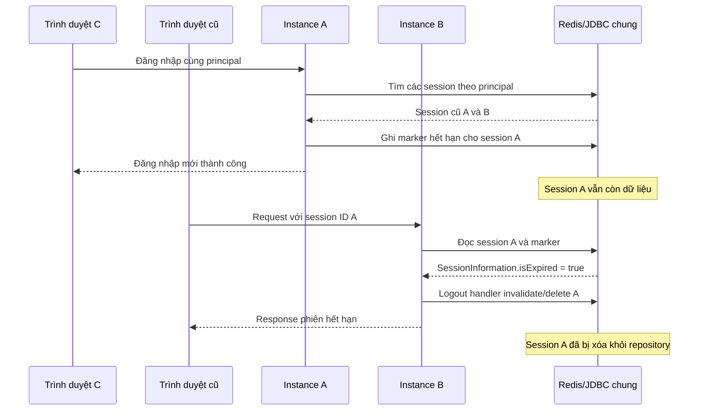

# Phiên hoạt động, phiên bị đánh dấu hết hạn và phiên đã xóa khỏi kho

Trong ứng dụng Spring Session, một session có thể ở ba trạng thái mà quản trị viên và lập trình viên thường nhầm lẫn: **đang hoạt động**, **được Spring Security đánh dấu hết hạn để thu hồi**, và **đã bị xóa khỏi kho session**. Ba trạng thái này có ý nghĩa và thời điểm chuyển đổi khác nhau.

Một session đang hoạt động là session mà repository còn trả về và chưa bị chính sách quản lý phiên đánh dấu thu hồi. Một session bị đánh dấu hết hạn do vượt giới hạn đăng nhập đồng thời vẫn có thể còn dữ liệu trong Redis hoặc JDBC; marker này yêu cầu Spring Security từ chối phiên khi request tiếp theo đi qua `ConcurrentSessionFilter`. Session đã bị xóa khỏi repository thì không còn được tải bằng session ID cũ, dù trình duyệt vẫn có thể giữ cookie đó.

Ngoài ra còn có **hết hạn do không hoạt động** (`maxInactiveInterval`). Đây là quy tắc vòng đời của Spring Session repository, khác với marker hết hạn do Spring Security dùng khi giới hạn số phiên. Phân biệt được các cơ chế này giúp xây dựng đúng chức năng xem thiết bị đăng nhập, giới hạn phiên đồng thời, đăng xuất từ xa và kiểm tra trạng thái trên nhiều instance.

## 1. Ba trạng thái và một cơ chế timeout cần phân biệt

### 1.1. Phiên đang hoạt động

Một session có thể xem là đang hoạt động khi:

- Repository còn tìm thấy session theo ID.
- Session chưa vượt `maxInactiveInterval`.
- Session chưa bị đánh dấu thu hồi bởi chính sách concurrent-session của Spring Security.
- Request mang session ID được xác thực và xử lý bình thường theo Security filter chain.

Với Spring Session, session được lưu ở kho dùng chung như Redis hoặc JDBC. Request tới instance A có thể tạo hoặc cập nhật session; request tiếp theo tới instance B có thể nạp lại cùng session từ repository. Vì vậy, trạng thái hoạt động không phụ thuộc vào bộ nhớ của một máy chủ.

### 1.2. Phiên bị đánh dấu hết hạn do giới hạn đăng nhập đồng thời

Khi người dùng đăng nhập ở phiên mới và vượt quá `maximumSessions`, Spring Security có thể đánh dấu một hoặc nhiều phiên cũ là hết hạn. Theo mặc định, chiến lược concurrent-session sẽ chọn phiên ít hoạt động gần đây nhất để đánh dấu hết hạn. Nếu cấu hình ngăn đăng nhập vượt giới hạn, lần xác thực mới có thể bị từ chối thay vì đánh dấu phiên cũ.

Với `SpringSessionBackedSessionRegistry`, trạng thái đánh dấu này được lưu cùng session trong Spring Session store để các instance có thể nhìn thấy. Việc đánh dấu không đồng nghĩa với việc repository đã xóa session. Session vẫn có thể được đọc như dữ liệu, nhưng `SessionInformation.isExpired()` báo rằng phiên không còn được phép tiếp tục theo chính sách concurrency.

### 1.3. Phiên đã bị xóa khỏi kho

Session bị xóa khi ứng dụng hoặc Spring Security thực hiện invalidate/delete, ví dụ:

- Người dùng logout bình thường.
- `ConcurrentSessionFilter` xử lý một session đã bị đánh dấu hết hạn và gọi logout handlers.
- Quản trị viên chủ động thu hồi session bằng `SessionRepository.deleteById(sessionId)`.
- Repository xóa session khi phát hiện inactivity timeout đã qua.
- Tác vụ dọn dữ liệu vật lý xóa các hàng hoặc key đã hết hạn.

Sau khi repository xóa session, `findById(sessionId)` trả về `null`. `SessionRegistry.getSessionInformation(sessionId)` cũng không còn thông tin session tương ứng nếu registry đọc trực tiếp từ Spring Session store.

### 1.4. Hết hạn do không hoạt động là cơ chế riêng

`maxInactiveInterval` xác định thời gian session được phép không có request hoạt động. Khi vượt hạn, repository không trả session đó như một session hợp lệ. Với Redis hoặc JDBC, dữ liệu vật lý có thể được dọn sau đó theo cơ chế TTL hoặc cleanup job.

Đây không phải marker mà `SessionInformation.expireNow()` sử dụng để xử lý giới hạn đăng nhập đồng thời. Một session có thể chưa hết inactivity timeout nhưng đã bị Spring Security đánh dấu thu hồi; ngược lại, session có thể hết inactivity timeout mà chưa từng bị đánh dấu bởi concurrent-session strategy.

## 2. Bảng so sánh trạng thái

| Trạng thái | Còn được repository tìm thấy? | Có thể tiếp tục request đã xác thực? | Dữ liệu đã bị xóa? | Cơ chế quyết định |
|---|---|---|---|---|
| Đang hoạt động | Có | Có, nếu xác thực và phân quyền hợp lệ | Chưa | Repository và Security filter chain |
| Đã đánh dấu hết hạn do concurrency | Thường vẫn có, cho đến khi bị invalidate hoặc timeout | Không, khi request đi qua `ConcurrentSessionFilter` được cấu hình | Chưa nhất thiết | `SessionInformation.isExpired()` và concurrency control |
| Đã xóa khỏi kho | Không | Không; session ID cũ không nạp lại được | Có theo thao tác repository | `deleteById`, `invalidate`, logout hoặc cleanup |
| Hết inactivity timeout | Repository không trả về như session hợp lệ | Không | Dữ liệu vật lý có thể còn chờ cleanup | `lastAccessedTime` và `maxInactiveInterval` |

Ví dụ một tài khoản chỉ được có hai phiên đồng thời. Người dùng đã có session A và B. Khi đăng nhập ở thiết bị C, Spring Security có thể đánh dấu A hết hạn. Ngay sau bước đánh dấu, A vẫn còn trong Redis/JDBC nhưng request kế tiếp mang cookie A sẽ bị `ConcurrentSessionFilter` phát hiện và invalidate. Sau bước này, repository không còn trả A. B và C vẫn hoạt động.

## 3. Hết inactivity timeout khác với đánh dấu thu hồi

### 3.1. `lastAccessedTime` và `maxInactiveInterval`

Spring Session xác định inactivity timeout bằng hai giá trị:

- `lastAccessedTime`: thời điểm request gần nhất gắn với session.
- `maxInactiveInterval`: khoảng thời gian tối đa không hoạt động.

Thời điểm hết hạn logic:

\[
T_{expire}=T_{lastAccessed}+I_{maxInactive}
\]

Nếu request hợp lệ tiếp tục sử dụng session trước hạn, mốc truy cập cuối được cập nhật và thời điểm hết hạn được đẩy về phía trước. Đây là timeout trượt.

### 3.2. Repository là nguồn quyết định tính hợp lệ do timeout

API `SessionRepository.findById(id)` không trả về session đã hết hạn. Với Redis indexed, dữ liệu hash có thể được giữ thêm một khoảng đệm để xử lý expiration event; với JDBC, row có thể chờ lần cleanup cron tiếp theo. Nhưng session hết inactivity timeout không được coi là hợp lệ chỉ vì key hoặc row còn tồn tại vật lý.

Do đó, khi kiểm tra timeout, hãy dùng repository hoặc gửi request qua ứng dụng. Không chỉ chạy `TTL` trên Redis hoặc `SELECT` một hàng JDBC rồi kết luận phiên còn hoạt động.

### 3.3. Marker concurrency không thay đổi timeout

Khi `SessionInformation.expireNow()` được gọi trên thông tin phiên do `SpringSessionBackedSessionRegistry` tạo, registry ghi một thuộc tính đánh dấu nội bộ vào session và lưu lại. Giá trị này thể hiện quyết định thu hồi do chính sách concurrency; nó không thay `maxInactiveInterval` và không đặt TTL bằng 0.

Không tự tạo hoặc sửa thuộc tính nội bộ đó bằng controller. Hãy dùng API `SessionInformation.expireNow()` và `ConcurrentSessionFilter` để Spring Security điều phối trạng thái. Tên và cách lưu marker là chi tiết triển khai, không phải hợp đồng ứng dụng nên phụ thuộc trực tiếp.

## 4. Cấu hình Spring Security dùng kho session chung

### 4.1. Vì sao cần `SpringSessionBackedSessionRegistry`?

`SessionRegistryImpl` mặc định của Spring Security lưu thông tin registry trong bộ nhớ của một instance. Nếu chạy nhiều instance, mỗi node có thể có danh sách phiên khác nhau. Một node không nhất thiết biết phiên được tạo ở node khác, khiến giới hạn đăng nhập đồng thời không nhất quán.

`SpringSessionBackedSessionRegistry` lấy thông tin session từ `FindByIndexNameSessionRepository`. Vì repository dùng Redis/JDBC chung, các instance có thể tra cứu phiên của cùng principal và nhìn thấy marker hết hạn đã được ghi vào session.

Repository phải hỗ trợ `FindByIndexNameSessionRepository` và tra cứu theo principal. Giá trị tên principal mà Spring Security cung cấp phải khớp với chuỗi được Spring Session lập chỉ mục. Nếu resolver không ghi principal hoặc hai bên dùng cách chuẩn hóa tên khác nhau, danh sách session có thể bị thiếu.

### 4.2. Ví dụ cấu hình giới hạn hai phiên

Ví dụ dưới đây dùng Servlet stack, Spring Security Java DSL và một repository Spring Session có hỗ trợ principal index:

```java
import org.springframework.context.annotation.Bean;
import org.springframework.context.annotation.Configuration;
import org.springframework.security.config.annotation.web.builders.HttpSecurity;
import org.springframework.security.core.session.SessionRegistry;
import org.springframework.security.web.SecurityFilterChain;
import org.springframework.session.FindByIndexNameSessionRepository;
import org.springframework.session.Session;
import org.springframework.session.security.SpringSessionBackedSessionRegistry;

@Configuration
public class SecurityConfiguration {

    @Bean
    SessionRegistry sessionRegistry(
            FindByIndexNameSessionRepository<? extends Session> sessionRepository) {
        return new SpringSessionBackedSessionRegistry<>(sessionRepository);
    }

    @Bean
    SecurityFilterChain securityFilterChain(
            HttpSecurity http,
            SessionRegistry sessionRegistry) throws Exception {
        return http
            .authorizeHttpRequests(authorize -> authorize
                .requestMatchers("/login", "/assets/**").permitAll()
                .anyRequest().authenticated())
            .formLogin(form -> form.permitAll())
            .sessionManagement(session -> session
                .maximumSessions(2)
                .sessionRegistry(sessionRegistry))
            .build();
    }
}
```

Ví dụ chỉ tập trung vào cấu hình concurrent-session. Ứng dụng vẫn cần cấu hình authentication provider, CSRF, cookie, HTTPS và các quy tắc phân quyền phù hợp. Tên API cụ thể có thể thay đổi theo phiên bản Spring Security; hãy dùng BOM tương thích với phiên bản Spring Session đang chạy.

### 4.3. Hai chính sách khi vượt số phiên tối đa

Spring Security hỗ trợ hai hành vi:

| Chính sách | Kết quả khi đăng nhập mới vượt giới hạn |
|---|---|
| Mặc định: cho phép đăng nhập mới | Đánh dấu các phiên cũ vượt giới hạn là hết hạn, thường chọn phiên ít hoạt động gần đây nhất; phiên cũ bị invalidate khi truy cập lại |
| Ngăn đăng nhập vượt giới hạn | Từ chối lần xác thực mới bằng `SessionAuthenticationException`; các phiên hiện có tiếp tục hoạt động |

Với API DSL của các phiên bản Spring Security hỗ trợ, có thể chọn hành vi ngăn đăng nhập bằng `maxSessionsPreventsLogin(true)` trong cấu hình session management. Kiểm tra đúng API của phiên bản dự án.

### 4.4. `ConcurrentSessionFilter` xử lý marker

Filter này thực hiện hai việc quan trọng:

1. Tra `SessionInformation` theo session ID của request.
2. Nếu `isExpired()` là `true`, gọi logout handlers, thường để invalidate session, rồi gọi `SessionInformationExpiredStrategy` để quyết định response.

Nếu phiên chưa bị đánh dấu hết hạn, filter cập nhật thời điểm request gần nhất trong registry. Với `SpringSessionBackedSessionRegistry`, dữ liệu session được lấy từ repository thay vì một registry độc lập trong bộ nhớ.

Điều này có nghĩa marker thu hồi được thực thi ở request kế tiếp đi qua Security filter chain. Nếu một ứng dụng bỏ qua filter hoặc dùng một đường truy cập session không có kiểm tra concurrency, marker không tự biến thành lệnh xóa repository.

## 5. Vòng đời của một phiên bị đánh dấu hết hạn

### 5.1. Từ đăng nhập mới đến thu hồi phiên cũ



Các bước có thể xảy ra trên những instance khác nhau. Điều kiện quan trọng là mọi instance dùng cùng repository, cùng principal index và cùng cấu hình Spring Security.

### 5.2. Đánh dấu không đồng nghĩa xóa ngay

Sau khi `expireNow()` hoàn tất, marker đã được lưu vào session. Repository vẫn có thể trả session khi tra cứu theo ID vì session chưa bị xóa và có thể chưa hết inactivity timeout. `SpringSessionBackedSessionRegistry` dựng lại `SessionInformation` từ session và khôi phục cờ expired từ marker đã lưu.

Điều này giúp marker tồn tại qua lần restart instance và được nhìn thấy bởi node khác. Nó cũng giải thích vì sao kiểm tra key trong Redis ngay sau khi đăng nhập mới có thể vẫn thấy session cũ.

### 5.3. Request tiếp theo mới thực hiện invalidate

Khi trình duyệt cũ gửi request, `ConcurrentSessionFilter` nhận diện session đã bị đánh dấu. Filter gọi logout handlers và chiến lược xử lý session hết hạn. Logout handler mặc định thường invalidate `HttpSession`, khiến Spring Session xóa phiên trong repository và phát event hủy session nếu repository hỗ trợ.

Nếu trình duyệt cũ không gửi request nữa, session có thể tiếp tục tồn tại ở kho cho tới khi inactivity timeout hoặc cleanup. Vì vậy, marker là trạng thái thu hồi chờ thực thi ở request kế tiếp; nó không phải cơ chế dọn dữ liệu vật lý tức thời.

## 6. Phiên đã bị xóa khỏi repository

### 6.1. Xóa qua `HttpSession.invalidate()`

Trong request Servlet, logout hoặc luồng nghiệp vụ có thể invalidate session:

```java
@PostMapping("/account/logout-all-current")
public void logoutCurrent(HttpServletRequest request) {
    HttpSession session = request.getSession(false);
    if (session != null) {
        session.invalidate();
    }
}
```

Ví dụ minh họa việc invalidate session hiện tại; trong ứng dụng thực tế nên dùng Spring Security logout để các `LogoutHandler` cùng dọn `SecurityContext`, cookie và session theo cấu hình. Không gọi `invalidate()` khi `getSession(false)` trả về `null`.

### 6.2. Xóa từ xa bằng repository

Để thu hồi một session trên thiết bị khác, service quản trị có thể dùng repository:

```java
import org.springframework.session.FindByIndexNameSessionRepository;
import org.springframework.session.Session;
import org.springframework.stereotype.Service;

@Service
public class RemoteSessionRevocationService {

    private final FindByIndexNameSessionRepository<? extends Session> repository;

    public RemoteSessionRevocationService(
            FindByIndexNameSessionRepository<? extends Session> repository) {
        this.repository = repository;
    }

    public void revoke(String sessionId) {
        this.repository.deleteById(sessionId);
    }
}
```

Sau khi `deleteById` hoàn tất, repository không còn trả session theo ID cũ. Cookie trên thiết bị từ xa có thể vẫn còn cho đến khi browser nhận lệnh xóa cookie hoặc tự loại bỏ nó, nhưng ID cũ không thể khôi phục session đã xóa.

Endpoint gọi service này phải xác minh quyền sở hữu session, quyền quản trị và principal mục tiêu. Không cho phép client tự gửi session ID bất kỳ để xóa phiên của người dùng khác.

### 6.3. `removeSessionInformation()` không nhất thiết xóa dữ liệu Spring Session

Với `SpringSessionBackedSessionRegistry`, registry không duy trì một bản sao session riêng. Nó đọc dữ liệu từ `FindByIndexNameSessionRepository`. Một số phương thức của `SessionRegistry`, gồm `registerNewSession`, `refreshLastRequest` và `removeSessionInformation`, không có trách nhiệm quản lý kho session theo cách của `SessionRegistryImpl` trong bộ nhớ.

Nếu mục tiêu là xóa dữ liệu session, dùng `SessionRepository.deleteById` hoặc invalidate `HttpSession` qua luồng phù hợp. Không gọi `SessionRegistry.removeSessionInformation` rồi mặc định rằng Redis/JDBC đã bị xóa.

## 7. Tra cứu và hiển thị các phiên của người dùng

### 7.1. Dùng `FindByIndexNameSessionRepository`

Repository có principal index có thể tìm session của một người dùng:

```java
Map<String, ? extends Session> sessions =
    sessionRepository.findByPrincipalName(username);
```

Kết quả là map theo session ID. Từ mỗi session có thể đọc `creationTime`, `lastAccessedTime`, `maxInactiveInterval` và các thuộc tính đã được ứng dụng chọn lưu. Không hiển thị toàn bộ session attributes vì chúng có thể chứa `SecurityContext`, token hoặc dữ liệu nhạy cảm.

### 7.2. Dùng `SessionRegistry`

`SessionRegistry.getAllSessions(principal, includeExpiredSessions)` trả danh sách `SessionInformation` cho principal. Tham số `includeExpiredSessions` quyết định có lấy cả các phiên đã bị đánh dấu expired hay không.

```java
List<SessionInformation> all = sessionRegistry.getAllSessions(principal, true);

for (SessionInformation info : all) {
    String sessionId = info.getSessionId();
    Date lastRequest = info.getLastRequest();
    boolean markedExpired = info.isExpired();
}
```

`SessionInformation.isExpired()` phản ánh marker concurrency của Spring Security. Nó không phải phép kiểm tra tổng quát thay cho `Session.isExpired()` do inactivity timeout. Nếu repository đã xóa session, thông tin đó thường không còn xuất hiện trong registry backed by Spring Session.

### 7.3. Hạn chế `getAllPrincipals()`

`SpringSessionBackedSessionRegistry` không hỗ trợ `getAllPrincipals()` vì Spring Session có thể tìm phiên theo một principal đã biết nhưng không cung cấp danh sách toàn bộ principal đang có session. Spring Security không cần gọi phương thức này cho luồng concurrent-session chuẩn; hạn chế ảnh hưởng tới màn hình quản trị muốn liệt kê mọi tài khoản đang đăng nhập.

Nếu cần dashboard toàn hệ thống, xây dựng chỉ mục hoặc bảng quản lý phiên phục vụ truy vấn quản trị riêng. Đừng gọi `getAllPrincipals()` và kỳ vọng nó hoạt động với registry backed by Spring Session.

### 7.4. Principal phải được lập chỉ mục nhất quán

`SpringSessionBackedSessionRegistry` cần suy ra cùng chuỗi principal mà Spring Session đã lưu. Nếu ứng dụng ghi principal là email nhưng registry truy vấn theo username, kết quả có thể rỗng. Cần thống nhất:

- Dùng định danh ổn định, chẳng hạn username chuẩn hóa hoặc account ID.
- Cấu hình `IndexResolver` hoặc principal attribute phù hợp.
- Giữ quy tắc hoa/thường và tenant nhất quán.
- Kiểm thử login qua authentication filter thật để xác minh principal index được ghi.

## 8. Quản lý số phiên đồng thời

### 8.1. Giới hạn số phiên

Giới hạn session có thể áp dụng cho toàn bộ tài khoản hoặc tùy theo vai trò/loại tài khoản. `maximumSessions(2)` cho phép tối đa hai session theo principal. Giá trị `-1` trong các API cũ biểu thị không giới hạn; các phiên bản mới có thể cung cấp `SessionLimit` để biểu diễn giới hạn động.

Khi vượt giới hạn, quyết định là từ chối login mới hoặc đánh dấu session cũ. Chọn chính sách theo yêu cầu sản phẩm:

- Ứng dụng ngân hàng hoặc hệ thống nhạy cảm có thể từ chối login mới để không tự động ngắt phiên đang dùng.
- Ứng dụng phổ thông có thể cho login mới và đánh dấu phiên cũ nhất hết hạn.
- Hệ thống hỗ trợ nhiều thiết bị có thể cho phép số phiên lớn hơn hoặc áp dụng giới hạn riêng theo thiết bị.

### 8.2. Phiên ít hoạt động gần đây nhất

Khi chính sách đánh dấu phiên cũ, Spring Security thường sắp xếp theo `lastRequest` trong `SessionInformation` và chọn phiên ít hoạt động gần đây nhất. Đây là mốc request được registry cập nhật; không nhất thiết đồng nhất với thời điểm tạo session hoặc thời điểm người dùng đăng nhập.

Với registry backed by Spring Session, thông tin được dựng từ dữ liệu session và repository. Hãy đảm bảo filter cập nhật lần truy cập và principal index được lưu đúng. Nếu không, thứ tự lựa chọn có thể không phản ánh chính xác hoạt động gần nhất.

### 8.3. Race condition khi nhiều login đồng thời

Kiểm tra số session và đăng ký session mới là một chuỗi thao tác đọc rồi ghi. Hai request login cùng principal có thể đồng thời đọc thấy số phiên dưới giới hạn và cả hai cùng được chấp nhận. `maximumSessions` không tự biến toàn bộ quy trình thành một giao dịch phân tán nguyên tử.

Nếu yêu cầu giới hạn phải chính xác dưới tải login đồng thời cao, cần thêm cơ chế điều phối theo principal, ví dụ:

- Distributed lock có thời hạn và fencing phù hợp.
- Bảng quản lý login có unique constraint/transaction.
- Một dịch vụ cấp session tập trung thực hiện kiểm tra và đăng ký trong critical section.
- Kiểm thử concurrency và xử lý retry/idempotency.

Không dùng sticky session để giải quyết race condition trong một cụm có nhiều instance và kho session dùng chung.

## 9. Redis, JDBC và thời điểm xóa vật lý

### 9.1. Redis

Với Redis indexed repository, dữ liệu hash session có thể được giữ thêm khoảng đệm sau khi session hết inactivity timeout để Spring Session xử lý expiration event và dọn index. Một khóa expiration riêng theo dõi hạn logic. Vì vậy, hash còn tồn tại không chứng minh session còn hoạt động.

Khi session bị xóa rõ ràng, repository xóa dữ liệu và Redis có thể phát keyspace notification nếu cấu hình phù hợp. `SessionDeletedEvent` và `SessionExpiredEvent` là các sự kiện vòng đời khác nhau. Không phải mọi loại Redis repository đều hỗ trợ cùng indexing/event behavior; kiểm tra đúng repository đang dùng.

### 9.2. JDBC

Với `JdbcIndexedSessionRepository`, session được lưu trong các bảng `SPRING_SESSION` và `SPRING_SESSION_ATTRIBUTES`. `EXPIRY_TIME` xác định hạn logic; cleanup job định kỳ xóa hàng hết hạn. Một hàng đã đến hạn có thể còn tồn tại vật lý cho tới lần cleanup tiếp theo.

JDBC repository không phát session lifecycle events theo cùng cách Redis indexed repository. Nếu ứng dụng cần audit hoặc dọn tài nguyên khi logout/thu hồi, hãy xử lý rõ ràng trong luồng nghiệp vụ hoặc xây dựng cơ chế thông báo riêng.

### 9.3. Trạng thái vật lý không phải nguồn xác thực

Trong cả Redis và JDBC, không dùng việc nhìn thấy key hoặc row làm căn cứ duy nhất để cho phép truy cập. Luôn dùng Spring Session repository và Spring Security filter chain. Kho có thể còn dữ liệu để phục vụ cleanup, trong khi request đã phải bị từ chối.

## 10. Kiểm thử ba trạng thái

### 10.1. Kiểm thử session đang hoạt động

1. Đăng nhập và nhận session cookie.
2. Xác minh `findById(sessionId)` trả session.
3. Xác minh principal lookup tìm thấy session.
4. Gửi request tới endpoint được bảo vệ và xác nhận người dùng vẫn được xác thực.
5. Kiểm tra `SessionInformation.isExpired()` là `false`.

### 10.2. Kiểm thử session bị đánh dấu hết hạn

1. Cấu hình `maximumSessions(1)`.
2. Đăng nhập cùng tài khoản trên trình duyệt A.
3. Đăng nhập cùng tài khoản trên trình duyệt B với chính sách cho phép login mới.
4. Tra `SessionRegistry.getAllSessions(principal, true)` và xác định session A được đánh dấu expired.
5. Kiểm tra repository vẫn có thể trả session A trước khi request cũ bị xử lý, nếu inactivity timeout chưa qua.
6. Gửi request từ trình duyệt A; `ConcurrentSessionFilter` phải gọi logout handlers và trả response theo expired strategy.
7. Xác minh session A đã bị invalidate/xóa, còn session B hoạt động.

Không chỉ kiểm tra trang redirect. Hãy xác minh cả marker, repository và trạng thái xác thực sau request.

### 10.3. Kiểm thử session đã xóa khỏi kho

1. Tạo session và ghi lại ID trong môi trường test.
2. Gọi logout hoặc `deleteById`.
3. Xác minh `findById(sessionId)` trả `null`.
4. Xác minh `getSessionInformation(sessionId)` không còn trả thông tin phiên.
5. Gửi request với cookie cũ; ứng dụng không được khôi phục trạng thái đăng nhập cũ.

### 10.4. Kiểm thử nhiều instance

Chạy hai instance A và B cùng dùng Redis/JDBC:

- Tạo session ở A, tra cứu ở B.
- Đánh dấu hết hạn ở A, xác minh B nhìn thấy marker.
- Gửi request cũ qua B, xác minh filter invalidate session.
- Kiểm tra session đã xóa không được A nạp lại.
- Lặp lại khi một instance restart giữa các bước.

Kiểm thử này xác nhận trạng thái không phụ thuộc registry cục bộ của một node.

### 10.5. Kiểm thử đăng nhập đồng thời

Gửi nhiều request đăng nhập cùng principal gần như đồng thời. Ghi nhận số session cuối cùng, các marker expired và kết quả xác thực. Nếu giới hạn là ràng buộc cứng, kiểm tra race condition và xác minh cơ chế lock/transaction bổ sung.

## 11. Sự cố thường gặp

| Hiện tượng | Nguyên nhân có thể | Cách kiểm tra |
|---|---|---|
| Session bị đánh dấu nhưng vẫn thấy key Redis | Marker concurrency không xóa session ngay | Kiểm tra `SessionInformation.isExpired()` và request tiếp theo qua `ConcurrentSessionFilter` |
| Session cũ vẫn truy cập được trên một node | Thiếu `ConcurrentSessionFilter`, registry khác nhau hoặc node không dùng cùng store | Kiểm tra Security filter chain, registry bean và repository namespace |
| `getAllSessions` không tìm thấy phiên | Principal index không được ghi hoặc chuỗi principal không khớp | Kiểm tra index resolver và giá trị principal trong session |
| `getAllPrincipals()` ném exception | Đây là giới hạn của `SpringSessionBackedSessionRegistry` | Dùng nguồn quản trị riêng nếu cần liệt kê mọi principal |
| `removeSessionInformation` không xóa Redis/JDBC | Registry backed by Spring Session không phải API xóa repository | Dùng `deleteById` hoặc invalidate session |
| Logout xong cookie vẫn còn | Cookie cũ chưa bị xóa ở browser hoặc response bị bỏ | Kiểm tra `Set-Cookie`; xác minh repository đã xóa session |
| Session không còn trong Redis nhưng cookie vẫn gửi | Cookie lưu ID cũ, session phía server đã bị xóa | Request tiếp theo phải được xem là chưa đăng nhập |
| Hai login đồng thời vượt giới hạn | Check-count/register không nguyên tử | Thêm điều phối theo principal và kiểm thử race condition |
| Session bị thu hồi nhưng tài nguyên phụ vẫn tồn tại | Chưa xử lý event/cleanup hoặc repository không phát event tương ứng | Dọn tài nguyên ở logout path và có timeout/đối soát dự phòng |
| Một số phiên bị coi là cũ hơn thực tế | Last-request không được cập nhật hoặc clock các node lệch | Kiểm tra filter, `lastAccessedTime`, đồng hồ và cấu hình cụm |

## 12. Quy trình quản lý vòng đời nhiều phiên

Khi thiết kế chức năng xem và thu hồi nhiều session, hãy thực hiện theo trình tự:

1. Chọn repository dùng chung hỗ trợ principal index và xác minh tất cả instance dùng cùng cấu hình.
2. Xác định principal ổn định và đảm bảo repository ghi index đúng.
3. Cấu hình `SpringSessionBackedSessionRegistry` cho Spring Security concurrent-session control.
4. Chọn chính sách vượt giới hạn: đánh dấu phiên cũ hay từ chối login mới.
5. Đảm bảo `ConcurrentSessionFilter` xử lý session đã bị đánh dấu và gọi logout handlers.
6. Phân biệt marker concurrency với inactivity timeout và thao tác xóa repository.
7. Với đăng xuất từ xa, dùng `deleteById` hoặc luồng invalidate được bảo vệ bằng quyền quản trị.
8. Khi hiển thị trạng thái, dùng `SessionRegistry` để nhận biết marker expired và repository để xác minh session còn tồn tại.
9. Kiểm thử request tiếp theo sau khi marker được ghi, logout, cookie cũ và request chuyển instance.
10. Nếu giới hạn phiên là ràng buộc cứng, bổ sung cơ chế điều phối cho các login đồng thời.

Một session hoạt động là session repository còn cung cấp và Security chưa đánh dấu thu hồi. Một session bị đánh dấu hết hạn do concurrent-session control vẫn có thể còn dữ liệu trong kho; marker được `ConcurrentSessionFilter` thực thi ở request kế tiếp. Một session đã xóa khỏi repository không còn được tải bằng ID cũ. Inactivity timeout lại là quy tắc riêng dựa trên `lastAccessedTime` và `maxInactiveInterval`. Tách rõ các trạng thái này giúp hệ thống quản lý đăng nhập đồng thời chính xác, hoạt động trên nhiều instance và tránh nhầm dữ liệu còn tồn tại vật lý với một phiên vẫn được phép truy cập.

## Tài liệu tham khảo

- [Spring Session — Spring Security Integration và Concurrent Session Control](https://docs.spring.io/spring-session/reference/spring-security.html)
- [Spring Session API — SpringSessionBackedSessionRegistry](https://docs.spring.io/spring-session/reference/api/java/org/springframework/session/security/SpringSessionBackedSessionRegistry.html)
- [Spring Security API — SessionRegistry](https://docs.spring.io/spring-security/reference/api/java/org/springframework/security/core/session/SessionRegistry.html)
- [Spring Security API — SessionInformation](https://docs.spring.io/spring-security/reference/api/java/org/springframework/security/core/session/SessionInformation.html)
- [Spring Security API — ConcurrentSessionControlAuthenticationStrategy](https://docs.spring.io/spring-security/reference/api/java/org/springframework/security/web/authentication/session/ConcurrentSessionControlAuthenticationStrategy.html)
- [Spring Security API — ConcurrentSessionFilter](https://docs.spring.io/spring-security/reference/api/java/org/springframework/security/web/session/ConcurrentSessionFilter.html)
