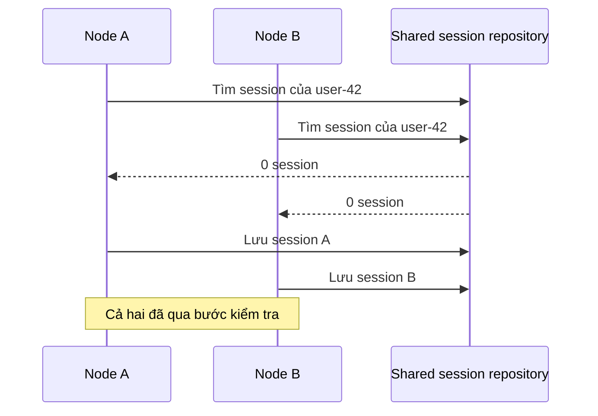

# Đăng nhập đồng thời và giới hạn bảo đảm khi nhiều nút cùng xử lý

Spring Security có cơ chế giới hạn số phiên đăng nhập qua `maximumSessions` và `SessionRegistry`. Khi kết hợp với Spring Session, `SpringSessionBackedSessionRegistry` có thể tra cứu các session theo principal trong Redis hoặc JDBC dùng chung. Cách này giúp nhiều instance nhìn thấy trạng thái phiên của nhau, nhưng thao tác “đếm phiên hiện có rồi đăng ký phiên mới” vẫn là một chuỗi đọc và ghi có thể xảy ra đồng thời trên nhiều node.

Nếu hai lần đăng nhập cùng principal đến hai instance gần như cùng lúc, cả hai có thể cùng đọc thấy còn chỗ trước khi một phiên mới được ghi vào repository. Vì vậy, `maximumSessions(1)` hữu ích cho chính sách phiên thông thường nhưng không tự tạo ra bảo đảm nguyên tử toàn cụm. Khi nghiệp vụ yêu cầu giới hạn cứng, cần một điểm điều phối tập trung có thao tác admission nguyên tử theo principal, cùng quy tắc đồng bộ với vòng đời Spring Session.

## 1. Xác định chính xác giới hạn cần bảo đảm

Trước khi thiết kế, cần xác định “số phiên đang hoạt động” nghĩa là gì. Có thể tính:
- Các session đã đăng nhập và còn trong thời hạn idle.
- Các session đã được cấp slot admission và chưa bị thu hồi.
- Các session có thể thực hiện request được bảo vệ tại thời điểm kiểm tra.
- Các thiết bị đang kết nối, bao gồm cả WebSocket, nếu sản phẩm muốn tính chúng vào cùng giới hạn.

Các định nghĩa này không hoàn toàn giống nhau. Một bản ghi session có thể còn trong Redis/JDBC sau khi hết hạn logic; một thiết bị có thể giữ socket mở sau logout cho đến khi event đóng kết nối được xử lý; một admission reservation có thể tồn tại tạm thời khi session chưa được lưu thành công.

Một invariant rõ ràng có thể là:

```text
Với mọi principal P:
Số admission slot ACTIVE của P không vượt quá MAX_SESSIONS(P).
```

Nếu mục tiêu là giới hạn số session thực sự được phép truy cập, mỗi request cần xác nhận session ID còn giữ slot ACTIVE. Khi thay phiên cũ bằng phiên mới, slot cũ phải bị thu hồi theo một cơ chế mà mọi node có thể quan sát trước khi tiếp tục cho phép request của phiên đó.

Không nên dùng từ “bảo đảm tuyệt đối” nếu chưa xác định cả hành vi khi kho dữ liệu mất kết nối, failover, event bị trễ và ứng dụng không thể kiểm tra trạng thái admission.

## 2. Vì sao maximumSessions chưa phải thao tác nguyên tử?

Cấu hình Spring Security phổ biến:

```java
http.sessionManagement(session -> session
        .maximumSessions(1)
        .maxSessionsPreventsLogin(true)
        .sessionRegistry(sessionRegistry));
```

Khi đăng nhập, cơ chế concurrency control thường cần:
1. Lấy principal đã xác thực.
2. Tra cứu các session hiện tại của principal.
3. So sánh số phiên với giới hạn.
4. Từ chối đăng nhập mới hoặc đánh dấu một phiên cũ hết hạn.
5. Đăng ký hoặc lưu phiên mới.

Đây là logic kiểm tra rồi cập nhật. Nếu hai request cùng thực hiện bước 2 trước khi bất kỳ request nào hoàn tất bước 4–5, cả hai đều có thể nhìn thấy cùng một trạng thái cũ.

Ví dụ với giới hạn một phiên:



Repository dùng chung giúp hai node đọc cùng dữ liệu, nhưng không tự gộp các bước tra cứu và đăng ký thành một giao dịch nguyên tử. Đây là race condition kiểu check-then-act.

## 3. Vai trò và giới hạn của SpringSessionBackedSessionRegistry

`SpringSessionBackedSessionRegistry` kết nối Spring Security `SessionRegistry` với `FindByIndexNameSessionRepository`. Nó hỗ trợ tìm session theo principal index, nhờ đó node A có thể thấy session được tạo bởi node B.

Để sử dụng, repository phải hỗ trợ principal index, ví dụ:
- `RedisIndexedSessionRepository`.
- `JdbcIndexedSessionRepository`.
- Repository indexed khác có triển khai đúng contract.

Repository chỉ lưu session theo ID mà không có principal index không đủ để registry này truy vấn các phiên theo người dùng. Tên principal cần ổn định giữa các lần đăng nhập và mọi instance phải dùng cùng cách lập chỉ mục.

Registry backed by repository giải quyết vấn đề trạng thái cục bộ theo JVM. Nó không tự thêm distributed lock, transaction bao trùm toàn bộ đăng nhập hoặc compare-and-set nguyên tử cho số phiên. Vì thế, nó là nền tảng cần thiết cho concurrency control chia sẻ, nhưng chưa phải bộ điều phối giới hạn cứng dưới tải đồng thời.

## 4. Những điều không tạo ra bảo đảm toàn cụm

Một số biện pháp thường được nhầm là đủ:

| Biện pháp | Vì sao chưa đủ |
|---|---|
| Dùng chung Redis hoặc JDBC | Cùng kho dữ liệu không đồng nghĩa chuỗi đọc/ghi là nguyên tử |
| Sticky session ở load balancer | Hai thiết bị hoặc request đăng nhập vẫn có thể vào hai node khác nhau |
| `synchronized` trong Java | Chỉ khóa thread trong một JVM, không khóa node khác |
| `SessionRegistryImpl` | Registry giữ map cục bộ theo instance |
| Chỉ tăng tần suất cleanup | Cleanup dọn dữ liệu cũ, không tuần tự hóa admission |
| Dựa vào event logout/expire | Event có thể đến trễ hoặc được xử lý sau quyết định login mới |
| Đọc số session rồi insert | Vẫn có race nếu hai transaction cùng đọc trước khi insert |

Cần một cơ chế điều phối có điểm đồng bộ dùng chung cho tất cả node và được gọi bởi mọi đường đăng nhập.

## 5. Mô hình admission-control tập trung

Admission-control là thành phần quyết định một principal có được cấp thêm một phiên hay không. Nó nhận principal, session ID mới, giới hạn và thông tin thời hạn; sau đó thực hiện một thao tác nguyên tử trên kho điều phối.

Một giao diện khái quát:

```java
public interface LoginAdmissionService {

    AdmissionResult admit(
            String principalKey,
            String sessionId,
            int maximumSessions,
            Instant expiresAt);

    void revoke(String principalKey, String sessionId);

    boolean isActive(String principalKey, String sessionId);

    void refresh(
            String principalKey,
            String sessionId,
            Instant newExpiresAt);
}
```

`AdmissionResult` có thể biểu diễn được chấp nhận, vượt giới hạn, phiên cũ bị thay thế hoặc lỗi điều phối. Giao diện là ví dụ thiết kế; ứng dụng cần triển khai trên một kho dữ liệu có semantics nguyên tử phù hợp.

Điểm quan trọng là mọi instance phải gọi cùng dịch vụ admission. Không để một số đường đăng nhập dùng `maximumSessions` cục bộ, trong khi đường OAuth2, remember-me hoặc API login khác bỏ qua admission-control.

## 6. Thiết kế bảng admission trong cơ sở dữ liệu quan hệ

Với relational database, có thể lưu một hàng khóa theo principal và các slot phiên. Ví dụ schema khái quát:

```sql
CREATE TABLE LOGIN_ADMISSION_GUARD (
    PRINCIPAL_KEY VARCHAR(200) PRIMARY KEY,
    UPDATED_AT TIMESTAMP NOT NULL
);

CREATE TABLE LOGIN_ADMISSION_SLOT (
    PRINCIPAL_KEY VARCHAR(200) NOT NULL,
    SLOT_NO SMALLINT NOT NULL,
    SESSION_ID VARCHAR(256) NOT NULL,
    STATE VARCHAR(16) NOT NULL,
    EXPIRES_AT TIMESTAMP NOT NULL,
    UPDATED_AT TIMESTAMP NOT NULL,
    PRIMARY KEY (PRINCIPAL_KEY, SLOT_NO),
    UNIQUE (SESSION_ID),
    FOREIGN KEY (PRINCIPAL_KEY)
        REFERENCES LOGIN_ADMISSION_GUARD(PRINCIPAL_KEY)
);

CREATE INDEX IDX_LOGIN_ADMISSION_EXPIRY
    ON LOGIN_ADMISSION_SLOT (EXPIRES_AT);
```

Mỗi principal có một guard row để tuần tự hóa quyết định. Mỗi slot đại diện cho một phiên được phép. Với giới hạn N, hệ thống không cấp quá N slot cho principal đó.

Schema cần điều chỉnh kiểu timestamp, độ dài key và cú pháp theo DBMS. Nếu một session ID có thể xuất hiện ở nhiều môi trường hoặc tenant, unique key nên bao gồm namespace hoặc tenant key để tránh va chạm.

## 7. Cấp slot trong một transaction có khóa

Một transaction admission có thể thực hiện theo trình tự:

1. Tạo guard row nếu chưa tồn tại.
2. Khóa guard row của principal bằng `SELECT ... FOR UPDATE`.
3. Xóa hoặc giải phóng các slot đã hết hạn theo thời gian của database.
4. Kiểm tra session ID này đã được cấp slot chưa để thao tác có tính idempotent.
5. Đếm slot ACTIVE còn hiệu lực.
6. Nếu số slot nhỏ hơn giới hạn, cấp slot trống và commit.
7. Nếu đã đạt giới hạn, từ chối hoặc thu hồi slot được chọn theo chính sách.
8. Ghi audit/outbox trong cùng transaction nếu cần phát sự kiện.

Ví dụ SQL minh họa bước khóa:

```sql
INSERT INTO LOGIN_ADMISSION_GUARD (PRINCIPAL_KEY, UPDATED_AT)
VALUES (:principal, CURRENT_TIMESTAMP)
ON CONFLICT (PRINCIPAL_KEY) DO NOTHING;

SELECT PRINCIPAL_KEY
FROM LOGIN_ADMISSION_GUARD
WHERE PRINCIPAL_KEY = :principal
FOR UPDATE;
```

`ON CONFLICT` là cú pháp PostgreSQL; DBMS khác có thể cần câu lệnh upsert tương ứng. Sau khi guard row bị khóa, các transaction khác xử lý cùng principal phải chờ. Các principal khác nhau vẫn có thể được xử lý song song.

Nếu có N slot được tạo sẵn cho mỗi principal, transaction có thể khóa slot trống và cập nhật một slot. Nếu dùng bảng động, transaction khóa guard row rồi đếm và insert. Unique constraint là lớp bảo vệ bổ sung, nhưng không thay thế khóa/transaction đúng cách khi điều kiện là giới hạn lớn hơn một.

## 8. Từ chối hay thay thế phiên cũ

Khi đã đạt giới hạn, chính sách cần rõ ràng:

| Chính sách | Hành vi admission | Tác động |
|---|---|---|
| Reject new login | Không cấp slot mới | Phiên hiện tại tiếp tục hoạt động |
| Replace oldest | Thu hồi slot cũ nhất rồi cấp slot mới trong cùng transaction | Phiên cũ phải bị từ chối ở request tiếp theo |
| Replace least recently active | Chọn phiên có activity cũ nhất | Cần dữ liệu last activity đáng tin cậy và được cập nhật nhất quán |
| Admin revoke | Thu hồi slot theo lệnh quản trị | Cần audit và xác thực quyền quản trị |

Nếu thay phiên cũ, hãy đánh dấu slot cũ REVOKED hoặc xóa slot trong cùng transaction cấp slot mới. Sau đó phát lệnh invalidate session tương ứng qua outbox hoặc cơ chế đáng tin cậy.

Nếu chỉ xóa session khỏi Redis/JDBC sau khi transaction admission commit, có một khoảng thời gian session cũ vẫn có thể được repository đọc. Để bảo đảm quyền truy cập, request được bảo vệ phải kiểm tra slot admission còn ACTIVE hoặc có cơ chế fencing tương đương. Việc đóng socket và xóa session vật lý là bước dọn vòng đời; quyết định cho phép request phải dựa trên trạng thái admission có thẩm quyền.

## 9. Gắn admission-control vào luồng xác thực Spring Security

Trong Servlet, `SessionAuthenticationStrategy` là extension point phù hợp để áp dụng chính sách sau khi xác thực thành công. Một strategy tùy chỉnh có thể lấy principal đã xác thực và session ID cuối cùng, rồi gọi `LoginAdmissionService`.

Ví dụ khung:

```java
public final class AdmissionSessionAuthenticationStrategy
        implements SessionAuthenticationStrategy {

    private final LoginAdmissionService admissionService;
    private final int maximumSessions;

    public AdmissionSessionAuthenticationStrategy(
            LoginAdmissionService admissionService,
            int maximumSessions) {
        this.admissionService = admissionService;
        this.maximumSessions = maximumSessions;
    }

    @Override
    public void onAuthentication(
            Authentication authentication,
            HttpServletRequest request,
            HttpServletResponse response) {

        HttpSession session = request.getSession(true);
        String principalKey = authentication.getName();

        AdmissionResult result = admissionService.admit(
                principalKey,
                session.getId(),
                maximumSessions,
                calculateIdleExpiry());

        if (!result.accepted()) {
            throw new SessionAuthenticationException(
                    "Concurrent login limit reached");
        }
    }
}
```

Đây là khung minh họa; hàm tính thời hạn, xử lý replace và ánh xạ lỗi cần được triển khai theo chính sách ứng dụng. Nếu dùng session fixation protection, admission phải gắn với session ID sau khi ID đã được thay đổi. Cấu hình thứ tự `SessionAuthenticationStrategy` trong `CompositeSessionAuthenticationStrategy` cần được kiểm tra theo phiên bản Spring Security.

Không gọi admission trước khi biết session ID cuối cùng rồi sau đó để session fixation đổi ID mà không cập nhật slot. Khi đổi ID, cần chuyển slot một cách nguyên tử hoặc thu hồi ID cũ và cấp lại cho ID mới.

Mọi cơ chế đăng nhập phải đi qua cùng điểm admission: form login, OAuth2 login, SAML, remember-me, custom authentication filter và endpoint đăng nhập riêng. Nếu một đường xác thực bỏ qua strategy, giới hạn không còn được bảo đảm.

## 10. Đồng bộ slot với vòng đời Spring Session

Admission record không tự biến mất khi session Redis/JDBC bị xóa. Cần đồng bộ các sự kiện:

- Khi session được tạo và lưu thành công, reservation chuyển sang ACTIVE.
- Khi logout hoặc session bị xóa, slot chuyển sang REVOKED hoặc được xóa.
- Khi session hết hạn, slot phải hết hạn hoặc được thu hồi.
- Khi session ID thay đổi, slot phải được chuyển sang ID mới.
- Khi request hợp lệ cập nhật idle timeout, thời hạn admission phải được gia hạn tương ứng.

Spring Session phát các sự kiện vòng đời như session created, deleted hoặc expired tùy repository và cấu hình. Listener có thể cập nhật admission store, nhưng event handler cần idempotent vì sự kiện có thể được retry hoặc đến trễ. Với Redis, cần cấu hình keyspace notifications và hiểu độ trễ expiration; với JDBC, cleanup task có thể chạy theo lịch.

Một mô hình bền vững có thể dùng trạng thái `PENDING` trước khi session được lưu, sau đó xác nhận `ACTIVE` khi repository xác nhận session đã tồn tại. Nếu request thất bại giữa hai bước, reservation pending cần TTL ngắn và sweeper để thu hồi. Reservation pending vẫn phải được tính vào giới hạn để hai login đồng thời không cùng chiếm slot cuối.

## 11. Gia hạn slot theo idle timeout

Nếu slot admission có `EXPIRES_AT`, nó phải phản ánh thời hạn session thực tế. Nếu chỉ đặt expiry một lần lúc login, một người dùng đang hoạt động có thể mất slot dù session vẫn được gia hạn.

Có hai chiến lược:

**Gia hạn theo hoạt động:** mỗi request được xác thực cập nhật `lastAccessedTime` và đồng thời gia hạn slot admission theo idle timeout. Việc cập nhật nên dùng thời gian từ cùng nguồn đáng tin cậy hoặc một quy tắc nhất quán.

**Slot không tự hết hạn, có reconciliation:** giữ slot đến khi nhận sự kiện logout/expire và chạy tác vụ đối soát định kỳ với repository session. Cách này tránh slot hết hạn sớm nhưng event bị mất có thể làm slot cũ tồn tại và từ chối login mới lâu hơn.

Nhiều hệ thống kết hợp cả hai: slot có lease dài hơn idle timeout một khoảng grace, được refresh theo request; sweeper kiểm tra session repository để loại bỏ reservation mồ côi. Không dùng TTL ngắn hơn session timeout nếu không thể bảo đảm refresh slot ở mọi request gia hạn session.

## 12. Redis Lua script cho admission nguyên tử

Nếu dùng Redis làm admission store, một Lua script có thể thực hiện prune, đếm và cấp slot trong một thao tác nguyên tử trên Redis primary.

Ví dụ cấu trúc:
- Một sorted set lưu session ID theo principal.
- Score là thời điểm hết hạn admission.
- Script dùng `TIME` của Redis để lấy thời gian hiện tại.
- Script xóa member hết hạn.
- Script kiểm tra session ID đã tồn tại chưa.
- Script so sánh số member với giới hạn.
- Nếu còn chỗ, script thêm session ID mới với expiry.
- Nếu hết chỗ, script trả kết quả reject hoặc thay thế member theo chính sách.

Mã giả Lua:

```lua
local now = redis.call('TIME')
local nowMs = now[1] * 1000 + math.floor(now[2] / 1000)

redis.call('ZREMRANGEBYSCORE', KEYS[1], '-inf', nowMs)

if redis.call('ZSCORE', KEYS[1], ARGV[1]) then
    return 1 -- idempotent: slot đã tồn tại
end

local count = redis.call('ZCARD', KEYS[1])
local maximum = tonumber(ARGV[2])

if count >= maximum then
    return 0 -- limit reached
end

redis.call('ZADD', KEYS[1], tonumber(ARGV[3]), ARGV[1])
return 1
```

Đây là mã khung, cần bổ sung kiểm tra tham số, refresh, revoke, thay thế slot, TTL cho key và xử lý lỗi. Với Redis Cluster, các key mà một script truy cập phải nằm trong cùng hash slot; có thể dùng hash tag theo principal, ví dụ `login-admission:{user-42}`.

Lua script nguyên tử trên một primary giúp tránh hai node cùng vượt qua bước đếm/cấp slot. Tuy nhiên, không nên diễn giải điều đó thành bảo đảm không mất dữ liệu dưới mọi sự cố. Redis replication/failover có thể có semantics khác với một database giao dịch đồng bộ; nếu write đã được xác nhận nhưng bị mất khi failover, slot admission có thể bị lùi trạng thái. Hãy đánh giá durability, persistence, replication và failover của cấu hình Redis thực tế.

## 13. Distributed lock: dùng đúng và hiểu giới hạn

Một cách khác là khóa theo principal trước khi kiểm tra registry và đăng ký phiên. Khóa có thể được triển khai bằng database advisory lock hoặc Redis lock có token ngẫu nhiên và TTL.

Quy trình:
1. Lấy lock theo principal.
2. Đọc trạng thái session và admission.
3. Quyết định reject hoặc thay thế.
4. Ghi trạng thái admission.
5. Chờ bước lưu session cần thiết được xác nhận hoặc để reservation làm nguồn sự thật.
6. Nhả lock bằng thao tác compare-and-delete để chỉ chủ sở hữu token mới được xóa lock.

Không dùng `SET key value NX EX` rồi `DEL key` vô điều kiện. Nếu lock hết TTL và được node khác lấy lại, node cũ có thể xóa nhầm lock của node mới. Cần token ownership và cơ chế fencing nếu công việc có thể chạy lâu hơn lease.

Distributed lock đơn thuần cũng không thay thế admission record. Nếu khóa được nhả trước khi session mới xuất hiện trong repository, login tiếp theo có thể vẫn đọc trạng thái cũ. Hãy giữ reservation nguyên tử làm trạng thái điều phối, hoặc chỉ nhả lock sau khi điểm commit mà toàn cụm nhìn thấy đã hoàn tất.

## 14. Fencing token và tác vụ chạy quá thời hạn lock

Lease lock có thể hết hạn khi node đang bị pause, GC dài hoặc database chậm. Node khác có thể lấy lock mới và hoàn thành admission. Sau đó node cũ tỉnh lại và tiếp tục ghi dữ liệu dựa trên quyền sở hữu lock đã hết hạn.

Fencing token là số thứ tự tăng đơn điệu được cấp mỗi lần lấy lock. Kho dữ liệu nhận thao tác chỉ chấp nhận token lớn hơn hoặc bằng token mới nhất đã ghi nhận. Nhờ đó, một worker cũ với token thấp không thể ghi đè quyết định mới.

Nếu dùng Redis lock mà không có fencing ở nơi lưu trạng thái admission, token chỉ là metadata và không tự ngăn stale worker. Cần đưa token vào câu lệnh cập nhật có điều kiện hoặc dùng database row version để từ chối ghi cũ.

Với admission-control, có thể dùng version trên hàng guard của principal. Mỗi transaction tăng version; thao tác cập nhật slot phải kiểm tra version hoặc giữ row lock đến commit. Cách này giúp bảo vệ khỏi cập nhật dựa trên trạng thái cũ.

## 15. Fail-open hay fail-closed khi kho admission lỗi?

Nếu admission store không truy cập được, ứng dụng phải có chính sách rõ ràng:

| Chính sách | Hành vi | Hệ quả |
|---|---|---|
| Fail-open | Cho phép đăng nhập khi không kiểm tra được giới hạn | Tăng tính sẵn sàng nhưng có thể vượt giới hạn |
| Fail-closed | Từ chối đăng nhập mới khi không thể xác minh admission | Giữ invariant tốt hơn nhưng login bị gián đoạn |
| Degraded mode có giới hạn | Chỉ cho phép một số nhóm hoặc một node điều phối | Phức tạp hơn, cần thiết kế và kiểm thử riêng |

Nếu yêu cầu là giới hạn cứng, fail-closed thường là lựa chọn nhất quán hơn. Không thể vừa bảo đảm không vượt giới hạn, vừa luôn cho phép login khi coordinator mất khả năng ra quyết định mà không có một cơ chế thay thế có semantics tương đương.

Request của session đã có cũng cần chính sách khi admission store lỗi. Nếu không thể xác minh session còn slot ACTIVE, hệ thống có thể từ chối thao tác nhạy cảm hoặc dùng một lease/cache có thời hạn rất ngắn theo mức rủi ro chấp nhận được. Cache cục bộ lâu dài làm suy yếu khả năng thu hồi ngay trên node khác.

## 16. Tách admission state khỏi session repository

Spring Session repository lưu trạng thái HTTP session. Admission store lưu quyết định ai đang chiếm slot đăng nhập. Hai kho có thể cùng là Redis hoặc cùng database, nhưng không mặc nhiên nằm trong một transaction.

Nếu session repository là Redis còn admission store là PostgreSQL:
- Transaction admission không thể nguyên tử với việc lưu session trong Redis.
- Có thể cấp reservation trước rồi tạo session; nếu tạo session thất bại, cần compensation.
- Có thể tạo session trước rồi admission; nếu admission bị từ chối, phải invalidate session ngay.
- Outbox có thể phát lệnh đồng bộ event sau commit.
- Reconciliation cần tìm reservation mồ côi hoặc session không có slot.

Nếu cả hai cùng dùng một relational database và transaction manager có thể bao phủ đúng thao tác, có thể thiết kế transaction chung. Tuy nhiên, không giả định Spring Session JDBC tự động tham gia mọi transaction nghiệp vụ hoặc custom admission transaction. Kiểm tra `TransactionOperations`, propagation và transaction manager cụ thể của repository.

Thiết kế nên chọn một nguồn sự thật cho admission. Không để Redis registry, database slot table và local map cùng có quyền quyết định độc lập.

## 17. Thay phiên cũ an toàn

Với chính sách “đăng nhập mới thay phiên cũ”, trình tự an toàn có thể là:

1. Khóa hoặc transaction hóa admission của principal.
2. Chọn slot cũ theo quy tắc đã công bố.
3. Đánh dấu slot cũ REVOKED và cấp slot mới trong cùng thao tác nguyên tử.
4. Ghi outbox event yêu cầu invalidate session cũ.
5. Commit admission.
6. Gửi sự kiện đến các node hoặc listener liên quan.
7. Invalidate session trong Spring Session repository và đóng WebSocket liên quan.
8. Mọi request của phiên cũ phải kiểm tra slot và bị từ chối ngay cả khi dữ liệu session vật lý chưa bị xóa.
9. Reconciliation dọn session hoặc reservation còn sót.

Nếu hệ thống chỉ dựa vào `ConcurrentSessionFilter` để phát hiện session cũ bị expire, cần xác minh cách trạng thái expired được chia sẻ và thời điểm filter đọc lại trạng thái. Với yêu cầu thu hồi tức thời, một admission check tập trung hoặc token version kiểm tra trong authorization path có thể cần thiết.

## 18. Phân biệt giới hạn idle session và absolute login lifetime

Admission slot thường có thời hạn để dọn reservation mồ côi. Cần phân biệt:

- **Idle timeout:** session hết hạn sau khoảng không hoạt động.
- **Absolute lifetime:** phiên buộc kết thúc sau tổng thời gian tối đa kể từ khi đăng nhập, dù có activity.
- **Admission lease:** thời hạn tạm thời của slot trong coordinator; phải được refresh hoặc reconciliation.
- **Transport lifetime:** thời gian kết nối WebSocket hoặc thiết bị duy trì kết nối.

Không dùng admission lease thay cho absolute lifetime. Nếu lease được refresh theo mỗi request, một người dùng hoạt động có thể giữ phiên lâu dài; nếu sản phẩm yêu cầu giới hạn tổng thời gian đăng nhập, cần lưu `authenticatedAt` và kiểm tra absolute expiry độc lập.

Thời gian nên dựa trên đồng hồ của kho điều phối hoặc database để tránh clock skew giữa node. Không dùng giờ hệ điều hành của từng instance làm nguồn duy nhất nếu quyết định admission cần nhất quán.

## 19. Kiểm thử race condition trên nhiều node

Test phải tạo cạnh tranh thật, không chỉ gọi hai lần tuần tự trong một JVM.

Một kịch bản cho giới hạn một phiên:
1. Khởi chạy hai application context độc lập, A và B.
2. Cấu hình cả hai dùng cùng Spring Session repository và cùng admission store.
3. Dùng cùng principal để gửi hai lần đăng nhập đồng thời.
4. Dùng barrier/latch để cả hai request bắt đầu admission gần như cùng thời điểm.
5. Xác nhận chỉ một admission được cấp.
6. Xác nhận login còn lại bị từ chối hoặc thay phiên theo đúng chính sách.
7. Đọc admission store sau test và xác nhận chỉ một slot ACTIVE.
8. Gửi request bằng session ID của từng client đến cả hai node.
9. Xác nhận chỉ session có slot ACTIVE được phép truy cập.

Các trường hợp bổ sung:
- Giới hạn N lớn hơn một và N+1 lần login đồng thời.
- Hai principal khác nhau không khóa lẫn nhau.
- Hai lần login gửi cùng session ID có tính idempotent.
- Node chết sau khi reserve nhưng trước khi session được lưu.
- Node chết sau khi revoke phiên cũ nhưng trước khi invalidate repository.
- Event logout/expire bị trì hoãn hoặc xử lý lặp.
- Coordinator timeout và failover.
- Session ID thay đổi sau session fixation.
- Một đường đăng nhập phụ như OAuth2 hoặc remember-me có bỏ qua admission hay không.

Test dùng mock `SessionRegistry` không chứng minh tính nguyên tử của kho. Dùng Redis/database thật qua Testcontainers hoặc môi trường test tương đương và chạy nhiều application context độc lập.

## 20. Đo lường và vận hành admission-control

Các chỉ số cần quan sát:
- Số admission ACTIVE/PENDING/REVOKED theo thời gian.
- Số lần login được chấp nhận, từ chối hoặc thay phiên.
- Thời gian chờ lock và thời gian transaction admission.
- Số lock timeout, deadlock, transaction retry.
- Số reservation PENDING quá thời hạn.
- Số slot không còn session tương ứng.
- Số session không có admission record.
- Độ trễ từ revoke đến khi node khác từ chối request.
- Số lỗi coordinator và tỷ lệ fail-closed.
- Số WebSocket còn mở sau session destruction.

Log nên dùng principal key đã chuẩn hóa hoặc mã tham chiếu phù hợp; không ghi session ID, cookie hoặc token nguyên vẹn. Audit record cần ghi ai/luồng nào đưa ra quyết định, node xử lý, policy version và kết quả, đồng thời tuân thủ chính sách bảo vệ dữ liệu.

Tác vụ reconciliation cần idempotent. Nó có thể đối chiếu slot với session repository, thu hồi reservation mồ côi và phát lại lệnh invalidate chưa hoàn tất. Không để một tác vụ dọn dữ liệu tự xóa slot chỉ dựa trên snapshot cũ mà không khóa hoặc kiểm tra version.

## 21. Quy trình triển khai theo từng mức bảo đảm

Có thể triển khai theo các mức:

| Mức | Cơ chế | Bảo đảm thực tế |
|---|---|---|
| Cơ bản | `maximumSessions` với registry cục bộ | Phù hợp một instance; không chia sẻ quyết định giữa node |
| Chia sẻ trạng thái | `SpringSessionBackedSessionRegistry` và indexed repository | Các node tra cứu được session chung; vẫn có race check-then-act |
| Admission nguyên tử | Transaction/row lock hoặc Redis Lua theo principal | Tuần tự hóa cấp slot trong coordinator; cần đồng bộ lifecycle |
| Thu hồi request có kiểm tra | Admission slot là nguồn sự thật, kiểm tra trước thao tác được bảo vệ | Phiên bị revoke có thể bị từ chối trên mọi node dù cleanup vật lý trễ |
| Chịu lỗi coordinator nghiêm ngặt | Store có durability/consistency phù hợp, fail-closed, fencing và reconciliation | Giảm rủi ro vượt giới hạn khi failover; cần xác minh semantics hạ tầng |

Không cần mức phức tạp cao nhất cho mọi ứng dụng. Nếu chính sách chỉ nhằm hạn chế đăng nhập trùng trong trải nghiệm thông thường, Spring Security concurrency control cùng repository indexed có thể đủ. Nếu giới hạn là điều kiện bảo mật hoặc tuân thủ bắt buộc, cần thiết kế và kiểm thử admission-control như một thành phần nghiệp vụ riêng.

## 22. Checklist trước khi phát hành

- Xác định định nghĩa active session và giá trị giới hạn theo principal.
- Tất cả instance dùng cùng Spring Session repository và principal index.
- Không dùng `SessionRegistryImpl` cục bộ làm nguồn quyết định toàn cụm.
- Có một coordinator admission dùng chung cho mọi phương thức đăng nhập.
- Cấp/revoke slot là thao tác nguyên tử theo principal.
- Có unique constraint, row lock, Lua script hoặc cơ chế đồng bộ tương đương.
- Session fixation đổi ID được phối hợp với admission slot.
- Slot được refresh theo idle timeout và được dọn khi logout/expire.
- Event handler và reconciliation idempotent.
- Request được bảo vệ kiểm tra trạng thái admission nếu cần thu hồi tức thời.
- Chính sách fail-open/fail-closed được quyết định rõ.
- Có fencing hoặc cơ chế chống stale writer nếu dùng lease lock.
- Kiểm thử nhiều node, N+1 login đồng thời, crash giữa các bước và failover.
- Theo dõi admission count, stale slot, latency và revoke propagation.

`SpringSessionBackedSessionRegistry` giúp các instance tra cứu session chung theo principal, nhưng không tự biến việc kiểm tra số phiên và tạo phiên thành một thao tác nguyên tử. Để giới hạn cứng khi nhiều node cùng xử lý, cần một admission coordinator có thao tác cấp slot nguyên tử theo principal, đồng bộ với vòng đời session và được kiểm tra trên request cần bảo vệ. Cơ chế đó phải có chính sách rõ cho thay phiên, timeout, lỗi kho dữ liệu, event đến trễ và node chết giữa chừng. Mức bảo đảm cuối cùng phụ thuộc vào transaction, durability và consistency thực tế của kho điều phối.

